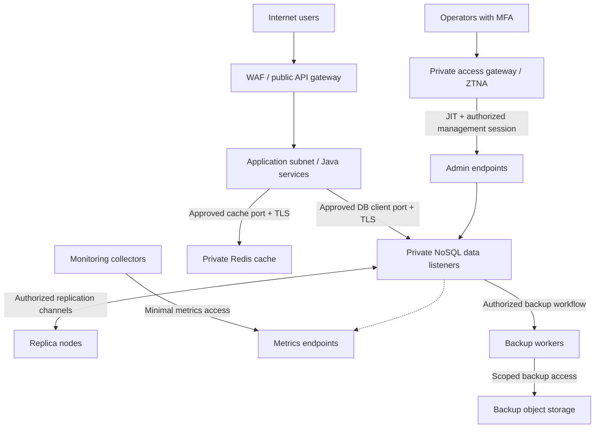

# Phân vùng mạng, điểm kết nối quản trị và giới hạn truy cập trong NoSQL

Một cụm NoSQL có xác thực người dùng, TLS và mật khẩu mạnh vẫn có thể gặp sự cố nghiêm trọng nếu các điểm kết nối dữ liệu hoặc quản trị được mở rộng quá mức. Cơ sở dữ liệu có thể bị truy cập từ Internet, từ một workload nội bộ không đáng tin, từ máy của nhân viên không còn nhiệm vụ quản trị, hoặc từ một môi trường thử nghiệm có kết nối trực tiếp đến production.

**Phân vùng mạng (network segmentation)** giúp giảm số nguồn có thể tiếp cận từng dịch vụ. **Bảo vệ điểm kết nối quản trị (management endpoints)** ngăn các thao tác nhạy cảm như thay đổi quyền, cấu hình cluster, xóa dữ liệu, thay đổi topology hoặc thực hiện backup/restore từ những đường truy cập thông thường. **Giới hạn truy cập (access restriction)** là chính sách nhiều lớp, phối hợp network, định danh, chứng thực, phân quyền, logging và quy trình vận hành.

Bài học thuộc chương **Bảo mật dữ liệu** của module **Database No SQL**. Nội dung tập trung vào cách xây dựng ranh giới an toàn giữa ứng dụng Java, các node NoSQL, hạ tầng cloud/Kubernetes, nhân sự vận hành và hệ thống tích hợp.

Sau bài này, bạn cần có thể:

- Liệt kê các **mặt phẳng kết nối**: ứng dụng, replication, quản trị, giám sát, sao lưu, điều khiển hạ tầng.
- Thiết kế chính sách **default deny + explicit allow** cho cả ingress và egress.
- Đọc và giải thích ma trận kết nối giữa subnet/VPC, namespace, workload, port và danh tính.
- Giới hạn truy cập tới **MongoDB, Cassandra, Redis, OpenSearch/Elasticsearch và NoSQL managed services** mà không làm hỏng replication, failover hoặc backup.
- Phân biệt **private endpoint** với **authentication**, **TLS** với **authorization**, **VPN** với **quyền quản trị**.
- Thiết kế đường truy cập admin có xác thực mạnh, **just-in-time access** và audit.
- Kiểm tra thay đổi firewall/NetworkPolicy trong quy trình triển khai, xử lý sự cố và disaster recovery.

> **Nguyên tắc trung tâm:** Một kết nối chỉ nên tồn tại khi có **tác nhân cụ thể**, **đích cụ thể**, **mục đích nghiệp vụ hợp lệ**, **quyền tối thiểu**, **thời hạn cần thiết** và **bằng chứng giám sát**. Việc hai hệ thống cùng ở “mạng nội bộ” không tự biến chúng thành đáng tin.

---

## 1. Mục tiêu của phân vùng mạng

Phân vùng mạng không phải chỉ để “chia subnet cho gọn”. Nó phục vụ ít nhất năm mục tiêu:

1. **Giảm attack surface:** Không công khai các socket và API không cần thiết.
2. **Giảm lateral movement:** Nếu một ứng dụng bị xâm nhập, nó không tự động được phép kết nối mọi database khác.
3. **Giảm blast radius:** Một secret bị lộ hoặc một container bị chiếm quyền chỉ ảnh hưởng các tài nguyên nằm trong phạm vi cho phép.
4. **Bảo vệ luồng đặc quyền:** Tách đường quản trị, replication và backup khỏi đường truy vấn của ứng dụng.
5. **Cung cấp tín hiệu kiểm toán:** Biết ai/cái gì được kết nối đến đâu, theo chính sách nào và vào thời điểm nào.

### 1.1. Bốn câu hỏi phải trả lời

Đối với mỗi luồng mạng:

- **Nguồn là ai?** Một ứng dụng Java, node replica, job backup, monitoring collector hay operator?
- **Đích là gì?** Listener truy vấn, inter-node port, management API, metrics exporter hay object storage?
- **Phạm vi nào được phép?** Tenant, môi trường, namespace, security group, workload identity?
- **Điều kiện gì?** TLS/mTLS, authentication, RBAC, firewall allow, JIT approval, time window?

### 1.2. Không đồng nghĩa với mã hóa

Firewall đúng giúp hạn chế người có thể **đến được** port. TLS bảo vệ kênh truyền; authentication xác định danh tính; RBAC/ACL xác định quyền hành động. Bốn lớp cần phối hợp, không thể thay thế lẫn nhau.

---

## 2. Một tình huống minh họa

Giả sử Rental App có hệ thống đặt xe:

```text
Booking API (Java)
    |
    v
MongoDB bookings
    |
    +----> Change stream / CDC worker
    |
    +----> Redis read cache
    |
    +----> OpenSearch availability index

Operations team
    |
    v
Secure admin access gateway
    |
    +----> DB administrative endpoints
```

API đặt xe cần đọc/ghi booking theo quyền; CDC worker đọc changes; monitoring cần metrics; đội vận hành đôi khi phải xem topology hoặc restore. **Không có lý do** để web frontend truy cập MongoDB trực tiếp, để một analytics job có quyền gọi admin API, hoặc để máy cá nhân kết nối mọi node production vĩnh viễn.

### 2.1. Mục tiêu phân tách

- Internet chỉ được tới reverse proxy/API gateway.
- Booking API chỉ kết nối những NoSQL endpoints đã định nghĩa.
- Database nodes chỉ nhận kết nối ứng dụng từ workload được phép.
- Các nodes trao đổi replication trên các đường riêng được cho phép.
- Administration chỉ đi qua gateway hoặc môi trường vận hành bảo vệ.
- Metrics/backup có quyền riêng, không tái sử dụng credential của API.
- Dev/staging không có đường mạng và quyền tự do tới production.

---

## 3. Sáu mặt phẳng mạng cần phân biệt

| Mặt phẳng | Lưu lượng | Ví dụ | Phương án bảo vệ |
| --- | --- | --- | --- |
| **Data plane** | Query và write của ứng dụng | Java → MongoDB/Cassandra | Private routing, TLS, app-specific role |
| **Replication plane** | Đồng bộ giữa các nodes | Replica ↔ replica | Node allowlist, inter-node authentication/TLS |
| **Management plane** | Cấu hình, khôi phục, thay đổi topology | Admin CLI/JMX/HTTP API | JIT access, MFA, RBAC, audit |
| **Control plane** | Điều khiển hạ tầng/database service | Cloud API, Kubernetes API | IAM, private/service endpoints nếu có |
| **Observability plane** | Metrics, traces, logs | Exporter → collector | Read-only auth, giới hạn mạng/PII |
| **Backup/restore plane** | Snapshot, archive, restore | DB node/job → backup store | Scoped credentials, encryption, isolation |

Một sản phẩm có thể dùng cùng một port vật lý cho nhiều thao tác. Vì vậy **tách mặt phẳng logic** không luôn đồng nghĩa **mỗi mặt phẳng có một port riêng**; đôi khi phải phân tách bằng database roles, API authorization và dedicated management identity.

### 3.1. Phân vùng theo rủi ro, không chỉ theo nhóm phát triển

Một microservice có tên “admin-service” không mặc nhiên được quyền làm admin database. Quyền cần dựa trên **operation thật sự**: đọc chỉ số, tạo user, reshard, backup, restore hay cập nhật schema.

---

## 4. Threat model tối thiểu

Xem những sự cố giả định:

1. Một container web có lỗi remote code execution.
2. Credentials của một integration bị lộ.
3. Một nhân viên dùng laptop nhiễm mã độc.
4. Một pod trong cùng cluster Kubernetes bị chiếm quyền.
5. Một database node bị lỗi và phải thay mới.
6. Một developer vô tình mở cổng NoSQL qua public load balancer.
7. Một metrics exporter để lộ chi tiết topology hoặc thông tin nhạy cảm.
8. Một backup job bị dùng để sao chép dữ liệu ra một storage bucket không được phép.

Với từng kịch bản cần trả lời: kẻ tấn công có thể kết nối **đích nào**, được xác thực bằng **danh tính nào**, thực hiện **quyền gì**, và **ai phát hiện**?

### 4.1. “Nội bộ” không phải trust boundary đủ mạnh

Một pod ở cùng VPC với database không có nghĩa pod đó được tin. Một NAT gateway hoặc VPN có thể khiến rất nhiều nguồn chia sẻ địa chỉ IP. Network location là một tín hiệu, không phải định danh và quyền.

### 4.2. Defense in depth

Một luồng nên được bảo vệ bằng nhiều lớp độc lập:

```text
Source workload identity
        |
    Egress policy
        |
     Private route
        |
    Ingress firewall
        |
       TLS/mTLS
        |
    Database auth
        |
    Role/permission
        |
 Audit / anomaly detection
```

Mỗi lớp có cách hỏng khác nhau; mục tiêu là hạn chế lỗi đơn lẻ biến thành toàn quyền.

---

## 5. Kiến trúc tham chiếu: tách lớp truy cập



Sơ đồ là **một mô hình tham chiếu**, không phải cấu hình mặc định của MongoDB, Cassandra hay Redis. Các port cụ thể và đường replication tùy công nghệ/triển khai.

### 5.1. Không đặt database sau public load balancer chỉ vì dễ kết nối

Public endpoint làm tăng nguy cơ bị dò quét, cấu hình sai và credential stuffing. Với phần lớn workload ứng dụng nội bộ, nên ưu tiên private networking cùng kiểm soát identity và access.

### 5.2. Không bắt dữ liệu replication đi qua cổng API công khai

Database cluster cần kênh node-to-node được quản lý. Khi mọi thứ đi qua public gateway/NAT, ta tăng attack surface, chi phí, độ trễ và phụ thuộc hạ tầng.

---

## 6. Network segmentation và microsegmentation

**Segmentation** chia hạ tầng thành những vùng có chính sách khác nhau, ví dụ:

```text
Public ingress zone
Application zone
Database/data zone
Operations/management zone
Backup zone
Monitoring zone
```

**Microsegmentation** áp chính sách nhỏ hơn cho từng service/workload/identity:

```text
booking-api  --> bookings-mongodb : query/write
search-sync  --> bookings-mongodb : read/CDC
search-sync  --> search-index    : index update
reporting    --> reporting-store : read
frontend     -X-> bookings-mongodb
reporting    -X-> admin-endpoints
```

`-X->` nghĩa là đường không được phép.

### 6.1. Tại sao mạng riêng chưa đủ?

Trong một mạng phẳng, một service có thể gửi lưu lượng tới nhiều databases mà không qua policy layer. Khi service đó bị xâm nhập, attacker được thừa hưởng phạm vi kết nối rộng.

### 6.2. Tránh mạng quá phân mảnh nhưng không có ownership

Hàng trăm firewall rules không được quản lý có thể gây lỗi deploy và làm admin mở dần quyền cho “dễ vận hành”. Cần owner, template, review và tests cho từng rule.

---

## 7. Mô hình zero-trust trong môi trường NoSQL

Zero Trust không đồng nghĩa phải mua một sản phẩm cụ thể. Đây là cách thiết kế:

- Không mặc định tin cậy chỉ vì nguồn ở cùng subnet/VPC.
- Xác thực từng workload/operator.
- Cấp quyền tối thiểu theo ứng dụng và thao tác.
- Đánh giá ngữ cảnh truy cập, thời gian và mức độ nhạy cảm.
- Giám sát và thu hồi quyền.
- Giảm khả năng truy cập ngang giữa các workloads.

### 7.1. “Đã kết nối VPN” không có nghĩa “được dùng mọi lệnh”

VPN đưa laptop vào một đường mạng. Nó không tự cấp quyền `DROP`, `FLUSHALL`, đổi cấu hình auth hoặc đọc collection nhạy cảm.

### 7.2. “Có TLS” không chứng minh client được phép

TLS một chiều có thể chỉ xác thực server. Cần database authentication và authorization; mTLS nếu phù hợp giúp xác thực certificate client nhưng vẫn cần mapping identity → role.

---

## 8. Default deny: nền tảng của chính sách mạng

Nguyên tắc an toàn:

```text
DENY all connections by default
ALLOW only documented communication paths
```

Cần áp cho **ingress** và **egress**.

**Ingress:** Ai được kết nối tới listener NoSQL?

**Egress:** Workload NoSQL/API/backup được phép kết nối ra đâu?

### 8.1. Tại sao egress quan trọng?

Nếu một service bị chiếm quyền, outbound access không kiểm soát có thể giúp kết nối tới dịch vụ khác hoặc đưa dữ liệu ra nơi ngoài chính sách.

### 8.2. Egress không thể “chặn tất cả” một cách mù

Một NoSQL node có thể cần:

- DNS, time synchronization và các dependency nội bộ.
- Kênh replication tới peers.
- Kết nối KMS hoặc dịch vụ quản lý khóa.
- Hệ metrics/logging, nếu dùng push.
- Backup destination đã phê duyệt.
- Cloud/service control plane theo loại managed service.
- Các endpoint cập nhật/chứng chỉ theo chính sách vận hành.

Phải **lập inventory trước khi bật deny egress**, rồi kiểm thử failover và maintenance.

### 8.3. Deny mặc định phải có quy trình ngoại lệ

Mọi đường allow nên có purpose, owner, expiry hoặc review date, nguồn và đích xác định. Không tạo rule mở vĩnh viễn chỉ để xử lý một sự cố ngắn hạn.

---

## 9. Stateful firewall, security group và network ACL

Ba cơ chế thường gặp:

1. **Security group / workload firewall:** áp chính sách ở mức instance/ENI/service identity tùy nền tảng, thường stateful.
2. **Network ACL/subnet firewall:** lọc lưu lượng ở ranh giới subnet, có thể stateless tùy cloud.
3. **Host firewall:** áp quy tắc trên node/VM/container host.

### 9.1. Stateful không phải là không có egress

Stateful firewall thường cho reply traffic của một connection đã được phép mà không phải viết rule response đối xứng. Nhưng kết nối **mới do workload khởi tạo** vẫn cần egress policy phù hợp.

### 9.2. Stateless cần chú ý return path

Khi dùng stateless ACL, phải xét cả request và response, bao gồm ephemeral source/destination ports theo kiến trúc mạng. Nếu chỉ allow đúng cổng DB theo một chiều, kết nối có thể thất bại.

### 9.3. Dùng nhiều lớp nhưng tránh phụ thuộc vào “một lớp thần kỳ”

Network ACL có thể bảo vệ subnet; security group giới hạn từng app; host firewall bảo vệ process. Lớp nào là tuyến chính cần được xác định theo topology và khả năng quản lý.

---

## 10. VPC, subnet và private routing

Một bố trí phổ biến:

```text
VPC production
  |
  +-- public subnets:
  |     ingress / controlled edge
  |
  +-- application private subnets:
  |     Java services
  |
  +-- data private subnets:
  |     NoSQL nodes
  |
  +-- operations private subnets:
        admin gateway, monitoring, backup
```

### 10.1. Private subnet là điều kiện cần, chưa đủ

Không có route tới Internet gateway không đồng nghĩa mọi workload nội bộ bị hạn chế. Cần security groups/firewall, identity và database ACL.

### 10.2. Private IP không tự chống truy cập chéo

Một VPC có thể chứa hàng trăm services. Nếu tất cả được phép kết nối data subnet, khả năng lateral movement vẫn lớn.

### 10.3. Chọn đường kết nối cụ thể

Có thể dùng private endpoint, VPC endpoint, private service connect, VNet private link hay private routing tương ứng tùy provider và sản phẩm. Chỉ định **đúng service + vùng + DNS + identity**, tránh cho rằng tên gọi giống nhau thì semantics giống nhau.

---

## 11. Private endpoint và public endpoint

**Private endpoint** thường giúp truy cập dịch vụ qua kết nối mạng riêng mà không dùng public Internet endpoint như đường truy cập chính.

Nó giúp:

- Thu hẹp bề mặt mạng.
- Kiểm soát đường đi, DNS và routing.
- Hạn chế một số tình huống cấu hình sai firewall Internet.
- Phù hợp các chính sách data residency/egress.

Nhưng không tự bảo đảm:

- Database authentication.
- Quyền đọc/ghi của từng service.
- Mã hóa end-to-end nếu cấu hình TLS sai.
- Chống lộ credentials.
- Tách tenant ở mức hàng/document.
- Endpoint luôn sẵn trong mọi AZ/failover nếu topology chưa thiết kế.

### 11.1. Không mặc định private endpoint đồng nghĩa private DNS hoạt động đúng

Client có thể vẫn resolve hostname sang public IP nếu DNS/conditional forwarding cấu hình sai. Cần kiểm tra thực tế từ workload.

### 11.2. Nhiều managed services có control plane riêng

Data API có thể nằm ở private network, nhưng tạo user, đổi cluster hoặc backup vẫn diễn ra qua cloud management API. Phải quản lý IAM của control plane độc lập.

---

## 12. DNS cũng là một thành phần bảo mật

Khi ứng dụng dùng hostname `bookings-db.internal`, DNS quyết định kết nối đi tới địa chỉ nào.

Các rủi ro:

- Hostname trỏ nhầm public IP.
- Split-horizon DNS sai giữa dev và prod.
- Internal DNS zone bị chỉnh sửa không kiểm soát.
- Resolver không được cho phép qua egress policy.
- TTL hoặc caching làm chuyển đổi failover chậm.
- Khi đổi replica set hostnames, client không resolve được peers.

### 12.1. DNS không thay xác thực server

Một DNS record đúng theo kỳ vọng vẫn có thể bị thao túng ở nơi khác. Client phải kiểm tra TLS certificate/hostname và credential theo policy.

### 12.2. Kiểm tra từ đúng nguồn

Chạy kiểm tra name resolution từ **application pod/VM** và **management gateway** trong môi trường được phép, không chỉ từ laptop vận hành.

### 12.3. Không cố định IP khi service có endpoint động

Managed databases, failover và private endpoints có thể đổi địa chỉ. Dùng provider-supported DNS/service identity và cập nhật allowlist theo quy trình; không khóa một IP đến mức làm failover thất bại.

---

## 13. IPv4 và IPv6: tránh đường bỏ sót

Một firewall rule chỉ hạn chế IPv4 không bảo đảm workload không có đường IPv6 khác.

Cần đánh giá:

- Listener có bind trên `0.0.0.0`, địa chỉ private cụ thể hay `::`?
- Host/network policy áp dụng IPv6 đầy đủ không?
- Route và DNS trả bản ghi A/AAAA nào?
- Cloud security groups/ACL có rule riêng cho IPv6?
- Traffic qua load balancer/proxy dùng địa chỉ nào ở từng hop?

### 13.1. Cẩn trọng với wildcard bind

`0.0.0.0` thường nghĩa lắng nghe mọi giao diện IPv4 của host; `::` có thể nghe trên IPv6 và tùy OS/socket configuration có thể có dual-stack behavior. Không tự kết luận chỉ vì firewall IPv4 đã đóng thì IPv6 cũng đã đóng.

### 13.2. Xác minh ở các tầng

Listener, route, firewall, load balancer, DNS và host policy đều cần được đối chiếu.

---

## 14. TLS và mTLS giữa ứng dụng với NoSQL

**TLS** giúp mã hóa dữ liệu trên đường truyền và thường xác thực server qua certificate.

**mTLS** thêm việc xác thực certificate của client, hữu ích cho workload-to-workload hoặc node-to-node communication khi engine/topology hỗ trợ.

### 14.1. Những cấu hình phải đúng

- Chỉ dùng protocol/cipher suites được phê duyệt.
- Client xác minh chain of trust và hostname/identity của server.
- Không `trustAll` hoặc tắt certificate verification.
- Chứng chỉ có vòng đời, gia hạn và thu hồi.
- Private keys được giữ trong secret store/hardware-backed service khi phù hợp.
- TLS hoạt động cho cả data plane và replication/management channels khi yêu cầu.

### 14.2. Mã hóa không giải quyết quyền truy cập

Một client có kết nối TLS thành công vẫn phải được xác thực và chỉ có quyền dữ liệu cần thiết. Nếu toàn bộ ứng dụng dùng chung admin account, TLS không hạn chế thao tác.

### 14.3. Termination point

Nếu TLS kết thúc tại proxy/gateway rồi proxy kết nối plaintext tới database, phải đánh giá mức tin cậy của hop sau. Không mô tả đường truyền là “mTLS end-to-end” nếu chỉ mã hóa từng đoạn không có identity continuity theo thiết kế.

---

## 15. Authentication, authorization và network policy

Một request tới database nên đi qua ba quyết định riêng:

1. **Network admission:** nguồn có được kết nối tới listener?
2. **Authentication:** nguồn là workload/user nào?
3. **Authorization:** danh tính đó được làm thao tác gì trên dữ liệu nào?

| Lớp | Câu hỏi | Cơ chế minh họa |
| --- | --- | --- |
| Network | Có được tạo kết nối TCP/TLS không? | SG/ACL/NetworkPolicy |
| Identity | Đây là app hoặc operator nào? | X.509/SCRAM/OIDC/IAM/cert tùy sản phẩm |
| Permission | Có được đọc/ghi/đổi cấu hình không? | DB roles, resource policies |
| Audit | Điều gì đã xảy ra? | Access/command/audit logs |

### 15.1. Không dùng một admin credential cho API

Dịch vụ đặt xe thường chỉ cần quyền CRUD có phạm vi; không cần tạo users, drop database, thay replication hoặc restore.

### 15.2. Mô hình least privilege phải đi sâu vào resource

Nếu engine hỗ trợ, giới hạn theo database, collection, keyspace, table, index, command hoặc tenant scope. Với kiểm soát quyền theo tenant mà database không tự cung cấp, ứng dụng phải thực thi và kiểm thử.

---

# Phần II — Điểm kết nối quản trị và đường truy cập đặc quyền

## 16. Điểm kết nối quản trị là gì?

Những thành phần cần được xem là management endpoints gồm:

- Database admin commands trong CLI/driver.
- HTTP management APIs.
- JMX/management agent hoặc node status endpoints.
- Cluster reconfiguration, resharding, failover APIs.
- User/role/key/certificate management.
- Backup/restore và snapshot APIs.
- Monitoring endpoints lộ topology/configuration.
- Shell/SSH vào host/container dữ liệu.
- Kubernetes API, container runtime và cloud control plane.
- Web-based admin dashboards.

**Một số thao tác admin dùng cùng cổng dữ liệu**; không được nghĩ “không thấy port admin” là không có khả năng quản trị.

### 16.1. Management endpoint thường có quyền rất rộng

Một lệnh sai có thể xóa toàn bộ keyspace, đổi consistency, thay topology hoặc ảnh hưởng mọi tenants. Vì vậy đường quản trị cần **mạnh hơn kết nối ứng dụng** về identity, approval và audit.

---

## 17. Nguyên tắc admin access: không mở vĩnh viễn

Một chính sách điển hình:

```text
Operator identity with MFA
          |
          v
Access request and approval
          |
          v
Short-lived authorization (JIT)
          |
          v
Audited secure access gateway
          |
          v
Approved target + operation
```

### 17.1. Just-in-time (JIT)

Quyền quản trị chỉ được cấp trong thời gian cần thiết, tự hết hạn sau khi hoàn thành công việc. Tránh VPN/firewall/DB admin role luôn mở 24/7 cho mọi thành viên.

### 17.2. Just-enough-access (JEA)

Quyền cấp vừa đủ tác vụ: xem status, chạy backup, đổi index hoặc restore một collection — thay vì full superuser cho mọi việc.

### 17.3. Break-glass

Khi SSO/identity provider hỏng, cần cơ chế khẩn cấp đã chuẩn bị, bảo vệ và ghi log riêng. Nó không phải lý do để giữ một mật khẩu root chung trong tài liệu wiki.

---

## 18. Bastion host, access proxy, VPN và ZTNA

Các phương thức có thể dùng:

- **Bastion/jump host:** điểm trung gian được quản lý để truy cập mạng quản trị.
- **Identity-aware proxy / ZTNA:** cho phép một danh tính truy cập một ứng dụng/đích cụ thể theo policy.
- **VPN:** cung cấp đường mạng bảo vệ; vẫn phải hạn chế firewall và database roles.
- **Session manager qua cloud control plane:** truy cập host mà không nhất thiết mở SSH Internet, nếu provider hỗ trợ.
- **Ephemeral admin job/pod:** chạy tác vụ có kiểm soát trong vùng quản trị, với secret/role ngắn hạn.

### 18.1. Bastion không phải magic shield

Nếu bastion lưu credentials lâu dài, dùng chung account hoặc cho phép đi tiếp tới mọi subnet, nó trở thành điểm tập trung rủi ro.

### 18.2. Tránh “mở 0.0.0.0/0 trong 30 phút”

Quy tắc tạm nhưng quá rộng có thể bị quên hoặc bị khai thác trong cửa sổ mở. Dùng scoped access gateway/JIT rule theo identity/đích/thời hạn.

### 18.3. Session recording

Có thể ghi metadata, lệnh/operations phù hợp và approval ticket. Cần che thông tin nhạy cảm và tuân thủ quyền riêng tư/retention.

---

## 19. Admin CLI có thể nguy hiểm dù chỉ một cổng

Một số lệnh NoSQL có mức ảnh hưởng lớn:

| Hệ | Ví dụ nhóm thao tác đặc quyền | Rủi ro |
| --- | --- | --- |
| MongoDB | Drop, quản lý users/roles, cấu hình replica set | Mất dữ liệu, thay quyền, gián đoạn |
| Cassandra | Schema/keyspace changes, node maintenance/JMX | Mất sẵn sàng, repair/compaction pressure |
| Redis | ACL/CONFIG, flush, replication/cluster commands | Xóa dữ liệu cache hoặc thay cấu hình an ninh |
| OpenSearch/Elasticsearch | Cluster settings, snapshots, index delete, security roles | Thay routing, mất index hoặc lộ dữ liệu |
| Managed NoSQL | Update table/network/IAM/backup policies | Thay quyền service và môi trường |

Không coi CLI `mongosh`, `cqlsh`, `redis-cli` hoặc REST admin API là “chỉ là cách kết nối khác”. Chúng có thể mở ra những commands mà ứng dụng không bao giờ cần.

### 19.1. Không dựa vào tên binary để cấp quyền

Một chương trình bất kỳ có thể gửi cùng protocol request như CLI. Phải enforce ở network/database authorization, không chỉ cho “lệnh chính thức” quyền.

---

## 20. Bảo vệ quyền điều khiển infrastructure

Database managed services thường có hai vùng:

**Data plane:** ứng dụng thực hiện operations trên records.

**Control plane:** cloud API tạo/xóa cluster, thay network settings, bật public access, tạo backup/export, rotate credentials hoặc đổi IAM policies.

### 20.1. Cần hai bộ quyền

Một service account đọc DynamoDB items không cần IAM quyền xóa table hoặc sửa VPC. Một operator thay throughput không nhất thiết cần đọc mọi item.

### 20.2. Console UI không phải tuyến bảo vệ duy nhất

Người có API credentials có thể gọi control plane trực tiếp. MFA, IAM boundaries, approval/audit và resource policies phải được thực thi ở cloud platform.

### 20.3. Restrict automation credentials

CI/CD chỉ nên quản lý những database resources trong scope deploy của nó. Một token infrastructure-as-code có quyền toàn tổ chức làm tăng hậu quả khi pipeline bị xâm nhập.

---

## 21. Bảo vệ JMX, admin HTTP, exporter và debug interfaces

Một số nền tảng có cổng/endpoint quản trị hoặc introspection chuyên dụng. Chúng có thể cung cấp:

- Node topology và phiên bản phần mềm.
- Connection/account metadata.
- Heap dump, profiling và process management.
- Runtime configuration.
- Metrics chi tiết.
- Thao tác maintenance khi quyền cho phép.

### 21.1. Metrics không tự là dữ liệu công khai

Metrics endpoint có thể lộ instance IDs, collection names, tenant identifiers, topology, version hoặc lỗi bảo mật. Giới hạn nguồn scraper và bảo vệ auth/TLS theo rủi ro.

### 21.2. JMX và remote management

JMX có thể sử dụng các cổng/đường kết nối phụ và cơ chế authentication riêng. Không mở chỉ “một port JMX” ra toàn mạng rồi cho rằng đã an toàn. Ưu tiên local agent hoặc kênh quản trị bảo vệ theo cấu hình sản phẩm.

### 21.3. Debug endpoint tạm

Một endpoint debug được bật trong incident phải có expiry, logging và bước tắt sau khi hoàn tất; không để thường trực trên public interface.

---

## 22. Port được phép: ví dụ, không phải công thức bất biến

Một số **cổng mặc định phổ biến**:

| Công nghệ | Port dữ liệu thường thấy | Ghi chú |
| --- | --- | --- |
| MongoDB | TCP 27017 | Có thể đổi theo topology, proxy, TLS; admin commands có thể cùng port |
| Cassandra CQL native transport | TCP 9042 | Inter-node/JMX có kênh khác; xác minh version/config |
| Redis | TCP 6379 | Có thể dùng TLS port khác; Redis Cluster còn bus communication |
| Elasticsearch/OpenSearch REST | TCP 9200 | HTTP API có cả truy vấn và quản trị; inter-node transport riêng |
| Neo4j Bolt | TCP 7687 | HTTP/admin interfaces khác theo cấu hình |
| Couchbase | Nhiều ports theo service | Xem tài liệu port matrix của deployment/version |
| Managed NoSQL | Provider endpoint/API | Không suy một port cố định trong mọi VPC |

**Các port chỉ là ví dụ cho việc xây ma trận.** Cấu hình TLS, cluster bus, replication, monitoring, proxies và phiên bản có thể thay đổi chúng.

### 22.1. Không mở cả dải 0–65535 cho “database hoạt động”

Nếu deployment cần nhiều cổng, liệt kê rõ **mục đích từng cổng, node peers, directions và authority**.

### 22.2. Cổng query không nhất thiết là cổng chỉ đọc

Một ứng dụng có kết nối tới 27017 hoặc 9200 có thể gửi operations quản trị nếu credentials có quyền. Vì vậy **network + database RBAC** cần đi cùng.

---

## 23. Ma trận kết nối: một tài liệu bắt buộc

Ví dụ cho cluster NoSQL nội bộ:

| Source identity/zone | Destination | Operation | Network scope | Permission | Owner |
| --- | --- | --- | --- | --- | --- |
| `booking-api` | MongoDB query listener | Read/write bookings | Private application → data | Scoped app role | Booking team |
| `booking-cdc` | MongoDB change stream | Consume committed changes | Private worker → data | Read/change-stream rights | Integration team |
| `mongo-node` | Replica peers | Replication/heartbeat | Data node ↔ data node | Node identity | Data platform |
| `ops-gateway` | DB admin listener | Maintenance | Approved management path | JIT admin role | SRE/DBA |
| `metrics-agent` | Exporter/metrics | Observe | Monitoring subnet | Read-only metrics | Observability |
| `backup-job` | Backup destination | Store encrypted snapshots | Backup egress only | Scoped object write | DR owner |
| `frontend` | MongoDB | None | DENY | None | Security |
| `staging-api` | Production MongoDB | None | DENY | None | Platform |

Đây là **bảng thiết kế**, không phải firewall đã tự được áp dụng.

### 23.1. Owner và expiry

Mỗi allow rule phải có owner và khi nào review. Nếu không biết vì sao một rule tồn tại, đó là tín hiệu cần điều tra chứ không phải lý do mở thêm quyền.

### 23.2. Chú ý return traffic, DNS và discovery

Ma trận cần phản ánh cả những dependency thực: application resolve DNS, node tự phát hiện peers, managed DB có nhiều endpoints sau failover.

---

# Phần III — Kubernetes, containers và microservices

## 24. Kubernetes NetworkPolicy: tác dụng và phạm vi

Kubernetes `NetworkPolicy` mô tả traffic được phép tới/từ các Pods khi **CNI/network plugin thực thi NetworkPolicy**.

Nó có thể chọn:

- Pods đích theo `podSelector`.
- Sources theo `podSelector`, `namespaceSelector` hoặc IP blocks.
- Ports/protocols được cho phép.
- Policy types: `Ingress`, `Egress`.

### 24.1. Quy tắc rất quan trọng

`NetworkPolicy` không tự bảo vệ nếu CNI không hỗ trợ/enforce nó. Pod không được chọn bởi một deny/selecting policy có thể vẫn được nhận traffic theo mặc định. Policies thường có semantics **allow additive**: thêm một policy có rule rộng có thể mở thêm truy cập.

### 24.2. NetworkPolicy không phải firewall toàn bộ cloud

Nó không thay VPC security groups, host firewall, node-management protections, cloud IAM và database authorization. Managed database ngoài cluster cần policy tại mạng đích.

---

## 25. Kubernetes: default deny ingress và egress

Ví dụ đặt trong namespace `data`:

```yaml
apiVersion: networking.k8s.io/v1
kind: NetworkPolicy
metadata:
  name: default-deny-all
  namespace: data
spec:
  podSelector: {}
  policyTypes:
    - Ingress
    - Egress
```

Policy chọn toàn bộ Pods trong namespace `data` và không khai báo allow rules. Với CNI thực thi đúng, các Pods được chọn sẽ bị hạn chế **các kết nối đến và đi** theo semantics NetworkPolicy.

### 25.1. Tác dụng phụ cần biết

Nếu áp dụng trực tiếp lên một cụm database đang chạy, có thể cắt:

- Replication và heartbeat.
- DNS/resolver.
- KMS/backup.
- Monitoring/logging.
- Operator control loops.
- Kubernetes service discovery.

Vì thế đây là **mẫu policy để học**, không phải lệnh khuyến khích apply ngay vào production.

### 25.2. Bổ sung allow theo từng luồng

Default deny cần đi cùng các policies cho application traffic, node-to-node và những dependencies đã lập inventory. Đừng sửa bằng một allow-all để “chữa nhanh”.

---

## 26. Kubernetes: cho phép riêng Booking API kết nối MongoDB

Giả định:

- MongoDB Pods nằm trong namespace `data`, label `app: mongodb`.
- Booking API Pods nằm trong namespace `app`, label `app: booking-api`.
- CNI có NetworkPolicy enforcement.
- MongoDB client listener ở TCP 27017.
- Chính sách đã được thiết kế cùng những rules bổ sung cho replication/DNS/backup.

```yaml
apiVersion: networking.k8s.io/v1
kind: NetworkPolicy
metadata:
  name: allow-booking-api-to-mongodb
  namespace: data
spec:
  podSelector:
    matchLabels:
      app: mongodb
  policyTypes:
    - Ingress
  ingress:
    - from:
        - namespaceSelector:
            matchLabels:
              kubernetes.io/metadata.name: app
          podSelector:
            matchLabels:
              app: booking-api
      ports:
        - protocol: TCP
          port: 27017
```

### 26.1. Vì sao cùng một mục `from` có hai selectors?

Ở đây, `namespaceSelector` và `podSelector` **đồng thời phải khớp** trong cùng một peer. Nghĩa là chỉ chọn Pods `app=booking-api` trong namespace `app`.

Nếu tách thành hai peer list items khác nhau, ý nghĩa có thể trở thành **OR**, mở rộng nguồn không mong muốn.

### 26.2. Đây chỉ là ingress ở DB

Nếu Booking API Pods bị egress-isolated, cần một **egress allow rule** từ app namespace đến DB theo policy thực tế. Không được giả rằng DB ingress allow sẽ tự mở ứng dụng egress.

### 26.3. Những gì ví dụ chưa làm

- Không có MongoDB node-to-node replication policy.
- Không có DNS/KMS/backup/monitoring policy.
- Không có TLS/auth/RBAC.
- Không quản trị pod label trust; ai có quyền gán label có thể ảnh hưởng policy.
- Không kiểm tra `hostNetwork`, NodePort, ingress proxies hoặc các đặc tính CNI khác.

---

## 27. Kubernetes: egress từ ứng dụng

Giả sử app namespace cũng dùng default-deny egress; ta cần cho Booking API gửi traffic tới MongoDB trong namespace `data`.

```yaml
apiVersion: networking.k8s.io/v1
kind: NetworkPolicy
metadata:
  name: allow-booking-api-egress-db
  namespace: app
spec:
  podSelector:
    matchLabels:
      app: booking-api
  policyTypes:
    - Egress
  egress:
    - to:
        - namespaceSelector:
            matchLabels:
              kubernetes.io/metadata.name: data
          podSelector:
            matchLabels:
              app: mongodb
      ports:
        - protocol: TCP
          port: 27017
```

### 27.1. DNS không tự nằm trong rule này

Nếu ứng dụng dùng DNS để resolve Service/host, cần policy cho DNS đến đúng resolver endpoints, ví dụ CoreDNS theo namespace/labels/ports thực tế. Không copy một DNS allow mẫu không kiểm tra vị trí của DNS Pods.

### 27.2. Egress tới managed DB ngoài cluster

`podSelector` không chọn một managed database ngoài Kubernetes. Lúc đó dùng VPC routes/security groups, CNI egress policies, gateway/egress proxy hoặc IP/CIDR rules có quản trị theo khả năng nền tảng.

### 27.3. NAT và Service IP

NetworkPolicy implementation có thể xử lý policy trước/sau NAT khác nhau. Kiểm thử kết nối **từ Pod thật** tới Service và endpoint thực, không chỉ nhìn YAML.

---

## 28. Kubernetes: replication và operator phải có đường riêng

Một StatefulSet Cassandra/MongoDB không chỉ nhận client queries. Các pods có thể phải:

- Kết nối peers để replication và cluster membership.
- Trao đổi heartbeat/election.
- Resolve peer DNS qua headless Services.
- Nhận probes hoặc operator operations.
- Gửi/nhận backup data.

### 28.1. Không mở replication ports cho mọi app

Replication thường chỉ cần giữa **những node identities** của cùng cluster hoặc các cụm được cho phép. Nếu cần cross-AZ/region, network policy phải bao trùm failure-domain routing nhưng không thành mở toàn VPC.

### 28.2. Liveness/readiness probes

Probes có thể xuất phát từ node/kubelet và chịu network policy semantics khác nhau theo CNI. Trước khi áp deny, đo đường thực tế thay vì giả mọi probes là Pod-to-Pod.

### 28.3. Operator service account

Kubernetes operator quản lý cluster thường cần API permissions. NetworkPolicy không thay RBAC của Kubernetes API hoặc DB admin role operator sử dụng.

---

## 29. Service mesh, sidecar và giới hạn của chúng

Service mesh có thể cung cấp:

- Workload identity.
- mTLS giữa các services được quản lý.
- Traffic policy, retries, observability.
- Authorization policy ở proxy theo khả năng sản phẩm.

Tuy nhiên:

- Không phải mọi NoSQL binary protocol được mesh hỗ trợ tương đương HTTP.
- Node-to-node replication có thể có đường riêng.
- Sidecar không tự bảo vệ host-level/JMX/private management interface.
- Policy có thể bị bypass qua traffic ngoài mesh nếu không chặn ở network.
- Retry tự động của mesh có thể gây vấn đề với writes không idempotent.

### 29.1. Identity của mesh và DB role

Một service được mesh xác thực là Booking API vẫn cần database credentials/roles tương ứng. mTLS không tự biến thành quyền truy cập collection.

---

## 30. Containers, local development và Docker ports

Trong môi trường lab, một cấu hình như:

```yaml
services:
  mongo:
    image: mongo
    ports:
      - "27017:27017"
```

có thể publish container port ra host theo cơ chế của Docker/network platform. Không nên copy nguyên mẫu này sang máy có thể truy cập từ mạng rộng mà không biết host bind semantics.

### 30.1. Local-only binding trong lab

Một số môi trường có thể giới hạn host listener vào loopback:

```yaml
ports:
  - "127.0.0.1:27017:27017"
```

Đây chỉ là ví dụ **local development**; vẫn cần xác nhận Docker/OS/network configuration. Loopback trên host không đồng nghĩa container bên trong được cấu hình authorization/TLS.

### 30.2. Production

Ưu tiên service-to-service private networking, không publish database port ra host/public network nếu không cần. Việc expose được quản lý bằng network policy và deployment architecture.

### 30.3. Không coi Docker network name là security boundary duy nhất

Các container cùng mạng có thể kết nối theo khả năng network. Cần service identities, credentials và quyền riêng.

---

# Phần IV — Các đặc thù của NoSQL

## 31. MongoDB: kết nối dữ liệu và quản trị

MongoDB có client listener được dùng bởi ứng dụng và các công cụ như `mongosh`. Nhiều administrative commands có thể đi qua cùng protocol listener.

### 31.1. Các lớp cần có

- Bind interfaces và private networking phù hợp.
- TLS theo policy, certificate validation.
- Authentication được bật và quản lý đúng.
- Users/roles tách app, CDC, backup và DBA.
- Network allowlist chỉ các sources hợp lệ.
- Replica set/shard node links theo topology, được bảo vệ.
- Audit và command visibility khi sản phẩm/phiên bản hỗ trợ.

### 31.2. Không chỉ đóng một cổng “admin”

Nếu admin command dùng cùng listener với `find()`, cần **database RBAC** để app account không thể `dropDatabase` hoặc đổi users.

### 31.3. Change streams

CDC service cần quyền đọc change stream và đường mạng tương ứng, nhưng không nhất thiết có quyền quản trị toàn DB. Quyền cụ thể phụ thuộc deployment, database và collection watch scope.

### 31.4. MongoDB sharded cluster

Có thể có routers, config servers và shard replica sets với luồng nội bộ. Firewall phải dựa trên **port matrix/topology của deployment thực**, không áp sơ đồ standalone MongoDB lên sharded cluster.

---

## 32. Cassandra: CQL, inter-node và JMX

Cassandra thường có những luồng tách biệt về mục đích:

- CQL client transport (ví dụ TCP 9042 trong nhiều cấu hình).
- Node-to-node communication/replication.
- Management/monitoring như JMX hoặc agent/exporter.
- Backup/repair/streaming theo topology.

### 32.1. CQL listener

Chỉ app clients được phép truy cập CQL. Mỗi service có database identity/roles phù hợp với keyspaces/tables cần thiết; TLS/authentication phải được bật theo policy.

### 32.2. Inter-node không phải client access

Không mở inter-node ports cho mọi application workloads. Peers/seed nodes và DC topology cần được cho phép và xác thực, bao gồm đường phục hồi khi thay node.

### 32.3. JMX và `nodetool`

Nhiều tác vụ bảo trì dùng management interfaces/agents. Những đường này thường có nhiều quyền, vì vậy chỉ từ management zone, với auth và kênh bảo vệ. Remote JMX có thể yêu cầu cấu hình liên quan đến nhiều sockets/ports; kiểm tra phiên bản thực.

### 32.4. Lưu ý multi-DC

Nếu Cassandra trải nhiều datacenters, phải có đường internode phù hợp giữa DCs theo topology nhưng tránh mở rộng vô kiểm soát. Test replication/repair/failover trước rollout firewall.

---

## 33. Redis: dữ liệu, Cluster bus và quyền quản trị

Redis cơ bản có data listener, trong khi Redis Cluster còn có kênh liên lạc giữa các nodes theo cơ chế cluster bus. Các cổng cụ thể phụ thuộc cấu hình/version.

### 33.1. Đừng coi `GET` và `CONFIG` có cùng mức rủi ro

App đọc cache có thể cần `GET`/một số lệnh write; không nên có quyền `CONFIG`, `ACL`, `FLUSHALL` hay cluster management không cần thiết.

Redis ACL/command/key pattern policies (nếu bản triển khai hỗ trợ) có thể giúp giới hạn lệnh/keyspaces theo identity.

### 33.2. Protected mode không thay production security

Một cơ chế bảo vệ mặc định hữu ích không miễn cấu hình bind, TLS, network rules và authentication/ACL.

### 33.3. Cache không mặc định là dữ liệu công khai

Redis có thể chứa user sessions, tokens, PII hoặc pricing. Một cache bị lộ network cũng có thể gây hậu quả nghiêm trọng tương đương database.

### 33.4. Replica reads

Nếu dùng replica để chia tải, phải thiết kế quyền client, network route và freshness contract. Không mở inter-node bus cho API chỉ vì API đọc replicas.

---

## 34. OpenSearch/Elasticsearch: HTTP API và quản trị

Một REST endpoint search có thể phục vụ **truy vấn** và nhiều **administrative APIs**.

Điều này dẫn tới hai yêu cầu đồng thời:

1. Network chỉ cho các services/management gateways cần kết nối.
2. API-level roles/security policies chỉ cho phép đúng index và actions.

### 34.1. Read search role khác cluster admin

Một ứng dụng tìm xe chỉ cần truy vấn index được phép, không cần thay cluster settings, snapshot repository hoặc xóa index.

### 34.2. Transport giữa search nodes

Search cluster có các luồng node-to-node riêng. Chúng chỉ nên được phép giữa đúng peers theo topology; không expose ra public edge.

### 34.3. Dashboard UI

OpenSearch Dashboards/Kibana hoặc công cụ tương tự có thể cho người dùng xem query/log/topology. Cần SSO/MFA/RBAC, network access và audit thích hợp, không được coi “dashboard chỉ để xem” là an toàn tuyệt đối.

### 34.4. Snapshot repository

Quyền snapshot/export có thể đưa toàn bộ index data ra object store. Phải kiểm soát destination, IAM, encryption và restore privileges.

---

## 35. DynamoDB và managed NoSQL: service endpoint không đủ

Với dịch vụ NoSQL được quản lý, nhiều thao tác đi qua provider API, không phải TCP listener trên VM do doanh nghiệp tự cấu hình.

### 35.1. Các lớp chính

- Service endpoint/private route khi provider hỗ trợ.
- IAM/workload identity.
- Resource policies hoặc service-specific permissions.
- TLS cho API transport.
- Access logging/audit.
- Network egress policies của ứng dụng.
- KMS/encryption/backup privileges tách biệt.

### 35.2. Private service endpoint không thay IAM

Một request qua private route với credential có quyền quá rộng vẫn nguy hiểm. Ngược lại IAM đúng không làm việc mở egress tới mọi nơi trở nên không có rủi ro.

### 35.3. IAM resource restrictions

Một ứng dụng đọc một bảng/index không nhất thiết cần quyền list/delete mọi table trong account. Quyền thực tế phải theo resource/operation và condition keys mà provider hỗ trợ.

### 35.4. Export và backups

Một identity được phép export toàn bảng có nguy cơ data exfiltration lớn hơn identity chỉ đọc một nhóm items. Cần giới hạn bucket, encryption key và nơi dữ liệu được sao chép.

---

## 36. Neo4j, Couchbase và những NoSQL khác

Không phải mọi NoSQL có cùng topology:

- Neo4j có Bolt/client endpoint và một số admin/cluster channels tùy edition/topology.
- Couchbase có nhiều dịch vụ (data, query, index, search, analytics, eventing, management), có thể có port matrix phức tạp.
- Managed graph/search/document databases có control plane và data plane tách theo cloud provider.
- Embedded/local stores có thể không có network listener, nhưng host/process/file permissions vẫn quan trọng.

### 36.1. Cách tiếp cận phổ quát

Không cố áp một danh sách port cho mọi engine. Thay vào đó, tìm:

1. Network interfaces nào đang lắng nghe?
2. Client/query APIs là gì?
3. Node replication/coordination dùng đường nào?
4. Admin/metrics/backup endpoints là gì?
5. Các API có xác thực/role nào?
6. Failover/upgrade cần mở thêm đường nào?

---

# Phần V — Sao lưu, giám sát, secrets và egress

## 37. Backup là một đường dữ liệu có đặc quyền

Một job backup có thể đọc **toàn bộ database**, kể cả dữ liệu mà Booking API không được phép xem. Vì vậy backup path cần policy riêng.

### 37.1. Bảo vệ ít nhất bốn điểm

- Identity của backup job.
- Network source/destination.
- Bucket/repository và quyền ghi/đọc/xóa.
- Encryption keys và quyền giải mã.

### 37.2. Không để app credentials làm backup

Một app account có thể chỉ cần đọc/ghi orders; backup service có thể cần snapshot privileges riêng. Tách role giúp giới hạn blast radius khi app secret bị lộ.

### 37.3. Chống xóa backup bởi attacker

Immutable/retention-locked backups hoặc quyền tách biệt có thể giảm nguy cơ ransomware, tùy sản phẩm. Network segmentation một mình không chống được attacker có cloud control plane permissions.

### 37.4. Restore còn nguy hiểm hơn đọc backup

Restore có thể ghi đè dữ liệu. Cần approval, JIT privilege, môi trường thử nghiệm, runbook và audit.

---

## 38. Monitoring, exporters và log pipelines

Observability cần dữ liệu để chẩn đoán, nhưng không nên có quyền thay đổi trạng thái database.

### 38.1. Pull và push

- **Pull metrics:** collector kết nối tới exporter; cần ingress tới exporter từ collector.
- **Push logs/metrics:** agent kết nối tới ingestion service; cần egress từ node/agent.

Không mở cả hai chiều “cho chắc” nếu chỉ dùng một mô hình.

### 38.2. Credentials chỉ đọc

Nếu metrics exporter cần query database, cấp read-only/monitoring roles phù hợp. Tránh dùng superuser để đơn giản hóa triển khai.

### 38.3. Logs có thể chứa bí mật

Query logs, slow logs, audit logs có thể chứa parameters, IDs và network addresses. Giới hạn người đọc, redact và retention.

### 38.4. Monitoring không phải kênh admin lén

Nếu agent có khả năng chạy arbitrary commands, nó thuộc management risk class dù tên là “monitoring”.

---

## 39. Secrets management và credential rotation

Một secret được đặt trong environment variable, config file hoặc Kubernetes Secret vẫn cần xem ai có quyền đọc nó và làm sao xoay vòng.

### 39.1. Các nguyên tắc

- Không hardcode password/token vào Git.
- Tách credentials theo môi trường và service.
- Dùng short-lived credentials/workload identity khi khả năng sản phẩm hỗ trợ.
- Không chia sẻ DB admin credential cho ứng dụng.
- Rotate theo quy trình có zero/minimal downtime.
- Giới hạn secrets access qua IAM/RBAC và network.
- Không log connection strings chứa password.

### 39.2. Đường tới secret store cũng là dependency

Nếu app cần KMS/secret manager để khởi tạo, egress deny phải cho phép **đúng endpoint và identity**. Khi secret store tạm lỗi, đã có cached credentials hay fail-closed? Cần thiết kế rõ.

### 39.3. Rotation phải xem connection pools

Một Java service giữ connection pool lâu dài có thể tiếp tục dùng credential cũ cho đến khi reconnect. Test rolling rotation và revocation theo driver/engine.

---

## 40. Egress controls và phòng chống đưa dữ liệu ra ngoài

Một workload có quyền đọc database nhưng được tự do kết nối Internet có thể trở thành đường exfiltration nếu bị xâm nhập.

Các lớp bảo vệ:

- Deny egress mặc định, allow destinations theo mục đích.
- Private endpoints cho dịch vụ cloud được phép.
- Object storage resource policies giới hạn destination.
- DNS/HTTP egress proxy theo policy.
- DLP/data classification khi tổ chức có.
- Audit network flows và bất thường về bytes.
- Service identities tối thiểu.
- Rate/concurrency limits cho bulk export.

### 40.1. NAT không phải destination control

Một NAT gateway cho outbound connectivity không tự kiểm tra xem ứng dụng đang gửi tới domain/bucket nào. Cần policy layer phù hợp.

### 40.2. DNS allowlist có giới hạn

Chỉ dựa vào tên miền có thể gặp thay đổi DNS, shared hosting, redirects hoặc IP reuse. Với dữ liệu nhạy cảm, kết hợp identity, service endpoint và destination policy.

### 40.3. Không đưa dữ liệu production vào công cụ debug cá nhân

Một admin session chỉ nên xuất dữ liệu theo quy trình phê duyệt. Tránh copy raw dumps vào laptop/chat/ticket system không được cấp phép.

---

## 41. Bảo vệ đường replication giữa các node

Replication là luồng sống còn để giữ availability/durability, nhưng thường truy cập nhiều dữ liệu nhạy cảm.

### 41.1. Những gì nên kiểm soát

- Chỉ peers đã biết được kết nối.
- Mutual authentication/inter-node TLS khi hỗ trợ và yêu cầu.
- Network paths phù hợp giữa racks/AZ/regions.
- Port và protocol của đúng phiên bản.
- Node identities/certificates và rotation.
- Network latency/packet loss/bandwidth.
- Thay node bootstrap/repair có quy trình mở đường hợp lệ.

### 41.2. Tránh mở quá hẹp rồi làm mất failover

Một allowlist chỉ chứa IP của leader hiện tại có thể khiến follower không kết nối khi được promote hoặc node mới thay thế. Phải thiết kế cho **tập peers hợp lệ trong các kịch bản failure**.

### 41.3. Tránh mở quá rộng vì failover

Giải pháp không phải mở inter-node ports cho cả Internet/VPC. Dùng identity groups, private subnet sets hoặc automation cập nhật policy theo topology.

---

## 42. Quản lý điểm kết nối quản trị qua lifecycle

Một admin endpoint có thể thay đổi theo:

- Database version.
- Cluster topology.
- Node replacement.
- TLS/certificate rotation.
- K8s operator upgrade.
- Cloud managed service maintenance.
- Network migration.
- Disaster recovery activation.

### 42.1. Kiểm kê tự động

Nên có inventory của:

```text
service / environment
endpoint / hostname
resolved IP or service identity
listener port and protocol
purpose
allowed sources
authentication and role
owner
last reviewed
expiration or change ticket
```

### 42.2. Shadow endpoints

Một metrics/exporter/debug process được thêm bởi sidecar hoặc operator có thể tạo listener mới không nằm trong sơ đồ kiến trúc. Kiểm tra actual listening sockets trong runtime.

### 42.3. IPv6/secondary interfaces

Inventory cả IPv4, IPv6, loopback, hostNetwork, load balancer và private/public network interfaces.

---

# Phần VI — Mã Java, IaC và bài kiểm tra đường mạng

## 43. Java: kết nối MongoDB qua TLS và cấu hình nguồn bảo vệ

Ví dụ sử dụng MongoDB Java Sync Driver, giả định deployment đã có authentication, certificate chain hợp lệ và một URI **private endpoint** được cấu hình qua secret/config system.

```java
import com.mongodb.ConnectionString;
import com.mongodb.MongoClientSettings;
import com.mongodb.client.MongoClient;
import com.mongodb.client.MongoClients;

public final class PrivateMongoConnection {
    public static MongoClient createClient() {
        String uri = System.getenv("BOOKINGS_MONGODB_URI");
        if (uri == null || uri.isBlank()) {
            throw new IllegalStateException(
                "Missing database connection configuration"
            );
        }

        ConnectionString connectionString =
            new ConnectionString(uri);

        MongoClientSettings settings =
            MongoClientSettings.builder()
                .applyConnectionString(connectionString)
                .applyToSslSettings(ssl -> ssl.enabled(true))
                .build();

        return MongoClients.create(settings);
    }
}
```

### 43.1. Ví dụ chưa là cấu hình production hoàn chỉnh

- URI phải trỏ tới hostname/private endpoint hợp lệ.
- Không log hoặc in URI khi có credentials.
- Truststore/certificate validation phải đúng.
- Phải cấu hình database auth và role của ứng dụng.
- Không tạo/đóng `MongoClient` mới cho mọi request; quản lý lifecycle qua DI/application.
- Phải dùng timeout/pool bounds, driver monitoring và retry policy phù hợp.
- TLS không chặn app account truy cập các collections ngoài quyền: cần RBAC.

### 43.2. Không dùng code để vá mạng mở rộng

Một Java driver chỉ kết nối đúng hostname không ngăn attacker/process khác kết nối listener đang public. Firewall/security group là trách nhiệm của hạ tầng, không phải một `if` trong repository.

---

## 44. Java: tách connection profiles của ứng dụng và quản trị

Không nên dùng một URI/config identity cho mọi thao tác.

```text
Application:
  identity: booking-api
  target: private bookings data endpoint
  allowed: read/write scoped collections
  denied: user admin, cluster config, drop

CDC worker:
  identity: booking-cdc
  target: private change-stream endpoint
  allowed: read/CDC scope
  denied: cluster config, data deletion

DB operator:
  identity: operator via JIT access
  target: management path
  allowed: approved maintenance actions
  denied by default: all else
```

### 44.1. Hạn chế quyền trong cả role và đường mạng

Dù app identity vô tình được cấp quyền lớn, đường mạng của app không nên nối tới một số dedicated management endpoints nếu kiến trúc có thể tách.

### 44.2. Cùng data listener vẫn cần tách role

Nếu engine dùng cùng port cho data/admin commands, network layer không phân biệt command. Dùng database RBAC và command/audit controls.

---

## 45. Infrastructure-as-code: biến ma trận thành policy có kiểm soát

Một phương pháp tốt:

1. Lưu network rules trong IaC/GitOps.
2. Rule có owner, ticket, purpose và môi trường.
3. CI kiểm tra policy lint và các anti-patterns.
4. Có review của security/platform owner cho đường admin/public.
5. Chạy kết nối thử theo positive/negative cases.
6. Có canary/rollback khi thay đổi production.
7. Phát hiện drift giữa cấu hình thực và IaC.

### 45.1. Anti-patterns cần bắt

- Public ingress `0.0.0.0/0` hoặc `::/0` tới DB/admin.
- App subnet được phép truy cập management port không cần thiết.
- Staging/dev source được phép tới production data.
- Monitoring credential có quyền admin.
- Security group rule dùng port range quá rộng.
- Outbound allow-all cho workloads đọc dữ liệu nhạy cảm không có lý do.
- Database account dùng chung giữa nhiều services.
- NetworkPolicy thiếu enforcement hoặc labels quá rộng.
- Kết nối plaintext do tắt TLS verify.

### 45.2. Không dùng policy test như phép chứng minh toàn diện

Một thử nghiệm `curl` không kết nối được chỉ cho biết một source/path tại thời điểm đó. Cần review topology, coverage và test nhiều nguồn, IP families và failure states.

---

## 46. Kiểm tra listener và network path

Trong một môi trường được cấp quyền, các công cụ có thể giúp:

```bash
# Xem các TCP listener trên một Linux host:
ss -lnt

# Kiểm tra DNS resolution từ chính app host/pod:
getent hosts bookings-db.internal

# Kiểm tra TCP connectivity tới hostname/port được phép:
nc -vz bookings-db.internal 27017
```

Các lệnh là **ví dụ quan sát**, kết quả phụ thuộc OS và công cụ được cài. Chúng không chứng minh authentication/TLS/RBAC đã đúng.

### 46.1. Positive test

Từ `booking-api`, kết nối thành công tới đúng private DB listener và thực hiện một operation **được quyền**.

### 46.2. Negative test

Từ `frontend` hoặc một test pod không được phép, connection phải bị chặn ở lớp dự kiến. Không dùng credentials production trong test không an toàn.

### 46.3. TLS test

Kiểm tra server identity và certificate validation qua chính driver/client config. Một TCP connection thành công chỉ chứng minh socket mở.

### 46.4. Admin test

Operator được phê duyệt có thể truy cập admin qua JIT gateway; application identity không được gọi lệnh admin. Sau khi thời hạn kết thúc, thử lại phải không được phép.

---

## 47. Test Kubernetes NetworkPolicy đúng cách

Một kế hoạch kiểm tra policy có thể có:

| Source | Destination | Expected | Mục đích |
| --- | --- | --- | --- |
| Booking API Pod | MongoDB data port | ALLOW | Query hợp lệ |
| Frontend Pod | MongoDB data port | DENY | Chống lateral access |
| Reporting Pod | MongoDB data port | DENY, trừ khi được phê duyệt | Least privilege |
| MongoDB peer | MongoDB replication port | ALLOW | Cluster health |
| Arbitrary Pod | Replication port | DENY | Isolate internode |
| Metrics collector | Metrics endpoint | ALLOW | Observability |
| Arbitrary Pod | Metrics endpoint | DENY | Hạn chế metadata |
| JIT admin session | Management path | ALLOW trong thời hạn | Operations |
| Expired admin session | Management path | DENY | Time-bound access |
| Staging workload | Production DB | DENY | Environment isolation |

### 47.1. Test qua Service và direct Pod IP

Theo yêu cầu mô hình kết nối, kiểm tra cả service routing và những đường direct pod/host có thể tồn tại. Tùy CNI/NAT, một đường có thể được xử lý khác đường kia.

### 47.2. Test khi node failover

Thay leader, chuyển pod sang node khác, restart, thay endpoint và quan sát replication/health. Network rules phải cho phép các members hợp lệ mà không mở rộng vô kiểm soát.

### 47.3. DNS và node-level paths

Thử DNS, KMS, backup và kubelet/operator dependencies; tránh một policy “qua test GET” nhưng làm node không join cluster được.

---

## 48. Kiểm thử firewall và IAM nên bao gồm cả hai chiều

Một luồng có thể được cho ở DB ingress nhưng bị app egress chặn, hoặc ngược lại. Không chỉ kiểm tra rule ở đích.

### 48.1. Test positive/negative bằng ma trận

Với mỗi rule:

- Expected source can connect.
- Unexpected source cannot connect.
- Correct app identity can authenticate.
- Unauthorized role cannot perform admin command.
- TLS certificate invalid phải bị từ chối.
- Denied attempt có audit/flow signal khi phù hợp.

### 48.2. Không nhầm timeout với deny xác định

`Connection timeout` có thể do firewall, route, DNS, service down hoặc packet loss. Cần logs/traces/firewall counters để xác định lớp từ chối. `Connection refused` và auth failure cũng có ý nghĩa khác nhau.

### 48.3. Không làm negative test phá dữ liệu

Để kiểm tra RBAC, chọn một administrative operation **không có side effect** hoặc một phép kiểm quyền phù hợp. Không thử `DROP` trên production rồi hy vọng bị từ chối.

---

# Phần VII — Triển khai, sự cố và khả năng phục hồi

## 49. Quy trình thay đổi rule an toàn

Một thay đổi security group/NetworkPolicy có thể làm database mất quorum hoặc API timeout hàng loạt.

Đề xuất:

1. Lập inventory existing traffic và legitimate dependencies.
2. Viết desired connectivity matrix.
3. Có staging/lab tương đồng topology.
4. Thực hiện positive/negative connectivity tests.
5. Canary một nhóm nhỏ workloads/nodes khi có thể.
6. Giám sát connection errors, auth failures, replication lag, p99.
7. Chuẩn bị rollback đã kiểm chứng.
8. Rollout theo vùng/node và đánh giá mỗi bước.
9. Lưu policy owner/approval/review date.
10. Sau thay đổi, quét lại exposed listeners và drift.

### 49.1. Thứ tự policy rollout

Nếu bật deny trước khi tạo các allow rules cần thiết, database có thể bị tách mạng. Có thể triển khai policies/allowlists với canary và kích hoạt default deny theo kế hoạch đã test, nhưng tránh một giai đoạn mở rộng không cần thiết.

### 49.2. Có đường khôi phục ngoài data plane

Nếu firewall vô tình cắt đường quản trị, cần out-of-band/control-plane recovery đã được phê duyệt. Không dựa hoàn toàn vào một SSH session duy nhất có thể bị mất.

---

## 50. Failover, node replacement và rolling upgrade

Một rule chỉ cho phép các IP của cluster hiện tại có thể làm node mới hoặc promoted replica không kết nối được.

### 50.1. Những gì phải thử

- Replica failover.
- Leader/primary switch.
- Rolling restart/upgrade.
- Node replacement và bootstrap.
- Shard move/reshard.
- Backup restore sang môi trường khác.
- DR region activation.
- Secret/certificate rotation.
- DNS endpoint change.

### 50.2. Temporary access vẫn cần quản trị

Nếu bootstrap cần một đường kết nối ngắn hạn, dùng automation/JIT with expiry. Không mở một CIDR rất rộng rồi quên đóng.

### 50.3. Không kết luận health check là tất cả

Một cluster có thể trả `healthy` nhưng backup/repair/CDC/metrics ngừng chạy vì policy mới. Theo dõi từng dependency.

---

## 51. Multi-region và disaster recovery

Một thiết kế DR có thể có production region A, secondary region B và backup store.

Cần quy định:

- Đường replication/backup A → B.
- Identities và encryption giữa regions.
- DNS/routing cutover.
- Firewall/private endpoints vùng DR.
- KMS keys và quyền giải mã.
- Admin access khi region A mất.
- Data residency và compliance.
- Băng thông/capacity phục vụ catch-up.
- Kiểm thử RPO/RTO.

### 51.1. Chính sách DR không được tạo lối tắt thường trực

Một tài khoản hoặc network tunnel mở toàn quyền giữa hai regions chỉ vì “để dự phòng” có thể mở rộng blast radius. Thiết kế explicit access theo luồng cần thiết.

### 51.2. Kiểm thử restore thực tế

Backup thành công không chứng minh có thể restore vào một vùng đã khóa firewall. Thực hiện drill trong môi trường được phép để kiểm tra mạng, credential và recovery order.

---

## 52. Sự cố: phát hiện database bị lộ điểm kết nối

Giả sử monitoring phát hiện một listener MongoDB/Redis có thể truy cập từ một nguồn ngoài phạm vi dự kiến.

### Giai đoạn A — Xác minh và hạn chế

1. Xác định resource, listener, environment và owner.
2. Kiểm tra rule/route/load balancer tạo exposure.
3. Đánh giá dữ liệu, credential và quyền có thể bị ảnh hưởng.
4. Hạn chế access bằng policy được phê duyệt, tránh phá replication.
5. Giữ logs/network flow records phục vụ điều tra.

### Giai đoạn B — Đánh giá hậu quả

6. Kiểm tra authentication/audit attempts và bất thường.
7. Kiểm tra accounts/roles/configuration changes.
8. Xem khả năng data access/export và backup repositories.
9. Đánh giá credentials/certificates cần rotate/revoke.
10. Kiểm tra workload khác có cùng network path không.

### Giai đoạn C — Khôi phục

11. Khôi phục private-only route và ingress/egress allowlist tối thiểu.
12. Rotate secrets và revoke sessions theo quy trình.
13. Kiểm thử application, replication, backup và monitoring.
14. Cập nhật incident report, policy-as-code và detection rules.

### 52.1. Đừng chỉ “đóng port rồi xong”

Nếu credentials đã bị lộ và attacker có đường khác, đóng một port không đủ. Phải xem identity, secrets, audit và các dữ liệu đã có thể bị đọc.

---

## 53. Sự cố: app không kết nối được sau policy change

Triệu chứng:

```text
Java API error: connection timeout
MongoDB nodes: healthy
Change: new default-deny egress policy
```

Cách khoanh vùng:

1. Từ pod/host app, kiểm tra DNS resolve.
2. Xác định IP/hostname/port đích thực.
3. Kiểm tra route và source egress policy.
4. Kiểm tra DB ingress/security group.
5. Xác định load balancer/service NAT path.
6. Xem firewall flow logs hoặc CNI metrics.
7. Kiểm tra TLS/auth nếu TCP đã kết nối.
8. Đối chiếu failed source identity với ma trận.
9. Áp rollback/targeted fix, không mở allow-all.
10. Test lại cả app, replication và backup.

### 53.1. Phân biệt loại lỗi

| Triệu chứng | Nhóm nguyên nhân có thể |
| --- | --- |
| DNS lookup fail | Resolver, DNS egress, zone |
| TCP timeout | Firewall drop, route, service down, packet loss |
| Connection refused | Listener không mở, host policy reject |
| TLS handshake fail | Cert chain/hostname/protocol, proxy |
| Authentication failed | Credentials/auth mechanism |
| Authorization denied | DB IAM/RBAC/ACL |
| Query timeout sau kết nối | Database overload/query/replica latency |

Một lỗi không tự xác định nguyên nhân duy nhất; cần evidence ở đúng tầng.

---

## 54. Quan sát và cảnh báo mạng cho NoSQL

| Chỉ số | Câu hỏi |
| --- | --- |
| Public exposure findings | Có listener DB/admin trên đường công khai? |
| Allowed connection attempts | Ai đang kết nối và tới đích nào? |
| Denied flow counts | Có kết nối trái policy, hoặc application đang bị chặn nhầm? |
| Unusual egress destinations | Workload có kết nối tới nơi ngoài kế hoạch? |
| TLS handshake failures | Cert rotation/hostname/protocol có lỗi? |
| Database auth failures | Credential lỗi hoặc hành vi bất thường? |
| Admin access events | Ai, lúc nào, approval nào, thao tác gì? |
| Credential age/revocation status | Secrets có tồn tại quá lâu? |
| Replica connectivity/lag | Node-to-node paths có bị ảnh hưởng? |
| CDC/backup/metrics lag | Policy có chặn luồng ngoài data plane? |
| Network RTT and retransmits | Có lỗi mạng gây p99? |
| Firewall/NetworkPolicy drift | Quy tắc thực tế có khác IaC? |
| Production-to-staging connection attempts | Có vi phạm ranh giới môi trường? |
| Large outbound data transfers | Có nguy cơ exfiltration/export? |

### 54.1. Logs phải phục vụ điều tra nhưng không làm lộ dữ liệu

Không ghi raw connection strings, passwords, token hoặc private customer data trong flow logs/traces. Audit logs cần quyền truy cập và retention rõ.

### 54.2. Alert theo mức độ rủi ro

Một failed connection từ staging tới prod là tín hiệu config drift; một public admin listener hoặc export bất thường là nguy cơ cao hơn. Không biến mọi deny thành một incident mức cao khiến đội vận hành bỏ qua cảnh báo.

---

# Phần VIII — Tình huống thiết kế và so sánh lựa chọn

## 55. Tình huống: Java Booking API và MongoDB

Yêu cầu:

- API Java chạy ba AZ.
- MongoDB replica set riêng trong private data subnets.
- Booking API có thể đọc/ghi `bookings`.
- CDC worker được theo dõi changes.
- SRE quản trị theo approval.
- Backup job gửi snapshot tới storage riêng.

### 55.1. Chính sách được đề xuất

1. Internet chỉ vào API gateway.
2. App SG/identity chỉ được tới MongoDB query listener hợp lệ.
3. MongoDB ingress chỉ từ app/CDC/admin sources và replica peers với các kênh phù hợp.
4. Replica links có node identity và encryption.
5. App role không có user admin/drop/cluster reconfig permissions.
6. CDC identity chỉ có quyền capture đúng scope.
7. SRE truy cập qua JIT management gateway.
8. Backup destination/permissions riêng.
9. Monitoring chỉ read-only.
10. Không có route tự do từ staging/laptop tới data subnet.
11. Test failover/rotate credentials/DR.
12. Alert trên public exposure và policy drift.

### 55.2. Read-your-writes không do network tạo ra

Dù mọi kết nối private/TLS, vẫn phải chọn MongoDB read concern/read preference/write concern theo nghiệp vụ. Security network không bảo đảm consistency dữ liệu.

---

## 56. Tình huống: Cassandra nhiều datacenter

Giả định:

```text
DC1: three Cassandra nodes
DC2: three Cassandra nodes
Java API in DC1
Backup and operations isolated
```

Một firewall plan đúng phải nêu:

- Java API CQL connections được phép tới các contact points hợp lệ.
- Node-to-node traffic trong và giữa DCs theo topology.
- Seed discovery/repair/bootstrap/streaming.
- Management/JMX access riêng.
- TLS/authentication và database roles.
- Monitoring/backup đường riêng.
- Failover của API và cross-DC routing khi DC1 lỗi.

### 56.1. Không mở toàn bộ internode traffic cho mọi app

Replicas cần kết nối peers, nhưng application chỉ cần CQL. App không có lý do truy cập JMX/maintenance endpoints.

### 56.2. Không khóa quá chặt nguồn CQL vào một node

Driver có thể khám phá và kết nối tới các nodes khác; policy phải tương thích topology/driver load balancing, không chỉ một contact point lúc khởi tạo.

---

## 57. Tình huống: Redis Cluster làm cache nhiều tenant

Redis dùng chung cho nhiều Java services. Rủi ro là:

- App A đọc hoặc ghi key của app B.
- Một app có quyền `FLUSHALL`.
- Một hot key làm primary bão hòa.
- Cluster bus bị expose.
- Dev/staging có quyền truy cập Redis prod.
- Redis exporter lộ key names/topology.

### 57.1. Hướng thiết kế

- Chia riêng clusters nếu mức cách ly cần cao.
- Workload identities/Redis ACLs và key-pattern/command scopes khi phù hợp.
- Network ingress chỉ từ app services được phê duyệt.
- Cluster bus chỉ từ peers.
- TLS/credentials theo policy.
- Không dùng public Redis endpoint.
- Rate/quota/client pool và anti-stampede controls.
- Cân nhắc Redis read replicas/L1 cho hot keys theo freshness contract.
- Không đặt secrets và PII trong cache không được bảo vệ tương xứng nguồn.

### 57.2. Prefix không tự là tenant isolation

`tenant-a:key` chỉ là quy ước đặt tên. Nếu client có quyền đọc mọi key, prefix không bảo vệ. Phải có ACL/service segregation và authorization ở ứng dụng.

---

## 58. Những ngộ nhận thường gặp

### 58.1. “Đặt database trong private subnet là xong”

Chưa. Các workloads nội bộ khác vẫn có thể kết nối; cần allowlist/identity/DB authorization.

### 58.2. “Có VPN thì mọi admin đều an toàn”

VPN chỉ cung cấp đường kết nối; không thay MFA, JIT, RBAC và audit.

### 58.3. “Có TLS thì người lạ không đọc được”

TLS bảo vệ kênh truyền, nhưng nếu attacker có credentials hoặc listener chấp nhận anonymous requests, vẫn có nguy cơ.

### 58.4. “Đóng port quản trị là không ai làm admin được”

Nhiều DB có admin commands trên cùng query/data listener. Phải dùng database permissions.

### 58.5. “Default deny egress không ảnh hưởng database”

Có thể chặn replication, DNS, KMS, backup, metrics hoặc control-plane dependencies.

### 58.6. “Ingress allow tới DB tự mở outbound app”

Không nếu app có egress isolation; cả hai policy phải cho luồng được phép.

### 58.7. “NetworkPolicy YAML nghĩa là CNI chắc chắn enforce”

Không. Cần kiểm tra network plugin và actual traffic.

### 58.8. “Namespace mặc định là security boundary”

Namespaces giúp tổ chức resources; không tự cắt mọi kết nối Pod-to-Pod. Cần policies/permissions phù hợp.

### 58.9. “Cho đúng namespace là đủ”

Nếu mọi Pod trong namespace đều được phép, app phụ trợ có thể tiếp cận DB. Chọn pod/workload identity cụ thể và kiểm soát quyền gán labels.

### 58.10. “Dùng `ipBlock` cho mọi managed service là ổn định”

Managed endpoints có thể thay IP, dùng DNS/service endpoints. IP-based policy cần cơ chế cập nhật và kiểm tra.

### 58.11. “Allow IPv4 thì tự được bảo vệ IPv6”

Không. Listener/routes/rules có thể khác nhau.

### 58.12. “Một cổng NoSQL luôn chỉ dành cho một mục đích”

Không. Query và admin commands có thể dùng chung listener.

### 58.13. “Replica chỉ cần được phép kết nối tới leader hiện tại”

Failover/replace node có thể thay leaders/peers. Cần topology-aware policy.

### 58.14. “Bastion đủ bảo mật dù dùng chung admin password”

Không. Cần danh tính cá nhân, MFA, JIT, least privilege và audit.

### 58.15. “Metrics endpoint không cần auth”

Có thể lộ topology, version và metadata nhạy cảm.

### 58.16. “Backup là read-only nên ít rủi ro”

Backup có thể trích xuất toàn bộ dữ liệu và restore còn có thể ghi đè nguồn.

### 58.17. “Source IP là danh tính đủ mạnh”

NAT, proxy, shared nodes và IP reuse khiến IP không tự xác định chính xác actor. Kết hợp workload/user identity.

### 58.18. “Admin tool chỉ truy cập được từ laptop công ty”

Không đủ nếu laptop bị xâm nhập hoặc quyền tồn tại vĩnh viễn. Dùng identity-aware gateway/JIT.

### 58.19. “Control plane không cần bảo vệ nếu DB data port private”

Cloud API có thể xóa cluster, đổi ACL, export data hoặc thay network settings.

### 58.20. “Một policy test thành công là mọi môi trường đúng”

Test cần bao phủ staging/prod, IPv4/IPv6, AZ, failover, replacement và negative cases.

### 58.21. “Cứ thêm firewall rules tạm để hết timeout”

Mở rộng không có expiry/owner làm tăng attack surface lâu dài; sửa theo ma trận đã kiểm chứng.

### 58.22. “Migrate subnet không làm ảnh hưởng cluster”

Đổi route/IP/DNS có thể ảnh hưởng replication, read preference, certificates, backup và monitoring.

### 58.23. “Log mọi admin command không có rủi ro”

Logs có thể chứa credentials/PII; cần redact và kiểm soát người đọc.

### 58.24. “Một account admin trong CI/CD giúp đơn giản hóa mọi thứ”

Nó tạo quyền lớn cho pipeline, làm tăng blast radius khi secret hoặc build process bị xâm nhập.

### 58.25. “Cache không phải dữ liệu quan trọng”

Cache có thể chứa PII, sessions, availability/pricing hoặc access tokens; cần policy tương xứng.

### 58.26. “Không có public IP nghĩa là không thể exfiltrate”

Workload có thể có outbound Internet/NAT, proxy hoặc object storage permission. Cần egress/destination controls.

### 58.27. “Failover không liên quan network policy”

Policy sai có thể làm replica mới không join, ứng dụng không kết nối leader mới hoặc backup/CDC ngừng.

### 58.28. “Chặn scanner bên ngoài đủ chống lateral movement”

Một compromised internal workload vẫn có thể thử kết nối DB nếu internal network quá phẳng.

### 58.29. “Private endpoint thay mọi quyền IAM”

Nó hạn chế đường mạng, không phân quyền API/resources.

### 58.30. “Security group không cần theo dõi drift”

Một manual rule mở rộng có thể tồn tại ngoài IaC; cần kiểm tra và reconciliate.

---

## 59. Bài tập thực hành

### Bài 1 — Xác định mặt phẳng

Liệt kê data, replication, management, observability, backup/control-plane paths của một cụm MongoDB có ba replicas và một Java API.

**Gợi ý:** Đừng gộp query traffic và node-to-node heartbeat thành một rule.

### Bài 2 — Private subnet

Một MongoDB node ở private subnet nhưng security group cho phép mọi workloads trong VPC kết nối.

**Hỏi:** Đã đủ least privilege chưa?

**Gợi ý:** Chưa. Cần source identities/security groups cụ thể và database RBAC.

### Bài 3 — Admin commands chung port

Booking API và DBA đều kết nối MongoDB TCP 27017.

**Hỏi:** Làm sao bảo đảm API không thể thực hiện admin commands?

**Gợi ý:** Database roles và policy về danh tính/quyền thao tác; quản trị đi qua JIT gateway.

### Bài 4 — Mạng nội bộ

Một pod `reporting` bị xâm nhập, nằm cùng namespace với `booking-api`.

**Hỏi:** Chỉ dựa vào namespace có ngăn reporting truy cập DB không?

**Gợi ý:** Không. Cần CNI-enforced NetworkPolicy/microsegmentation và identity.

### Bài 5 — Default deny

Bạn bật deny ingress + egress trong data namespace. Cassandra cluster mất quorum.

**Hỏi:** Thiếu những allow paths nào?

**Gợi ý:** Inter-node/replication/heartbeat, DNS và các dependencies của cluster.

### Bài 6 — Kubernetes selectors

Vì sao đặt `namespaceSelector` và `podSelector` trong cùng một `from` peer có ý nghĩa khác hai phần tử peer tách rời?

**Gợi ý:** Cùng peer là AND; các phần tử trong list thường kết hợp theo OR.

### Bài 7 — Egress

Booking API có ingress được phép tại MongoDB, nhưng query vẫn timeout sau khi app namespace bật deny egress.

**Hỏi:** Điều tra gì?

**Gợi ý:** App egress rule, DNS/route và DB ingress đồng thời.

### Bài 8 — IPv6

Firewall chỉ chặn `0.0.0.0/0` tới DB; host có IPv6 listener.

**Hỏi:** Còn nguy cơ nào?

**Gợi ý:** IPv6 exposure qua `::/0`/AAAA/dual stack nếu policy không bao phủ.

### Bài 9 — TLS

Ứng dụng dùng TLS nhưng tắt hostname/certificate validation cho tiện.

**Hỏi:** Vì sao không đạt mục tiêu xác thực server?

**Gợi ý:** Mã hóa mà không xác minh đúng đích có thể làm mất bảo đảm server identity.

### Bài 10 — mTLS

Hai workload có certificates hợp lệ, nhưng một workload không được phép đọc billing database.

**Hỏi:** mTLS có tự ngăn nó đọc không?

**Gợi ý:** Không. Cần mapping identity và DB authorization/network scope.

### Bài 11 — VPN

Một SRE vào VPN rồi dùng root DB password chung.

**Hỏi:** Thiếu những kiểm soát nào?

**Gợi ý:** Cá nhân hóa identity, MFA, JIT, RBAC, rotation, audit.

### Bài 12 — Bastion

Bastion có quyền SSH tới mọi production subnet và lưu credentials lâu dài.

**Hỏi:** Rủi ro tập trung là gì?

**Gợi ý:** Compromise bastion có thể làm lộ nhiều systems; hạn chế scope và thời hạn.

### Bài 13 — Redis Cluster

Booking API chỉ cần `GET/SET`, nhưng được phép kết nối cluster bus và sử dụng `FLUSHALL`.

**Hỏi:** Thiết kế sửa thế nào?

**Gợi ý:** Network chỉ data endpoint, Redis ACL command/key scope, cluster bus chỉ peers.

### Bài 14 — Cassandra JMX

Một monitoring tool dùng JMX với full admin privilege từ mọi office IP.

**Hỏi:** Điều chỉnh thế nào?

**Gợi ý:** Read-only exporter/metrics, management gateway, source restriction và auth.

### Bài 15 — Managed NoSQL

DynamoDB app dùng private service endpoint nhưng IAM role có quyền delete table.

**Hỏi:** Private endpoint đã đủ bảo vệ chưa?

**Gợi ý:** Chưa; IAM least privilege là lớp riêng.

### Bài 16 — Data egress

Một service có quyền đọc toàn bộ MongoDB và outbound Internet không giới hạn.

**Hỏi:** Phân vùng inbound alone giải quyết rủi ro dữ liệu bị đưa ra ngoài không?

**Gợi ý:** Không. Cần egress/destination controls, identities, audit.

### Bài 17 — DNS

Ứng dụng resolve `bookings-db.internal` thành public IP sau thay đổi DNS.

**Hỏi:** Những bằng chứng nào phải kiểm tra?

**Gợi ý:** DNS A/AAAA, split-horizon, private endpoint route, TLS hostname, firewall flow.

### Bài 18 — Metrics

Exporter xuất tên collections, host topology, errors mà không có auth.

**Hỏi:** Vì sao là bề mặt tấn công?

**Gợi ý:** Metadata giúp hiểu hệ thống và có thể lộ thông tin nhạy cảm; cần giới hạn scraper.

### Bài 19 — Backup

Backup worker có quyền ghi vào mọi buckets trong cloud account.

**Hỏi:** Áp dụng least privilege ra sao?

**Gợi ý:** Chỉ approved destination, KMS key, encryption, log và không cấp quyền xóa không cần thiết.

### Bài 20 — Failover

Firewall cho phép ứng dụng chỉ đến IP của primary hiện tại.

**Hỏi:** Điều gì xảy ra nếu follower thành primary với endpoint khác?

**Gợi ý:** App có thể mất kết nối; policy phải theo topology/DNS/service identities.

### Bài 21 — Node replacement

Cluster Cassandra thêm một node mới nhưng không join được.

**Hỏi:** Network checks nào cần?

**Gợi ý:** Peer routing, internode ports, DNS, cert identity và bootstrap/streaming.

### Bài 22 — Admin JIT

Hãy mô tả một quy trình cấp quyền khẩn cấp trong 30 phút và tự thu hồi.

**Gợi ý:** MFA, approval, named target, role, expiry, session audit và break-glass governance.

### Bài 23 — Network test

`nc -vz db.internal 27017` thành công.

**Hỏi:** Điều này chứng minh những gì và chưa chứng minh điều gì?

**Gợi ý:** TCP reachability; chưa chứng minh TLS, authentication, RBAC hoặc tính đúng truy vấn.

### Bài 24 — NetworkPolicy enforcement

Đã tạo YAML deny-all nhưng `frontend` vẫn tới MongoDB.

**Hỏi:** Những nguyên nhân nào có thể có?

**Gợi ý:** CNI không enforce, policy không chọn Pod, allow policy khác, hostNetwork hoặc network path khác.

### Bài 25 — IaC drift

Một engineer thêm rule public ingress tạm rồi quên xóa.

**Hỏi:** Biện pháp tổ chức và kỹ thuật?

**Gợi ý:** Drift detection, temporary expiry, owner, approval và public exposure alert.

### Bài 26 — Search management

Ứng dụng Java chỉ dùng OpenSearch Query API nhưng account được quyền đổi cluster settings và delete index.

**Hỏi:** Cần tách gì?

**Gợi ý:** App search role vs admin role, private management path và audit.

### Bài 27 — Revoke credentials

Một DB credential bị lộ, network port vẫn private.

**Hỏi:** Hành động nào cần ngoài việc giữ firewall?

**Gợi ý:** Rotate/revoke identity, review logs, sessions, authorization, lateral routes và data access.

### Bài 28 — Egress và backup recovery

Sau deny egress, dữ liệu vẫn đọc được nhưng backup thất bại.

**Hỏi:** Vì sao health check ứng dụng không phát hiện?

**Gợi ý:** Backup destination/secret store là đường dependency khác data queries.

### Bài 29 — Tình huống tổng hợp

Một hệ thống Java có MongoDB, Redis và OpenSearch trong Kubernetes, Cassandra ở VM riêng, backup trên cloud. Viết **ma trận kết nối** với:

1. Tất cả source workloads.
2. Data, replication, management, metrics, backup destinations.
3. Network paths, ports/protocols theo từng deployment.
4. Identity và quyền.
5. Default deny + specific allow.
6. DNS/IPv4/IPv6 considerations.
7. Failover/DR cases.
8. Positive/negative connectivity tests.
9. Owner/review/expiry.
10. Audit/alerts.

**Gợi ý:** Ma trận phải cho người vận hành biết “ai được tới đâu để làm gì”, không chỉ liệt kê ports.

### Bài 30 — Thiết kế bảo mật cuối khóa

Bạn phụ trách một ứng dụng cho thuê xe gồm Booking API, Payment API, Search API, MongoDB bookings, Redis cache, OpenSearch và dịch vụ backup. Hệ vận hành đa AZ, có môi trường staging độc lập và SRE on-call.

Thiết kế bản kiến trúc gồm:

1. Sơ đồ trust zones.
2. Bảng data/replication/management/control-plane endpoints.
3. Private routing và nguồn/đích của ingress/egress rules.
4. K8s NetworkPolicy, cloud firewall và host-level controls.
5. Database RBAC/ACL cho từng service.
6. TLS/mTLS, certificate lifecycle và secret rotation.
7. JIT admin access, MFA, break-glass và audit.
8. Backup/restore isolation và KMS permissions.
9. Egress/destination restrictions chống exfiltration.
10. DNS, IPv6, proxy/NAT và dependency inventory.
11. Failover, bootstrap, rolling upgrade và DR tests.
12. Incident response cho public exposure/credential leak.
13. CI/IaC policy tests và drift monitoring.
14. Positive/negative access matrix.
15. Kết quả mong đợi về SLO, data security và business correctness.

**Gợi ý:** Một sơ đồ chỉ có “database trong private subnet” chưa đủ. Hãy chứng minh cả người dùng hợp lệ, ứng dụng hợp lệ, node hợp lệ và operator hợp lệ đều đi được **đúng đường cần thiết**, trong khi nguồn không được phép bị chặn ở nhiều lớp độc lập.

---

## 60. Checklist triển khai phân vùng mạng NoSQL

### A. Kiểm kê và phân loại

1. Đã nhận diện toàn bộ query/data listeners.
2. Đã liệt kê inter-node/replication endpoints.
3. Đã liệt kê admin/JMX/HTTP/CLI/metrics/debug interfaces.
4. Đã liệt kê cloud/Kubernetes control-plane dependencies.
5. Đã liệt kê backup/restore và KMS/secret store paths.
6. Mỗi endpoint có owner, sensitivity, hostname/IP/port và purpose.

### B. Ranh giới mạng

7. Không expose NoSQL data/admin listener ra public network nếu không có yêu cầu và thiết kế chấp thuận đặc biệt.
8. Dùng VPC/subnet/private endpoints phù hợp với kiến trúc.
9. Default deny ingress/egress và allow từng luồng đã duyệt.
10. Security groups/ACL/host firewall được cấu hình có chủ đích.
11. Phân tách dev/staging/production, tenants và management zones.
12. Kiểm tra cả IPv4, IPv6 và DNS routing.
13. Đảm bảo node peers/failover/backup/monitoring có đường cần thiết.
14. Không mở admin/replication ports cho application workloads.
15. CNI-enforced NetworkPolicies được kiểm chứng bằng traffic tests.
16. Có egress controls/destination restrictions cho dữ liệu nhạy cảm.

### C. Định danh và quyền

17. TLS certificate/hostname verification hoạt động.
18. Inter-node/mTLS khi hỗ trợ và cần thiết.
19. Database authentication bật, không có anonymous access ngoài policy.
20. App, CDC, metrics, backup và admin dùng identities/roles riêng.
21. Application identities không có quyền drop/admin/config.
22. Admin dùng MFA/JIT/JEA và session audit.
23. Break-glass được bảo vệ và kiểm toán.
24. Credentials/secrets không hardcode và có kế hoạch rotation.
25. Cloud IAM/control-plane permissions được tách khỏi data-plane permissions.

### D. Triển khai và vận hành

26. Có connectivity matrix được review và quản lý bằng IaC/GitOps.
27. Có drift detection và cảnh báo public exposure.
28. Có positive/negative access tests theo source/destination.
29. Có kiểm tra listener thực tế, không chỉ dựa trên sơ đồ.
30. Có canary/rollback khi sửa firewall/NetworkPolicy.
31. Có test replica promotion, node replacement và rolling upgrade.
32. Có DR/restore drills qua đúng network/IAM path.
33. Có log firewall deny, TLS/auth/admin events theo policy.
34. Có giám sát replication/CDC/backup/metrics sau thay đổi.
35. Có quota/ratelimit và egress monitoring chống misuse.
36. Có quy trình incident response cho credential leak và exposed endpoints.

### Bảng quyết định nhanh

| Tình huống | Lớp bảo vệ trọng tâm | Điều không được quên |
| --- | --- | --- |
| Java app cần truy vấn NoSQL | Private routing + SG/NetworkPolicy + TLS + app DB role | Tenant scope và query permissions |
| Database dùng replica set/cluster | Peer allowlist + inter-node authentication | Failover/node replacement |
| DBA cần thao tác khẩn cấp | JIT access gateway + MFA + audit | Time-limited role và break-glass |
| MongoDB dùng chung query/admin listener | Database RBAC + source network restrictions | Không chỉ dựa vào port |
| Cassandra có JMX/nodetool | Management-zone only + auth | Không mở remote JMX cho toàn VPC |
| Redis Cluster có bus ports | Peer-only internal networking | App chỉ cần client endpoint |
| OpenSearch có REST admin APIs | Index/action RBAC + private endpoint | Search user không có cluster-admin |
| DynamoDB qua private service endpoint | IAM least privilege + endpoint policy nếu hỗ trợ | Private path không thay IAM |
| K8s Pods tới DB | Default deny + precise allow ingress/egress | CNI enforcement/DNS/replication |
| Backup/export | Backup identity/destination/KMS policies | Rủi ro exfiltration và restore |
| Metrics/debug | Scoped scraping + read-only role | Metadata/PII trong logs |
| Multi-region DR | Private routes, certs, IAM và failover tests | Data residency, RPO/RTO |
| Public listener được phát hiện | Contain + assess + rotate + audit | Không chỉ đóng port |
| App timeout sau firewall change | DNS → route → egress → ingress → TLS → auth | Không sửa bằng allow-all |
| IaC rule drift | Detect/reconcile/owner/expiry | Manual changes tạo attack surface |

**Kết luận:** Bảo mật mạng cho NoSQL không kết thúc ở việc “đưa database vào private subnet”. Cần xác định rõ **data, replication, management, control, monitoring và backup planes**; giới hạn **ingress lẫn egress** theo những luồng thật sự cần; sử dụng **TLS, workload identity, database RBAC và IAM** để bảo vệ cả những thao tác dùng chung listener. Đường quản trị cần **MFA, JIT, least privilege, audit và khả năng khôi phục khi xảy ra sự cố**. NetworkPolicy, security group, private endpoint hay VPN chỉ là từng lớp, không phải bảo đảm đầy đủ khi đứng một mình. Một thiết kế an toàn phải được **kiểm thử từ cả nguồn được phép và nguồn bị từ chối**, vận hành được khi **replica failover, node replacement, secret rotation và DR**, đồng thời có **ma trận kết nối, IaC và drift monitoring** để chính sách không dần trở thành “mọi thứ truy cập được mọi thứ”.
