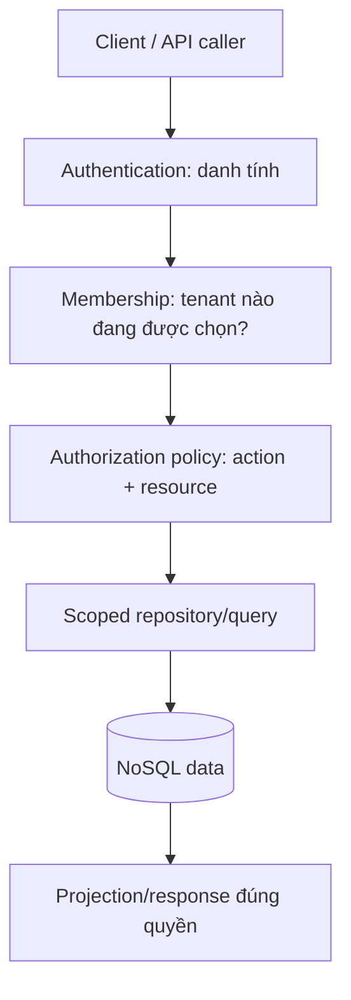

# Phân tách tenant và kiểm chứng quyền ở cấp bản ghi/truy vấn

## 1. Tình huống mở đầu: đăng nhập hợp lệ nhưng đọc nhầm dữ liệu công ty khác

Một nền tảng SaaS dùng Java và MongoDB lưu đơn hàng của nhiều doanh nghiệp. Ứng dụng xác thực JWT thành công, sau đó xử lý:

```http
GET /api/orders/O-1008
Authorization: Bearer <token-hợp-lệ-của-tenant-A>
```

Repository truy vấn:

```java
orders.find(eq("_id", orderId)).first();
```

Nếu `O-1008` thuộc tenant B, truy vấn vẫn có thể trả đơn hàng đó vì tài khoản kết nối MongoDB của ứng dụng có quyền đọc toàn collection. Đây là lỗi **Broken Object Level Authorization (BOLA)/IDOR**: người dùng được xác thực, database có sẵn record, nhưng ứng dụng không chứng minh người gọi được phép xem record ấy.

Sửa ở controller bằng một điều kiện sau khi lấy dữ liệu:

```java
Order order = repository.findById(orderId);
if (!order.getTenantId().equals(currentTenantId)) {
    throw new ForbiddenException();
}
```

có thể giảm một số lỗi, nhưng vẫn để dữ liệu không thuộc tenant đi qua nhiều tầng, dễ bị log, cache, mapper hoặc xử lý phụ trước khi kiểm tra. Thiết kế tốt hơn cần đưa **tenant scope vào truy vấn nguồn**, đồng thời kiểm tra quyền nghiệp vụ đối với thao tác và bản ghi.

Ví dụ ý tưởng:

```java
orders.find(and(
    eq("_id", orderId),
    eq("tenantId", verifiedTenantId)
)).first();
```

**Cảnh báo quan trọng:** một filter `tenantId` không tự giải quyết tất cả bảo mật. Quyền còn phụ thuộc tenant membership, role, ownership, trạng thái tài nguyên, thao tác đang làm, relation trong dữ liệu và các đường truy cập phụ như cache, search, export và background jobs.

Bài học trình bày cách thiết kế, triển khai và **kiểm chứng phân tách tenant ở cấp bản ghi/truy vấn** trong hệ NoSQL đa thuê, với trọng tâm Java và các failure modes thực tế.

---

## 2. Mục tiêu học tập

Sau bài này, bạn có thể:

1. Phân biệt xác thực danh tính, phân quyền nghiệp vụ và cô lập tenant.
2. So sánh mô hình cluster/database/collection/table dùng riêng với mô hình chia sẻ.
3. Xác định tenant từ **trusted identity context**, không tin `tenantId` do client tùy ý truyền.
4. Xây dữ liệu có `tenantId`, khóa, index, partition key và version theo ranh giới tenant.
5. Áp tenant predicates cho truy vấn đọc, ghi, xóa, thống kê, phân trang, aggregation và join.
6. Kết hợp **RBAC, ABAC và resource-level authorization** với nguyên tắc deny-by-default.
7. Ngăn BOLA/IDOR, NoSQL operator injection, mass assignment và cross-tenant cache collision.
8. Áp dụng mẫu Java cho MongoDB, DynamoDB, Cassandra, Redis và hệ Search.
9. Nhận diện giới hạn của ACL/role của từng database và nơi phải bảo vệ tại ứng dụng.
10. Kiểm thử tenant isolation với positive/negative cases, concurrency, migration và async pipelines.
11. Thiết kế audit, metrics, quy trình vận hành và ứng phó khi phát hiện lộ dữ liệu.

## 3. Tenant là gì? Không đồng nghĩa user hoặc database account

**Tenant** là một đơn vị cô lập dữ liệu/quyền trong mô hình đa thuê, thường là công ty, tổ chức, workspace hoặc khách hàng SaaS.

```text
SaaS platform
  Tenant T-A: Công ty A
    User U1: admin
    User U2: viewer
  Tenant T-B: Công ty B
    User U3: admin
    User U4: editor
```

Các định danh cần phân biệt:

| Định danh | Ý nghĩa | Có thể có quan hệ |
| --- | --- | --- |
| `tenantId` | Ranh giới tổ chức/dữ liệu | Một tenant có nhiều users |
| `userId` / `subject` | Danh tính người hoặc workload | Một user có thể thuộc nhiều tenants |
| `role` | Nhóm quyền trong một scope | `admin` ở A không phải admin ở B |
| `resourceId` | ID của order/document | Có thể trùng giữa tenants theo thiết kế |
| `ownerId` | Chủ sở hữu trong tenant | Không luôn bằng `tenantId` |
| `servicePrincipal` | Danh tính backend kết nối DB | Có thể có quyền vật lý tới nhiều tenants |
| `operationId` | Một ý định nghiệp vụ | Phải được scope theo tenant khi lưu/dedup |
| `requestId`/`traceId` | Liên kết telemetry | Không phải chứng cứ quyền |

Một người được cấp vai trò quản trị ở Tenant A **không tự có quyền quản trị Tenant B**, dù cả hai tenants nằm trong cùng database hay user dùng một email.

## 4. Ba tầng bảo vệ cần phân biệt



**Authentication (AuthN):** Xác minh danh tính và tính hợp lệ của session/token.

**Authorization (AuthZ):** Quyết định `subject` được thực hiện `action` lên `resource` trong `tenant` và ngữ cảnh nào.

**Data isolation:** Bảo đảm cơ chế lưu trữ và các đường truy cập không trả hoặc sửa dữ liệu tenant khác, kể cả khi developer viết query thiếu điều kiện hoặc một service bị cấp quyền quá rộng.

Ba tầng bổ trợ nhau, không thay thế nhau. Database RBAC có thể cho service account đọc collection `orders`; chính business service vẫn phải kiểm soát record nào người dùng được xem.

## 5. Đặt câu hỏi bảo mật đúng: Ai? Làm gì? Trên đâu? Khi nào?

Một quyết định cấp quyền có thể được biểu diễn:

```text
Subject:      user U17
Tenant:       T-A (membership đã kiểm chứng)
Action:       orders.read
Resource:     order O1008 thuộc T-A
Context:      session còn hiệu lực; không bị khóa
Decision:     ALLOW/DENY
```

Hoặc:

```text
Subject:      user U17
Tenant:       T-A
Action:       orders.delete
Resource:     order O1008, state=PAID
Context:      role=viewer
Decision:     DENY
```

Các thành phần chính:

- **PEP – Policy Enforcement Point:** Điểm thực thi quyết định, ví dụ service/repository/gateway.
- **PDP – Policy Decision Point:** Hàm hoặc dịch vụ đánh giá policy.
- **PIP – Policy Information Point:** Nguồn thông tin role, membership, owner, trạng thái tài nguyên.

Không nhất thiết phải triển khai một policy engine phức tạp cho mọi dự án. Nhưng phải biết **quyền được kiểm ở đâu và dựa trên dữ liệu nào**.

## 6. Threat model cho NoSQL đa tenant

Những kịch bản cần phòng vệ:

1. User A đoán ID order của B rồi gọi API trực tiếp.
2. Client sửa `tenantId` trong request body/header/query string.
3. Một API list/filter thiếu tenant predicate.
4. Một query aggregation `$lookup` nối qua tenant khác.
5. Cache key chỉ có `orderId`, làm đụng dữ liệu giữa tenants.
6. Elasticsearch query hoặc vector search trả tài liệu sai tenant.
7. Bulk update/delete thiếu điều kiện, ảnh hưởng toàn collection.
8. Background consumer dùng event payload có tenant giả.
9. Export/report/backup hỗn hợp được tải về bởi tenant không có quyền.
10. Role mapping bị stale sau khi user bị xóa khỏi workspace.
11. Restore/migration chuyển record nhầm tenant.
12. SDK dùng service credential quá mạnh làm thiếu phòng vệ tầng DB.
13. Log/trace vô tình chứa dữ liệu tenant B trong request tenant A.
14. Cursor phân trang của tenant B được dùng lại dưới tenant A.
15. IDOR qua presigned download link hoặc object storage key không đúng scope.

Không thể dùng một test `GET /orders` trả đúng dữ liệu để chứng minh mọi đường này được bảo vệ.

## 7. Lựa chọn mô hình cô lập dữ liệu

| Mô hình | Ví dụ | Ưu điểm | Hạn chế |
| --- | --- | --- | --- |
| **Cluster/account riêng mỗi tenant** | Mỗi tenant một deployment | Cô lập tài nguyên mạnh, dễ chính sách riêng | Chi phí/điều phối lớn |
| **Database/keyspace riêng** | Một database MongoDB hoặc keyspace riêng | Dễ tách quyền/backup theo phạm vi | Số objects tăng, quản lý schema phức tạp |
| **Collection/table/index riêng** | `orders_tenant_A` | Phân tách logic rõ cho một số backend | Metadata/index explosion, onboarding/migration |
| **Shared collection/table với tenant key** | `orders{tenantId,...}` | Tận dụng hạ tầng, mở rộng số tenants | Mọi query và mutation phải scope đúng |
| **Hybrid** | Large tenant riêng, small tenants shared | Điều chỉnh isolation/chi phí theo tier | Data placement/migration cần kỷ luật |

### 7.1. Không có một mô hình tốt nhất cho mọi SaaS

Chọn theo:

- Số tenant và tốc độ tăng.
- Isolation yêu cầu pháp lý/hợp đồng.
- Chi phí và billing.
- Data residency.
- Kích thước tenant lớn nhất.
- Khả năng quản trị schema/index/backup.
- Tải và noisy-neighbor risk.
- Công cụ truy vấn và giới hạn per-resource.
- Yêu cầu mã hóa/KMS key per tenant.
- Khả năng khôi phục/xóa dữ liệu riêng tenant.

### 7.2. Mỗi tenant một collection không luôn dễ hơn

Nếu có 100.000 tenants, mỗi tenant một collection/index set có thể vượt giới hạn metadata/management của engine. Vấn đề càng lớn nếu cần change streams, migrations và backup từng collection.

### 7.3. Shared table không tự là thiếu bảo mật

Một shared table có thể được bảo vệ tốt nếu mọi access path đều dùng trusted tenant scope, DB constraints, conditional writes và tests. Nhưng không nên xem `tenantId` field đơn độc là một security boundary hoàn chỉnh.

## 8. Ranh giới vật lý, logic và mật mã

Ba loại isolation khác nhau:

- **Vật lý/tài nguyên:** tenants nằm ở cluster/VPC/account/disk khác nhau.
- **Logic:** application/DB policy và query constraints giữ dữ liệu đúng tenant.
- **Mật mã:** dữ liệu được mã hóa bằng keys được quản lý theo tenant hoặc phạm vi phù hợp.

Một KMS key riêng mỗi tenant có thể giúp quản lý vòng đời khóa, nhưng **không sửa lỗi query trả nhầm ciphertext hoặc plaintext** nếu service có quyền giải mã tất cả keys.

Ngược lại, filter tenant đúng nhưng shared cluster vẫn có thể gặp noisy neighbor. Cần xác định rõ loại cô lập mà hợp đồng bảo mật yêu cầu.

## 9. Nguồn tenant ID phải được tin cậy

Ví dụ nguy hiểm:

```http
GET /orders?tenantId=T-B
Authorization: Bearer token-of-user-T-A
```

Nếu controller lấy `tenantId=T-B` trực tiếp làm query scope, người dùng có thể tự đổi ranh giới truy cập.

### 9.1. Chuỗi tin cậy

```text
Signed token/session
  -> Validate signature, issuer, audience, expiry, not-before
  -> Resolve authenticated subject
  -> Verify active membership in selected tenant
  -> Determine roles/permissions in that tenant
  -> Construct immutable TenantContext
  -> Use context for every data operation
```

Header `X-Tenant-ID` chỉ có thể là **tenant được yêu cầu chọn**, không phải bằng chứng user thuộc tenant đó. Phải đối chiếu với membership đã xác minh.

### 9.2. API gateway gắn tenant header có đủ không?

Chỉ đủ trong threat model có ranh giới tin cậy rõ: gateway xác thực, loại header giả do client gửi, bảo vệ kết nối downstream và backend không thể bị truy cập bỏ qua gateway. Defense-in-depth vẫn nên xác minh context/claims ở service quan trọng.

### 9.3. User có nhiều tenants

Một user U1 thuộc cả A và B có thể chuyển active tenant. Token hoặc server-side session phải thể hiện **membership được kiểm chứng**, không tự suy rằng vì user có quyền A nên mọi request đều thuộc A.

## 10. Mẫu TenantContext bất biến trong Java

```java
import java.util.Objects;
import java.util.Set;

public record TenantContext(
        String tenantId,
        String subjectId,
        Set<String> permissions
) {
    public TenantContext {
        if (tenantId == null || tenantId.isBlank()) {
            throw new IllegalArgumentException("No tenant");
        }
        Objects.requireNonNull(subjectId);
        permissions = Set.copyOf(
            Objects.requireNonNull(permissions)
        );
    }

    public void require(String permission) {
        if (!permissions.contains(permission)) {
            throw new SecurityException("Access denied");
        }
    }
}
```

**Quan trọng:** constructor này chỉ kiểm tra hình thức và tính bất biến; nó **không xác minh JWT hoặc membership**. Chỉ tầng authentication/authorization đáng tin mới được phép tạo `TenantContext`.

### 10.1. Tránh nhận context do client gửi dưới dạng JSON

Sai:

```java
public List<Order> listOrders(TenantContext body) {
    return repository.findByTenant(body.tenantId());
}
```

Bởi client có thể tự ghi `tenantId` và `permissions`. Context cần lấy từ security principal đã được xác thực, còn JSON request chỉ chứa các tham số nghiệp vụ được cho phép.

### 10.2. Không dùng một static global tenant variable

Trong Java server xử lý nhiều requests đồng thời, `static String currentTenant` có thể bị ghi đè chéo luồng. Dùng request-scoped context hoặc propagation phù hợp framework.

## 11. RBAC, ABAC và quyền cấp bản ghi

**RBAC:** quyết định theo roles, ví dụ `ORDER_VIEWER`, `ORDER_EDITOR`.

**ABAC:** quyết định theo attributes, ví dụ `tenantId`, `ownerId`, `departmentId`, `status`, `region`, `projectId`.

**Resource-level authorization:** kiểm tra quyền trên một instance tài nguyên cụ thể, không chỉ loại tài nguyên.

Ví dụ:

```text
Role = ORDER_EDITOR
Tenant = T-A
Action = orders.update
Resource tenant = T-A
Resource state = DRAFT
Owner = current user OR has permission EDIT_ALL_ORDERS
```

Một người có quyền `orders.update` trong tenant vẫn có thể bị từ chối update một Order đã hoàn tất hoặc chỉ thuộc nhóm khác.

### 11.1. Deny-by-default

Nếu membership không tồn tại, resource chưa biết owner, policy provider lỗi hoặc context thiếu tenant, mặc định **không được cho phép** thao tác cần quyền.

### 11.2. Không coi ẩn nút UI là bảo mật

Nút Delete bị ẩn trên giao diện không có nghĩa `DELETE /orders/{id}` an toàn. Server phải kiểm tra action/resource tại mỗi operation.

## 12. Chọn tenant từ danh tính, chọn resource từ request

Một quy tắc thường hữu ích:

```text
Trusted:
  tenant = authenticatedSubject.activeTenant
  permissions = verifiedMembership.permissions

Untrusted:
  resourceId = URL path
  filter = query parameters
  sort = user input
  update payload = request body
```

Ta có thể dùng `resourceId` do client gửi để **tìm trong phạm vi tenant**, không dùng nó để xác nhận quyền.

```text
SELECT-equivalent:
  tenantId = trustedTenant
  AND orderId = userProvidedOrderId
```

Nếu không tìm thấy, API thường trả `404 Not Found` hoặc phản hồi khác theo chính sách chống tiết lộ sự tồn tại. Không tự trả record của tenant khác chỉ vì `_id` đúng.

## 13. Thiết kế khóa định danh có tenant scope

### 13.1. ID có thể trùng giữa tenants

```text
Tenant A: orderId = 0001
Tenant B: orderId = 0001
```

Nếu mỗi tenant chỉ cần unique trong phạm vi của mình, dùng unique key ghép:

```text
(tenantId, orderId)
```

Không yêu cầu `orderId` global unique trừ khi domain thật sự cần.

### 13.2. UUID toàn cục vẫn không phải cơ chế AuthZ

Một ObjectId/UUID ngẫu nhiên khó đoán giúp giảm rủi ro enumeration, nhưng khi ID bị rò qua email/log/link, attacker vẫn có thể thử truy vấn. **Khó đoán không thay kiểm tra tenant.**

### 13.3. Tránh namespace ambiguity

Nếu tạo key string như:

```text
tenantA:order:1
```

phải có encoding/validation tránh tenant ID chứa separator hoặc ký tự đặc biệt làm trùng key. Có thể dùng UUID canonical cho tenant, stable key builder và kiểm thử collision.

## 14. Thiết kế schema shared MongoDB collection

Ví dụ document:

```json
{
  "_id": "O1001",
  "tenantId": "T-A",
  "ownerId": "U17",
  "status": "DRAFT",
  "amountMinor": 90000,
  "version": 5,
  "createdAt": "2026-11-14T09:00:00Z"
}
```

Gợi ý index:

```javascript
db.orders.createIndex({
  tenantId: 1,
  status: 1,
  createdAt: -1
});
```

Index giúp những query có tenant predicate và sort theo createdAt. Lưu ý thứ tự fields và hiệu quả truy vấn phụ thuộc cardinality, selectivity và access patterns thực tế.

### 14.1. Unique business ID theo tenant

```javascript
db.orders.createIndex(
  { tenantId: 1, externalOrderId: 1 },
  { unique: true }
);
```

Constraint này bảo vệ không trùng `externalOrderId` **trong cùng tenant** (theo semantics MongoDB unique index, missing/null/collation và sharding cần được xem xét theo phiên bản và schema).

### 14.2. Một unique index không tự làm mọi query có tenant scope

Index `{tenantId, externalOrderId}` giúp constraints/access path. Nhưng developer vẫn có thể viết `find({"externalOrderId":x})` không filter tenant hoặc gọi một endpoint khác. **Query authorization và schema constraints là hai lớp riêng.**

## 15. Java MongoDB: truy vấn có tenant predicate

```java
import com.mongodb.client.MongoCollection;
import org.bson.Document;
import org.bson.conversions.Bson;
import static com.mongodb.client.model.Filters.*;

public final class OrderRepository {
    private final MongoCollection<Document> orders;

    public OrderRepository(MongoCollection<Document> orders) {
        this.orders = orders;
    }

    public Document findOne(
            TenantContext context,
            String orderId) {

        context.require("orders.read");

        Bson scope = and(
            eq("tenantId", context.tenantId()),
            eq("_id", orderId)
        );

        return orders.find(scope).first();
    }
}
```

Bài ví dụ giả định context được xây từ middleware đã xác thực và dữ liệu `_id` là string. Nếu `_id` thực tế là `ObjectId`, dùng type/validation đúng.

### 15.1. Tại sao đưa tenant vào DB filter?

- Dữ liệu khác tenant không cần được đưa lên ứng dụng để rồi bị loại.
- Giảm nguy cơ mapper/cache/log vô tình xử lý record chưa được phép.
- Tận dụng index bắt đầu bằng tenant key.
- Cho phép test assertion rằng query predicate luôn có tenant scope.

### 15.2. Vẫn cần quyền chi tiết

Nếu chỉ những user trong cùng department được đọc Order, filter nên bổ sung `departmentId` hoặc có policy check tương ứng. `tenantId` là **điều kiện bắt buộc**, không tự đầy đủ cho mọi use case.

## 16. Java MongoDB: update có tenant, ownership và trạng thái

Một thao tác cập nhật cần tránh hai bước không nguyên tử:

```text
1. find order và kiểm tra role
2. một request khác đổi owner/status
3. update chỉ theo orderId
```

Thay vào đó, với **một document**, có thể kết hợp các điều kiện cần bất biến vào một atomic conditional update:

```java
import static com.mongodb.client.model.Filters.*;
import static com.mongodb.client.model.Updates.*;

Bson filter = and(
    eq("_id", orderId),
    eq("tenantId", ctx.tenantId()),
    eq("ownerId", ctx.subjectId()),
    eq("status", "DRAFT"),
    eq("version", expectedVersion)
);

Bson update = combine(
    set("note", validatedNote),
    inc("version", 1)
);

var result = orders.updateOne(filter, update);
```

Diễn giải:

- `matchedCount == 1`: có một document khớp predicate; update outcome cần xét acknowledged result.
- `matchedCount == 0`: có thể không tồn tại, không thuộc tenant, không được owner phép, không còn DRAFT hoặc version đã đổi.
- Không được kết luận “không có record” từ matchedCount=0 để lộ trạng thái cho người không có quyền.

### 16.1. Bảo vệ mutation chứ không chỉ read

Một update thiếu `tenantId` có thể sửa record khác tenant dù API GET đã bảo vệ tốt. Kiểm thử riêng `PATCH`, `PUT`, `DELETE`, `bulkWrite`, `upsert`, `findOneAndUpdate`.

### 16.2. Upsert đòi đặc biệt cẩn thận

Với `upsert=true`, phải bảo đảm tenant/owner fields được **tạo từ trusted context**, unique keys đúng scope và không có đường ghi chèn sang tenant khác. Một filter tùy ý do client đưa vào rất dễ biến upsert thành lỗi phân tách.

## 17. Mass assignment: client không được tự đặt owner hoặc tenant

Payload:

```json
{
  "name": "Đơn hàng thử",
  "tenantId": "T-B",
  "ownerId": "U999",
  "status": "PAID",
  "isAdmin": true
}
```

Nếu application chuyển nguyên JSON thành MongoDB update document, client có thể đổi quyền sở hữu, trạng thái hoặc dữ liệu bảo vệ.

### 17.1. Cho phép danh sách fields cụ thể

```java
public record UpdateOrderRequest(String note) {}
```

```java
Bson update = combine(
    set("note", validatedNote),
    inc("version", 1)
);
```

Không đưa `tenantId`, `ownerId`, `createdBy`, `isAdmin`, `paymentStatus` vào DTO update phổ thông. Những fields đặc biệt phải có action/policy riêng và validation ở server.

### 17.2. Thử payload thừa

Security test nên gửi thêm `tenantId`, `ownerId`, `$set`, `__proto__` hoặc fields không được cho phép; hệ cần từ chối/không áp thay đổi. Hành vi cụ thể tùy serializer và API contract, nhưng **không được tin dữ liệu ngoài schema**.

## 18. NoSQL operator injection và query composition

Một API không nên làm:

```java
// NGUY HIỂM: userProvidedFilter đến từ JSON client
orders.find(userProvidedFilter);
```

Một attacker có thể gửi cấu trúc toán tử như `$or`, `$ne` hoặc nested expressions làm thay đổi phạm vi truy vấn nếu ứng dụng cho phép raw query DSL.

### 18.1. Gắn tenant predicate sai thứ tự

Giả sử client filter là:

```json
{"$or":[{"status":"PAID"},{"tenantId":"T-B"}]}
```

Nếu server đơn giản merge object theo `putAll`, field `$or` có thể vẫn mở đường lấy dữ liệu không mong muốn.

### 18.2. Cấu trúc an toàn hơn

```java
Bson tenantScope = eq("tenantId", ctx.tenantId());

Bson allowedUserFilter = and(
    eq("status", validatedStatus),
    gte("createdAt", validatedFrom),
    lt("createdAt", validatedTo)
);

Bson finalFilter = and(tenantScope, allowedUserFilter);
```

**Không nhận raw BSON operators** khi endpoint chỉ cần status/date/sort. Nếu cung cấp advanced search DSL, cần validator/parser tạo AST có allowlist và bảo đảm tenant predicate không bị OR/not phủ định.

### 18.3. Không chỉ lọc kết quả sau khi đọc

`find({}).into(list).stream().filter(tenantMatch)` có thể quét toàn collection, gây tải lớn và đưa dữ liệu không được phép vào memory/logs. Tenant predicate nên được áp ngay tại data access layer.

## 19. Aggregation và `$lookup`: đường thoát tenant phổ biến

Một pipeline có thể:

```javascript
[
  {$match: {tenantId: "T-A"}},
  {$lookup: {
    from: "order_items",
    localField: "_id",
    foreignField: "orderId",
    as: "items"
  }}
]
```

`$match` ở nguồn không tự bảo đảm documents trong `order_items` cùng tenant nếu `orderId` trùng hoặc tham chiếu không toàn cục.

### 19.1. Join phải scope cả hai phía

Một hướng có chủ đích:

```javascript
db.orders.aggregate([
  {$match: {tenantId: "T-A"}},
  {$lookup: {
    from: "order_items",
    let: {
      orderKey: "$_id",
      tenantKey: "$tenantId"
    },
    pipeline: [
      {$match: {$expr: {$and: [
        {$eq: ["$orderId", "$$orderKey"]},
        {$eq: ["$tenantId", "$$tenantKey"]}
      ]}}}
    ],
    as: "items"
  }}
]);
```

Đây là mẫu minh họa; hiệu quả index/explain cần kiểm tra theo phiên bản và dữ liệu. **Cả quan hệ join phải có tenant invariant**, không chỉ stage đầu tiên.

### 19.2. Aggregation operators khác

Cần đánh giá các thao tác:

- `$facet`: mọi nhánh có giữ tenant scope?
- `$unionWith`: collection được nối có scope tương ứng?
- `$graphLookup`: đồ thị quan hệ có liên kết xuyên tenant?
- `$group`/`$count`: kết quả thống kê có lộ tenant khác?
- `$merge`/`$out`: đích có thể ghi sang namespace chung hoặc tenant khác?
- Map-reduce/aggregation jobs dùng service principal nào?

Một pipeline đã có `$match` không chứng minh mọi subpipeline/side effect đều an toàn.

## 20. Phân trang và cursor cũng mang phạm vi quyền

Một API:

```http
GET /orders?cursor=eyJzb3J0Ijoi... 
```

không nên chấp nhận cursor do tenant B tạo rồi dùng ở tenant A.

Cursor có thể chứa:

```json
{
  "tenantId": "T-A",
  "sort": ["createdAt", "_id"],
  "after": ["2026-11-14T09:00:00Z", "O1008"],
  "filterHash": "controlled-reference",
  "expiresAt": "2026-11-14T10:00:00Z"
}
```

### 20.1. Cursor không phải credential

Nếu dùng opaque cursor, phải kiểm tra nó được tạo cho cùng tenant, user/permission scope và bộ filter/sort hợp lệ. Tùy threat model, dùng server-side cursor state hoặc **token ký có kiểm soát, hết hạn và chống sửa**.

### 20.2. Keyset pagination

Ví dụ Mongo query:

```text
tenantId = trusted tenant
AND (
  createdAt < lastCreatedAt
  OR (createdAt = lastCreatedAt AND _id < lastId)
)
ORDER BY createdAt DESC, _id DESC
LIMIT 50
```

Điều kiện tenant phải áp cho **toàn bộ biểu thức OR**, không chỉ một nhánh. Index/sort cần tương thích để không tạo scan lớn.

### 20.3. Không leak số lượng qua total count

Một API đếm tổng records trong toàn cluster rồi trả cho tenant A có thể làm lộ hoạt động tenant B. Count, pagination metadata và facets đều phải dùng cùng authorization scope như list data.

## 21. Đếm và thống kê: `count`, `distinct`, `group`

Một số API chỉ trả số:

```http
GET /reports/orders/count
```

nhưng nếu query bỏ tenant, count có thể tiết lộ doanh số/khối lượng của tổ chức khác.

Với MongoDB:

```java
long count = orders.countDocuments(
    eq("tenantId", ctx.tenantId())
);
```

Với các group reports, cần filter tenant **trước** khi group và bảo đảm các lookup/union không mở phạm vi.

### 21.1. Dữ liệu tổng hợp vẫn có thể nhạy cảm

Một bucket count bằng 1 kết hợp nhiều filters có thể cho phép suy thông tin cá nhân; ngoài tenant isolation, một số báo cáo cần minimum group size, suppress small counts hoặc differential privacy theo yêu cầu.

### 21.2. Không expose internal collection names

Một user chỉ có quyền đọc orders không cần được gọi `listCollections` hay truy vấn system metadata. DBA/system metadata permission khác quyền truy vấn nghiệp vụ.

## 22. DynamoDB: đưa tenant vào partition key và điều kiện ghi

Một mô hình single-table:

```text
PK = TENANT#T-A
SK = ORDER#O1001
tenantId = T-A
status = DRAFT
```

Java AWS SDK v2:

```java
import software.amazon.awssdk.services.dynamodb.DynamoDbClient;
import software.amazon.awssdk.services.dynamodb.model.*;
import java.util.Map;

public final class OrderTable {
    private final DynamoDbClient db;
    private final String tableName;

    public OrderTable(DynamoDbClient db, String tableName) {
        this.db = db;
        this.tableName = tableName;
    }

    public Map<String, AttributeValue> getOrder(
            TenantContext ctx, String orderId) {
        ctx.require("orders.read");

        var key = Map.of(
            "PK", AttributeValue.fromS(
                "TENANT#" + ctx.tenantId()),
            "SK", AttributeValue.fromS("ORDER#" + orderId)
        );

        var result = db.getItem(GetItemRequest.builder()
            .tableName(tableName)
            .key(key)
            .consistentRead(true)
            .build());

        return result.item();
    }
}
```

**Ý nghĩa:** PK được tạo từ tenant đã xác thực, nên request không thể chọn PK của tenant khác chỉ bằng cách thay `orderId` nếu key scheme và validation đúng.

### 22.1. Không dùng tenantId từ JSON body để tạo PK

Sai:

```java
String pk = "TENANT#" + body.tenantId();
```

Đúng hơn là lấy tenant từ trusted context rồi bỏ qua/từ chối `tenantId` không đáng tin.

### 22.2. ConsistentRead không phải authorization

`consistentRead(true)` (ở base table/LSI nơi được hỗ trợ) giúp lựa chọn độ nhất quán, **không thêm quyền truy cập**. Không nhầm strong read với security check.

## 23. DynamoDB: conditional update và tenant invariant

Ví dụ update không được áp dụng lên item bị đặt nhầm tenant:

```java
var request = UpdateItemRequest.builder()
    .tableName(tableName)
    .key(Map.of(
        "PK", AttributeValue.fromS(
            "TENANT#" + ctx.tenantId()),
        "SK", AttributeValue.fromS("ORDER#" + orderId)
    ))
    .updateExpression("SET #note = :note")
    .conditionExpression(
        "attribute_exists(PK) AND tenantId = :tenant")
    .expressionAttributeNames(Map.of(
        "#note", "note"
    ))
    .expressionAttributeValues(Map.of(
        ":note", AttributeValue.fromS(validatedNote),
        ":tenant", AttributeValue.fromS(ctx.tenantId())
    ))
    .build();

db.updateItem(request);
```

Điều kiện `tenantId = :tenant` là lớp defense-in-depth khi item có attribute này và dữ liệu không bị sửa trái protocol. Bảo vệ chính còn ở **key derivation và IAM/ứng dụng**.

### 23.1. `ConditionalCheckFailedException` không luôn là thiếu quyền

Nó có thể là item không tồn tại hoặc điều kiện nghiệp vụ/version không khớp. Không trả “tenant B có order này” khi conditional update fail.

### 23.2. Transaction nhiều items

Nếu update Order và Inventory trong một transaction, **mỗi item key phải được scope đúng tenant** và điều kiện invariant/authorization phải được thiết kế trong transaction. Chỉ filter Order rồi update Inventory bằng global key có thể gây cross-tenant side effect.

## 24. DynamoDB GSI: secondary access path có thể phá cô lập

Ví dụ table PK có tenant nhưng GSI được thiết kế:

```text
GSI1PK = EMAIL#customer@example.com
GSI1SK = ORDER#...
```

Query GSI theo email có thể gom records của nhiều tenants nếu email trùng hoặc user làm việc cho nhiều tổ chức.

### 24.1. GSI key nên mang tenant scope khi cần

```text
GSI1PK = TENANT#T-A#CUSTOMER#C100
GSI1SK = CREATED#2026-11-14#ORDER#O1001
```

Truy vấn GSI phải lấy tenant từ verified context và verify returned items theo policy.

### 24.2. FilterExpression không thay key design

Trong DynamoDB, `FilterExpression` được áp sau các items đã được đọc theo key condition. Nếu GSI partition key gom dữ liệu nhiều tenant, filter có thể làm giảm kết quả trả về nhưng vẫn phát sinh tải/chi phí và những nguy cơ access path không phù hợp.

### 24.3. IAM fine-grained access

Một số cơ chế IAM có thể giới hạn partition keys bằng điều kiện phù hợp như `dynamodb:LeadingKeys`. Khả năng và giới hạn phụ thuộc API/action/key schema. Cần kiểm tra policy evaluation và các access paths; **không coi IAM condition tự nhiên bảo vệ mọi GSI/Scan/Batch operation**.

## 25. Cassandra: tenant phải nằm trong partition và mọi access path

Một thiết kế CQL theo tenant/ngày:

```sql
CREATE TABLE orders_by_tenant_day (
    tenant_id text,
    order_day date,
    created_at timestamp,
    order_id text,
    status text,
    PRIMARY KEY (
        (tenant_id, order_day),
        created_at,
        order_id
    )
) WITH CLUSTERING ORDER BY (
    created_at DESC,
    order_id ASC
);
```

Truy vấn:

```sql
SELECT order_id, status
FROM orders_by_tenant_day
WHERE tenant_id = ?
  AND order_day = ?
LIMIT 50;
```

### 25.1. Vì sao tenant trong partition key?

CQL access patterns tập trung quanh partition key. Nếu query muốn đọc một tenant/ngày, đưa `tenant_id` vào partition key giúp route target đúng phạm vi và giảm scan.

### 25.2. Cassandra role không luôn enforce row-level tenant

Trong nhiều triển khai Cassandra, role/GRANT áp ở keyspace/table và các resource tương ứng. Service account có `SELECT` table chung có thể đọc nhiều tenant partitions. **Ứng dụng phải enforce tenant key**; nếu yêu cầu cô lập mạnh hơn, cân nhắc keyspace/cluster riêng hoặc proxy/policy có bảo đảm cụ thể.

### 25.3. Tránh table scan/ALLOW FILTERING thay security predicate

Không dùng truy vấn không có partition key rồi lọc `tenant_id` ở Java. Việc quét nhiều tenant dữ liệu vừa tốn chi phí vừa mở rộng vùng rủi ro.

## 26. Cassandra: collections phụ và denormalization

Với NoSQL, dữ liệu thường được nhân bản thành nhiều tables theo query:

```text
orders_by_id
orders_by_tenant_day
orders_by_customer
orders_by_status
```

Nếu `orders_by_customer` dùng primary key chỉ có `customer_id`, còn `customer_id` không global unique, query có thể trộn records tenants.

Một nguyên tắc:

```text
Every tenant-private read model
must have a tenant isolation contract
on its key/query path.
```

### 26.1. Duplicate fields không tự cập nhật đồng bộ

Nếu application ghi Order vào ba tables, có thể có partial failure. Dùng workflow/outbox/idempotent updates theo contract, và test không để projection tạm thời lệch biến thành cross-tenant leak.

### 26.2. Khi đổi quyền owner

Một copy ở read model cũ có thể tiếp tục lộ record sau khi owner bị chuyển. Need invalidation/version guard hoặc authoritative check khi dữ liệu có rủi ro cao.

## 27. Redis: namespace và ACL không giống row-level DB security

Cache key tốt hơn:

```text
tenant:T-A:order:O1001
tenant:T-B:order:O1001
```

Thay vì:

```text
order:O1001
```

vốn có nguy cơ cache collision nếu `O1001` chỉ unique trong tenant.

### 27.1. Java key builder

```java
public final class CacheKeys {
    private CacheKeys() {}

    public static String order(
            TenantContext ctx, String orderId) {
        if (!orderId.matches("[A-Za-z0-9_-]{1,80}")) {
            throw new IllegalArgumentException("Invalid order ID");
        }
        return "tenant:" + ctx.tenantId()
            + ":order:" + orderId;
    }
}
```

Ví dụ giả định tenantId đã được canonicalize từ identity context; production code nên dùng một formatter thống nhất và kiểm tra chiều dài/encoding.

### 27.2. Redis ACL bảo vệ theo pattern

Một Redis ACL có thể hạn chế user theo command và key pattern, nhưng nếu **cùng một Redis user của ứng dụng** được cấp `~tenant:*`, RBAC ở Redis không tự ngăn app đọc sai tenant. Có thể cân nhắc principal riêng/namespace riêng cho những tenant cần isolation mạnh, tùy chi phí quản lý.

### 27.3. Cache negative results cũng phải scope

Một `NOT_FOUND` cache cho `orderId=O1001` của tenant A không có nghĩa tenant B cũng không có `O1001`. Negative cache key cần tenant và policy context nếu kết quả phụ thuộc quyền.

## 28. L1 cache, CDN và response cache

Phân tách tenant không chỉ ở Redis:

```text
Browser/private cache
CDN/edge cache
API gateway response cache
L1 Caffeine trong JVM
L2 Redis
NoSQL source
```

Nếu cache key của API gateway chỉ là URL:

```text
GET /dashboard
```

mà không bao gồm identity/tenant partition hoặc chính sách `private` phù hợp, người dùng A có thể nhận response đã cache của B.

### 28.1. Quy tắc thiết kế

- Xác định response là public/shared hay private per tenant/user.
- Cache key phải phản ánh mọi đầu vào **ảnh hưởng dữ liệu được phép**.
- Không cache authorization-sensitive response trên shared cache nếu không có cơ chế partitioning đáng tin.
- Dùng cache-control headers đúng semantics.
- Invalidate theo tenant và resource version.
- Test switching tenant trong cùng browser/session.
- Test nhiều users chung endpoint nhưng role khác nhau.

### 28.2. Không chỉ đưa `tenantId` vào key rồi coi xong

Nếu cùng tenant có user viewer và admin, một dashboard tổng hợp có thể khác nhau theo quyền. Cache key có thể cần permission set/role revision hoặc tránh shared caching cho response nhạy cảm.

## 29. Search index: tenant phải nằm trong query và index document

Một document được đồng bộ sang Elasticsearch/OpenSearch:

```json
{
  "orderId": "O1001",
  "tenantId": "T-A",
  "customerName": "Người mua A",
  "status": "PAID",
  "embedding": [0.12, -0.09, 0.32]
}
```

Khi truy vấn:

```json
{
  "query": {
    "bool": {
      "filter": [
        {"term": {"tenantId": "T-A"}},
        {"term": {"status": "PAID"}}
      ]
    }
  }
}
```

### 29.1. Filter aliases không mặc nhiên là security boundary

Một filtered alias có thể hỗ trợ query convenience, nhưng nếu service credential vẫn được truy cập **index gốc**, một đường code khác có thể bỏ alias và thấy tenant khác. Với yêu cầu bảo mật cần kết hợp role/index privileges, document-level security nếu sản phẩm/phiên bản hỗ trợ, cùng authorization ở application.

### 29.2. Aggregations và suggest

Không chỉ lọc `_hits`: facets, aggregations, completion suggestions và highlighting cũng có thể tiết lộ dữ liệu nếu query context không được scope đúng.

### 29.3. Vector search

Với semantic/vector search, `topK` phải áp trên tập ứng viên đúng tenant theo search engine capability. Nếu vector search tìm topK toàn hệ rồi mới lọc tenant ở Java, kết quả vừa có nguy cơ rò dữ liệu ở tầng ứng dụng vừa thiếu độ đầy đủ.

Các engine có cơ chế prefilter/postfilter khác nhau; cần kiểm tra semantics thực của phiên bản triển khai.

## 30. Graph: cạnh quan hệ có thể vượt qua tenant boundary

Trong graph:

```text
(Tenant A) --owns--> (Order A)
(Order A) --relatedTo--> (Customer B?)
```

Một traversal có thể bắt đầu từ node của tenant A rồi đi qua relationship sang node tenant B nếu dữ liệu hoặc query không có constraint.

### 30.1. Cypher minh họa

```cypher
MATCH (o:Order {tenantId: $tenantId, orderId: $orderId})
RETURN o
```

Nhưng với traversal:

```cypher
MATCH (o:Order {tenantId: $tenantId})-[:HAS_ITEM]->(i:Item)
WHERE o.orderId = $orderId
  AND i.tenantId = $tenantId
RETURN i
```

Cần đảm bảo mọi node/relationship nhạy cảm có cùng invariant, hoặc có policy rõ cho quan hệ cross-tenant được phép (ví dụ một public catalog node dùng chung).

### 30.2. Một query bắt đầu đúng tenant chưa chắc kết thúc đúng tenant

Đừng chỉ kiểm tra start node. Kiểm tra toàn bộ path, projections và aggregations khi graph query có quan hệ nhiều hops.

## 31. Couchbase và document scopes

Với Couchbase, phân tách có thể theo bucket/scope/collection hoặc dùng `tenantId` field trong shared collections.

- Collection riêng hỗ trợ isolation ở resource boundary và RBAC theo capability.
- Shared collection cần query predicate trên `tenantId`.
- SQL++ queries, KV access, indexes và search services có quyền riêng.
- Một SDK principal có quyền Query trên collection chưa chứng minh logic ứng dụng đã scope đúng.

Mọi access path (KV by ID, SQL++, Full Text Search, Analytics) phải có cùng tenant policy.

## 32. Firestore security rules và server SDK

Firestore client SDK có thể được bảo vệ bởi **Firestore Security Rules** cho những request chịu rules evaluation. Nhưng **server/Admin SDK sử dụng service credentials thường không chịu cùng Firebase client security rules** theo mô hình quyền của nền tảng.

### 32.1. Vì sao đây là bẫy?

Mobile app đọc `/tenants/T-A/orders/...` được bảo vệ bởi rules. Backend Java Admin SDK dùng quyền service account có thể đọc `/tenants/T-B/orders/...` nếu code thiếu tenant scope.

Do đó:

- Client rules bảo vệ client access theo cơ chế của product.
- Server business code vẫn phải kiểm tenant và quyền.
- IAM/service account scope phải được hạn chế phù hợp.
- Test cả client rules **và** backend API server-side.

### 32.2. Đường dẫn không thay quyền

Một path `/tenants/T-A/orders/O1001` hữu ích, nhưng nếu client tự chọn T-A hoặc service chạy với quyền rộng, phải xác minh subject thuộc T-A.

## 33. Policy server-side và nhiều tenants trên một user

Một user U1 thuộc tenants A/B; khi chuyển workspace:

```text
Active tenant before: A
Active tenant after:  B
```

Rủi ro thường gặp:

- L1 cache chứa danh sách đơn A được trả sau khi switch B.
- Frontend còn cursor A.
- API gateway giữ header A dù token đã chuyển B.
- Worker async nhận request trước switch và chạy với context của request sau.
- Authorization cache lưu vai trò “admin” không kèm tenant ID.
- Một service bỏ qua membership revocation.

### 33.1. Role luôn có tenant scope

Sai:

```text
U1 -> role=ADMIN
```

Tốt hơn:

```text
U1 in Tenant A -> ADMIN
U1 in Tenant B -> VIEWER
```

### 33.2. Authorization cache key

```text
authz:{subjectId}:{tenantId}:{policyVersion}
```

Cần TTL/invalidation theo revocation requirements. `policyVersion` hoặc revision có ích khi role/membership đổi; không mặc định TTL dài phù hợp hệ nhạy cảm.

## 34. Revocation và dữ liệu cũ

Một quản trị viên thu hồi quyền U1 khỏi tenant A. JWT cũ có thể còn hiệu lực và cache membership vẫn chứa ALLOW.

Cần định nghĩa:

- Access token lifetime.
- Membership source authority.
- Revocation event propagation.
- Authorization decision cache TTL.
- Yêu cầu “quyền bị thu hồi có hiệu lực trong X giây”.
- Critical actions có cần authoritative check không.
- Xử lý khi authz service outage.

### 34.1. Fail-open nguy hiểm với thông tin nhạy cảm

Khi không xác minh được quyền, không nên tự động cho phép xem record “vì user từng được phép”. Với tính năng rủi ro thấp có thể có policy khác, nhưng phải được thẩm định và ghi rõ.

### 34.2. Temporal race

Ngay cả khi kiểm quyền trước khi query, membership có thể bị thu hồi trong lúc query đang thực thi. Cần xác định contract tại điểm nào quyết định quyền có hiệu lực, và với high-risk operations có thể yêu cầu versioned authorization decision/short-lived lease hoặc recheck.

## 35. TOCTOU: kiểm quyền rồi thay đổi owner ngay sau đó

Một workflow:

```text
T0: API đọc Order O1001, owner=U1.
T1: API xác nhận U1 có quyền sửa.
T2: Admin chuyển owner sang U2.
T3: API UPDATE O1001 chỉ theo _id.
```

Đây là **time-of-check to time-of-use race**: quyền được kiểm tại T1 nhưng trạng thái ở T3 đã đổi.

### 35.1. Thiết kế điều kiện nguyên tử

Khi DB hỗ trợ conditional update, đưa điều kiện `tenantId`, `ownerId`, `status`, `version` vào predicate/condition của **chính write**.

### 35.2. Quyền động ngoài record

Nếu membership trong store khác, một atomic DB update không thể tự bảo đảm membership không đổi trừ khi có protocol/version/transaction/authorization lease phù hợp. Nêu consistency contract rõ và chọn giải pháp theo độ nhạy nghiệp vụ.

### 35.3. Không phân biệt authorization race với conflict thông thường

`matchedCount=0` hoặc conditional check failed có thể do stale version, owner đổi hoặc record không tồn tại. Giữ thông báo công khai trung tính để không leak sự tồn tại; log phân loại có quyền ở nội bộ.

## 36. Transaction và multi-record invariant

Giả sử chuyển khoản giữa hai ví tenant:

```text
wallet:tenantA:W1
wallet:tenantB:W2
```

Một service thông thường không nên cho phép chuyển giữa hai tenant chỉ dựa trên ID bên ngoài, trừ khi business có một **cross-tenant transfer flow** được phê duyệt với quyền của hai phía, audit và settlement.

### 36.1. Mỗi resource trong transaction phải được scope

Nếu transaction chạm Order, Stock, Payment và Outbox, không chỉ kiểm quyền Order rồi bỏ qua những item khác.

### 36.2. Cross-tenant workflows cần policy riêng

Ví dụ marketplace hoặc shared customer catalog thực sự có dữ liệu xuyên tổ chức. Đừng cố mô hình hóa nó bằng “bỏ tenant filter” mà không có cơ chế cấp quyền; xác định entity public/shared, những tenants được tham gia và scope của từng field.

### 36.3. Error semantics

Timeout sau commit có thể tạo **unknown outcome**. Dùng operation ID scoped theo tenant, transaction protocol và authoritative lookup, không retry bằng ID mới rồi gây side effects trùng hoặc sang tenant khác.

## 37. Idempotency key phải scoped theo tenant

Một idempotency key do client gửi:

```http
Idempotency-Key: create-order-100
```

Tenant A và Tenant B có thể cùng chọn giá trị đó.

Nếu ledger dùng duy nhất:

```text
idempotencyKey = create-order-100
```

một request B có thể đọc được trạng thái nghiệp vụ A hoặc bị chặn nhầm duplicate.

Thiết kế hợp lý hơn:

```text
unique business operation identity =
  tenantId + operationType + idempotencyKey
```

Cần ràng buộc payload hash và retention theo contract. `tenantId` phải lấy từ trusted context.

### 37.1. Không trả result của tenant khác khi key trùng

Test với hai tenants cùng idempotency key và cùng/different payloads; API không được trả resource/payment reference của bên kia.

### 37.2. Key trong trace không phải quyền

Request/trace IDs giúp điều tra nhưng không phải tenant authorization; đừng dùng trace ID làm idempotency key hoặc public lookup key cho business data.

## 38. Event-driven architecture: tenant context qua broker

Ví dụ event:

```json
{
  "eventId": "E-T-A-1001",
  "aggregateType": "Order",
  "aggregateId": "O1001",
  "tenantId": "T-A",
  "sourceVersion": 5,
  "eventType": "OrderUpdated",
  "payload": {
    "status": "PAID"
  }
}
```

Consumer phải coi envelope là **dữ liệu từ producer với trust level cụ thể**, không mặc định mọi message đều được phép ghi mọi tenant.

### 38.1. Consumer phải kiểm nguồn và tenant invariant

- Xác minh producer/topic/identity theo cơ chế broker.
- Chỉ accept event types đã được phép.
- Kiểm `tenantId` với nguồn authoritative khi cần.
- Dùng destination key có tenant scope.
- Dedup theo `tenantId + eventId` hoặc contract nhất quán.
- Khi version cũ đến muộn, không overwrite phiên bản mới.
- Quarantine/DLQ event không hợp lệ, không tự route sang tenant mặc định.

### 38.2. Outbox và projections

Nếu Order có tenantId nhưng outbox event hoặc Search projection thiếu nó, đường truy vấn derived store có thể mất isolation. Tenant phải được bảo tồn qua mọi materialization và index.

### 38.3. Async context của Java

MDC/ThreadLocal thường không tự lan qua `ExecutorService`, `CompletableFuture` hay Reactor. **Không dùng MDC làm nguồn chính xác của authorization**; truyền tenant/security context rõ ràng và có lifecycle/verification đúng.

## 39. Batch jobs, scheduler và quản trị nội bộ

Background job không có HTTP caller, nên không thể dùng `currentRequestTenant` tùy tiện.

Các mô hình an toàn:

- Job chạy **một tenant**: tenantId trong job definition đã được server phê duyệt, scope mọi query.
- Job chạy **nhiều tenants**: enumerate tenants từ authoritative registry và chạy vòng lặp có isolation/metrics riêng.
- Job toàn hệ: dùng danh tính và API nội bộ được phê duyệt, có audit, không tái sử dụng endpoint public không scope.
- Admin support: break-glass được cấp có thời hạn, MFA, lý do và audit; không dùng role superuser thường trực.

### 39.1. Không dùng `tenantId = null` nghĩa “all tenants”

Một method repository:

```java
findOrders(tenantId == null ? allOrders : byTenant)
```

rất nguy hiểm nếu một code path quên truyền context. Tốt hơn là hai API tách biệt: `findTenantOrders(TenantContext, ...)` và `findAllForAdmin(ApprovedAdminContext, ...)`.

### 39.2. Tenant-scoped dependency injection

Có thể tạo repository wrapper bắt buộc `TenantContext` ở constructor/phương thức, tránh API generic dễ gọi sai. Nhưng wrapper vẫn cần test rằng underlying SDK calls giữ predicate thực sự.

## 40. Migration schema và backfill: rủi ro cross-tenant

Ví dụ migration thêm `tenantId` cho collection cũ.

Rủi ro:

- Một số records không có tenantId.
- Dữ liệu trùng external IDs giữa tenants.
- Backfill suy tenant từ email/owner đã thay đổi.
- Index mới được tạo trước khi dữ liệu clean.
- Node app cũ vẫn ghi record không tenant.
- Migration sửa `tenantId` sai làm dữ liệu xuất hiện ở tenant khác.

### 40.1. Quy trình có kiểm soát

1. Xác định nguồn authoritative xác minh tenant ownership.
2. Backfill trên sandbox/bản sao khi khả thi.
3. Ghi mapping provenance và những records không xác định.
4. Không đưa record ambiguous vào tenant mặc định.
5. Cài validation để writes mới luôn có tenantId.
6. Xây index/constraint mới theo backend.
7. Canary read/write code mới.
8. Đối soát counts/checksums per tenant.
9. Kiểm thử positive/negative access.
10. Rollback có bảo vệ dữ liệu, không khôi phục mapping sai.

### 40.2. Không chạy `updateMany({})` để thêm tenant bừa

Một bulk update filter rỗng có thể gán cùng tenantId cho toàn bộ dữ liệu. Mọi maintenance script phải có scope cụ thể, dry-run, approval và audit, nhất là khi chạy với credential mạnh.

## 41. Import/export và file download

Một API:

```http
POST /reports/export
```

có thể tạo file CSV/JSON/S3 object chứa nhiều records. Nếu export query thiếu tenant predicate hoặc object storage path chỉ dựa vào `reportId`, tenant A có thể tải file tenant B.

### 41.1. Phân quyền phải áp ở hai thời điểm

- Khi **tạo export**: query đúng tenant, fields đúng quyền, có quotas.
- Khi **tải export**: xác minh người tải còn được phép truy cập file tương ứng, đặc biệt nếu link tồn tại lâu.

### 41.2. Presigned URL

Presigned URL cấp quyền truy cập tạm trong phạm vi chữ ký và expiration, nhưng không tự xác minh tenant ở lần tải. Chỉ phát URL sau khi authorization, giữ TTL ngắn phù hợp, tránh log URL chứa token/chữ ký và hỗ trợ revoke theo chính sách nếu cần.

### 41.3. Không tin object name

Đường dẫn `exports/T-A/report-123.csv` hữu ích cho tổ chức, nhưng chỉ đặt tenant trong tên object không thay IAM/bucket policy và quyền ở API.

## 42. Backup, restore và tenant-specific deletion

Trong shared database, backup có thể chứa records của **nhiều tenants**. Một yêu cầu khôi phục dữ liệu tenant A không được phép dẫn đến việc restore toàn bộ backup lên production và ghi đè dữ liệu B.

### 42.1. Restore per tenant khó hơn restore toàn cluster

Cần:

- Xác định phạm vi và recovery point.
- Lọc documents/keys/projections đúng tenant.
- Giữ unique IDs, referential relations và source versions.
- Không tái tạo records đã bị xóa do policy.
- Không ghi đè dữ liệu tenant khác.
- Kiểm tra outbox/CDC replay side effects.
- So ACL/encryption keys và data residency.

### 42.2. Xóa tenant không chỉ xóa source collection

Kiểm kê:

```text
Source NoSQL
  + secondary indexes
  + L1/L2 caches
  + search/vector indexes
  + broker topics/DLQ
  + object storage exports
  + analytics/warehouse
  + backup retention
  + observability logs
```

Mỗi hệ có retention/legal hold và deletion semantics riêng. Không hứa “xóa ngay hoàn toàn” nếu backups có lịch retention; cần minh bạch hợp đồng và kiểm soát hợp lệ.

### 42.3. Khóa mã hóa riêng tenant

Tenant-specific key destruction có thể là một thành phần của cryptographic erasure trong mô hình phù hợp, nhưng **không thay việc xử lý plaintext copies, derived data và các bản sao khác**.

## 43. Noisy neighbor: cô lập quyền không có nghĩa cô lập tải

Tenant A gửi aggregation/scan rất nặng, khiến Tenant B bị tăng p99.

Dù A không đọc dữ liệu B, đây vẫn là vấn đề **performance isolation**.

### 43.1. Biện pháp

- Tenant-aware rate limiting/admission control.
- Query limits: result size, timeout, aggregation complexity.
- Per-tenant quotas/billing và workloads classes.
- Partition/shard placement theo kích thước tenant.
- Pool/concurrency budgets.
- Tách cluster cho tenant lớn.
- Cảnh báo per-tier thay vì metric label userId không giới hạn.

### 43.2. Không dùng tenantId thô làm label trên mọi metric

Nếu có hàng triệu tenants, labels theo tenantId có thể nổ time series. Dùng tier/region/plan ở metrics tổng; với hotspot cần sampled diagnostics/Top-N được phân quyền.

### 43.3. Tenant-aware capacity test

Không chỉ test traffic uniform. Thử một tenant chiếm 70% QPS và các tenants còn lại tiếp tục có SLO; đo impact cả khi nó chạy scan/bulk write.

## 44. Data residency: quyền đúng nhưng dữ liệu sai vùng vẫn là lỗi

Một tenant có yêu cầu lưu dữ liệu ở một vùng địa lý cụ thể. Khi API route sang cluster khác region hoặc một background export ghi tới bucket sai vùng, dữ liệu có thể vi phạm hợp đồng dù người đọc có role hợp lệ.

Cần metadata tin cậy:

```text
tenantId -> approved data region
tenantId -> storage placement
tenantId -> backup/DR placement policy
```

Không cho client gửi `region=anywhere` để bỏ qua chính sách. Kiểm tra failover, backup, search indexing và logs có chuyển dữ liệu ra ngoài vùng được phép không.

## 45. Field-level authorization và projection

Hai users cùng tenant nhưng role khác nhau:

```text
orders.read_basic:
  orderId, status, createdAt

orders.read_financial:
  orderId, status, amountMinor, paymentReference
```

Nếu repository luôn trả full document, serializer có thể vô tình expose fields nhạy cảm khi thêm DTO field mới.

### 45.1. Dùng projection và response DTO

```java
Document doc = orders.find(and(
        eq("tenantId", ctx.tenantId()),
        eq("_id", orderId)))
    .projection(fields(
        include("_id", "status", "createdAt"),
        excludeId()
    ))
    .first();
```

Ví dụ chỉ minh họa ý tưởng projection; nếu cần `_id` trong response thì không dùng `excludeId()`. Điều quan trọng là projection được chọn theo **permissions**, không theo raw list fields do client tùy ý cung cấp.

### 45.2. Filter authorization và field authorization là khác nhau

Một user được đọc một Order không có nghĩa được xem mọi field. API có thể phải áp field masking/redaction cho PII, payment references, credentials hoặc internal notes.

### 45.3. Logs và search cũng có field permissions

Không bảo vệ JSON response nhưng lại log toàn document hoặc index full payload ở search service dùng chung. Thiết kế field-level access cho cả derived stores và diagnostics.

## 46. Side channels: từ chối đúng mà vẫn làm lộ sự tồn tại

Ví dụ:

```text
GET order O1001:
  404 nếu không tồn tại
  403 nếu tồn tại nhưng thuộc tenant khác
```

Người dùng có thể suy rằng O1001 có thật dù không xem được nội dung.

### 46.1. Chính sách phản hồi

Một lựa chọn cho API private resources:

```text
Not found OR not accessible -> 404
```

Không phải mọi API cần làm vậy, nhưng phải đánh giá information disclosure. Không tuyên bố 404 luôn tốt hơn 403; đối với resource đã được biết và quyền denied cần giải thích, semantics có thể khác.

### 46.2. Timing side channel

Nếu 404 cho record không tồn tại trả rất nhanh, còn 404 cho record tenant khác đòi query tốn thời gian, attacker có thể thống kê sự tồn tại. Cần cân nhắc theo threat model; không cố giải quyết bằng sleep ngẫu nhiên đơn giản rồi tự coi an toàn.

### 46.3. Error messages

Không trả lỗi chứa:

```text
Owner tenant = T-B
User belongs to T-A
Permission denied on internal collection X
```

nếu caller không có quyền biết các thông tin đó. Chi tiết có thể được log ở hệ nội bộ với access control.

## 47. Audit và chẩn đoán cross-tenant access

Một audit event nên có:

```json
{
  "eventType": "RESOURCE_ACCESS_DENIED",
  "timestamp": "2026-11-14T10:00:00Z",
  "subjectRef": "U17",
  "activeTenantRef": "T-A",
  "resourceType": "Order",
  "resourceRef": "opaque-controlled-reference",
  "action": "orders.read",
  "decision": "DENY",
  "reasonClass": "SCOPE_OR_PERMISSION_MISMATCH",
  "policyVersion": "P42",
  "requestId": "REQ-9CA",
  "traceId": "4bf92f3577b34da6a3ce929d0e0e4736"
}
```

### 47.1. Không dùng trace làm nguồn sự thật bảo mật

Traces có thể sampling và retention ngắn. Audit về access/permission changes cần cơ chế lưu trữ/phân quyền/tamper evidence đúng chính sách, không dựa hoàn toàn vào DEBUG logs.

### 47.2. Không tiết lộ resource tenant B cho người điều tra không có quyền

Audit platform cũng phải có RBAC: không phải ai xem dashboard chung cũng được xem mọi tenant's order references.

### 47.3. Correlation IDs không phải credentials

Request ID giúp tìm log; nó không cấp quyền xem record. Support tool vẫn phải xác minh quyền khi lookup.

## 48. Observability: phải biết đường query nào bỏ quên tenant

Một số metric minh họa:

| Metric | Ý nghĩa |
| --- | --- |
| `tenant_authz_denials_total` | Decisions bị từ chối theo action/class |
| `tenant_query_guard_rejections_total` | Data access layer chặn query thiếu scope |
| `tenant_resource_scope_mismatch_total` | Thấy mismatch trong kiểm tra có kiểm soát |
| `tenant_policy_lookup_errors_total` | Không lấy được membership/policy |
| `tenant_cache_scope_miss_total` | Cache key/policy context mismatch |
| `tenant_projection_invalid_total` | Derived record thiếu/không hợp tenant |
| `tenant_access_latency_seconds` | Chi phí xác minh policy |
| `tenant_data_migration_ambiguous_total` | Records không xác định tenant |
| `tenant_deletion_pending_age_seconds` | Chậm hoàn tất deletion workflow |
| `cross_tenant_security_incidents_total` | Incident đã xác minh |

Các tên trên là đề xuất instrumentation, không phải metrics mặc định của MongoDB hay Micrometer.

### 48.1. Không log raw query/body

Một Mongo filter có thể chứa email, số điện thoại, token. Dùng query fingerprint, action, error class và controlled identifiers, không gửi toàn payload vào APM.

### 48.2. Alert không phải cứ 403 tăng là mất an toàn

Nhiều denied attempts có thể là protection hoạt động đúng, hoặc dấu hiệu enumeration. Cần phân biệt **expected denial** với **unexpected authorization regression** và nghi ngờ lạm dụng.

### 48.3. Phát hiện lỗ hổng thiếu predicate

Có thể instrument repositories để ghi nhận query shape có/không có tenant scope ở những path phải scoped. Nhưng detector ở client code không thay security testing; raw driver calls, aggregation subpipelines hoặc admin paths có thể vượt instrumentation.

## 49. Kiểm thử theo ma trận người gọi × tenant × action

Một bảng acceptance:

| Actor | Resource | Action | Kỳ vọng |
| --- | --- | --- | --- |
| A viewer | A Order | Read | ALLOW |
| A viewer | A Order | Update | DENY |
| A viewer | B Order | Read | DENY/opaque 404 |
| A admin | A Order | Update | Theo business state |
| A admin | B Order | Update | DENY |
| B admin | B Order | Delete | Theo policy |
| User chưa login | A Order | Read | DENY |
| A ex-member | A Order | Read | DENY sau revocation deadline |
| A support role | B Order | Read | DENY trừ scope hỗ trợ được phê duyệt |
| Platform break-glass | Selected tenant | Admin action | Approval + audit + expiry |

### 49.1. Test dữ liệu giống nhau giữa tenants

Seed cùng:

```text
orderId = O1001
customerId = C1001
idempotencyKey = R1001
cache lookup key suffix = O1001
```

ở A và B. Điều này phát hiện lỗi dùng một ID đơn lẻ làm global key.

### 49.2. Test mỗi HTTP method

Đừng chỉ test GET. Cần POST, PUT, PATCH, DELETE, bulk, export, count, search, admin endpoints và GraphQL/gRPC (nếu dùng).

### 49.3. Test đúng tenant nhưng sai owner/role

Nếu mọi test đều cross-tenant, có thể bỏ sót lỗi user viewer trong tenant A sửa record của user khác. Test cả **intra-tenant resource-level authorization**.

## 50. Integration test Java: quyền theo tenant

Ví dụ JUnit skeleton:

```java
import static org.junit.jupiter.api.Assertions.*;
import org.junit.jupiter.api.Test;

final class OrderIsolationTest {

    @Test
    void tenantACannotReadTenantBOrder() {
        // Fixture:
        // A và B đều có orderId O1001.
        // Repository phải dùng tenant từ authenticated context.
        TenantContext tenantA = testContext(
            "T-A", "U-A", "orders.read");

        var order = repository().findOne(tenantA, "O1001");

        assertNotNull(order);
        assertEquals("T-A", order.getString("tenantId"));
        assertEquals("A-ONLY", order.getString("marker"));
    }

    @Test
    void viewerCannotEditOwnTenantOrder() {
        TenantContext viewer = testContext(
            "T-A", "U-Viewer", "orders.read");

        assertThrows(SecurityException.class,
            () -> service().updateNote(viewer, "O1001", "x"));
    }

    // testContext, repository, service là fixtures
    // cần khai báo trong bộ test thực tế.
}
```

Đây là skeleton định hướng, không chạy nguyên trạng nếu chưa định nghĩa fixtures. Tài liệu kiểm thử phải còn xác minh **query thực sự không lấy dữ liệu B**, chứ không chỉ response có tenantId A.

### 50.1. Kiểm tra absent resource

Nếu chỉ tenant B có O2000, gọi từ A phải không trả B. Test này quan trọng hơn trường hợp A/B cùng ID có bản ghi A vì dễ bắt một query chỉ tìm theo ID.

### 50.2. Kiểm tra write isolation

Sau API update từ A với ID thuộc B, xác minh record B không thay đổi và audit/denial hợp lệ. Đừng chỉ assert HTTP status.

## 51. Property-based và fuzz testing cho tenant isolation

Ngoài một vài test ví dụ, có thể sinh:

- N tenants.
- M users/roles.
- Các resources thuộc tenant ngẫu nhiên.
- IDs trùng giữa tenants.
- Filters OR/AND lồng nhau.
- Sort/pagination cursor khác tenant.
- Create/update/delete đồng thời.
- Các tên key có dấu phân cách hoặc Unicode.
- Search queries và aggregations nhiều nhánh.

**Tính chất cần giữ:**

```text
For every returned private record r:
    r.tenantId == authenticatedActiveTenant
AND subject is authorized for action/read fields
```

Với các public/shared resources, điều kiện được thay bằng policy rõ, không bỏ qua hoàn toàn.

### 51.1. Test không nên chỉ sinh dữ liệu “đẹp”

IDs có dấu `:`, `/`, `%`, Unicode, giá trị rỗng, quá dài và trùng là những trường hợp giúp phát hiện lỗi key building/escaping. Validate canonical tenant IDs và resource IDs theo schema, không dùng string concatenation tùy tiện.

### 51.2. Mutation tests

Cố tình bỏ tenant predicate trong bản test, xem bộ negative tests có phát hiện không. Nếu test vẫn PASS, coverage chưa đủ. Đây là một phương pháp kiểm tra sức mạnh test suite, **không triển khai mutation vào production**.

## 52. Kiểm thử concurrent update và chuyển quyền

Kịch bản:

```text
T0: U1 có quyền edit Order O1.
T1: U1 bắt đầu PATCH O1.
T2: Admin chuyển owner của O1 sang U2.
T3: PATCH U1 hoàn tất.
```

Các câu hỏi phải xác định:

- Điều kiện owner được kiểm tại thời điểm nào?
- PATCH được phép hoàn tất nếu quyền thu hồi sau khi bắt đầu?
- Có version/CAS để chặn stale mutation?
- Outcome rõ hay `UNKNOWN` sau timeout?
- Nếu nhiều tenants chuyển ownership, đây có phải operation admin được phê duyệt không?

Không có một kết quả duy nhất cho mọi nghiệp vụ; nhưng **contract phải rõ và test theo contract**, không dựa vào may rủi scheduling.

## 53. Kiểm thử query plan và hiệu năng của tenant filter

Tenant isolation không nên dẫn đến toàn collection scan.

Ví dụ index:

```javascript
db.orders.createIndex({
  tenantId: 1,
  customerId: 1,
  createdAt: -1
});
```

Query:

```javascript
db.orders.find({
  tenantId: "T-A",
  customerId: "C-1"
}).sort({createdAt: -1}).limit(50);
```

Đo:

- Keys/documents examined.
- Latency p95/p99 theo tenant tier.
- Shards/partitions contacted.
- Index usage và scan ratio.
- Hot tenant partition load.
- Result size và pagination.
- Memory/CPU/IO.
- Request error/timeout.
- Correctness và scope.

### 53.1. Đừng “tối ưu” bằng cách bỏ tenant predicate

Nếu query chậm, sửa index, data model, partitioning hoặc materialized read model. Không bỏ security condition để đạt p99.

### 53.2. Sharding theo tenant có thể tạo hot tenants

Một tenant rất lớn có thể trở thành hotspot khi mọi records của nó được colocated. Lựa chọn shard key composite/hashed/subpartition phải vừa giữ query isolation vừa phân phối tải; test trên skewed workload.

## 54. Cô lập service accounts và kết nối

Nếu mọi Java service dùng cùng database admin credential, một lỗi app có thể truy cập dữ liệu ngoài phạm vi cần thiết.

Gợi ý:

```text
catalog-reader -> chỉ đọc catalog data cần thiết
orders-api -> đọc/ghi orders theo API contract
billing-worker -> thao tác payment ledger scoped
report-exporter -> chỉ chạy reporting access
tenant-admin-tool -> workflow đặc biệt, audit
```

### 54.1. Quyền ở DB là defense-in-depth

Nếu dùng shared collection và database role không có row-level restriction, credential chỉ giúp hạn chế collection/operation, **không thay tenant predicate**.

### 54.2. Kết nối pooled theo tenant

Có hai mô hình:

- Một pool/service principal chung, tenant isolation ở app/query.
- Pools/credentials tách theo tenant hoặc tier có yêu cầu cao.

Không tạo một pool mới mỗi request; quản lý số pools, credential rotation, quotas và memory. Nếu credential per tenant, một lỗi cache credentials hoặc tenant-to-pool mapping có thể đưa request sang connection của tenant khác; test mapping/eviction.

### 54.3. Không dựa vào `ThreadLocal` làm bằng chứng duy nhất

Với async/reactive, context có thể bị mất/chuyển threads. Authorization context phải được truyền theo framework với tính bất biến và scope rõ; không để reused thread giữ tenant cũ.

## 55. Khi nào dùng database-native row/document-level security?

Một số NoSQL/search/cloud products hỗ trợ các dạng:

- Resource-level RBAC (database, keyspace, bucket, collection, index).
- Document-level security theo query/policy ở một số editions.
- Attribute/partition-key conditions trong IAM.
- Fine-grained field-level policies.
- Rules engine cho client SDK trong một số managed products.

### 55.1. Đừng giả định capability giống nhau

MongoDB, Cassandra, Redis, DynamoDB, Elasticsearch/OpenSearch, Firestore, Couchbase và graph database có cơ chế, giới hạn phiên bản, license và request paths khác nhau.

Cần tài liệu hóa:

```text
Enforcement point
Authenticated principal
Allowed resource scope
Query restrictions
Operations not covered
Admin/service credential bypass paths
Consistency and revocation behavior
Auditing
```

### 55.2. Native policy không loại bỏ app-level security

Resource-level policy không thay business rules như `ownerId`, `status=DRAFT`, subscription tier hoặc user membership. Native enforcement là một lớp giúp giảm blast radius.

## 56. Quy trình điều tra sự cố nghi cross-tenant leak

**Dấu hiệu:** một người dùng báo thấy đơn hàng hoặc report của tổ chức khác.

1. **Containment:** giảm đường truy cập có nguy cơ bằng feature flag/bypass/disable endpoint theo runbook; không xóa bằng chứng.
2. **Triage:** xác định route, request IDs, thời gian, affected versions/regions.
3. **Scope:** xác minh records/tenants nào có khả năng bị trả hoặc sửa.
4. **Source of tenant:** xem context được lấy từ token, header hay request body.
5. **Authorization path:** kiểm role/membership, resource policy và tenant predicate.
6. **Query thực tế:** audit query shape, aggregation/subqueries, bulk operations.
7. **Derived paths:** cache, CDN, search, export, event consumer, report.
8. **Credential privileges:** có role admin hoặc service account rộng không?
9. **Correctness:** xác minh unauthorized reads/writes/delete theo audit và nguồn có thẩm quyền.
10. **Remediation:** sửa guard/query/cache key/policy theo nguyên nhân; dùng canary và negative tests.
11. **Recovery:** invalidate/repair projections và xác minh dữ liệu đã bị thay đổi trái phép nếu có.
12. **Incident process:** security/privacy escalation, notification và legal obligations theo chính sách áp dụng.
13. **Prevention:** regression tests, static checks, secure repository API, policy audits.

### 56.1. Không dùng log raw PII để gửi rộng

Trong incident, chỉ chia sẻ dữ liệu tối thiểu với những người được quyền. Log nội bộ có thể chứa dữ liệu nhạy cảm nên phải truy cập qua kênh an toàn.

### 56.2. Không tự suy phạm vi chỉ từ HTTP logs

Một query trả record rồi bị tầng trên lọc vẫn có thể đưa dữ liệu đến logs/cache/tracing. Phải xem end-to-end data flow, không chỉ final response.

## 57. Runbook: query thiếu tenant filter

1. Xác định endpoint và repository method bị ảnh hưởng.
2. Kiểm tra tenant context được tạo từ nguồn đáng tin.
3. Chặn endpoint/bật safe fallback nếu nguy cơ đang diễn ra.
4. Sửa predicate ở DB boundary, không chỉ lọc response.
5. Kiểm các branches `OR`, bulk, upsert, `$lookup`, aggregate.
6. Kiểm cache keys, search queries và pagination.
7. Thêm positive/negative tests với A/B có IDs trùng.
8. Xác minh B records không bị đọc/sửa trong fixture.
9. Xem index/query plan để tránh scan amplification.
10. Canary dưới đúng role và dataset.
11. Audit các lần truy cập nghi vấn theo thời gian lỗi.
12. Ghi incident và cách phòng ngừa tái diễn.

## 58. Runbook: sau khi chuyển tenant vẫn thấy dữ liệu cũ

1. Xác minh active tenant đã đổi ở trusted session.
2. Xem frontend state/local storage và response caching.
3. Kiểm L1 Caffeine/Redis keys có tenant/permission scope.
4. Kiểm API gateway/CDN `Vary`/private cache policy.
5. Xem cursor/report/export link có tái sử dụng được không.
6. Kiểm authorization cache có key tenant và policy revision.
7. Kiểm long-running async tasks còn context cũ.
8. Invalidate đúng scope, không flush toàn bộ cluster tùy tiện.
9. Test chuyển A→B→A với cùng user và concurrent requests.
10. Xác minh không có cross-tenant data exposure hoặc side effects.

## 59. Checklist thiết kế trước khi phát hành

- [ ] Tenant definition và threat model đã thống nhất.
- [ ] Chọn shared vs dedicated database/collection/cluster có lý do.
- [ ] Ranh giới lưu trữ, dữ liệu và mã hóa được mô tả riêng.
- [ ] TenantId chỉ lấy từ identity/membership đã xác minh.
- [ ] Header/query/body tenantId không được tin như quyền.
- [ ] Active tenant và roles được scope theo user-tenant membership.
- [ ] Mọi private record có tenant ownership rõ hoặc mapping đáng tin.
- [ ] Primary/secondary keys và unique constraints đúng tenant scope.
- [ ] Mọi GET/list/count/distinct có tenant predicate ở DB.
- [ ] Mọi PATCH/PUT/DELETE/upsert/bulk write có tenant guard.
- [ ] Conditional updates có owner/state/version khi cần.
- [ ] Có kiểm mass assignment cho tenantId/ownerId/status.
- [ ] Query filter/sort/DSL dùng allowlist, không tin raw operators.
- [ ] Aggregation lookup/union/graph paths giữ tenant scope.
- [ ] Pagination cursor không dùng chéo tenants/permissions.
- [ ] Search/vector queries và aggregations giữ tenant scope.
- [ ] Cache L1/L2/CDN keys reflect tenant và authorization.
- [ ] Idempotency ledger scope theo tenant + operation.
- [ ] Events/outbox/projections giữ tenantId và source version.
- [ ] Async jobs không lấy tenant từ thread-local bị tái sử dụng.
- [ ] Admin/break-glass paths tách biệt, có MFA/audit/expiry.
- [ ] Role revocation có freshness/fail-closed policy.
- [ ] Data residency, backups, exports và logs đúng ranh giới.
- [ ] Tenant deletion xử lý derived copies và retention.
- [ ] Metrics không chứa raw user/tenant IDs tràn lan.
- [ ] Positive và negative authorization tests đã có.
- [ ] Cross-tenant IDs trùng được dùng trong fixtures.
- [ ] Concurrency tests bao owner/role/version changes.
- [ ] Backend-native policy limitations được tài liệu hóa.
- [ ] Load test có hot tenant và resource isolation.
- [ ] Runbook incident và rollback đã sẵn sàng.

## 60. Bài tập thực hành

### Bài 1 — IDOR/BOLA

User thuộc tenant A gọi `GET /orders/O2`, O2 thuộc B. Repository tìm theo `_id` duy nhất.

**Hỏi:** Lỗi là gì?

**Gợi ý:** Thiếu tenant/resource authorization trong query; không phải token vô hiệu.

### Bài 2 — Header giả

Client gửi `X-Tenant-ID: T-B` nhưng token chỉ thuộc T-A.

**Hỏi:** Server nên làm gì?

**Gợi ý:** Xác minh membership và từ chối tenant không hợp lệ, không tin header.

### Bài 3 — User đa tenant

U1 admin ở A, viewer ở B.

**Hỏi:** Có nên lưu `role=ADMIN` chung theo U1?

**Gợi ý:** Không. Role cần scope theo membership `(user, tenant)`.

### Bài 4 — UUID

Order ID là UUIDv4 khó đoán.

**Hỏi:** Có thể bỏ tenant filter không?

**Gợi ý:** Không. Opaque ID không thay authorization.

### Bài 5 — Unique index

`externalOrderId=1001` của A và B cần cùng tồn tại.

**Hỏi:** Unique index nên theo fields nào?

**Gợi ý:** `(tenantId, externalOrderId)` theo backend limitations.

### Bài 6 — MongoDB filter

`find(eq("_id", id))` trả record B khi A gọi.

**Hỏi:** Sửa query?

**Gợi ý:** `and(eq("tenantId", verifiedTenant), eq("_id", id))`.

### Bài 7 — Update race

U1 đã mất quyền sở hữu giữa lúc đọc và update.

**Hỏi:** Cần gì?

**Gợi ý:** Atomic conditional update với owner/version/tenant khi có thể.

### Bài 8 — Mass assignment

Client gửi JSON có `"tenantId":"T-B"` và `"ownerId":"U99"`.

**Hỏi:** API có nên truyền nguyên JSON vào `$set`?

**Gợi ý:** Không; whitelist fields, tenant/owner do server quyết định.

### Bài 9 — `$or` injection

Client được gửi raw MongoDB JSON query.

**Hỏi:** Rủi ro với tenant scope?

**Gợi ý:** Operators có thể đổi logic query; server xây AST/filter cho phép.

### Bài 10 — Aggregation lookup

Orders đã lọc T-A nhưng `order_items` join chỉ theo `orderId`.

**Hỏi:** Có an toàn khi IDs trùng?

**Gợi ý:** Không; join phải xét tenant ở cả hai collection.

### Bài 11 — Count

`db.orders.countDocuments({})` dùng trong dashboard tenant.

**Hỏi:** Vấn đề?

**Gợi ý:** Leaks toàn hệ; count phải tenant-scoped.

### Bài 12 — Pagination cursor

User A dùng cursor của tenant B.

**Hỏi:** Cần kiểm gì?

**Gợi ý:** Cursor tenant, filter/sort, expiry và integrity bound to context.

### Bài 13 — DynamoDB PK

PK=`TENANT#T-A`, SK=`ORDER#O1` được tạo từ trusted context.

**Hỏi:** Lợi ích?

**Gợi ý:** Đường lookup khó ra ngoài tenant nếu key derivation đúng; vẫn cần AuthZ.

### Bài 14 — DynamoDB GSI

GSI partition key chỉ là email người mua dùng ở nhiều tenants.

**Hỏi:** Rủi ro?

**Gợi ý:** Kết quả/loads trộn tenant; GSI nên có tenant scope hoặc bảo vệ chặt ở query/policy.

### Bài 15 — Cassandra

CQL table shared, role có SELECT cả table.

**Hỏi:** Có tự được bảo vệ row-level theo tenant không?

**Gợi ý:** Không mặc định; query partition tenant và app policy.

### Bài 16 — Redis key collision

Cache key=`order:O1`, cả A/B có `O1`.

**Hỏi:** Điều gì có thể xảy ra?

**Gợi ý:** Cache trả nhầm tenant; key phải scope.

### Bài 17 — Negative cache

A query O1 không có và lưu NOT_FOUND, B có O1.

**Hỏi:** Có được dùng chung cache marker không?

**Gợi ý:** Không. Negative result gắn tenant/permission context.

### Bài 18 — CDN

`GET /dashboard` của hai tenants trả dữ liệu riêng, CDN dùng URL-only cache key.

**Hỏi:** Rủi ro?

**Gợi ý:** Cross-tenant response leak; private cache/partition.

### Bài 19 — Search index

Elasticsearch query trả `_hits` tenant A nhưng facets count toàn index.

**Hỏi:** Đã an toàn chưa?

**Gợi ý:** Chưa; aggregations/facets cũng cần scope.

### Bài 20 — Vector search

Search topK trên toàn index rồi app lọc tenant.

**Hỏi:** Vấn đề?

**Gợi ý:** Dữ liệu không đúng scope đi qua app và recall sai; dùng authorized candidate filtering.

### Bài 21 — Graph traversal

Bắt đầu từ Order A nhưng traverse sang Customer B.

**Hỏi:** Cần kiểm gì?

**Gợi ý:** Tenant invariant trên mọi node/edge hoặc explicit cross-tenant sharing policy.

### Bài 22 — Firestore Admin SDK

Client rules chặn tenant B, backend Admin SDK lại trả B.

**Hỏi:** Vì sao?

**Gợi ý:** Server/admin credential có đường quyền khác; backend phải AuthZ riêng.

### Bài 23 — Role revoked

U1 bị xóa khỏi A, authorization cache vẫn ALLOW 1 giờ.

**Hỏi:** Vấn đề?

**Gợi ý:** Revocation lag trái security freshness nếu policy nghiêm hơn.

### Bài 24 — Async

`CompletableFuture` chạy trên thread reused, đọc sai `ThreadLocal tenantId`.

**Hỏi:** Hướng sửa?

**Gợi ý:** Truyền immutable verified context theo task framework, không dùng shared global.

### Bài 25 — Idempotency

A và B đều dùng key `create-order-100`.

**Hỏi:** Ledger có thể dùng key này một mình không?

**Gợi ý:** Không; scope theo tenant và operation type.

### Bài 26 — Report export

Export có đúng dữ liệu A, nhưng file URL không kiểm quyền ở lúc tải.

**Hỏi:** Rủi ro?

**Gợi ý:** Người không được phép có link có thể tải; cần authorization/expiry.

### Bài 27 — Restore

Muốn restore một tenant từ backup chung vào production.

**Hỏi:** Cần chú ý gì?

**Gợi ý:** Không ghi đè tenants khác, đối soát mapping, versions, deletes, outbox và policies.

### Bài 28 — Noisy neighbor

Tenant A gửi 90% traffic và làm p99 B tăng mạnh.

**Hỏi:** Tenant isolation đã đủ chưa?

**Gợi ý:** Có thể đúng về confidentiality nhưng thiếu performance isolation.

### Bài 29 — 404/403

API trả 403 nếu ID tồn tại ở B và 404 nếu ID không có.

**Hỏi:** Có rò thông tin không?

**Gợi ý:** Có thể leak resource existence; chọn response policy theo threat model.

### Bài 30 — Bài thiết kế end-to-end

Một SaaS Java dùng MongoDB shared orders collection, Redis L2, Elasticsearch read model, DynamoDB idempotency ledger và Kafka/outbox. Một user có thể thuộc nhiều tenants, quyền có thể bị thu hồi bất kỳ lúc nào.

**Yêu cầu:**

- Thiết kế trusted `TenantContext` và membership checks.
- Chọn MongoDB keys/index/query/conditional update.
- Scope Redis cache và Search query/aggregations.
- Scope DynamoDB idempotency PK và event envelopes.
- Thiết kế export, pagination, audit và revocation.
- Viết ít nhất 12 negative tests chống cross-tenant reads/writes.
- Xác định xử lý sự cố và cách đối soát nếu đã lộ dữ liệu.
- Đo hot tenant load và resource quotas.

**Gợi ý:** Deny-by-default, tenant-aware keys, operation-specific permissions, server-enforced scope ở mọi read/write path, versioned invalidation, admin paths riêng, negative security tests và bảo vệ telemetry.

## 61. Tài liệu tham khảo và hướng đào sâu

Khi triển khai, cần đối chiếu tài liệu **đúng phiên bản sản phẩm, SDK và deployment mode**:

- OWASP API Security Top 10 (BOLA/IDOR): https://owasp.org/API-Security/
- OWASP Authorization Cheat Sheet: https://cheatsheetseries.owasp.org/cheatsheets/Authorization_Cheat_Sheet.html
- OWASP Insecure Direct Object Reference Prevention: https://cheatsheetseries.owasp.org/cheatsheets/Insecure_Direct_Object_Reference_Prevention_Cheat_Sheet.html
- MongoDB authorization: https://www.mongodb.com/docs/manual/core/authorization/
- MongoDB Java Sync Driver: https://www.mongodb.com/docs/drivers/java/sync/current/
- DynamoDB IAM fine-grained access control: https://docs.aws.amazon.com/amazondynamodb/latest/developerguide/specifying-conditions.html
- AWS SDK for Java v2 DynamoDB: https://docs.aws.amazon.com/sdk-for-java/latest/developer-guide/examples-dynamodb.html
- Cassandra CQL: https://cassandra.apache.org/doc/latest/
- Redis ACL: https://redis.io/docs/latest/operate/oss_and_stack/management/security/acl/
- Elasticsearch security: https://www.elastic.co/docs/
- OpenSearch security: https://docs.opensearch.org/
- Neo4j Java driver: https://neo4j.com/docs/java-manual/current/
- Couchbase security: https://docs.couchbase.com/
- Firebase Security Rules: https://firebase.google.com/docs/rules
- OpenTelemetry Java: https://opentelemetry.io/docs/languages/java/

Các nguồn là điểm bắt đầu tra cứu. Không giả định mọi engine có native row-level policies, mọi loại license hỗ trợ document-level security hoặc service SDK chịu cùng security rules như client SDK.

## 62. Kết luận

**Phân tách tenant là một bất biến bảo mật xuyên suốt luồng dữ liệu, không phải một field `tenantId` được thêm vào JSON cho đủ schema.** Hệ đa thuê cần xác định tenant từ danh tính và membership được xác minh, đánh giá quyền theo action/resource, rồi áp phạm vi đó ngay trong truy vấn và mutation ở database. Một user đăng nhập hợp lệ vẫn không được phép truy cập dữ liệu tenant khác; một role admin ở tenant A không tự có quyền ở tenant B.

Trong NoSQL, phải đặc biệt chú ý **khóa ghép theo tenant, conditional write, secondary indexes, MongoDB aggregation/lookup, Cassandra partition keys, DynamoDB GSI, Redis cache namespaces, Search aggregations/vector retrieval và graph traversals**. Những đường phụ như pagination, count, export, backup, events, async jobs và telemetry cũng có thể phá isolation dù API GET đã đúng.

Thiết kế tốt kết hợp **deny-by-default, least privilege, query scoping, version-aware authorization, negative security tests, audit và quy trình ứng phó sự cố**. Chỉ khi mọi access path đều giữ ranh giới tenant và quyền bản ghi được kiểm ở điểm thực thi, hệ thống mới có thể đồng thời đạt yêu cầu **bí mật dữ liệu, tính đúng đắn nghiệp vụ và khả năng mở rộng an toàn**.
