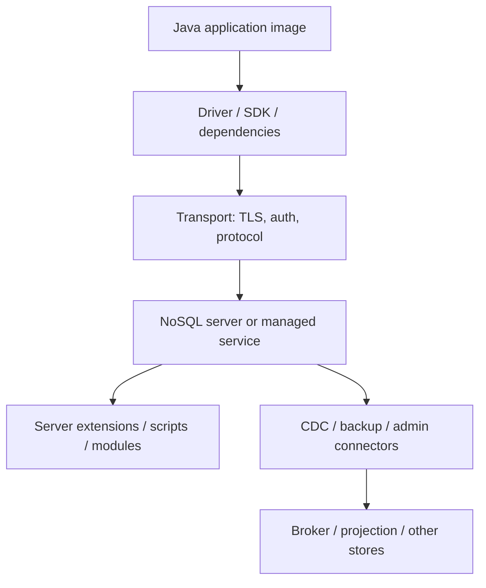
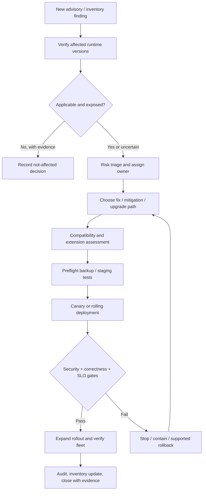

# Vá driver/server và đánh giá ảnh hưởng của tính năng mở rộng

Một ứng dụng Java có thể vẫn đọc/ghi MongoDB, Cassandra, Redis hoặc DynamoDB bình thường dù driver, server, plugin hay connector đã lỗi thời. Điều đáng lo không chỉ là hiệu năng: một lỗ hổng trong driver, thư viện phụ thuộc, cơ chế xác thực, thành phần máy chủ hoặc tính năng mở rộng có thể tạo đường tấn công mới. Ngược lại, vá một thành phần mà không kiểm tra tương thích có thể làm API mất kết nối, giao dịch bị xử lý hai lần, cluster mất quorum, CDC không tiếp tục được từ checkpoint hoặc bản sao mới không đọc được dữ liệu cũ.

Bài **Database No SQL → Bảo mật dữ liệu → Vá driver/server và đánh giá ảnh hưởng của tính năng mở rộng** trình bày cách quản trị hai rủi ro song song:

1. **Rủi ro chưa vá:** thành phần đang chạy tồn tại điểm yếu bảo mật, thiếu bản sửa hoặc hết thời gian hỗ trợ.
2. **Rủi ro thay đổi:** bản vá, nâng cấp hoặc tính năng mở rộng làm thay đổi giao thức, quyền, dữ liệu, topology, vận hành hoặc hành vi ứng dụng.

Mục tiêu không phải “luôn nâng tất cả lên phiên bản mới nhất bằng mọi giá”, cũng không phải “không động vào hệ đang chạy ổn”. Mục tiêu là **biết chính xác thành phần nào đang thực thi, ưu tiên lỗ hổng theo ngữ cảnh, triển khai bản sửa an toàn, và chỉ bật phần mở rộng sau khi hiểu được quyền, tài nguyên và failure modes của nó**.

Tình huống xuyên suốt:

```text
Ứng dụng:
    Java order-service
      ├── NoSQL Java driver + transitive dependencies
      ├── connection pool, TLS, authentication
      └── CDC projection worker

Hạ tầng:
    NoSQL primary/replicas hoặc managed service
      ├── storage/replication/protocol
      ├── authorization and audit settings
      └── optional extensions / modules / scripts

Thay đổi cần đánh giá:
    - Driver có security advisory.
    - Server cần bản vá bảo mật.
    - Team muốn bật plugin/UDF/module để giảm latency.
```

> Không nên áp một lệnh nâng cấp chung cho tất cả NoSQL. Khả năng rolling upgrade, tính tương thích phiên bản, phạm vi feature flags, quyền thực thi mã mở rộng và khả năng downgrade phụ thuộc sản phẩm, phiên bản, deployment mode và nhà cung cấp. Những bản cấu hình/lệnh trong bài là ví dụ cần điều chỉnh, **không phải lệnh an toàn để chạy trực tiếp trên production**. Không suy đoán CVE, affected versions hoặc bản sửa khi chưa có nguồn advisory chính thức.

---

## 1. Thuật ngữ: vá, nâng cấp, hardening và mở rộng

| Thuật ngữ | Ý nghĩa chính | Ví dụ |
| --- | --- | --- |
| **Security patch** | Sửa một lỗ hổng đã xác định | Bản phát hành sửa validation/authentication |
| **Maintenance release** | Sửa lỗi và cải tiến nhỏ | Bản driver/server bảo trì |
| **Minor/major upgrade** | Thay đổi phiên bản và có thể có hành vi/API mới | Đổi thế hệ driver hoặc server |
| **Configuration hardening** | Giảm bề mặt tấn công bằng cấu hình | Bật TLS, tắt tính năng không cần, giới hạn role |
| **Extension/plugin/module** | Mã hoặc thành phần bổ sung khả năng cho engine/driver/pipeline | Redis module, search plugin, CDC converter |
| **Feature enablement** | Bật một capability đã có trong sản phẩm | Server-side script, change stream, UDF |
| **Protocol change** | Thay đổi cách client và server giao tiếp | Driver handshake/wire protocol |
| **Data format migration** | Thay đổi cách dữ liệu/index/log được lưu hoặc hiểu | Storage format/feature compatibility transition |

Một thay đổi có thể thuộc nhiều nhóm. Ví dụ vá server bằng major upgrade đồng thời đổi data format và authentication defaults. Vì vậy phân loại thay đổi theo **tác động thực**, không chỉ tên bản phát hành.

## 2. Phân biệt “đã cập nhật package” và “đã hết rủi ro”

Các tình huống dễ nhầm:

```text
Build file khai driver version mới
    nhưng production pod vẫn chạy image cũ.

Server image đã pull bản mới
    nhưng process chưa restart/rollout.

Dependency manifest mới
    nhưng fat JAR chứa JAR vulnerable được đóng gói riêng.

Cluster có node đã vá
    và node chưa vá vẫn phục vụ traffic.

Managed service được provider vá hạ tầng
    nhưng client SDK, credentials và feature config chưa đổi.

Extension được disable trong config
    nhưng binary/script và quyền load động vẫn còn.
```

**Sự thật cần kiểm là phiên bản và cấu hình đang chạy trên từng execution path**, không chỉ commit Git hoặc bản khai báo mong muốn.

## 3. Ba lớp cần vá riêng

Sơ đồ:



Các lớp:

- **Client/application layer:** Java driver, dependency transitives, TLS provider, serializer, connection pool, instrumentation, JVM và base image.
- **Database/server layer:** binary/container/managed engine, OS dependencies, replication, auth, storage, configuration và network endpoints.
- **Extension/integration layer:** module/plugin/UDF/script, custom authenticator, CDC connector, backup agent, search extension, serializers/converters và operator tooling.

Một advisory cho một lớp không tự có nghĩa những lớp khác đã an toàn. Tương tự, nâng server không thay driver trong các application pods.

## 4. Mô hình đe dọa trước khi chọn bản vá

Hỏi:

1. Kẻ tấn công có thể tới endpoint từ Internet hay chỉ mạng nội bộ?
2. Cần xác thực trước khi khai thác không?
3. Service account có quyền đọc/ghi/admin ở phạm vi nào?
4. Input đến từ người dùng, stream, file backup hay operator?
5. Lỗ hổng ảnh hưởng availability, confidentiality, integrity hay cả ba?
6. Có thể dẫn tới remote code execution, thông tin nhạy cảm bị lộ, privilege escalation, denial of service hoặc data corruption không?
7. Có extension cho phép thực thi mã trong process NoSQL không?
8. Dữ liệu có chứa PII, secrets, thanh toán hoặc thông tin tenant nhạy cảm không?
9. Một node bị chiếm có lan sang replica, admin control-plane hoặc downstream không?
10. Những cơ chế phòng vệ hiện hữu có thực sự chặn đường khai thác không?

Không đánh giá rủi ro chỉ theo tên sản phẩm và severity công bố. **Khả năng khai thác trong môi trường cụ thể** mới giúp sắp ưu tiên, nhưng không được bỏ qua rủi ro chỉ vì endpoint “nằm trong private network”.

## 5. Tạo inventory: không biết có gì thì không thể vá đúng

Một **software/component inventory** nên mô tả cả dependency và nơi nó thực thi.

| Thành phần | Ví dụ cần lưu | Vì sao cần |
| --- | --- | --- |
| Java runtime | JDK vendor/version, base image digest | TLS/provider và runtime security |
| NoSQL driver | Artifact/module/version | API/protocol/security |
| Transitive library | Serializer, Netty, HTTP/TLS client | Vulnerability gián tiếp |
| NoSQL server | Engine/edition/build/version | Bản vá server và hỗ trợ |
| Cluster node | Host/Region/role/version | Mixed-version, blast radius |
| Managed service | Engine compatibility mode/provider maintenance | Phân chia trách nhiệm vá |
| Extension | Name/version/hash/signature | Mã chạy trong/ngoài database |
| Connector | CDC source/sink, SMT/transformer, version | Có thể đọc/ghi dữ liệu nhạy cảm |
| Admin/backup tool | CLI, operator, exporter | Quyền cao và đường export |
| Configuration | TLS/auth, script permission, ACL | Bề mặt tấn công không nằm trong version |
| Owner | Team/criticality/SLO | Đầu mối xử lý sự cố |

Có thể giữ inventory qua SBOM, image metadata, IaC, runtime diagnostics và configuration management. **SBOM của build không chứng minh runtime đã chạy đúng image**, nên cần đối chiếu deployment thực.

## 6. SBOM và dependency graph

**Software Bill of Materials (SBOM)** mô tả các components, versions và quan hệ phụ thuộc. Những định dạng phổ biến gồm CycloneDX và SPDX.

Ví dụ dependency tree mang tính khái niệm:

```text
order-service
  ├── nosql-driver
  │    ├── transport-library
  │    ├── codec-library
  │    └── logging-abstraction
  ├── metrics-agent
  └── CDC/serialization libraries
```

Một lỗ hổng có thể nằm ở `transport-library`, dù application không import trực tiếp.

Cần:

- Xác định dependency trực tiếp và transitives.
- Xác định resolved version thật trong `runtimeClasspath`, không chỉ version mong muốn.
- Kiểm tra nhiều bản của cùng thư viện nếu shaded/embedded.
- Gắn SBOM với artifact digest/build ID.
- Theo dõi bản JDK và OS/container layers ngoài JAR.
- Xem native libraries và plugins cài động ngoài Maven/Gradle.
- Ghi scanner/version/date của vulnerability data.
- Giải thích false positive hoặc không bị ảnh hưởng bằng bằng chứng.
- Cập nhật SBOM khi image rebuild/deploy.

**Không xem “dependency scan sạch” là bằng chứng phần mở rộng hoặc cấu hình server hoàn toàn an toàn.**

## 7. Direct vs transitive dependencies

Giả sử:

```text
order-service -> NoSQL driver A -> library B -> library C
```

Advisory nằm ở C. Thay version của driver A có thể kéo C sang bản sửa, nhưng không phải lúc nào cũng đúng vì:

- Dependency constraints/lockfile giữ bản cũ.
- Runtime classpath có thư viện khác ép version.
- Một library được shaded vào JAR.
- API incompatible khi ép transitive version mới.
- Driver yêu cầu một dải transport library cụ thể.

Quy trình:

```text
Identify affected class/package and resolved artifact.
Determine whether vulnerable code path is reachable.
Find vendor-supported fixed combination.
Update dependency constraints cautiously.
Run compile, integration, compatibility and security tests.
Verify runtime artifact after deployment.
```

Không ép một transitive dependency lên major version mới chỉ để scanner hết báo mà không kiểm driver support.

## 8. Các trục phiên bản cần quản trị

Không nên chỉ có:

```text
Java driver version = X
Server version = Y
```

Cần tối thiểu:

```text
JDK / JVM
    ↕
Driver API + dependency stack
    ↕
Authentication/TLS/protocol
    ↕
NoSQL engine server
    ↕
Storage/index/log format
    ↕
Extensions/plugins/connectors
```

Một **compatibility matrix** theo workloads:

| Trục | Câu hỏi |
| --- | --- |
| JDK ↔ driver | Driver hỗ trợ JDK runtime đang chạy không? |
| Driver ↔ server | Handshake/protocol/features có được hỗ trợ không? |
| Driver ↔ auth | SCRAM/IAM/OIDC/TLS/cert behavior có đổi không? |
| Driver ↔ app | Method signatures, exceptions, default retries có đổi không? |
| Server ↔ replica | Mixed-version rolling có được hỗ trợ trong cửa sổ upgrade không? |
| Server ↔ storage | Data format/feature compatibility có đổi một chiều không? |
| Server ↔ extensions | Module/plugin ABI/API có tương thích không? |
| CDC ↔ source | Resume token, log format, checkpoint có tiếp tục được không? |
| Backup ↔ restore | Bản backup tạo bởi version mới có restore vào version dự kiến được không? |

**Một kết nối bắt tay thành công chưa chứng minh transaction semantics, CDC continuity hoặc tính đúng dữ liệu.**

## 9. Support lifecycle và EOL

Một phiên bản có thể:

```text
Running fine
    nhưng vendor đã end-of-support.
```

Rủi ro:

- Không còn bản vá chính thức.
- Scanner khó tìm đường cập nhật an toàn.
- Driver mới có thể ngừng tương thích.
- Compliance policy có thể không cho sử dụng.
- Khó nhận hỗ trợ khi xảy ra sự cố.
- Extension tác giả độc lập có thể bỏ dự án từ trước.

Cần ghi:

- Current version và release channel.
- EOL/support status theo vendor.
- Latest security maintenance branch tương ứng.
- Approved upgrade target.
- ETA và owner.
- Known incompatible extensions.
- Exception/compensating controls nếu chưa nâng được.

Không tự gán một ngày EOL từ kinh nghiệm nếu chưa xác minh bằng thông báo hiện hành của nhà cung cấp.

## 10. Các nguồn thông tin lỗ hổng

Khi triage một thành phần, thường phải xem:

- Vendor security advisories và release notes.
- Official package/repository maintenance notices.
- CVE record và nguồn tham chiếu được kiểm chứng.
- Cơ sở dữ liệu lỗ hổng có mô tả affected/fixed versions.
- Scanner results/SBOM matching.
- Exploitability information khi có nguồn tin đáng tin cậy.
- Incident reports liên quan phiên bản thực.
- Internal inventory và deployment topology.

Một CVE có thể mô tả phạm vi affected versions khác nhau giữa các distribution/fork. **Phải đối chiếu bản vá của vendor/managed provider cụ thể**, không chỉ so chuỗi version.

Nếu advisory yêu cầu xác thực hoặc một feature tùy chọn đang tắt, hãy ghi bằng chứng. Nếu thông tin chưa rõ, giữ trạng thái `UNDER_INVESTIGATION`, không tự đánh dấu `NOT_AFFECTED`.

## 11. CVSS severity không phải mức ưu tiên duy nhất

Một lỗi có severity cao có thể:

- Ở một API không được ứng dụng sử dụng.
- Cần admin access vốn được giới hạn rất chặt.
- Chỉ ảnh hưởng module đã vô hiệu hóa.
- Có mitigation tạm được vendor xác nhận.

Ngược lại, một lỗi severity thấp hơn vẫn có thể quan trọng vì:

- Endpoint Internet-exposed.
- Có data exfiltration path rõ.
- Workload account có quyền rộng.
- Component là single point of failure.
- Bị khai thác tự động trong thực tế.
- Ảnh hưởng trực tiếp tenant isolation hoặc tính đúng giao dịch.

Nên dùng kết hợp:

```text
Severity + exploit maturity + exposure
+ reachable code path + privileges required
+ asset criticality + compensating controls
+ remediation risk + time to patch
```

Không dùng “scan chưa tìm thấy exploit” làm lý do trì hoãn vô thời hạn một bản vá nguy hiểm.

## 12. Phân loại một findings theo trạng thái có chứng cứ

Một mẫu:

```text
NEW
    -> TRIAGED
    -> AFFECTED / NOT_AFFECTED / NEEDS_EVIDENCE
    -> FIX_AVAILABLE / MITIGATION_ONLY / NO_FIX_YET
    -> SCHEDULED / EMERGENCY
    -> DEPLOYED
    -> VERIFIED
    -> CLOSED
```

Nếu `NOT_AFFECTED`, phải ghi:

- Component thực sự không có trong runtime, hoặc
- Affected code path không reachable theo bằng chứng đáng tin, hoặc
- Vendor xác nhận cấu hình/edition không bị ảnh hưởng.

Nếu `MITIGATION_ONLY`, phải ghi:

- Control đang áp dụng.
- Mức độ kiểm chứng.
- Owner.
- Thời hạn review.
- Khi nào chuyển sang fixed version.

Không xóa finding khỏi dashboard chỉ vì muốn giảm số cảnh báo.

## 13. Ma trận ưu tiên vá theo rủi ro

| Bối cảnh | Hành động ưu tiên |
| --- | --- |
| Lỗ hổng có khả năng khai thác cao trên endpoint truy cập được | Emergency patch/mitigation theo incident policy |
| Privilege escalation qua plugin có quyền admin | Disable/restrict feature và vá nhanh |
| Driver vulnerable nhưng service chưa chạy affected API | Xác minh, lập kế hoạch và vá trong chu kỳ phù hợp |
| Server unsupported/EOL | Upgrade plan có owner, deadline và compensating controls |
| Chỉ ảnh hưởng tool migration không chạy thường xuyên | Kiểm soát tool/credential, vá trước lần chạy tiếp |
| Không có fixed version | Mitigate, isolate, monitor, theo dõi advisory |
| Bản vá đòi storage migration không reversible | Chuẩn bị rehearsal/recovery và rollout bảo thủ hơn |
| Managed service chịu trách nhiệm binary patch | Theo dõi provider advisory/maintenance và phần app vẫn sở hữu |

Các mức thời gian remediation phải theo tổ chức và quy định liên quan; không tự coi bảng này là SLA bảo mật toàn cầu.

## 14. Patch availability khác compatibility

Vendor phát hành một bản sửa không có nghĩa có thể đổi tất cả các thành phần ngay.

Ví dụ:

```text
Fixed server requires protocol level P.
Old Java driver only supports previous protocol range.
A CDC connector does not understand new change token format.
A Redis module is compiled for old server ABI.
```

Cần **chọn một tổ hợp tương thích** và một thứ tự rollout được hỗ trợ, chẳng hạn:

```text
Upgrade client drivers to a version compatible with old and new server.
Verify application.
Roll server nodes following vendor-prescribed order.
Enable any new server feature only after cluster reaches target state.
Upgrade/remove extensions or connectors as required.
```

Đây là mô hình khái niệm, **không phải quy luật luôn “driver trước server”**. Một số phiên bản/protocol cần thứ tự khác; phải dùng vendor upgrade path.

## 15. Phân biệt rolling upgrade và zero downtime

Một rolling upgrade thay lần lượt instances/nodes. Nó **có thể** giảm gián đoạn, nhưng không tự chứng minh zero downtime:

- Primary election có thể làm requests timeout/abort.
- Quorum có thể thiếu tạm thời.
- Replica lag khiến read freshness thay đổi.
- Authentication/config khác nhau giữa nodes.
- Connection pools gặp reset/reconnect storm.
- Clients có thể không hỗ trợ mixed versions.
- CDC consumers có thể trễ hoặc mất resume window.
- Write outcome sau disconnect có thể là UNKNOWN.

Bảo đảm outage/availability phải đến từ topology, client retry/idempotency và phép đo thực tế, không từ tên “rolling”.

## 16. Preflight trước một bản vá server

Một danh sách chuẩn bị:

```text
[ ] Patch target xác nhận từ official source.
[ ] Asset inventory chính xác theo node/Region.
[ ] Driver/JDK/extension compatibility matrix.
[ ] Backup và restore test gần đây.
[ ] Dung lượng disk/CPU/network đủ cho rolling/rebalance.
[ ] Replica health và replication lag trong ngưỡng.
[ ] Quorum/failure domains được hiểu.
[ ] Change stream/CDC checkpoint hợp lệ.
[ ] SLA/maintenance window và communication plan.
[ ] Canary test environment gần production.
[ ] Feature compatibility/data format risk đã được xem.
[ ] Rollback có giới hạn rõ (config/binary/data).
[ ] Stop conditions và người có quyền stop.
[ ] Audit/monitoring theo từng node và client.
```

Nếu backup chưa từng restore thành công, một bản backup tồn tại trên disk **chưa phải bằng chứng khôi phục được**.

## 17. Quorum và thứ tự thay node

Với một cluster nhân bản, mọi thao tác phải xét **số bản sao cần có và fault domain**.

Ví dụ khái niệm:

```text
Replicas: A, B, C
Required write quorum: 2

Take A offline for patch:
    B + C must remain healthy enough to serve.
```

Nhưng:

- Có thể có roles/leader khác nhau.
- Một node offline có thể kích hoạt nhiều replication work.
- B và C có thể ở cùng availability zone.
- Read consistency levels khác nhau.
- Shard/partition ownership không đều.
- Một node đơn giản “healthy” không bảo đảm disk/network capacity đủ.

Không áp quy tắc “mỗi lần tắt một node” cho mọi cluster mà không kiểm đúng hướng dẫn upgrade và quorum topology.

## 18. Mixed-version windows là một giai đoạn rủi ro

Trong rolling upgrade:

```text
Node A: new server version
Node B: old version
Node C: old version
```

Cần xác minh:

- Replica communication giữa các versions.
- Wire protocol compatibility.
- Leader election behavior.
- Data/index format compatibility.
- Feature flags không kích hoạt tính năng các node cũ không hiểu.
- Node join/restart consistency.
- Authentication/TLS settings giống như dự kiến.
- Plugin/modules có thể load trên từng version không?
- Client routing có giữ đúng không?

**Mixed-version operation thường chỉ được hỗ trợ trong những đường nâng cấp cụ thể và thời gian giới hạn**, không phải một cấu hình lâu dài.

## 19. Feature compatibility và khả năng downgrade

Một số database có cơ chế versioned feature compatibility hoặc storage format transitions. Khi chuyển mốc đó:

```text
Binary upgrade completed
    -> new feature compatibility enabled
    -> metadata/storage changes may become irreversible
```

Không được hiểu:

```text
Rollback = run old container image.
```

Rollback có thể cần:

- Hạ feature compatibility khi còn được hỗ trợ.
- Không bật feature mới trước khi xác minh toàn cluster.
- Restore backup sang cluster cũ.
- Replay logical changes từ một điểm phục hồi phù hợp.
- Chuyển traffic sang hệ cũ bằng migration có kiểm soát.

Nếu data format đã đổi không tương thích, khởi động binary cũ trên cùng storage **có thể thất bại hoặc nguy hiểm**. Phải lấy downgrade path từ vendor, không đoán.

## 20. Rollback strategy: phân biệt các lớp

| Loại thay đổi | Rollback có thể là | Rủi ro |
| --- | --- | --- |
| Java driver only | Revert app image | API/serialization behavior có thể đã đổi |
| Server binary maintenance | Follow supported reverse path | Storage/protocol compatibility |
| TLS/auth config | Restore config có phê duyệt | Lùi về cấu hình kém an toàn |
| Index build | Drop/disable index có kiểm soát | Chi phí build/drop, ảnh hưởng plans |
| New data format | Restore/migrate theo vendor | Không phải downgrade tại chỗ đơn giản |
| Plugin/module enable | Disable/unload/rollback plugin | State/plugin-owned data vẫn tồn tại |
| CDC connector | Restore connector config/checkpoint an toàn | Duplicate/missing events |
| Client feature flag | Turn off new code path | Dữ liệu được tạo theo feature mới có thể khó đọc |

**Một rollback thành công phải phục hồi contract nghiệp vụ**, không chỉ đưa process về trạng thái `UP`.

## 21. Backup là một phần của patch security

Trước thay đổi có khả năng ảnh hưởng dữ liệu:

- Xác minh backup mới và retention.
- Mã hóa backup và giới hạn access.
- Ghi schema/index/config versions.
- Biết Point-In-Time Recovery capabilities nếu có.
- Xác định RPO/RTO theo nghiệp vụ.
- Có bản diễn tập restore vào môi trường cô lập.
- Kiểm tra data correctness, ACL và tenant isolation sau restore.
- Không cho maintenance job xóa hoặc ghi đè backup.
- Đánh giá CDC/outbox replay giữa điểm backup và thời điểm khôi phục.

Với một số managed services, provider cung cấp backup/snapshot APIs; trách nhiệm cấu hình, retention và phục hồi vẫn phải được xác định rõ.

## 22. Bản vá bảo mật có thể tác động authentication

Sau nâng version:

```text
Old client TLS/auth method -> accepted.
New server stricter policy -> rejected.
```

Các khu vực cần kiểm:

- TLS protocol/cipher policy.
- Certificate chain/trust anchors.
- Hostname verification.
- mTLS client certificates.
- IAM/OIDC/token refresh.
- SCRAM hoặc cơ chế xác thực bản địa.
- Authentication database/realm.
- Role grants và authorization defaults.
- Certificate revocation/rotation.
- Connection string parser và URI encoding.

Không giải quyết bằng cách tắt TLS validation hoặc bật insecure compatibility mode mặc định. Nếu cần migration tạm, hãy giới hạn scope/thời hạn và có kế hoạch loại bỏ.

## 23. “Bật TLS” khác “kiểm chứng TLS đúng”

Một Java client có thể thiết lập kết nối mã hóa nhưng cấu hình sai:

```text
TLS enabled: yes
Hostname verification: disabled
Trust store: accepts arbitrary certificate
```

Điều đó không cung cấp sự xác thực server như kỳ vọng.

Khi nâng driver/server:

- Giữ hostname verification.
- Dùng CA/trust bundle theo chính sách.
- Không lưu private keys trong repository.
- Test certificate expiry và rotation.
- Test connecting to a host with wrong certificate phải fail.
- Kiểm tra client fallback có thể rơi xuống plaintext không.
- Theo dõi TLS handshake errors, protocol negotiation.
- Đảm bảo local/staging không dạy production thói quen `trustAll`.

**Bản vá không nên trở thành lý do làm yếu xác thực đường truyền.**

## 24. Java driver upgrade: kiểm tra nhiều hơn compile

Một driver có thể compile thành công nhưng thay đổi:

- Connection pooling và topology discovery.
- Retry/read-retryable-write defaults.
- Operation timeouts/deadlines.
- Codec/serialization, null handling, numeric mapping.
- Exception types/error labels.
- Authentication mechanism.
- TLS provider behavior.
- Default read/write consistency.
- Transactions và session behavior.
- Monitoring/metrics/tracing hooks.
- Pagination/cursor handling.
- Backpressure/asynchronous API.
- Native driver dependencies.
- Deprecated/removed APIs.

**Bài test compile không chứng minh tính đúng của query và write semantics**, nhất là khi retry sau timeout có thể nhân đôi side effects.

## 25. Driver không phải lớp hỗ trợ schema migration tự động

Một thư viện client mới không nhất thiết tự:

```text
Convert all documents.
Rebuild indexes.
Update TTL semantics.
Migrate data partitions.
Change CDC checkpoints.
```

Tách kế hoạch:

```text
Driver/library update
Server/engine update
Schema/index changes
Data backfill
Feature activation
```

Có thể phối hợp thành một chương trình nhưng mỗi bước cần gates, người sở hữu và rollback riêng.

Một release làm cả năm việc cùng lúc rất khó xác định root cause khi lỗi xảy ra.

## 26. Test matrix cho driver trước khi rollout

| Test | Mục tiêu |
| --- | --- |
| Point reads | Đúng key/value, mapping |
| Indexed range/list | Filter, sort, pagination không đổi |
| Conditional writes/CAS | Lost-update và conflict semantics |
| Transaction commit | Atomicity, retry và unknown outcome |
| Delete/TTL | Không resurrect data, expiration đúng |
| Read consistency | Không hạ freshness contract |
| Connection loss | Backoff và bounded retries |
| Server failover | Reconnect và topology discovery |
| TLS/cert rotation | Secure authentication |
| Authorization deny | Không dùng fallback admin account |
| Serialization edge cases | Big integers, decimals, dates, nulls |
| CDC/change stream | Resume and dedup, ordering |
| High concurrency | Pool behavior, p95/p99 |
| Mixed versions | Old/new driver cùng phục vụ |
| Extension-dependent APIs | Script/UDF/module compatibility |
| Native/transitive dependencies | Runtime classpath đúng |

Đây là **ma trận phạm vi**; testcase chi tiết phải dựa trên đường gọi của ứng dụng.

## 27. Bản vá server có thể đổi performance

Ngay cả maintenance release cũng có thể:

- Chỉnh query optimizer/index plans.
- Thay thread scheduling hoặc IO paths.
- Sửa memory/caching behavior.
- Thay compaction/GC characteristics.
- Giới hạn một feature trước đây quá lỏng.
- Tăng validation/logging.
- Thay cách xử lý timeout.
- Chỉnh security checks làm một số operations tốn thêm chi phí.

Nếu API p99 tăng sau vá, cần đối chiếu:

```text
Same workload
Same data/tenant skew
Same index/schema
Same consistency/durability
Same cache state
Same topology and traffic mix
```

Không vội rollback security patch chỉ vì một lần benchmark không có điều kiện so sánh. Có thể cần tối ưu query hoặc điều chỉnh resource, nhưng giữ correctness/auth guarantees.

## 28. Thực hành thay đổi driver theo canary

Một chiến lược:

```text
1. Build new app image with fixed driver.
2. Record image digest, SBOM, JDK/driver versions.
3. Run unit + integration/security regression.
4. Deploy to staging with representative NoSQL topology.
5. Run chaos/failover and retry tests.
6. Route small approved traffic cohort to canary.
7. Compare against stable pods under same SLO.
8. Expand cohort gradually if gates pass.
9. Keep ability to stop/revert app image.
10. Verify every production pod uses expected artifact.
```

Đặt **rollback gates** cho lỗi dữ liệu/authorization nghiêm ngặt hơn gates hiệu năng. Một sự cố cross-tenant leak hay double-charge không được bù bởi latency p99 tốt.

## 29. Một canary chỉ so version mà không so dữ liệu là chưa đủ

Ví dụ:

```text
Old driver:
    serializes amountMinor as 64-bit integer.

New codec path:
    converts through double or wrong decimal mapping.
```

Response time có thể không đổi, nhưng số tiền hoặc timestamp bị sai.

Cần đối chiếu:

- Serialized form của decimal, UUID, timestamps, binary.
- Schema defaults/unknown fields.
- Query result sets theo keys/versions.
- Pagination cursor and ordering.
- CAS conditions và transaction receipts.
- Idempotency behavior sau retries.
- Read-your-writes/monotonic reads nếu được hứa.
- Encryption/decryption của trường dữ liệu nhạy cảm.
- Change event format downstream.

**Security patch deployment chỉ được coi là hoàn thành khi business behavior vẫn đúng**, không chỉ khi service healthy.

## 30. Feature flags cho hành vi mới

Một driver/server upgrade đôi khi đi kèm feature mới:

```text
Feature X:
    advanced query pushdown
    new script API
    new authentication mechanism
    new index type
```

Có thể giữ feature tắt khi chỉ muốn vá:

```text
Patch binary/library first
    -> establish stable baseline
    -> enable feature on canary
    -> evaluate separately
```

Lợi ích:

- Giảm số biến thay đổi cùng lúc.
- Dễ xác định lỗi.
- Có kill switch cho feature.
- Phân tách security remediation với performance experiment.

Nhưng một **security fix bắt buộc** không nên được đặt sau feature flag cho phép quay về vulnerable behavior vô hạn. Kill switch cho tính năng phụ khác với rollback bản sửa bảo mật.

## 31. Tính năng mở rộng làm tăng attack surface như thế nào?

Một extension có thể có thêm:

- Parser cho kiểu dữ liệu/lệnh mới.
- Scripting runtime hoặc code execution.
- Network client/egress.
- File read/write.
- Access tới credentials, environment và process memory.
- Quyền đăng ký command/procedure.
- Hooks ở authentication/authorization.
- Thread/CPU/memory pools riêng.
- Native code và ABI dependencies.
- Update/auto-download mechanism.
- Remote management/API.
- Logging chứa payload nhạy cảm.

Một plugin chỉ vài trăm dòng cũng có thể **chạy trong process có quyền rộng**, tạo blast radius lớn hơn kích thước source.

## 32. Phân loại extension theo trust boundary

| Loại | Chạy ở đâu | Rủi ro thường gặp |
| --- | --- | --- |
| Server module/plugin | Trong database process | Memory/process privileges, crash, data access |
| Server-side UDF/script | Trong sandbox/runtime của engine | CPU, memory, code execution, access controls |
| Search plugin | Search/database node | Parser/network/code permissions |
| Driver plugin/interceptor | Trong Java process | Credentials, query data, TLS hooks |
| CDC connector/transformer | Connector worker | Đọc dữ liệu nguồn, xuất dữ liệu, replay |
| Backup/export extension | Ops runner/control plane | Quản trị, file/cloud storage access |
| Authentication extension | Auth boundary | Bypass/privilege escalation |
| Monitoring/exporter | Sidecar/agent | Admin APIs, secrets, high-cardinality logs |
| Managed-service integration | Provider-managed component | Role trust, API scope, data egress |

Phải đánh giá từng extension **theo nơi chạy và quyền thật**, không chỉ theo chức năng quảng cáo.

## 33. Các câu hỏi trước khi cài plugin/module

1. Extension do ai phát hành và duy trì?
2. Nguồn package có được kiểm chứng không?
3. Có checksum/signature/provenance hợp lệ theo policy không?
4. Phiên bản hỗ trợ server/driver/JDK nào?
5. Có security advisories và lịch vá không?
6. Có phải native code hoặc được chạy trong DB process không?
7. Nó cần những roles/files/network endpoints nào?
8. Có đọc dữ liệu toàn bộ database hay chỉ collection cần thiết?
9. Có thể thực thi lệnh OS, mở socket hoặc spawn thread không?
10. Có giới hạn CPU/memory/time per execution không?
11. Có thể làm database crash hoặc block event loop không?
12. Có mã hóa và redaction dữ liệu qua logs/events không?
13. Có tạo data/index format riêng không?
14. Có thể tắt/gỡ mà không mất dữ liệu không?
15. Ai là owner và xử lý CVEs về sau?
16. Có policy chống tải extension động ngoài danh sách được duyệt không?

Nếu chưa trả lời được những câu hỏi quan trọng, nên giữ extension **chưa bật** cho tới khi có bằng chứng.

## 34. Quyền tối thiểu áp dụng cho chính extension

Một extension không nên mặc định dùng cùng quyền DB admin của installer hoặc runtime process nếu có cơ chế hạn chế.

Ví dụ một CDC transformer cần:

```text
READ approved change events
WRITE approved broker topic
WRITE own checkpoint
```

Không cần:

```text
WRITE source business records
MANAGE database users
EXPORT unrelated collections
EXECUTE arbitrary OS commands
```

Với extension chạy in-process không có sandbox/privilege separation, dù cấu hình permission nhỏ, **nó có thể kế thừa khả năng của DB process**. Khi đó đây là boundary trust rất mạnh; có thể chọn extension chạy ngoài database trong một service riêng để giảm blast radius.

## 35. Secure supply chain cho extension

Cần kiểm:

```text
Publisher identity
Source/release provenance
Artifact checksum/signature
Dependency tree and SBOM
License and maintenance status
Known vulnerabilities
Reproducibility/build process
Distribution and update channel
```

Không tải module động từ một URL bất kỳ trong startup script mà không xác minh nguồn.

Nếu extension được build từ source:

- Pin commit/tag đã review.
- Build trong pipeline được kiểm soát.
- Kiểm dependency versions.
- Đánh giá native compiler/toolchain khi có.
- Quét binary và dependencies theo policy.
- Lưu artifact digest.
- Ký/phát hành qua artifact registry được duyệt.
- Không để production node tự `curl | sh` hoặc tải code chưa kiểm từ Internet.

## 36. Redis modules: rủi ro trong server process

Redis modules có thể bổ sung cấu trúc dữ liệu và commands mới. Một số modules dùng native code và chạy gắn chặt với Redis server.

Cần đánh giá:

- Redis server version vs module compatibility.
- Module ABI/API và binary architecture.
- Cơ chế load/unload và quyền ai được thực hiện.
- Command ACL categories/permissions.
- Memory accounting và fragmentation.
- Persistence/RDB/AOF interoperability.
- Replication/cluster behavior.
- Eviction/TTL semantics.
- Failover.
- Module-owned data format khi downgrade/remove.
- Crash/isolation: module lỗi có thể ảnh hưởng server process.
- Khả năng nâng module theo rolling topology.

**Disable module** có thể chưa đủ nếu dữ liệu đang lưu ở kiểu do module định nghĩa; gỡ module bừa có thể khiến dữ liệu không đọc được. Cần migration/export plan.

## 37. Redis Lua và Functions: mở rộng khả năng nhưng không miễn phí

Một script có thể giúp atomic update trên một key/slot:

```lua
local existing = redis.call("GET", KEYS[1])

if existing == ARGV[1] then
    return "NO_CHANGE"
end

redis.call("SET", KEYS[1], ARGV[1])
return "UPDATED"
```

Điểm cần kiểm:

- Script có thể chạy lâu và ảnh hưởng latency server.
- Command permissions/ACL có thể khác giữa các version và contexts.
- Key access/cluster slot restrictions.
- Scripts có được phép gọi những commands nguy hiểm không?
- Inputs có được validate và bound size không?
- Có thể tạo CPU/memory pressure từ loop hoặc payload lớn không?
- Script/result logging có lộ secrets không?
- Rollout có thay behavior/idempotency không?
- Reload/restart/failover có ảnh hưởng cache function state không?

Không cho service account quyền scripts/functions rộng chỉ vì nó cần một atomic counter. Nếu có lựa chọn native command hoặc server-side operation đã được review và giới hạn, so trade-off trước.

## 38. Redis ACL không thay kiểm thử module security

Một Redis ACL có thể giới hạn command/key patterns; tuy nhiên extensions có thể khai báo commands mới hoặc thay đổi cách xử lý key.

Cần kiểm:

```text
User reader can GET approved key.
User reader cannot call module write/admin commands.
User writer can perform only approved module operations.
Module does not expose unexpected data through new commands.
ACL rules remain enforced after server/module upgrade.
```

Không mặc định `+@read` sẽ chỉ cho đúng các commands bạn biết ở thời điểm cũ khi module mới đăng ký command/ACL metadata. Phải test effective permissions trên phiên bản mới.

## 39. MongoDB: driver/server upgrades và tính năng server-side

Với MongoDB, cần xem:

- Driver/server compatibility theo vendor.
- Authentication/TLS/SCRAM/OIDC/IAM-like integrations (tùy môi trường).
- Wire protocol và topology.
- Read concern/write concern.
- Retryable reads/writes và transaction behavior.
- Change streams/resume tokens.
- Index plans/collation/TTL.
- Replica sets và sharded clusters.
- Server feature compatibility khi có.
- Aggregation features được bật ở version mới.

Một server-side aggregation expression hoặc JavaScript-related capability **không nhất thiết là plugin bên thứ ba**. Dù vậy, khi một tính năng cho phép thực thi biểu thức/mã trên server, hãy xét quyền, resource limits, tính ổn định và input safety.

Không nhầm Atlas integrations/triggers với core server plugin native trên self-managed MongoDB; chúng có deployment, identity và security boundaries riêng.

## 40. MongoDB: change streams sau nâng cấp

Một CDC consumer có thể giữ:

```text
resumeToken
lastAppliedAggregateRevision
targetProjectionCheckpoint
```

Sau nâng server/driver:

- Consumer còn resume được từ token cũ trong cửa sổ được hỗ trợ không?
- Thứ tự/metadata của events có thay đổi không?
- Event schema có fields mới không?
- Có transaction event handling/large events phù hợp không?
- Không bỏ events khi reconnect.
- Không áp effect trùng sau replay.
- Delete/tombstone vẫn được xử lý.
- Lag còn nằm trong retention window.

Nếu resume không thể thực hiện, không tự reset consumer về “mới nhất” rồi bỏ events cũ. Cần recovery/backfill/reconciliation được kiểm chứng.

## 41. Cassandra/ScyllaDB: server và Java driver

Những điểm cần đối chiếu:

- Driver protocol compatibility và cluster topology discovery.
- Authentication/authorization configuration.
- TLS, cipher/certificate handling.
- Query preparation và schema agreement.
- Consistency levels và retry/speculative execution policy.
- LWT/CAS outcomes và timeout semantics.
- Paging state compatibility.
- Compaction/tombstone behavior.
- Native transport, client pooling.
- CDC feature/connector format và retention.
- Rolling nodes và repair/streaming overhead.

Không suy rằng `SELECT` chạy được là `IF NOT EXISTS`, CAS, batch và read consistency đều tương thích đúng.

## 42. Cassandra/ScyllaDB: UDF, UDA và custom extensions

Một số wide-column engines/versions hỗ trợ user-defined functions/aggregates hoặc custom auth/authorization implementations. Những capabilities này không hoàn toàn giống nhau giữa Cassandra, ScyllaDB và từng edition.

Cần hỏi:

- Feature có được bật và được hỗ trợ production không?
- Function chạy trong sandbox nào?
- Có execution timeout/memory limits không?
- Có thể khiến coordinator/replica CPU quá tải không?
- Có thể truy cập filesystem/network hoặc lớp Java/native không?
- Ai được tạo/thay/xóa function?
- Function dùng dữ liệu nhạy cảm nào?
- Có thể phá serialization hoặc query determinism không?
- Behavior khi rolling versions mixed?
- Có test với dữ liệu/inputs bất thường?

Nếu engine không cung cấp sandbox đủ tin cậy cho code bên thứ ba, cân nhắc đưa logic sang **application/worker đã cô lập**, thay vì chạy trong database process.

## 43. Custom authenticator/authorizer là phần mở rộng đặc biệt nhạy cảm

Một extension thay authentication hoặc authorization có thể:

- Nhận credentials/tokens.
- Quyết định quyền truy cập mọi bảng.
- Ghi audit hoặc bỏ audit.
- Cho phép/deny connections.
- Tạo fail-open path nếu dependency không sẵn.

Nên áp:

- Chỉ lấy từ vendor/source được phê duyệt.
- Review độc lập security logic.
- Fail-closed policy khi không thể xác thực, theo contract.
- Test mọi principal: reader, writer, migrator, admin.
- Test revoke/rotation và role inheritance.
- Test khi identity provider timeout.
- Có break-glass/recovery plan không phụ thuộc vào extension bị lỗi.
- Theo dõi denied attempts và privilege escalations.

**Một lỗi ở auth extension có thể nguy hiểm hơn lỗi ở query plugin**, vì nó nằm ngay trong trust boundary.

## 44. DynamoDB: trách nhiệm server thuộc managed provider

Với một managed NoSQL service như DynamoDB, khách hàng thường **không trực tiếp cài bản vá binary server** lên các nodes nội bộ của provider.

Khách hàng vẫn sở hữu:

- AWS SDK/Java dependencies.
- IAM roles, trust policies, conditions và secrets.
- Table/index schema, encryption options trong phạm vi có thể cấu hình.
- VPC/network endpoint policies khi dùng.
- Application query/consistency/idempotency semantics.
- Lambda/connector runtimes.
- Dữ liệu, backup, restore và retention settings.
- Monitoring và incident response.
- Các managed integrations/extension-like features mà khách cấu hình.

Khi có provider advisory, kiểm tra **shared responsibility**, maintenance communications và những hành động khách phải thực hiện, thay vì tạo một server rolling plan cho hạ tầng khách không quản lý.

## 45. Managed service không miễn trách nhiệm bảo mật phần mở rộng

Một ứng dụng có thể dùng:

```text
DynamoDB Streams
    -> event source integration
    -> Java/Lambda consumer
    -> data warehouse/search index
```

Provider quản lý server của DynamoDB, nhưng:

- IAM role của consumer có thể quá rộng.
- Event payload có thể lộ PII.
- Runtime/SDK của consumer có CVE.
- Transformation code có bug.
- DLQ/target bucket không mã hóa hoặc public.
- Retry xử lý trùng payments.
- CDC lag gây dữ liệu thiếu.
- Backup/export privileges có thể bị lạm dụng.

**Shared responsibility** phải được viết đến từng thành phần pipeline, không chỉ gắn nhãn “managed”.

## 46. Elasticsearch/OpenSearch: plugins và scripts

Trong các hệ search/read-model liên quan NoSQL, plugins có thể:

- Thêm analyzers/tokenizers.
- Thêm authentication integration.
- Đăng ký ingest processors.
- Thay query/aggregation behavior.
- Cài Java dependencies hoặc native code.
- Sử dụng script engines.

Cần đánh giá:

- Compatibility với chính xác distribution/version.
- Plugin dependencies và license.
- Node restart/rolling install requirements.
- Script sandbox, allowed contexts và resource limits.
- Security plugin roles/privileges.
- Stored scripts và data leakage.
- Index mapping/segment format.
- Query behavior và cluster availability.
- Reindex/rollback nếu plugin tạo dữ liệu riêng.

Không coi plugin được liệt kê trong một marketplace/repository là đã đáp ứng chính sách bảo mật của tổ chức.

## 47. Graph database procedures và traversal extensions

Với graph NoSQL, procedure/plugin có thể có quyền rộng hơn truy vấn graph thông thường.

Rủi ro:

- Thực thi code trên graph server.
- Đọc nhiều labels/properties vượt mục đích.
- Traversal fan-out gây exhaustion.
- Import/export files hoặc network calls.
- Property-level PII leak.
- Procedure privilege bypass.
- Khác biệt giữa editions/versions.

Cần allowlist procedures, kiểm input và per-procedure privileges khi engine hỗ trợ, hạn chế resource budgets và có dedicated service cho các tác vụ có quyền cao.

## 48. CDC connector: extension chạy ngoài database vẫn rất nhạy cảm

Một connector có thể đọc hàng triệu changes:

```text
NoSQL source
    -> CDC connector
    -> converter/transform
    -> broker
    -> sink
```

Các rủi ro:

- Source credential có quyền đọc quá rộng.
- SMT/converter thêm code được nạp động.
- Sink destination cấu hình sai tenant/bucket/topic.
- Dead-letter queue lưu raw PII.
- Retry và duplicate delivery không được xử lý.
- Checkpoint bị reset khiến mất hoặc phát lại dữ liệu.
- Connector upgrade làm schema mapping sai.
- Plugin classpath đưa thêm transitive CVEs.

Khi vá connector, phải test **end-to-end data correctness**, không chỉ connector health.

## 49. Extension được tải động sau deploy

Một rủi ro supply chain khác:

```text
Server starts from approved image.
Operator or process loads plugin from an external path.
```

Lúc này image SBOM có thể không phản ánh module đang chạy.

Cần:

- Chính sách allowlist installed modules/plugins.
- Hạn chế quyền load/unload runtime.
- Image/manifest digest và inventory runtime.
- Audit plugin installation/change.
- Disable dynamic loading khi không cần và engine cho phép.
- Network egress restrictions.
- Filesystem immutability/read-only mounts khi phù hợp.
- Alert cho unknown modules.
- Reconcile runtime extensions với approved inventory.

Không chỉ scan container image rồi kết luận extension không đổi sau startup.

## 50. Sandbox, quota và resource limits

Khi extension chạy trong server/worker:

```text
One expensive script
    -> CPU 100%
    -> event loop/worker blocked
    -> p99 spike
    -> client retries
    -> additional load
```

Cần xác định cơ chế giới hạn:

- CPU time/per-command timeout.
- Memory budget và allocation controls.
- Allowed I/O và network.
- Number of concurrent executions.
- Data size limits.
- Loop/recursion limits.
- Request deadlines.
- Cancellation behavior.
- Isolation giữa tenants.
- Failover/restart impact.
- Policy khi extension panic/crash.

Nếu một extension không có giới hạn đáng tin ở tầng database, cân nhắc đưa nó ra một service riêng với sandbox và quotas của hệ điều hành/container.

## 51. Lỗ hổng trong plugin có thể thành sự cố dữ liệu

Ví dụ:

```text
Public query parameter
    -> application query
    -> extension parser
    -> untrusted input parsed in privileged process
```

Kẻ tấn công có thể nhắm:

- Malformed payload và parser edge cases.
- Resource exhaustion.
- Unauthorized command exposure.
- Script injection nếu ứng dụng dựng code từ input.
- Arbitrary file/network access nếu sandbox yếu.
- Cross-tenant access qua plugin.
- Data egress qua callback/telemetry.

Nguyên tắc phòng vệ:

```text
Validate input at API boundary.
Use parameterized/safe APIs where available.
Do not interpolate user input as executable script.
Limit extension privileges.
Disable unused plugin capabilities.
Apply patches and monitor.
```

Đây là threat modeling phòng thủ; không cần tạo exploit payloads để hiểu trách nhiệm vá.

## 52. Extension compatibility không chỉ theo version number

Một module tương thích với server binary có thể vẫn sai ở:

- Persistence/data encoding.
- Replication/cluster failover.
- ACL/permission checks.
- Query results/schema.
- Operational metrics.
- Backup/restore.
- CDC replay.
- Resource budgets.
- Concurrency/thread safety.
- Cross-region behavior.
- Upgrade/downgrade.

Kiểm thử một `PING` hoặc load plugin thành công **không đủ**. Phải chạy các đường business và failure scenarios có dùng extension.

## 53. Đánh giá lợi ích của extension phải có đường so sánh

Một team muốn bật server-side analytics UDF để tránh dữ liệu đi qua network.

Mô hình đánh giá:

```text
Without extension:
    Query -> read data -> Java computes -> response.

With extension:
    Query -> server-side function -> response.
```

Các yếu tố:

- CPU/time trên database nodes tăng hay giảm?
- Bytes/network giảm bao nhiêu?
- Có tạo hot key/partition không?
- Query p95/p99 thay đổi?
- Workload khác bị cạnh tranh tài nguyên?
- Có thể chạy sandbox với minimal privileges không?
- Có lộ dữ liệu ngoài scope không?
- Có bảo đảm tính xác định/idempotency không?
- Có lối rollback khi function logic sai không?
- Extension được bảo trì và vá bảo mật như thế nào?

**Giảm network traffic không đủ để biện minh cho chạy code không kiểm soát ngay trong process của database.**

## 54. Feature flags không che được lỗi bảo mật nếu mã vẫn chạy

Một flag:

```text
enableNewSearchPlugin=false
```

có thể ngăn application gọi plugin theo đường chính, nhưng:

- Binary vẫn đã load vào server process.
- Plugin có startup hook/HTTP endpoint.
- Một user khác có quyền gọi trực tiếp command mới.
- Mã dễ bị kích hoạt qua admin API.
- Một dependency lỗi vẫn nằm trong process.

Do đó, một feature flag ở ứng dụng là **giảm sử dụng**, không luôn là **giảm attack surface hoàn toàn**.

Để loại bỏ exposure, cần xác minh command/route/plugin thật sự disabled/unloaded và quyền truy cập bị chặn theo sản phẩm.

## 55. Bảo mật và hiệu năng của plugin phải đo cùng nhau

Một extension có thể cải thiện:

```text
p99 query: 400ms -> 80ms
```

nhưng kéo theo:

```text
DB CPU +60%
Memory +2GB/node
New network egress endpoint
New library with unresolved security advisory
Requires admin-like privileges
```

Một bảng quyết định:

| Chiều | Trước | Sau | Có chấp nhận? |
| --- | --- | --- | --- |
| Business correctness | Đúng | Phải giữ nguyên | Bắt buộc |
| Query latency | 400ms | 80ms | Lợi ích |
| DB CPU | 50% | 85% | Cần đánh giá headroom |
| Security permissions | Reader | Admin-like | Cảnh báo lớn |
| Dependency risk | Known | Unmaintained plugin | Có thể từ chối |
| Recovery | Rebuild đơn giản | Format tùy biến | Cần kế hoạch |
| Operations | Standard | Special procedure | Tăng chi phí |

Không quyết định chỉ dựa trên một cột p99.

## 56. Khung đánh giá extension trước phê duyệt

Một phiếu đánh giá:

```yaml
extension:
  name: "example-search-processor"
  version: "<approved-version>"
  artifactDigest: "<sha256>"
  publisher: "approved-upstream"
  maintainer: "search-team"
  purpose: "normalize search text"
  runtime: "server-process"
  access:
    dataScope: "catalog-index-only"
    filesystem: "none-required"
    networkEgress: "none-required"
    adminPrivilege: false
  dependencies:
    sbomPresent: true
    securityAdvisoriesReviewed: true
  compatibility:
    serverVersionRange: "<vendor-verified>"
    rollingUpgradeSupported: "<verified>"
    storageFormatImpact: "<assessed>"
  tests:
    performance: "required"
    isolation: "required"
    negativePermissions: "required"
    failover: "required"
    dataCorrectness: "required"
  rollout:
    canary: true
    disablePlan: "documented"
    rollbackDataCaveats: "documented"
  review:
    securityOwner: "security-team"
    operationsOwner: "database-team"
    reviewDate: "YYYY-MM-DD"
```

Đây là **mẫu kiểm soát** chứ không phải schema cấu hình thật của một engine.

## 57. Đánh giá rủi ro plugin theo ba mức tin cậy

Một cách thực dụng:

**Mức A — Function có sẵn trong engine**

- Được vendor bảo trì.
- Ít third-party dependencies hơn.
- Vẫn có thể có security/performance side effects.
- Phải xét privilege và input handling.

**Mức B — Extension do vendor hoặc đối tác được hỗ trợ phát hành**

- Có support/patch channel.
- Compatibility có thể rõ hơn.
- Không tự miễn security review.
- Cần xem quyền và chi phí.

**Mức C — Custom/community plugin**

- Có thể cần review source/binary sâu.
- Nguy cơ không có người vá khi CVE xuất hiện.
- Có thể không theo kịp server upgrades.
- Có nhiều supply-chain dependency.
- Cần owner, tests và exit plan rõ.

Đây không phải thang điểm tuyệt đối: native feature lỗi vẫn có thể nguy hiểm; một custom extension được review và cô lập tốt vẫn có thể phù hợp.

## 58. Java application plugins và instrumentation agents

Không phải chỉ server mới có extensions. Java có thể nạp:

```text
APM Java agent
Serializer extension
Driver interceptor
Custom authentication plugin
Logging/metrics agent
Native library
```

Một agent chạy cùng JVM thường có khả năng xem:

- Connection strings.
- Query parameters.
- Credentials trong memory nếu thiết kế kém.
- Response payloads.
- Stack traces.
- Network destinations.

Khi nâng driver, agent instrumentation có thể không tương thích, tạo:

- Connection errors.
- High CPU/GC.
- Missing traces.
- Sensitive data logging.
- Unexpected classpath conflicts.

Cần kiểm agent version, quyền/nơi gửi telemetry, sampling/redaction, dependency pinning và khả năng disable/rollback một cách có kiểm soát.

## 59. Không dùng dynamic plugin discovery không kiểm soát

Một số framework/driver dùng ServiceLoader, classpath scanning hoặc extension directories. Khi một JAR bất ngờ xuất hiện, code có thể được nạp dù không thấy explicit import.

Biện pháp:

- Giới hạn runtime classpath.
- Không mount thư mục plugin writable bởi untrusted processes.
- Chỉ deploy signed/approved image artifacts.
- Kiểm inventory của plugins đã load.
- Review service provider configurations.
- Không cho build pipeline lấy dynamic latest không pin.
- Tách optional plugin khỏi core runtime khi có thể.

Supply-chain security phải kiểm **điểm nạp động**, không chỉ dependency declarations.

## 60. Phân tách emergency patch khỏi feature rollout

Khi có security fix khẩn cấp và feature team muốn bật plugin mới:

```text
Security objective:
    remove exposed vulnerable behavior quickly.

Feature objective:
    enable new capability with performance gains.
```

Nên cân nhắc:

1. Vá tối thiểu để giảm exposure.
2. Giữ extension mới disabled nếu không liên quan bản sửa.
3. Xác minh security and correctness gates.
4. Roll extension trong change riêng sau khi ổn định.
5. Không kéo dài emergency patch vì một feature đang thử nghiệm.
6. Trường hợp extension chính là nguồn lỗ hổng, có thể disable/remove trước nếu contract cho phép.

Giảm số biến cùng lúc giúp khôi phục nhanh và biết đúng nguyên nhân nếu lỗi.

## 61. Quy trình chuẩn từ advisory đến production



Không bỏ qua nhánh `uncertain`: chưa đủ bằng chứng không có nghĩa an toàn.

## 62. Từng bước kiểm chứng driver được vá

Một tuyến kiểm chứng:

```text
Source dependency change
    -> resolved classpath
    -> built artifact
    -> container image digest
    -> deployed pod/process
    -> runtime driver version and behavior
```

Ví dụ trong một Gradle project, lệnh **minh họa để kiểm dependency**, không phải yêu cầu chạy STEP 4:

```bash
./gradlew dependencies --configuration runtimeClasspath
```

Khi cần xem lý do chọn một version cụ thể, có thể dùng dependency insight ở cấu hình tương ứng, theo version Gradle của dự án.

Không chỉ dùng output của `compileClasspath` nếu dependency vulnerable chỉ xuất hiện ở runtime.

Với fat JAR/native/image, cần kiểm được contents/metadata thực của artifact, không suy từ dependency lockfile.

## 63. Pinned versions và reproducibility

Một dependency:

```text
driver: latest.release
plugin: always download newest at startup
```

khiến hai builds cùng commit có thể tạo artifacts khác nhau. Điều này làm:

- Khó điều tra incident.
- Khó rollback.
- Khó chứng minh phiên bản đã được kiểm.
- Thêm supply-chain risk.
- Có thể nhận bản không tương thích mà không review.

Một cách tốt:

- Pin approved versions/digests.
- Dùng lockfile/BOM khi phù hợp.
- Có automated dependency update PRs.
- Quét SBOM và signature trước merge.
- Không tự động đưa bản chưa kiểm vào production.
- Lưu build provenance.
- Có cadence cập nhật để tránh pin mãi phiên bản EOL.

**Pin không có nghĩa đóng băng mãi; nó làm thay đổi trở nên có chủ đích và có kiểm chứng.**

## 64. Một manifest phiên bản phục vụ vận hành

Ví dụ YAML mô tả **trạng thái mong muốn**, không phải schema của product cụ thể:

```yaml
workload: order-service
environment: production
imageDigest: "sha256:<immutable-image-digest>"
java:
  runtime: "<approved-jdk-build>"
  driver:
    artifact: "<group:artifact>"
    version: "<approved-version>"
database:
  product: "<engine>"
  serverBuild: "<approved-build>"
  topology: "replicated"
  compatibilityPolicy: "<vendor-upgrade-guide>"
extensions:
  - name: "<extension-name>"
    version: "<approved-version>"
    digest: "sha256:<immutable-digest>"
    permissions: "read-approved-data-only"
security:
  tls: "required-and-verified"
  auth: "workload-identity"
  role: "order-command-prod"
  riskAssessmentId: "SEC-CHANGE-EXAMPLE"
rollout:
  strategy: "canary-or-vendor-supported-rolling"
  rollbackBoundary: "before-irreversible-format-change"
```

Runtime inventory phải được đối chiếu với manifest này; không mặc định manifest tự phản ánh thực tế.

## 65. Bảo vệ quyền tối thiểu trong patch rollout

Một tình huống:

```text
New driver starts using a previously unused metadata operation.
Application gets Unauthorized.
```

Đừng mặc định cấp:

```text
dbAdmin or clusterAdmin
```

Các bước:

1. Xác định exact denied action/resource.
2. Kiểm xem action có thật cần để thực hiện nghiệp vụ không.
3. Kiểm driver upgrade notes/default settings.
4. Có thể cấu hình client không gọi action không cần?
5. Nếu bắt buộc, cấp quyền nhỏ nhất có thể.
6. Chạy positive và negative permission tests.
7. Review role inheritance và trust.
8. Ghi lý do/owner vào policy-as-code.

**Bản vá driver không phải giấy phép cấp thêm admin privileges**.

## 66. Cấu hình feature mới có thể mở đường truy cập dữ liệu

Một extension/query feature mới có thể cho:

```text
READ on search projection
    -> join / lookup into source collection
```

Nếu service account có quyền rộng, ứng dụng có thể vô tình trả fields nhạy cảm chưa từng trả trước đó.

Cần:

- Phân tích dữ liệu có thể truy cập theo đường mới.
- Test cross-tenant và field-level exposure.
- Kiểm query/procedure permissions.
- Chặn raw user-provided expressions nếu không an toàn.
- Redact logs/projection content.
- Kiểm controls ở cả server và application.
- Kiểm data lineage qua CDC/search/cache.

Chỉ vì chức năng được gọi là “search extension” không có nghĩa nó không ảnh hưởng bảo mật dữ liệu.

## 67. Tích hợp backup/restore sau patch

Một kiểm chứng nên gồm:

```text
Backup created before upgrade
    -> restore into isolated target per supported path.

Backup created after upgrade
    -> restore into supported target version.

Check:
    data counts and representative hashes
    indexes/constraints
    authentication and roles
    encryption keys
    tenant isolation
    CDC/outbox resume plan
```

Không giả mọi backup có thể restore sang mọi major version. Đặc biệt khi extension tạo data types/index formats riêng, recovery có thể phụ thuộc vào đúng plugin version.

Nếu muốn bỏ extension, cần thử **export/migration dữ liệu** khỏi định dạng riêng trước.

## 68. Có thể cần blue-green migration thay vì rolling in-place

Rolling không phù hợp nếu:

- Server major version không hỗ trợ mixed-version.
- Storage format không thể downgrade.
- Extension cần rebuild toàn bộ dữ liệu.
- Data model/index migration thay đổi lớn.
- CDC connector không đọc được log format cũ/mới trong cùng giai đoạn.
- Business cần khả năng revert nhanh, còn in-place rollback không hỗ trợ.

Blue-green:

```text
Old cluster
    -> snapshot/backfill
    -> CDC incremental catch-up
    -> validate source/target
    -> route canary traffic
    -> controlled cutover
    -> decommission old after safety window
```

Nhưng đây không tự giải quyết consistency:

- Dual-write có partial failure.
- CDC lag/gaps có thể làm mất sự kiện.
- Delete/tombstone cần được giữ.
- Query results/indices phải đối soát.
- Cutover có thể gây write conflicts.
- Rollback sau new writes cần reverse sync hoặc business recovery plan.

**Blue-green cho phép có hai môi trường, không tự cung cấp zero data loss.**

## 69. Idempotency khi server/driver failover

Trong rolling upgrade:

```text
Client sends INSERT/UPDATE.
Server commits.
Connection drops before ACK.
Client retries.
```

Nếu update kiểu:

```text
balance += 100
```

hoặc:

```text
create shipment
```

không có idempotency, có thể tạo side effect trùng.

Cần:

- Stable operation ID.
- Conditional update/CAS nếu phù hợp.
- Deduplication ledger và transaction boundary.
- Đọc authoritative receipt khi commit outcome UNKNOWN.
- Retry budget/backoff.
- Không bật `retry all writes` tùy tiện.
- Test crash đúng sau commit-before-response.

**Failover test chỉ thấy API cuối cùng trả 200 không chứng minh không có double effect**.

## 70. Replication và read-after-write sau nâng cấp

Một client có thể chuyển từ node A sang B:

```text
Write ACK at A.
Read from B before B caught up.
```

Khi thay driver/server, default read preference hoặc topology selection có thể đổi.

Nếu API hứa read-your-writes:

- Giữ causal/session token hoặc minVersion.
- Đọc từ authority phù hợp.
- Không phục vụ stale cache/replica như successful RYW.
- Xác định cross-region/failover scope.
- Test under replica lag.
- Theo dõi read regression.
- Không hạ consistency chỉ để giảm p99 sau patch.

Driver patch là security change nhưng **hành vi quan sát dữ liệu** vẫn là phần nghiệm thu.

## 71. Checkpoint và replay của CDC

Một connector chạy liên tục:

```text
Source changes
    -> checkpoint/resume token
    -> target projection
```

Khi patch:

1. Ghi mốc checkpoint đã commit.
2. Xác nhận source retention còn đủ.
3. Dừng/nâng consumer theo semantics có hỗ trợ.
4. Restart và kiểm số event đọc lại.
5. Dedup eventId/business operation ID.
6. Kiểm gaps và ordering theo scope.
7. Theo dõi lag cho tới khi về baseline.
8. So source-target revisions/hashes.
9. Kiểm delete/tombstone không resurrect.
10. Không tiến offset trước khi target effect commit.

Không xóa state/checkpoint mù khi gặp compatibility error để “bắt đầu lại cho sạch” nếu chưa có replay plan.

## 72. Kiểm thử lỗi chức năng mở rộng

Một extension quan trọng cần được thử:

```text
Plugin fails to load.
Plugin crashes mid-request.
Plugin returns invalid/corrupted output.
Plugin runs too slowly.
Plugin uses too much memory.
Permission check denies a command.
One node has old plugin, another has new.
Plugin loses access to its external service.
Backup restored without expected plugin.
```

Expected outcomes theo thiết kế:

- Hệ từ chối rõ, không trả success sai.
- Không cấp thêm admin quyền để cứu plugin.
- Không bỏ qua authorization.
- Tài nguyên được giới hạn.
- Có alert và owner.
- Dữ liệu không bị corrupt.
- Failover/recovery có đường được hỗ trợ.

Một plugin làm database crash có thể yêu cầu isolation hoặc không được phép dùng production, dù functional happy path tốt.

## 73. Tích hợp giám sát sau patch

Một bộ tín hiệu:

```text
security_advisories_open_by_component
runtime_component_version_mismatch
unsupported_component_count
unapproved_extensions_loaded
credential_authentication_failures
authorization_denied_rate
tls_handshake_errors
unexpected_admin_operations

database_node_health
primary_elections_or_topology_changes
replication_lag
quorum_or_write_availability
query_latency_p95_p99
connection_pool_wait
client_retries_and_timeouts
unknown_write_outcomes

cdc_source_to_target_lag
cdc_resume_failures
processed_event_duplicates
data_reconciliation_mismatches
backup_restore_validation_age

plugin_load_failures
plugin_execution_latency
plugin_cpu_memory_usage
plugin_permission_denials
extension_specific_errors
```

Tên metric chỉ là ví dụ. Các sản phẩm cung cấp fields khác nhau; cần mapping telemetry cho deployment thực.

## 74. Phân biệt metrics từ client và server

Một Java API:

```text
Client p99 = 950ms.
Server query p99 = 40ms.
```

Sau patch có thể nguyên nhân là:

- Driver pool wait.
- TLS handshake/reconnect.
- DNS/topology refresh.
- Authentication token refresh.
- Client-side retries.
- Serialization/codec regression.
- JVM GC.
- Network routing.

Nếu chỉ nhìn server query latency, ta bỏ sót lỗi ở driver. Ngược lại, p99 client tăng không tự chứng minh query planner của server có vấn đề.

Đo cả **client end-to-end** và **server execution** qua traces có cùng correlation window.

## 75. Security telemetry và privacy

Khi điều tra patch lỗi, không bật raw query logging tùy tiện. Logs/profiler có thể chứa:

```text
Credentials
Connection strings
User IDs and tenant IDs
PII payload
Payment data
Auth tokens
Server-side script inputs
```

Nên:

- Redact secrets và sensitive values.
- Log query shape/fingerprint thay vì raw literals.
- Ghi principal/action/resource/decision có kiểm soát.
- Giới hạn retention và truy cập logs.
- Không đưa tenantId/orderId vào metrics labels cardinality cao.
- Dùng trace IDs để nối application và DB diagnostics.
- Audit ai đã bật profiling.
- Tắt diagnostic mode sau incident.

**Một bản vá bảo mật không nên tạo kênh rò dữ liệu mới qua logs/telemetry**.

## 76. Java 17: ví dụ runnable về gate cho rollout

Chương trình sau minh họa cách diễn đạt **điều kiện trước khi rollout**. Nó không phát hiện CVE thật, không truy vấn provider và không thay một hệ policy/CI hoàn chỉnh; các cờ phải được xác minh bằng tests và bằng chứng riêng.

```java
import java.util.ArrayList;
import java.util.List;

public final class NoSqlPatchRolloutGate {

    record Evidence(
            boolean approvedArtifact,
            boolean fixedVersionVerified,
            boolean driverServerCompatible,
            boolean extensionCompatibilityVerified,
            boolean authAndTlsTestsPassed,
            boolean readWriteCorrectnessPassed,
            boolean failoverTestsPassed,
            boolean backupRestoreTested,
            boolean rollbackOrRecoveryDocumented,
            boolean ownerApproved) {
    }

    static List<String> blockers(Evidence e) {
        List<String> result = new ArrayList<>();

        if (!e.approvedArtifact()) {
            result.add("Artifact provenance not approved");
        }
        if (!e.fixedVersionVerified()) {
            result.add("Fixed runtime version not verified");
        }
        if (!e.driverServerCompatible()) {
            result.add("Driver/server compatibility unverified");
        }
        if (!e.extensionCompatibilityVerified()) {
            result.add("Extension compatibility unverified");
        }
        if (!e.authAndTlsTestsPassed()) {
            result.add("Auth/TLS regression tests failed");
        }
        if (!e.readWriteCorrectnessPassed()) {
            result.add("Read/write correctness tests failed");
        }
        if (!e.failoverTestsPassed()) {
            result.add("Failover tests failed");
        }
        if (!e.backupRestoreTested()) {
            result.add("Backup/restore evidence missing");
        }
        if (!e.rollbackOrRecoveryDocumented()) {
            result.add("Recovery plan missing");
        }
        if (!e.ownerApproved()) {
            result.add("Owner approval missing");
        }
        return result;
    }

    public static void main(String[] args) {
        Evidence evidence = new Evidence(
                true,  // approved artifact digest
                true,  // runtime fixed version
                true,  // driver/server compatibility
                false, // plugin compatibility not verified
                true,  // auth and TLS
                true,  // business correctness
                true,  // failover
                true,  // restore exercise
                true,  // recovery plan
                true   // approved change
        );

        List<String> findings = blockers(evidence);

        if (findings.isEmpty()) {
            System.out.println("ROLLOUT_GATE=PASS");
        } else {
            System.out.println("ROLLOUT_GATE=BLOCKED");
            findings.forEach(System.out::println);
        }
    }
}
```

Output dự kiến:

```text
ROLLOUT_GATE=BLOCKED
Extension compatibility unverified
```

Trong thực tế, trạng thái `true` phải đến từ artifacts, integration tests, reviews và runtime verification; không tin một file YAML tự khai. Một emergency patch có thể dùng **waiver có thời hạn và compensating controls** theo incident governance nếu một gate chưa hoàn thành, nhưng phải ghi được trách nhiệm và mức rủi ro, không âm thầm đổi `false` thành `true`.

## 77. Java: dùng driver mà không rò credentials

Ví dụ Java với một factory giả lập khái niệm:

```java
public interface CredentialProvider {
    Credential current() throws Exception;
}

public record Credential(
        String principal,
        char[] secret) {
}

public interface SecureNoSqlClient extends AutoCloseable {
    String authenticatedPrincipal();
    void close();
}

public final class ClientLifecycle {
    public static void verifyPrincipal(
            SecureNoSqlClient client,
            String expectedPrincipal) {

        if (!expectedPrincipal.equals(
                client.authenticatedPrincipal())) {
            throw new IllegalStateException(
                "Unexpected runtime database identity");
        }
    }
}
```

Các types trên không phải API chung của mọi driver. Mục đích là:

- Kiểm đúng **workload identity** đang sử dụng.
- Không log password/token.
- Không dùng admin fallback.
- Hỗ trợ rotation/recreate pool theo contract.
- Kiểm client closed/replaced đúng lúc.

Trong production, nên dùng cơ chế SDK/driver quản lý secrets/credential providers phù hợp, không tự triển khai lưu mật khẩu lâu dài bằng một class đơn giản.

## 78. Một phép thử tương thích có tính tái lập

Một test case ghi:

```yaml
testId: "order-cas-after-driver-patch"
client:
  jdk: "<approved-build>"
  driver: "<candidate-version>"
server:
  engine: "<product>"
  version: "<target-build>"
  topology: "replicated"
feature:
  extension: "<enabled-or-disabled>"
scenario:
  concurrentWriters: 10
  operation: "conditional-order-update"
  failureInjection: "drop-response-after-commit"
expect:
  noLostUpdate: true
  noDuplicateEffect: true
  unauthorizedCommandsDenied: true
  allWriteOutcomesReconciled: true
```

Một test như vậy tốt hơn chỉ chạy:

```text
ping database -> success
```

Nó kiểm đúng đường business có khả năng chịu lỗi khi server/driver thay đổi.

## 79. Ma trận kiểm thử cho security patch

| Mã | Tình huống | Kỳ vọng |
| --- | --- | --- |
| T01 | Driver chứa dependency bị đánh dấu vulnerable | Fixed artifact được xác minh |
| T02 | Fat JAR chứa bản transitive cũ | Phát hiện runtime packaging |
| T03 | Old pod còn sống sau rollout | Runtime inventory báo mismatch |
| T04 | Server node chưa vá | Fleet/version alert |
| T05 | Mixed-version replica | Chỉ dùng supported upgrade path |
| T06 | Primary failover khi write commit | Không double effect |
| T07 | Client lost ACK | Operation UNKNOWN được reconcile |
| T08 | New auth default | Không fail-open/admin fallback |
| T09 | TLS certificate rotate | Hostname/cert validation đúng |
| T10 | Privilege role change | Allow/deny đúng scope |
| T11 | Client retry default đổi | Không tạo retry storm |
| T12 | Driver serializer đổi | Dữ liệu round-trip đúng |
| T13 | Cursor/pagination đổi | Không skip/duplicate records sai |
| T14 | Read preference đổi | RYW/consistency contract không giảm |
| T15 | Index plan đổi | Performance regression được đo |
| T16 | CDC restart sau patch | Resume/gap/dedup đúng |
| T17 | CDC retention không đủ | Fail safe và rebuild plan |
| T18 | Backup từ version cũ restore | Supported restore thành công |
| T19 | New data format không downgrade được | Recovery plan rõ |
| T20 | Redis module version mismatch | Không bật trước compatibility evidence |
| T21 | Redis script dài chạy trong burst | Resource budget/latency được đo |
| T22 | New module command permission | Non-admin denied |
| T23 | CQL UDF/custom auth lỗi | Không bypass quyền/không phá node |
| T24 | OpenSearch plugin không tương thích | Block rollout |
| T25 | CDC transformer ghi sai tenant | Isolation/correctness test |
| T26 | Extension cố network egress ngoài policy | Denied/detected |
| T27 | Unapproved runtime plugin load | Inventory/alert |
| T28 | Feature flag off nhưng command còn callable | Exposure được đánh giá đúng |
| T29 | Managed service patch event | App/SDK verification |
| T30 | Security patch đổi query latency | Before/after workload comparison |
| T31 | Rollback app image | Driver/runtime identity xác minh |
| T32 | Restore sau irreversible format change | Data integrity check |
| T33 | Role grants tạm để patch | Thu hồi và audit |
| T34 | Package signature/checksum không hợp lệ | Không deploy |
| T35 | Build dùng dynamic latest | Policy từ chối unpinned artifact |
| T36 | SIEM/profiler log credentials | Redaction test |
| T37 | Patch canary p99 tốt nhưng cross-tenant leak | Fail immediately |
| T38 | Emergency mitigation khi chưa có fix | Owner/timebound monitoring |
| T39 | Extension bật một node trong cluster | Mixed-state/failover test |
| T40 | Plugin gỡ nhưng data format riêng còn lại | Migration/recovery verified |

## 80. Tiêu chí nghiệm thu

| Mã | Tiêu chí | Bằng chứng |
| --- | --- | --- |
| AC-01 | Có inventory theo runtime image/node/extension | Fleet + SBOM |
| AC-02 | Advisory được gắn vào đúng affected product/version | Triage record |
| AC-03 | Risk đánh giá theo exposure và business impact | Threat model |
| AC-04 | Fixed version có source và artifact provenance | Vendor advisory/digest |
| AC-05 | Direct/transitive deps được xác minh | Runtime classpath/SBOM |
| AC-06 | EOL/support status có owner | Lifecycle register |
| AC-07 | JDK-driver-server matrix đúng | Compatibility tests |
| AC-08 | Auth/TLS/role không yếu hơn trước | Negative security tests |
| AC-09 | Không dùng admin fallback trong rollout | Credential tests |
| AC-10 | Driver retry/idempotency vẫn đúng | Commit ACK-loss test |
| AC-11 | Server rolling/quorum path được hỗ trợ | Vendor upgrade plan + rehearsal |
| AC-12 | Mixed-version period có giới hạn | Rollout design |
| AC-13 | Feature compatibility/data format risk rõ | Preflight document |
| AC-14 | Backup restore thử được | Restore drill |
| AC-15 | Rollback và giới hạn downgrade có bằng chứng | Recovery exercise |
| AC-16 | CDC checkpoint/resume không mất event | Replay/gap test |
| AC-17 | Read-your-writes/freshness vẫn đúng | Consistency tests |
| AC-18 | Extension có owner, artifact digest và review | Extension inventory |
| AC-19 | Extension privileges/data/network scope hợp lý | Security tests |
| AC-20 | Không có plugin động chưa duyệt | Runtime inventory |
| AC-21 | Script/UDF/Module resource budgets rõ | Load/fault test |
| AC-22 | Extensions tương thích server/plugin ABI | Vendor/integration evidence |
| AC-23 | Query performance không vi phạm SLO | A/B/canary histograms |
| AC-24 | Business invariants không bị phá | Data reconciliation |
| AC-25 | Staging thể hiện topology/tenant skew cần thiết | Environment review |
| AC-26 | Canary có stop/rollback gates | Deployment record |
| AC-27 | Mọi pod/node được verify sau rollout | Runtime version report |
| AC-28 | Managed service trách nhiệm provider/customer rõ | Shared responsibility review |
| AC-29 | Exceptions được timebox, monitor | Risk acceptance record |
| AC-30 | Security audit logs không lộ secrets/PII | Redaction test |
| AC-31 | Patch status phản ánh bản đang chạy, không chỉ Git | Deployment verification |
| AC-32 | Remediation closure có chứng cứ tái lập | Final change report |

Ngưỡng, thời hạn và maintenance window cụ thể phải lấy từ SLO, criticality, vendor upgrade constraints và chính sách an toàn của tổ chức.

## 81. Bài tập 1: lập inventory cho Java + NoSQL

Hệ:

```text
3 Java APIs
1 CDC connector
1 Redis cache cluster
1 MongoDB replica set
1 search projection engine
```

Yêu cầu:

1. Liệt kê runtime JDK, Java drivers, transitives, DB nodes, modules/plugins và connectors.
2. Đặt owner cho từng thành phần.
3. Xác định cách lấy actual runtime version (không chỉ source declarations).
4. Chọn nơi lưu SBOM và image digests.
5. Nêu hai cách một plugin động có thể không xuất hiện trong SBOM build.
6. Thiết kế cảnh báo khi một pod chưa được vá.
7. Ghi đường restore và support/EOL status.

## 82. Bài tập 2: triage advisory trong ngữ cảnh

Thông tin giả định:

```text
Component A: driver library, severity HIGH.
Affected code path: optional parser for untrusted input.

Application 1:
    uses parser on public requests.

Application 2:
    does not use parser but dependency bundled.

Component B:
    extension with severity MEDIUM,
    runs in DB process and has filesystem access.
```

Hỏi:

- Cần bằng chứng gì cho reachability?
- Component nào ưu tiên vá hoặc tắt trước?
- Những yếu tố exposure/privilege thay đổi quyết định ra sao?
- Có thể dùng network isolation như mitigation tạm không?
- Khi không có fixed version, làm gì?
- `NOT_AFFECTED` cần bằng chứng gì?
- Có nên xóa finding chỉ vì dependency transitively unused không?

Không có đáp án một con số severity; phải trình bày lập luận và ranh giới tin cậy.

## 83. Bài tập 3: lập compatibility matrix

Tình huống:

```text
JDK current -> target
Driver current -> fixed version
Server current -> fixed version
Redis module current -> candidate version
CDC connector old -> candidate version
```

Yêu cầu:

1. Tạo ma trận old/new cùng protocol/auth/TLS.
2. Xác định thứ tự rollout do vendor hỗ trợ.
3. Nêu những tổ hợp phải test trong mixed-version.
4. Nêu rollback boundary nếu data format thay đổi.
5. Đề xuất canary và stop conditions.
6. Kiểm tra behavior của retries, transactions, CDC.
7. Xác định ai approve risk exceptions.

## 84. Bài tập 4: Redis module cần quyền admin

Một team muốn cài module để cải thiện aggregate queries. Module:

```text
Needs load permission from operator.
Registers several commands.
Maintains custom data type.
May allocate large memory.
```

Hãy:

- Phân biệt quyền installer với quyền runtime app.
- Xác định ACL cho commands mới.
- Kiểm tra Redis failover và module trên mỗi node.
- Đo latency/CPU/memory khi có burst.
- Đánh giá dữ liệu custom type sau khi gỡ module.
- Xây rollback/migration procedure.
- Kiểm supply-chain provenance và owner.
- Nêu trường hợp nên từ chối extension dù query nhanh hơn.

## 85. Bài tập 5: vá driver nhưng API lỗi `Unauthorized`

Một service:

```text
Old driver GET works.
New driver GET fails unauthorized on a metadata operation.
```

Yêu cầu:

1. Xác định exact denied operation/resource.
2. Kiểm driver defaults và version compatibility.
3. Xác định operation có thực sự cần không.
4. Nếu cần, cấp permission nhỏ nhất bằng policy-as-code.
5. Không mở `clusterAdmin` để chữa tạm.
6. Viết positive/negative security tests.
7. Kiểm tra mọi pods dùng expected principal.
8. Cân nhắc rollback app image nếu không thể cấp quyền an toàn.

## 86. Bài tập 6: change stream dừng sau nâng cấp

Tình huống:

```text
Source writes continue.
CDC worker upgrade completed.
Consumer cannot resume old token.
Read model starts falling behind.
```

Yêu cầu:

- Không tự skip tới newest offset.
- Xác định tính tương thích token và retention.
- Kiểm source position và checkpoint.
- Xây rebuild/backfill + catch-up nếu cần.
- Chống duplicate event effects.
- Đối soát deletes/tombstones.
- Xác định freshness SLO và thời gian hồi phục.
- Thiết kế alert cho retention risk.

## 87. Bài tập 7: rollback khi data format đã thay

Một server major upgrade thành công, sau đó một plugin không tương thích. Team muốn chạy lại old server image trên cùng storage.

Hãy:

1. Giải thích vì sao rollback binary có thể không an toàn.
2. Tra approved downgrade path và feature compatibility.
3. Xác định data/index format nào đã được chuyển.
4. Đánh giá khôi phục từ backup và mất mát dữ liệu/RPO.
5. Có cần reverse CDC hay blue-green không?
6. Xây phương án tắt plugin mà không làm hỏng dữ liệu.
7. Xác minh sau recovery với business invariants và ACL.

## 88. Bài tập 8: managed NoSQL và shared responsibility

Hệ dùng:

```text
DynamoDB base table
DynamoDB Streams
Java SDK consumer
External search projection
Object storage backup export
```

Phân công:

- Provider chịu trách nhiệm gì ở server binary?
- Team application cần vá những components nào?
- IAM roles/conditions của từng worker ra sao?
- Search extension/plugin ai quản lý?
- Nếu event transformer bị CVE, phương án giảm exposure là gì?
- Sau vá consumer, test idempotency và backlog thế nào?
- Backup export permissions và redaction ra sao?

## 89. Runbook: có advisory mới cho driver/server

### Pha A — Xác định phạm vi

1. Ghi advisory identifier, nguồn, thời điểm và affected versions.
2. So actual runtime inventory: pods, nodes, Regions, extensions.
3. Xác định ứng dụng/users/data affected.
4. Xác định exploit prerequisites, privilege và exposure.
5. Ghi business impact và operational SLO.
6. Phân loại `AFFECTED`, `NOT_AFFECTED` hoặc `UNCERTAIN` bằng bằng chứng.
7. Phân công incident/change owner.

### Pha B — Giảm rủi ro trước khi vá

8. Xem có vendor-supported mitigation không.
9. Disable unused feature/module theo runbook an toàn.
10. Giới hạn network/role scope và audit.
11. Không bật unsafe fallback cho TLS/auth.
12. Theo dõi suspicious operations/data exports.
13. Đặt thời hạn cho mitigation/exception.
14. Không trì hoãn bản vá quan trọng chỉ vì một dashboard chưa cập nhật.

### Pha C — Thiết kế thay đổi

15. Chọn fixed version và xác minh artifact provenance.
16. Kiểm JDK-driver-server-extension matrix.
17. Kiểm hỗ trợ mixed-version và feature compatibility.
18. Kiểm backup/restore, RPO/RTO.
19. Chuẩn bị canary/rolling/blue-green theo vendor.
20. Định nghĩa stop/rollback/recovery boundaries.
21. Chạy regression auth/TLS, CRUD, CAS, transaction, CDC.
22. Test permissions negative và tenant isolation.
23. Benchmark latency/throughput/freshness.

### Pha D — Triển khai

24. Roll canary và kiểm actual runtime versions.
25. Theo dõi errors, p99, pool waits, auth failures.
26. Theo dõi replicas/quorum/leader elections.
27. Kiểm unknown write outcomes và idempotency.
28. Kiểm CDC checkpoint/lag và projections.
29. Mở rộng theo gate/maintenance plan.
30. Dừng ngay nếu phát hiện cross-tenant leak, duplicate effects hoặc data corruption.
31. Không kích hoạt extension mới không liên quan security fix.

### Pha E — Xác minh và đóng

32. Chụp inventory toàn fleet sau rollout.
33. Confirm CVE/finding applicability được remediated thật.
34. Kiểm images/nodes không còn version cũ.
35. Xác minh audit logs và auth policy.
36. Đối soát dữ liệu/CDC/delete semantics.
37. Kiểm backup/restore assumptions vẫn đúng.
38. Ghi risk exceptions và follow-up.
39. Cập nhật runbook/compatibility notes.
40. Chỉ đóng khi security và business correctness gates đều có bằng chứng.

## 90. Runbook: plugin/extension gây sự cố sau rollout

1. Khoanh vùng extension, version, node/Region và workload.
2. Kiểm plugin load errors, command latencies, CPU/memory.
3. Xác định có data corruption hoặc permission bypass không.
4. Giới hạn traffic/disable feature entry points nếu an toàn.
5. Không unload native module bừa khi nó sở hữu data types quan trọng.
6. Xác minh version/ABI/config giữa các nodes.
7. Kiểm logs có thông tin nhạy cảm hay egress bất thường.
8. Dùng kill switch chỉ trong phạm vi nó thực sự cô lập được extension.
9. Xem rollback dữ liệu, plugin state và cluster compatibility.
10. Nếu không thể rollback, kích hoạt recovery/restore plan.
11. Kiểm tenant isolation, auth policies và business invariants.
12. Chạy reconciliation cho projections/CDC affected.
13. Ghi root cause: code, privilege, dependency, resource hay rollout sequence.
14. Thêm test failover/fault injection cho đúng failure mode.
15. Không bật lại extension trước khi có approval và evidence.

## 91. Những hiểu nhầm thường gặp

**“Build file ghi driver mới nghĩa production đã vá.”** Không; cần kiểm classpath, image và runtime.

**“Chỉ cần scan dependencies Java là xong.”** Server, JDK, native modules, CDC connectors và cấu hình vẫn có thể có rủi ro.

**“CVE HIGH là luôn vá trước mọi CVE MEDIUM.”** Phải xét exposure, exploit maturity và blast radius.

**“Không có public IP nghĩa không thể bị khai thác.”** Workload bị compromise/SSRF/lateral movement vẫn có thể đi qua private network.

**“Tính năng chưa dùng thì không thể bị ảnh hưởng.”** Có thể còn endpoint/parser loaded hoặc direct callable path.

**“Vendor đã vá server thì driver tự được vá.”** Không.

**“Managed database đồng nghĩa không phải làm security patch.”** Client/SDK/IAM/connectors/integrations vẫn thuộc trách nhiệm khách hàng.

**“Compile thành công chứng minh driver tương thích server.”** Chưa thử TLS, transaction, failover, CDC hoặc mapping dữ liệu.

**“Rolling upgrade đồng nghĩa zero downtime.”** Có thể có election, disconnect, retry, replica lag.

**“Một node mới và hai node cũ có thể chạy chung vĩnh viễn.”** Mixed-version support thường giới hạn.

**“Rollback luôn chỉ cần dùng image cũ.”** Storage/data compatibility có thể ngăn downgrade.

**“Có backup tức là restore được.”** Phải diễn tập và kiểm data integrity.

**“Bản vá làm Unauthorized thì hãy cấp dbAdmin.”** Cần hiểu exact permission và hạn chế scope.

**“Một security patch cần tắt TLS verification cho tương thích.”** Đó là hạ bảo mật, không phải giải pháp mặc định.

**“Module có signature thì chắc không có lỗi.”** Provenance không chứng minh code an toàn hay ít quyền.

**“Plugin chỉ phục vụ tìm kiếm nên không ảnh hưởng dữ liệu.”** Nó có thể đọc fields nhạy cảm, thay query hoặc export.

**“Feature flag off nghĩa binary plugin không còn attack surface.”** Mã có thể vẫn loaded/direct callable.

**“Redis Lua chạy atomic nên không thể gây outage.”** Script tốn CPU có thể gây queueing/latency.

**“UDF giúp xử lý gần dữ liệu nên luôn tốt hơn Java.”** Resource/isolation/security có thể tệ hơn.

**“CDC connector chỉ đọc nên không nguy hiểm.”** Nó có thể xuất toàn bộ payload nhạy cảm.

**“Dùng Kafka exactly-once nghĩa CDC patch không thể tạo duplicate.”** Cần xem transaction scope và target-side idempotency.

**“Không dùng raw tenant ID trong logs thì không trace được.”** Có thể dùng correlation IDs, hashes và RBAC trên logs.

**“Plugin được vendor hỗ trợ thì khỏi kiểm thử quyền.”** Cần effective-permission tests.

**“p99 giảm là đủ để duyệt extension.”** Còn privilege, compatibility, data integrity, rollback và ownership.

**“Không thể vá ngay thì xóa finding.”** Cần mitigation, risk acceptance có thời hạn và giám sát.

## 92. Checklist triển khai thực tế

```text
[ ] Component inventory đúng theo runtime pods/nodes.
[ ] SBOM includes direct/transitive/native dependencies where applicable.
[ ] Driver/JDK/server/support versions được ghi nhận.
[ ] Không có dynamic/unapproved plugin không thể kiểm soát.
[ ] Advisory applicability được xác minh từ nguồn tin cậy.
[ ] Risk triage theo exposure, privilege và business criticality.
[ ] Có fixed artifact hash/signature/provenance.
[ ] Version pin/lock để build reproducible.
[ ] Compatibility matrix JDK-driver-server-protocol-auth.
[ ] Extension/plugin ABI/data format compatibility verified.
[ ] Mixed-version rolling path được vendor hỗ trợ.
[ ] Feature compatibility/downgrade boundary đã hiểu.
[ ] Backup/restore diễn tập trong phạm vi thích hợp.
[ ] Security patch và feature rollout tách nếu có thể.
[ ] TLS/hostname verification và least privilege không bị giảm.
[ ] Driver retry, CAS và transaction semantics đã kiểm thử.
[ ] Unknown write outcomes được reconcile, không double effect.
[ ] Read-your-writes/replica behavior vẫn giữ theo contract.
[ ] CDC checkpoint/resume/gap/dedup đã kiểm thử.
[ ] Delete/tombstone không resurrect sau replay.
[ ] Plugin chỉ có quyền/file/network access cần thiết.
[ ] Server-side scripts/UDF có resource controls.
[ ] Không có module command/script privilege escalation.
[ ] Extension owner và patch cadence đã rõ.
[ ] Canary/stop conditions và maintenance plan rõ.
[ ] Metrics p95/p99, auth failures, retries, lag đã bật.
[ ] Query plans/index storage/write amplification được quan sát.
[ ] Actual version verified on all production nodes/pods.
[ ] Unsupported/EOL components có remediation plan.
[ ] Exceptions timebound với compensating controls.
[ ] Không log credential/PII trong debug profiler.
[ ] Rollback/recovery plan thực sự khả thi.
[ ] Post-change data correctness và security audit đã kiểm.
```

## Kết luận

**Vá driver/server và đánh giá ảnh hưởng của tính năng mở rộng** là công việc bảo mật gắn trực tiếp với tính đúng và khả năng vận hành của NoSQL. Một phiên bản lỗi thời có thể tạo lỗ hổng, nhưng một thay đổi chưa kiểm cũng có thể làm hỏng xác thực, transaction, replication, CDC, dữ liệu hoặc đường khôi phục. Vì vậy phải kiểm cả **security risk** và **change risk**, không chỉ nhìn version number.

Quy trình đáng tin cậy bắt đầu từ **inventory và SBOM đúng với runtime**, nhận diện advisory có nguồn, đánh giá exposure và business impact, chọn artifact được hỗ trợ, xây ma trận tương thích giữa **JDK, driver, server, protocol, tính năng và extension**, rồi triển khai theo canary/rolling/blue-green được vendor hỗ trợ. Các bài test cần bao phủ **AuthN/AuthZ, TLS, read/write semantics, CAS/idempotency, failover, CDC/checkpoints, data integrity, p95/p99, backup/restore và rollback boundaries**.

Với extensions — Redis modules/Lua, MongoDB server-side features/integrations, Cassandra/ScyllaDB UDF/custom authorization, search/graph plugins hoặc CDC converters — hãy xem chúng là **mã có trust boundary riêng**. Kiểm nguồn phát hành, dependency, quyền thực thi, data/network access, resource budgets, tương thích và khả năng gỡ bỏ. Một plugin giúp query nhanh hơn không đủ đáng dùng nếu nó mở ra đường truy cập dữ liệu không kiểm soát, làm database dễ crash hoặc khiến backup không còn khôi phục được.

Mục tiêu cuối cùng là **giảm bề mặt tấn công mà vẫn giữ khả năng truy cập, tính đúng dữ liệu và khả năng phục hồi**: bản vá phải hiện diện trên mọi thành phần đang chạy, tính năng mới chỉ được mở khi có bằng chứng, và mọi rủi ro còn lại phải có owner, giới hạn và kế hoạch xử lý.
