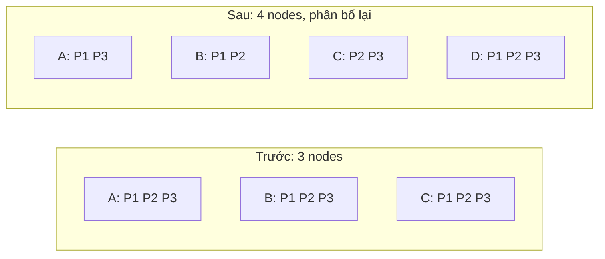
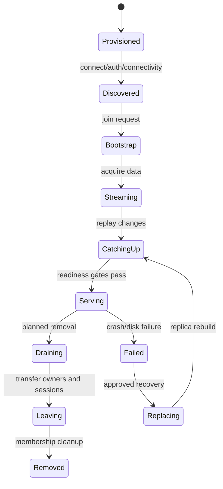
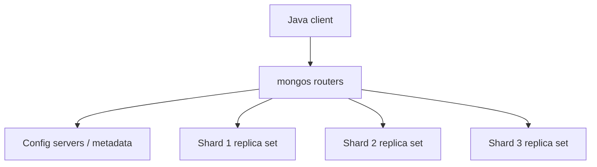
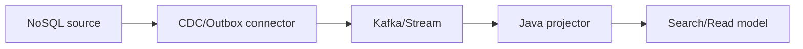

# Thêm nút, rút nút, thay nút và kiểm tra dữ liệu sau thay đổi

## 1. Vì sao thay đổi một nút có thể khiến dữ liệu “biến mất” dù cụm vẫn chạy?

Hãy tưởng tượng dịch vụ Java lưu đơn hàng trong một cụm NoSQL phân tán gồm ba máy `node-a`, `node-b` và `node-c`. Lưu lượng tăng, đội vận hành quyết định bổ sung `node-d`. Sau khi nút mới khởi động, dashboard hiện “healthy”, API vẫn trả 200 và hàng nghìn đơn hàng mới được ghi. Một ngày sau, một số truy vấn trên một dải khóa lại trả thiếu kết quả.

Sự cố có thể bắt nguồn từ nhiều điều khác nhau:

- Nút mới đã tham gia **membership** nhưng chưa hoàn thành **data streaming**.
- Dữ liệu đã di chuyển, nhưng **routing/cache topology** của client chưa cập nhật.
- Một số partitions/chunks/slots được chuyển sai thứ tự hoặc vẫn do owner cũ phụ trách.
- Bản sao đã đủ số lượng nhưng không trải đều **failure domains**.
- Một replica mới có dữ liệu chưa bắt kịp mà client lại được cho đọc từ đó.
- Nút cũ bị xóa trước khi mọi dữ liệu/leader responsibility đã được chuyển.
- Background replication/repair còn hàng đợi, nhưng “node up” được hiểu nhầm là “dữ liệu đồng nhất”.
- Index, search projection hoặc CDC consumer chưa theo kịp nguồn.
- Các bản ghi đã xóa bị **resurrect** do tombstone/deletion history chưa được xử lý đúng.
- Một lệnh migration ghi được trên các nút khác nhau nhưng **commit outcome** hoặc thứ tự không được bảo vệ.

Trong NoSQL, một node thường không chỉ là một máy chủ chứa dữ liệu. Nó còn có thể nắm **replica**, **partition ownership**, **shard**, **token range**, **leader role**, **quorum vote**, **coordination metadata**, **transaction log** và trách nhiệm phát sự kiện. Vì vậy, thay đổi topology phải là **quy trình có kiểm soát và được kiểm chứng bằng dữ liệu**, không phải chỉ thêm/xóa máy ảo.

Bài học thuộc module **Database No SQL**, chương **Vận hành cụm**, chủ đề **“Thêm nút, rút nút, thay nút và kiểm tra dữ liệu sau thay đổi”**.

> **Nguyên tắc trung tâm:** Một thay đổi topology chỉ hoàn tất khi những ràng buộc về **an toàn dữ liệu, khả năng phục vụ, replication, ownership, hiệu năng và khả năng phục hồi** đã được kiểm tra; trạng thái node “RUNNING” hay cluster “GREEN” là điều kiện vận hành hữu ích nhưng không tự chứng minh dữ liệu chính xác.

### Mục tiêu học tập

Sau bài này, bạn có thể:

1. Phân biệt **thêm node**, **rút node có kế hoạch**, **thay node lỗi**, **thay instance cùng danh tính** và **di chuyển shard/partition**.
2. Hiểu quan hệ giữa replication factor, quorum, consistency level, availability và số lượng failure domains.
3. Mô tả các giai đoạn discovery, bootstrap, sync/catch-up, rebalance, drain, decommission và cleanup.
4. Xác định khi nào cần scale dữ liệu, scale xử lý request, tăng replica để chịu lỗi hoặc tách workload.
5. Lập điều kiện **go/no-go** trước và sau khi thay đổi topology.
6. Nhận biết các rủi ro khi thay đổi cụm MongoDB, Cassandra, Redis Cluster, Elasticsearch/OpenSearch và managed NoSQL.
7. Không nhầm lẫn cơ chế **node replacement** với việc vô tình tạo thêm node độc lập có danh tính mới.
8. Thiết kế xác minh post-change bằng counts, manifests, checksums, sampling, version/CAS, tombstone và CDC watermarks.
9. Đánh giá replication lag, leader election, routing, client pool, hot partitions và tail latency.
10. Biết cách dừng, rollback, tiếp tục hoặc khôi phục khi migration không hoàn thành.
11. Viết một runbook có checkpoints, owner, metrics, kill-switch, audit và rollback strategy.
12. Thiết kế thử nghiệm trước production, fault injection và thực hành Java client để quan sát topology.

## 2. Từ điển tối thiểu: node, partition, replica, shard, slot

Các khái niệm thường bị dùng thay nhau, nhưng cần phân biệt.

| Khái niệm | Ý nghĩa | Ví dụ |
|---|---|---|
| **Node** | Một tiến trình/máy tham gia cụm | MongoDB member, Cassandra node, Redis instance |
| **Membership** | Tập node và trạng thái tham gia cụm | Voting members, gossip peers |
| **Partition/shard** | Phần dữ liệu logic chia theo key/range/hash | Order IDs 1000–1999, token range |
| **Replica** | Bản sao của một phần dữ liệu | Primary/secondary, RF=3 |
| **Leader/primary** | Node chịu trách nhiệm vai trò điều phối/ghi tùy engine | Replica-set primary |
| **Follower/secondary** | Node theo dõi bản ghi từ leader tùy engine | MongoDB secondary |
| **Coordinator** | Nhận request và phối hợp replicas | Cassandra coordinator |
| **Token range** | Một khoảng trên vòng băm của dữ liệu | Cassandra token ownership |
| **Hash slot** | Đơn vị phân phối key space | Redis Cluster 16.384 slots |
| **Chunk/range** | Nhóm dữ liệu có thể di chuyển | MongoDB sharded collection range |
| **Index shard** | Phân đoạn của một index tìm kiếm | OpenSearch primary shard |
| **Failure domain** | Một vùng rủi ro độc lập tương đối | Rack, AZ, node, region |
| **Quorum** | Số vote/replica phản hồi cần cho một quyết định | Majority election, CL=QUORUM |
| **Bootstrap** | Node mới gia nhập và nhận trạng thái cần thiết | Stream dữ liệu và metadata |
| **Catch-up** | Node theo kịp những cập nhật đã xảy ra khi nó lag | Oplog replay, replica sync |
| **Rebalance** | Di chuyển trách nhiệm/dữ liệu để cân bằng | Token/chunk/slot move |
| **Decommission** | Rút node có kế hoạch, chuyển trách nhiệm trước | Drain/leave cluster |
| **Replace** | Thay một node hỏng hoặc muốn bảo trì | Instance replacement |
| **Repair** | Kiểm/đồng bộ dữ liệu giữa replicas theo cơ chế engine | Cassandra anti-entropy repair |
| **Rebuild** | Dựng lại dữ liệu từ nguồn/replica/log hợp lệ | Replica resync, index rebuild |

### 2.1. Membership khác ownership

Nút xuất hiện trong danh sách membership không đồng nghĩa nó đã nhận đủ shards/tokens hoặc có thể trả mọi truy vấn đúng. Cần kiểm **dữ liệu được gán**, **dữ liệu đã đồng bộ** và **đường client truy cập**.

### 2.2. Replica khác backup

Replica giúp availability và read throughput trong một số cấu hình, nhưng các thay đổi sai và xóa nhầm có thể được replicate. Backup/PITR có retention tách biệt mới giúp khôi phục các trường hợp ấy.

### 2.3. “Node” của managed NoSQL không phải lúc nào do bạn quản lý

DynamoDB và một số dịch vụ cloud abstractions tự quản lý partitions/replicas vật lý. Người dùng thay đổi capacity, keys, replicas/regions, table/index configuration, chứ không có lệnh “add server node” tương đương Cassandra. Bài này luôn phân biệt **self-managed cluster** và **managed service**.

## 3. Ba thao tác có mục tiêu và rủi ro khác nhau

### 3.1. Thêm node — scale out

Mục tiêu có thể là:

- Tăng tổng storage capacity.
- Tăng aggregate read/write throughput.
- Cải thiện phân phối partition.
- Bổ sung failure-domain redundancy.
- Giảm nguy cơ node hiện tại đầy disk.
- Tăng số replicas theo yêu cầu durability.

Nhưng thêm node **không tự** tăng write throughput nếu bottleneck nằm ở một hot partition, một primary duy nhất, một global index hoặc một lock.

### 3.2. Rút node — scale in/decommission

Mục tiêu có thể là:

- Giảm chi phí sau khi lưu lượng hạ.
- Loại phần cứng cũ.
- Chuyển sang rack/AZ khác.
- Giảm tài nguyên không còn cần.
- Thực hiện planned maintenance.

Rút node làm giảm **dung lượng và vùng chịu lỗi** cho tới khi dữ liệu được chuyển, replicas được tái tạo và quorum/topology đủ điều kiện. Rút nhầm leader hoặc node chứa bản sao cuối cùng có thể gây outage/data loss.

### 3.3. Thay node — replacement

Mục tiêu có thể là:

- Đổi instance/đĩa máy bị lỗi.
- Thay OS hoặc storage class.
- Di chuyển từ host bị lỗi phần cứng.
- Khôi phục sự có mặt của replica bị mất.
- Giữ logical topology/voting configuration mong muốn.

**Thay node lỗi** khác với “thêm node mới rồi đợi cluster tự xử lý” nếu engine cần replacement semantics, token/slot identity hoặc metadata cleanup đặc biệt.

### 3.4. Quy tắc không làm nhiều thay đổi cùng lúc

Đừng vừa thay toàn bộ nodes, vừa nâng major server version, vừa đổi shard key và đổi replication factor trong một maintenance window trừ khi có kế hoạch kỹ thuật được chứng minh. Một lỗi sẽ khó cô lập và rollback khi nhiều biến số thay đổi đồng thời.

## 4. Sơ đồ topology trước và sau

Giả sử dữ liệu được chia thành ba partitions logic `P1`, `P2` và `P3`, mỗi partition có ba replicas.



Sơ đồ chỉ minh họa việc phân bố lại replicas, không phải thuật toán placement của engine nào. Ở hệ có nhiều shards, placements thực tế còn phụ thuộc:

- Partition key/hash/range.
- Replication factor từng keyspace/collection/table.
- AZ/rack awareness.
- Capacity weight/disk usage.
- Replica eligibility.
- Election/voting members.
- Node roles (data, master, coordinating, arbiter...).
- Background streaming/rebalancing.

### 4.1. Tổng replica count khác replica placement

Một partition có RF=3 nhưng cả ba copies nằm trong một AZ thì **không chịu được sự cố toàn AZ**. Post-change verification phải xét placements theo failure domains, không chỉ count=3.

### 4.2. Phân phối cân bằng không có nghĩa mọi node bằng bytes

Nodes có thể có kích thước disk khác nhau, partition skew, compression ratio khác, replicas/indexes khác nhau và reserved headroom. Dùng tỷ lệ dung lượng/throughput hợp lý theo role thay vì yêu cầu mỗi node chính xác bằng nhau.

## 5. An toàn, khả dụng và tính bền vững phải được xét riêng

Ba mục tiêu:

- **Safety:** không xác nhận những kết quả mâu thuẫn, không mất committed data theo contract.
- **Availability:** hệ có thể tiếp tục phục vụ requests theo SLO.
- **Durability:** dữ liệu đã commit vẫn tồn tại qua các lỗi được giả định trong mô hình triển khai.

Trong một network partition, hệ có thể chủ động từ chối write để bảo vệ safety. Một request `503` không tự là bug nếu hợp đồng yêu cầu **fail closed** khi thiếu quorum.

### 5.1. Majority trong consensus

Với `N` voting members, đa số là:

\[
majority(N)=\left\lfloor N/2\right\rfloor+1
\]

Ví dụ:

| Voting members | Majority | Có thể mất tối đa mấy phiếu vẫn giữ majority? |
|---:|---:|---:|
| 1 | 1 | 0 |
| 2 | 2 | 0 |
| 3 | 2 | 1 |
| 4 | 3 | 1 |
| 5 | 3 | 2 |

Bảng chỉ mô tả majority vote logic; một hệ cụ thể còn có quy tắc eligibility, data-bearing members, lag, write concern, failure domains và placement.

### 5.2. Thêm một voter có thể thay đổi ngưỡng quorum

Cụm ba voters cần 2 để có majority. Cụm bốn voters cần 3. Nếu thêm voter vào cấu hình không đúng thời điểm, **quorum threshold có thể tăng trước khi node mới hữu ích**, ảnh hưởng availability.

Đừng coi “thêm một voting member” luôn làm cụm an toàn hơn. Cần xem tài liệu cơ chế membership change của từng engine (ví dụ Raft joint consensus hoặc replica-set reconfiguration rules).

### 5.3. RF của hệ không leader không đồng nghĩa số voters

Cassandra `replication_factor=3` nói về placement copies theo strategy, trong khi quorum read/write tùy consistency level, coordinator và topology. Không đồng nhất một cách máy móc với majority election của MongoDB/etcd.

### 5.4. Công thức quorum read/write đơn giản và giới hạn

Trong một replication model nhất quán, người ta thường nêu:

\[
R+W>RF
\]

để read quorum và write quorum giao nhau ở ít nhất một replica, trong **những giả thiết cụ thể**. Không suy từ công thức này rằng mọi Cassandra read/write ở các consistency levels đã chọn đều linearizable, hoặc rằng stale/tombstone/clock errors không thể xảy ra.

Khi thiết kế operation safety phải xét engine behavior, write ordering, consistency semantics, LWT/transactions và failure recovery.

### 5.5. Không hạ consistency để migration “xanh”

Nếu ứng dụng cần majority acknowledgement, chuyển sang single-replica ACK chỉ để có thể rút node nhanh là đổi **business durability guarantee**, không phải tối ưu vận hành bình thường.

## 6. Những thứ phải nhận diện trước khi đụng topology

Một bản đồ hiện trạng nên có ít nhất:

| Nhóm | Câu hỏi |
|---|---|
| Cluster | Engine/version/edition, self-managed hay cloud managed? |
| Membership | Node IDs, endpoints, roles, voting/data-bearing status? |
| Replication | RF, primary/secondary, placement by AZ/rack/region? |
| Ownership | Shards/chunks/slots/token ranges đang do ai giữ? |
| Storage | Disk used/free, IO bandwidth, WAL/oplog/log retention? |
| Workload | Read/write QPS, hot keys, scans, index builds? |
| Consistency | Write/read concerns, consistency levels, timeout contracts? |
| Transactions | Cross-shard transactions, ongoing locks/long-running jobs? |
| CDC | Outbox/Change Streams/Streams/consumer watermarks? |
| Recovery | Last verified backup/PITR, restore drill, RPO/RTO? |
| Security | Node TLS/auth, disk encryption, service identity, firewall? |
| Operations | Known issues, background repair/compaction, pending alerts? |
| Client | Driver versions, topology discovery, connection pools, routing? |
| Cost | Node/storage/data-transfer, migration bandwidth, headroom? |

### 6.1. Không dựa vào một màn hình “healthy”

Một dashboard tổng quan có thể hiển thị tất cả nodes UP, nhưng một keyspace RF=3 có một replica chưa stream đủ dữ liệu, một index shard đã yellow, hoặc read queries đang gặp timeout.

### 6.2. Không bắt đầu khi đã có lỗi không giải thích được

Nếu trước khi thay node đã có unacknowledged write errors, missing replicas, long CDC lag hoặc backup failures, phải phân loại và xử lý hoặc chấp nhận risk bằng một change plan rõ. Nếu không, post-change khó biết lỗi cũ hay lỗi mới.

### 6.3. Ghi baseline

Trước khi thao tác, chụp:

- Node membership/versions.
- Replica placement và ownership manifest.
- Dataset cardinality/size ở những scopes quan trọng.
- Snapshot/watermark.
- p50/p95/p99 và error rates.
- Replication lag.
- Cache hit/miss, compaction, rebalancing activity.
- CDC offsets và outbox oldest age.
- Backup status và restore capability.
- Application SLO và business invariants.

## 7. Các đường chuyển trạng thái chung của một node

Một mô hình khái niệm:



Đây là mô hình học tập. Tên/trình tự lệnh cụ thể khác nhau giữa engine; một cluster có thể tự elect leader, move shard, rebalance asynchronously hoặc yêu cầu operations thủ công.

### 7.1. Một state transition phải có điều kiện đạt

Không chỉ “đợi 10 phút rồi coi như complete”. Cần điều kiện quan sát được như:

- Required replicas reached healthy/serving.
- Data streaming/rebalance queues drained.
- Oplog/commit-log catch-up đầy đủ.
- Membership/slot/token ownership nhất quán.
- Replication lag dưới ngưỡng đã xác định.
- Client discovery/routing bình thường.
- Business data checks pass.

### 7.2. Serving không cần đợi mọi byte phụ trợ trong mọi hệ

Một số engine cho đọc/ghi trong quá trình shard migration theo protocol an toàn. Không tự dựng rule “node chỉ phục vụ khi đã copy 100% disk bytes” nếu engine design cho safe online migration. Dựa trên **readiness/correctness contract chính thức**, không đoán.

### 7.3. Không tự rút điện để giả lập decommission

Graceful drain/decommission khác force kill hoặc mất ổ đĩa. Chúng có các phục hồi khác nhau. Một runbook phải nói rõ đang xử lý **planned removal** hay **failed node**.

## 8. Tại sao cần tính dung lượng và băng thông trước?

Giả sử cụm có 8 TB dữ liệu logical và RF=3. Tổng dữ liệu replicated xấp xỉ:

\[
8\ \text{TB}\times3=24\ \text{TB}
\]

Đây là ước lượng thô trước overhead, compaction, index, compression, logs và spare capacity.

### 8.1. Khi thêm node

Nếu thêm node để giảm fullness, lượng dữ liệu cần chuyển phụ thuộc shard placement, token/slot distribution và imbalance. Một node mới không tự nhận 1/4 tổng dữ liệu physical ngay lập tức trong mọi engine.

### 8.2. Khi rút node

Cụm bốn node có tổng 24 TB physical phân đều (~6 TB/node). Rút một node mà vẫn giữ RF và volume dữ liệu như cũ thì ba node còn lại phải chứa ~8 TB/node **chưa kể headroom**. Nếu mỗi máy chỉ có 7 TB usable, decommission sẽ gây disk pressure hoặc thất bại.

### 8.3. Headroom cho chuyển dữ liệu

Migration có thể tạm cần giữ old và new copies cùng lúc, write-ahead logs, compaction scratch và snapshots. Không chạy ở 95–99% disk full rồi kỳ vọng thêm node sẽ tự sửa ngay.

### 8.4. Network bandwidth

Nếu cần chuyển 2 TB qua đường truyền hiệu dụng 200 MB/s:

\[
T_{\min}\approx\frac{2\times10^{12}}{200\times10^6}
=10{,}000\ \text{giây}
\approx2{,}78\ \text{giờ}
\]

Đây chỉ là **lower bound lý tưởng** của một luồng dữ liệu. Trong thực tế TLS, checksum, compaction, concurrent writes, retries, throttling và network shares làm thời gian dài hơn; không hứa thời gian thực thi từ công thức này.

### 8.5. Thêm node có thể làm tăng tải

Bootstrap streaming sử dụng disk I/O, CPU, network và cache. Nếu tổ chức đòi p99 chặt, phải giới hạn migration bandwidth/concurrency và theo dõi client SLO, không dành toàn bộ đường truyền cho movement.

## 9. Failure domains: đừng chỉ đếm replicas

Ví dụ cluster có `RF=3`:

```text
AZ-1: node-a, node-b, node-c
AZ-2: node-d
AZ-3: node-e
```

Nếu placement rules đưa cả ba replicas của một partition vào `AZ-1`, cluster vẫn có RF=3 nhưng một sự cố AZ có thể làm mất cả ba bản sao.

### 9.1. Anti-affinity

Các replica của cùng shard/partition nên trải trên fault domains độc lập theo mục tiêu chịu lỗi. Dùng rack/AZ awareness hoặc allocation awareness phù hợp engine.

### 9.2. Cân bằng data và quorum

Với leader/voting configurations, cần xem cả nơi đặt voters và data-bearing members. Một vote-only/arbiter có thể giúp election nhưng không thay bản sao dữ liệu. Không đếm arbiter như một data replica.

### 9.3. Điều chỉnh topology không tự thay RF

Thêm node data-bearing không nhất thiết tạo thêm replica cho mỗi partition. Có thể chỉ **phân bố lại** số bản sao theo RF hiện hành. Muốn tăng durability có thể cần thay replication config và đồng bộ thêm dữ liệu, một operation khác với add node.

### 9.4. Multi-region

Đặt node ở nhiều regions không tự tạo active-active an toàn. WAN latency, conflict resolution, leader placement, consistency và DR orchestration phải được thiết kế riêng.

## 10. Giai đoạn chuẩn bị: change plan và điều kiện dừng

Trước khi thao tác cần một bản plan:

```yaml
changeId: "cluster-change-2026-041"
target: "orders-nosql-prod"
operation: "add-node"
plannedNode: "node-d"
expectedTopology: "4 data nodes, RF3"
owner: "database-oncall"
changeWindow: "approved-window"
preconditions:
  - "backup đã tạo và restore drill còn hợp lệ"
  - "mọi required replicas healthy"
  - "không có operation outcome chưa rõ"
  - "disk/network đủ headroom cho streaming"
  - "client SLO đang ở mức baseline hợp lệ"
stopConditions:
  - "committed write invariant violation"
  - "quorum unavailable quá giới hạn"
  - "replication/streaming stuck"
  - "disk pressure vượt safety threshold"
  - "client error rate hoặc p99 vượt giới hạn đã phê duyệt"
  - "CDC/outbox có gap không phục hồi tự động"
postconditions:
  - "membership và ownership đúng"
  - "required replicas/placements healthy"
  - "watermark reconciliation pass"
  - "application SLO phục hồi"
  - "audit và inventory cập nhật"
```

Đây là **mẫu kế hoạch**, không phải file cấu hình cluster hay ngưỡng SLO thực của một tổ chức.

### 10.1. Người chịu trách nhiệm

Xác định rõ: ai thực hiện, ai giám sát SLO, ai có quyền dừng, ai phê duyệt rollback và ai chịu trách nhiệm đánh giá correctness dữ liệu. Không cần một người vừa thao tác vừa duyệt kết quả của chính mình ở hệ nhạy cảm.

### 10.2. Thay một nút mỗi lần nếu có thể

Trong nhiều cụm, tiến hành từng node và chờ gate đạt trước khi chuyển sang node khác giúp giảm nguy cơ mất quorum/copies. Một số thuật toán hỗ trợ batch changes, nhưng phải có cơ sở và test trước, không tự giả định.

### 10.3. Khi nào nên hủy change?

Nếu backup hỏng, cluster đã không ổn định, disk không đủ, hoặc có incident chưa xử lý, có thể hoãn thao tác. “Đã đến maintenance window” không phải lý do bỏ qua safety gate.

### 10.4. Không hứa rollback luôn dễ

Node add/remove có thể đổi ownership và ghi dữ liệu mới sau cutover. Rollback không nhất thiết là “bấm undo”. Một số trường hợp phải thực hiện **forward recovery**, thêm node mới hoặc rebuild từ bản sao nguồn, chứ không thể nối lại node cũ như chưa từng có chuyện gì.

## 11. Quy trình chung để thêm node

Một workflow thiết kế ở mức engine-agnostic:

1. **Xác minh preconditions:** quorum, RF, capacity, backup, versions, client metrics.
2. **Provision node:** OS/image, disk, network, identity, TLS, clock sync, certificates.
3. **Cấu hình role:** node ID, storage paths, cluster ID, rack/AZ/zone, seed/discovery.
4. **Kết nối membership:** join cluster bằng protocol chính thức, không clone metadata bừa.
5. **Bootstrap:** transfer shard/token/replica data theo engine.
6. **Catch-up:** replay oplog/WAL/changelog và xử lý writes xảy ra trong lúc copy.
7. **Phân bổ ownership:** chuyển shard/slot/leader responsibility nếu cần.
8. **Serving readiness:** bảo đảm driver routing và replica availability.
9. **Kiểm dữ liệu:** checksums/versions/CDC/queries theo kế hoạch kiểm chứng.
10. **Theo dõi ổn định:** error rates, latency, resource, repair/replication backlog.
11. **Cập nhật inventory và audit:** topology, versions, costs, incident notes.

### 11.1. Khởi tạo node đúng danh tính

Không clone disk chứa cluster UUID/node ID/instance metadata của một node đang sống rồi khởi động cả hai cùng lúc. Tùy engine, duplicate identities có thể gây membership corruption, stale replica states hoặc confusion.

### 11.2. Chọn phiên bản được phép

Không đưa node chạy server major version không tương thích vào cluster chỉ vì binary khởi động được. Kiểm rolling-upgrade compatibility và protocol features theo vendor. Node replacement không nên đồng thời là unplanned major upgrade.

### 11.3. Không nhận traffic quá sớm

Một node có thể đã mở TCP port nhưng chưa đủ data/index/session state. Readiness phải dựa vào cluster assignment và replication health, không chỉ `ping`.

### 11.4. Client connection pools

Java drivers có discovery/topology caching. Sau node join, kiểm kết nối mới, server selection, backoff, connection pool saturation và log/metrics. Không mặc định mọi ứng dụng tự thấy node mới ngay theo cùng một thời gian.

### 11.5. Tăng công suất không đồng nghĩa tăng đều throughput

Nếu shard key nóng vì một tenant có 70% traffic, thêm node có thể không giải quyết hot partition; cần data model, key strategy hoặc fan-out/read routing phù hợp.

## 12. Giai đoạn bootstrap và sao chép dữ liệu

Trong lúc bootstrap, một số dữ liệu cũ cần được chuyển đến node mới, đồng thời writers vẫn tạo dữ liệu mới.

### 12.1. Snapshot + delta

Một khung lý thuyết:

```text
T0: Bắt đầu snapshot/copy dữ liệu base.
T1: Writers vẫn ghi vào authoritative owners.
T2: Node mới nhận snapshot.
T3: Node mới replay delta/log từ checkpoint T0.
T4: Catch-up tới trạng thái được phép serving.
T5: Routing/ownership cutover theo giao thức nhất quán.
```

Không phải mọi engine triển khai đúng năm bước này, nhưng nguyên tắc **không mất writes phát sinh khi đang copy** là bất biến chung.

### 12.2. Đừng dùng copy folder tùy ý như migration protocol

Copy các files SSTable/MongoDB data directory/Redis RDB từ node khác mà không theo hướng dẫn engine có thể làm metadata, log position, encryption hoặc identity không khớp. Dùng backup/restore/streaming/snapshot procedures chính thức.

### 12.3. Idempotent movement

Nếu một chuyển shard thất bại giữa chừng và retry, hệ cần hiểu trạng thái source/destination và không tạo duplicate logical owners. Không tự xóa source chunk chỉ vì thấy destination có vài files.

### 12.4. Đồng bộ deletion history

Khi một record bị xóa trong lúc snapshot đang copy, node mới phải được thông báo deletion/tombstone trong log hoặc protocol hợp lệ. Nếu chỉ copy bản ghi cũ mà bỏ delete, dữ liệu có thể hồi sinh.

### 12.5. Dữ liệu index và metadata

Dữ liệu source có thể đúng nhưng secondary index/query planner chưa sẵn. Readiness phải bao gồm indexes/compaction/metadata cần thiết để phục vụ query contract.

## 13. Sau khi thêm node, cần xác minh gì ngay?

Một node mới được coi là vận hành ổn khi các nhóm điều kiện cùng đạt:

| Nhóm | Ví dụ câu hỏi |
|---|---|
| Membership | Node mới xuất hiện với node ID/role/zone đúng? |
| Ownership | Partitions/chunks/slots được gán đúng, không unassigned? |
| Replication | Tất cả required copies healthy/caught up? |
| Quorum | Elections/commit paths giữ guarantee? |
| Storage | Không có lỗi disk, I/O, compaction backlog tăng không kiểm soát? |
| Client | Java driver không gặp routing/timeout tăng? |
| Data | Checksums/sample queries/version manifests khớp tại cùng mốc? |
| Metadata | Index/schema/config tương thích? |
| CDC | Outbox/events không mất hoặc tạo gap? |
| Security | Node TLS/auth/ACL/encryption/audit phù hợp? |
| Workload | p95/p99, write errors, read errors, QPS nằm trong ngưỡng? |
| Recovery | Backup/PITR vẫn hoạt động và restore path hợp lệ? |

### 13.1. “Traffic chạy được” là smoke test, chưa phải data verification

Một API ping hoặc 100 GETs thành công có thể không chạm tới những token ranges mới vừa chuyển. Cần sample có phân tầng theo key ranges/shards/replicas/tenants.

### 13.2. Có thể thấy imbalance tạm thời

Background rebalance có thể cần thời gian. Nhưng phải biết tiến độ, tốc độ dự kiến, ngưỡng backlog và dấu hiệu mắc kẹt; không tuyên bố “xong” khi data movement vẫn chưa hoàn thành mà không có ngoại lệ được chấp thuận.

## 14. Quy trình rút node có kế hoạch (graceful decommission)

Một thủ tục tổng quát:

1. **Chọn node cần rút**, kiểm role/partitions/replicas/zone của nó.
2. **Chứng minh capacity còn lại đủ** cho dữ liệu và peak traffic.
3. **Chứng minh quorum/replication vẫn an toàn** sau khi node biến mất.
4. **Drain traffic** hoặc chuyển leadership/client routes nếu engine yêu cầu.
5. **Chuyển shard/slot/token ownership** sang các nodes còn lại.
6. **Đợi replication/rebalance hoàn tất**, không chỉ đợi node ngừng nhận traffic.
7. **Xác minh data checks và CDC/consumer health** trước khi drop membership.
8. **Dùng lệnh leave/decommission chính thức**, không tự xóa metadata.
9. **Kiểm topology và client health** sau khi membership thay đổi.
10. **Revoke credentials/certs, xóa infrastructure có kiểm soát** khi đã an toàn.

### 14.1. Sai lầm: stop process rồi xóa máy

Nếu node là holder của bản sao cuối cùng cho một phạm vi, hoặc đang giữ primary/leader role, stop ngay có thể gây mất availability/durability. Planned decommission phải đi theo protocol riêng.

### 14.2. Sai lầm: đo only disk usage

Nhìn thấy còn 30% disk trống chưa đủ. Node còn lại có thể không chịu được IOPS, hot partition load, compaction và replica rebuild overhead. Cần capacity của **storage, CPU, network, connections và quorum**.

### 14.3. Bảo đảm một node một lượt

Nếu rút đồng thời hai replicas chứa cùng partition khi RF=3, có thể mất quorum/copies. Dù một node rút thành công, vẫn cần chờ rebalance/repair và stability gate trước node tiếp theo.

### 14.4. Nếu rút node kéo dài

Có thể dừng những bước chưa irreversible, giảm streaming rate, hoặc tạm ngưng change. Không tự “force remove” chỉ vì planned window hết giờ. Cần escalation protocol và hiểu rủi ro.

### 14.5. Cẩn thận node ID tái sử dụng

Một node đã được decommission có thể cần cleanup ở cluster metadata/host. Đừng khởi động lại với old data dir/ID sau khi membership đã thay đổi mà không theo replacement procedure.

## 15. Quy trình thay node lỗi

Thay node thất bại không giống rút node đang khỏe. Một phần dữ liệu có thể không stream được từ node cũ; cụm phải khôi phục từ **những bản sao còn lại** hoặc backup.

### 15.1. Trước hết xác định mức độ lỗi

- Process restartable, disk còn nguyên?
- Disk corruption hay full?
- Node mất network tạm thời?
- Machine đã bị phá hủy?
- Node ID/identity có còn hợp lệ?
- Nó là voter/primary/coordinator hay data replica?
- Replica factor còn những copies nào?
- Có dữ liệu đã ACK chỉ tồn tại trên node này theo write concern đã dùng không?
- Oplog/commit log/backup retention còn đủ không?

### 15.2. Hai hướng khác nhau

**Hướng A — Restart/repair cùng identity:** nếu dữ liệu và metadata còn tin cậy, engine support restart/rejoin an toàn.

**Hướng B — Replace mất dữ liệu:** tạo instance mới theo replacement protocol, copy lại replicas/log, xác minh state và retire identity cũ.

Không tự chọn hướng B nếu node cũ chỉ mất mạng trong vài phút: hai node cùng nhận cùng logical identity hoặc cùng tokens có thể gây split-brain/ownership conflicts.

### 15.3. Không nhầm “mất kết nối” với “đã chết chắc”

Trong distributed systems, một node có thể đang sống nhưng bị network partition. Force replacement khi node cũ còn có thể trở lại cần protocol fencing/identity protection; nếu không có thể có hai owners đồng thời theo cách không an toàn.

### 15.4. Dữ liệu mới cần nguồn đáng tin

Nếu replica mới được dựng từ một replica stale, cần biết log/catch-up guarantees. Không mặc định bản sao còn sống duy nhất luôn chứa mọi acknowledged writes, nhất là khi trước đó write concern/consistency yếu.

### 15.5. “Replace” có thể làm tăng disk/traffic của nodes khác

Các bản sao khác phải stream dữ liệu sang node mới. Giới hạn migration concurrency và monitor disk/network/compaction. Khi cluster đang degraded, một replacement quá nhanh và nặng có thể gây lỗi cascade.

### 15.6. Sau replacement phải khôi phục fault tolerance

“Cluster lên lại” chưa đủ nếu RF=3 nhưng một partition đang chỉ có hai healthy copies hoặc placements cùng AZ. Chỉ đóng incident khi bảo đảm chịu lỗi đã trở lại theo mục tiêu.
## 16. MongoDB replica set: thêm, rút và thay member

MongoDB replica set là nhóm tiến trình `mongod` duy trì cùng một tập dữ liệu theo cơ chế primary/secondary. Nó khác sharded cluster: **thêm một replica-set member không tự chia dữ liệu thành những shard nhỏ hơn**.

### 16.1. Thêm secondary đúng mục đích

Một hướng làm phổ biến:

1. Kiểm version compatibility, authentication, TLS, replica set name, network.
2. Provision `mongod` với data directory sạch hoặc theo backup/initial sync procedure được hỗ trợ.
3. Kết nối từ `mongosh` với user có quyền reconfigure phù hợp.
4. Dùng replica-set membership operation chính thức để thêm member.
5. Theo dõi initial sync, secondary state và replication lag.
6. Kiểm data-bearing vs arbiter/voting properties.
7. Chỉ cân nhắc cho phép secondary reads hoặc trở thành eligible primary khi readiness phù hợp.
8. Kiểm write concern majority, driver server selection và backups.

Một dạng lệnh **minh họa** khi quản trị replica set:

```javascript
// Chỉ trong môi trường được phê duyệt.
// Tên host/port, cấu hình voters/priority, phiên bản
// và security phải xác minh trước khi thực thi.
rs.status()
rs.conf()
rs.add("mongo-d.internal:27017")
rs.status()
```

Không copy lệnh vào production chưa có plan. Trong một số tình huống, cần thêm non-voting/member priority 0 theo version/constraint trước khi điều chỉnh membership để tránh thay quorum quá sớm.

### 16.2. Initial sync và lag

Secondary có thể sao chép dữ liệu ban đầu rồi bắt kịp các operations phát sinh sau mốc sync. Nếu oplog window quá ngắn so với initial sync, member có thể không theo kịp và phải thử lại. Cần monitor:

- Replica state.
- Initial sync progress.
- Oplog window.
- Replication lag.
- Disk I/O và network.
- Index build/replication state.
- Election activity.

**Không coi `rs.add` thành công là hoàn tất sync.**

### 16.3. Voting/election và write concern

Khi thêm/rút voting member, majority size có thể thay đổi. Đặc biệt với cluster ba voting members, thêm member thứ tư có thể đẩy majority từ 2 lên 3 nếu họ đều là voters. Cần hiểu quy tắc MongoDB cho max voting members, voting changes và reconfiguration của **phiên bản đang chạy**.

### 16.4. Rút secondary có kế hoạch

Trước khi `rs.remove(...)`:

- Không còn dùng node làm source cho backup/analytics/secondary reads.
- Đã xác minh data-bearing members/voters còn lại đủ.
- Client read preference/connection strings không phụ thuộc host đó.
- Không có initial sync/rebuild nguy hiểm đang diễn ra.
- Có cấu hình phù hợp với quorum/write concern.
- Có kế hoạch xử lý replica ID/host sau rút.

Minh họa syntax:

```javascript
// Chỉ thao tác sau khi đã xác minh điều kiện an toàn.
rs.remove("mongo-d.internal:27017")
```

Không xóa primary mà chưa xử lý leadership/election theo quy trình. Một planned `rs.stepDown` có thể được dùng trong tình huống phù hợp, nhưng còn phụ thuộc node election readiness và write concern; không thực hiện tùy tiện.

### 16.5. Thay member bị lỗi

Nếu host cũ đã hỏng hoàn toàn, có thể cần xóa member cũ khỏi config rồi thêm host mới, hoặc dùng cùng hostname/node replacement strategy theo hướng dẫn MongoDB. Quan trọng:

- Không để node cũ quay lại với metadata/membership mâu thuẫn.
- Không giả định một secondary mới có data ngay.
- Kiểm số healthy data-bearing members.
- Kiểm majority-committed data từ nguồn hợp lệ.
- Đừng reset replset config trên từng node độc lập như thao tác sửa lỗi thông thường.

### 16.6. Arbiter không chứa dữ liệu

Arbiter chỉ tham gia election, không lưu bản sao dữ liệu như secondary. Nếu hệ cần durability, thêm arbiter **không thay** thêm data-bearing replica. Khi đánh giá post-change, không đếm arbiter là một bản sao dữ liệu.

### 16.7. Driver Java và read preference

Một MongoDB client cấu hình `secondaryPreferred` có thể được route sang member mới khi nó trở thành SECONDARY. Nếu replication lag cao, một request đọc dữ liệu mới nhất có thể thấy trạng thái cũ. Thiết kế consistency/read concern/read preference riêng, không giả định kết quả secondary luôn mới như primary.

### 16.8. Điều cần nghiệm thu

- Topology đúng voting/data-bearing roles.
- Required majority/write concern thỏa.
- Replication lag dưới gate.
- Initial sync hoàn tất.
- Không có unexpected election loops.
- Client connections ổn.
- Primary/secondary read paths theo contract.
- Reconciliation query/sampling qua các replica reads được hỗ trợ.

## 17. MongoDB sharded cluster: khác hoàn toàn replica-set scale

MongoDB sharding phân phối **collections theo shard key**. Mỗi shard thường là một replica set, có cluster metadata/config servers và `mongos` routers.



### 17.1. Thêm shard không giống thêm member

- **`rs.add`**: thêm data replica trong **một** replica set.
- **Add shard**: tăng số shards có thể chứa các ranges/chunks của sharded collection.

Nếu source bottleneck là một primary xử lý toàn bộ writes cho một collection chưa sharded, thêm secondary không tự chia throughput writes. Nếu shard key thiếu phân tán, thêm shard cũng không tự giải quyết hot key.

### 17.2. Thêm shard

Một workflow:

1. Provision một replica set đủ nodes/failure domains cho shard mới.
2. Đảm bảo tương thích phiên bản, TLS/internal authentication và cluster configs.
3. Dùng cluster management API/lệnh chính thức để add shard qua `mongos`.
4. Xác minh shard membership và metadata.
5. Theo dõi balancer/migration tasks, bytes moved và jumbo/hot ranges.
6. Kiểm chunk distribution và read/write targeting.
7. So data manifests theo shard key và kiểm docs thiếu/trùng khi projection/queries.
8. Đánh giá SLO trước khi coi scale-out hoàn tất.

Ví dụ dạng tương tác quản trị:

```javascript
// Minh họa thao tác qua mongos; cần xác minh
// cú pháp theo MongoDB server version.
sh.status()
sh.addShard("ordersShard3/mongo-s3a:27017,mongo-s3b:27017,mongo-s3c:27017")
sh.status()
```

Trong môi trường managed, dashboard/API của nhà cung cấp có thể là đường supported; không chạy thủ công trên cluster khi vendor không cho phép.

### 17.3. Chunk/range migration và balancer

Balancer có thể di chuyển ranges dần; topology “đã có shard mới” không nghĩa data đã được cân bằng. Theo dõi:

- Chunk/range distribution.
- Migration activity/errors.
- Hot shard/key traffic.
- Jumbo chunks hoặc ranges khó di chuyển.
- Config metadata health.
- Disk/IO network của nguồn/đích.
- Query target vs scatter-gather.

### 17.4. Rút shard

Rút shard là **drain dữ liệu và responsibilities**, không phải `rm -rf shard`:

- Chọn shard cần remove và xác định collection/database placement.
- Chạy cơ chế remove shard theo MongoDB version.
- Theo dõi operation state/pending chunks.
- Xử lý những database primary placements/unsharded data cần chuyển theo hướng dẫn phiên bản.
- Đợi mọi remaining responsibilities được giải quyết.
- Xác minh metadata và data access trước khi dừng shard resources.
- Không force-remove một shard còn dữ liệu hoặc primary database placements.

Một số commands hoặc hành vi di chuyển database primary, unsharded collections và balancer được thay đổi theo MongoDB version. Phải dùng **runbook phiên bản cụ thể** thay vì cố áp một lệnh cũ cho mọi cluster.

### 17.5. Config servers và `mongos`

Không coi config server nodes như ordinary data shards. Chúng giữ metadata quan trọng; thay đổi quorum/member của config server replica set có rules riêng. `mongos` là router, thường không chứa toàn bộ business data; thêm `mongos` có thể tăng routing capacity nhưng không thêm storage replicas.

### 17.6. Sau thay đổi phải thử query theo shard key

Các integration tests nên bao phủ:

- Query có shard key và lookup theo tenant.
- Query không có shard key, xác nhận routing/latency thuộc SLO.
- Cross-shard aggregation/transactions nếu dùng.
- Unique index/shard-key constraints.
- Pagination/cursor khi ranges đang di chuyển.
- Deletes/tombstones.
- Resharding/zone constraints nếu có.

## 18. Apache Cassandra: token ring, bootstrap và decommission

Cassandra phân phối dữ liệu qua token ranges và placement dựa trên replication strategy, không có single global primary cho mọi writes theo kiểu MongoDB replica set.

### 18.1. Token ownership và vnodes

Một node Cassandra có thể sở hữu nhiều token ranges (virtual nodes). Khi thêm node, một phần ranges/replicas có thể được stream từ các nodes cũ tới nodes mới. Quy mô movement phụ thuộc num_tokens, topology/rack/DC, keyspace replication strategy và version.

### 18.2. Thêm node (bootstrap)

Một hướng vận hành:

1. Kiểm seed providers, cluster name, partitioner và DC/rack topology.
2. Kiểm RF/consistency và capacity/headroom.
3. Khởi tạo data directory và node identity theo đúng quy trình.
4. Cho node join/bootstrapping bằng cơ chế chính thức.
5. Giám sát `nodetool status` và streaming progress.
6. Kiểm schema agreement, gossip health, ownership.
7. Kiểm read/write availability trong quá trình bootstrap.
8. Đối soát data/replica placement, chạy repair khi thiết kế/version yêu cầu.
9. Kiểm client routing/consistency.

Một số lệnh **read-only**, ví dụ:

```bash
nodetool status
nodetool ring
nodetool netstats
nodetool info
```

Lệnh và availability thay đổi theo Cassandra distribution/version. Đặc biệt không giả định `nodetool status` = UN là toàn bộ consistency đã đúng; cần kiểm streaming/repair/snapshots và query semantics.

### 18.3. Quorum khi một node mất

Với RF=3 và `LOCAL_QUORUM`, coordinator cần số replicas phản hồi theo phạm vi DC/CL theo contract. Một node mất có thể còn phục vụ, nhưng nếu thêm một lỗi trong lúc replacement, cụm có thể mất quorum ở một số ranges.

Vì vậy **không bắt đầu decommission node thứ hai** khi node thứ nhất vẫn chưa được tái tạo thành healthy replica và verified.

### 18.4. Rút node khỏe bằng decommission

Một hoạt động decommission có thể dùng lệnh quản trị chuyên biệt:

```bash
# LỆNH CÓ TÁC ĐỘNG: chỉ minh họa,
# tuyệt đối không chạy nếu chưa có approved runbook.
nodetool decommission
```

Operation này có thể stream data và sửa ring ownership; cần monitor kết quả. Sau decommission, một số hệ/config có thể cần cleanup/repair trên các nodes còn lại, theo hướng dẫn phiên bản.

### 18.5. Node chết: removenode khác decommission

Một node đã chết không thể tự stream dữ liệu để decommission. Cassandra có các quy trình loại node chết/replace node (ví dụ `removenode` hoặc replacement-specific startup config, tùy version).

**Không dùng planned decommission như recovery cho dead node**, cũng không tùy tiện chạy force-removal khi chưa kiểm còn đủ replicas để phục hồi dữ liệu.

### 18.6. Replace node và duplicate identity

Cassandra replacement semantics có thể gắn với address/host ID/tokens và khởi động node mới theo cấu hình riêng của bản release. Sai tham số hoặc để node cũ bất ngờ quay lại có thể gây ownership/identity conflict.

Một số tài liệu có các tên tùy chọn như `replace_address_first_boot` hoặc `replace_address` cho những phiên bản cụ thể; **không sao chép chúng giữa các versions** mà không kiểm release manual. Trong cloud/operator deployments, use supported orchestration API.

### 18.7. Schema agreement

Nếu nodes chưa đồng thuận metadata schema, một application query qua coordinator này có thể khác qua coordinator kia. Trong giai đoạn join/remove, theo dõi schema versions và errors; không deploy schema migration đồng thời khi topology change chưa ổn định nếu không có kế hoạch phối hợp.

### 18.8. Anti-entropy repair và tombstones

Cassandra có anti-entropy repair giúp đối chiếu replicas. Quan trọng:

- Replica diverge do node downtime/timeout/hinted handoff.
- Tombstone propagation cần được xử lý trước những mốc retention/gc liên quan.
- Một node offline quá lâu có thể có dữ liệu cũ và cơ hội resurrect dữ liệu đã xóa nếu quy trình repair/GC bị quản lý sai.
- Repair có I/O/network cost và cần plan.

Không chỉ dựa vào `COUNT(*)` cho từng replica; Cassandra query thường đi qua coordinator/CL, không phải một câu lệnh “quét trực tiếp từng SSTable” thông thường.

### 18.9. Cleanup

Sau khi ranges chuyển chủ, dữ liệu không còn thuộc responsibility của một node có thể cần được cleanup theo procedure. Một lệnh cleanup có thể tiêu tốn disk/compaction; chỉ chạy khi hiểu node ownership và version. **Không cleanup sớm** khi node khác chưa có bản sao đủ an toàn.

### 18.10. Post-change check của Cassandra

- Ring membership, gossip và token ownership.
- Per-DC RF/replica placement.
- Schema agreement.
- Streaming completed, queues stable.
- Repair state/anti-entropy theo policy.
- Hinted handoff, mutation failures, pending compactions.
- Coordinator latency, read/write CL success.
- Tombstone/TTL behavior, data access patterns.
- Disk headroom và large partitions/hot tokens.

## 19. Redis Cluster: hash slots, master và replicas

Redis Cluster chia key space vào **16.384 hash slots**. Các masters sở hữu slots; replicas có thể theo một master để hỗ trợ failover. Thêm instance không nhất thiết phân lại slot tự động.

### 19.1. Vai trò khác nhau

- **Master/primary**: owner của một số hash slots, xử lý writes cho slots đó.
- **Replica**: theo primary, có thể được promote theo failover conditions.
- **Empty master**: tham gia cluster nhưng chưa sở hữu slots; không tự tăng data capacity phục vụ keys.
- **Standalone Redis**: không có Cluster hash-slot routing giống Redis Cluster.

### 19.2. Thêm primary master

Một lộ trình:

1. Provision Redis instance với Redis Cluster mode/security/config hợp lệ.
2. Join node vào cluster bằng procedure chính thức.
3. Kiểm `CLUSTER NODES`, `CLUSTER INFO`, `CLUSTER SLOTS` hoặc `CLUSTER SHARDS` theo version.
4. Reshard/move hash slots từ masters hiện có sang master mới.
5. Giám sát migrating/importing slot states và key movement.
6. Kiểm client `MOVED`/`ASK` redirects và slot map refresh.
7. Xác minh **mọi hash slots có owner hợp lệ**, không unassigned/dupe.
8. Đánh giá balance theo bytes/QPS/hot slots, không chỉ số slots.
9. Phân bổ replicas/failure domains nếu phù hợp.
10. Kiểm key counts/TTL/values theo source/target với phương pháp an toàn.

Các lệnh inspection thường gặp:

```text
CLUSTER INFO
CLUSTER NODES
CLUSTER SLOTS
CLUSTER SHARDS
```

Một CLI quản trị như `redis-cli --cluster reshard` có thể hỗ trợ chuyển slots. Không chạy lệnh vào production khi chưa có plan, state inspection và hiểu ảnh hưởng đối với client/keys.

### 19.3. Thêm replica không chuyển slot ownership

Nếu node mới được thêm dưới dạng replica, nó **không** trở thành primary owner của slots ngay lập tức. Nó hỗ trợ redundancy/failover nhưng không mặc nhiên tăng dung lượng ghi của primary đang nóng.

### 19.4. Rút một primary

Trước khi rút primary, cần di chuyển slots đi hoặc thực hiện failover/role change đúng protocol. Nếu primary vẫn sở hữu slots rồi bị xóa đột ngột, cluster có thể thiếu slot coverage và một số keys không phục vụ.

### 19.5. Rút replica

Kiểm còn đủ replicas/placement và failover SLO. Không rút replica cuối cùng của nhiều masters trong cùng maintenance window khi failure tolerance là requirement.

### 19.6. Planned failover vs crash

Redis Cluster có cơ chế failover và config phù hợp; một replica có thể được promote. Việc promote/replace cần biết replication state, lag, async replication risk và topology epoch. Không coi một master promotion là bằng chứng mọi acknowledged writes đã đồng bộ sang replica nếu cấu hình không bảo đảm.

### 19.7. Async replication có thể mất writes

Redis Cluster replication thường bất đồng bộ; một số acknowledged writes có thể bị mất trong failover theo failure model. `WAIT` hoặc các durability features liên quan có giới hạn riêng và không tự biến hệ thành strong consensus. Phải xác định business contract trước khi dùng Redis làm authoritative store.

### 19.8. Hash tags và multi-key commands

Keys như:

```text
order:{O42}:status
order:{O42}:items
```

có thể cùng slot nhờ hash tag. Khi thay đổi topology, multi-key/Lua scripts vẫn chịu hash-slot constraints và ACL. Test với Redis Cluster thật, không chỉ single Redis.

### 19.9. Redis slot migration và data verification

- Không có slot unassigned.
- Client redirects được hỗ trợ.
- Target masters thực sự sở hữu slot ranges được gán.
- Key/value/TTL semantics giữ theo contract.
- Evictions/expiration không bị hiểu nhầm là mất dữ liệu migration.
- Replica lag/role recovery đạt mục tiêu.
- ACL/TLS/clients không lỗi sau đổi endpoint.

## 20. Elasticsearch/OpenSearch: allocation, shard replicas và index health

Trong các hệ tìm kiếm phân tán, node roles, primary/replica shards và shard allocation quyết định dữ liệu nào có thể đọc/ghi.

### 20.1. Thêm data node

Khi thêm node, shard allocator có thể phân lại shards dựa trên allocation/awareness/tier/capacity settings. Một node mới “joined” không có nghĩa index đã rebalance.

### 20.2. Health states

Một cluster `green` thường phản ánh all assigned shards (theo engine/version), `yellow` có thể thiếu một số replica allocations, `red` liên quan unassigned primary shards. Nhưng **màu cluster không tự chứng minh business source/projection correctness**.

### 20.3. Rút node theo allocation exclusion/drain

Một strategy là điều chỉnh shard allocation để chuyển shards khỏi node mục tiêu, chờ relocation và replica health, rồi dừng node. Exact APIs/version-specific settings cần tra tài liệu của deployment.

### 20.4. Replicas và zero-downtime index replacement

Một rebuild target index không giống node replacement. Nếu search index bị sai projection, có thể tạo index mới, backfill và switch alias với controlled cutover. Tách việc này khỏi thay node vật lý để dễ kiểm và rollback.

### 20.5. Cẩn thận unassigned shards

Rút một node mà primary shard không có bản sao hợp lệ có thể làm một tập documents tạm hoặc vĩnh viễn unavailable. Phải xem allocation explain/health và snapshots trước destructive action.

### 20.6. Verification

- Shard allocation, relocation completion.
- Primary and replica counts.
- No unexpected unassigned shards.
- Index mapping/version/alias.
- Search query correctness, doc counts và sourceVersion.
- Refresh lag và event/projector watermark.
- TLS/auth/role/client transport.
- p99 query/indexing latency và segment/merge pressure.

## 21. DynamoDB và NoSQL managed: không tự thêm/rút máy vật lý

DynamoDB được quản lý như service: AWS tự quản lý physical partitions và replicas nội bộ. Khách hàng thường thay:

- Provisioned/on-demand throughput hoặc auto scaling.
- Table/secondary index structure.
- Global table replica regions (nếu dùng).
- Table class/backup/PITR.
- Hot partition key access pattern.
- Dữ liệu và read/write consistency options theo API.

### 21.1. “Thêm node” không phải API khách hàng

Đừng thiết kế runbook `ssh vào DynamoDB node` hoặc `nodetool decommission DynamoDB`. Nếu cần tăng throughput, phải xem capacity, partition key design, quotas, throttling metrics và service options.

### 21.2. Global table không tương đương thêm secondary trong cùng AZ

Thêm region replica có thể tạo multi-region replication với semantics và conflict resolution khác single-region table. Cần hiểu MREC/MRSC capabilities và constraints theo service version/region/config, không giả định global uniqueness hoặc immediate global consistency.

### 21.3. Table backups và restore

Khi nâng capacity hoặc thay region replicas, cần backup/PITR và data validation theo service guarantees. Thực hiện negative/positive checks trong sandbox, không cố simulate một physical node failure mà cloud provider không expose.

### 21.4. Cloud-managed khác self-managed

Dù provider nói “fully managed”, client vẫn chịu trách nhiệm về:

- Access pattern/shard key nóng.
- IAM, encryption, data retention.
- Query/transaction semantics.
- CDC/Streams consumers.
- Backup/restore drills.
- App-level idempotency.
- Latency/cost/throttling SLO.
- Dữ liệu correctness và validation.

## 22. Hệ có consensus/coordination: etcd, ZooKeeper và Raft-based stores

Nếu một cụm NoSQL hoặc coordination backend dựa vào majority consensus, **thành viên voting** là đối tượng phải thay đổi qua protocol an toàn.

### 22.1. Thêm voter không đơn giản là mở process

Membership change có thể cần learner/non-voting stage, catch-up và promotion để tránh tăng majority requirement trước khi node mới ready. Với etcd, có quy trình `member add/remove` và learner semantics phụ thuộc phiên bản.

### 22.2. Không sửa dữ liệu membership ngoài protocol

Không trực tiếp sửa config files trên nhiều nodes hoặc copy state directory để “ép” một cluster có thành viên mới. Membership/election metadata là state nhất quán cần tuân rules của consensus implementation.

### 22.3. Một follower mới không lập tức tăng safety

Nếu follower chưa nhận đủ committed log, nó có thể chưa vote/serve theo rules; required quorum và availability có thể bị ảnh hưởng nếu cấu hình sai.

### 22.4. Thay node chết

Nếu node cũ không thể quay lại, cần phương án remove member cũ qua quorum còn sống rồi add member mới, restore snapshot, hoặc theo exact documented recovery path. **Không tự reset cluster ID hay tạo một “cluster mới” từ stale snapshots** mà không có kế hoạch tránh divergent histories.

### 22.5. Trường hợp mất quorum

Khi không còn majority, thao tác thay đổi membership thông thường có thể không thực hiện được. Recovery có thể cần disaster recovery từ snapshot và quy trình đặc biệt với rủi ro mất dữ liệu; không cấp quyền force reset bừa chỉ để khôi phục API.

## 23. Bảng so sánh: thêm/rút/thay node theo từng hệ

| Hệ | Đơn vị phân phối | Thêm node | Rút node | Thay node lỗi | Hậu kiểm đặc trưng |
|---|---|---|---|---|---|
| MongoDB replica set | Bản sao full dataset trong replica set | Add member + initial sync | Reconfigure membership | Rebuild/sync member + reconfig | Votes, replication lag, write concern |
| MongoDB sharded | Shard/key ranges | Add shard + balancer | Drain shard/chunks/metadata | Replace node trong shard RS | Shard routing/chunks + replica health |
| Cassandra | Token ranges/vnodes theo RF | Bootstrap/stream | Decommission | Replacement/removenode đúng loại lỗi | Ring/schema agreement/repair/CL |
| Redis Cluster | 16.384 hash slots | Join + reshard hoặc add replica | Move slots/role + forget theo procedure | Failover/rejoin và resync | Slot coverage, redirect, replica lag |
| Elasticsearch/OpenSearch | Primary/replica index shards | Allocation/rebalance | Shard relocation/drain | Replica recovery/reallocation | Assigned shards, health, index correctness |
| DynamoDB managed | Service-managed physical partitions | Điều chỉnh capacity/data model/regions | Không thao tác host vật lý | Provider-managed | Throttling, key distribution, table/replica semantics |
| etcd/consensus | Replicated state machine/member votes | Learner/member add | Membership remove | Member recovery/re-add | Majority, commit index, log catch-up |

### 23.1. Không có một lệnh chung

Không thể viết script `cluster.addNode(host)` chung rồi áp cho mọi NoSQL mà đảm bảo đúng dữ liệu. Control-plane APIs, quorum behavior và ownership transfer khác nhau.

### 23.2. Đọc tài liệu đúng version là một phần kỹ năng

Ngay cả trong cùng MongoDB/Cassandra/Redis, lệnh/behavior có thể đổi theo major versions và managed operator. Một runbook phải ghi engine version, deployment topology, API chính thức và destructive command guards.
## 24. “Cụm healthy” và “dữ liệu đúng” là hai điều khác nhau

Sau một thay đổi node, có thể quan sát ba tầng kết quả:

1. **Hạ tầng:** node process, disk, network và cluster membership hoạt động.
2. **Database protocol:** replica placement, leader election, routing, transactions và reads/writes theo contract hoạt động.
3. **Nghiệp vụ/dữ liệu:** mọi bản ghi cần giữ vẫn có thể truy cập, revisions không lùi, deletion vẫn có hiệu lực và invariants không bị phá.

Tầng 1 là điều kiện cần cho nhiều thao tác, nhưng không đủ cho tầng 2–3.

### 24.1. Ma trận xác minh post-change

| Điều muốn chứng minh | Dữ liệu/evidence cần |
|---|---|
| Node mới tham gia đúng | Membership/role/ID/zone từ authoritative cluster metadata |
| Không có range thiếu owner | Ownership manifest theo shard/token/slot |
| Required copies đạt | Replica state, RF/placement/lag |
| Routing đúng | Client routes/query success trên tất cả ranges đại diện |
| Không mất records | Count/manifest/checksum ở cùng snapshot hoặc watermark |
| Không duplicate entities | Unique business key, ID manifest, target dedup guard |
| Không hồi sinh dữ liệu xóa | Tombstone/deletion ledger và version checks |
| Không làm giảm version | Source/target revision comparisons |
| Không mất commits đã ACK | Operation ledger/checkpoints/transaction semantics |
| CDC không bị đứt | Stream source position, resume/checkpoint, gap detection |
| Index và query đúng | Index definitions, query plan, result set |
| API đáp ứng SLO | p95/p99/error/throttle rates sau ổn định |
| Có thể chịu thêm lỗi | Failure-domain-aware replica placement và recovery state |
| Có thể khôi phục | Backup/PITR và restore drill vẫn hợp lệ |
| Không lộ dữ liệu | Auth/TLS/ACL/KMS/resource policies đúng sau node join |

### 24.2. “Có mặt” khác “đầy đủ”

Một query `GET order O42` trả về record không chứng minh tất cả đơn hàng còn đầy đủ. Một count toàn table bằng trước cũng không chứng minh **đúng những IDs** được giữ.

### 24.3. Dữ liệu đã đổi trong lúc kiểm

Cụm vẫn nhận writes, vì vậy so trước–sau theo một thời điểm tùy ý có thể tạo false positives. Muốn chứng minh integrity, phải có **consistent cutoff, snapshot, high-water mark, event/commit positions hoặc invariant có tính đến writes trong khoảng kiểm**.

## 25. Kiểm counts: nhanh nhưng không đủ

Một phép kiểm đơn giản:

```text
Trước thay đổi: 10.000.000 orders
Sau thay đổi:  10.000.000 orders
```

Hai con số giống nhau nhưng vẫn có thể mất order A và trùng order B.

### 25.1. Những lý do counts sai

- Có inserts/deletes hợp lệ trong maintenance window.
- TTL expiration tiếp tục chạy.
- Một replica còn lag.
- Query chưa đạt consistent snapshot.
- Count của index khác count của source.
- Approximate/estimated count không phải exact.
- Scan bỏ sót/đọc lặp vì pagination/routing thay đổi.
- Document key conflict hoặc tenant scope khác nhau.

### 25.2. Counts theo bucket

Tốt hơn so:

```text
tenant=t17, key_range=00-0f, status=ACTIVE, count=...
tenant=t17, key_range=10-1f, status=ACTIVE, count=...
...
```

Buckets nên được chọn theo stable partition/key distribution hoặc hash của business ID, giúp khoanh vùng lỗi. Tránh nhầm một bucket nằm trên một node vật lý cố định nếu resharding làm thay owner.

### 25.3. Count có “giá trị thời gian”

Một biểu thức cần ghi:

```text
count(orders WHERE commitVersion <= watermark W)
```

hoặc dùng consistent snapshot ID, nếu engine hỗ trợ. Không phải DB nào cũng có global commit version có thể query như vậy; trong hệ khác phải dùng snapshot/CDC/transactional snapshot protocol phù hợp.

### 25.4. Exact count có thể rất tốn

Scan toàn table hàng trăm triệu records làm tăng I/O và có thể ảnh hưởng SLO. Tổ chức counts thành incremental manifest, per-partition totals, background checks hoặc sample có độ tin cậy phù hợp, thay vì chạy full scan vào peak traffic.

### 25.5. Khi nào count đủ?

Count giúp phát hiện chênh lệch thô và đo coverage, nhưng không đủ làm **duy nhất** acceptance gate cho tài chính, tenant boundaries, deletion hoặc data consistency.

## 26. Kiểm danh tính bản ghi và revision

Một kiểm chứng mạnh hơn là tập stable IDs:

```text
source/order IDs at W = {O1, O2, O3}
target/order IDs at W = {O1, O2, O3}
```

Ngoài IDs, nên so:

```text
(id, tenantId, logicalRevision, deletedFlag, canonicalFields)
```

### 26.1. Missing, extra và mismatched

Phân loại:

- **MISSING:** nguồn có, đích không có.
- **EXTRA:** đích có, nguồn không có (có thể do deletion/lag).
- **STALE:** đích revision thấp hơn nguồn.
- **FUTURE/CONFLICT:** đích revision cao hơn hoặc value mâu thuẫn cần điều tra.
- **SCHEMA_MISMATCH:** cùng business fact nhưng decode/canonicalization khác.
- **DUPLICATE:** trùng business identity ở nơi đòi uniqueness.
- **TOMBSTONE_MISMATCH:** deleted entity vẫn có thể đọc tại đích.
- **UNKNOWN_CUTOFF:** không thể so do snapshot/offset thiếu.

### 26.2. Revision phải có semantics

Một record `updatedAt` mới hơn không tự đáng tin hơn khi clocks lệch. Nếu có CAS `revision` do authority cấp hoặc monotonic source sequence, đó thường là tín hiệu tốt hơn để chặn stale writes.

### 26.3. Aggregate ID cần tenant scope

`O42` ở tenant A và `O42` ở tenant B có thể là hai records khác nhau. Nếu dùng `orderId` một mình để kiểm uniqueness, có thể báo giả hoặc làm lộ cross-tenant data.

### 26.4. Per-node verification

Nếu engine hỗ trợ đọc trực tiếp replicas với consistency/read preference phù hợp, có thể kiểm các copies cho cùng key/version. Nhưng đừng tự phát truy vấn vào node trong cách không được hỗ trợ hoặc bỏ qua coordinator/quorum semantics. Cần thiết kế verifier theo actual engine APIs.

## 27. Hash/checksum: mạnh hơn count nếu canonicalization đúng

Giả sử cần kiểm rằng hai tập records có cùng business values.

Một cách là tính:

\[
H=\operatorname{SHA256}(\text{canonical rows sorted by stable key})
\]

với mỗi row:

```text
tenantId | orderId | revision | deleted | amountMinor | currency
```

### 27.1. Canonicalization phải rõ

Cùng business value có thể biểu diễn khác nhau:

```json
{ "a": 1, "b": 2 }
```

```json
{ "b": 2, "a": 1 }
```

Hash raw JSON bytes cho hai object trên có thể khác dù semantic fields giống nhau. Cần:

- Field order cố định.
- Encoding UTF-8 thống nhất.
- Null/missing xử lý riêng.
- Numeric precision/signedness rõ.
- Timestamp normalized theo UTC và unit.
- Enum/version/unit được chuẩn hóa.
- Arrays được sắp xếp **chỉ khi** thứ tự không mang ý nghĩa.
- Byte arrays/collation/Unicode normalization theo contract.
- Stable row ordering.

### 27.2. Đừng ghép chuỗi với delimiter thiếu escape

```text
("ab", "c")  -> ab|c
("a", "b|c") -> a|b|c
```

Có thể tạo collision do encoding/escaping không duy nhất. Tốt hơn dùng length-prefixed encoding, canonical serialization hoặc hashing từng field với type/length markers.

### 27.3. Content hash và row count

Một bucket digest nên chứa ít nhất:

```json
{
  "bucket": "orders:hashprefix=0a",
  "count": 81243,
  "schemaVersion": 3,
  "snapshotId": "snap-..."
}
```

và digest bytes. Nếu digest khác, cần drill-down theo smaller buckets và compare IDs/values; digest bằng nhau có xác suất collision mật mã cực thấp khi thuật toán đúng, nhưng **không chứng minh tính nhất quán của snapshot/source semantics**.

### 27.4. Không so replication internals như business data

Hai node có thể lưu compression blocks/SSTables hoặc storage engine pages khác mà vẫn chứa logical data giống nhau. Hash trên raw disk files không nên thay logical record checksum trừ khi tool repair/consistency của engine quy định như vậy.

### 27.5. SHA-256 là công cụ, không thay authority

Nếu cả nguồn và đích đều được ghi sai cùng giá trị, checksum vẫn khớp. Business invariants, audit/ledger và recovery evidence cần được kiểm độc lập.

## 28. Merkle trees và anti-entropy

Khi dữ liệu rất lớn, so từng record qua mạng tốn băng thông. Một kỹ thuật là xây **Merkle tree**: hash lá theo dữ liệu của từng range/bucket, hash nút cha từ các hash con.

```text
                 Root H
             /            \
           H01            H23
          /   \          /    \
        H0    H1       H2      H3
      Range0 Range1   Range2  Range3
```

Nếu root khác, đi xuống chỉ những nhánh khác để tìm ranges cần so.

### 28.1. Điều kiện so sánh

Hai Merkle trees chỉ so được trực tiếp nếu:

- Cùng key range/partition scheme.
- Cùng canonicalization/hash algorithm.
- Cùng snapshot/logical cutoff.
- Cùng cách biểu diễn deletions/tombstones.
- Cùng phạm vi dữ liệu/tenant.

### 28.2. Cassandra repair không đồng nghĩa app checksum

Một số cơ chế anti-entropy/repair dùng Merkle-tree-like comparisons và streaming để đối chiếu replicas. Đây là **cơ chế engine** với semantics riêng, không nên xây một script Merkle tự chế rồi sửa SSTables dựa trên kết quả.

### 28.3. Merkle không giải quyết missed writes khi đang scan

Nếu nguồn liên tục thay đổi, hai nhánh có thể khác vì đọc ở thời điểm khác nhau. Cần consistent snapshot hoặc reconciliation protocol bằng watermark/CDC.

### 28.4. Risk của repair

Repair có thể tiêu thụ CPU, disk, network; nếu cluster đang degraded, chạy full repair đồng thời ở mọi node có thể tạo thêm sự cố. Dùng lịch/throttle và tools chính thức.

## 29. Snapshot và watermark: cách so hai trạng thái đang thay đổi

Giả sử trước khi thêm node, API nhận writes liên tục. Một phép so chính xác cần xác định “dữ liệu ở thời điểm nào?”.

### 29.1. Consistent snapshot

Nếu database hỗ trợ snapshot read/timepoint:

```text
Snapshot S at commit point W
Read all keys under S
Compute manifest M(S)
```

Sau thay đổi, đọc cùng logical state hoặc dựng bản biểu diễn tương đương từ backup/log. Không phải mọi engine hỗ trợ snapshot quét toàn cluster hoặc snapshot giữa databases; phải theo consistency scope của từng hệ.

### 29.2. Snapshot + CDC catch-up

Một pattern cho target projection/rebuild:

```text
Source snapshot at watermark W
  -> Bulk copy state as-of W
  -> Replay CDC events after W
  -> Catch up to watermark W2
  -> Compare target to source at W2
```

Nếu lấy snapshot không gắn với CDC start position nhất quán, có thể bỏ qua writes xảy ra ngay giữa “chụp snapshot” và “bật CDC”.

### 29.3. High-water mark không nhất thiết là timestamp

Nên dùng commit/log sequence hoặc source position khi có. Timestamp máy chủ/app có thể không đủ thứ tự với concurrent transactions, clock skew hoặc multi-region.

### 29.4. Multi-partition offsets

Kafka offset=100 ở partition 1 không tương đương offset=100 ở partition 2. Một watermark nhiều partitions có thể là **vector các source positions**; đừng thay bằng một số duy nhất không có semantics.

### 29.5. Tính hiện thời vs tính đầy đủ

Target có thể đầy đủ tới offset W nhưng lag 5 phút so với source hiện tại. Hai mục tiêu khác nhau:

- **Completeness:** không thiếu events tới W.
- **Freshness:** W còn cách current source bao xa.

Post-change cần xét cả hai khi có read model/CDC.

## 30. Tombstones, TTL và tránh hồi sinh dữ liệu xóa

Một failure mode khó thấy xảy ra khi node cũ quay lại sau thời gian dài hoặc replica mới được khôi phục từ snapshot cũ.

### 30.1. Timeline

```text
T0: Record O42 tồn tại, version 10.
T1: Delete O42, tombstone/version 11.
T2: Node B offline, chưa nhận deletion.
T3: Tombstone bị dọn theo retention/compaction.
T4: Node B quay lại với O42 version 10.
T5: Một reconciliation/repair sai coi old O42 là valid và hồi sinh.
```

Các details phụ thuộc storage engine và deletion semantics. Cassandra tombstone/gc và anti-entropy cần policy chính xác, MongoDB oplog/change streams có khác biệt; nhưng **khả năng nguồn cũ làm resurrect dữ liệu** là rủi ro chung cần đặt câu hỏi.

### 30.2. TTL không luôn xóa vật lý ngay

Nhiều hệ có logical expiry và background cleanup; một record có thể bị coi expired trước khi disk blocks biến mất. Post-change count hoặc backup bytes có thể thay đổi do TTL tự nhiên, không hẳn migration mất dữ liệu.

### 30.3. Deletion ledger

Với yêu cầu xóa/privacy mạnh, có thể cần ledger:

```json
{
  "entityId": "O42",
  "generation": 3,
  "deleteVersion": 11,
  "deletedAt": "2026-11-14T10:00:00Z",
  "reasonClass": "PRIVACY_DELETION"
}
```

Ledger phải được bảo vệ và retention phù hợp. Khi replay backup/node replacement, kiểm ledger trước khi cho data phục vụ; không coi old snapshot là authoritative mới hơn deletion.

### 30.4. Identity reuse

Nếu dùng lại `O42` cho entity mới, version reset=1 có thể bị chặn bởi tombstone version 11. Cần generation/incarnation ID hoặc non-reuse policy, không chỉ so một số version thiếu scope.

### 30.5. Test deletion quan trọng không kém insert

Sau thay node:

- Soft delete vẫn ẩn đúng.
- Hard delete/tombstone không hồi sinh.
- TTL behavior không bị reset ngoài contract.
- Replayed old events bị version guard chặn.
- Search/read cache không còn phục vụ data bị xóa.
- Restore từ backup áp các suppression rules.

## 31. Dữ liệu logic có thể đúng nhưng index/query sai

Sau reshard/rebalance, cần xác minh read APIs mà ứng dụng sử dụng.

### 31.1. Primary data vs secondary index

Một record có thể hiện diện theo primary key nhưng query theo `customerId`, `status` hoặc full-text search không tìm thấy do:

- Secondary index chưa xây xong.
- Index metadata chưa đồng bộ.
- Query planner chọn scan gây timeout.
- Search projector còn lag.
- Unique constraint migration chưa được áp đúng.
- Cursor/routing có bug trong lúc move shard.

### 31.2. Những truy vấn nên test

- Point lookup theo partition/business key.
- Range query/quét phân trang.
- Query theo secondary index.
- Aggregation/report với cutoff rõ.
- Multi-key/batch operations nếu engine hỗ trợ.
- Writes có condition/CAS.
- Transaction path được bật trong production.
- Deletes và re-creates.
- Queries từ mỗi AZ/client pool khi routing khác nhau.

### 31.3. Không so explain raw string giữa versions một cách mong manh

Execution plan format có thể khác sau upgrade. Kiểm những đặc điểm cần như index usage, docs examined, shard targeting và latency, không đòi mọi byte của plan giống nhau.

### 31.4. Hot partitions

Một shard balanced theo bytes có thể quá tải QPS. Đánh giá hottest keys/token ranges/tenant classes bằng metrics; không kết luận balance thành công chỉ vì dung lượng đều.

### 31.5. Queries với read preference/consistency khác nhau

Nếu API đọc majority nhưng verifier đọc từ stale secondary với `local`, hai phía có thể trả khác mà không phải data loss. Dùng read semantics tương ứng và hiểu giới hạn từng lựa chọn.

## 32. CDC, outbox và event consumers sau topology change

Topology thay đổi có thể ảnh hưởng source position/resume token, node endpoint, connector lease và broker data flow.

### 32.1. Một pipeline



Nếu node cũ giữ change stream connection rồi bị rút, connector phải reconnect và resume theo token/offset hợp lệ; không nên tự bắt đầu ở “now” nếu nó cần đảm bảo không mất event.

### 32.2. Những checkpoints cần giữ

- Source commit/log position.
- CDC resume token/offset.
- Broker topic-partition offsets.
- Consumer group offsets.
- Sink applied sourceVersion/operation ID.
- DLQ/quarantine positions.
- Delete/tombstone tracking.

### 32.3. Lỗi thường gặp

- Resume token đã quá retention.
- Connector đọc lại snapshot và phát duplicate events.
- Consumer redelivery dẫn tới double-count.
- Đổi shard key làm event routing đảo thứ tự.
- Node cũ bị dừng trước khi log/change stream đã bền ở replicas khác.
- Deletion events lọt khỏi replay window.
- Source node address hard-code trong connector.

### 32.4. Không chỉ theo dõi consumer lag

Lag giảm về 0 có thể vì connector đã **skip một đoạn dữ liệu**. Cần đối soát source state/manifest với target và phát hiện missing source positions; lag=0 không tự chứng minh completeness.

### 32.5. Restore/replacement làm thay đổi history boundary

Nếu source được restore từ snapshot cũ, CDC có thể phải bootstrap lại hoặc dùng resume semantics khác. Không re-attach consumer cũ bừa khi cluster identity/collection UUID/stream timeline đã thay. Cần runbook của connector và phương án rebuild no-gap.

## 33. Invariants nghiệp vụ sau thay đổi

Một cụm có đủ record count vẫn có thể phá business contract nếu cập nhật sai hoặc ghi đè concurrent state.

### 33.1. Tồn kho

\[
available = initial + validRestocks - confirmedReservations + validReleases
\]

và với inventory không cho âm:

\[
available\ge0
\]

Tùy domain, invariant có thể được enforce bằng conditional writes/transactions, không chỉ kiểm sau thay node.

### 33.2. Idempotency

Với một `operationId`:

```text
same logical command -> at most one committed business effect
```

Sau failover/retry, một request timeout có thể đã commit. Nếu client gửi cùng operation ID, ledger phải trả prior outcome hoặc reconcile; không tạo thêm đơn hàng hoặc charge.

### 33.3. Unique key theo tenant

`(tenantId, orderId)` phải unique. Một shard migration có thể phơi bày giả định sai về global uniqueness, shard key/index constraints hoặc duplicate business IDs.

### 33.4. Revision không được lùi

Một target projection nhận event v17 sau khi đã áp v19 phải từ chối stale event hoặc có protocol merge đúng. Thay node/consumer redelivery không được ghi đè revision mới bằng revision cũ.

### 33.5. Nguồn và đích không phải hai authorities ngang nhau

Nếu search index khác source DB, không dùng lastUpdated timestamp để tự chọn bản “mới hơn” khi source là authoritative. Verify state từ đúng authority với version/transaction semantics.

### 33.6. Audit trail và business outcomes

Nếu một transaction đã trả SUCCESS cho khách, post-change validation nên tìm được authoritative state tương ứng hoặc record uncertainty cần điều tra. Đừng kết luận chỉ từ API log vì log có thể mất hoặc chứa “request attempted” chứ không phải committed.

## 34. Sampling có phân tầng và probes theo key ranges

Khi full scan quá đắt, dùng **risk-based sampling** kết hợp full invariant checks cho dữ liệu quan trọng.

### 34.1. Không chỉ random 100 IDs

Một mẫu ngẫu nhiên 100 records ở cụm 100 triệu records khó phát hiện một range nhỏ bị mất. Tốt hơn:

- Chọn sample ở **mọi shard/token/slot range** có data.
- Phủ mọi AZ/rack/replica placement class.
- Phủ hot và cold partitions.
- Phủ tenant/data size buckets.
- Phủ newly moved, not moved và boundary keys.
- Phủ old/new schema versions.
- Phủ recently created/updated/deleted records.
- Phủ records với long TTL/near expiry.
- Phủ transaction/conditional write paths.

### 34.2. Sample phải gắn source of truth

Nếu cả sample trước/sau đều đọc qua cùng một proxy cache stale, hai lần có thể khớp nhưng không chứng minh server data mới. Sử dụng authoritative read path hoặc validated snapshot, và ghi rõ consistency.

### 34.3. Sentinel records

Có thể tạo **synthetic canary data** nằm tại những ranges/slots/tenants test, gắn với expected values/revisions. Sau migration, test read/conditional update/delete paths. Không dùng canary có PII hay triggers payment/email thật.

### 34.4. Confidence phải nói thật

Một sample pass là tín hiệu “không phát hiện lỗi trong mẫu”; không phải chứng minh toàn bộ dữ liệu không mất. Đối với invariant critical, cần exact reconciliation/ledger hoặc cơ chế engine đủ mạnh và verification phù hợp.

## 35. Java: kiểm checksum cho dữ liệu logic có thứ tự

Ví dụ một tool Java 17 tính digest cho những `OrderRecord` đã được **đọc ở cùng snapshot/cutoff**, **sắp xếp theo cùng thứ tự stable key**, **cùng scope**.

### 35.1. DTO kiểm chứng

```java
public record OrderRecord(
    String tenantId,
    String orderId,
    long revision,
    boolean deleted,
    long amountMinor,
    String currency
) {}
```

Đây là dữ liệu minh họa; không lưu email/phone/PII trong verifier nếu không cần.

### 35.2. Length-prefixed hash, tránh delimiter collision

```java
import java.io.ByteArrayOutputStream;
import java.io.DataOutputStream;
import java.nio.charset.StandardCharsets;
import java.security.MessageDigest;
import java.security.NoSuchAlgorithmException;
import java.util.Iterator;
import java.util.HexFormat;
import java.util.Objects;

public final class OrderDigest {
    private OrderDigest() {}

    public record Result(long count, String sha256) {}

    public static Result compute(
            Iterator<OrderRecord> sortedRows) {
        Objects.requireNonNull(sortedRows, "sortedRows");

        MessageDigest sha;
        try {
            sha = MessageDigest.getInstance("SHA-256");
        } catch (NoSuchAlgorithmException e) {
            throw new IllegalStateException(e);
        }

        String previousKey = null;
        long count = 0L;

        while (sortedRows.hasNext()) {
            OrderRecord row = sortedRows.next();
            String key = keyOf(row);

            if (previousKey != null &&
                previousKey.compareTo(key) >= 0) {
                throw new IllegalArgumentException(
                    "Rows must have unique, strictly sorted keys"
                );
            }

            sha.update(encodeRow(row));
            previousKey = key;
            count++;
        }

        return new Result(count,
            HexFormat.of().formatHex(sha.digest()));
    }

    private static String keyOf(OrderRecord row) {
        Objects.requireNonNull(row);
        return Objects.requireNonNull(row.tenantId())
            + "\u0000"
            + Objects.requireNonNull(row.orderId());
    }

    private static byte[] encodeRow(OrderRecord row) {
        try {
            ByteArrayOutputStream bytes =
                new ByteArrayOutputStream();
            DataOutputStream out =
                new DataOutputStream(bytes);

            writeString(out, row.tenantId());
            writeString(out, row.orderId());
            out.writeLong(row.revision());
            out.writeBoolean(row.deleted());
            out.writeLong(row.amountMinor());
            writeString(out, row.currency());
            out.flush();

            return bytes.toByteArray();
        } catch (java.io.IOException impossible) {
            throw new IllegalStateException(impossible);
        }
    }

    private static void writeString(
            DataOutputStream out, String text)
            throws java.io.IOException {
        if (text == null) {
            out.writeInt(-1);
        } else {
            byte[] value = text.getBytes(
                StandardCharsets.UTF_8);
            out.writeInt(value.length);
            out.write(value);
        }
    }
}
```

### 35.3. Giải thích

- `DataOutputStream` ghi các số theo định dạng big-endian cố định.
- String nullable được phân biệt bằng length=-1.
- Order key phải có một quy tắc sắp xếp **tương thích với comparator dùng để cung cấp iterator**.
- Digest khác khi một field business được chọn thay đổi.
- Result có count và SHA-256 để khoanh vùng khác biệt.
- Không đọc toàn bộ dataset vào bộ nhớ nếu `Iterator` đến từ cursor/pagination streaming đúng.

### 35.4. Cảnh báo về comparator và key

`keyOf` dùng NUL separator để phát hiện ordering trong ví dụ. Nếu IDs có thể chứa NUL, hoặc cách sort của DB khác so sánh UTF-16 của Java, check order có thể sai. Trong production hãy dùng một **canonical composite-key encoding** và comparator nhất quán với DB scan/order. Không lấy đoạn minh họa này làm universal key format.

### 35.5. Cảnh báo quan trọng về snapshot

Hai lần gọi `compute` có thể trả digest khác nhau nếu chúng đọc hai thời điểm khác nhau. Code hash **không tạo consistent snapshot**; caller phải cung cấp cursor có cùng business scope và consistent watermark/snapshot hoặc so bản snapshot với log đã replay đủ.

### 35.6. Cảnh báo về deletes

Nếu deleted records không được trả về trong cursor, hash chỉ bảo vệ tập currently visible theo query. Để bảo vệ khỏi resurrection cần kiểm tombstone/deletion ledger riêng.

### 35.7. Không dùng để sửa database

Code chỉ tính digest. Nếu khác, phải xác định source authority, timing, key range rồi dùng repair protocol được kiểm soát. Không tự đồng bộ mọi row từ nguồn này sang nguồn kia dựa trên một digest khác.

## 36. Quy trình drill-down khi checksum lệch

Một playbook:

```text
root checksum mismatch
  -> compare bucket hashes
  -> identify mismatched buckets
  -> compare stable IDs and revisions
  -> classify missing/extra/stale/deleted
  -> verify snapshot/cutoff equality
  -> inspect source and target logs/CDC
  -> create findings, not blind writes
  -> approved targeted repair/rebuild
  -> reverify postconditions
```

### 36.1. Không sửa source từ replica stale

Một replica lag có thể thiếu bản ghi mới nhưng không bị corrupted. Nếu dùng nó như authority để đồng bộ “xóa” record ở replica khác, ta phá dữ liệu đúng.

### 36.2. Đừng coi mọi lệch là lỗi data movement

Khác biệt có thể từ:

- Concurrent legitimate writes.
- TTL background expiration.
- Replica lag.
- Read preferences.
- Mismatched projection schema.
- Query filter/tenant scope khác.
- Canonicalization/hash version khác.
- CDC lag hoặc missing events.
- Quá trình xóa do privacy policy.

Phân loại trước khi thực hiện repair.

### 36.3. Scope khi sửa

Một repair chỉ nên áp vào entity/range đã xác minh, với sourceVersion/targetVersion CAS, max records, rate limits, approval và audit. Không chuyển sang “full reimport và overwrite” nếu chưa đánh giá tác động tới writes mới.

## 37. Hiệu năng, replication và client SLO trong maintenance window

Dữ liệu có thể chính xác nhưng migration gây downtime vượt SLO. Cần monitor theo thời gian:

- API success/error rates.
- Client p50/p95/p99.
- Database read/write latency theo operation.
- Timeouts, throttling, retries.
- Open connections, connection pool wait.
- CPU, memory, disk usage/free.
- Disk read/write latency, compaction/write amplification.
- Network throughput/packet loss.
- Background streaming/relocation bytes/ETA.
- Replica lag/under-replicated ranges.
- Leader election/reconfig events.
- CDC consumer lag, DLQ, outbox backlog.
- Hot partition/slot/shard skew.
- Node restart/crash/OOM rates.

### 37.1. Phân biệt foreground và background throughput

Một công cụ rebalance có thể báo 300 MB/s và “đang nhanh”, nhưng p99 API tăng gấp bốn. Khống chế background movement để giữ mục tiêu foreground service.

### 37.2. Chạy ở mức tải đại diện

Một thay đổi hoàn thành lúc 03:00 nhưng chưa chịu traffic giờ cao điểm. Đánh giá sau change theo ít nhất một window phù hợp workload hoặc synthetic load test trong giới hạn an toàn.

### 37.3. Alert phải hỗ trợ quyết định

Các ngưỡng nên được thỏa thuận:

```text
if write error rate exceeds change budget:
    PAUSE migration and investigate

if replication lag exceeds retention safety budget:
    STOP risky removal steps

if disk headroom falls below minimum:
    STOP streaming/scale-in, recover capacity

if data invariant violation observed:
    ABORT cutover, block unsafe writes if required
```

Đây là pseudo-rules, không phải thresholds cố định cho mọi hệ. Một số nền tảng có rollback semantics riêng và có thể cần **forward recovery** thay vì đảo thao tác.
## 38. Bảo mật và định danh node sau thay đổi

Node mới phải là thành viên **được phép** của cluster, không chỉ kết nối được TCP. Trong môi trường hỗ trợ, kiểm mTLS, certificate/hostname verification, node/cluster ID, rack/AZ labels, workload identity, KMS grants và firewall/private endpoints.

- Không clone nguyên data directory/identity của node còn sống để chạy song song.
- Không tắt TLS verification để “bootstrap nhanh”.
- Không copy secrets quản trị vào application runtime.
- Không để một node cũ đã retire bất ngờ rejoin với identity/keys cũ.
- Sau decommission, xử lý disk/data sanitization, secrets/cert revocation và cloud inventory theo policy.
- Không cho dữ liệu nhạy cảm di chuyển sang region/AZ/account không được phép.
- Chỉ dùng operator/JIT admin role trong maintenance window và lưu audit change ID, node roles, commands, approvals, kết quả.

### 38.1. Security là một phần của post-change readiness

Một node có thể chứa dữ liệu đầy đủ nhưng TLS/auth/KMS cấu hình sai làm client không đọc được, hoặc nguy hiểm hơn là cho truy cập trái phép. Kiểm cả positive và negative access paths, nhưng chỉ chạy các destructive permission tests trong sandbox.

### 38.2. Node đã rút vẫn có thể chứa dữ liệu

Việc gỡ membership không tự xóa physical data trên disk, snapshots hoặc volume. Quản lý secure wipe/crypto erasure, backup retention và kiểm quyền truy cập dữ liệu còn lưu.

## 39. Fault injection trước production

Một cluster chạy bình thường chưa chứng minh nó an toàn khi lỗi xảy ra **trong lúc** thêm, rút hoặc thay node.

| Kịch bản lỗi | Kỳ vọng cần kiểm |
|---|---|
| Node mới restart giữa initial sync | Tự resume/rebuild an toàn theo protocol |
| Network mất khi streaming | Không xóa dữ liệu source quá sớm |
| Target disk full | Migration dừng an toàn, source còn giữ responsibility |
| Replica lag khi cutover | Read consistency/serving gate vẫn đúng |
| Primary election lúc client retry | Unknown commit resolution và idempotency |
| CDC connector restart | Resume không gap, redelivery không double-count |
| Redis slot move bị ngắt | Slot migration/redirect hồi phục không mất key |
| Cassandra decommission bị cắt | Membership/streaming/repair được xử lý theo state |
| Node cũ quay lại sau replacement | Không có duplicate ownership/split-brain |
| Một AZ mất trong khi rebalance | Failure tolerance phù hợp change risk |
| TLS/KMS bị deny | Không tự bypass security |
| Backup restore test | RPO/RTO và key/schema/identity đủ |
| Quét kiểm dữ liệu trên nguồn đang ghi | Verifier phân biệt snapshot lệch với data loss |

### 39.1. Test safety không phải chỉ test 2xx

Nếu thiếu quorum khiến hệ từ chối writes nhưng không ghi nhận hai committed histories mâu thuẫn, đó có thể là phản ứng đúng. Kết quả phải phù hợp consistency contract, không ép mọi request thành 200.

### 39.2. Không thực hiện chaos trên production tùy tiện

Dùng staging đa node với RF/zone/driver tương đồng, synthetic data và safety guard. Một process restart không mô phỏng disk loss, network partition hay identity collision; chọn fault theo risk thật.

## 40. Chẩn đoán những sự cố thường gặp

### 40.1. Node mới UP nhưng một range truy vấn thiếu dữ liệu

Xem token/slot/chunk ownership, streaming/initial sync, replica lag, driver routing/read preference, indexes, rồi kiểm stable IDs/revisions theo consistent cutoff. Không copy bừa dữ liệu từ replica stale vào source authoritative.

### 40.2. Rút node làm disk/CPU còn lại tăng quá mức

Capacity có thể đã tính thiếu, background repair/compaction đang chạy hoặc hot tokens bị dồn vào một node. Pause phần có thể dừng theo protocol, giảm movement concurrency, bổ sung capacity; không tiếp tục rút node kế tiếp.

### 40.3. MongoDB election liên tục sau thay đổi votes

Kiểm voting config/majority threshold, network, priority, lag và node eligibility. Không force-reconfig nhiều member độc lập khi chưa có supported recovery plan.

### 40.4. Cassandra còn lag/hinted handoff sau decommission

Kiểm schema agreement, pending compactions, repair progress, token ranges và CQL consistency errors. Không chạy cleanup/repair toàn cụm đồng thời nếu I/O đang cạn.

### 40.5. Redis Cluster mất slot coverage

Kiểm `CLUSTER INFO/NODES/SLOTS/SHARDS`, master owners, importing/migrating states, epochs và client `MOVED/ASK` support. Không gán cùng slot cho masters tùy ý để làm dashboard xanh.

### 40.6. Search cluster green nhưng projection thiếu documents

Phân biệt allocated shards với business correctness: source-of-truth, index alias, projector offsets, refresh, sourceVersion và tombstone. Green không chứng minh đủ dữ liệu.

### 40.7. Xóa rồi bản ghi xuất hiện lại

Kiểm restore snapshot age, stale replica, tombstone/TTL, deletion ledger và replay order. Có thể cần phục hồi suppression trước khi cho kết quả phục vụ.

### 40.8. Database healthy nhưng Java API timeout

Điều tra driver topology discovery, stale hostnames, TLS/DNS, connection pool wait, primary selection, retries và routing. Không chỉ tăng timeout để che lỗi.

### 40.9. Report nhân đôi doanh thu

Connector có thể replay events khi chuyển node; consumer dedup không đủ hoặc sinh event ID mới. So operation ledger, source positions và versions. Không ghi ngược report vào source theo suy đoán.

## 41. Rollback, pause và forward recovery

| State | Chiến lược có thể cân nhắc | Rủi ro |
|---|---|---|
| Node mới provision chưa join | Hủy provision | Cleanup secrets/resources |
| Đã join nhưng chưa nhận ownership | Leave/remove theo protocol | Membership metadata phải nhất quán |
| Đang stream/move ranges | Pause/resume/rollback theo engine | Dangling copies, in-flight writes |
| Đã cutover và nhận writes mới | Thường cần migration ngược hoặc forward recovery | Snapshot cũ có thể làm mất committed writes |

### 41.1. Undo topology không phải undo nghiệp vụ

Nếu cutover từ version 100 rồi đã ghi version 101 và 102, copy lại snapshot v100 sẽ mất confirmed writes. Một rollback thực phải biết source/target ownership, log/CDC catch-up, active client routing và operation ledger.

### 41.2. Không force-remove vì hết maintenance window

Force removal có thể bỏ một node khỏi metadata trước khi required replicas đủ dữ liệu. Khi không còn quorum hoặc source authority, cần DR procedure/approval, không tự bấm force để “kết thúc change”.

### 41.3. Điều kiện quyết định

Giữ baseline, current membership/ownership, business health, data manifests, backup/PITR và risk of continuing. Có thể **dừng tại trạng thái đang an toàn và tiếp tục xử lý sau** thay vì đảo một bước đã irreversible.

## 42. Runbook thêm node

### Chuẩn bị

- [ ] Backup và restore evidence hợp lệ.
- [ ] Cluster/driver versions tương thích; không có unknown errors.
- [ ] Dung lượng, IOPS, network, RF/quorum/failure-domain headroom đủ.
- [ ] Node identity/TLS/KMS/clock sync/rack-AZ chuẩn.
- [ ] Manifest/watermark, query baseline, business invariants đã ghi.
- [ ] Change owner, approval, stop conditions và incident contact rõ.

### Thực hiện

1. Provision node trong đúng môi trường.
2. Xác minh identity/version/cluster ID.
3. Join bằng supported membership operation.
4. Monitor initial sync/streaming/replication.
5. Rebalance ranges/chunks/slots đúng engine.
6. Không promote/route reads trước readiness gate.
7. Kiểm replicas/owners/placements, membership và client routing.
8. So stable IDs, digests/revisions, deletions tại cutoff.
9. Kiểm CDC resume, lag, report invariants.
10. Theo dõi SLO sau ổn định và cập nhật inventory/audit.

## 43. Runbook rút node

1. Chọn node đúng và xác định leadership/votes/replica/slot/token responsibilities.
2. Chứng minh dung lượng sau scale-in và failure tolerance đủ.
3. Drain traffic/leadership theo engine.
4. Chuyển shard/slot/token ownership, duy trì replicas đúng.
5. Theo dõi data movement, under-replication, queue và latency.
6. Verify records, revisions, tombstones và CDC completeness.
7. Chỉ decommission/remove membership khi engine cho phép.
8. Đảm bảo no stale clients/slot references, cluster healthy.
9. Revoke secrets/certs, secure disk và cập nhật audit/inventory.
10. Không rút node tiếp theo trước khi ổn định.

## 44. Runbook thay node lỗi

1. Phân biệt process/disk failure với network partition.
2. Xác định old node ID, data roles, votes, recovery options.
3. Kiểm dữ liệu đã ACK có đủ replicas/log/backup nguồn phục hồi.
4. Cô lập old node theo identity/fencing procedure.
5. Provision replacement đúng cluster, rack/AZ, version và auth.
6. Thực hiện node replacement/rebuild/removal API chuẩn của engine.
7. Monitor streaming, catch-up, repair, quorum và driver errors.
8. Kiểm data manifests, sourceVersion, tombstones, business invariants.
9. Xác nhận RF/fault tolerance và latency/CDC recovered.
10. Retire old credentials/identity và lập postmortem.

**Không giả định** node cũ đã chết hoàn toàn chỉ vì monitoring mất liên lạc; nếu nó quay lại, protocol phải ngăn duplicate owners. Khi thay node mà không còn replica đủ tin cậy, thay node đơn thuần có thể không khôi phục những writes đã mất — cần backup/PITR và chính sách thông báo dữ liệu ảnh hưởng.
## 45. Ma trận kiểm thử trước và sau thay đổi

Một bài test chất lượng phải nêu **môi trường nào**, **thuộc tính nào** và **giới hạn nào** của kết luận.

| Test | Unit/đơn node | Multi-node staging | Post-change production |
|---|---|---|---|
| Encode/decode và point lookup | Có | Có | Smoke |
| Unique key/CAS | Engine thật | Có | Theo sample |
| Initial sync và node join | Không đủ | Chính | Quan sát state |
| Quorum/election khi mất node | Không đủ | Chính | Không chủ động gây lỗi khi đang degraded |
| Cassandra range streaming/repair | Không đủ | RF/CL tương ứng | Monitor |
| Redis Cluster slot migration | Standalone không đủ | Cluster đúng | Slot coverage |
| MongoDB sharded chunk movement | Không đủ | Sharded cluster | Balancer/routing |
| Elasticsearch shard allocation | Không đủ | Replica shard topology | Health + query |
| Delete/tombstone resurrection | Unit guard một phần | Replay/fault test | Ledger/checks |
| CDC connector reconnect/no-gap | Mock không đủ | Real source/connector | Watermarks |
| Snapshot/checksum logic | Unit function | Consistent snapshot | Bucket manifest |
| Unknown commit/idempotency | Unit protocol | Fault injection | Ledger reconcile |
| TLS/ACL/KMS sau join | Không | Secure staging | Verify config |
| Backup/restore | Logic riêng | Sandbox restore | Evidence |
| Hot partition/capacity | Dataset nhỏ không đủ | Load/scale rehearsal | p99/throughput |

### 45.1. Test không chạy khác test PASS

Nếu CI chỉ có một container, không thể công bố suite đã chứng minh leader failover, quorum hoặc shard rebalancing của production. Đánh dấu blocked/skipped trung thực và tổ chức môi trường phù hợp.

### 45.2. Nghiệm thu cần cả metrics và correctness

Một migration không phát sinh exceptions nhưng tăng p99 từ 100 ms lên 5 s là vấn đề availability. Một migration giữ p99 tốt nhưng mất tombstone là vấn đề safety/data correctness. Hai nhóm đều cần acceptance gates.

### 45.3. Post-change testing không được tự phá cụm

Không kill thêm replica trong production vừa mất redundancy chỉ để “chứng minh có thể chịu lỗi”. Dựa vào topology state và staging fault drills đã thử, hoặc lên kế hoạch chaos riêng sau khi ổn định.

## 46. Bài tập thực hành

### Bài 1 — Phân biệt nhiệm vụ

Một cụm 5 nodes gặp ba tình huống: storage sắp đầy, một node bị hỏng đĩa và nhu cầu giảm chi phí một node.

**Yêu cầu:** chọn add/decommission/replace, các preconditions và rollback khác nhau.

### Bài 2 — Majority

Tính majority cho 3, 4, 5, 6 voting members. Giải thích vì sao thêm voter thứ tư có thể làm quorum threshold tăng trước khi năng lực chịu lỗi được cải thiện.

### Bài 3 — Failure domain

Một partition RF=3 có cả ba replicas trong cùng một AZ.

**Yêu cầu:** đề xuất lại placement và acceptance test chứng minh chịu được AZ loss theo mục tiêu.

### Bài 4 — Capacity scale-in

24 TB physical replicated phân trên bốn nodes có mỗi node 7 TB usable.

**Yêu cầu:** phân tích việc rút một node và headroom cho streaming/compaction/log.

### Bài 5 — Bandwidth

Cần chuyển 1,5 TB với tốc độ 150 MB/s. Tính thời gian lý tưởng tối thiểu và liệt kê các lý do thực tế lâu hơn.

### Bài 6 — MongoDB replica set

Cụm có ba voting data members, muốn thêm secondary.

**Yêu cầu:** lập kế hoạch `rs.add`, initial sync, write concern, voting/election, read preference và readiness.

### Bài 7 — Arbiter

Một secondary lỗi được đề xuất thay bằng arbiter.

**Yêu cầu:** vì sao arbiter không thay data-bearing replica, và khi nào election availability khác durability?

### Bài 8 — MongoDB shard

Ứng dụng có một collection đang bottleneck write trên một primary.

**Yêu cầu:** phân biệt thêm secondary và thêm shard; chọn shard key theo access pattern thay vì chọn vì số lượng nodes.

### Bài 9 — Drain shard

Một shard vẫn chứa chunks và database primary responsibility.

**Yêu cầu:** mô tả vì sao không thể dừng máy ngay, và cần kiểm điều gì trước removal.

### Bài 10 — Cassandra bootstrap

Một node đã thấy `UN` nhưng streaming queue còn.

**Yêu cầu:** đưa acceptance gates về token ownership, schema agreement, CL availability và data checks.

### Bài 11 — Cassandra RF/CL

RF=3, yêu cầu `LOCAL_QUORUM`. Trong lúc replace, một node khác mất mạng.

**Yêu cầu:** tính các khả năng từ chối read/write trên các token ranges và rủi ro thay CL sang ONE.

### Bài 12 — Cassandra chết hẳn

Node bị mất disk, không thể tự stream/decommission.

**Yêu cầu:** phân biệt `decommission`, `removenode` và replacement theo đúng version; cần chứng minh điều gì về copies còn lại?

### Bài 13 — Tombstone

Một replica offline đã bỏ lỡ delete và quay lại sau khi tombstone retention hết.

**Yêu cầu:** mô tả nguy cơ resurrect và vai trò repair/deletion ledger.

### Bài 14 — Redis Cluster

Thêm một master rỗng vào Redis Cluster ba masters.

**Yêu cầu:** vì sao throughput không tự tăng; thiết kế resharding và kiểm 16.384 slots.

### Bài 15 — Redis failover

Master được ACK write rồi chết trước khi replica nhận update.

**Yêu cầu:** phân tích async replication, lost-write risk và giới hạn của Redis nếu làm nguồn dữ liệu authoritative.

### Bài 16 — Search engine green

Cluster OpenSearch green nhưng query thiếu 10% records sau node change.

**Yêu cầu:** chứng minh sự khác nhau giữa shard allocation và projection correctness.

### Bài 17 — DynamoDB managed

Đề nghị tạo EC2 instance để thêm một “DynamoDB node”.

**Yêu cầu:** sửa runbook thành capacity/index/partition key/region-replica plan phù hợp managed service.

### Bài 18 — Count bằng nhau vẫn sai

Trước/sau đều có 1.000.000 records, nhưng O42 biến mất và một record khác bị nhân đôi.

**Yêu cầu:** xây ID manifest, revision/digest buckets và reconciliation procedure.

### Bài 19 — Snapshot sai mốc

Verifier đọc source lúc 10:00 và target lúc 10:05 trong lúc có writes.

**Yêu cầu:** giải thích checksum mismatch giả và thiết kế same-cutoff hoặc snapshot+CDC.

### Bài 20 — Merkle

Một dataset 16 buckets chỉ có bucket 7 khác.

**Yêu cầu:** nêu cách khoanh vùng bằng Merkle tree, điều kiện về canonicalization/cutoff.

### Bài 21 — Canonical hash

Hai JSON objects cùng fields nhưng khác thứ tự.

**Yêu cầu:** định nghĩa canonical encoding, null/missing, currency, timestamps, collection order.

### Bài 22 — Java verifier

Dùng `OrderDigest` trong bài với 3 records ở hai nguồn. Thử thay đổi revision/currency.

**Yêu cầu:** giải thích vì sao digest khác, điều kiện sorted-key, consistent snapshot và deletion handling.

### Bài 23 — Node mới vào cluster đã đầy disk

Cluster đã 95% disk, muốn thêm node mới giải cứu.

**Yêu cầu:** đánh giá bootstrap scratch space/compaction risk và phương án an toàn.

### Bài 24 — Lost ACK

Node primary thay đổi khi command commit; Java client timeout.

**Yêu cầu:** thiết kế stable operation ID và status lookup, không double-create effect.

### Bài 25 — CDC gap

Connector reconnect sau khi resume token hết hạn.

**Yêu cầu:** thiết kế snapshot+CDC restore, giữ event ID, phát hiện gap thay vì bắt đầu từ hiện tại.

### Bài 26 — Privacy deletion

Backup cũ chứa dữ liệu đã phải xóa.

**Yêu cầu:** thiết kế deletion ledger/tombstone replay trước serving cutover.

### Bài 27 — Tenant isolation

Hai tenants cùng có `orderId=O42`, shard key migration đổi format.

**Yêu cầu:** kiểm composite ID, authorization và không cross-tenant overwrite.

### Bài 28 — Fault injection

Thiết kế kịch bản network split, disk loss và stale identity rejoin khi replace node.

**Yêu cầu:** phân biệt expected safety/availability và cần môi trường staging nào.

### Bài 29 — Rollback sau cutover

Một shard đã nhận writes v101/v102 nhưng backup cũ chỉ có v100.

**Yêu cầu:** vì sao không thể copy backup đè; phác thảo migration ngược/forward recovery an toàn.

### Bài 30 — Full runbook

Ứng dụng Java có MongoDB source, Redis Cluster cache, Cassandra read model và Kafka CDC.

**Yêu cầu:** lập change plan thay một Cassandra node hỏng với baseline, IAM/TLS, cluster procedures, business correctness, CDC offsets, p99 SLO, stop condition, incident escalation và post-change audit.

## 47. Checklist vận hành cụm NoSQL

### Trước thao tác

- [ ] Chọn đúng engine/version/deployment model?
- [ ] Phân biệt add/rút/thay node?
- [ ] Đã biết node IDs, roles, membership, ownership?
- [ ] RF/CL/voting/majority và failure domains được xác minh?
- [ ] Có kiểm tác động của voter mới tới quorum?
- [ ] Capacity/disk/IO/network/temporary headroom đủ?
- [ ] Backup/PITR/restore drill hợp lệ?
- [ ] Không có replication/repair/data issues chưa rõ?
- [ ] Source/target watermark và dataset baseline đã ghi?
- [ ] Có business invariants và critical IDs/canaries?
- [ ] TLS/auth/KMS/secrets/network/region đúng?
- [ ] Java driver có routing/topology discovery phù hợp?
- [ ] Change owner, approvals, stop criteria, recovery plan rõ?

### Thêm node

- [ ] Node mới có identity riêng, join đúng cluster?
- [ ] Version/role/zone/seed/config phù hợp?
- [ ] Streaming/initial sync/catch-up hoàn thành theo protocol?
- [ ] Required replicas/failure-domain placement đủ?
- [ ] Chunk/token/slot ownership được cân bằng?
- [ ] Client đã cập nhật routing/connection pool?
- [ ] Không có unexpected election hoặc lag?
- [ ] API error/p99 và background load trong change budget?

### Rút node

- [ ] Không làm mất quorum/data copies?
- [ ] Các nodes còn lại đủ headroom sau redistribution?
- [ ] Đã drain/transfer leadership/ownership?
- [ ] Không còn shard/token/slot responsibility trên node bị rút?
- [ ] Đã kiểm data/CDC/transactions trước remove?
- [ ] Node cũ không thể rejoin sai identity?
- [ ] Đã revoke certificates/secrets và xử lý disk dữ liệu?

### Thay node

- [ ] Phân biệt dead node thật với network partition?
- [ ] Có đủ authoritative replicas/log/backup để rebuild?
- [ ] Old identity đã xử lý/fence theo procedure?
- [ ] Replacement dùng đúng protocol phiên bản?
- [ ] Không duplicate ownership/membership?
- [ ] Repair/catch-up/rebalance xong và RF phục hồi?
- [ ] Acknowledged writes, tombstones và business effects được đối soát?

### Sau thay đổi

- [ ] Counts + stable ID manifest/digest cùng snapshot/cutoff?
- [ ] Không thiếu/trùng/stale/extra records?
- [ ] Không hồi sinh deletion/tombstones?
- [ ] Có kiểm TTL/schema/index/query/search chính xác?
- [ ] Có CDC resume/no-gap và projection freshness?
- [ ] Có test tenant authorization/unique key/CAS?
- [ ] Có metric p95/p99, retries, disk, lag, compaction?
- [ ] Cluster có thể chịu sự cố tiếp theo theo thiết kế?
- [ ] Backup và khôi phục vẫn thực hiện được?
- [ ] Không có integrity alert chưa giải quyết?
- [ ] Có audit/inventory/incident runbook mới?
- [ ] Đã nêu rõ phạm vi chưa kiểm và rủi ro còn lại?

## 48. Tài liệu tham khảo

Khi thao tác thật, tra **tài liệu chính thức đúng engine và phiên bản**. Các đường dẫn gợi ý:

- [MongoDB Replica Set Members](https://www.mongodb.com/docs/manual/core/replica-set-members/) — primary/secondary/arbiter.
- [MongoDB Expand Replica Set](https://www.mongodb.com/docs/manual/tutorial/expand-replica-set/) — add member/initial sync.
- [MongoDB Remove Replica Set Member](https://www.mongodb.com/docs/manual/tutorial/remove-replica-set-member/) — membership reconfiguration.
- [MongoDB Replica Set Elections](https://www.mongodb.com/docs/manual/core/replica-set-elections/) — voting/majority.
- [MongoDB Sharding](https://www.mongodb.com/docs/manual/sharding/) — shard keys, router và data distribution.
- [MongoDB Add Shards](https://www.mongodb.com/docs/manual/tutorial/add-shards-to-shard-cluster/) — add shard.
- [MongoDB Remove Shards](https://www.mongodb.com/docs/manual/tutorial/remove-shards-from-cluster/) — drain/remove và metadata.
- [MongoDB Change Streams](https://www.mongodb.com/docs/manual/changeStreams/) — CDC/resume behavior.
- [Apache Cassandra Documentation](https://cassandra.apache.org/doc/latest/) — tokens, replication, bootstrap, decommission và repair.
- [Apache Cassandra nodetool](https://cassandra.apache.org/doc/latest/cassandra/managing/tools/nodetool/nodetool.html) — cluster inspection/operations.
- [Redis Cluster Specification](https://redis.io/docs/latest/operate/oss_and_stack/reference/cluster-spec/) — slots, epochs, failover.
- [Redis Cluster Operations](https://redis.io/docs/latest/operate/oss_and_stack/management/scaling/) — resharding và slot migration.
- [Elasticsearch Shard Allocation Settings](https://www.elastic.co/docs/reference/elasticsearch/configuration-reference/cluster-level-shard-allocation-routing-settings) — allocation/awareness.
- [OpenSearch Cluster Health](https://docs.opensearch.org/latest/api-reference/cluster-api/cluster-health/) — shard assignment and status.
- [Amazon DynamoDB Documentation](https://docs.aws.amazon.com/amazondynamodb/latest/developerguide/Introduction.html) — managed partitions/capacity.
- [Amazon DynamoDB Backup and Restore](https://docs.aws.amazon.com/amazondynamodb/latest/developerguide/Backup-and-Restore.html) — PITR.
- [etcd Documentation](https://etcd.io/docs/) — consensus membership/learners/recovery.
- [Apache Kafka Documentation](https://kafka.apache.org/documentation/) — stream offsets/CDC integration.
- [OpenTelemetry Documentation](https://opentelemetry.io/docs/) — client/database telemetry.
- [Google SRE Books](https://sre.google/books/) — SLO, change management, recovery.
- [Designing Data-Intensive Applications](https://dataintensive.net/) — replication, partitioning, fault tolerance.

Lệnh quản trị trong bài chỉ minh họa. **Không thực hiện remove/force-reconfigure/decommission/restore trên production theo một ví dụ không được điều chỉnh với topology, version, quyền và safety gates thực tế.**

## 49. Kết luận

**Thêm, rút và thay một node không đơn thuần là chỉnh số lượng máy chủ.** Chúng có thể thay đổi chủ sở hữu token ranges/shards/hash slots, quorum, leader election, đường Java driver routing, replication, CDC, backup và khả năng truy cập dữ liệu của người dùng.

Một kế hoạch vững chắc phân biệt:

1. **Thêm node:** provision danh tính an toàn, join đúng, bootstrap/catch-up, rebalance và phục vụ khi đủ readiness.
2. **Rút node:** chứng minh cluster còn đủ capacity/fault tolerance, chuyển ownership rồi mới decommission.
3. **Thay node:** xác định dead node vs network partition, chọn nguồn dữ liệu tin cậy, xử lý identity cũ và rebuild theo protocol.
4. **Replication/quorum:** xét data-bearing replicas, votes, CL/read/write concerns và AZ/rack placement thay vì chỉ đếm nodes.
5. **Xác minh dữ liệu:** cùng cutoff/snapshot, stable IDs, revisions, canonical checksums, deletes/tombstones, indexes, CDC và business invariants.
6. **Vận hành:** có stop conditions, backup/PITR, client SLO, auditing và rollback/forward recovery theo state thực.

Hệ NoSQL có cơ chế rất khác nhau: MongoDB replica set và sharded cluster không cùng loại scale; Cassandra dựa token ring, streaming và anti-entropy; Redis Cluster cần 16.384 slots có owner hợp lệ; Elasticsearch/OpenSearch cần shard allocation; DynamoDB managed không cho khách hàng trực tiếp thêm/rút physical nodes.

**“Cluster healthy” là một tín hiệu cần thiết nhưng chưa phải bằng chứng dữ liệu đã đầy đủ, chính xác và chịu lỗi.** Câu hỏi cuối để nghiệm thu topology change là:

> **Nếu một request đã nhận ACK trước khi thay node, một event CDC đang chờ được xử lý, một bản ghi đã bị xóa và một replica tiếp tục bị lỗi sau cutover, liệu hệ vẫn giữ đúng dữ liệu, không làm lặp nghiệp vụ, không hồi sinh thông tin đã xóa và không phá consistency contract — và chúng ta có bằng chứng kiểm chứng cho từng điểm hay chưa?**

Một runbook trả lời được câu hỏi đó bằng replica placement, authoritative state, watermarks, business invariants và các đợt phục hồi đã diễn tập mới thực sự là một quy trình **vận hành cụm NoSQL an toàn**.


