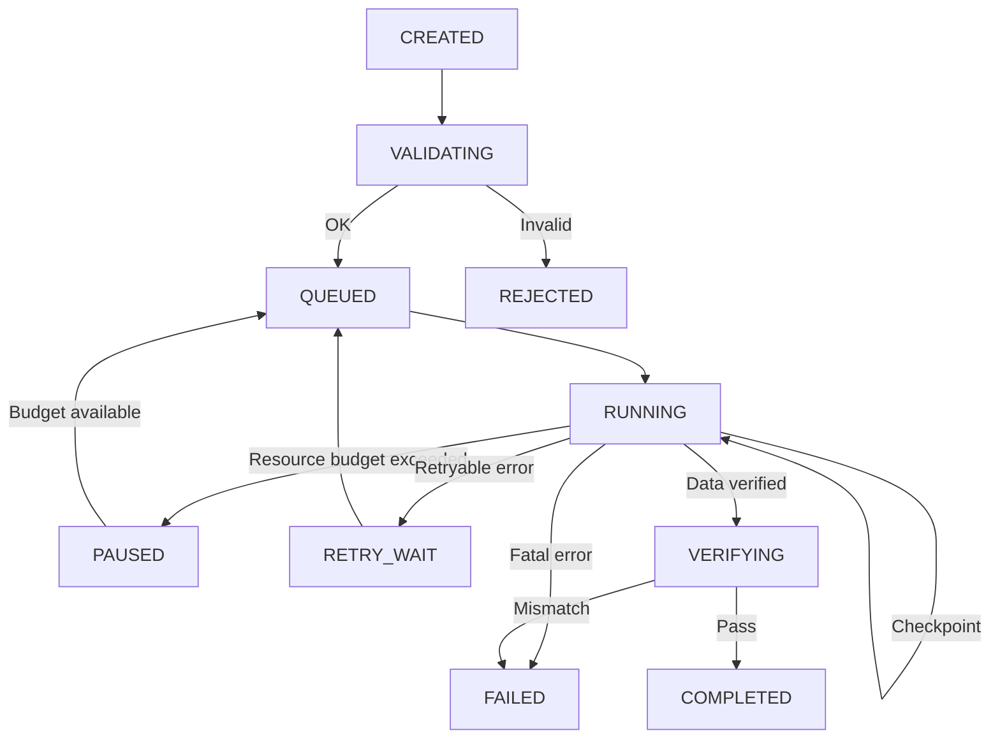
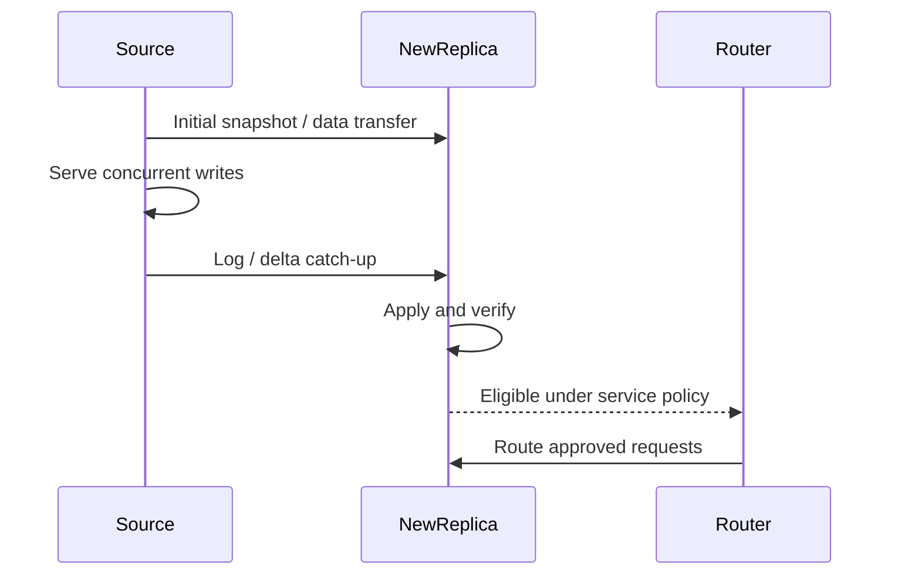
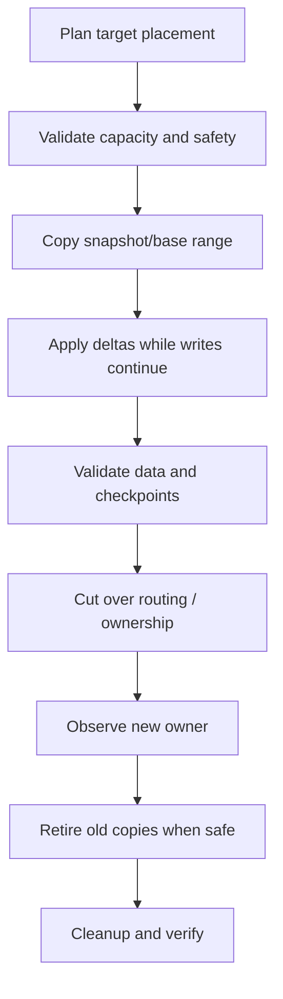

# Quản lý các tác vụ đồng bộ, cân bằng và dọn dữ liệu nền

Một cụm NoSQL không chỉ xử lý những lệnh `GET`, `INSERT`, `UPDATE` hay `DELETE` từ ứng dụng Java. Ngay cả khi không có request trực tiếp, các node vẫn có thể phải **đồng bộ bản sao**, **bắt kịp nhật ký ghi**, **sửa dữ liệu lệch**, **chuyển phân vùng giữa các node**, **gộp file lưu trữ**, **dọn dữ liệu hết hạn**, **xây lại chỉ mục**, **sao lưu** và **khôi phục các bản đọc dẫn xuất**. Những công việc này diễn ra trong nền nhưng dùng **cùng CPU, RAM, disk IOPS, network và dung lượng trống** với truy vấn nghiệp vụ.

Nếu thiếu điều phối, một job “bảo trì” có thể gây ra sự cố lớn hơn lỗi mà nó định sửa:

- Thêm node nhưng sao chép dữ liệu quá nhanh khiến API p99 tăng từ 80 ms lên 2 giây.
- Chạy repair đồng thời trên mọi replica khiến disk I/O và network bão hòa.
- TTL tạo nhiều tombstones, compaction không theo kịp và truy vấn phải quét dữ liệu đã xóa.
- Reindex toàn collection làm nguồn NoSQL bị quá tải và CDC không bắt kịp.
- Di chuyển shard khi cụm vừa failover khiến headroom dành cho recovery biến mất.
- Xóa dữ liệu nguồn trước khi mọi bản sao và consumer nhận được sự kiện xóa, dẫn tới dữ liệu cũ xuất hiện lại.

Bài học này thuộc chương **Vận hành cụm**, module **Database No SQL**, với đề bài **Quản lý các tác vụ đồng bộ, cân bằng và dọn dữ liệu nền**.

Mục tiêu sau bài học:

1. Phân loại công việc nền theo **bản chất, độ ưu tiên, rủi ro và nhu cầu tài nguyên**.
2. Lập **ngân sách CPU, disk, network, concurrency và dung lượng trống** để foreground traffic vẫn đạt SLO.
3. Thiết kế job có **checkpoint, retry, idempotency, lease/fencing và cơ chế tạm dừng/tiếp tục**.
4. Hiểu các pha **replica catch-up, repair, rebalance, compaction, TTL cleanup và index backfill**.
5. Biết những điểm khác nhau trong MongoDB, Cassandra, Redis Cluster, OpenSearch và DynamoDB.
6. Xây dashboard, cảnh báo, runbook và các bài kiểm thử failure/overload cho tác vụ nền.

> **Nguyên tắc:** Tác vụ nền chỉ “thành công” khi hoàn thành **đúng dữ liệu, đúng quyền sở hữu và đúng mức an toàn**, đồng thời không tiêu thụ toàn bộ năng lực dành cho traffic đang phục vụ người dùng. Một job báo `COMPLETED` nhưng làm API lỗi hoặc tạo sai lệch replica vẫn là một thất bại vận hành.

---

## 1. Foreground work và background work

**Foreground work** được khởi phát bởi yêu cầu mà người dùng/ứng dụng đang chờ kết quả:

```text
Client -> API -> NoSQL -> Result
```

**Background work** được khởi phát bởi bộ lập lịch, hệ quản trị, log thay đổi hoặc yêu cầu vận hành:

```text
Scheduler / cluster controller / CDC
               |
               v
  Repair / compaction / rebalance / TTL / backfill
               |
               v
           Storage/replicas
```

Sự phân biệt nói về **ai kích hoạt và ai phải đợi**, không phải mức độ quan trọng. Một background replica recovery hoặc quyền xóa dữ liệu có thể **cấp bách hơn** một truy vấn analytics không quan trọng.

### 1.1. Tài nguyên dùng chung

Cả hai luồng có thể tranh:

- Disk IOPS và bandwidth.
- CPU cho nén/giải nén, hashing, serialization.
- RAM cho buffers, page cache và compaction.
- Network giữa các node/AZ/region.
- Connection pools, threads, file descriptors.
- Dung lượng trống để viết file tạm, snapshot và recovery.
- Quyền sử dụng transaction/log/metadata locks.

### 1.2. Bài toán không phải “tắt hết việc nền”

Nếu cấm compaction, dữ liệu có thể tạo thêm read amplification. Nếu cấm repair quá lâu, replicas có thể lệch và việc mất một node sẽ nguy hiểm hơn. Nếu ngừng cleanup, disk có thể đầy. Mục tiêu là **điều tiết phù hợp SLO và deadline**, không trì hoãn vô thời hạn.

---

## 2. Bản đồ các nhóm tác vụ

| Nhóm | Mục đích | Ví dụ | Rủi ro khi quá tải hoặc trì hoãn |
| --- | --- | --- | --- |
| **Replica catch-up** | Đồng bộ node mới hoặc node vừa quay lại | Log replay, snapshot transfer | Network/disk cao; replica tụt hậu |
| **Anti-entropy/repair** | Phát hiện và sửa lệch giữa replicas | So digest/range, streaming | I/O cao; nếu trì hoãn có nguy cơ giữ dữ liệu lệch |
| **Rebalance/resharding** | Chuyển quyền sở hữu phân vùng hoặc dữ liệu | Chunk migration, slot migration | Dual traffic, temporary capacity, routing change |
| **Compaction/merge** | Tối ưu các lớp dữ liệu và loại phần đã lỗi thời khi an toàn | LSM SSTables, index segments | CPU/IO/temporary disk tăng; backlog gây read amplification |
| **TTL/garbage cleanup** | Loại dữ liệu hết hạn, bản ghi mồ côi | Tombstones, expire, purge | Dung lượng tăng; deletion lag |
| **Index/backfill** | Xây read path hoặc schema mới | Secondary index build, search reindex | Scan nguồn, ghi đích, catch-up lag |
| **CDC/materialization** | Đưa nguồn thay đổi đến bảng/cache/index dẫn xuất | CDC consumers, read projections | Backlog, stale reads, sự kiện đến sai thứ tự |
| **Backup/snapshot** | Tạo điểm khôi phục | Incremental/full backup | Storage/network/cost; backup không đủ mới |
| **Restore/recovery** | Khôi phục khi lỗi | Restore snapshot + log replay | RTO/RPO bị ảnh hưởng; quyền sở hữu và consistency |
| **Integrity/audit cleanup** | Đối soát, dọn dữ liệu dư | Reconciliation, orphan removal | Xóa nhầm hoặc kéo dài sai lệch |

### 2.1. Cùng tên nhưng khác semantics giữa engines

`repair` trong Cassandra, replica synchronization của MongoDB và shard recovery của OpenSearch không phải một API chung. Không copy lệnh, timeline hay tiêu chí hoàn thành từ một engine sang engine khác.

---

## 3. Phân biệt đồng bộ, cân bằng và dọn dữ liệu

**Đồng bộ (synchronization)** làm các bản sao hoặc bản đọc bắt kịp trạng thái nguồn theo contract.

**Cân bằng (balancing)** thay đổi vị trí đặt dữ liệu hoặc phân phối công việc để cải thiện capacity, placement và availability.

**Dọn dữ liệu (cleanup)** loại dữ liệu đã hết hiệu lực hoặc tối ưu representation lưu trữ, nhưng chỉ khi quy tắc giữ/xóa an toàn được đáp ứng.

### 3.1. Ví dụ ba tác vụ nối tiếp

Một node mới gia nhập:

```text
Allocate node
    |
    v
Rebalance/assign ranges
    |
    v
Copy initial data
    |
    v
Replay changes / catch up
    |
    v
Verify data and ownership
    |
    v
Remove obsolete copies / compact cleanup
```

Các bước có thể xen kẽ tùy engine. **Không** chuyển ngay từ “đã copy snapshot” sang “được xóa bản nguồn cũ”.

### 3.2. “Dọn dữ liệu” là nhiều giai đoạn

Một bản ghi bị đánh dấu delete có thể chưa biến mất vật lý ngay. Một cache TTL hết hạn có thể chỉ bị bỏ khi truy cập hoặc khi background expiration chạy. Một index document bị xóa có thể còn ở segment cũ cho tới khi merge. Các trạng thái cần phân biệt.

---

## 4. Những điều phải đúng trước khi chạy

Một job nền cần có **preconditions**, ví dụ:

- Cluster không ở trạng thái mất quorum/availability nghiêm trọng ngoài kế hoạch.
- Có đủ disk headroom cho file tạm, streams và rollback.
- Có network bandwidth và budget đã tính.
- Có quyền/source identity đúng.
- Không có job xung đột trên cùng shard/range nếu engine không hỗ trợ.
- Snapshot, oplog, changelog hoặc broker retention đủ cho catch-up.
- Có checkpoint/rollback/resume strategy.
- Có owner, change record và tiêu chí dừng.
- Có readiness/health signals đáng tin.
- Có phương án giảm tải nếu foreground p99 xấu đi.

### 4.1. “Healthy” không phải một Boolean duy nhất

Một cụm có thể trả health màu xanh nhưng CDC lag cao, backup không chạy hoặc một node sắp hết disk. Điều kiện admission cần lấy **những metrics liên quan đúng job**.

---

## 5. Vòng đời của một background job

Một mô hình chung:



### 5.1. Không đồng nhất `PAUSED` với `FAILED`

Tạm dừng có kiểm soát vì p99 vượt SLO có thể là hành vi đúng. `FAILED` nghĩa job cần can thiệp hoặc không thể hoàn thành theo protocol.

### 5.2. Trạng thái phải sống sót qua restart

Nếu scheduler restart và quên checkpoint, nó có thể lặp hàng giờ scan/copy. Persist job record và progress trong storage bền phù hợp.

### 5.3. Completion có nhiều mức

- **Work accepted:** scheduler nhận job.
- **Work executed:** các bước đã chạy.
- **Data applied:** changes được ghi tại đích.
- **Verified:** trạng thái/ownership hợp lệ.
- **Safe to retire source:** mọi preconditions để xóa bản cũ đã thỏa.

Không dùng một `success=true` cho tất cả.

---

# Phần I — Ngân sách tài nguyên và lập lịch

## 6. Đặt foreground SLO lên trước “đẩy job chạy hết tốc độ”

Những chỉ số cần quan sát khi job hoạt động:

```text
API p50/p95/p99 latency
Error/timeout/retry/throttling
Node CPU và heap/GC
Disk throughput, IOPS, queue latency
Network bandwidth và cross-AZ egress
Replication lag và CDC lag
Free disk + temporary space
Compaction/rebuild backlog
```

Có thể đặt chính sách:

```text
IF foreground p99 > SLO:
    reduce background concurrency/rate
IF disk free < safety threshold:
    pause jobs creating temporary files
IF replica lag exceeds catch-up policy:
    prioritize recovery, postpone optional reindex
```

Các threshold phải được xây từ **capacity testing và engine semantics**, không sao chép cứng từ hệ khác.

### 6.1. Đừng thắt job nền khi nó chính là việc giải cứu

Nếu disk sắp đầy do compaction backlog, tạm dừng mọi compaction có thể làm disk đầy nhanh hơn. Scheduler phải xem **tác động và rủi ro của trì hoãn**, không chỉ p99.

---

## 7. Tính bandwidth budget: ví dụ có số

Giả định một node có sustained disk read bandwidth trong điều kiện production là 400 MiB/s. Foreground ở giờ cao điểm dùng 240 MiB/s. Ta muốn giữ ít nhất 20% capacity làm headroom.

\[
B_{\mathrm{headroom}} = 400 \times 0.20 = 80\ \mathrm{MiB/s}.
\]

Ngân sách lý thuyết còn lại cho background disk reads:

\[
B_{\mathrm{bg}}
\leq 400 - 240 - 80 = 80\ \mathrm{MiB/s}.
\]

Nhưng node còn có writes, compaction write amplification và network traffic. Không được mặc định cho job đọc đủ 80 MiB/s nếu **disk write IOPS hoặc CPU đã chạm trần**.

### 7.1. Kiểm tra network

Giả sử inter-node network bền vững là 300 MiB/s, foreground dùng 210 MiB/s và cần 15% headroom:

\[
B_{\mathrm{network,bg}}
\leq 300-210-45=45\ \mathrm{MiB/s}.
\]

Nếu một streaming job đồng thời tiêu thụ disk và network, giới hạn từ hai tài nguyên cho ta mức **tối đa xấp xỉ 45 MiB/s** trước khi xét overhead và write amplification.

### 7.2. Luôn có margin

Để chừa chỗ cho replication, retries và burst, có thể khởi đầu job ở mức thấp hơn, ví dụ 20–30 MiB/s rồi tăng dần dựa trên p99/IO metrics. Đây là **ví dụ chiến lược**, không phải cấu hình bắt buộc.

### 7.3. Bài tính có giả định

Các con số 400, 240, 300 MiB/s chỉ để minh họa. Capacity thật phải đo dưới payload, compaction, RAID/cloud disk limits, caching và lỗi node phù hợp.

---

## 8. Ngân sách đa tài nguyên

Một background job thường tiêu thụ các tài nguyên theo tỷ lệ khác nhau.

| Job | CPU | Disk read | Disk write | Network | Temporary storage |
| --- | --- | --- | --- | --- | --- |
| Replica catch-up | Trung bình | Cao | Cao | Cao | Trung bình |
| Anti-entropy repair | Cao | Cao | Có thể cao | Cao | Thay đổi |
| LSM compaction | Cao | Cao | Cao | Thường thấp nội bộ node | Có thể cao |
| Search reindex | Cao | Cao nguồn | Cao đích | Cao | Cao |
| TTL cleanup | Thấp–cao | Thay đổi | Thay đổi | Thường thấp | Thay đổi |
| Backup upload | Trung bình | Cao | Ít ở nguồn | Cao | Snapshot metadata |
| Restore | Trung bình–cao | Cao | Cao | Cao | Cao |
| CDC catch-up | Trung bình | Theo stream | Theo sink | Cao | Queue/checkpoint |

Đây là **xu hướng**, không phải yêu cầu tài nguyên chuẩn.

### 8.1. Không đồng thời đặt mọi job nặng trên cùng node

Một compaction đang chiếm disk và một backup full scan cùng lúc có thể cạnh tranh với foreground. Điều phối theo **node, shard, rack/AZ và resource class**.

### 8.2. Headroom tính cả failure mode

Nếu mất một replica, các nodes còn lại phải gánh thêm queries/catch-up. Ngân sách background ở trạng thái khỏe không được ăn hết capacity dành cho N-1 recovery.

---

## 9. Priority không phải chỉ một hàng đợi FIFO

Một chính sách ưu tiên minh họa:

1. **Bảo vệ correctness và phục hồi an toàn:** dữ liệu có nguy cơ mất/đã quá replication window, security deletion, node replacement cần gấp.
2. **Ngăn sự cố gần xảy ra:** disk headroom thấp, compaction backlog sắp gây write stalls, retention window sắp hết.
3. **Đáp ứng deadline vận hành:** backup trước RPO, repair định kỳ, CDC catch-up cần đạt freshness SLO.
4. **Cải thiện capacity:** rebalance, shard redistribution.
5. **Tối ưu không cấp bách:** optional reindex, archive/cleanup không có deadline ngay.

### 9.1. Quy tắc không tuyệt đối

Một full repair cực nặng ở giờ cao điểm có thể làm mất availability; phải chọn cách chia nhỏ/giới hạn. Một backup có deadline pháp lý có thể được nâng ưu tiên so với rebalancing.

### 9.2. Starvation

Nếu các job ưu tiên thấp bị hoãn vô hạn, dữ liệu rác và drift sẽ tích lũy. Scheduler cần **maximum deferral time**, cảnh báo deadline và định kỳ cấp budget cho bảo trì.

---

## 10. Điều phối bằng admission control

**Admission control** quyết định có cho một job bắt đầu **ngay lúc này** không.

Ví dụ policy:

```yaml
taskClass: reindex
scope: catalog-v2
constraints:
  maxClusterConcurrentJobs: 2
  maxPerSourceShardConcurrentReads: 1
  maxPerTargetShardConcurrentWrites: 1
  pauseIf:
    foregroundP99OverSlo: true
    freeDiskBelowSafetyBudget: true
    recoveryInProgress: true
  require:
    checkpointing: true
    idempotentSink: true
    rollbackPlan: true
```

Đây là **schema ý tưởng**, không phải cấu hình mặc định của MongoDB hay Kubernetes.

### 10.1. Chỉ có max concurrency chưa đủ

Hai jobs mỗi job tải 500 MiB/s có thể vẫn quá tải dù `maxConcurrentJobs=2`. Cần **throughput cap theo tài nguyên**.

### 10.2. Phạm vi đặt limit

- Cluster-wide.
- Per node/shard.
- Per failure domain.
- Per tenant.
- Per job class.
- Per source/sink dependency.

Một giới hạn toàn cluster không ngăn hai jobs trùng lên một shard.

---

## 11. Token bucket và adaptive throttling

Một token bucket có thể phát tokens tương ứng với số byte hoặc số work units được phép mỗi giây.

```text
Job needs 8 MiB read
      |
      v
Request 8 MiB worth of tokens
      |
      +-- tokens available --> do one bounded batch
      |
      +-- no tokens --------> wait / pause
```

### 11.1. Giới hạn theo byte thường tốt hơn chỉ giới hạn pages/s

Mỗi page có thể chứa 1 KiB hoặc vài MiB. Chỉ giới hạn `100 pages/s` khiến throughput không ổn định khi payload thay đổi.

### 11.2. Adaptive control

Một controller có thể giảm tốc độ khi p99, disk queue hoặc throttling tăng; tăng từ từ khi hệ có headroom.

```text
If latency/IO pressure high:
  newRate = max(minRate, oldRate * 0.7)
Else if healthy across several windows:
  newRate = min(maxRate, oldRate + smallStep)
```

Đây là **heuristic**, cần hysteresis để tránh tốc độ dao động nhanh.

### 11.3. Không dùng metric stale

Nếu dashboard cập nhật mỗi 5 phút, controller điều chỉnh mỗi giây có thể đưa quyết định sai. Cần xác định metric freshness và fallback khi telemetry bị mất.

---

## 12. Cửa sổ bảo trì và time-of-day scheduling

Một job có thể chạy:

- Theo lịch định kỳ.
- Khi disk/lag vượt threshold.
- Sau deployment/migration.
- Khi node gia nhập/rời cụm.
- Khi change stream yêu cầu rebuild.
- Khi kiểm tra DR hoặc recovery.

### 12.1. “Ban đêm” không luôn thấp tải

Hệ đa quốc gia có giờ cao điểm khác nhau. Batch analytics, backup và customer jobs thường chạy ngoài giờ hành chính. Cần đo workload thực trước khi chọn maintenance window.

### 12.2. Có thể dùng quiet hours, nhưng phải có deadline

Repair hoặc delete có deadline không nên bị đẩy mãi vì mỗi ngày đều có job khác. Dùng calendar cùng SLO và safety conditions.

### 12.3. Change freeze

Trong giai đoạn sự kiện lớn, có thể hoãn optional resharding/reindex nhưng vẫn phải cho recovery và cleanup thiết yếu. Định nghĩa rõ class nào được phép bypass freeze.

---

## 13. Chia task thành đơn vị nhỏ có thể dừng

Một job “scan 500 triệu documents” rất khó kiểm soát nếu không chia nhỏ.

Nên chia:

```text
Reindex catalog
  - segment 00: hash range A-B
  - segment 01: hash range B-C
  - segment 02: hash range C-D
  ...
```

Hoặc:

```text
Archive event table
  - tenant tier small / month 2024-01
  - tenant tier small / month 2024-02
  - ...
```

### 13.1. Work unit nên có tính chất

- Có ID ổn định.
- Có scope/range xác định.
- Có checkpoint.
- Có dự toán bytes/records.
- Có thể retry và verify.
- Không phụ thuộc một in-memory cursor duy nhất.
- Không tạo duplicate side effects khi chạy lại.

### 13.2. Tránh chia đơn vị theo offset không ổn định

Trong dataset đang thay đổi, pagination `skip/offset` có thể bỏ hoặc lặp records. Dùng keyset cursor, snapshot/log position hay cơ chế scan được engine bảo đảm.

---

## 14. Checkpoint và restart

Checkpoint là bằng chứng job đã xử lý **đến đâu**, chẳng hạn:

```json
{
  "jobId": "reindex-products-v2",
  "segmentId": "segment-03",
  "cursor": "product-00004569",
  "sourceRevisionWatermark": 8841032,
  "lastAppliedAt": "2026-11-14T08:00:00Z",
  "status": "RUNNING"
}
```

Các giá trị chỉ minh họa.

### 14.1. Thứ tự an toàn

```text
Read batch
    |
    v
Apply idempotently at target
    |
    v
Confirm durable apply
    |
    v
Persist checkpoint
```

Nếu checkpoint trước target write và worker chết, batch có thể bị bỏ sót.

### 14.2. Checkpoint sau write vẫn có duplicate

Worker có thể ghi target thành công nhưng chết trước checkpoint. Khi restart, batch được xử lý lại. Vì vậy sink phải idempotent hoặc có version guard.

### 14.3. Checkpoint không đồng nghĩa snapshot consistency

Một cursor đã lưu không chứng minh dữ liệu thay đổi sau lúc scan cũng được xử lý. Cần snapshot+stream catch-up với log position phù hợp.

---

## 15. Idempotency là yêu cầu hàng đầu

Một operation **idempotent** có thể được thực hiện lặp lại mà vẫn cho cùng trạng thái mong muốn.

Ví dụ hợp với reindex:

```text
Upsert search document ID=product-42
SourceRevision=128
Payload=...
```

Nếu sink chỉ chấp nhận revision mới hơn, replay không ghi lùi.

### 15.1. Không phải mọi thao tác đều idempotent

```text
totalSales = totalSales + 100000
```

Chạy hai lần làm tổng tăng gấp đôi. Cần contribution/event ID ledger hoặc một transaction bảo đảm dedupe.

### 15.2. Xóa cũng có vấn đề replay

Nếu delete v14 đã xóa record khỏi index, một upsert v13 đến muộn không được tạo lại. Cần tombstone/high-watermark hoặc cơ chế phiên bản tương ứng.

### 15.3. Idempotency phụ thuộc phạm vi

Một `PUT` với cùng document ID có thể idempotent về final payload nhưng vẫn phát audit event/email hai lần. Tách side effects và bảo vệ từng sink.

---

## 16. Lease, lock và fencing

Khi hai workers cùng thấy một job chưa hoàn thành, cần cơ chế claim/ownership.

Một mô hình:

```text
Job state in durable store:
  status=RUNNING
  owner=worker-7
  leaseUntil=...
  fencingToken=193
```

Worker phải gia hạn lease. Nếu không gia hạn được thì ngừng nhận work mới.

### 16.1. Vì sao lock TTL đơn giản chưa đủ?

```text
T0: Worker A acquires lock.
T1: A bị pause, lock hết hạn.
T2: Worker B acquires lock và bắt đầu.
T3: A tỉnh lại, tiếp tục ghi đích.
```

Hai workers chạy chồng. Nếu đích là operation không idempotent, dữ liệu có thể hỏng.

### 16.2. Fencing token

Mỗi lần cấp lease mới nhận token đơn điệu tăng. Sink hoặc storage authority phải **từ chối writes từ token cũ** nếu protocol cần exactly-one-active-writer. Chỉ kiểm tra token trong bộ nhớ worker không chặn được A ở T3.

### 16.3. Không đồng nhất fencing với revision nguồn

Fencing token xác định **thế hệ quyền thực thi của worker**, còn source revision xác định **thứ tự trạng thái dữ liệu**. Một job có thể cần cả hai.

---

## 17. Retry, backoff và dead-letter queue

Các lỗi cần phân loại:

| Lỗi | Hướng xử lý |
| --- | --- |
| Sink throttled (429/503) | Bounded exponential backoff + jitter |
| Network timeout | Kiểm tra outcome; retry idempotently |
| Source snapshot gap | Dừng, lấy snapshot/checkpoint mới |
| Schema mismatch | Quarantine/repair code, không retry vô hạn |
| Target quota/disk full | Pause, giải quyết capacity |
| Lease lost | Worker dừng; job được reclaim theo protocol |
| Data checksum mismatch | Verify/repair, không đánh dấu completed |
| Permission/auth failure | Alert và sửa identity/secret, không bypass |
| Deleted source record | Áp tombstone hoặc protocol delete thích hợp |
| Conflict/invariant violation | Điều tra, không ghi đè mù |

### 17.1. Retry storm trong background jobs

Nếu hàng trăm tasks bị timeout rồi cùng retry mỗi giây, chúng có thể làm node đang chậm càng chậm. Retry budget phải ở **tầng job scheduler**, không chỉ từng HTTP client.

### 17.2. DLQ không phải “đã hoàn thành”

Một segment bị quarantine vẫn là nghĩa vụ cần sửa/replay hoặc chấp thuận loại bỏ bằng policy, không được tính vào coverage đã verify.

---

## 18. Fairness giữa tenants và các lớp công việc

Một tenant rất lớn có thể tiêu tốn toàn bộ budget của reindex/compaction/backup.

Có thể dùng:

- Per-tenant concurrency budgets.
- Weighted fair queueing.
- Resource classes: recovery, routine, low priority.
- Max time slice per segment.
- Scheduling theo shard/region để tránh nóng cùng một nơi.
- Per-tenant quotas cho bulk operations.

### 18.1. Không giới hạn cứng khiến tenant lớn không bao giờ xong

Có thể cấp trọng số cao hơn theo SLA; vẫn cần deadline và theo dõi age của job thấp ưu tiên.

### 18.2. Multi-tenant correctness

Job cleanup phải scope đúng tenant. Một sai sót trong prefix/range có thể xóa dữ liệu ngoài phạm vi, nghiêm trọng hơn chậm vài giờ.

---

# Phần II — Đồng bộ dữ liệu và sửa lệch replicas

## 19. Replica synchronization không chỉ là “copy hết dữ liệu”

Một replica mới có thể cần:

1. Nhận snapshot/initial state.
2. Tải dữ liệu hiện hữu.
3. Theo dõi changes phát sinh trong lúc copy.
4. Replay log hoặc apply deltas.
5. Xác minh bắt kịp source theo consistency/role policy.
6. Chuyển trạng thái đủ điều kiện phục vụ reads/writes.
7. Tiếp tục replication bình thường.



### 19.1. Một replica “có dữ liệu” chưa chắc sẵn sàng

Snapshot hoàn tất không có nghĩa replica đã apply mọi changes hoặc an toàn để trả reads với consistency yêu cầu.

### 19.2. Catch-up window

Nếu source log giữ 2 giờ nhưng initial copy mất 6 giờ, replica có thể không bắt kịp từ vị trí ban đầu nếu không có giao thức/retention phù hợp.

---

## 20. Full sync và incremental sync

**Full sync** tái tạo một tập dữ liệu lớn từ snapshot/base state.

**Incremental sync** chỉ tải các changes kể từ mốc đã biết, nếu log/history còn đủ và protocol hỗ trợ.

| Yếu tố | Full sync | Incremental sync |
| --- | --- | --- |
| Network | Thường lớn | Theo lượng changes |
| Disk pressure | Có thể cao | Thường nhỏ hơn |
| Yêu cầu history | Snapshot/base consistency | Log position/retention |
| Khả năng resume | Tùy engine | Dựa vào cursor/offset |
| Failure cost | Recopy nếu không checkpoint | Replay từ checkpoint |
| Rủi ro | Overload, insufficient disk | Log gap, version conflict |

### 20.1. Không phải incremental luôn rẻ

Nếu node offline lâu và changed data gần bằng toàn dataset, incremental có thể đọc quá nhiều random fragments và tốn hơn full sync.

### 20.2. Phải có source-of-truth cho mốc

Không dùng đồng hồ client tự tạo `updatedAt` rồi suy chắc mọi mutation từ đó đều được capture. Mốc phải đến từ cơ chế snapshot/log được engine bảo đảm.

---

## 21. Anti-entropy: phát hiện bản sao lệch

**Anti-entropy** là họ kỹ thuật so sánh dữ liệu ở replicas để tìm và sửa phần không khớp. Tùy engine có thể dùng:

- Partition/range digest.
- Merkle tree hoặc hashing hierarchy.
- Per-row versions/timestamps.
- Read repair hoặc scheduled repair.
- Replica reconciliation protocols.

### 21.1. Anti-entropy khác replication thông thường

Replication liên tục chuyển changes theo write path. Anti-entropy có thể phát hiện những khác biệt còn sót do downtime, missed messages, lag hoặc lỗi trước đó.

### 21.2. Không suy mọi NoSQL cần người vận hành chạy Merkle repair

Một số managed/replication systems tự xử lý consistency/recovery bằng giao thức riêng. Khả năng bật/chạy repair và tiêu chí cần được xác minh theo engine/version/topology.

### 21.3. Đừng chỉ nhìn checksum root

Một checksum range không khớp cần drill down, phân biệt dữ liệu hợp lệ, tombstones, schema/version và thời điểm snapshots. Không sửa bằng copy mù một replica lên mọi replica.

---

## 22. Repair có thể rủi ro như thế nào?

Một repair có thể:

- Đọc nhiều dữ liệu trên nhiều replicas.
- Dùng CPU hashing/digest.
- Tạo streaming traffic.
- Tăng disk writes/compaction.
- Gây queue cho foreground.
- Chạm các partitions quá lớn.
- Phải retry khi node tạm mất mạng.

### 22.1. Cách vận hành

- Chia theo token ranges/partitions nếu engine hỗ trợ.
- Giới hạn concurrent ranges, sessions và bandwidth.
- Tránh chạy cùng backup, bootstrap và major compaction quá nặng.
- Theo dõi pending compactions và replica health.
- Dành maintenance window và recovery headroom.
- Có lịch repair đáp ứng chính sách xóa/tombstone retention.
- Checkpoint/ghi job history và cảnh báo phần chưa repair.

### 22.2. Không chọn replica “cũ nhất” hay “mới nhất” bằng trực giác

Consistency rules, tombstones và conflict resolution do engine quy định. Một stale replica có thể chứa delete marker quan trọng, trong khi một bản nhìn có vẻ “đầy đủ hơn” lại là dữ liệu cũ đã phải xóa.

---

## 23. Repair và tombstone safety

Trong một số LSM-based NoSQL, delete/TTL được biểu diễn bằng tombstones trước khi được loại bỏ vật lý. Marker giúp replica biết dữ liệu đã bị xóa.

Ví dụ nguy hiểm:

```text
Replica A: key K đã bị delete (tombstone)
Replica B: offline, vẫn giữ K cũ
A dọn tombstone quá sớm
B quay lại với dữ liệu cũ
```

Nếu conflict protocol không còn bằng chứng delete, **dữ liệu đã xóa có thể xuất hiện lại**.

### 23.1. Đặc thù Cassandra

Cassandra có chính sách tombstone retention và repair liên quan đến `gc_grace_seconds`, với lưu ý phụ thuộc phiên bản/cấu hình và cơ chế repair. Không hạ grace period bừa để giảm disk/tombstone scans; phải xác minh mọi replica nhận xóa, downtime maximum và lịch repair trước.

### 23.2. Không áp `gc_grace_seconds` cho mọi engine

MongoDB, Redis và DynamoDB có cleanup/replication semantics khác. Không dùng một khái niệm Cassandra như công thức toàn bộ NoSQL.

### 23.3. Xóa theo luật hoặc bảo mật

Khi cần xóa gấp vì quyền riêng tư, không được chỉ chờ eventual physical GC mà vẫn để read path trả dữ liệu. Có thể cần access suppression, tombstone semantics, hard expiry và quy trình purge toàn bộ copies/index/backup theo policy.

---

## 24. Replica lag: đo nhiều mức

Một node có thể ở các trạng thái khác nhau:

```text
Source commit position
       |
       v
Captured log position
       |
       v
Transferred position
       |
       v
Applied position
       |
       v
Eligible read / visible position
```

Cần phân biệt:

- Time lag (giây).
- Bytes/operations/offset lag.
- Apply backlog.
- Read visibility delay.
- Source log retention còn lại.
- Có bắt kịp với tốc độ hiện tại không?

### 24.1. ETA không đơn giản là bytesLeft/bandwidth

Trong lúc catch-up, source vẫn ghi mới. Nếu apply tốc độ 1.000 changes/s nhưng source phát 1.200 changes/s, backlog **tăng** dù worker bận liên tục.

### 24.2. Đặt catch-up rate > incoming change rate

Muốn thu hẹp backlog, trong giai đoạn recovery cần throughput apply hữu hiệu vượt tốc độ changes mới, hoặc giảm write load có kiểm soát theo business contract.

### 24.3. Log retention là deadline

Khi backlog gần vượt lịch sử còn giữ, cần ưu tiên catch-up/re-snapshot thích hợp. Không chỉ chờ qua đêm nếu retention window sẽ hết trước.

---

# Phần III — Cân bằng và dịch chuyển dữ liệu

## 25. Khi nào cần rebalance?

Dấu hiệu:

- Node A dùng 88% disk, các node khác 45%.
- Một số shards nhận phần lớn read/write QPS.
- Node mới đã được thêm nhưng chưa chứa đủ dữ liệu.
- Một AZ chứa quá nhiều primaries/hot shards.
- Một tenant tăng mạnh làm placement lệch.
- Resharding theo access pattern mới.
- Chuẩn bị maintenance/decommission node.
- Sau failover, ownership và capacity không phù hợp.

### 25.1. Dung lượng cân bằng không đảm bảo tải cân bằng

Một shard chỉ 5 GiB nhưng chứa hot key 60.000 GET/s có thể quá tải hơn shard 300 GiB ít truy cập.

### 25.2. Rebalance không tự giải một hot key

Nếu mọi request của logical key K vẫn đến một owner, di chuyển K sang node khác chỉ **chuyển hotspot**, không chia tải. Có thể cần cache read replication, thay partitioning hoặc mô hình ghi.

---

## 26. Một data migration có nhiều pha an toàn



**Pha cụ thể do engine quyết định**; đây là mô hình tư duy để hiểu rủi ro.

### 26.1. Copy không bằng cutover

Khi dữ liệu đã được copy sang đích, writes mới có thể vẫn tới nguồn. Không chuyển router khi đích chưa catch-up/ready theo protocol.

### 26.2. Cutover không bằng safe deletion

Sau đổi owner, clients có thể còn cached routing metadata, retries hoặc requests đang in-flight. Việc xóa bản cũ phải tuân theo giao thức migration/ownership của engine.

### 26.3. Data validation không chỉ đếm records

Cần xem revisions, checksums/hashes theo semantics, tombstones, TTL, index correctness và visibility. Hai shards có cùng count vẫn có thể khác dữ liệu.

---

## 27. Chia rebalance thành các đơn vị kiểm soát

Một plan có thể chuyển:

```text
Range A: Node-1 -> Node-4, estimated 12 GiB
Range B: Node-2 -> Node-5, estimated 8 GiB
Range C: Node-1 -> Node-6, estimated 16 GiB
```

Các giá trị minh họa.

### 27.1. Tại sao không chuyển tất cả đồng thời?

Nếu cả ba ranges đọc source Node-1, Node-1 chịu tổng 28 GiB streaming + foreground. Scheduling per-source/per-destination node giúp tránh overload.

### 27.2. Chia theo bytes thay vì chỉ số partitions

Một partition 30 GiB không bằng 30 partitions mỗi cái 1 KiB. Estimation nên tính size/hotness và thước đo work.

### 27.3. Phụ thuộc failure domains

Không được di chuyển mọi replicas của cùng shard vào một AZ chỉ vì rẻ network. Placement constraints (rack/AZ/region) phải được giữ.

---

## 28. Cân bằng dữ liệu khác cân bằng request traffic

Có thể cần hai kế hoạch:

**Data balance:**

```text
Node A: 800 GiB
Node B: 300 GiB
Node C: 350 GiB
```

**Traffic balance:**

```text
Node A: 8.000 GET/s
Node B: 38.000 GET/s
Node C: 7.500 GET/s
```

Một rebalancer dựa trên disk bytes có thể làm A nhẹ hơn nhưng không giảm GET traffic ở B.

### 28.1. Đừng chuyển quá nhiều shard rất nóng cùng lúc

Transfer những hot shards tạo tăng network và replication lag ngay trên các nodes đích đang nóng. Cần plan dựa trên **size và heat**.

### 28.2. Cân bằng theo p99 và headroom

Một node mới có ít traffic không có nghĩa nó nên nhận toàn bộ traffic từ node khác. Kiểm tra sustainable capacity và topology.

---

## 29. Rebalance trong sự cố

Khi một node bị lỗi, cluster có thể tự redistribute/rebuild replicas. Đây là lúc capacity bị giảm, nên optional migration có thể cạnh tranh với recovery.

### 29.1. Quy tắc ưu tiên

- Bảo vệ quorum/availability trước.
- Giới hạn background tasks không bắt buộc.
- Đảm bảo nguồn/đích có disk và bandwidth.
- Theo dõi replication/catch-up và error budget.
- Không chạy major compaction/reindex full cluster nếu không cần.
- Chỉ resume optional rebalance khi trạng thái phục hồi ổn định.

### 29.2. Không tắt mọi movement vô thời hạn

Nếu placement đang vi phạm fault-domain redundancy, delay quá lâu cũng nguy hiểm. Chọn thứ tự và tốc độ phục hồi theo mục tiêu an toàn.

---

# Phần IV — Dọn dữ liệu nền và storage maintenance

## 30. TTL expiration, logical delete và physical reclamation

Ba thời điểm thường khác nhau:

```text
T0: Application marks record deleted / TTL expires
T1: Read path stops returning record
T2: Storage physically reclaims bytes
```

### 30.1. Trễ giữa T1 và T2 là bình thường ở nhiều engines

- TTL có thể được dọn ở background.
- LSM tombstones cần compaction an toàn.
- Search index deletes có thể chờ segment merge.
- Redis có thể dùng lazy expiration hoặc active expire.
- Object storage và backups có retention riêng.

### 30.2. Không dùng disk-used giảm ngay làm tiêu chí duy nhất

Một delete API trả success có thể làm record không còn visible nhưng disk chưa giảm. Nếu hứa “xóa khỏi mọi bản sao” với user, phải có policy rõ về source, cache, index và backup retention.

---

## 31. Compaction trong LSM-based NoSQL

Nhiều NoSQL dùng cấu trúc LSM để ghi nhanh:

```text
Write -> WAL/commit log -> Memtable
                    |
                    v
                 SSTables
             /      |      \
           S1       S2      S3
             \      |      /
             Background compaction
                    |
                    v
              Fewer/rewritten SSTables
```

Compaction có thể:

- Gộp các versions.
- Giảm số SSTables phải xem khi đọc.
- Xử lý tombstones theo điều kiện an toàn.
- Cải thiện locality/compression.
- Thu hồi dung lượng của dữ liệu lỗi thời khi đủ điều kiện.

### 31.1. Compaction vừa giúp vừa cạnh tranh I/O

Nó đọc và viết lại dữ liệu, dùng disk bandwidth/CPU. Nếu compaction backlog kéo dài, read amplification/write stalls có thể tăng. Nhưng cho compaction chạy cực nhanh trong giờ cao điểm cũng có thể làm API chậm.

### 31.2. Compaction khác repair

Compaction chủ yếu tổ chức lại storage theo engine. Repair đảm bảo replicas có nội dung đúng theo protocol. Chạy compaction không tự thay thế anti-entropy repair.

---

## 32. Các chiến lược compaction và đánh đổi

Một số LSM engines hỗ trợ lựa chọn strategy (tên và semantics khác theo sản phẩm):

- Size-tiered: nhóm file cùng kích thước.
- Leveled: chia dữ liệu thành levels/ranges, ảnh hưởng read/write amplification.
- Time-window: nhóm dữ liệu theo thời gian, thường hợp workload có TTL/time series nếu thiết kế đúng.
- Universal/other vendor-specific strategies.

### 32.1. Không có strategy tốt nhất cho mọi workload

- Read-heavy cần ít SSTables per read.
- Write-heavy có thể ưu tiên throughput ghi và chi phí compaction.
- TTL-heavy/time-series cần thiết kế cho expiry/retention.
- Large partitions và hot keys có thể tạo áp lực khác.

### 32.2. Đổi strategy có thể gây compaction storm

Khi đổi strategy, dữ liệu có thể cần được tổ chức lại, tiêu tốn disk và bandwidth. Không đổi compaction policy trên production khi thiếu benchmark và headroom.

### 32.3. Major/forced compaction

Các thao tác compact toàn bộ lớn có thể tăng tạm thời dung lượng, I/O và thời gian hoàn tất. Chỉ thực hiện theo hướng dẫn engine và runbook, không xem là nút “tăng tốc ngay”.

---

## 33. Tombstones và dữ liệu hết hạn

Một delete marker có thể giúp một replica hiểu record đã bị xóa. Cleanup phải xem:

- Mọi replica cần biết delete chưa?
- Grace/retention window có hết chưa?
- Có node offline quá lâu?
- Snapshot/log replay hoặc backup có thể đưa dữ liệu cũ trở lại không?
- Có TTL hàng loạt khiến delete bursts không?
- Có compaction backlog chặn reclamation không?

### 33.1. Không giảm retention một cách tùy tiện

Giảm TTL/grace quá mức có thể phá semantics hoặc tạo dữ liệu “zombie” trong những kiến trúc dùng tombstones cho replication. Cần hiểu từng engine và phiên bản.

### 33.2. TTL storm

Nếu 100 triệu rows cùng hết hạn lúc 00:00, cleanup/compaction có thể tạo đột biến I/O và p99. Có thể cân nhắc bucket theo thời gian, phân tán expiry, chính sách retention và scheduler theo workload.

### 33.3. Hết hạn logic khác giải phóng storage

Một query không trả expired rows không có nghĩa disk space đã thu hồi. Dashboard nên theo dõi cả **logical expired data, cleanup lag và physical storage trend** khi có telemetry.

---

## 34. Dọn orphan records và các bản đọc dẫn xuất

Một read model hoặc search index có thể chứa records nguồn đã xóa hoặc thiếu records mới khi consumer lag.

Ví dụ:

```text
Canonical Products DB: product X deleted at rev51
Search Index: product X still exists at rev50
Redis Cache: product X still exists
```

Một reconciliation job có thể:

1. Đọc trạng thái nguồn đúng scope.
2. So source revision/key với target.
3. Xác định missing/stale/orphan records.
4. Gửi repair/invalidation event idempotently.
5. Ghi checkpoint và kiểm tra kết quả visible.
6. Báo mismatch rate và age.

### 34.1. Không xóa orphan theo heuristic thiếu authority

Nếu một target row “không thấy ở source” do snapshot đang partial hay nguồn tạm lỗi, xóa ngay có thể làm mất dữ liệu hợp lệ. Cần snapshot consistency/negative lookup policy.

### 34.2. Replay event cũ có thể resurrect

Sau delete, update event cũ đến muộn có thể tạo lại target nếu tombstone/version ledger bị mất. Cleanup phải thiết kế cùng retention/replay window.

---

## 35. Index build, reindex và backfill là background data jobs

Khi thêm một index hoặc read table, thường phải:

```text
Create new target
    |
    v
Snapshot scan source
    |
    v
Bulk write target
    |
    v
Catch up source changes
    |
    v
Verify coverage & freshness
    |
    v
Switch read routing/alias
```

### 35.1. Snapshot + stream handoff

Nếu bắt CDC **sau** khi scan xong, những writes trong thời gian scan có thể mất. Cần native snapshot+log protocol hoặc stream-before-scan có checkpoint và version guard.

### 35.2. Throttle cả source và sink

Source có thể bị scan overload, sink có thể bị bulk indexing/throttling. Rate limit chỉ ở một đầu không đủ.

### 35.3. Không cutover chỉ vì progress 100%

`ScannedRecords=100%` không chứng minh mọi changes đến sau scan đã apply. Cần **catch-up watermark, target visibility, checksum/coverage và error state**.

---

## 36. Cleanup và index lifecycle

Search engines thường dùng:

- Rollover sang index mới.
- Retention policy theo thời gian.
- Background segment merges.
- Delete-by-query (có thể tốn nhiều tài nguyên).
- Reindex/alias cutover.
- Snapshot và xóa old generation sau rollback window.

### 36.1. Delete-by-query không tự giải phóng bytes ngay

Documents có thể bị đánh dấu xóa, storage được thu hồi khi segments được hợp nhất theo engine policy. Một forced merge làm nhanh cleanup có thể tốn I/O lớn.

### 36.2. Đừng xóa index cũ khi rollback chưa an toàn

Trong blue/green migration, old index có thể cần giữ để rollback. Nhưng giữ vô hạn cũng làm disk đầy. Đặt retention/owner cho old generations.

### 36.3. Privacy-deletion ưu tiên access suppression

Khi cần chặn truy cập ngay, không đợi background merge; đảm bảo read path và quyền truy cập ngăn dữ liệu cũ hiển thị.

---

# Phần V — Các thao tác đặc thù theo NoSQL

## 37. MongoDB: replication catch-up và initial sync

MongoDB replica set có primary và secondary members theo topology/election semantics. Secondary theo dõi và áp operations được ghi bền theo cơ chế replication của sản phẩm.

Những điểm vận hành:

- Initial sync/recovery có thể tốn network/disk.
- Secondary có thể lag so với primary.
- Oplog/history window ảnh hưởng khả năng bắt kịp.
- Indexes và dữ liệu cần nhất quán theo protocol initial sync.
- Election/failover có thể thay đổi nơi nhận writes.
- Một số thao tác admin ảnh hưởng replica set health.

### 37.1. Lệnh chẩn đoán minh họa

Trong `mongosh` với quyền tương ứng:

```javascript
rs.status();
db.serverStatus();
```

Với sharded cluster còn cần xem router, config metadata và từng replica set. Không tự sửa `rs.reconfig()` hoặc ép resync trên production chỉ vì thấy secondary lag.

### 37.2. Không dùng replication lag làm thước đo duy nhất

Replica có thể apply chậm do disk I/O, index build, network hoặc write surge. Cần đo throughput của các bước và log retention.

---

## 38. MongoDB: chunk/range migrations và balancer

Ở sharded cluster, việc phân phối dữ liệu có thể dựa trên shard key ranges/chunks và cơ chế balancer tùy phiên bản.

Ví dụ lệnh quan sát trên môi trường có quyền phù hợp:

```javascript
sh.status();
```

Có thể kết hợp cluster metrics, migration histories, per-shard disk/QPS và current operations theo công cụ phiên bản hỗ trợ.

### 38.1. Rebalance có thời điểm copy và cutover

Một range migration có thể cần copy base data, bắt kịp writes và chuyển ownership. Trong quá trình đó phát sinh network/disk traffic và các giới hạn consistency do engine quản lý.

### 38.2. Không tự xóa data ở shard cũ

Sau migration, các bản dữ liệu cũ/cleanup tasks phải do giao thức engine quản lý. Không dùng script `deleteMany()` để dọn ranges theo suy đoán.

### 38.3. Bốn câu hỏi

- Balancer có đang hoạt động theo cấu hình?
- Có migration backlog/failures không?
- Có zone placement constraints không?
- Đang cân bằng theo dữ liệu hay giải quyết traffic hotspot?

Một hot shard không phải lúc nào cũng được chữa bằng balancer.

---

## 39. MongoDB: TTL monitor và dọn collection

MongoDB có TTL indexes trong những trường hợp hỗ trợ. Dữ liệu hết hạn có thể bị xóa bởi background process, không được bảo đảm biến mất đúng vào thời điểm TTL.

Ví dụ schema minh họa cho documents có `expiresAt` kiểu date, trong collection dành riêng:

```javascript
db.tempSessions.createIndex(
  { expiresAt: 1 },
  { expireAfterSeconds: 0 }
);
```

### 39.1. TTL là eventual cleanup

Một record hết hạn có thể tồn tại trong khoảng thời gian trước khi background TTL process xóa. Ứng dụng cần kiểm tra `expiresAt` nếu nghiệp vụ yêu cầu session không còn hợp lệ ngay.

### 39.2. TTL delete cũng là write workload

Xóa hàng triệu records có thể tạo write traffic, replication và index maintenance. Cần xét tốc độ hết hạn, storage pressure và workload foreground.

### 39.3. Không suy disk bytes giảm ngay

WiredTiger/storage engine có cơ chế space reclamation và file reuse khác việc delete logical rows. Kiểm tra metrics và policy trước khi kỳ vọng disk file co lại ngay.

---

## 40. Cassandra: repair và anti-entropy

Với Cassandra, scheduled repair thường là thành phần quan trọng của vận hành consistency và tombstone safety, phụ thuộc topology/version/configuration.

Các lệnh chẩn đoán thường gặp:

```bash
nodetool status
nodetool netstats
nodetool compactionstats
nodetool tablestats app.events_by_customer
```

Chỉ dùng trong môi trường có quyền và đúng Cassandra version; tham số/format có thể khác giữa distributions.

### 40.1. Repair không phải backup

Repair giúp đồng bộ giữa replicas nhưng không cung cấp snapshot lịch sử bảo vệ trước xóa nhầm hay corruption lan ra mọi replicas.

### 40.2. Lịch và phạm vi repair

Có thể lên lịch theo keyspace/table/token ranges và chiến lược incremental/full phù hợp version. Không chạy `nodetool repair` đồng loạt trên mọi nodes mà chưa thiết kế concurrency, budget và trách nhiệm của scheduler.

### 40.3. Đặc biệt quan trọng: tombstone grace

Một replica offline vượt quá cửa sổ an toàn của deletes có thể mang dữ liệu cũ trở lại. Cần repair policy và cơ chế bảo vệ phù hợp trước khi hạ grace.

---

## 41. Cassandra: bootstrap, decommission và streaming

Khi thêm node, Cassandra có thể streaming các token ranges; khi bỏ node, phải đảm bảo dữ liệu/ownership tiếp tục được nhân bản theo topology.

### 41.1. Các lưu ý

- Streaming đồng thời với live traffic.
- Replication factor và token ownership.
- Network bandwidth giữa racks/DCs.
- Read/write load của source và destination.
- Disk headroom và pending compactions.
- Node state và consistency khi chuyển ownership.
- Khả năng retry/resume theo phiên bản.

### 41.2. Không “delete data rồi remove node” theo ý muốn

Decommission/removenode/replace có semantics khác nhau. Phải dùng runbook và lệnh chính thức tương ứng với node alive/dead, RF và topology.

### 41.3. Cân bằng DC

Data balance trong một DC không tự chứng minh placement đủ khả năng chịu mất rack/AZ. Cần verify replication placement constraints.

---

## 42. Cassandra: compaction và cleanup

`nodetool compactionstats` giúp quan sát pending/active compactions theo tính năng phiên bản. Storage maintenance có thể gồm cleanup sau thay đổi token ownership và những kiểu compaction khác.

### 42.1. `cleanup` không đồng nghĩa xóa bản ghi hết TTL

Một số maintenance commands dùng thuật ngữ cleanup để loại dữ liệu mà node không còn sở hữu sau topology change. TTL/tombstone reclamation lại tuân theo compaction/grace semantics riêng.

### 42.2. Tránh manual major compaction trong giờ cao điểm

Nó có thể tăng read/write I/O và disk headroom requirements. Chỉ dùng khi có lý do chẩn đoán và kế hoạch kiểm soát tải.

### 42.3. Đo read amplification

Số SSTables per read, tombstones scanned, partition sizes và disk queue giúp đánh giá compaction backlog. Không chỉ nhìn một counter “pending compactions”.

---

## 43. Redis: replication và full resynchronization

Redis replication và Redis Cluster có semantics riêng, với cơ chế partial/full resync tùy backlog/history và trạng thái nodes.

Các nhóm metrics có thể quan sát:

```redis
INFO replication
INFO persistence
INFO stats
```

### 43.1. Full sync có thể gây áp lực

Tải snapshot/base data, network transfer, memory/copy-on-write và apply backlog có thể làm tăng CPU/RAM/disk/network; mức độ phụ thuộc persistence and replication configuration/version.

### 43.2. Redis replica không tự linearizable read

Replica reads có thể nhìn dữ liệu cũ. Cần policy rõ cho data được đọc từ replica, đặc biệt với trạng thái thanh toán/đặt chỗ.

### 43.3. Không dùng Redis cache làm authority bất biến

Redis có thể là nguồn lưu chính trong một số hệ theo thiết kế riêng, nhưng nếu dùng Redis làm cache, xác nhận tồn kho/thanh toán phải dựa trên authority và transaction/conditional write phù hợp.

---

## 44. Redis Cluster: resharding và slot migration

Redis Cluster gán hash slots cho primaries. Khi rebalancing, slots và keys có thể được di chuyển giữa nodes theo cluster protocol.

Các lệnh quan sát thường gặp:

```redis
CLUSTER INFO
CLUSTER NODES
CLUSTER SLOTS
```

### 44.1. Move slot có thể chuyển điểm nóng

Nếu một hot key chiếm 60% GET/s trên slot S, di chuyển slot S sang node khác thường **chuyển** hot load chứ không chia nó thành nhiều nơi phục vụ.

### 44.2. Resharding ảnh hưởng routing

Cluster-aware clients phải xử lý redirection/slot cache updates theo protocol. Test retry budget, MOVED/ASK handling và latency khi migration.

### 44.3. Redis Cluster bus và replication traffic

Slot migration/replication cần các node peers kết nối qua các kênh phù hợp. Firewall quá chặt có thể làm migration/cluster health thất bại.

### 44.4. Không tự chuyển slots bằng script thiếu protocol

Dùng công cụ được hỗ trợ với rollback/health checks, không sao chép/delete keys mù khi live writes đang diễn ra.

---

## 45. Redis: active expiration, eviction và asynchronous free

Ba khái niệm:

- **Expiration:** key có TTL và hết hiệu lực.
- **Eviction:** Redis loại keys do áp lực memory theo eviction policy.
- **Freeing memory:** trả memory của cấu trúc dữ liệu về allocator, có thể phát sinh công việc đáng kể.

### 45.1. Dọn key lớn

Một `DEL` trên key có cấu trúc rất lớn có thể gây độ trễ theo đặc tính engine; một số trường hợp dùng `UNLINK` để tách phần giải phóng memory sang background thread. Nhưng `UNLINK` không làm chi phí biến mất và vẫn cần theo dõi background freeing backlog.

### 45.2. Không lạm dụng TTL đồng loạt

Hàng triệu keys cùng expire có thể tạo memory churn, cache miss stampede và origin overload. Cân nhắc TTL jitter/refresh-ahead, nhưng bảo vệ freshness bound.

### 45.3. AOF rewrite và persistence tasks

Redis persistence/rewrite có thể dùng CPU, memory và disk. Đừng chạy workload nặng khác trên cùng node mà bỏ qua RDB/AOF background activity.

---

## 46. OpenSearch/Elasticsearch: shard recovery và reallocation

Search clusters có thể chạy:

- Primary/replica shard recovery.
- Shard relocation/reallocation.
- Segment merge.
- Translog replay.
- Index rollover/delete.
- Snapshot/restore.
- Reindex hoặc force merge.
- Cache cleanup và index lifecycle tasks.

Một số API quản trị/quan sát minh họa:

```http
GET /_cluster/health
GET /_cat/shards?v
GET /_cat/recovery?v
GET /_nodes/stats
GET /_tasks?detailed=true
```

Tên API và quyền cần phù hợp sản phẩm/phiên bản.

### 46.1. Disk watermark là giới hạn an toàn

Cluster có thể hạn chế shard allocation hoặc writes khi disk vượt các watermarks theo cấu hình. Không chỉ xem CPU và số shards cân bằng.

### 46.2. Reindex vs shard recovery

Reindex tạo một bộ tài liệu/index khác; shard recovery khôi phục bản sao của shard. Hai loại có mục tiêu, cost và tính đúng khác nhau.

### 46.3. Segment merges

Merges tiêu tốn disk I/O và temporary storage; force merge không phải công cụ chữa mọi p99 spike. Theo dõi merge time, segment count, indexing rate và threadpool rejects.

---

## 47. DynamoDB và managed NoSQL: nền tảng quản lý phần lớn việc nền

Managed services có thể tự quản lý:

- Physical partition placement/capacity.
- Replication nội bộ.
- Storage compaction.
- Adaptive capacity.
- TTL cleanup.
- Index backfill/online index creation.
- Backup/PITR hoặc restore workflows.

### 47.1. Ứng dụng thường không có lệnh `compact`/`rebalance`

Đừng áp vận hành của Cassandra/MongoDB lên DynamoDB. Tập trung vào **API controls, quotas, consumed capacity, throttling, GSI status, TTL lag và table/index state**.

### 47.2. TTL là eventual

DynamoDB TTL có thể xóa expired items bất đồng bộ; application cần tự xét expiry khi yêu cầu không còn hợp lệ ngay. Đừng dùng việc TTL deletion trễ để khẳng định service vi phạm một deadline mà nó không hứa.

### 47.3. GSI backfill có thể ảnh hưởng resource/cost

Khi thêm GSI hoặc xây read model, theo dõi index status/backfill progress/throttling và write capacity constraints theo tính năng hiện hành của dịch vụ.

### 47.4. Global tables và conflicts

Cross-region replication có consistency/conflict policies riêng. Không giả định background copy bảo đảm multi-region serializable writes nếu sản phẩm không cung cấp.

---

## 48. Background tasks của ứng dụng: CDC và materialized views

Không phải mọi job nền do database engine quản lý. Ứng dụng có thể xây:

```text
Orders source DB
      |
      v
CDC/outbox event stream
      |
      +---> Customer read table
      +---> Search index
      +---> Redis cache
      +---> Daily reporting aggregates
```

### 48.1. Version guard

Event v15 có thể đến sau v16; sink phải chống ghi lùi. Một check version trên client trước HTTP write không đủ khi workers chạy song song: guard phải được thực thi nguyên tử hoặc serialization protocol phù hợp.

### 48.2. Event deletes/tombstones

Nếu read model đã xóa v16, replay upsert v15 không được khôi phục record. Giữ high-watermark/tombstone đủ với replay retention.

### 48.3. Consumer lag

Nếu processing rate thấp hơn incoming event rate trong nhiều giờ, backlog tăng. Tăng workers có thể tạo hot write key ở sink; phải đo per-key/per-shard pressure.

---

# Phần VI — Thiết kế một bộ điều phối job bằng Java

## 49. Job metadata bền và có thể quan sát

Một bảng `background_jobs` minh họa:

```json
{
  "jobId": "reindex-catalog-2026-v2",
  "kind": "REINDEX",
  "scope": {
    "source": "products",
    "target": "products_v2",
    "segmentId": "range-10"
  },
  "status": "RUNNING",
  "priority": 3,
  "owner": "worker-7",
  "fencingToken": 193,
  "leaseUntil": "2026-11-14T09:00:00Z",
  "checkpoint": "sku-000012345",
  "processedRecords": 12345,
  "estimatedBytesRemaining": 1800000000,
  "lastErrorClass": null,
  "updatedAt": "2026-11-14T08:59:45Z"
}
```

### 49.1. Trường quan trọng

- `jobId` và `segmentId`: định danh cố định.
- `scope`: giới hạn mục tiêu, tenant và range.
- `status`: vòng đời.
- `owner/leaseUntil/fencingToken`: ownership.
- `checkpoint`: tiến độ restart.
- `priority`: scheduler policy.
- `processedRecords/estimatedBytesRemaining`: quan sát.
- `lastErrorClass`: phân loại lỗi/repair.

### 49.2. Không để checkpoint là nguồn sự thật duy nhất

Một job phục hồi phải có cách verify target coverage và revision, không chỉ tin một cursor đã lưu.

---

## 50. Java 17: worker reindex có checkpoint và giới hạn batch

Ví dụ sau minh họa **bộ khung một background worker** dùng Java 17. Các interfaces cho source/sink/repository cần được triển khai bằng driver NoSQL phù hợp. Đây **không phải dịch vụ production hoàn chỉnh**.

```java
import java.util.List;
import java.util.Objects;

public final class ResumableReindexWorker {
    public record Product(
        String id,
        long sourceRevision,
        String searchableText
    ) {}

    public record Page(
        List<Product> items,
        String nextCursor,
        boolean hasMore
    ) {}

    public record Job(
        String id,
        long fencingToken,
        String lastCursor
    ) {}

    public interface Source {
        Page readPageAfter(String cursor, int maxItems);
    }

    public interface Target {
        // Must be durable and idempotent for the source revision.
        void upsertIfNewer(Product product);
    }

    public interface JobStore {
        // Lease ownership checked with an authoritative CAS.
        boolean ownsLease(String jobId, long fencingToken);

        // Persist cursor only if lease fencing still valid.
        boolean checkpoint(
            String jobId,
            long fencingToken,
            String cursor
        );

        boolean complete(String jobId, long fencingToken);
    }

    public interface Budget {
        // Throws or blocks until resource budget is granted.
        void acquire(int items) throws InterruptedException;
    }

    private final Source source;
    private final Target target;
    private final JobStore jobs;
    private final Budget budget;
    private final int batchSize;

    public ResumableReindexWorker(
            Source source,
            Target target,
            JobStore jobs,
            Budget budget,
            int batchSize
    ) {
        this.source = Objects.requireNonNull(source);
        this.target = Objects.requireNonNull(target);
        this.jobs = Objects.requireNonNull(jobs);
        this.budget = Objects.requireNonNull(budget);
        if (batchSize < 1 || batchSize > 1000) {
            throw new IllegalArgumentException("invalid batchSize");
        }
        this.batchSize = batchSize;
    }

    public void run(Job job) throws InterruptedException {
        String cursor = job.lastCursor();

        while (true) {
            if (!jobs.ownsLease(job.id(), job.fencingToken())) {
                throw new IllegalStateException("Lease lost");
            }

            // Bounded amount of work, pause-friendly.
            budget.acquire(batchSize);

            Page page = source.readPageAfter(cursor, batchSize);

            for (Product item : page.items()) {
                // Atomic sink-side version guard is required.
                target.upsertIfNewer(item);
            }

            // Only checkpoint after successful durable sink apply.
            if (!jobs.checkpoint(
                    job.id(),
                    job.fencingToken(),
                    page.nextCursor())) {
                throw new IllegalStateException("Stale worker");
            }

            cursor = page.nextCursor();

            if (!page.hasMore()) {
                if (!jobs.complete(job.id(), job.fencingToken())) {
                    throw new IllegalStateException("Job ownership lost");
                }
                return;
            }
        }
    }
}
```

### 50.1. Worker này bảo vệ những gì?

- Batch size bounded.
- Resource budget có thể chặn/hoãn.
- Lease ownership được kiểm trước batch.
- Target upsert dự kiến idempotent theo source revision.
- Cursor chỉ checkpoint sau khi target áp dụng thành công.
- Mất lease ngăn việc tiếp tục chủ động.

### 50.2. Những gì chưa có

- Lease renewal, claim queue, deadlines, cancellation.
- Retry/backoff, poison-page handling, metrics.
- Snapshot+CDC handoff để không bỏ update khi source đang thay đổi.
- Durable ordered cursor semantics của Source.
- Crash-safe external side effects ngoài target.
- Fencing token được target tự kiểm tra nếu có operation không idempotent.
- Per-node byte-level rate limits và adaptive throttling.
- Source watermark, target verification và cutover readiness.
- Cơ chế xử lý page rỗng nhưng vẫn có cursor.
- Tenant authorization và schema compatibility.

### 50.3. Điều kiện để không bỏ sót

`readPageAfter(cursor)` phải cung cấp pagination **ổn định và không bỏ records** theo source protocol; một cursor đơn thuần trên collection đang thay đổi không đáp ứng yêu cầu này nếu không có snapshot/stream catch-up.

### 50.4. Không tuyên bố exactly-once

Worker crash sau target write trước checkpoint vẫn sẽ replay batch. Điều đúng là *at-least-once attempts với sink idempotent*, không phải mỗi operation vật lý chỉ chạy một lần.

---

## 51. Java: ngân sách rate limit không nên dựa mỗi số rows

Trong ví dụ, `budget.acquire(batchSize)` chỉ kiểm soát số records. Nếu mỗi record có kích thước khác nhau, workload vẫn có thể bùng disk/network.

Một interface tốt hơn có thể dùng:

```java
public interface ResourceBudget {
    void acquireReadBytes(long expectedBytes)
        throws InterruptedException;

    void acquireWriteBytes(long expectedBytes)
        throws InterruptedException;

    void reportActual(
        long readBytes,
        long writtenBytes,
        long elapsedNanos
    );
}
```

### 51.1. Ước lượng và hoàn trả token

Nếu expected bytes quá thấp, job có thể vượt budget. Một bộ rate limiter có thể charge actual consumption vào kỳ tiếp theo hoặc dùng conservative estimate.

### 51.2. Resource budgets theo cả source và sink

Một reindex job có thể có read budget trên MongoDB và write budget trên OpenSearch; dùng một limiter global sẽ không phản ánh bottleneck hai đầu.

### 51.3. Không để limiter tạo memory queue vô hạn

Khi budget không đủ, scheduler nên giữ bounded pending work, backpressure upstream và cancellation/deadline policy; không tạo hàng triệu CompletableFutures chờ tokens.

---

## 52. Adaptive scheduling theo tín hiệu hệ thống

Một controller khái niệm có thể dùng:

```text
Input:
  p99 latency
  error rate
  disk queue depth
  network utilization
  replica/CDC lag
  free disk headroom

Every control interval:
  if critical correctness/recovery condition:
    reserve capacity for mandatory recovery
  if foreground SLO violated or IO pressure high:
    decrease optional background rate
  else if stable for multiple windows:
    increase optional background rate gradually
  enforce per-node/shard/AZ/tenant caps
```

### 52.1. Tránh feedback loop xấu

Nếu controller tăng tốc job vì thấy backlog tăng, job làm foreground chậm, retries tăng, backlog lại tăng, hệ có thể rơi vào vòng lặp bất ổn. Cần hysteresis, max steps và cảnh báo khi backlog không thể bắt kịp.

### 52.2. Sự khác biệt giữa due-date và rate

Một job có deadline trong 2 giờ nhưng cần 10 giờ dưới budget hiện tại phải được **escalate**: tăng capacity, đổi maintenance window hoặc thay plan. Không tự phá SLO chỉ vì thiếu kế hoạch ban đầu.

---

# Phần VII — Đo lường và xác minh

## 53. Dashboard tối thiểu cho các tác vụ nền

| Chỉ số | Giải thích |
| --- | --- |
| `jobs_queued/running/paused/failed` | Trạng thái backlog |
| `job_oldest_age_seconds` | Jobs có bị starvation? |
| `job_duration_seconds` p50/p95/p99 | Thời gian hoàn thành |
| `job_checkpoint_age_seconds` | Có tiến độ thật hay bị kẹt? |
| `rows_processed` và `bytes_processed` | Throughput |
| `estimated_bytes_remaining` | Công việc còn lại, có thể là ước lượng |
| `read/write MiB/s per node` | Áp lực I/O |
| `network egress/inter-node bytes` | Chi phí streaming |
| `CPU, disk queue, free disk` | Headroom |
| `foreground p95/p99/errors` | Tác động đến người dùng |
| `replica lag/CDC lag/oplog window` | Rủi ro mất catch-up |
| `compaction pending/bytes` | Storage backlog |
| `repair coverage/age` | Những ranges lâu chưa đối soát |
| `shard placement skew` | Dung lượng/tải lệch |
| `TTL/deletion lag` | Dữ liệu hết hạn chưa dọn |
| `verification mismatches` | Data correctness |
| `retry attempts/throttles` | Có retry storm/overload |
| `lease steals/fencing rejects` | Worker ownership issues |
| `index coverage/visibility watermark` | Reindex đã đủ để cutover? |

### 53.1. Không đánh đồng job progress với correctness

`bytesCopied=100%` có thể vẫn còn deltas pending. `consumerLag=0` không chắc index đã refresh searchable.

### 53.2. Metrics phải có scope

Dùng labels có cardinality hợp lý như `jobClass`, `cluster`, `region`, `nodeTier`, `scopeBucket`; không thêm hàng triệu raw document/partition IDs.

---

## 54. Điều kiện hoàn thành của từng job

### 54.1. Replica catch-up

- State consistent/eligible theo engine policy.
- Apply position và lag đạt mục tiêu.
- Replication health ổn qua các failure cases.
- Không còn recovery errors chưa xử lý.

### 54.2. Rebalance

- Ownership/routing metadata thống nhất.
- Placement/failure-domain constraints đúng.
- Target health/lag/bytes phù hợp.
- Old copies chỉ được retire khi engine cho phép.
- API latency và errors trở lại SLO.

### 54.3. Compaction/cleanup

- Job thành công theo engine.
- Backlog/space/read amplification cải thiện.
- Không vi phạm retention/tombstone safety.
- Không tạo write stalls hoặc thiếu disk headroom.

### 54.4. Reindex/backfill

- Source coverage đủ.
- Snapshot+stream catch-up đạt watermark.
- Schema transform đúng và target searchable.
- Tenant/ACL/deletes phù hợp.
- Cutover/rollback đã được kiểm chứng.

### 54.5. Backup/restore

- Snapshot có integrity và retention đúng.
- Restore drill xác minh ứng dụng đọc được dữ liệu.
- RPO/RTO trong policy.
- Backup credentials/destination và encryption được xác minh.

---

## 55. Tính thời gian hoàn tất: có tính arrival rate và overhead

Giả sử còn 720 GiB dữ liệu cần streaming, và throughput thực ổn định dưới SLO là 60 MiB/s.

Theo quy ước \(1\ \mathrm{GiB}=1024\ \mathrm{MiB}\):

\[
T_{\mathrm{base}}
=
\frac{720 \times 1024}{60}
=12288\ \mathrm{s}
\approx 3.41\ \mathrm{giờ}.
\]

Đây là thời gian **chuyển dữ liệu base tối thiểu theo mô hình đơn giản**, chưa tính:

- Deltas phát sinh trong lúc copy.
- Disk writes/verification.
- Retries, compaction, throttling.
- Source/sink background contention.
- Startup/cutover/cleanup.
- Bandwidth overhead và topology.

### 55.1. Backlog catch-up

Giả sử changes đến 30 MiB/s và worker có thể apply 60 MiB/s hữu hiệu:

\[
\mathrm{netCatchupRate} = 60 - 30 = 30\ \mathrm{MiB/s}.
\]

Một backlog 90 GiB cần ít nhất khoảng:

\[
90 \times 1024 / 30 = 3072\ \mathrm{s}
\approx 51.2\ \mathrm{phút}.
\]

Chỉ đúng nếu arrival/apply rates giữ ổn định và cùng một dạng bytes được đo.

### 55.2. Khi rates bằng nhau

Nếu worker apply đúng bằng arrival rate, backlog **không giảm**. Chạy thêm giờ không giúp nếu không tăng capacity hoặc giảm input.

---

## 56. Runbook cho một job làm API chậm

### Giai đoạn A — Xác minh

1. Xác định p99/errors tăng từ lúc job nào bắt đầu.
2. So timeline với compaction, streaming, backup và deployment.
3. Đo per-node CPU, disk IOPS, queue, network và free disk.
4. Xác định job class, source/destination shards, concurrency và rate.
5. Kiểm tra retry storms hoặc throttling.
6. Kiểm tra replica/CDC lag và log retention.

### Giai đoạn B — Giảm ảnh hưởng

7. Giảm rate/concurrency của optional jobs.
8. Pause job có checkpoint khi có thể và an toàn.
9. Dành budget cho recovery/replication quan trọng.
10. Không kill/cancel mù một migration đang cutover.
11. Không chạy compaction/full scan bổ sung để “sửa tốc độ”.
12. Bảo vệ foreground bằng connection/thread pools và retry budgets.

### Giai đoạn C — Khôi phục

13. Kiểm tra checkpoint và ownership.
14. Khởi động lại theo rate thấp.
15. Tăng tốc dần nếu p99 ổn định.
16. Xác minh data/ownership trước khi chuyển stage.
17. Theo dõi đến khi backlog giảm thực sự.
18. Đánh giá khả năng phải scale thêm source/sink capacity.

### Giai đoạn D — Phòng ngừa

19. Bổ sung admission guard và resource budgets.
20. Đặt alert max node utilization và job age.
21. Lập lịch tránh các công việc cùng loại chồng lên nhau.
22. Kiểm thử lỗi/rollback/cutover.
23. Cập nhật runbook và assignment owner.

---

## 57. Runbook khi job kẹt hoặc mất tiến độ

Triệu chứng:

```text
job=repair-range-07
status=RUNNING
checkpoint age=4h
bytesProcessed/s=0
owner worker=7
```

Các bước:

1. Kiểm tra worker còn sống và lease có hợp lệ?
2. Kiểm tra source/sink reachable, auth và network paths.
3. Kiểm tra disk full, network timeout, thread deadlock, pool saturation.
4. Xem task engine-native có đang chạy không.
5. Xem có job xung đột trên cùng range/shard.
6. Kiểm tra checkpoint cursor có còn hợp lệ?
7. Kiểm tra changelog/oplog retention.
8. Nếu lease hết, để scheduler reclaim theo fencing protocol.
9. Nếu source snapshot gap, rebuild lại từ mốc an toàn.
10. Replay idempotently rồi verify; không bỏ qua segment.
11. Báo completion hoặc failed state chính xác.

### 57.1. Không đánh dấu done chỉ để queue rỗng

Một range chưa repair hoặc một index segment chưa rebuild phải được xử lý hoặc được ghi thành công việc còn lại có owner và deadline.

---

## 58. Lịch bảo trì mẫu cho một cụm dữ liệu lớn

Một lịch **minh họa**, phải chỉnh theo engine, topology và SLO:

| Tần suất/kích hoạt | Công việc | Điều kiện bắt đầu | Tiêu chí kết thúc |
| --- | --- | --- | --- |
| Liên tục | Replication/CDC catch-up | Luôn bật theo protocol | Lag trong SLO |
| Liên tục | Compaction/expiration nội bộ | Engine tự điều phối | Backlog trong budget |
| Theo lịch | Anti-entropy/repair nếu engine yêu cầu | Capacity + retention policy | All ranges covered |
| Khi thêm/bỏ node | Streaming/rebalance | Placement/capacity healthy | Ownership và redundancy đúng |
| Khi thay schema | Index backfill/reindex | Snapshot/CDC protocol sẵn | Coverage + watermark đạt |
| Theo RPO | Backup/snapshot | Headroom + destination/KMS sẵn | Backup verify/restore test |
| Định kỳ | Reconciliation và orphan cleanup | Source snapshot đáng tin | Mismatch repaired/recorded |
| Theo alert | Remediation under disk/lag pressure | Incident policy | Risk giảm mà SLO vẫn ổn |
| Theo DR plan | Restore drill | Isolated environment | RPO/RTO được đo |

### 58.1. Lịch không thay admission check

Job đến giờ nhưng cluster đang thiếu quorum hoặc disk đầy không được tự chạy vì cron đến hạn. Scheduler phải kiểm tra trạng thái thực.

---

# Phần VIII — Sai lầm và bài tập

## 59. Những ngộ nhận phổ biến

### 59.1. “Background job không ảnh hưởng request đang chạy”

Sai. Nó có thể dùng cùng disk, CPU, network, heap, connection pools và compaction headroom.

### 59.2. “Chạy càng nhanh càng tốt”

Không nếu foreground SLO bị phá hoặc retention/quorum/ownership mất an toàn.

### 59.3. “Cứ thêm node thì rebalancing sẽ xong ngay”

Việc chuyển dữ liệu có giới hạn nguồn, đích, network, disk và log catch-up.

### 59.4. “Repair là backup”

Không. Repair sửa lệch replicas, không phải bản snapshot lịch sử chống xóa nhầm.

### 59.5. “Compaction là repair”

Không. Compaction tối ưu storage layout; replica reconciliation là vấn đề khác.

### 59.6. “Một shard nóng thì move nó sang node khác là hết”

Có thể chỉ chuyển hotspot sang node mới, nếu nguồn là một hot logical key.

### 59.7. “Dữ liệu đã copy 100% là được cutover”

Chưa. Cần apply writes phát sinh trong lúc copy và verify/routing readiness.

### 59.8. “Cutover xong có thể xóa dữ liệu cũ ngay”

Không tự động. Clients stale routing, in-flight requests và engine migration protocol phải được xử lý.

### 59.9. “TTL hết hạn thì disk giảm ngay”

Nhiều engines có background expiration/compaction; logical và physical deletion khác thời điểm.

### 59.10. “Giảm tombstone grace chắc chắn cải thiện p99 mà không rủi ro”

Có thể gây resurrect dữ liệu trong những hệ như Cassandra nếu replica/repair chưa đảm bảo.

### 59.11. “Full compaction là cách chữa mọi query chậm”

Nó có thể tăng I/O và disk pressure, trong khi query thiếu index/partition key vẫn đắt.

### 59.12. “Chỉ cần giới hạn số background threads”

Một thread vẫn có thể saturate disk/network; giới hạn theo bytes/work units và SLO.

### 59.13. “Bật autoscale bảo đảm catch-up nhanh”

Nếu source log window, disk, network, hot key hoặc sink quota giới hạn, thêm workers chưa chắc giúp.

### 59.14. “Ghi checkpoint trước target apply tránh duplicate”

Nó có thể bỏ mất cập nhật sau crash. Checkpoint sau durable apply và dùng idempotency.

### 59.15. “Có lock TTL thì luôn một worker”

Lease hết hạn có thể làm worker cũ và mới chạy chồng. Cần fencing/idempotent sink.

### 59.16. “Worker có fencing token là đích tự an toàn”

Nếu sink không kiểm tra token (khi cần), old worker vẫn có thể ghi.

### 59.17. “Retry không có thêm chi phí”

Retries tăng request pressure và có thể làm sink quá tải hơn.

### 59.18. “DLQ rỗng nghĩa là dữ liệu đúng”

Consumer mapping bug có thể ghi sai mà không có exception. Cần reconciliation.

### 59.19. “Snapshot scan trước, bắt CDC sau” là an toàn

Có thể bỏ changes xảy ra trong khoảng scan. Cần snapshot/stream handoff.

### 59.20. “Consumer lag=0 nghĩa search đã thấy toàn bộ writes”

Applied và searchable visibility là các mốc khác nhau.

### 59.21. “Một node nhận cùng QPS là công việc cân bằng”

Payload, query cost, storage bytes và background compaction có thể khác nhau.

### 59.22. “Capacity của mọi nodes giống nhau”

Nodes khác cấu hình, AZ/storage/network có sustainable capacity khác.

### 59.23. “Không cần giữ headroom nếu cluster đang healthy”

Failover/repair/catch-up cần capacity khi một node hoặc AZ mất.

### 59.24. “Đổi compaction strategy không có phí chuyển đổi”

Có thể kích hoạt rewrite/compaction lớn và cần temporary disk.

### 59.25. “`cleanup` trong mọi NoSQL nghĩa một việc giống nhau”

Không. Cassandra cleanup sau topology change khác TTL purge/compaction hoặc Redis memory free.

### 59.26. “Dùng `UNLINK` là không tốn tài nguyên”

Nó có thể chuyển phần freeing sang background, vẫn tiêu tốn memory/CPU và có backlog.

### 59.27. “Managed NoSQL có lệnh repair/compact giống self-hosted”

Nhiều tác vụ được provider quản lý; phải dùng công cụ/metrics/quota đúng sản phẩm.

### 59.28. “Backup thành công là DR đã được chứng minh”

Chỉ restore test mới đo được RPO/RTO/permission/network và integrity thực tế.

### 59.29. “Đưa mọi job bảo trì chạy lúc 0:00 là tối ưu”

Nếu tất cả khởi động cùng lúc, có thể tạo thundering herd I/O và cache misses.

### 59.30. “Job completed nghĩa đã xóa sạch mọi bản copy”

Tombstones, segment merges, replicas, search/cache, backup retention có lifecycle riêng.

### 59.31. “Có thể dùng cùng admin credentials cho mọi background jobs”

Nó mở rộng blast radius; mỗi job class nên có identity/role cần thiết.

### 59.32. “Xóa orphan chỉ bằng việc không thấy record khi query source một lần”

Source có thể tạm lỗi hoặc snapshot không nhất quán; cần protocol kiểm chứng và ownership.

### 59.33. “Tăng tốc repair bằng cách tắt consistency checks”

Nguy hiểm: kết quả có thể không còn đáp ứng correctness/availability contract.

### 59.34. “Cứ tăng network cap là compaction sẽ nhanh hơn”

Compaction có thể bị giới hạn bởi disk write/CPU, network không phải bottleneck.

### 59.35. “Tạm dừng mãi compaction không có hậu quả”

Backlog có thể gây read amplification, write stalls và disk đầy.

---

## 60. Bài tập thực hành

### Bài 1 — Nhận diện nhóm việc

Một node mới gia nhập và bắt đầu copy ranges, một worker khác đang gộp SSTables, một job khác dọn cache hết TTL.

**Hỏi:** Phân loại ba việc thuộc đồng bộ/cân bằng/dọn dữ liệu nào?

**Gợi ý:** Copy ranges gắn với placement/recovery; compaction là storage maintenance; TTL cleanup là expiration.

### Bài 2 — Resource budget

Disk sustainable 400 MiB/s, foreground 240, dự phòng 20%. Background disk read budget tối đa theo mô hình là bao nhiêu?

**Gợi ý:** \(400 - 240 - 80 = 80\) MiB/s, trước khi xét tài nguyên khác.

### Bài 3 — Network bottleneck

Network 300 MiB/s, foreground 210, headroom 15%. Background tối đa bao nhiêu?

**Gợi ý:** 45 MiB/s theo mô hình đơn giản.

### Bài 4 — Phụ thuộc tài nguyên

Một job dùng đồng thời disk và network, disk budget 80 MiB/s, network budget 45 MiB/s.

**Hỏi:** Cho job chạy 80 MiB/s được không nếu mỗi byte disk đọc phải truyền đi một byte?

**Gợi ý:** Không; network budget thấp hơn.

### Bài 5 — Replica catch-up

Replica apply 600 changes/s, source tạo 900 changes/s.

**Hỏi:** Backlog tăng hay giảm?

**Gợi ý:** Tăng khoảng 300 changes/s nếu rates ổn định.

### Bài 6 — Log retention

Replica offline 5 giờ nhưng history chỉ giữ 2 giờ.

**Hỏi:** Có thể incremental replay an toàn từ checkpoint cũ không?

**Gợi ý:** Không mặc nhiên; cần resnapshot/full sync hoặc mechanism engine hỗ trợ.

### Bài 7 — Repair vs backup

Một operator chạy repair sau khi vô tình xóa cả collection trên mọi replicas.

**Hỏi:** Repair có khôi phục dữ liệu đã xóa không?

**Gợi ý:** Không nên coi repair là backup/PITR.

### Bài 8 — Tombstone

Replica B offline khi A xử lý delete, sau đó A dọn tombstone trước khi B bắt kịp.

**Hỏi:** Rủi ro gì?

**Gợi ý:** Resurrection/zombie data ở những replication designs cần tombstone retention.

### Bài 9 — Wide partition

Một Cassandra partition chứa 3 triệu rows và nhiều tombstones; compaction backlog cao.

**Hỏi:** Có nên chỉ tăng số nodes?

**Gợi ý:** Cần xem partition key/bucketing/TTL/repair và storage maintenance.

### Bài 10 — Compaction conflict

Full backup scan, major compaction và node bootstrap đều đòi disk read lớn.

**Hỏi:** Scheduler nên làm gì?

**Gợi ý:** Resource budgeting/per-node concurrency, ưu tiên recovery và hoãn optional tasks.

### Bài 11 — Rebalance placement

Node A giữ 70% data, node B 10%, node C 20%.

**Hỏi:** Chỉ cân bằng bytes có đảm bảo QPS cân bằng?

**Gợi ý:** Không; còn traffic skew và hot keys.

### Bài 12 — Hot key

Một Redis key chiếm 50% GET/s. Di chuyển slot sang node khác có tự chia tải key đó không?

**Gợi ý:** Không; thường chỉ chuyển điểm nóng.

### Bài 13 — Snapshot race

Reindex scan đọc rev7, source commit rev8 trong lúc scan, consumer bắt CDC sau scan.

**Hỏi:** Có thể xảy ra điều gì?

**Gợi ý:** Mất rev8; cần snapshot+stream handoff.

### Bài 14 — Backfill cũ ghi lùi

CDC apply rev12 trước khi snapshot worker ghi rev10.

**Hỏi:** Sink phải làm gì?

**Gợi ý:** Atomic source-revision guard.

### Bài 15 — Worker crash

Consumer ghi search index thành công nhưng crash trước checkpoint.

**Hỏi:** Khi restart, điều gì xảy ra và cần tính chất gì?

**Gợi ý:** Replay duplicate; sink phải idempotent/versioned.

### Bài 16 — Lease expired

Worker A bị pause lâu, lease được cấp lại cho B, rồi A thức dậy.

**Hỏi:** Vì sao chỉ kiểm tra lock lúc start chưa đủ?

**Gợi ý:** Cần lease check/fencing tại authority và idempotent sink.

### Bài 17 — Priority

Cluster disk còn 5%, compaction backlog cao, một optional analytics reindex đang chạy.

**Hỏi:** Ưu tiên nào cần xét?

**Gợi ý:** Giữ available storage và compaction cần thiết, giảm/hoãn optional scan; không tắt compaction mù.

### Bài 18 — Noisy tenant

Tenant A có 80% data và job archive chạy hàng giờ, tenants khác không được cấp budget.

**Hỏi:** Điều phối thế nào?

**Gợi ý:** Fair queueing, per-tenant time slices, weighted quotas và deadlines.

### Bài 19 — Retry storm

100 jobs cùng retry mỗi 100 ms khi sink trả 503.

**Hỏi:** Nguy cơ gì và giải pháp?

**Gợi ý:** Khuếch đại overload; global retry budget, backoff+jitter, circuit breaker.

### Bài 20 — DynamoDB TTL

Một item đã qua expiry timestamp nhưng vẫn xuất hiện trong một query.

**Hỏi:** Có thể dựa vào background TTL xóa ngay để bảo vệ quyền sử dụng không?

**Gợi ý:** Không; check expiry/authorization ở read/action path.

### Bài 21 — MongoDB TTL

Một triệu session cùng hết hạn một thời điểm.

**Hỏi:** Vì sao TTL cleanup có thể tác động tới p99?

**Gợi ý:** Deletes/index updates/replication/workload burst.

### Bài 22 — Redis UNLINK

`UNLINK` trả nhanh cho một big key.

**Hỏi:** Có nghĩa server hoàn toàn không còn công việc background không?

**Gợi ý:** Không; phần giải phóng memory có thể còn đang xử lý.

### Bài 23 — OpenSearch reindex

Index v2 có scan coverage 100% nhưng CDC lag 30 phút.

**Hỏi:** Có nên cutover không?

**Gợi ý:** Chưa nếu freshness SLO chưa đạt; verify catch-up/visibility.

### Bài 24 — Backup DR

Backup job báo success nhưng restore fail vì DR region thiếu KMS permission.

**Hỏi:** Thiếu bước gì?

**Gợi ý:** Restore drill và network/IAM/KMS validation.

### Bài 25 — Metrics

Dashboard chỉ có `jobs_running=3`.

**Hỏi:** Cần thêm các metrics nào để hiểu tác động?

**Gợi ý:** Per-job bytes/s, checkpoints, age, node I/O, p99, errors, lag, headroom.

### Bài 26 — Compaction backlog

Foreground p99 tăng nhưng compaction pending cũng đang tăng; operator muốn pause mọi compaction.

**Hỏi:** Vì sao cần thận trọng?

**Gợi ý:** Compaction có thể là phần duy trì storage health; pause làm tình trạng dài hạn tệ hơn.

### Bài 27 — Resource per-shard

Cluster cho phép hai reindex jobs nhưng cả hai đọc từ cùng shard A.

**Hỏi:** Có thể vẫn overload không?

**Gợi ý:** Có; cần per-source-shard concurrency và throughput budgets.

### Bài 28 — Delete propagation

Source đã xóa document, index đã xóa nhưng replay upsert cũ sau đó.

**Hỏi:** Cần bảo vệ gì?

**Gợi ý:** Tombstone/high-watermark/version guard theo replay horizon.

### Bài 29 — ETA

Còn 720 GiB cần stream ở 60 MiB/s không gián đoạn. Thời gian base transfer lý tưởng là bao lâu?

**Gợi ý:** 12.288 giây, khoảng 3,41 giờ; còn delta/retry/verify.

### Bài 30 — Thiết kế scheduler tổng hợp

Một hệ thống Java có MongoDB sharded cluster, Cassandra event store, Redis Cluster, OpenSearch và một read-model worker dùng CDC. Cần thêm node, reindex sản phẩm, sửa replica lệch và dọn dữ liệu hết hạn.

Hãy thiết kế:

1. Danh sách job classes và owner.
2. Data/replica/management topology, failure domains.
3. Điều kiện admission theo cluster state.
4. Priority/deadline và calendar.
5. Per-node/shard/tenant resource budgets.
6. Limit concurrency và adaptive throttling.
7. Bounded batch/work unit definitions.
8. Lease/fencing, checkpoint và idempotency.
9. Snapshot+CDC handoff cho reindex.
10. Replica catch-up và anti-entropy repair schedule.
11. Rebalance copy/cutover/cleanup verification.
12. Tombstone/TTL/grace/retention safety.
13. MongoDB/Cassandra/Redis/OpenSearch native metrics.
14. GSI/TTL/managed service limitations nếu có.
15. Dashboard p99, backlog, disk, network và log windows.
16. Pause/resume, retry/DLQ và incident runbook.
17. Data correctness/ACL/delete tests.
18. Failover/DR/restore drills.
19. Kế hoạch canary và rollback.
20. Completion criteria cho từng job.

**Gợi ý:** Đừng trả lời bằng một cron expression. Cần một **hệ thống điều phối biết ngân sách và bảo vệ tính đúng**.

---

## 61. Checklist vận hành các tác vụ nền

### A. Phạm vi và độ ưu tiên

1. Phân loại job: sync/repair/rebalance/compaction/TTL/backfill/backup.
2. Có owner, scope, change record và deadline.
3. Có phân nhóm mandatory vs optional.
4. Có các preconditions theo cluster health và redundancy.
5. Biết rủi ro khi job bị trì hoãn.
6. Không chạy tasks xung đột trên cùng shard/range.

### B. Resource budgeting

7. Đo foreground p95/p99, errors và traffic.
8. Đo CPU, disk IOPS/bandwidth/queue, network, free disk.
9. Có per-node/per-shard/per-AZ concurrency caps.
10. Có read/write/network bytes/s limits.
11. Có headroom cho N-1 failure/recovery.
12. Có adaptive throttling/hysteresis.
13. Có rate budget cho source và sink.
14. Không để queue/waiters tăng vô hạn.

### C. Độ tin cậy

15. Job state/checkpoint bền qua restart.
16. Chỉ checkpoint sau durable apply.
17. Có idempotency/version guard.
18. Có lease/ownership và fencing nếu cần.
19. Có retry budget/backoff/jitter.
20. Phát hiện unrecoverable log gap/retention.
21. Có quarantine/DLQ và owner.
22. Có pause/resume/cancel semantics an toàn.
23. Có data verification, không chỉ completion percentage.
24. Không xóa dữ liệu cũ trước safe-retire point.

### D. Đúng semantics NoSQL

25. MongoDB initial sync/oplog/TTL/balancer được quan sát.
26. Cassandra repair/tombstone grace/compaction/streaming được vận hành đúng.
27. Redis replication/slot migration/AOF/expiration được theo dõi.
28. Search shard recovery/reindex/merge/watermarks được kiểm chứng.
29. Managed NoSQL TTL/index backfill/quotas được hiểu theo API.
30. CDC projections có snapshot+stream handoff và source revision.
31. Deletion/ACL propagation và backup retention được xác định rõ.
32. Không dùng read replicas/caches stale cho bất biến quan trọng.

### E. Vận hành và cải tiến

33. Dashboard có backlog age, throughput, checkpoint age và failed tasks.
34. Alert trên foreground p99, disk headroom, replica/CDC lag.
35. Có runbook khi job quá tải hoặc kẹt.
36. Có routine reconciliation/repair coverage report.
37. Thử node failure, maintenance overlap và restart worker.
38. Test backup restore/RPO/RTO.
39. Tính capacity/time estimates có arrival rate và retry overhead.
40. Có change approval, audit và least-privilege job identities.
41. Đo trước/sau tối ưu, tránh chuyển bottleneck.
42. Có kế hoạch dọn old index generations, temporary files và stale task records.

### Bảng quyết định nhanh

| Tình huống | Cần ưu tiên | Không được quên |
| --- | --- | --- |
| Replica mới cần sync | Initial copy + catch-up có budget | Log retention, read eligibility |
| Replica lệch | Anti-entropy/repair đúng engine | Tombstones, consistency, IO pressure |
| Node mới vào cụm | Placement/rebalance | Copy → catch-up → cutover → safe cleanup |
| Một hot shard | Chẩn đoán heat vs size | Move owner có thể chỉ chuyển hotspot |
| Disk gần đầy, compaction backlog cao | Safe storage maintenance | Đừng pause compaction mù |
| TTL deletes đột biến | Dàn việc/rate limits | Logical expiry vs physical reclamation |
| Reindex collection lớn | Snapshot + stream + throttle | Không bỏ changes lúc scan |
| Search index cũ cần xóa | Verified cutover + rollback window | Deletion policy, backup |
| Redis replica full sync | Network/disk/memory monitoring | Read freshness, memory pressure |
| DynamoDB TTL/index creation | Managed API/metrics/quotas | TTL bất đồng bộ, service behavior |
| Worker crash giữa batch | Idempotent replay + checkpoint | Không có exactly-once mặc định |
| Lease của worker hết | Fencing + stop/reschedule | Old worker vẫn có thể tiếp tục |
| Sink trả 429/503 | Backoff+jitter, global retry budget | Tránh retry storm |
| Job kẹt không tăng checkpoint | Diagnose source/sink/lease/retention | Không mark completed giả |
| Foreground p99 tăng khi repair | Adaptive throttling, scoped pause | Repair deadline và safety |
| Mất node/AZ | Recovery priority + N-1 capacity | Hoãn optional work có kiểm soát |
| Backup báo success | Restore drill + integrity/RPO | IAM/KMS/network DR |
| Chỉ số job 100% nhưng query chưa thấy data | Visibility/watermark verification | Applied khác searchable |
| Dữ liệu xóa xuất hiện lại | Tombstone/replay/repair protocol | Không xóa high-watermark quá sớm |
| Nhiều tenants cạnh tranh job budget | Weighted fairness/quotas | Không starvation |

**Kết luận:** **Đồng bộ, cân bằng và dọn dữ liệu nền** là những công việc không thể thiếu để cụm NoSQL tiếp tục đúng, nhanh và phục hồi được theo thời gian. Chúng không miễn phí: replica catch-up, anti-entropy repair, streaming, compaction, TTL cleanup, reindex, CDC và backup đều cạnh tranh tài nguyên với truy vấn nghiệp vụ. Một quy trình tốt cần **phân loại ưu tiên, đặt ngân sách nhiều tài nguyên, chia nhỏ công việc, checkpoint bền, idempotency/fencing, adaptive throttling, quan sát độ trễ và backlog, cùng kiểm chứng data/ownership/retention trước khi đánh dấu hoàn thành**. Hãy ưu tiên correctness và recovery, dành headroom cho failover, kiểm soát canary/rollback và dùng runbook phù hợp từng engine. Một cụm vận hành tốt không phải cụm “không còn background jobs”, mà là cụm **biết khi nào cần chạy việc nền, chạy đến đâu là an toàn, và chứng minh được người dùng vẫn nhận dữ liệu đúng trong SLO**.
