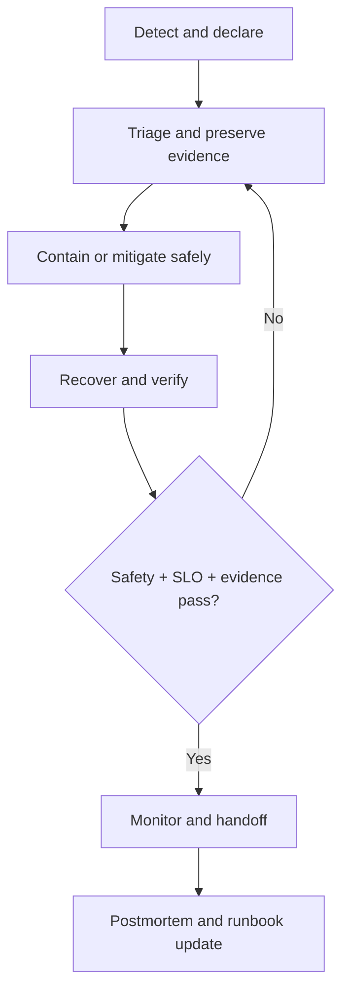

# Sổ tay xử lý sự cố, quyền thao tác và bằng chứng kiểm tra

Một hệ thống NoSQL thường được vận hành dưới nhiều điều kiện khó quan sát hết bằng một dashboard: dữ liệu phân mảnh trên nhiều node, bản sao chưa đồng bộ, yêu cầu đang retry, bộ nhớ đệm có thể giữ phiên bản cũ, CDC có độ trễ, và các đường đọc/ghi có mức nhất quán khác nhau. Khi xảy ra sự cố, một thao tác tưởng đơn giản — restart node, thay leader, xóa hàng đợi, hạ consistency level hoặc restore backup — có thể khiến tình hình khó phục hồi hơn nếu người thực hiện không biết quyền hạn, điều kiện an toàn và bằng chứng xác minh.

Hãy xem một tình huống:

```text
14:02  API ghi đơn bắt đầu timeout.
14:04  Một replica không trả lời.
14:05  Dashboard cho thấy write throughput giảm.
14:06  Một operator đề nghị restart toàn bộ cluster.
14:07  Một operator khác đề nghị hạ mức write consistency.
14:08  CDC consumer vẫn đang ghi một read model.
```

Không thể chọn phương án chỉ dựa trên việc “có nhiều errors”. Cần biết:

- **Ảnh hưởng thực tế:** yêu cầu nào bị lỗi, đọc hay ghi, một tenant hay toàn bộ hệ?
- **Bất biến dữ liệu:** đã có giao dịch commit nhưng client mất ACK không; có thể làm trùng đơn/thanh toán không?
- **Trạng thái cụm:** leader/replicas, quorum, phân vùng mạng, disk, compaction, hot shard ra sao?
- **Thẩm quyền:** ai được xem logs, restart một node, thay cấu hình nhất quán, restore dữ liệu?
- **Bằng chứng:** số liệu nào được ghi lại trước/sau, lấy từ đâu, thời điểm nào, có đủ chứng minh sự cố đã hết không?

Bài **Database No SQL → Vận hành cụm → Sổ tay xử lý sự cố, quyền thao tác và bằng chứng kiểm tra** xây dựng một phương pháp thực hành: **runbook có cấu trúc, quyền thực hiện theo mức rủi ro, và chứng cứ có thể kiểm chứng**. Ví dụ sử dụng các mô hình cluster của MongoDB, Cassandra/ScyllaDB, Redis và DynamoDB, nhưng nguyên tắc vận hành có thể áp dụng cho nhiều hệ NoSQL khác.

> **Phạm vi và lưu ý:** các lệnh, ngưỡng và timeline dưới đây chỉ là minh họa. Tên command, điều kiện an toàn, quyền cần thiết và tính năng thay đổi theo sản phẩm, phiên bản, topology, chế độ managed/self-managed và policy của tổ chức. Không chạy command thay đổi dữ liệu/topology trên production nếu chưa kiểm tra runbook được duyệt. Những lệnh quan sát cũng có thể tốn tài nguyên hoặc lộ dữ liệu nhạy cảm; phải giới hạn phạm vi và lưu chứng cứ an toàn.

---

## 1. Runbook là gì, và vì sao cần hơn một danh sách lệnh?

**Runbook** là một quy trình thực thi có thể lặp lại khi xảy ra một tình huống vận hành xác định. Một runbook tốt trả lời:

1. **Khi nào dùng?** Trigger, alert và phạm vi triệu chứng.
2. **Ai chịu trách nhiệm?** Incident commander, người thao tác, người quan sát và owner.
3. **Trước khi thao tác cần biết gì?** Health, data safety, quorum, backup, traffic và dependencies.
4. **Làm gì trước?** Quan sát, khoanh vùng, giảm rủi ro, xử lý nguyên nhân.
5. **Ai được phép thực hiện?** Permission, approval, break-glass và segregation of duties.
6. **Thao tác tối đa tới đâu?** Một node, một shard, một tenant hay toàn cluster.
7. **Điều kiện dừng là gì?** Khi một bước làm error tăng, replica tụt lag, hoặc nguy cơ mất dữ liệu.
8. **Kiểm tra thành công ra sao?** Metrics, read/write probes, consistency và đối soát.
9. **Nếu thất bại phải làm gì?** Rollback hoặc chuyển sang recovery procedure.
10. **Giữ chứng cứ gì?** Timeline, command, kết quả, sự thay đổi và quyết định.

Một trang wiki chỉ ghi:

```text
If database slow:
    restart database
```

không phải runbook đáng tin. Nó thiếu tiêu chí nhận diện, phạm vi quyền, ảnh hưởng tới quorum và bằng chứng sau thao tác.

## 2. Phân biệt playbook, runbook và postmortem

| Tài liệu | Mục đích | Nội dung trọng tâm |
| --- | --- | --- |
| **Playbook** | Định hướng ứng phó một loại sự cố | Cách phân loại, escalation, các nhánh quyết định |
| **Runbook** | Thực thi một chuỗi thao tác cụ thể | Precondition, command, quyền, stop/verify |
| **Checklist** | Nhắc các điều kiện bắt buộc | Những mục đã xác nhận |
| **Decision record** | Ghi quyết định có rủi ro | Lựa chọn, lý do, người duyệt, thời gian |
| **Evidence pack** | Lưu bằng chứng kiểm chứng | Metrics, traces, logs, trạng thái, hashes |
| **Postmortem/RCA** | Học từ sự cố sau khi ổn định | Timeline, nguyên nhân, contributing factors, action items |

Trong một incident có thể dùng nhiều tài liệu, nhưng không nên nhầm:

- Runbook `restore` **không thay** quy trình phê duyệt thao tác phá hủy.
- Log command đã chạy **không chứng minh** dữ liệu đúng sau khôi phục.
- Một postmortem viết hay **không thay** evidence thực về trạng thái production.

## 3. Ba mục tiêu không được đánh tráo

Trong vận hành NoSQL, cần cân bằng:

**An toàn dữ liệu (safety):**

```text
Không mất một write đã được hệ xác nhận bền vững theo contract.
Không ghi trùng một giao dịch nghiệp vụ.
Không để dữ liệu tenant khác rò rỉ.
Không resurrect bản ghi đã xóa.
```

**Khả năng phục vụ (availability):**

```text
API có thể tiếp nhận, đọc hoặc ghi trong ngưỡng SLO.
Thời gian lỗi/gián đoạn được giảm.
```

**Khả năng chẩn đoán (observability/evidence):**

```text
Biết thao tác nào đã xảy ra.
Có bằng chứng về tính đúng và mức độ phục hồi.
```

Một bước giảm error rate bằng cách hạ consistency hoặc phục vụ cache rất cũ **có thể cải thiện availability nhưng làm sai hợp đồng dữ liệu**. Một bước restore làm cluster `UP` nhưng mất những writes đã commit vẫn không đạt safety.

## 4. Sự cố cần phân loại theo business impact

Một bảng severity **minh họa**, tổ chức cần định nghĩa lại:

| Severity | Ví dụ | Ứng phó |
| --- | --- | --- |
| SEV-1 | Giao dịch quan trọng bị gián đoạn rộng; nghi mất/sai dữ liệu hoặc lộ dữ liệu | Incident command, cô lập rủi ro, owner và security/data teams |
| SEV-2 | Một dịch vụ chính suy giảm nhiều, thời gian kéo dài hoặc nhiều tenants bị ảnh hưởng | Escalation khẩn, giảm tải và root-cause triage |
| SEV-3 | Suy giảm có giới hạn hoặc một bộ phận không quan trọng | On-call xử lý có kiểm soát |
| SEV-4 | Cảnh báo hoặc bất thường không tác động SLO hiện tại | Điều tra, lên lịch thay đổi |

Một lỗi chỉ ảnh hưởng một tenant nhưng liên quan tới tiền hoặc dữ liệu nhạy cảm **có thể là SEV-1**, dù số request ít. Không dùng tỷ lệ HTTP 5xx đơn độc để xác định severity.

## 5. Vai trò trong một sự cố

Các vai có thể do ít người kiêm khi sự cố nhỏ, nhưng cần phân biệt trách nhiệm:

| Vai trò | Trách nhiệm |
| --- | --- |
| **Incident commander (IC)** | Điều phối, giữ bức tranh tổng thể, chốt quyết định |
| **Technical lead/DB owner** | Đánh giá topology, tính đúng, lựa chọn xử lý |
| **Operator** | Thực hiện thao tác được phép, ghi kết quả |
| **Scribe/evidence owner** | Lưu timeline, links, command outcomes, approvals |
| **Communications lead** | Cập nhật stakeholders/trạng thái |
| **Security/privacy lead** | Quyết định ứng phó khi nghi xâm nhập/rò dữ liệu |
| **Application owner** | Xác minh read/write semantics, idempotency, caller impact |
| **Data recovery owner** | Backup/restore, RPO/RTO, đối soát dữ liệu |

Không phải mọi người tham gia đều có quyền database admin. Việc ngồi trong kênh incident **không tự cấp quyền thao tác phá hủy**.

## 6. Quyền thao tác theo mức rủi ro

Một ma trận phân tầng:

| Mức | Hành động ví dụ | Quyền/kiểm soát |
| --- | --- | --- |
| **R0 — Quan sát** | Dashboard, logs đã redacted, health endpoints | Read-only observability và audit |
| **R1 — Giảm tải có thể đảo** | Throttle background job, tạm dừng feature không quan trọng | On-call owner, có stop/restore |
| **R2 — Thay đổi vận hành có kiểm soát** | Restart một instance, fail traffic khỏi node theo runbook | Operator được ủy quyền, preflight |
| **R3 — Thay đổi topology/consistency** | Reconfigure replication, leader operations, shard movement | DB lead, approval tăng cường |
| **R4 — Có thể mất/hủy dữ liệu** | Force reinitialize, restore ghi đè, delete/reset data/checkpoint | Data owner, hai người duyệt/break-glass theo policy |

Phân tầng là **mô hình quản trị**, không phải tên role chính thức của NoSQL. Một lệnh tưởng R0 như full-table scan hay collection-wide trace vẫn có thể gây tải lớn và phải nâng mức kiểm soát.

## 7. Nguyên tắc quyền tối thiểu cho vận hành

Phân biệt:

```text
incident-observer
    -> read metrics + limited logs.

database-operator
    -> approved operational commands on specific cluster.

schema-migrator
    -> scoped DDL under change window.

backup-reader
    -> inspect/obtain approved backups.

restore-operator
    -> restore into approved target with explicit approval.

security-administrator
    -> manage credentials/roles, independent of routine writes.
```

Quyền thao tác có thể đến từ:

- Cloud IAM roles/resource policies.
- Database-native users/roles.
- Kubernetes RBAC.
- Bastion/SSH/cluster management.
- Deployment automation.
- Backup/object storage access.
- Monitoring/log-platform permissions.

**Cần xem effective permissions qua tất cả lớp**, không chỉ database role. Một Kubernetes admin có thể restart pods hoặc truy cập secrets dù không phải database user.

## 8. Break-glass không phải tài khoản dùng hàng ngày

**Break-glass** là cơ chế cấp quyền tạm khi cần khôi phục khả năng kiểm soát hoặc xử lý sự cố nghiêm trọng.

Quy trình:

1. Xác nhận điều kiện kích hoạt.
2. Gắn incident ID, scope và lý do.
3. Xác thực mạnh, review theo policy.
4. Cấp role/credential có thời hạn.
5. Ghi audit ai dùng, từ đâu và thao tác gì.
6. Giới hạn phạm vi của quyền cao nhất có thể.
7. Thu hồi sau xử lý.
8. Test quyền không còn hiệu lực, kể cả session/connection còn mở.
9. Hậu kiểm toàn bộ các thay đổi đã thực hiện.

Không lưu secret root vào runbook, tin nhắn nhóm hoặc source code làm “phương án dự phòng”.

## 9. Cần phê duyệt cụ thể hành động, không chỉ phê duyệt incident

Ví dụ:

```text
Incident declared at 14:05.
IC approved investigation.
```

Điều này **không đồng nghĩa** IC đã duyệt:

```text
Force new primary.
Reduce quorum.
Delete replica data directory.
Reset CDC checkpoint.
Restore yesterday backup over production.
```

Với hành động rủi ro cao, evidence nên ghi:

```text
Action:
Scope:
Reason:
Expected benefit:
Potential data-safety impact:
Preconditions:
Approver(s):
Operator:
Rollback/recovery:
Stop condition:
Start time:
```

Phê duyệt “fix database ASAP” không đủ để chứng minh sự thay đổi phá hủy được cho phép.

## 10. Một runbook chuẩn nên có front matter

Ví dụ mẫu:

```yaml
runbookId: "nosql-replica-lag-01"
title: "Diagnose and mitigate replica lag"
ownerTeam: "database-platform"
version: "2.1"
reviewDate: "YYYY-MM-DD"
applicableProducts:
  - "<engine-version-range>"
applicableTopologies:
  - "replicated-cluster"
trigger:
  - "replica lag exceeds approved threshold"
severityGuidance: "assess business impact first"
requiredRole: "incident-observer"
elevatedActions:
  - action: "restart-one-replica"
    role: "database-operator"
    approval: "per production change policy"
stopConditions:
  - "quorum at risk"
  - "data divergence evidence"
verification:
  - "lag recovers"
  - "app reads satisfy consistency contract"
```

Đây là **runbook schema gợi ý**, không phải cấu hình của MongoDB/Cassandra/Redis. Các version và ngưỡng phải được kiểm chứng cho hệ đang vận hành.

## 11. Trạng thái runbook và vòng đời review

Một runbook có thể ở:

```text
DRAFT
    -> REVIEWED
    -> APPROVED
    -> ACTIVE
    -> NEEDS_REVIEW
    -> RETIRED
```

Phải biết:

- Người sở hữu.
- Lần kiểm thử gần nhất.
- Phiên bản cluster/driver áp dụng.
- Lần thay đổi topology.
- Các lệnh nào chỉ được chạy ở môi trường cô lập.
- Quyền cần dùng.
- Lỗi từng xảy ra khi làm theo runbook.
- Các nhánh đã lỗi thời vì managed service upgrade.

**Một runbook năm cũ có thể nguy hiểm hơn không có runbook nếu operator tin rằng mọi lệnh vẫn đúng.**

## 12. Quan sát trước, thao tác sau

Bước đầu nên cố thu thập:

```text
Cluster health
Topology and node roles
Read/write availability
Client errors and latency
Disk/CPU/memory/network
Replication lag
CDC and projection lag
Backups/recovery state
Deployment/config timeline
Auth/security anomalies
```

Không vì thu thập chứng cứ mà trì hoãn một bước bảo vệ khẩn cấp rõ ràng, nhưng khi có thể, giữ **pre-change snapshot** để so trước/sau.

Một quyết định dựa trên trạng thái cũ 30 phút có thể không còn hợp lệ lúc thực hiện. Gắn timestamp và thời hạn hiệu lực cho preconditions.

## 13. Bảo toàn bằng chứng là một phần của xử lý

Trong sự cố kéo dài:

- Logs có thể bị rotate.
- Pods bị thay bởi autoscaler.
- Replica lag có thể hết rồi xuất hiện lại.
- Metrics có thể roll up và mất độ phân giải.
- CDC checkpoints có thể tiến.
- Cache entries bị evict.
- Incident chat có thể bị chỉnh sửa.
- Hệ đã restart có thể không còn trạng thái in-memory cũ.

Cần giữ các **evidence snapshots có time range, nguồn và provenance**. Không tự ý giữ raw dữ liệu cá nhân nhiều hơn policy cho phép; có thể dùng aggregation, redaction và access-controlled evidence store.

## 14. Evidence là gì?

Một bằng chứng vận hành tốt có tối thiểu:

| Trường | Ví dụ | Vai trò |
| --- | --- | --- |
| Incident ID | `INC-EXAMPLE-20261114-001` | Liên kết |
| Collected at | UTC timestamp với offset | Thời điểm đo |
| Target | Cluster/Region/shard/node | Phạm vi |
| Source | Dashboard/API/command/trace | Nguồn |
| Collector | Operator hoặc automation identity | Trách nhiệm |
| Command/query | Bản redacted và parameters an toàn | Tái lập |
| Result | Counts, state, error, metric | Quan sát |
| Time window | `14:00–14:10 UTC` | Bối cảnh |
| Artifact digest | SHA-256 nếu phù hợp | Phát hiện thay đổi |
| Access classification | Internal/Restricted | Bảo mật |
| Interpretation | Dấu hiệu gì, điều gì chưa chứng minh | Tránh suy diễn |

Một ảnh chụp “CPU 80%” không có time range, node/Region và timestamp thường không đủ làm bằng chứng cho quyết định thay leader.

## 15. Bằng chứng quan sát khác bằng chứng tính đúng dữ liệu

Ví dụ:

```text
Cluster reports GREEN.
All nodes respond.
HTTP 200 rate back to normal.
```

Những dấu hiệu này chứng minh một phần về **availability**.

Chúng không tự chứng minh:

```text
Every acknowledged write still exists.
No duplicate payment effect.
No stale overwrite after failover.
All deletes propagated.
No CDC event permanently lost.
```

Cần thêm **data correctness evidence**:

- Authoritative record/version checks.
- Reconciliation theo business identity.
- Unique contribution/processed-event receipts.
- Source–projection key/revision/hash comparison.
- Tombstone/delete validation.
- Transaction invariant checks.
- Restore validation khi có data recovery.

## 16. Thời gian và clock skew trong timeline

Một incident có thể có:

```text
App log:       14:03:12 UTC
Database log:  14:03:08 UTC
Broker log:    14:03:15 UTC
```

Nếu đồng hồ lệch, không được suy “database xảy ra trước app” chỉ từ timestamp.

Cần:

- Thống nhất ghi UTC/offset-aware timestamps.
- Nêu timezone và định dạng.
- Kiểm NTP/time synchronization.
- Liên kết theo request/trace/event IDs.
- Dùng monotonic duration trong process.
- Dựa vào source sequence/commit offsets khi cần causal ordering.
- Đánh dấu uncertainty về timestamp trong RCA.

Một request start time và một database event không có correlation ID **không đủ để khẳng định quan hệ nhân quả**.

## 17. Thu thập logs có kiểm soát

Nên lưu:

```text
event timestamp
service/component
cluster/region/host
severity/code
request or trace ID
query shape
retry count
error class
target partition/shard
```

Không nên sao chép:

```text
database password
access token
full connection URI with secret
raw payment payload
PII document body
private key
```

Nếu security investigation cần dữ liệu nhạy cảm làm chứng cứ, dùng quy trình bảo quản/quyền truy cập đặc biệt, không đăng vào kênh incident chung.

## 18. Evidence integrity và hash

Khi lưu evidence file:

```text
incident-001-cluster-health-redacted.json
incident-001-timeline.csv
incident-001-metrics.png
```

Có thể tính hash SHA-256 để nhận biết nếu artifact bị thay sau khi thu thập.

Ý nghĩa:

- Hash xác minh **nội dung file trùng với bản được hash**.
- Hash không tự xác minh nguồn đã nói đúng.
- Hash không chứng minh timestamp là trung thực.
- Nếu người có quyền có thể thay cả file và file hash, cần thêm controls như immutable storage/audit signatures.
- Hash không làm dữ liệu nhạy cảm an toàn để công khai.

Cần giữ **chain of custody** phù hợp với quy trình tổ chức và mức độ nhạy cảm.

## 19. Mẫu evidence manifest

```json
{
  "incidentId": "INC-EXAMPLE-001",
  "collectedAt": "2026-11-14T08:10:00Z",
  "environment": "production",
  "system": "orders-nosql",
  "region": "example-region",
  "collectorRole": "incident-observer",
  "source": "read-only cluster health API",
  "commandCategory": "OBSERVE",
  "timeWindow": {
    "from": "2026-11-14T08:00:00Z",
    "to": "2026-11-14T08:10:00Z"
  },
  "artifact": "health-redacted.json",
  "sha256": "<computed-digest>",
  "sensitivity": "internal-restricted",
  "interpretation": "One replica lagging",
  "limitations": "Does not prove all acknowledged writes durable"
}
```

Đây là mẫu dữ liệu minh họa. `<computed-digest>` phải được thay bằng kết quả thực nếu lưu artifact; không tự điền chuỗi hash giả rồi gọi là chứng cứ.

## 20. Sổ ghi quyết định (decision log)

Một dòng decision log:

```text
08:12 UTC
Decision: pause non-critical analytics backfill.
Scope: analytics worker only; not payment CDC.
Reason: source read IOPS saturated.
Evidence: disk read 95% + API p99 spike + backfill started 08:00.
Owner: database lead.
Approver: incident commander.
Expected result: source p99 improves without losing queued work.
Verification at: 08:15 UTC.
Rollback: resume worker with bounded rate.
```

Nên ghi cả **các lựa chọn bị loại và lý do** khi chúng có rủi ro:

```text
Not chosen:
    reduce write consistency — could violate durability contract.
```

Điều này giúp RCA không biến thành câu chuyện hậu nghiệm bỏ qua bối cảnh lúc quyết định.

## 21. Bốn giai đoạn của xử lý sự cố



Không phải lúc nào cũng tuyến tính: khi có dấu hiệu mất dữ liệu sau mitigation, quay lại triage và nâng severity. Không được tuyên bố “resolved” chỉ vì đã chạy xong chuỗi command.

## 22. 15 phút đầu: một lịch minh họa

**Phút 0–3**

- Xác nhận alert và tình trạng người dùng.
- Tạo incident ID/kênh điều phối.
- Gắn IC, technical lead và scribe.
- Xác định có nghi sai/lộ dữ liệu không.

**Phút 3–8**

- Tạo snapshot metrics/topology/changes gần đây.
- Khoanh vùng read/write, tenant, Region, shard.
- Xác định liệu có recent deploy, failover, load spike.
- Đóng băng các thao tác thay đổi khác nếu cần.

**Phút 8–15**

- Chọn bước **giảm rủi ro ít phá hủy nhất**.
- Ghi approval/scope/stop condition.
- Thực hiện và đo kết quả.
- Escalate nếu quorum, data safety hoặc security bất định.

Thời lượng là gợi ý để tăng tính kỷ luật, **không phải SLA bắt buộc cho mọi incident**.

## 23. Quyết định đầu tiên: đọc hỏng hay ghi hỏng?

Phân biệt:

```text
Read error:
    GET/QUERY timeouts
    stale reads
    incorrect results
    permission errors
```

với:

```text
Write error:
    INSERT/UPDATE timeout
    CAS conflict
    quorum unavailable
    commit UNKNOWN
    duplicate effects
```

Một sự cố có thể ảnh hưởng cả hai, nhưng cách xử lý khác:

- Query index/scan có thể làm reads chậm.
- Một replica mất có thể ảnh hưởng writes với consistency mạnh.
- Auth policy mới có thể chặn chỉ một workload.
- CDC lag có thể làm projection stale trong khi writes source vẫn đúng.

**Không hạ write durability để khắc phục read latency** nếu không có quyết định thay đổi hợp đồng dữ liệu được phê duyệt.

## 24. Phân loại lỗi theo đường yêu cầu

| Nhóm | Tín hiệu | Nên kiểm |
| --- | --- | --- |
| Transport | Connection reset, timeout | Network/TLS/pool |
| Authentication | Invalid credential/token | Identity, rotation, trust |
| Authorization | Permission denied | Role/effective privileges |
| Capacity | Throttled, queue full | Hot partition, load, quotas |
| Data conflict | CAS/LWT failed | Business contention |
| Replication | Quorum/leader unavailable | Node roles, lag, partitions |
| Storage | Disk full, read errors | Capacity, corruption, I/O |
| Query | p99 cao, scans | Shape, index, fan-out |
| CDC | Consumer lag, resume failure | Checkpoint, retention, outbox |
| Correctness | Duplicate/lost/stale | Business ledger, source validation |

Một HTTP `500` ở API không đủ phân biệt các loại này. Cần đọc error codes từ driver/DB, nhưng tránh ghi raw sensitive query parameters.

## 25. Đừng coi timeout là rollback

Một write:

```text
Client sends update.
Server commits update.
Network drops response.
Client sees timeout.
```

Kết quả nghiệp vụ có thể đã xảy ra. Nếu retry:

```text
balance += 100
```

mà không có idempotency, dữ liệu có thể bị cập nhật hai lần.

Runbook cần chỉ rõ:

1. Ghi operation ID/trace.
2. Xác định API/driver retry semantics.
3. Tra receipt/ledger từ authoritative read path.
4. Phân biệt APPLIED, NOT_APPLIED được chứng minh, và UNKNOWN.
5. Chỉ retry theo protocol an toàn.
6. Đối soát eventual side effects.
7. Không tự ghi “failed write” dựa trên client timeout.

## 26. Không coi replica `NOT_FOUND` là bằng chứng dữ liệu mất

Một replica chậm có thể trả:

```text
NOT_FOUND
```

trong khi primary/authoritative path đã có record.

Cần biết:

- Read consistency/read preference.
- Replica lag và session/causal tokens.
- Tombstone/delete generation.
- Cache fallback.
- Query index propagation.
- Failover có thay route không.
- Status của source transaction.

Trước khi tuyên bố mất dữ liệu, dùng **đường đọc có thẩm quyền theo hợp đồng** và nhiều bằng chứng độc lập.

## 27. Metric tối thiểu cho incident commander

Một “incident overview” nên có:

```text
User-facing:
    error and timeout rates
    p95/p99 latency
    affected endpoints/tenants
    write successful/unknown count

Cluster:
    node health and roles
    leader/quorum availability
    per-node CPU/memory/disk/network
    queues/connection pools
    replication/repair/compaction state
    per-shard hot partitions

Data:
    consistency error probes
    CDC/source-to-projection lag
    duplicate business effects
    reconciliation mismatch
    backup/RPO exposure

Security:
    auth failures
    role/config changes
    unexpected exports/admin operations
```

Chỉ số được diễn giải trong một **time window** và từng component. CPU trung bình toàn cluster thấp vẫn có thể có một hot partition đã chạm trần.

## 28. Bằng chứng theo từng đường truy cập

Một trace:

```text
HTTP request R-101: 950ms
    ├── App queue:          400ms
    ├── Driver pool wait:   300ms
    ├── NoSQL operation:    100ms
    └── Other/network:      150ms
```

Nếu database operation chỉ 100ms, restart DB vì p99 HTTP 950ms có thể không giải quyết nguyên nhân.

Tương tự:

```text
DB returned 20 rows.
DB examined 1,000,000 candidates.
```

Đây là bằng chứng access path tốn chi phí dù response nhỏ.

Cần nhóm query theo shape, phân biệt client/server timings, retries, pool wait, index/scan và fan-out. Không đưa raw query literals hoặc tenant IDs vào metric labels cardinality cao.

## 29. Tín hiệu quorum và replication

Ở hệ có replica/quorum, cần biết:

- Số replica hoạt động theo từng partition/range.
- Roles/leader per shard.
- Required acknowledgment count.
- Replica lag.
- Network connectivity giữa failure domains.
- Pending repair/hinted handoff/streaming.
- Tình trạng disk và IO của replica còn lại.
- Last confirmed durable checkpoints.

**Quorum đủ để phản hồi một số requests không tự chứng minh mọi replica đã đồng bộ**, và một node báo `UP` không tự chứng minh nó có dữ liệu mới nhất.

Không dùng một count “3 nodes alive” để kết luận mỗi partition có quorum nếu placement/sharding khác nhau.

## 30. Sự cố network partition: giữ safety trước

Ví dụ:

```text
Region A can reach two replicas.
Region B has one isolated replica.
```

Một lựa chọn vội:

```text
Force isolated replica as primary.
```

có thể gây split-brain hoặc làm xuất hiện writes khác nhau nếu hệ/thủ tục không bảo vệ.

Runbook nên:

1. Xác định partition membership và đường network.
2. Xác định authority/leader/quorum theo từng partition.
3. Ghi last committed/applied positions nếu engine cho phép.
4. Chặn thao tác split-brain hoặc `force` không được duyệt.
5. Tập trung phục hồi connectivity hoặc safe failover theo vendor.
6. Không giảm consistency vô ý.
7. Đối soát writes xảy ra trong giai đoạn lỗi.
8. Xác minh sau khi cluster hội tụ.

## 31. Restart node không phải bước đầu mặc định

Restart có thể:

- Xóa một phần trạng thái in-memory hữu ích để chẩn đoán.
- Kích hoạt leader election.
- Làm mất quorum khi replica khác chậm.
- Tăng load lên nodes còn lại.
- Làm recovery/compaction kéo dài.
- Cắt client connections và tạo retry storm.
- Tạo lag cho CDC/read model.
- Phơi bày lỗi boot/TLS/config.

Trước restart:

```text
Reason:
Node role:
Other replicas healthy?
Quorum remains?
Last backup:
Current CPU/disk:
In-flight writes:
Drain/fence strategy:
Expected reconnection:
Stop if:
```

Nếu cần restart khẩn vì process treo, ít nhất ghi **lý do và state hiện có** trong phạm vi không làm trì hoãn bảo vệ an toàn.

## 32. Controlled failover và bằng chứng cần có

Một failover có thể hợp lệ khi leader không thể phục vụ, nhưng cần:

- Xác định authoritative election/failover mechanism.
- Không tạo hai leaders có thể accept conflicting writes.
- Kiểm node dự kiến nhận vai trò đã đủ dữ liệu theo engine.
- Xem quorum/replica placement.
- Xác định các writes in-flight và outcomes UNKNOWN.
- Client reconnect behavior.
- Confirm routes tới leader/cluster mới.
- Validate write/read invariants.
- Chờ replication/CDC lag trở lại ngưỡng.

**Leader election success là một milestone; data safety và user-facing recovery là acceptance gates riêng.**

## 33. Sự cố disk pressure

Triệu chứng:

```text
Disk utilization > threshold.
Write latency rising.
Compaction/flush backlog growing.
A node may refuse writes.
```

Cách tiếp cận:

1. Thu metrics dung lượng tổng, free bytes, growth rate, disk errors.
2. Phân biệt live data, logs, snapshots, WAL/oplog, SSTables, temp files.
3. Kiểm compaction/replication/backup đang dùng dung lượng tạm.
4. Tìm consumer lag hoặc retention cản trở cleanup.
5. Giới hạn background jobs không quan trọng nếu policy cho phép.
6. Xem capacity expansion hoặc data migration theo vendor.
7. Không xóa tùy tiện WAL/oplog, SSTables, snapshots hoặc system files.
8. Chọn recovery path nếu đĩa có lỗi vật lý.
9. Sau xử lý, kiểm consistency/replication/backup.

Một lệnh `rm -rf` để “giải phóng đĩa” có thể biến sự cố capacity thành mất dữ liệu. Nó thuộc nhóm thao tác rủi ro cao.

## 34. Sự cố compaction/repair backlog

Ở những engine LSM, compaction và repair ảnh hưởng trực tiếp:

- Write amplification.
- Read latency và SSTable overlap.
- Disk free space.
- Tombstone cleanup.
- Replica consistency.
- Network/CPU contention.

Runbook nên:

- Đo backlog và tốc độ tiến triển.
- Phân biệt steady overload với background task theo lịch.
- Kiểm hot partitions và TTL waves.
- Đánh giá query/write workload đẩy backlog lên không.
- Tính nhu cầu disk headroom.
- Dùng throttle/scheduling options theo engine nếu hỗ trợ.
- Không tắt repair/compaction vô hạn để đẹp API p99.
- Theo dõi backlog **sau khi API đã phục hồi**.

## 35. Hot shard và noisy neighbor

Một cluster:

```text
Average CPU: 40%.
Shard P7 CPU: 100%.
```

Có thể gặp:

- Key distribution skew.
- Một tenant gửi nhiều requests.
- Một document/key bị CAS contention.
- Query scatter-gather hoặc index scan.
- Repartition/resharding load.
- CDC/backup cùng shard.

Cần evidence per-shard/per-key bucket đã ẩn danh:

```text
Offered and completed ops
Throttle/retry
Latency p99
Reads/writes per partition
Queue/lock/CAS conflicts
Shard ownership
```

Các biện pháp rủi ro thấp hơn trước tiên có thể là rate limit/bulkhead cho workload không quan trọng, query rewrite hoặc caching **trong consistency contract**. Di chuyển shard/key là thay đổi topology và cần runbook riêng.

## 36. Khi cache làm incident khó chẩn đoán

Một API có thể:

```text
Cache HIT -> 5ms.
Cache MISS -> NoSQL source 200ms.
```

Khi cache expire hàng loạt, source chịu tải tăng đột ngột dù HTTP RPS không đổi.

Cần kiểm:

- Hit/miss ratio theo phase.
- Negative cache.
- Stampede/single-flight.
- TTL và eviction.
- Cache invalidation lag.
- Read-your-writes token.
- Read fallback tới authority.
- Hot keys.
- Cache/client connectivity.

Không “khắc phục” bằng kéo dài TTL vô hạn khi dữ liệu cần freshness mạnh. Cũng không xóa toàn cache nếu hành động đó gây thác lũ đọc xuống source.

## 37. Sự cố query p99 cao

Các câu hỏi:

1. Endpoint nào và query shape nào tăng p99?
2. Có bao nhiêu calls/attempts?
3. Filter/sort/projection có đổi không?
4. Indexed vs full scan?
5. Records examined/returned bao nhiêu?
6. Target một hay nhiều shards?
7. Driver pool wait hoặc network có chi phối không?
8. Cache hit có giảm?
9. Data distribution/tenant skew có đổi?
10. Schema/index deploy gần nhất?
11. Có compaction/repair/backup đang chạy?
12. Có authorization/query rewrite làm đổi access path?

Không thêm index chỉ vì p99 tăng nếu nguyên nhân là pool starvation hoặc failover. Cần một **giả thuyết có thể bác bỏ bằng metrics**.

## 38. Throttling và retry storm

Một dependency bị chậm có thể kích hoạt:

```text
Original traffic: 1000 RPS.
SDK retries:     +700 RPS.
App retries:     +500 RPS.
Total attempts:  2200 RPS.
```

Khi tăng attempts, service càng quá tải.

Runbook:

- Đo logical requests vs physical DB attempts.
- Giới hạn retry budget, exponential backoff, jitter.
- Dùng bounded queues/concurrency.
- Tách 429/quota khỏi 503/overload và CAS conflict.
- Giữ idempotency cho writes.
- Không bật retry vô hạn.
- Kiểm nguồn đột biến: cron, backfill, deployment, thundering herd.
- Theo dõi latency và backlog sau khi giảm tải.

**Giảm attempts có thể làm completion ổn định hơn dù không thêm node**, nhưng vẫn phải ghi requests bị từ chối/hoãn theo contract.

## 39. Authentication outage và quyền thao tác

Một bản rotate token/cert có thể khiến service mất kết nối:

```text
TLS certificate expired.
IAM role trust changed.
Mongo authSource wrong.
CQL user/role revoked.
Redis ACL changed.
```

Trước khi sửa:

1. Xác định AuthN hay AuthZ.
2. Ghi principal thực tế (không in credential).
3. Xem change history của role/trust/cert.
4. Kiểm allowed/denied action và resource.
5. Sử dụng một account observer không phụ thuộc cùng secret nếu có.
6. Không rollback sang `trustAll` hoặc tắt TLS verification.
7. Không cấp admin mù cho runtime.
8. Rotate/rebind theo policy, kiểm các phiên còn mở.
9. Chạy negative security tests sau khôi phục.

Lỗi `Unauthorized` có thể là **bảo vệ đang làm đúng** khi một command sai bị chặn.

## 40. Nghi ngờ dữ liệu bị hỏng hoặc mất

Đây là nhánh **safety-first**:

```text
Record count differs.
Checksums mismatch.
A committed order appears missing.
A delete seems undone.
Two replicas disagree.
```

Trước khi sửa:

- Dừng các automated destructive repair paths nếu cần và được cho phép.
- Ghi rõ record IDs/generations/revisions **an toàn** qua evidence scope.
- Chụp backup/snapshot theo policy để giữ trạng thái điều tra.
- Xác minh đọc từ authority đúng.
- Kiểm replica lag, cache, index/projection lag.
- Kiểm client timeout vs commit UNKNOWN.
- Kiểm schema migration/codec.
- Kiểm tombstones/TTL.
- Kiểm restoration/migration gần đây.
- Mời data owner quyết định sửa; không làm blind overwrite.

Một `NOT_FOUND` từ secondary index không phải luôn là mất dữ liệu source.

## 41. Reconciliation là bằng chứng sau khôi phục

Với hệ đơn hàng:

```text
Source order ledger
Payment business ledger
Order read model
CDC processed-event markers
```

Đối soát có thể kiểm:

- Tập business IDs.
- Generation/revision hoặc source sequence.
- Trạng thái đơn theo state machine.
- Unique payment capture/refund IDs.
- Số lượng/tổng theo cửa sổ có ý nghĩa.
- Deletes/tombstones.
- Key hashes trên dữ liệu được canonicalize.
- Unprocessed CDC gaps.

Không chỉ so tổng số records: **hai datasets có cùng count vẫn có thể khác bản ghi**. Trong hệ eventually consistent, so sánh phải dùng snapshot boundary/watermark tương thích để tránh hiểu nhầm lag bình thường là corruption.

## 42. Backup/restore không phải thao tác “thử một lần trên prod”

Restore có thể:

- Ghi đè dữ liệu hiện hữu.
- Thay data/schema/index format.
- Mất writes sau backup.
- Trùng outbox/CDC events khi replay.
- Phục hồi quyền bảo mật cũ.
- Đưa lại deleted records.
- Làm client/protocol không tương thích.

Trước restore vào môi trường production cần:

```text
Backup ID / timestamp
Integrity and encryption keys
Supported source/target versions
RPO/RTO assessment
Business approved data loss window
Target location
Isolation and access controls
Cutover/rollback plan
CDC reconciliation strategy
Approvers
```

Lý tưởng là **restore vào môi trường cô lập trước để kiểm** và chọn safe cutover, nếu business/time constraints cho phép.

## 43. RPO và RTO khác nhau

**RPO (Recovery Point Objective):** mức mất dữ liệu tối đa có thể chấp nhận theo mục tiêu.

**RTO (Recovery Time Objective):** thời gian mục tiêu để phục hồi chức năng.

Ví dụ minh họa:

```text
RPO <= 5 phút
RTO <= 60 phút
```

Nếu khôi phục từ snapshot cách đây 3 giờ và không có log replay, có thể vi phạm RPO dù API chạy lại trong 10 phút.

Cần đo:

- Backup point.
- Last durable log/CDC position có thể replay.
- Last acknowledged business write.
- Data reconciliation gaps.
- Restore time và application warm-up.
- Read/write verification time.
- Security/tenant permission restoration.

**`Server process UP` không phải là `RTO met` nếu business API chưa phục vụ đúng.**

## 44. CDC lag và checkpoint mất

Một luồng:

```text
NoSQL source -> CDC connector -> broker -> consumer -> projection
```

Các điểm nghẽn:

- Source log/change stream không còn đủ retention.
- Connector authorization lỗi.
- Checkpoint incompatible sau upgrade.
- Broker lag.
- Consumer poison event.
- Target read model throttle.
- Event dedup marker TTL quá ngắn.
- Delete/tombstone không được áp.
- Schema evolution fail.

Cần biết:

```text
Source committed position
Connector last emitted position
Broker position
Consumer last applied receipt
Projection watermark/revision
```

Không tự `seek to latest` để xóa lag nếu các events cũ chưa được áp. Cần replay/backfill được kiểm, và source–target reconciliation.

## 45. Sự cố event delivery trùng

Một event được giao lại sau ACK-loss có thể là bình thường theo at-least-once.

Runbook phải phân biệt:

```text
Duplicate message deliveries
    !=
Duplicate business effects
```

Evidence:

- Event ID/operation ID ổn định.
- Consumer receipt/processed-events ledger.
- Unique business contribution key.
- Target transaction result.
- Broker offset/ACK history.
- CDC replay reason.
- Count of applied vs already-applied.

Nếu duplicate payments hoặc reservations đã xuất hiện, cần escalation correctness/data owner; không chỉ tăng consumer concurrency để giảm lag.

## 46. Tách điều tra bảo mật khỏi xử lý performance

Dấu hiệu:

```text
Unknown principal reads high volume.
Unexpected data export.
New admin role.
Extension/plugin loaded without approval.
TLS disabled.
Cross-tenant query appeared.
```

Có thể bị nhầm với “traffic tăng” hoặc “slow query”.

Cần:

- Security incident coordination.
- Preserve audit logs và access history.
- Tính effective privileges/blast radius.
- Revocation/credential rotation theo incident policy.
- Không xóa dấu vết trước forensic collection.
- Xem data exfiltration path và tenant impact.
- Không cho mọi operator truy cập evidence chứa PII.
- Tách recovery safety khỏi mục tiêu giữ p99.

Một lệnh thu thập logs với quyền admin có thể chính nó làm lộ secrets; security lead phải xác định phạm vi evidence.

## 47. MongoDB: nhóm nguồn bằng chứng

Các tín hiệu có thể gồm:

- Replica set/sharded topology.
- Member health, primary state, replication lag.
- Server metrics/current operations.
- Slow query/profiler/explain có chọn lọc.
- Connection pools và driver retries.
- Oplog/change stream behavior.
- Index usage and query plans.
- Storage/disk metrics.
- Authentication/authorization errors.

Các lệnh chỉ để **minh họa đọc trạng thái** (quyền và chi phí phải được kiểm theo môi trường):

```javascript
db.hello();

db.adminCommand({ replSetGetStatus: 1 });

db.serverStatus();
```

Không mặc định mọi lệnh hoạt động với managed deployment, mọi role hoặc mọi topology; `serverStatus()` có thể trả nhiều metadata nhạy cảm/khối lượng dữ liệu. Chỉ thu các trường cần cho evidence.

## 48. MongoDB: replica và shard runbook

Khi primary không sẵn:

1. Kiểm replica set member states.
2. Ghi source of current primary/term theo khả năng engine.
3. Kiểm elections và network connectivity.
4. Kiểm các replicas đủ điều kiện nhận role.
5. Kiểm replication lag, write concern failures.
6. Ghi driver selection/retry behavior.
7. Không ép cấu hình membership nếu quorum/data safety chưa rõ.
8. Chọn vendor-supported failover path.
9. Kiểm client read/write contract và CDC resume.
10. Reconcile acknowledged writes/outbox.

Trong sharded cluster, một vấn đề có thể chỉ ở **một shard**; không suy toàn bộ cluster từ một member status.

## 49. MongoDB: kiểm query chậm có kiểm soát

Một truy vấn thử trên môi trường phù hợp:

```javascript
db.orders.find(
  { tenantId: "T1", status: "PAID" }
).sort({ createdAt: -1 }).limit(20)
 .explain("executionStats");
```

Xem theo phiên bản:

```text
winning plan / index name
keys examined
docs examined
nReturned
sort/fetch stages
shard targeting
```

Cảnh báo:

- `explain` có thể tốn tài nguyên trên query scan lớn.
- Dữ liệu tenant và literals cần redaction.
- Một lần explain không thay latency histogram.
- Không thêm index trực tiếp trên production trong incident nếu chưa đánh giá build load và quyền.

## 50. DynamoDB: managed service và phạm vi thao tác

Với DynamoDB, operator thường không SSH hoặc restart database nodes. Sự cố cần xem:

- Table/index metrics.
- Throttling và consumed capacity.
- Hot partition/key patterns.
- Request latency và SDK retry.
- Table/index state theo APIs.
- Global tables/replication behavior nếu dùng.
- DynamoDB Streams backlog.
- IAM/authorization failures.
- PITR/backup/export status.
- Service health/advisory.
- Application consistency/query paths.

Ví dụ thao tác **quan sát qua SDK/CLI** cần quyền thích hợp:

```text
DescribeTable
DescribeContinuousBackups
Inspect CloudWatch table/index metrics
Inspect relevant Streams/consumer checkpoints
```

Không đưa lệnh “restart DynamoDB node” vào runbook của người sử dụng managed service.

## 51. DynamoDB: hot partition và throttling

Kịch bản:

```text
Table total capacity seems sufficient.
One partition key receives most writes.
Some requests throttled.
```

Điều tra:

- Per-key/partition distribution ở mức telemetry được cung cấp.
- `Query` vs `Scan` và filter cost.
- Item size, batch size.
- Base table/GSI writes.
- SDK retries và request attempts.
- Consistency mode.
- Sudden traffic change/backfill.
- Quota/capacity mode.
- CDC/Streams lag.

Không mặc định “tăng toàn bộ table capacity” giải quyết hot key. Cần thay data model, workload rate/concurrency hoặc key distribution **theo semantics và giới hạn dịch vụ thực**.

## 52. Cassandra/ScyllaDB: nguồn quan sát cơ bản

Tùy engine, quyền và phiên bản, có thể dùng một số lệnh như:

```text
nodetool status
nodetool tpstats
nodetool tablestats
nodetool compactionstats
nodetool netstats
```

Mục tiêu:

- Node state và ring/token ownership.
- Thread/request queues.
- Table/partition statistics.
- Compaction backlog.
- Streaming/rebuild status.

**Không gọi các lệnh thay đổi cấu hình/topology/repair chỉ vì chúng nằm cùng công cụ `nodetool`.** Một số lệnh đọc cũng có thể đắt khi dữ liệu lớn hoặc node quá tải. Không chạy tracing đại trà không giới hạn.

## 53. Cassandra/ScyllaDB: quorum và LWT

Trong sự cố:

```text
Client writes at chosen consistency level.
One replica unavailable.
CAS/LWT operations time out.
```

Cần phân biệt:

- Plain write timeout.
- Unavailable/insufficient replicas.
- CAS conflict bình thường.
- LWT/CAS outcome UNKNOWN sau timeout.
- Coordinator failure.
- Read repair/anti-entropy lag.
- Hot partition contention.

Một `INSERT ... IF NOT EXISTS` timeout không chứng minh điều kiện chưa được áp. Dùng authoritative readback/consistency và operation ID thích hợp; không retry business effect không lũy đẳng một cách mù.

## 54. Cassandra/ScyllaDB: repair và topology change

Những hành động như:

```text
repair
rebuild
replace node
decommission
bootstrap
```

có thể tiêu thụ network/disk/CPU lớn và thay replica placement.

Preflight:

- Topology/rack/DC/failure domains.
- Quorum còn lại.
- Disk headroom và compaction pressure.
- Data ownership ranges.
- Current streaming/repair tasks.
- Snapshot/backup condition.
- Schema agreement.
- Network bandwidth.
- Window, concurrency và stop conditions.
- Owner và quyền R3/R4 phù hợp.

Không chạy toàn cụm cùng lúc theo phán đoán. Việc repair có thể hữu ích cho dữ liệu thiếu replica, nhưng không thay xác định nguồn gốc business data và consistency contract.

## 55. Redis: health và replication evidence

Tùy topology/config, các nhóm lệnh quan sát thường gặp:

```text
INFO server
INFO clients
INFO memory
INFO stats
INFO replication
INFO persistence

SLOWLOG GET 20
```

Với Redis Cluster, có thể xem trạng thái cluster/slots qua các lệnh quan sát phù hợp, chẳng hạn:

```text
CLUSTER INFO
CLUSTER NODES
```

Lưu ý:

- Kết quả có thể chứa địa chỉ, key patterns hoặc metadata nhạy cảm.
- `SLOWLOG` phản ánh thời gian thực thi command trên server theo cấu hình, không phải toàn bộ client latency.
- Không dùng `MONITOR` đại trà trên production bận.
- Không chạy `FLUSHALL`, `FLUSHDB`, `CLUSTER RESET` hoặc thay cấu hình chỉ để “kiểm tra”.
- Read replicas/cache có durability/consistency caveats khác source of truth.

## 56. Redis: cache incident khác data authority incident

Nếu Redis chỉ là cache:

```text
Redis unavailable
    -> Application may fallback to NoSQL source.
```

Nhưng fallback có thể làm source overload.

Runbook:

- Kiểm vai trò Redis: cache, session, queue, stream hay source of truth.
- Giới hạn fallback rate/concurrency.
- Đo cache hit/miss và source DB load.
- Không xóa cache toàn bộ khi source không có headroom.
- Kiểm TTL/eviction/hot key.
- Nếu Redis chứa Streams, xử lý pending entries/ACK đúng.
- Nếu dùng Redis replication/persistence làm dữ liệu quan trọng, phục hồi theo durable semantics thực.
- Không suy mọi dữ liệu Redis “có thể mất tùy ý”.

**Cùng sản phẩm Redis nhưng vai trò khác sẽ có runbook và quyền khác.**

## 57. Redis Cluster: slot ownership và chuyển đổi leader

Một sự cố Redis Cluster có thể gồm:

```text
Slot migration in progress.
MOVED/ASK redirects increasing.
One primary/replica unavailable.
Client topology cache stale.
```

Cần:

- Cluster/slot mapping theo thời gian.
- Client error/retry distribution.
- Replication/lag và persistence.
- Key co-location/hash tag implications.
- Network partitions.
- Quorum/failover semantics của cấu hình thực.
- Các apps có dùng multi-key Lua/transaction trong cùng slot không.
- Không tự dùng destructive cluster reconfiguration khi chưa đánh giá ownership và dữ liệu.

Sau phục hồi, cần kiểm cả cache access và stream/queue state nếu Redis thực hiện nhiều vai trò.

## 58. Quyền quan sát không phải quyền xuất dữ liệu toàn hệ

Một account có quyền:

```text
Read all metrics
Read full logs
Run profiler
Read collection contents
```

vẫn có thể lộ credentials, PII hoặc tài liệu kinh doanh.

Thiết kế:

- Dashboard read-only theo nhóm.
- Application logs đã redacted.
- Query-shape telemetry thay raw literals.
- Database metadata queries giới hạn.
- Full data exports thuộc role tạm thời được duyệt.
- Forensics access có audit và retention.
- Evidences được lưu ở nơi có RBAC.

**Least privilege áp dụng cả khi sự cố xảy ra**, không nên mở quyền toàn bộ hệ chỉ để việc điều tra thuận tiện.

## 59. Quyền thay cấu hình consistency và durability

Một số cấu hình/driver flags có thể thay lời hứa dữ liệu:

```text
write acknowledgment level
read consistency level
read preference
transaction retry policy
sync/replication behavior
```

Cần coi đây là thay đổi có rủi ro:

- Có thể tăng availability nhưng giảm durability/freshness.
- Có thể làm lost-update hoặc stale decision.
- Có thể khiến phục hồi khó đối soát.
- Có thể thay cách timeouts được diễn giải.
- Có thể không áp đồng đều lên mọi clients/pods.

Nếu phải tạm giảm một bảo đảm theo policy, cần business/data owner chấp thuận **bằng lời hứa dịch vụ mới rõ ràng**, không âm thầm sửa config để p99 đẹp.

## 60. Tạo một action plan cho mỗi bước có rủi ro

Mẫu:

```yaml
actionId: "pause-analytics-backfill"
incidentId: "INC-EXAMPLE-001"
riskTier: "R1"
scope:
  workload: "analytics-backfill"
  environment: "production"
preconditions:
  - "job work is durably resumable"
  - "job is not critical CDC consumer"
operatorRole: "database-operator"
approver: "incident-commander"
commandCategory: "CONTROLLED_CHANGE"
expected:
  - "foreground read p99 improves"
  - "no data loss"
stopConditions:
  - "CDC retention risk increases"
  - "job cannot resume"
verification:
  - "source QPS and disk read decrease"
  - "backfill checkpoint remains durable"
rollback:
  - "resume job at bounded rate"
```

Phạm vi “pause analytics” khác “pause payment event processing”. Không lặp thao tác đã được approve cho một workload khác chỉ vì tên command giống nhau.

## 61. Kiểm trước/sau theo phương pháp thực nghiệm

Một bước:

```text
Action: reduce non-critical export concurrency 20 -> 4.
```

Cần:

**Before:**

```text
export concurrency = 20
source reads = 8k/s
API p99 = 900ms
CDC lag = 5s
```

**After (trong cửa sổ quan sát xác định):**

```text
export concurrency = 4
source reads = 4k/s
API p99 = 140ms
CDC lag = 6s
```

Nếu số liệu có thời gian và cùng workload profile, có bằng chứng tác động tích cực. Tuy nhiên correlation vẫn chưa tự chứng minh causal trong mọi trường hợp; cần xem các thay đổi khác cùng thời điểm.

Ghi:

- Action timestamp.
- Target đúng.
- Change applied.
- Metric observation window.
- Confounders.
- Side effects.
- Verification owner.
- Decision tiếp theo.

## 62. Stop conditions là phần bắt buộc

Một runbook cần nói rõ **khi nào không tiếp tục**.

Ví dụ rolling restart:

```text
STOP if:
    available replica count falls below safe quorum.
    unexpected primary elections occur repeatedly.
    replication lag exceeds approved recovery budget.
    write error rate crosses emergency threshold.
    business reconciliation detects missing/duplicate effects.
    security access controls fail.
```

Khi stop:

1. Không tự động chuyển sang thao tác nguy hiểm hơn.
2. Ghi current state, metrics, last completed step.
3. Escalate đúng người.
4. Giữ dữ liệu và evidence.
5. Chọn rollback/recovery dựa trên vendor-supported path.

**Một runbook có bước 1–10 nhưng không có điều kiện dừng có thể biến incident nhỏ thành sự cố lớn.**

## 63. Recovery phải có tiêu chí kết thúc riêng

Các trạng thái:

```text
MITIGATED:
    User impact reduced but root cause still active.

RECOVERING:
    Backlog/replication/CDC catching up.

RESTORED:
    User-facing SLO and data contracts validated.

RESOLVED:
    Incident closed with monitoring, handoff, evidence.
```

Một service có thể trở lại HTTP 200 nhưng vẫn:

```text
CDC lag 2 hours.
Some writes UNKNOWN.
Replica repair backlog growing.
```

Không gọi “resolved” nếu các nghĩa vụ phục hồi còn tồn tại ngoài ngân sách cho phép.

## 64. Health checks có nhiều mức

**Liveness:**

```text
Process responds or is running.
```

**Readiness:**

```text
Process can accept its intended requests.
```

**Cluster health:**

```text
Topology, replicas, partitions and dependencies healthy.
```

**Business health:**

```text
User-facing operations meet SLO.
Read/write correctness preserved.
Data projections within freshness bounds.
```

Có thể:

```text
Liveness=PASS
Readiness=PASS
Cluster=DEGRADED
Business=FAIL
```

Nếu chỉ dùng `PING`, có thể không phát hiện authorization failure cho một collection hoặc mất một partition.

## 65. Synthetic probes phải không phá dữ liệu

Một probe:

```text
Write test record
Read back
Delete test record
```

có thể gây rủi ro nếu:

- Dùng key trùng dữ liệu thật.
- Ghi vào billing/queue live.
- Có event trigger/CDC side effects.
- Delete thiếu tombstone semantics.
- TTL/retry tạo duplicate.
- Role test có quyền quá rộng.

Thiết kế probe:

- Namespace/tenant test riêng.
- ID duy nhất, hạn chế side effects.
- Có documented cleanup.
- Idempotent operation và receipt.
- Không dùng payment gateway thực.
- Kiểm source + read model khi cần.
- Ghi chi phí/retention và access controls.

Một “canary write” thành công chỉ chứng minh đường test đó, không tự chứng minh mọi tenant/partition đều khỏe.

## 66. Evidences cho correctness của write

Một phép kiểm mẫu:

```text
Create logical operation O-test-1.
Send write with stable idempotency key.
Inject/observe retry or failover safely in staging.
Read authoritative receipt.
Verify exactly one business effect.
```

Kết quả cần:

- Operation ID.
- Write request timeline.
- Server/driver attempts.
- Commit response/timeout.
- Receipt location.
- Read consistency.
- Business state/version.
- Duplicate suppression evidence.

Đối với tiền/tồn kho, không dùng `COUNT(*)` tổng quát thay cho kiểm business invariant.

## 67. Evidences cho delete và TTL

Sau restore/replay:

```text
Record deleted at revision 8.
Old event revision 7 arrives late.
```

Nếu dữ liệu sống lại, hệ sai dù API có 200.

Cần:

- Tombstone/delete generation.
- Last applied revision/watermark.
- TTL/delete propagation.
- Read model/cache invalidation.
- Replica visibility.
- Snapshot and CDC boundary.
- Test late replay không resurrect.

Không xóa tombstone sớm để giảm disk nếu chưa chứng minh replay/repair window an toàn theo engine.

## 68. Bằng chứng sau một thay đổi role/credential

Nếu incident do auth:

**Trước:**

```text
order-reader-prod gets Unauthorized on expected read.
```

**Sau:**

```text
Expected read ALLOW.
Update orders DENY.
Drop collection DENY.
Read unrelated sensitive collection DENY.
Old compromised credential DENY after revoke.
TLS verification still enabled.
```

Chỉ test positive read thành công có thể bỏ qua một bản sửa cấp thừa quyền admin.

Negative tests cần chạy trên resources thử nghiệm có kiểm soát; không gửi destructive command vào production chỉ để chứng minh nó bị từ chối.

## 69. Phân biệt thao tác qua control plane và data plane

Một managed service có thể có:

**Control plane:**

```text
Change capacity mode
Create/restore backup
Update table configuration
Manage IAM/resource policy
```

**Data plane:**

```text
Get/Query/Put/Update/Delete items
Consume stream
```

Hai loại quyền có thể tách bằng IAM. Một operator có thể đọc CloudWatch nhưng không được export table; một runtime service có thể ghi item nhưng không được đổi bảng.

Một runbook phải nêu **đúng plane và principal** cần sử dụng. Không đồng nhất database authentication với cloud control-plane authorization.

## 70. RACI cho thay đổi có thể mất dữ liệu

Một sơ đồ trách nhiệm minh họa:

| Hoạt động | IC | DB lead | Data owner | Operator | Security |
| --- | --- | --- | --- | --- | --- |
| Declare incident | A | C | I | I | I |
| Collect read-only evidence | I | A | I | R | C khi dữ liệu nhạy cảm |
| Pause non-critical job | A | C | I | R | I |
| Restart one replica | A | R/C | C | R | I |
| Reconfigure quorum/leader | A | R | C/A theo policy | R | C |
| Restore into isolated cluster | A | R | A | R | C |
| Overwrite production data | A | R | A | R | C |
| Revoke compromised identity | A | C | I | R | A/R |
| Close correctness incident | A | R | A | C | C |

`R` = thực hiện, `A` = chịu trách nhiệm phê duyệt cuối, `C` = tham vấn, `I` = được thông báo. Đây là bảng minh họa; quy trình nội bộ quyết định ai được quyền thực tế. Khi có hai `A` ở một hàng, cần làm rõ cơ chế đồng phê duyệt hoặc sửa lại bảng cho phù hợp, tránh mơ hồ.

## 71. Một sự cố có nhiều hệ cùng ảnh hưởng

Ví dụ:

```text
MongoDB orders source healthy.
CDC connector lagged.
Kafka broker backlog rising.
Redis cache serves stale projection.
API shows incorrect order status.
```

Nếu chỉ kiểm MongoDB `UP`, có thể bỏ sót vấn đề của user.

Tách các mốc:

```text
Source transaction committed
Outbox event persisted
Publisher emitted
Broker accepted
Consumer applied
Projection visible
Cache invalidated or version guarded
Client observed state
```

Từng mốc cần evidence/owner. Không tự khẳng định một pipeline end-to-end “exactly-once” chỉ vì một broker hỗ trợ transaction trong phạm vi riêng.

## 72. Timeline với nhiều clocks và actions

Một timeline tốt:

```text
08:00:12Z  Alert: payment API write p99 high.
08:01:05Z  IC declared SEV-1.
08:02:14Z  Evidence E1: primary elected, quorum still available.
08:03:09Z  Evidence E2: SDK retry attempts x3.
08:04:22Z  Decision D1: pause analytics backfill.
08:04:42Z  Action A1 executed by operator role.
08:06:10Z  Evidence E3: p99 improved, unknown writes still 24.
08:10:00Z  Reconciliation began for 24 operations.
08:20:00Z  All 24 operations classified with receipts.
08:21:00Z  Data owner confirmed no duplicate captures.
```

Không được viết:

```text
08:04 fixed database
```

nếu phần idempotency/reconciliation vẫn chưa xong.

## 73. Java 17: gắn operation và outcome khi log lỗi

Trong service Java, một wrapper khái niệm:

```java
public record DbOperationEvidence(
        String operationName,
        String queryShape,
        String traceId,
        String outcome,
        int attempts,
        long durationMillis) {
}
```

Các `outcome` rõ hơn boolean:

```text
SUCCESS
CONDITION_NOT_MET
UNAUTHORIZED
THROTTLED
TIMEOUT_UNKNOWN
FAILED_CONFIRMED
```

Không gán `TIMEOUT_UNKNOWN` thành `FAILED_CONFIRMED` nếu database có thể đã commit.

Nên ghi:

- Operation name ổn định.
- Trace ID.
- Query shape thay vì literal payload.
- Driver attempts.
- Timeout budget.
- Consistency class.
- Server/Region target nếu telemetry cho phép.
- Business operation ID trong audit có kiểm soát.

Không log raw payment/order payload chỉ để tiện điều tra.

## 74. Java 17 runnable demo: biểu diễn kiểm soát trước khi thao tác

Mẫu này chạy trong Java 17, minh họa một **gate nghiệp vụ cho action**. Nó không thay IAM/DB authorization thực; trong production kiểm soát phải được enforcement bởi hệ cấp quyền và approval workflow.

```java
import java.util.EnumSet;
import java.util.Set;

public final class IncidentActionGateDemo {
    enum Role {
        OBSERVER,
        OPERATOR,
        DB_LEAD,
        DATA_OWNER,
        SECURITY
    }

    enum Risk {
        OBSERVE,
        REVERSIBLE,
        TOPOLOGY,
        DESTRUCTIVE
    }

    record Action(
            String name,
            Risk risk,
            boolean safetyPreconditionsMet,
            boolean approvalRecorded) {
    }

    static boolean permitted(
            Set<Role> roles,
            Action action) {

        if (!action.safetyPreconditionsMet()) {
            return false;
        }

        return switch (action.risk()) {
            case OBSERVE -> roles.contains(Role.OBSERVER)
                    || roles.contains(Role.OPERATOR)
                    || roles.contains(Role.DB_LEAD);
            case REVERSIBLE -> roles.contains(Role.OPERATOR)
                    && action.approvalRecorded();
            case TOPOLOGY -> roles.contains(Role.OPERATOR)
                    && roles.contains(Role.DB_LEAD)
                    && action.approvalRecorded();
            case DESTRUCTIVE -> roles.contains(Role.OPERATOR)
                    && roles.contains(Role.DB_LEAD)
                    && roles.contains(Role.DATA_OWNER)
                    && action.approvalRecorded();
        };
    }

    public static void main(String[] args) {
        Set<Role> onCall = EnumSet.of(Role.OBSERVER, Role.OPERATOR);

        Action viewHealth = new Action(
                "read-health", Risk.OBSERVE, true, false);

        Action restartReplica = new Action(
                "restart-one-replica",
                Risk.TOPOLOGY, true, true);

        Action restoreOverProduction = new Action(
                "overwrite-production",
                Risk.DESTRUCTIVE, true, true);

        System.out.println(
                "read=" + permitted(onCall, viewHealth));
        System.out.println(
                "restart=" + permitted(onCall, restartReplica));
        System.out.println(
                "restore=" + permitted(onCall, restoreOverProduction));
    }
}
```

Kết quả:

```text
read=true
restart=false
restore=false
```

**Giới hạn:** bản demo chỉ nhận tập roles được truyền vào; không xác thực người dùng, không kiểm token hết hạn, không chặn người dùng bỏ qua Java code để gọi database trực tiếp. Production phải dựa vào control plane/database permissions, approval policy và audit. Trường hợp `OBSERVER` cũng cần kiểm data classification và giới hạn truy vấn.

## 75. Java: xử lý operation UNKNOWN trong incident

Pseudo-code:

```java
public enum WriteOutcome {
    APPLIED,
    NOT_APPLIED,
    UNKNOWN
}

public WriteOutcome classifyPaymentWrite(
        String stableOperationId) {

    // Authoritative receipt lookup, not a stale cache lookup.
    var receipt = paymentLedger.lookup(stableOperationId);

    if (receipt.isCommitted()) {
        return WriteOutcome.APPLIED;
    }

    if (receipt.hasProvenAbort()) {
        return WriteOutcome.NOT_APPLIED;
    }

    return WriteOutcome.UNKNOWN;
}
```

`paymentLedger` là abstraction, không phải implementation có sẵn. Lưu ý:

- `NOT_FOUND` không tự là `hasProvenAbort`.
- Một receipt lookup timeout tiếp tục là UNKNOWN.
- Cần dùng consistency/transaction contract đúng.
- Không retry một charge mới với operationId khác để “chắc chắn”.
- Nếu provider bên ngoài có tham gia, phải reconcile provider outcome.
- Có workflow xử lý UNKNOWN quá deadline.

## 76. Mẫu runbook: replica lag bất thường

**Trigger:** replica lag vượt ngưỡng theo hợp đồng đọc/khôi phục.

**Phạm vi:** xác định shard/replica/Region.

**Quyền tối thiểu:** observer để thu bằng chứng; operator được duyệt khi cần control action.

**Preflight:**

```text
Replication topology
Current leader/replica roles
Lag trends
Disk/CPU/network
Repair/compaction load
Recent deploy/backup
Read consistency and traffic routing
```

**Các nhánh chẩn đoán:**

- Network congestion.
- Replica disk saturation.
- Background maintenance.
- Excessive writes.
- Large index build.
- Auth/TLS issue.
- Replica recovery after restart.
- Hot partition.

**Không làm mặc định:** xóa replica data, force resync, hạ write concern, restart nhiều replicas đồng thời.

**Xác minh:** lag giảm bền vững, quorum giữ, API read/write SLO, session freshness đúng, CDC không tạo gap.

## 77. Mẫu runbook: query p99 tăng mạnh

**Trigger:** p99 của một query/endpoint vượt SLO.

**Thu bằng chứng:**

```text
Query shape and operation
Logical QPS/physical attempts
p50/p95/p99 by cohort
Driver pool wait
Server execution time
Keys/docs/rows examined
Partitions/shards touched
Cache hit/miss
Index/deploy timeline
```

**Nhánh xử lý:**

- Pool bottleneck → xem connection/acquire timeout.
- Scan/index issue → plan/index review.
- Hot partition → load shaping/data model.
- Retry storm → bounded retry.
- Cache stampede → coalescing/rate control.
- Compaction → schedule/pressure review.

**Quyền:** xem telemetry R0; tạo index, đổi data model hay config R2/R3 theo scope.

**Xác minh:** cùng workload và query result semantics, p99/cost giảm, write/index maintenance không xấu vượt budget.

## 78. Mẫu runbook: không còn đủ quorum

**Trigger:** unavailable/timeout vì thiếu replicas theo consistency contract.

**Bằng chứng ban đầu:**

- Replica members/ranges.
- Network failures.
- Recent elections/reconfiguration.
- Last durable positions nếu có.
- In-flight write outcomes.
- Node disk/recovery health.
- Required CL/quorum.
- Business impact.

**Cấm mặc định:** force leader ở partition cô lập, giảm consistency, xóa logs hoặc tự thay token ownership.

**Hành động:** escalate DB lead, dùng vendor-supported recovery/repair, bảo vệ remaining healthy replicas.

**Xác minh:** availability và data safety, không split-brain, receipts của UNKNOWN writes đã reconcile, replication converges.

## 79. Mẫu runbook: CDC đứng hoặc lag tới hạn retention

**Trigger:** oldest unprocessed event age hoặc gap risk vượt ngưỡng.

**Bằng chứng:**

```text
Source log position
Connector checkpoint
Broker partition offsets
Consumer applied markers
Target projection watermarks
Retention horizon
DLQ size
Poison events/schema failures
```

**Hành động an toàn:**

- Giới hạn competing background loads.
- Khôi phục consumer/permissions theo policy.
- Giữ event IDs khi replay.
- Throttle catch-up nếu target cần.
- Nếu log gap, chuẩn bị snapshot + CDC boundary/rebuild.

**Không làm mặc định:** reset offset tới latest, xóa DLQ hoặc đánh dấu event `APPLIED` khi effect chưa commit.

**Xác minh:** source–target reconciliation, delete/tombstone, ordering/dedup, freshness SLO.

## 80. Mẫu runbook: nghi lộ secret/service principal

**Trigger:** credential lộ hoặc truy cập bất thường.

**Ưu tiên:**

1. Bảo vệ audit/log evidence.
2. Xác định principal, effective permissions và affected resources.
3. Revoke/rotate theo incident policy.
4. Kiểm application pods/connection pools/token refresh.
5. Giới hạn egress/traffic nếu cần.
6. Kiểm data scans/exports, role changes, writes.
7. Không log secret lần nữa trong điều tra.
8. Reconcile sensitive writes và tenant access.
9. Đảm bảo old credential không còn dùng được.
10. Khôi phục service bằng identity mới hẹp.

**Quyền:** security lead và database IAM owner; không sử dụng account bị nghi compromise để tự chứng minh nó đã an toàn.

## 81. Mẫu runbook: restore từ backup

**Trigger:** business-approved recovery khi nguồn dữ liệu không thể phục hồi an toàn bằng repair khác.

**Cổng bắt buộc:**

```text
Known clean backup
Supported restore target
RPO and data loss accepted
RTO and outage impact
Encryption keys available
Restore operator permission
Two-person/data owner approval per policy
Old cluster evidence preserved
CDC/outbox replay strategy
Cutover and rollback boundaries
```

**Bước an toàn hơn:**

- Restore vào isolated environment.
- Kiểm sample/business hashes, counts và revisions.
- Xem index/schema/ACL/cert settings.
- Catch up CDC nếu có reliable boundary.
- So source/target, deletes và ledger.
- Chọn cutover có kiểm soát.
- Theo dõi và giữ old environment trong safety window nếu phù hợp.

**Không làm:** ghi đè production chỉ vì có file snapshot mới nhất mà chưa biết những writes sau snapshot.

## 82. Bài tập 1: phân quyền thao tác

Một cluster có ba nhóm:

```text
API team
DB platform team
Security team
```

Hành động:

```text
Read dashboards.
Run bounded explain.
Restart one replica.
Force new primary.
Delete a collection.
Restore a backup.
Revoke a service account.
```

Yêu cầu:

1. Gán action risk tier R0–R4.
2. Gán người thao tác và approver.
3. Chọn preconditions.
4. Nêu stop condition.
5. Đặt evidence trước/sau.
6. Xác định nhóm nào không cần database root/admin thường trực.

## 83. Bài tập 2: phân biệt outage và sai dữ liệu

Tình huống:

```text
API write timeout: 5%.
Cluster health: mostly green.
Replica lag: 8 seconds.
Two payments have client timeouts.
```

Hỏi:

- Có thể kết luận hai payments thất bại không?
- Nên tra receipt ở đâu?
- Một retry với operation ID mới có an toàn không?
- Cluster green đã đủ đóng incident chưa?
- Metrics nào cần lấy từ provider và application?
- Khi nào cần data owner/security join incident?
- Bằng chứng nào cho phép nói “không double charge”?

## 84. Bài tập 3: network partition và quorum

Một data model nhân bản ba bản sao:

```text
Replica A in Zone 1.
Replica B in Zone 2.
Replica C in Zone 3.
```

Network làm C mất kết nối với A/B.

Yêu cầu:

1. Xác định các câu hỏi về quorum và leader/coordination.
2. Vì sao không tự force C thành primary?
3. Những writes nào có thể UNKNOWN?
4. Thu evidence nào trước khôi phục network?
5. Khi C trở lại, cần kiểm replica lag và reconciliation gì?
6. Nếu nghiệp vụ đòi strong consistency, có được tự giảm CL để giữ availability không?

Không giả một thuật toán replication duy nhất áp cho mọi engine.

## 85. Bài tập 4: lỗi query do cache miss

```text
HTTP RPS stays 10,000.
Cache hit falls from 95% to 20%.
NoSQL read p99 becomes 1.5s.
```

Yêu cầu:

- Ước tính source read rate trước/sau nếu mỗi cache miss tạo một read.
- Phân biệt nguyên nhân TTL wave, traffic skew, Redis outage.
- Đặt giới hạn fallback để tránh overload.
- Giữ freshness/read-your-writes semantics.
- Chọn metrics và decision record.
- Vì sao xóa toàn bộ cache có thể làm sự cố nặng hơn?

## 86. Bài tập 5: bằng chứng restore

Một backup lúc 09:00, sự cố lúc 09:40, doanh nghiệp có RPO 5 phút.

Yêu cầu:

1. Có thể restore trực tiếp backup 09:00 mà vẫn đạt RPO không?
2. Cần log/CDC replay tới đâu?
3. Nêu records/IDs cần đối soát.
4. Kiểm schema/index/ACL như thế nào?
5. Nếu một delete xảy ra 09:35, làm sao chặn dữ liệu resurrect?
6. Phân biệt `restore process completed` và `business recovered`.

## 87. Bài tập 6: viết evidence manifest

Tạo ba artifacts:

```text
E1: metrics screenshot during timeout.
E2: cluster topology response.
E3: reconciliation result for operation IDs.
```

Với mỗi artifact, ghi:

- Source.
- Timestamp UTC.
- Time window.
- Scope.
- Collector.
- Redaction policy.
- Hash/digest.
- Kết luận hỗ trợ.
- Điều gì artifact không chứng minh.

Giải thích vì sao E1/E2 không tự chứng minh E3.

## 88. Bài tập 7: CDC replay sau incident

Một consumer đã commit target projection nhưng crash trước ACK.

Yêu cầu:

1. Giải thích vì sao broker có thể redeliver.
2. Thiết kế `(consumerId,eventId)` dedup receipt.
3. Đặt marker và effect trong atomic boundary nếu có thể.
4. Phân biệt duplicate delivery và duplicate effect.
5. Cần làm gì khi checkpoint đã bị reset?
6. Vì sao không `seek latest` chỉ để giảm lag?
7. Đối soát source revisions/delete như thế nào?

## 89. Bài tập 8: cấu trúc một postmortem

Cho timeline:

```text
08:00  New app deployment.
08:05  API p99 spikes.
08:07  Redis cache misses increase.
08:10  DB throttling grows.
08:12  Incident declared.
08:14  Backfill paused.
08:20  API latency recovers.
09:15  CDC lag fully catches up.
```

Hãy:

- Xác định incident start/recovery milestones.
- Nêu thiếu evidence gì để kết luận deploy là root cause.
- Phân biệt mitigated 08:20 và restored 09:15.
- Ghi owners của action items.
- Đề xuất phòng ngừa retry/cache stampede.
- Viết stop conditions cho rollout sau này.

## 90. Ma trận diễn tập sự cố

| Mã | Tình huống | Bằng chứng cần có |
| --- | --- | --- |
| D01 | API timeout nhưng DB query nhanh | Pool/network/client split |
| D02 | Primary election khi ghi | In-flight/UNKNOWN receipt |
| D03 | One replica offline | Quorum/topology remaining |
| D04 | Network partition giữa zones | Authority/leader safety |
| D05 | Restart nhiều replicas | Stop condition ngăn mất quorum |
| D06 | Hot shard giữa cluster CPU thấp | Per-shard metrics |
| D07 | Disk 95% + compaction | Free space/growth/queue |
| D08 | Query scan tăng sau deploy | Shape + plan fingerprint |
| D09 | Cache stampede | Source fallback rate |
| D10 | Retry storm | Attempts/logical request |
| D11 | Write timeout after commit | No duplicate business effect |
| D12 | Replica NOT_FOUND stale | Authoritative readback |
| D13 | CDC consumer stops | Checkpoint/retention lag |
| D14 | Replay old event after delete | Tombstone prevents resurrection |
| D15 | Duplicate broker message | Idempotent consumer receipt |
| D16 | Backup restore into isolated environment | Data integrity evidence |
| D17 | Backup incompatible with target version | Supported restore path |
| D18 | Unauthorized after role change | Positive/negative tests |
| D19 | Credential leakage | Revocation and audit |
| D20 | Redis limiter/cache outage | Bounded fallback |
| D21 | Cassandra LWT timeout | Unknown outcome handling |
| D22 | DynamoDB throttling | Capacity/skew/SDK retry |
| D23 | MongoDB change stream resume failure | Gap detection/rebuild |
| D24 | Broken observability pipeline | Alternative evidence source |
| D25 | Operator uses wrong cluster | Target confirmation prevents action |
| D26 | Runbook outdated after upgrade | Version applicability check |
| D27 | Plugin causes node crash | Recovery without unsafe unload |
| D28 | DLQ replay after marker TTL | Business dedup retention |
| D29 | Cross-tenant search leak | Security incident escalation |
| D30 | Two operators issue conflicting changes | Single IC/serialized approvals |
| D31 | Restore recovers process but misses recent writes | RPO/data reconciliation |
| D32 | p99 recovers but CDC still behind | Separate recovered milestones |
| D33 | Rolling restart under compaction pressure | Safe resource headroom |
| D34 | Manual command lacks audit trail | Evidence/role gate blocks action |
| D35 | Missing SHA/evidence timestamp | Incomplete evidence flag |
| D36 | Old credential works after rotate | Revocation verification |
| D37 | Cluster healthy but wrong data | Business probe/reconciliation |
| D38 | Runbook must stop midway | Escalation/rollback branch |
| D39 | Duplicate command from automation | Idempotency and action journal |
| D40 | Low-priority backfill paused | Durable resumability confirmed |

## 91. Acceptance criteria cho một bộ runbook vận hành

| Mã | Tiêu chí | Bằng chứng |
| --- | --- | --- |
| AC-01 | Mỗi runbook có owner, version, scope và review date | Runbook registry |
| AC-02 | Trigger và severity gắn business impact | Incident classification |
| AC-03 | Roles/approvers được định nghĩa | RACI + IAM review |
| AC-04 | R0–R4 hoặc risk tiers tương đương rõ | Action catalog |
| AC-05 | Read-only access không phơi dữ liệu nhạy cảm | Redaction/access tests |
| AC-06 | Destructive actions có approval riêng | Decision log |
| AC-07 | Break-glass JIT được thu hồi | Access audit |
| AC-08 | Preflight topology/quorum được ghi | Evidence snapshot |
| AC-09 | Có stop conditions trước mỗi high-risk action | Runbook test |
| AC-10 | Không có restart-all mặc định | Review |
| AC-11 | Không giảm consistency/durability mù | Contract/approval test |
| AC-12 | Unknown writes có reconciliation | Business receipt tests |
| AC-13 | Replica stale reads không được coi data loss | Read-path test |
| AC-14 | CDC checkpoint/retention được kiểm | Replay/gap test |
| AC-15 | Cache fallback có limits | Overload drill |
| AC-16 | Query incident có shape/plan metrics | Trace/dashboard |
| AC-17 | Backup restore có diễn tập | Isolated restore evidence |
| AC-18 | RPO/RTO đo bằng business correctness | Recovery report |
| AC-19 | Evidence có timestamp/scope/source/collector | Manifest inspection |
| AC-20 | Artifacts nhạy cảm được redacted/phân quyền | Security review |
| AC-21 | Evidence integrity/provenance hợp policy | Digest/audit |
| AC-22 | Timeline có decisions và approvals | Incident journal |
| AC-23 | Before/after metrics theo cùng cửa sổ nghĩa | Change validation |
| AC-24 | Cluster health không thay data integrity checks | RCA evidence |
| AC-25 | Có engine-specific versions và quyền | Technical review |
| AC-26 | Managed service không có lệnh không thực thi được | Product-scoped runbook |
| AC-27 | Khôi phục CDC/replication lag có ngưỡng | Recovery time series |
| AC-28 | Postmortem có contributing factors và owners | Action tracker |
| AC-29 | Runbook được diễn tập định kỳ hoặc sau thay lớn | Drill results |
| AC-30 | Incident có định nghĩa mitigated/restored/resolved | Closure evidence |
| AC-31 | Sự cố bảo mật có quy trình evidence riêng | Security playbook |
| AC-32 | Thao tác không được audit bị chặn/escalate | Permission gate test |

Ngưỡng, quyền và thời gian cụ thể phải được lấy từ chính sách tổ chức, khả năng engine và mức độ rủi ro của sản phẩm.

## 92. Mẫu runbook hoàn chỉnh để áp dụng

```markdown
# RUNBOOK: <Incident type>

## Metadata
- ID/version:
- Owner/approver:
- Engine/edition/version/topology:
- Critical dependencies:
- Last rehearsal:
- Security classification:

## Trigger and impact
- Alert:
- Affected APIs/tenants/Regions:
- Read/write implications:
- Safety vs availability risks:
- Severity decision:

## Roles and authorization
- Incident commander:
- Technical owner:
- Operator:
- Scribe:
- Required role for observation:
- Required role for changes:
- Break-glass policy:

## Preflight and evidence
- Timestamp:
- Cluster topology:
- Quorum/replica health:
- App p99/errors/retries:
- Data/CDC/backup state:
- Recent changes:
- Evidence links/hashes:
- Unknowns:

## Hypotheses
- Most likely cause:
- Alternative causes:
- What would falsify each?

## Action plan
- Lowest-risk mitigation:
- Target and scope:
- Preconditions:
- Approvals:
- Command or approved automation:
- Expected behavior:
- Stop conditions:
- Undo/recovery path:

## Verification
- Client-facing SLO:
- Database health:
- Replication/quorum:
- Data correctness/receipts:
- CDC/projection freshness:
- Security/negative permission tests:
- Evidence of before/after:

## Closure
- Mitigated time:
- Restored time:
- Resolved time:
- Residual risks:
- Owner handoff:
- RCA and follow-up:
```

**Mẫu runbook phải được điền bằng dữ liệu thực, kiểm trên engine/version thật và lưu trong nơi quản lý thay đổi.** Không chèn mật khẩu hoặc lệnh phá dữ liệu không có gate vào một tài liệu phổ biến rộng.

## 93. Mẫu báo cáo sau sự cố

```markdown
# Incident Report: <INC-ID>

## Executive summary
- What happened?
- User and business impact:
- Data/security implications:
- Start, mitigation, restoration, resolution times:

## Timeline
- UTC timestamp + action/evidence/decision:
- Role/approval at each high-risk step:
- Clock skew or missing observations:

## Technical evidence
- Runtime versions/topology:
- Client errors and p95/p99:
- Replication/quorum:
- Disk/CPU/IO/cache:
- CDC/backup:
- Authoritative data reconciliation:
- Source links and redacted artifact hashes:

## Root cause and contributing factors
- What is confirmed?
- What remains uncertain?
- Why detection/mitigation took this long?

## Recovery verification
- SLO recovered:
- No duplicate/lost acknowledged effects:
- Deletes/tombstones correct:
- Projection freshness within bounds:
- Access/permissions validated:

## Corrective actions
- Action / owner / due date / verification test:
- Runbook changes:
- Alert thresholds/automation changes:
- Drill/review date:
```

Một báo cáo không nên trình bày giả thuyết như sự thật đã chứng minh. Những điều **chưa kết luận** cần được nêu rõ, cùng kế hoạch kiểm tiếp nếu có.

## 94. Các sai lầm thường gặp

**“Cụm báo GREEN là sự cố đã xong.”** Green không chứng minh business data đúng.

**“Restart là thao tác an toàn, làm trước rồi tính.”** Có thể làm mất quorum, phá evidence và gây retry storm.

**“Ai ở kênh incident đều được dùng admin.”** Vai trò điều phối không đồng nghĩa quyền thao tác.

**“Approval xử lý sự cố là approval restore ghi đè.”** Thao tác rủi ro cao cần scope và approval riêng.

**“Lệnh đọc không bao giờ nguy hiểm.”** Full scan/profiler có thể gây tải và lộ dữ liệu.

**“Log raw queries càng nhiều càng tốt.”** Có nguy cơ lộ PII/credentials và làm quá tải monitoring.

**“Một timeout chứng minh write thất bại.”** Commit có thể đã xảy ra trước khi ACK mất.

**“Replica NOT_FOUND chứng minh mất record.”** Có thể là replica lag, index/cache stale.

**“Hạ quorum/consistency chỉ là tuning hiệu năng.”** Có thể đổi durability và correctness contract.

**“Bật thêm retry tăng availability.”** Retry amplification có thể kéo hệ xuống.

**“Backup có nghĩa khôi phục được.”** Phải test restore và kiểm compatibility.

**“Restore mới nhất luôn là đúng nhất.”** Có thể bỏ writes sau backup hoặc chứa corruption.

**“Có file SHA-256 thì dữ liệu evidence chắc là sự thật.”** Hash chỉ bảo vệ integrity của bytes, không xác minh nguồn.

**“Chỉ cần screenshot dashboard.”** Không có timestamp, source, scope và raw count thì khó tái lập.

**“Theo dõi average CPU là đủ.”** Một shard/hot partition có thể overload dù average thấp.

**“Đổi schema/index khi incident sẽ luôn giúp.”** Có thể tăng disk/write/compaction và làm sự cố nặng hơn.

**“Pause toàn bộ CDC để giảm tải.”** Có thể tiến sát nguồn log retention, gây mất replay.

**“Reset checkpoint tới latest là giải quyết lag.”** Có thể bỏ vĩnh viễn events chưa áp.

**“Một error 403 chỉ cần cấp role rộng.”** Có thể chính là quyền bị từ chối đúng.

**“Quyền từ cloud IAM và database role là một.”** Control/data planes và Kubernetes có ranh giới khác nhau.

**“Dừng log để đỡ tải rồi mới điều tra.”** Có thể xóa mất evidence; phải quyết định có kiểm soát.

**“Sau failover, tất cả ứng dụng sẽ tự hồi phục đúng.”** Pool, retry, CDC và consistency cần verify.

**“Cùng count nghĩa source và projection giống nhau.”** Cần keys, versions, hashes, tombstones.

**“Runbook có 20 lệnh nghĩa hoàn chỉnh.”** Thiếu stop conditions, quyền, phê duyệt và verification thì chưa đủ.

**“RCA biết nguyên nhân rồi không cần diễn tập.”** Chỉ thử nghiệm mới chứng minh biện pháp phòng ngừa hoạt động.

## 95. Checklist dùng ngay khi sự cố xuất hiện

```text
[ ] Incident ID, severity, IC và technical owner rõ.
[ ] Sự cố ảnh hưởng read, write, data correctness hay security?
[ ] Có data loss/duplicate/tenant leak nghi ngờ cần nâng mức?
[ ] Đã ghi time window, topology, Region, affected tenants?
[ ] Đã chụp pre-change metrics/evidence an toàn?
[ ] Đã kiểm clock skew và correlation IDs?
[ ] Có deployment/config/role changes gần thời điểm lỗi?
[ ] Đã phân biệt logical vs physical retries?
[ ] Timeout write được coi UNKNOWN khi chưa chứng minh?
[ ] Quorum/leader/replica lag đã xác minh đúng phạm vi?
[ ] Disk/compaction/repair/CDC backlog được kiểm?
[ ] Cache stale/cold/source fallback được kiểm?
[ ] Có runbook đúng phiên bản/topology?
[ ] Operator có role đúng cho hành động dự kiến?
[ ] High-risk action đã được approve rõ scope?
[ ] Đã ghi preconditions, stop conditions, undo/recovery?
[ ] Không dùng destructive commands để “thử” trên prod?
[ ] Bằng chứng không chứa credentials/raw PII?
[ ] Sau thao tác đã đo SLO và resource impact?
[ ] Business receipts, unique effects và tombstones đã kiểm?
[ ] CDC/projection freshness đã phục hồi?
[ ] Backup/restore status và RPO/RTO được đánh giá?
[ ] Có runbook riêng cho incident bảo mật khi cần?
[ ] Có evidence links, hashes, decision log?
[ ] Có phân biệt MITIGATED, RESTORED và RESOLVED?
[ ] Có owner cho residual risks và RCA action items?
```

## Kết luận

**Sổ tay xử lý sự cố, quyền thao tác và bằng chứng kiểm tra** là ba thành phần không thể tách rời của vận hành NoSQL có trách nhiệm. Một runbook chỉ hữu ích khi nó nói rõ **trường hợp áp dụng, người phụ trách, preconditions, lệnh hoặc hành động được cho phép, điều kiện dừng, cách phục hồi và cách chứng minh kết quả**. Một hệ thống phân quyền chỉ an toàn khi **người quan sát, operator, migration/restore owner và security administrator không mặc định dùng chung quyền admin**, kể cả trong lúc khẩn cấp.

Bằng chứng cần được giữ theo **nguồn, timestamp, scope, collector, redaction và integrity**, đồng thời diễn giải giới hạn của từng phép đo. `Cluster UP`, `HTTP 200` hay một biểu đồ CPU đẹp mới chỉ phản ánh một phần availability; để đóng incident còn cần kiểm **quorum/replication, writes có kết quả UNKNOWN, idempotency, deletes/tombstones, CDC checkpoint/freshness, backup/RPO và business invariants**. Các bước thay topology, hạ consistency, reset checkpoint hay restore ghi đè phải đi qua mức rủi ro và quyền duyệt phù hợp.

Với MongoDB, Cassandra/ScyllaDB, Redis hay DynamoDB, các công cụ quan sát và thao tác khác nhau, nhưng phương pháp vẫn nhất quán: **khoanh vùng bằng chứng trước, chọn biện pháp ít phá hủy nhất, kiểm soát quyền và thay đổi, đo lại trạng thái thực tế, rồi đối soát dữ liệu và ghi rõ những gì đã chứng minh hoặc còn chưa chắc chắn**. Một incident được xử lý tốt không chỉ là “hệ đã chạy lại”, mà là **dịch vụ đã phục hồi theo đúng hợp đồng, dữ liệu còn đáng tin và mọi hành động đều có thể truy vết, giải thích và cải tiến**.
