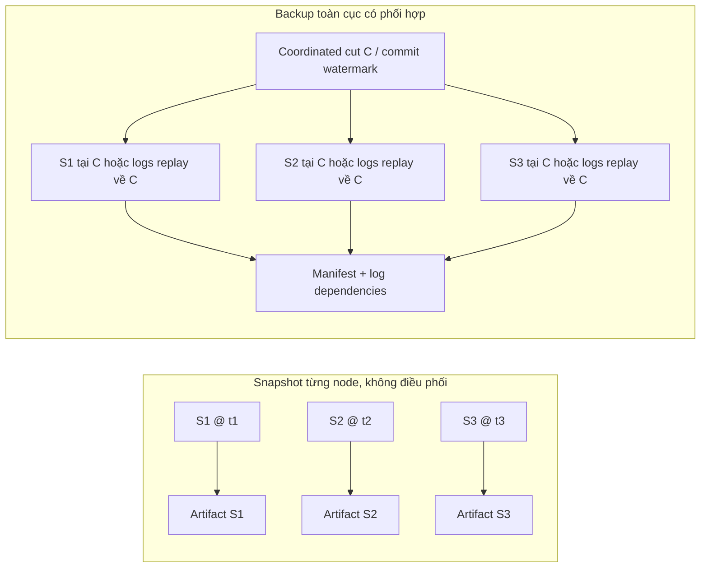

# Snapshot từng nút so với ảnh chụp nhất quán toàn tập dữ liệu

## 1. Tình huống mở đầu: có đủ ba file snapshot nhưng vẫn mất tính đúng đắn

Một ứng dụng Java lưu tài khoản và giao dịch trong cụm NoSQL được phân mảnh. Tài khoản A nằm ở shard S1, tài khoản B nằm ở shard S2. Một lệnh chuyển 100 đơn vị từ A sang B cần làm cho cả hai số dư thay đổi theo đúng giao thức giao dịch.

Trong lúc ứng dụng vẫn ghi dữ liệu, hệ thống lấy bản chụp riêng trên từng nút:

```text
10:00:00  Snapshot S1 bắt đầu
10:00:01  Snapshot S1 hoàn tất
10:00:02  Chuyển khoản T100 bắt đầu
10:00:03  Debit A: -100
10:00:04  Credit B: +100
10:00:05  Snapshot S2 bắt đầu
10:00:06  Snapshot S2 hoàn tất
```

Nếu bản chụp S1 giữ số dư **trước** giao dịch, còn S2 giữ số dư **sau** giao dịch, khôi phục hai bản chụp cùng nhau sẽ tạo trạng thái như thể tiền đã được cộng cho B nhưng chưa bị trừ khỏi A. Cả hai file snapshot có thể hợp lệ về checksum và đọc được khi restore; **tập hợp của chúng không nhất thiết là một điểm khôi phục nhất quán**.

Vấn đề không phải copy thiếu file. Vấn đề là **các điểm chụp trên nhiều nút không cùng biểu diễn một trạng thái toàn cục được phép tồn tại theo giao thức ứng dụng**.

Bài học *Database No SQL → Sao lưu và phục hồi → Snapshot từng nút so với ảnh chụp nhất quán toàn tập dữ liệu* giải thích cách phân biệt bản chụp cục bộ với bản chụp nhất quán toàn tập dữ liệu, những bảo đảm thật sự có thể đạt được, và cách kiểm thử phục hồi thay vì chỉ tin trạng thái `BACKUP SUCCESS`.

---

## 2. Mục tiêu học tập

Sau bài học, bạn có thể:

1. Giải thích snapshot ở cấp ổ đĩa, tiến trình database, node, replica, shard và toàn cụm.
2. Phân biệt **crash-consistent**, **transaction-consistent**, **application-consistent** và **causally consistent global cut**.
3. Nhận diện trường hợp một tập snapshot từng node chứa trạng thái không thể khôi phục an toàn.
4. Hiểu quan hệ nhân quả (*happens-before*), thông điệp đang truyền và vai trò của log trong distributed snapshot.
5. Mô tả cơ chế phối hợp như quiescence, MVCC timestamp, commit watermark, consistent snapshot protocol và log replay.
6. Giải thích vì sao bản chụp “cùng giờ” không nhất thiết là bản chụp logic nhất quán.
7. Chọn chiến lược backup cho các topology MongoDB, Cassandra, Elasticsearch/OpenSearch, Redis, DynamoDB và nhiều hệ dữ liệu liên kết.
8. Phân biệt replica redundancy với recovery point và backup bền vững.
9. Xây manifest chứa vị trí, log position, checksum, schema version và thông tin phục hồi.
10. Thiết kế restore drill, đối soát bất biến nghiệp vụ, RPO/RTO, quyền truy cập và quy trình vận hành.
11. Nhận diện failure modes khi có transaction đang commit, shard migration, node mất, backup kéo dài hoặc log bị cắt sớm.
12. Phân tích một bài kiểm thử thực tế mà không suy luận bảo đảm vượt quá những gì công cụ và engine cung cấp.

## 3. Trước hết: snapshot không tự đồng nghĩa backup

**Snapshot** là một biểu diễn trạng thái ở một điểm hoặc một mốc logic theo cơ chế cụ thể. Nó có thể là:

- Bản chụp block-level của volume.
- Tập file SSTable/segment được giữ lại.
- Logical dump các documents/items.
- Database-native checkpoint.
- Managed snapshot tại cloud service.
- Một điểm bắt đầu để phát lại log/PITR.

**Backup** là một tập artifact và metadata đủ để hỗ trợ quy trình phục hồi theo mục tiêu. Backup có thể bao gồm snapshot, transaction logs, catalog, schema, credentials/keys được quản lý riêng, manifests và hướng dẫn restore.

Một snapshot nằm cùng ổ đĩa, có thể mất cùng node, không tự là bản sao an toàn trước thảm họa. Một backup đã upload đầy đủ cũng chưa chắc **khôi phục được** nếu thiếu WAL, key giải mã, mapping shards hoặc manifest.

### 3.1. Ba câu hỏi quan trọng

1. **Chụp cái gì?** Node local files, một shard, một keyspace, hay toàn tập dữ liệu nghiệp vụ?
2. **Chụp lúc nào?** Thời gian tường, timestamp MVCC, committed log position, hay điểm đồng bộ?
3. **Khôi phục bằng cách nào?** Dùng riêng file snapshot, replay log, khôi phục nhiều shards theo manifest hay dựng lại read model?

Không biết ba câu trả lời này, không thể đánh giá tính nhất quán của bản chụp.

## 4. Các tầng phạm vi dữ liệu

```text
Ứng dụng nghiệp vụ
  ├── Database nguồn (source of truth)
  │    ├── Shard S1: Replica A, Replica B, Replica C
  │    ├── Shard S2: Replica D, Replica E, Replica F
  │    └── Metadata/configuration của cụm
  ├── Outbox / change stream / message broker
  ├── Cache Redis
  └── Search / analytics projection
```

Snapshot trên **Replica A** mới chụp một bản sao của **Shard S1**, chưa phải toàn bộ S1 hay toàn database. Chụp mỗi primary của S1 và S2 có thể đủ file về **phạm vi dữ liệu** nhưng chưa chắc đạt một **mốc nhất quán**.

Snapshot toàn database nguồn cũng chưa đương nhiên nhất quán với Kafka, Redis và Search. Đó là phạm vi lớn hơn, cần thêm recovery protocol.

### 4.1. Định nghĩa population của bản sao

Khi nói “đã chụp toàn bộ dữ liệu”, phải nêu:

- Bao nhiêu shard/range/token/partition?
- Có bao nhiêu replica cho mỗi đơn vị?
- Có include metadata/schema/index/roles?
- Có dữ liệu đang được chuyển shard không?
- Có WAL/commitlog/oplog/change streams tương ứng không?
- Có các dịch vụ phụ thuộc cần dựng lại không?

## 5. Crash-consistent và application-consistent

| Mức | Điều được bảo đảm về mặt ý tưởng | Điều chưa tự bảo đảm |
| --- | --- | --- |
| File copy thông thường | Có file được copy | Không chắc file đang ghi là một trạng thái hợp lệ |
| Block/volume crash-consistent | Giống dữ liệu tồn tại sau một sự kiện mất điện ở thời điểm được chụp | Không bảo đảm giao dịch liên volume hoặc nghiệp vụ |
| Database recoverable checkpoint | Engine có thể áp recovery log để vào trạng thái hợp lệ trong phạm vi của nó | Không bảo đảm nhiều shards/systems cùng một mốc |
| Transaction-consistent | Các giao dịch trong phạm vi bảo đảm không bị thấy nửa chừng | Không mặc nhiên đồng nhất với event broker hay external side effects |
| Application-consistent | Những bất biến nghiệp vụ được bảo tồn theo protocol được định nghĩa | Không nhất thiết phản ánh mọi external system nếu không phối hợp |

**Crash-consistent không có nghĩa dữ liệu bị hỏng**: một database có WAL và recovery protocol có thể phục hồi tốt sau mất điện. Nhưng phải có đúng tập files/logs và tính nhất quán giữa chúng.

### 5.1. Một volume không phải mọi volume

Nếu data files và WAL nằm ở hai volumes khác nhau, snapshot chỉ atomic trên một volume có thể không đủ. Cần tính nhất quán của nhóm volumes hoặc quy trình database quiesce/checkpoint theo hướng dẫn sản phẩm.

### 5.2. “Ứng dụng tạm dừng ghi” cũng cần định nghĩa

Tạm dừng nhận HTTP writes không đồng nghĩa:

- Không còn transaction in-flight.
- Không còn CDC/outbox consumers ghi.
- Không còn scheduler/backfill.
- Không còn replica replay.
- Không còn shard migration.

Một điểm chụp thực sự yên cần kiểm soát tất cả **nguồn mutation có liên quan**, hoặc dùng giao thức snapshot online được thiết kế để xử lý chúng.

## 6. Snapshot từng nút là gì?

Một snapshot **per-node** thường giữ trạng thái local tại thời điểm công cụ ghi nhận:

```text
Node N1 -> snapshot_N1@t1
Node N2 -> snapshot_N2@t2
Node N3 -> snapshot_N3@t3
```

Nó hữu ích cho:

- Khôi phục local files của một node.
- Tạo bản sao lạnh hoặc warm standby theo phương thức hỗ trợ.
- Giữ checkpoint SSTables/segments cho backup incremental.
- Giảm tải thao tác copy nhờ filesystem copy-on-write.
- Hỗ trợ repair/rebuild theo cơ chế engine.

Nhưng ba snapshot này **không tự tạo** một global transaction boundary.

### 6.1. Khi per-node snapshot có thể đủ

Có thể chấp nhận nếu:

- Phạm vi cần khôi phục chỉ một node độc lập.
- Dữ liệu của các nodes không có bất biến xuyên node.
- Hệ có một giao thức restore/replay giải quyết sai lệch giữa snapshots.
- Các nodes đã được quiesce tại một mốc được xác minh.
- Snapshot per-node là **các thành phần** của giải pháp backup cluster-level có coordinator và manifest nhất quán.

Đừng đồng nhất “per-node snapshots” với “không thể dùng để backup cụm”; vấn đề là **thiếu phối hợp khi ghép lại**.

## 7. Ảnh chụp nhất quán toàn tập dữ liệu là gì?

Một **consistent global snapshot** biểu diễn một **consistent cut** của trạng thái phân tán theo mô hình cụ thể. Nó cần thỏa các quan hệ nhân quả và các quy tắc của protocol, thay vì chỉ có các file được chụp gần cùng giờ.

Ví dụ các components:

```text
S1 local state at logical cut C
S2 local state at logical cut C
S3 local state at logical cut C
in-flight messages / commit logs if protocol requires
metadata and topology view appropriate to C
```

### 7.1. Cần phân biệt hai kiểu “nhất quán”

Một **consistent cut về quan hệ nhân quả** không tự đồng nghĩa các số dư nghiệp vụ có thể được cộng trực tiếp từ local state mà không cần xử lý in-flight messages. Một **application-consistent recovery point** còn phải xử lý transaction boundaries, pending operations và external effects.

### 7.2. Định nghĩa “toàn bộ” luôn có phạm vi

- “Toàn bộ replica set” khác “toàn bộ sharded cluster”.
- “Toàn bộ Cassandra keyspace” khác “toàn bộ hệ thống Order + Ledger + Search”.
- “Toàn bộ dữ liệu trên volume” khác “toàn bộ những writes đã được ACK”.

## 8. Quan hệ nhân quả: send và receive

Trong distributed systems, sự kiện \(a\) *happens-before* \(b\), ký hiệu \(a \rightarrow b\), nếu:

1. Chúng thuộc cùng tiến trình và a xảy ra trước b.
2. a gửi thông điệp mà b nhận.
3. Quan hệ suy ra qua tính bắc cầu.

Ví dụ:

```text
Shard S1                       Shard S2
-----------                    -----------
a: Debit 100
b: Send "credit 100" ------->
                               c: Receive "credit 100"
                               d: Apply credit
```

Ta có:

\[
a\rightarrow b\rightarrow c\rightarrow d
\]

Một cut chứa sự kiện `d` nhưng không chứa `b` là **không nhất quán về nhân quả** theo mô hình này: đã thấy tác động của thông điệp nhưng chưa thấy nguồn gửi.

### 8.1. Điều kiện consistent cut

Một cut \(C\) là nhất quán nếu:

\[
b \in C \land (a\rightarrow b)
\Rightarrow a \in C
\]

Nghĩa là cut đóng theo quan hệ nhân quả: **nếu chứa một sự kiện thì phải chứa các tiền nhiệm nhân quả của nó**.

### 8.2. Vì sao không dùng timestamp tường?

Clock giữa hosts có thể lệch. Ngay cả khi NTP đồng bộ khá tốt, timestamp tường cũng không tự xác định thứ tự commit xuyên shards hoặc một causal cut. Cần logical ordering hoặc commit/snapshot coordination theo engine.

## 9. Hai loại cut dễ nhầm

Xét một chuyển khoản có thông điệp credit:

```text
S1                              S2
debit
send credit ------------------->
                                receive credit
                                apply credit
```

**Cut A:** S1 sau `send`, S2 trước `receive`.

- Có thể là một cut **nhất quán về nhân quả**.
- Nhưng message `credit` đang **in-flight**.
- Nếu chỉ cộng balances trong hai local snapshots mà bỏ message, tổng có thể tạm sai.

**Cut B:** S1 trước `send`, S2 sau `receive`.

- Cut này **không nhất quán về nhân quả**.
- Thể hiện receive mà không có send.
- Không thể sửa bằng cách nói “hai snapshots cách nhau chỉ 10 ms”.

### 9.1. Học từ ví dụ

Một consistent global snapshot đúng nghĩa theo giao thức có thể cần lưu **channel state / in-flight messages**, hoặc cần transaction protocol đảm bảo không có trạng thái dở dang không được phục hồi.

Với cơ sở dữ liệu giao dịch, các cơ chế commit/log/recovery thường giải quyết vấn đề ở mức engine. Không tự lấy trạng thái các nút rồi coi giao thức snapshot lý thuyết là đã được triển khai.

## 10. Sơ đồ so sánh hai cách chụp



Đây là sơ đồ khái niệm. Trong engine thực, một consistent snapshot có thể được dựng qua storage snapshots, MVCC, oplog/commitlog, một coordinator hoặc protocol khôi phục riêng; không bắt buộc có một lệnh “pause tất cả shard”.

## 11. Vì sao bấm snapshot cùng giây vẫn chưa đủ?

Một script có thể phát ba lệnh trong vòng 100 ms:

```text
snapshot node A
snapshot node B
snapshot node C
```

Nhưng:

- Lệnh API gửi tới nodes khác nhau có network latency.
- Snapshot có thể bắt đầu ở một điểm nhưng chốt metadata ở điểm khác.
- Đang có transactions commit giữa các nodes.
- Replicas có lag khác nhau.
- Filesystem snapshot giữa volumes không atomic.
- Shard migration đổi ownership.
- Một số service xử lý backup asynchronously.
- Wall clocks và `createdAt` không phải commit watermarks.

### 11.1. “Cùng timestamp” cần định nghĩa

Nếu engine hỗ trợ một **global stable timestamp** và bảo đảm đọc mọi shard tại cùng mốc logic, đó là một cơ chế mạnh hơn việc nhận UTC time giống nhau ở các nodes. Nhưng phải kiểm tra điều kiện hỗ trợ, retention và snapshot consistency contract của engine.

## 12. Replica có giống bản sao “ở cùng thời điểm” không?

Không nhất thiết.

```text
Primary: committed through log position 1050
Replica A: applied through 1049
Replica B: applied through 1035
```

Một snapshot của A và B lúc cùng giờ chứa **những state khác nhau**.

Một ACK `w:1`/single-replica có thể có durability contract khác majority/quorum ACK. Replica lag là lý do không thể suy từ “mọi node đã copy xong” rằng mọi write được ứng dụng xác nhận đều nằm trong backup.

### 12.1. Snapshot nhiều replicas không thay quorum

Có nhiều bản snapshot replica giúp giảm rủi ro mất một artifact, nhưng không tự tạo một bản chụp logic duy nhất. Lựa chọn replica phải biết log position/stable commit state và dữ liệu nào authoritative.

### 12.2. Không khôi phục ngẫu nhiên replica cũ vào nhóm mới

Một replica đã tách khỏi cụm và có lịch sử cũ có thể phải resync theo quy trình sản phẩm. Copy file cũ trực tiếp vào topology đang ghi có nguy cơ đưa state không tương thích trở lại.

## 13. Tính nhất quán giao dịch ở nhiều shard

Một transaction xuyên S1/S2 có thể trải qua:

```text
BEGIN
  prepare S1
  prepare S2
  decide COMMIT
  finalize S1
  finalize S2
ACK
```

Cơ chế thực tế khác theo engine, nhưng rủi ro là **snapshot từng nút ghi lại các pha khác nhau**.

| S1 local snapshot | S2 local snapshot | Câu hỏi khi restore |
| --- | --- | --- |
| Before transaction | Before transaction | Có thể là trạng thái trước |
| After commit | After commit | Có thể là trạng thái sau |
| Prepared | Before transaction | Có coordinator/log để resolve? |
| After commit | Prepared | Có thể replay/reconcile từ protocol? |
| After commit | Before transaction | Có bằng chứng global cut tương thích không? |

### 13.1. Không tự “hoàn tất” transaction bằng suy đoán

Nếu local snapshot chứa prepared state, recovery phải theo **transaction log/coordinator decision** hoặc giao thức được sản phẩm hỗ trợ. Không chỉ chọn phía “có dữ liệu mới hơn” để ghi đè phía còn lại.

### 13.2. ACK và recovery point

Một restore về điểm trước ACK có thể cố ý mất một số writes theo RPO. Nhưng nếu chính sách hứa **không mất acknowledged writes tới mốc C**, manifest phải chứng minh recovery target và commit history đủ đáp ứng. Đừng nhập nhằng RPO với transaction consistency.

## 14. Bốn chiến lược tạo điểm chụp toàn cục

| Chiến lược | Cơ chế chính | Đánh đổi |
| --- | --- | --- |
| **Stop writes / quiescence** | Dừng mutations, đợi in-flight hoàn tất, chụp toàn bộ | Dễ lý giải, gây downtime hoặc giới hạn dịch vụ |
| **Coordinated snapshots** | Snapshot coordinator, log positions, metadata | Yêu cầu engine/công cụ hỗ trợ |
| **MVCC/common timestamp** | Đọc/chụp trạng thái tại một consistent timestamp | Cần retention/history và semantics đúng |
| **Snapshot + continuous logs** | Chụp checkpoint rồi replay về mốc khôi phục hợp lệ | Quản lý log gap, ordering, pruning, metadata phức tạp |

Một production deployment có thể kết hợp nhiều cơ chế.

### 14.1. Không tự dựng protocol bằng cách ghép `tar`

Copy raw database files khi engine đang ghi có thể tạo file set không hợp lệ. Chỉ dùng cơ chế snapshot/backup được hỗ trợ hoặc checkpoint/quiescence đúng quy trình vendor.

## 15. Quiescence: dừng tác nhân ghi trong phạm vi đúng

Một quy trình có thể:

1. Chặn **requests tạo mutation mới**.
2. Tạm dừng scheduled jobs/backfills và import.
3. Đợi in-flight transactions hoàn tất hoặc xử lý abort theo policy.
4. Chờ replica/commit state đến ngưỡng yêu cầu.
5. Ghi logical recovery marker/metadata.
6. Trigger database/volume snapshots theo cách được hỗ trợ.
7. Xác minh artifacts, rồi tiếp tục write traffic.
8. Theo dõi backlog và phục hồi.

### 15.1. Gating API không đủ nếu có nhiều writers

Một Kafka consumer hoặc admin batch job có thể tiếp tục ghi sau khi HTTP endpoints bị khóa. Quiescence cần kiểm kê mọi producer có khả năng mutation.

### 15.2. Downtime vs consistency

Tạm dừng writes có thể đơn giản hóa mô hình hơn snapshot online, nhưng business có thể không cho phép. Khi yêu cầu availability cao, dùng công cụ online có bảo đảm consistency được tài liệu hóa.

### 15.3. Không dừng cluster bằng lệnh không kiểm soát

Mọi thao tác freeze/stop/failover là hoạt động quản trị rủi ro. Chỉ thực hiện trong môi trường/maintenance window được phê duyệt với backup hiện có và phương án rollback.

## 16. Distributed snapshot algorithm: ý tưởng Chandy–Lamport

Trong mô hình lý thuyết với tiến trình phân tán và các kênh giao tiếp FIFO đáng tin cậy, Chandy–Lamport dùng **marker messages** để ghi:

- Local state của từng tiến trình.
- Những messages đang in-flight trên channels.
- Một cut nhất quán về nhân quả mà không cần dừng toàn bộ ứng dụng.

Khái niệm:

```text
Process P ghi local state
P gửi marker trên outgoing channels
Q nhận marker đầu tiên, ghi local state
Q ghi các messages đến trên channel chưa nhận marker
...
```

### 16.1. Điều quan trọng không được suy rộng

- Thuật toán đặt giả định về channel và message ordering.
- Nó **không phải** lệnh backup MongoDB, Cassandra hoặc Redis.
- Ghi state của một service không tương đương chụp files vật lý của database.
- Để backup ứng dụng tài chính, còn cần kiểm tra transaction side effects, external systems và protocol phục hồi.

### 16.2. Tại sao vẫn học?

Nó giúp hiểu về **causality và in-flight state**: tại sao snapshot toàn cục cần hơn nhiều so với chọn một thời điểm trên đồng hồ.

## 17. MVCC và điểm snapshot logic

**Multi-Version Concurrency Control (MVCC)** cho phép hệ lưu hoặc truy cập nhiều phiên bản dữ liệu theo một cơ chế thời gian/phiên bản.

Một truy vấn snapshot có thể thấy:

```text
Order O1: version đã committed ở snapshot point C
Order O2: version đã committed ở C
```

thay vì trộn versions trước/sau một số giao dịch.

### 17.1. Điều kiện để chụp/đọc toàn cụm

Cần biết:

- Snapshot time có ý nghĩa trên mọi shards không?
- Có global transaction ordering hoặc stable timestamp không?
- Các shards có giữ history đủ lâu không?
- Những writes sau C có bị loại/được replay đúng không?
- Read concern/isolation level có cùng semantics trên toàn scope không?
- Có giải quyết prepared/in-flight transactions không?

### 17.2. MVCC không tự tạo một backup

Một snapshot read trả dữ liệu nhất quán có thể phục vụ logical export nhưng chi phí cao. Cần upload artifacts, lưu metadata, phục hồi schema/index/permissions và kiểm tra RPO/RTO.

## 18. Commit log, WAL, oplog và vị trí log

Một recovery protocol có thể kết hợp:

```text
Full snapshot tại checkpoint B
+
log entries từ B đến C
=
state tại recovery point C
```

Với phân tán:

```text
Shard S1: snapshot B1 + log [B1..C1]
Shard S2: snapshot B2 + log [B2..C2]
Coordinator: commit decisions consistent with C
```

Không nhất thiết có một log sequence number toàn cụm; một số hệ dùng tập per-shard positions, epochs và coordinator metadata.

### 18.1. Log liên tục không được có gap

Nếu mất log segment giữa checkpoint và recovery point, không thể đơn giản khôi phục chính xác đến C theo protocol.

Cần theo dõi:

- Earliest retained position.
- Last durable archived position.
- Gaps và checksum.
- Log ordering/epochs.
- Replay compatibility với schema.
- Retention đủ dài cho backup duration và restore drill.

### 18.2. Không lấy “log mới nhất” tùy ý

Một shard có thể replay xa hơn shard khác. Nếu target cần global consistent point, các log positions phải được chọn theo **coordination rule**, không đơn giản là mỗi shard replay hết logs có sẵn.

## 19. Snapshot barrier và commit watermark

Một **barrier** hoặc **watermark** có thể là tín hiệu xác định những operations nào nằm trước điểm cắt logic.

Ví dụ:

```yaml
recoveryPoint:
  id: cut-2026-11-14-01
  epoch: 42
  sourceState:
    shardS1:
      snapshot: s1-base-77
      logPosition: LSN-9100
    shardS2:
      snapshot: s2-base-63
      logPosition: LSN-12005
  coordinatorDecisionReference: txn-log-42
  status: SEALED
```

Đây chỉ là **mô hình minh họa**, không phải manifest chuẩn của một sản phẩm.

### 19.1. Watermark phải được định nghĩa bởi protocol

Một timestamp `2026-11-14T10:00Z` do script tự ghi chưa đủ chứng minh các shards đã commit cùng đến điểm đó.

### 19.2. Manifest nên được niêm phong

Sau khi xác minh đủ artifacts/logs, ghi manifest bất biến có content hashes, dependencies và commit state. Không thay đổi một node artifact mà quên cập nhật global manifest.

## 20. Phân biệt điểm recovery và thời gian hoàn thành backup

Ví dụ:

```text
10:00  Logical recovery point C được chốt
10:01  Chụp/checkpoint S1
10:03  Chụp/checkpoint S2
10:07  Tải artifacts lên object storage
10:10  Backup job báo SUCCESS
```

Nếu protocol bảo đảm dữ liệu phục hồi về C, **recovery time là 10:00**, không phải 10:10.

### 20.1. Tầm quan trọng đối với RPO

Đến 10:20 xảy ra thảm họa, latest successful backup được tạo xong lúc 10:10 nhưng chỉ phục hồi đến 10:00. **Data loss window** có thể khoảng 20 phút, không phải 10 phút, trừ khi có logs/PITR bổ sung.

### 20.2. Đừng suy thời gian chụp từ file mtime

File modification time có thể do upload/copy/chuyển vùng. Lưu **logical capture watermark** riêng với artifact creation/transfer timestamps.

## 21. Snapshot crash-consistent của ổ đĩa và database recovery

Các hệ lưu trữ có thể hỗ trợ LVM, EBS, CSI/volume snapshots hoặc storage-array snapshot.

Một block snapshot mô phỏng trạng thái volume ở một điểm theo consistency guarantee của dịch vụ/driver; database có thể cần:

- Flush/checkpoint.
- WAL/redo/commit logs phù hợp.
- Hệ files nhất quán giữa volumes.
- Filesystem freeze hoặc application hooks nếu được hỗ trợ.
- Database recovery sau restore.

### 21.1. Snapshot volume “atomic” không tự đồng nghĩa “cluster-wide atomic”

Một hệ storage có thể chụp nhất quán **một volume**, nhưng cluster có nhiều volumes trên nhiều hosts. Cần consistency group hoặc database-level coordination.

### 21.2. Freezing filesystem có rủi ro

`fsfreeze` hoặc tương đương có thể chặn I/O và làm database latency tăng. Không dùng tùy tiện trên production. Cần theo vendor guidance, timeout, watchdog, cleanup và thử nghiệm trước.

### 21.3. Checkpoint và durability policy

Các database khác nhau dùng journaling/WAL khác nhau; không lấy quy trình của một engine áp cho engine khác. Backup tool chính thức thường biết cần giữ những file/log nào.

## 22. Snapshot ở replica để giảm tải primary: có điều kiện

Chọn follower/secondary để backup có thể giảm trực tiếp disk reads trên leader, nhưng:

- Secondary có replication lag.
- Backup có thể tranh chấp I/O với replay.
- Cần knowable stable commit point.
- Replica bị backup có thể không tiếp tục theo kịp writes.
- Failover khi đang chụp có thể đổi role/topology.
- Bản sao được chọn có thể thiếu acknowledged writes theo consistency contract.

### 22.1. Định nghĩa “replica đủ mới”

Không chỉ `lagSeconds < 5`. Cần bảo đảm replica đã áp/durable tới **watermark được phép phục hồi** và engine cho phép chụp tại điểm ấy.

### 22.2. Backup ưu tiên availability không phải lúc nào cũng dễ

Nếu backup kéo dài đến mức secondary quá chậm, nó có thể làm giảm redundancy và read capacity. Theo dõi replica health và có kế hoạch hủy/đổi nguồn backup theo support policy.

## 23. Shard migration, resharding và topology epoch

Trong lúc backup:

```text
Range R: owner S1 -> owner S2
```

Nếu snapshot S1 được chụp trước khi move và S2 sau khi move, tập artifact có thể:

- Chứa R ở cả hai nơi.
- Không chứa R ở nơi nào theo cách khôi phục đang đọc.
- Có các phiên bản R khác nhau.
- Có metadata định tuyến không phù hợp với data snapshots.

### 23.1. Cần một consistent topology view

Một manifest cluster-level nên liên kết:

- Shard/range ownership.
- Epoch/generation.
- Snapshot IDs.
- Chuyển shard/resharding state.
- Cách engine giải quyết data duplication, movement và commit point.

### 23.2. Không ghép snapshots theo danh sách nodes hiện tại

Danh sách nodes **lúc restore** có thể khác lúc backup. Dữ liệu được xác định theo partition/shard/token và metadata, không chỉ tên máy `node-1`, `node-2`.

## 24. MongoDB replica set: bản sao cục bộ và oplog

MongoDB replica set dùng replication/oplog và cơ chế recovery riêng.

Một số công cụ backup cho **một replica set** có thể tạo logical dump và giữ oplog entries trong khoảng chụp để phục hồi tới một điểm nhất quán theo những điều kiện công cụ hỗ trợ.

### 24.1. `mongodump --oplog` có scope

`mongodump --oplog` là một tùy chọn liên quan đến việc ghi oplog của **replica set** trong thời gian dump, theo điều kiện/cấu hình được hỗ trợ.

**Không suy rằng chạy `mongodump --oplog` độc lập trên mỗi shard sẽ tự tạo một ảnh chụp nhất quán của toàn sharded cluster**. Backup sharded deployment cần phương pháp cluster-aware có coordinator hoặc quy trình được MongoDB hướng dẫn cho đúng phiên bản.

### 24.2. Không dùng `copy dbPath` khi process vẫn ghi

Copy trực tiếp raw WiredTiger files trong khi server chạy, thiếu checkpoint/backup protocol được hỗ trợ, có thể tạo artifact không phục hồi được.

### 24.3. Transactions và commit ordering

Với multi-document/multi-shard transactions, phải chọn recovery point theo protocol xử lý commit và recoverability; file timestamp riêng của từng shard không đủ.

## 25. MongoDB sharded cluster: cần phối hợp ở cấp cluster

Một sharded deployment có thể gồm:

```text
mongos routers
config server replica set
shard replica sets
chunk/range placement metadata
balancer
```

Một backup toàn cluster cần quan tâm:

- Documents trên mọi shards.
- Config/metadata tương thích với thời điểm dữ liệu.
- Shard migrations đang diễn ra.
- Multi-shard transactions.
- Write concern/read concern/recovery point.
- Oplog/history retention khi backup kéo dài.
- Indexes, schema validators, users/roles theo phạm vi sản phẩm.
- Restore topology và version compatibility.

### 25.1. Snapshot riêng từng shard có rủi ro

Shard S1 chụp trước một multi-shard write, S2 chụp sau; nếu không có coordinator/log recovery, trạng thái ghép không phản ánh transaction atomicity.

### 25.2. Chọn công cụ có tài liệu bảo đảm nhất quán

MongoDB Atlas/managed backup hoặc công cụ có khả năng phối hợp cluster cần được kiểm tra **deployment type, snapshot scope, PITR semantics và version**. Không coi tên thương mại “snapshot” là bằng chứng đủ về multi-shard consistency.

### 25.3. Đừng nhầm snapshot read của transaction với backup

Một transaction dùng `readConcern: "snapshot"` theo điều kiện được hỗ trợ có thể đưa ra snapshot đọc nhất quán, nhưng không có nghĩa mọi data files của cluster đã được copy và có thể restore về chính snapshot đó.

## 26. MongoDB: ví dụ đặt marker nghiệp vụ

Nếu muốn xác minh các dữ liệu đi cùng nhau sau restore, có thể tạo **test records** với transaction ID ổn định trong môi trường cho phép.

Ví dụ:

```json
{
  "_id": "transfer-T100",
  "tenantId": "T-A",
  "status": "COMMITTED",
  "debitOrderId": "D100",
  "creditOrderId": "C100",
  "businessVersion": 7
}
```

Sau restore, kiểm:

- Transfer `COMMITTED` có cả debit/credit phù hợp không?
- Có transfer `PREPARED/PENDING` cần recovery protocol không?
- Order/ledger versions có bị lùi sai policy?
- Có acknowledged writes thuộc recovery point bị thiếu?
- Các indexes và unique constraints còn bảo vệ dữ liệu không?

**Marker không tạo ra consistency**; nó chỉ hỗ trợ kiểm chứng một tập bất biến.

## 27. Cassandra: `nodetool snapshot` là snapshot cục bộ

Apache Cassandra lưu dữ liệu theo token ranges và replication factor. `nodetool snapshot` tạo hard links/copies theo cơ chế SSTable snapshot trên **node được gọi**, với phạm vi keyspace/table theo lệnh và phiên bản.

Một thư mục snapshot node A không chứa tự nhiên toàn bộ token ranges của cluster.

### 27.1. Vì sao cần snapshot tất cả nodes hoặc phủ đủ ranges?

Nếu một range có RF=3 và đã được đặt trên nhiều replicas, muốn phục hồi toàn dataset phải biết **mỗi range có bản sao recoverable nào** và các bản đó có mức cập nhật phù hợp.

Một backup workflow có thể tận dụng snapshots của tất cả nodes và metadata token/range, nhưng một tập snapshot độc lập vẫn không tự có một transactional global cut.

### 27.2. Replication không đồng nghĩa snapshot đồng nhất

Hai replicas có thể khác nhau tạm thời do hints, writes theo consistency level, repairs, tombstones và anti-entropy process. “Chụp cả ba replicas” không chứng minh chúng tương đương ở từng thời điểm.

## 28. Cassandra: commitlog, SSTables, schema và repair

Để restore, có thể cần xem:

- SSTables được snapshot.
- Commitlog/archive logs nếu muốn phục hồi writes sau checkpoint.
- Schema/keyspace/table definitions.
- Token topology và replication settings.
- Version/format compatibility.
- Tombstones và TTL semantics.
- Repair/hinted handoff/streaming status.
- Dữ liệu ở các tables được denormalize.

### 28.1. Tính nhất quán liên table

Ứng dụng có thể ghi một Order vào `orders_by_id`, `orders_by_tenant_day` và `orders_by_customer` theo nhiều operations, không có transaction bao trùm tất cả. Chụp mỗi node tại một thời điểm không tự biến các writes ấy thành atomic.

### 28.2. Restore SSTable không phải “đã phục hồi toàn bộ”

Sau nạp dữ liệu có thể cần refresh/import/stream, bảo đảm correct ownership và repair theo quy trình được hỗ trợ. Không copy SSTables trực tiếp rồi cho query chạy mà bỏ schema/version/token checks.

### 28.3. Delete và TTL

Một bản snapshot chứa dữ liệu đã bị tombstone sau đó có thể làm deleted data tái xuất hiện nếu restore sai điểm hoặc thiếu tombstone/log. Cần reconciliation với policy xóa dữ liệu và retention, không chỉ so count.

## 29. Elasticsearch/OpenSearch: snapshot repository là protocol cấp cluster

Elasticsearch/OpenSearch có cơ chế snapshot tới repository được hỗ trợ, thường dựa trên segments và metadata được quản lý bởi engine.

Nó khác việc copy thư mục data của mỗi Elasticsearch node. Một snapshot có thể bao gồm các indices, shard data và những metadata/feature states theo lựa chọn, phiên bản, product mode.

### 29.1. Không chụp raw node data directories để tạo backup cluster

Shards có relocation, segments đang merge, translogs và cluster metadata biến đổi. Việc ghép các file node-level tùy ý có thể không phục hồi thành một state hợp lệ.

### 29.2. Snapshot có thể chạy khi hệ tiếp tục ghi

Engine có protocol riêng để xử lý segment state và các writes xảy ra trong khoảng backup. Cần hiểu consistency semantics của snapshot: không giả định mọi shard contents đều phản ánh một thời điểm wall-clock chính xác giống nhau hoặc tạo atomic transaction cut cho dữ liệu ứng dụng ngoài engine.

### 29.3. Verify restoration thực sự

Sau restore:

- Kiểm indices/aliases/templates phù hợp.
- Kiểm shard allocation/health.
- Kiểm document counts, representative queries và source version.
- Kiểm field mappings, routing và security config cần thiết.
- Kiểm khả năng phục hồi từ repository, retention và compatibility.

Một search index thường là **read model**; nếu nguồn còn, có thể tái lập index từ source + CDC thay vì coi Search là authoritative backup.

## 30. Redis: RDB/AOF per instance và giới hạn cluster-wide

Redis RDB snapshot có thể tạo điểm chụp dữ liệu của một instance theo cơ chế persistence; AOF ghi lại operations để replay theo mode/config.

Trong Redis Cluster:

```text
Master M1 -> slots A
Master M2 -> slots B
Master M3 -> slots C
```

Các RDB snapshot độc lập của M1/M2/M3 không tự tạo một global transaction-consistent cut.

### 30.1. Cache và nguồn dữ liệu chính khác nhau

- Nếu Redis chỉ là **cache**, khôi phục từ cache snapshot có thể không cần; nên refill từ authoritative source, tránh stale keys.
- Nếu Redis lưu **dữ liệu nghiệp vụ chính**, phải thiết kế persistence, failover, replication, key ownership, AOF/RDB và durability contract riêng.

### 30.2. Snapshot RDB không chắc chứa mọi ACK

Dữ liệu mới hơn lần tạo snapshot có thể chỉ ở memory/AOF tùy persistence policy. Không diễn giải `BGSAVE` thành zero data loss.

### 30.3. Không đánh đồng Redis cluster slot movement với file backup

Nếu slot di chuyển trong lúc backup, cần coverage/ownership metadata nếu muốn ghép artifacts. Product/version và công cụ backup chuyên dụng quyết định mức hỗ trợ.

## 31. DynamoDB: dịch vụ managed không có “snapshot từng node” cho khách hàng

Với DynamoDB, người dùng không quản lý data nodes vật lý hay tạo filesystem snapshot từng node.

Các cách bảo vệ dữ liệu thường liên quan đến:

- On-demand backup.
- Point-in-time recovery (PITR).
- Export/restore capabilities theo dịch vụ.
- Global tables/cross-region replication với semantics riêng.

### 31.1. Đặt câu hỏi đúng

Không hỏi “DynamoDB node A có được chụp trước node B không?” nếu API không phơi khái niệm đó. Hỏi:

- Backup/PITR có bảo đảm trạng thái nhất quán ở cấp **table** như thế nào?
- Mốc phục hồi được cho phép và retention window?
- Có bao gồm GSIs và metadata nào?
- Restore tạo một table mới hay ghi đè table cũ?
- Restore có các bước cutover/permission/configuration nào?
- Có bảo đảm atomic snapshot xuyên **nhiều tables** hoặc regions không?

### 31.2. Không tự suy multi-table global consistency

Một application transaction chạm nhiều tables hay phụ thuộc S3/Kafka. Chỉ vì cả hai tables có PITR không tự tạo consistent snapshot của **cả ứng dụng** ở một mốc nhân quả nếu không có phối hợp.

### 31.3. Số liệu quản lý vẫn phải đo

Nhà cung cấp có thể bảo vệ hạ tầng, nhưng ứng dụng vẫn phải thực hiện restore drill, kiểm dữ liệu/indices, IAM, application readiness và RPO/RTO thật.

## 32. Couchbase và Neo4j: cần biết backup scope riêng

Một số hệ NoSQL khác có công cụ backup/restore riêng:

- Couchbase có services và buckets/scopes/collections; một bản chụp KV data không tự phản ánh đầy đủ Search/Analytics/Index state theo mọi cấu hình.
- Neo4j clustered database có semantics về transactions, database backups, log recovery và cluster roles; backup một thành viên không đồng nghĩa backup toàn bộ logical graph theo mọi topology.

**Không dùng một chiến lược chung** kiểu “copy folder data của mỗi node” cho hai sản phẩm. Xác định product, version, backup tool, online/offline mode, cluster scope, logs và restore protocol.

## 33. Nhiều database trong một ứng dụng: không tồn tại global snapshot tự động

Ứng dụng Order thường có:

```text
MongoDB -> authoritative Orders
DynamoDB -> idempotency ledger
Kafka -> OrderEvents
Elasticsearch -> search index
Redis -> cache
Object storage -> invoice PDFs
```

Một snapshot MongoDB nhất quán **chưa** đồng nghĩa mọi dịch vụ khác nhất quán với nó.

### 33.1. Chọn nguồn sự thật

Phân loại:

- **Authoritative:** không được mất ngoài RPO, ví dụ ledger.
- **Durable event history:** có thể replay theo offset/retention.
- **Derived:** có thể dựng lại, ví dụ Search.
- **Ephemeral:** có thể bỏ và refill, ví dụ cache.

Cách restore tùy vai trò, không nhất thiết snapshot mọi hệ cùng lúc.

### 33.2. Một global cut xuyên hệ cần protocol

Một consistent cut giữa MongoDB và Kafka có thể cần outbox + source commit marker + broker offset checkpoint, hoặc chiến lược rebuild. Không có “global snapshot transaction” chỉ bằng cách gửi lệnh backup tới hai nhà cung cấp vào cùng giây.

## 34. Outbox: cầu nối giữa source transaction và event stream

Một mẫu phổ biến:

```text
Transaction trong nguồn:
  Update Order
  Insert Outbox event cùng transaction (nếu engine hỗ trợ)
Commit

Outbox relay:
  Publish event to broker
  Mark/track delivery
```

### 34.1. Khi restore nguồn về thời điểm C

Có thể xảy ra:

- Outbox records được restore lại trạng thái pending.
- Một số events đã được publish trước thảm họa.
- Consumer vẫn giữ offset sau C.
- Replay có thể tạo duplicate delivery hoặc missing projections nếu điều phối sai.

### 34.2. Yêu cầu

- Stable event IDs.
- Idempotent consumers.
- Source version/sequence guards.
- Watermark/offset metadata.
- Quy trình chọn reset hoặc rebuild projections.
- Chính sách xử lý external irreversible side effects.

**Không chỉ restore source rồi nối broker offsets mới nhất và hy vọng mọi dữ liệu tự đúng.**

## 35. Khôi phục Search và cache sau source restore

Nếu nguồn được phục hồi về 10:00, Search index còn state 10:05:

```text
Source Order status: DRAFT @10:00
Search Order status: PAID @10:05
```

Dù Search search API rất nhanh, nó đang phản ánh **một tương lai so với nguồn**.

### 35.1. Các chiến lược

- Xóa/rebuild Search từ source và change stream đúng checkpoint.
- Chọn snapshot Search tương thích rồi replay events.
- Dùng version guards để không áp event cũ đè mới.
- Tạm chặn query search quan trọng cho đến khi projection hội tụ.
- Flush/refill Redis theo namespace/version an toàn.
- Kiểm read-your-writes và dữ liệu đã xóa.

### 35.2. Đừng bỏ qua sự kiện external

Nếu email thanh toán đã gửi trước khi database rollback, không thể “restore email”. Cần ledger/reconciliation và business compensation, không chỉ data copy.

## 36. Data correctness: bất biến phải chứng minh sau restore

Các ví dụ:

| Domain | Bất biến |
| --- | --- |
| Ngân hàng | Tổng tiền được bảo toàn nếu tính cả tài khoản trung gian và external flows |
| Đặt hàng | Mỗi operation ID tạo tối đa một Order |
| Tồn kho | Tổng reserved không vượt available theo policy |
| Thanh toán | Không double charge khi replay |
| Phân quyền | Quyền thu hồi không bị hồi sinh ngoài recovery contract |
| Booking | Không có hai reservation active cùng chỗ/khung giờ |
| CDC | Event không mất sau committed source change theo contract |
| Tenant | Không ghi/đọc nhầm dữ liệu giữa tenants |
| Xóa dữ liệu | Không phục hồi dữ liệu đã bị xóa trái chính sách |
| Search | Projection có thể được tái tạo đúng source version |

### 36.1. Snapshot có checksum tốt vẫn có thể FAIL

Checksum giúp phát hiện artifact corruption, không chứng minh correctness của quan hệ nghiệp vụ.

### 36.2. Invariants theo mốc phục hồi

Nếu recovery point C nằm trước một Order được tạo, việc Order ấy vắng mặt sau restore có thể đúng theo RPO. Test phải biết **cái gì đáng lẽ có ở C**, không so máy móc với state mới nhất trước thảm họa.

## 37. RPO và RTO: khả năng phục hồi phải đo

**RPO (Recovery Point Objective):** mức mất dữ liệu tối đa chấp nhận được, thường biểu thị khoảng thời gian.

**RTO (Recovery Time Objective):** thời gian mục tiêu tối đa từ sự cố đến khi dịch vụ được phục hồi theo định nghĩa.

Ví dụ:

```text
RPO target: 5 minutes
RTO target: 30 minutes
```

Một backup completed lúc 09:55 nhưng capture watermark là 09:40, mất hệ lúc 10:00: recovery point có thể cách sự cố **20 phút**, không phải 5 phút.

### 37.1. RTO gồm nhiều bước

\[
RTO_{\text{actual}}
=
t_{\text{service-ready}}-t_{\text{incident-start}}
\]

Các phần:

```text
Detect incident
Decide recovery point
Provision/restore storage
Replay logs
Rebuild indexes
Validate data
Reconcile event consumers
Warm critical cache
Switch traffic
Pass smoke/correctness checks
```

### 37.2. Backup nhanh không đồng nghĩa restore nhanh

Một snapshot tạo trong vài giây có thể mất hàng giờ khi replay log, dựng indexes hoặc copy nhiều terabytes qua vùng mạng khác.

## 38. Quản lý log retention cho backup online

Giả sử full backup mất 4 giờ. Muốn replay đến C, bạn cần các log segments chưa bị cắt hoặc các consistent recovery markers tương ứng trong suốt quá trình.

### 38.1. Bẫy

- Oplog/commitlog vòng bị ghi đè trong khi dump chưa xong.
- Archiver chậm làm log thiếu.
- Restore không có khóa giải mã log cũ.
- Snapshot và log thuộc epoch/topology khác.
- Replica backup source lag quá xa.
- Log retention 1 giờ nhưng backup chạy 4 giờ.

### 38.2. Quan sát cần có

```text
oldest retained log position
last archived durable position
archiver lag
backup start watermark
backup end watermark
log bytes pending
estimated retention headroom
restore replay progress
```

Không xác nhận backup recoverable chỉ từ “upload file data thành công”.

## 39. Các rủi ro khi snapshot kéo dài

Một backup có thể chạy nhiều giờ trên data lớn:

```text
S1 captured at logical point ...
S2 captured hours later ...
S3 still uploading ...
```

Có thể có:

- Log window vượt retention.
- Thay đổi shard ownership.
- Schema migration.
- Node failover.
- Certificate/credential rotation.
- Storage snapshot expiration.
- In-flight transactions tăng.
- Object store throttling.
- Backup worker restart.

### 39.1. Backup job cần state machine

```text
PLANNED
  -> CAPTURING
  -> ARTIFACTS_UPLOADING
  -> LOGS_SEALED
  -> MANIFEST_VALIDATED
  -> RESTORABLE
```

`CAPTURE_DONE` khác `RESTORABLE`. Khi partial failure, không ghi artifact chưa hoàn chỉnh thành recovery point hợp lệ.

## 40. Manifest backup: ví dụ cấu trúc

Một manifest minh họa:

```yaml
backupId: backup-2026-11-14-001
source:
  engine: illustrative-distributed-nosql
  deploymentId: cluster-prod-like-01
  topologyEpoch: 42
  schemaVersion: 117
  shardCount: 3
capture:
  recoveryPointId: C-105
  consistencyModel: coordinated-logical-cut
  coordinatorDecisionLog: txn-decisions-105
  startedAtUtc: 2026-11-14T09:55:00Z
  completedAtUtc: 2026-11-14T10:05:00Z
artifacts:
  - shardId: S1
    nodeRef: backup-source-A
    snapshotRef: snap-S1-101
    recoverTo: LSN-9100
    sha256: <expected-artifact-hash>
  - shardId: S2
    nodeRef: backup-source-B
    snapshotRef: snap-S2-88
    recoverTo: LSN-12005
    sha256: <expected-artifact-hash>
  - shardId: S3
    nodeRef: backup-source-C
    snapshotRef: snap-S3-97
    recoverTo: LSN-7501
    sha256: <expected-artifact-hash>
dependencyReferences:
  - config-epoch-42
  - schema-version-117
  - encryption-key-version-8
  - archived-log-set-001
validation:
  coverage: PASS
  logContinuity: PASS
  restoreDrillId: drill-2026-11-14-02
  status: RESTORABLE
```

**Đây không phải format được MongoDB/Cassandra/Elasticsearch chuẩn hóa.** Giá trị trong manifest phải được tạo/kiểm chứng bởi workflow có đủ bằng chứng, không viết bằng tay `PASS` rồi coi là chứng nhận.

### 40.1. Những trường cần bảo vệ

- Credentials và private keys **không nằm trong manifest**.
- Encryption key reference thay vì raw key.
- ACL/IAM cho artifact và manifest.
- Immutable backup ID.
- Artifact hashes và integrity verification.
- Thời gian retention/legal hold.
- Nguồn, topology epoch, schema và compatibility.

## 41. Khả năng truy cập và mã hóa backup

Backup thường chứa dữ liệu nhạy cảm của nhiều tenants. Việc tập trung artifacts vào một bucket không được làm ranh giới phân quyền kém hơn production.

Cần kiểm:

- Encryption in transit và at rest.
- KMS key policy và rotation.
- IAM least privilege cho backup/restore workers.
- Không dùng chung credential ứng dụng thông thường với backup admin.
- Audit download/delete/restore.
- Object lock/immutable backups phù hợp chống ransomware.
- Offsite/cross-region copy khi disaster model yêu cầu.
- Data residency và retention.
- Quản lý quyền khi nhân viên/tenant không còn được phép.

### 41.1. Backup bất biến vẫn cần delete policy

Immutable retention và yêu cầu xóa dữ liệu cá nhân đôi khi căng thẳng với nhau. Phải có policy pháp lý/hợp đồng và cơ chế phù hợp, không hứa “xóa tất cả mọi backup ngay lập tức” nếu hệ không hỗ trợ.

### 41.2. Không lưu raw secrets cạnh snapshot

Secrets, private keys và credentials nên được quản lý tách biệt. Thiếu key khi restore có thể làm dữ liệu không thể sử dụng, nên DR drill phải xác minh **khả năng cấp quyền và giải mã**, không copy key vào artifact.

## 42. Restore drill: chứng cứ tốt hơn trạng thái job

Một bài thử phục hồi có thể tiến hành:

1. Dựng **môi trường cô lập** có đủ capacity.
2. Chọn `backupId` và recovery point C.
3. Đọc/kiểm manifest, artifact hashes và log dependencies.
4. Phục hồi schema/catalog/topology theo công cụ hỗ trợ.
5. Khôi phục snapshots và replay logs theo protocol.
6. Xử lý prepared transactions/recovery state đúng cách.
7. Khôi phục hoặc rebuild search/cache/read models.
8. Nối/đặt lại CDC offsets và event dedup.
9. Kiểm representative records và committed operations.
10. Kiểm các business invariants.
11. Thử ứng dụng Java với read/write smoke tests.
12. Đo thời gian tới service-ready, ghi RPO/RTO quan sát được.

### 42.1. Không restore đè lên production khi chưa có phê duyệt

Một sandbox hoặc DR environment riêng giúp tránh ghi đè dữ liệu hiện tại. Nếu phải cutover thật, cần change control và quy trình cho source/quorum/traffic.

### 42.2. Restore success có nhiều mức

```text
ARTIFACTS_READABLE
DATABASE_ENGINE_STARTED
SCHEMA_AND_DATA_AVAILABLE
TRANSACTIONS_RECOVERED
PROJECTIONS_RECONCILED
APPLICATION_READY
BUSINESS_INVARIANTS_VERIFIED
```

`Database started` chưa đồng nghĩa `business ready`.

## 43. Khôi phục và dữ liệu “tương lai” phải xử lý có chủ đích

Giả sử source restore về C=10:00, nhưng có operations sau C được external services ghi nhận:

```text
10:02  Payment provider đã charge
10:04  Email hóa đơn được gửi
10:10  Database nguồn bị mất
```

Nếu phục hồi database về 10:00, các side effects sau C vẫn tồn tại.

### 43.1. Không replay bừa để “cân bằng”

Nếu API tạo payment lại mà không kiểm idempotency, có thể charge đôi. Cần reconcile qua stable operation IDs/provider ledger và compensation workflow.

### 43.2. Chọn mốc phục hồi theo business impact

Một recovery point càng mới càng giảm mất dữ liệu, nhưng nếu log không đầy đủ hoặc multi-system cut không nhất quán, chọn một mốc mới không đáng tin có thể tệ hơn mốc cũ đã được kiểm chứng.

## 44. Thử nghiệm mô phỏng inconsistent cut bằng Java

Để hiểu quan hệ nhân quả, có thể mô phỏng một tập sự kiện. Mỗi event ghi một ID và ID của sự kiện trực tiếp cần có trước nó.

```java
import java.util.List;
import java.util.Set;
import java.util.stream.Collectors;

public final class ConsistentCutDemo {
    public record Event(
        String id,
        String process,
        String requiresEventId
    ) {}

    public static boolean isCausallyClosed(
            List<Event> included) {

        Set<String> ids = included.stream()
            .map(Event::id)
            .collect(Collectors.toSet());

        for (Event event : included) {
            String required = event.requiresEventId();

            if (required != null && !ids.contains(required)) {
                return false;
            }
        }
        return true;
    }

    public static void main(String[] args) {
        Event debit = new Event(
            "debit", "S1", null);
        Event send = new Event(
            "send-credit", "S1", "debit");
        Event receive = new Event(
            "receive-credit", "S2", "send-credit");

        System.out.println(isCausallyClosed(
            List.of(debit, send))); // true

        System.out.println(isCausallyClosed(
            List.of(receive)));    // false
    }
}
```

### 44.1. Giới hạn của mô phỏng

- `requiresEventId` mô tả một phần quan hệ nhân quả, không phải đầy đủ vector clock.
- Một chương trình thật có nhiều predecessors và cùng-process ordering.
- Kiểm causal closure không chứng minh transaction atomicity/application consistency.
- Không dùng đoạn code này để chọn MongoDB/Cassandra recovery positions.

Nó chỉ minh họa lý do **nhận một effect mà thiếu cause** là một cut không nhất quán.

## 45. Java kiểm tra bất biến sau restore

Một kiểm tra ứng dụng có thể bắt đầu từ các **logical operations** đã commit trước recovery point.

Ví dụ pseudo-Java theo domain:

```java
public final class RestoreVerifier {
    public void verifyTransfer(
            String transferId,
            long expectedAmountMinor,
            LedgerReader ledger) {

        var debit = ledger.findDebit(transferId);
        var credit = ledger.findCredit(transferId);

        if (debit == null || credit == null) {
            throw new IllegalStateException(
                "Incomplete committed transfer");
        }

        if (debit.amountMinor() != expectedAmountMinor
                || credit.amountMinor() != expectedAmountMinor) {
            throw new IllegalStateException(
                "Transfer amounts mismatch");
        }

        if (!debit.tenantId().equals(credit.tenantId())) {
            throw new SecurityException(
                "Cross-tenant transfer mismatch");
        }
    }
}
```

`LedgerReader` là abstraction cần triển khai trong project; code chỉ mô tả hướng kiểm. Một transfer có nhiều hệ thống, phí hoặc external transactions cần invariant phong phú hơn. **Không chạy trên mọi transfer và tự khẳng định hoàn chỉnh nếu nguồn dữ liệu có thể bị thiếu**; phải có authoritative expected set và recovery watermark.

### 45.1. Đánh giá transactions ở mốc C

Một transaction commit **sau C** có thể được phép vắng mặt. Một transaction `PENDING` ở C phải được giải quyết theo recovery protocol, không tự coi là committed.

### 45.2. Tách bài kiểm khỏi quyền production

Restore test dùng danh tính có phạm vi, dữ liệu thử hoặc môi trường cô lập. Không tạo financial side effects thật chỉ để verify.

## 46. Checklist bảo đảm coverage toàn tập dữ liệu

Một backup cluster-level nên xác minh theo topology:

- [ ] Mọi shard/token/range được đại diện ở recovery point.
- [ ] Metadata về ownership và topology epoch đúng mốc.
- [ ] Không thiếu range mới chuyển trong lúc rebalance.
- [ ] Artifact của mọi thành phần đã được lưu bền.
- [ ] Replicas được chọn đạt watermark/durability requirement.
- [ ] Không có coordinator transaction decision cần thiết bị thiếu.
- [ ] Logs đủ từ snapshots tới recovery target.
- [ ] Log ordering/epochs/gaps đã được xác minh.
- [ ] Schema và index metadata tương thích.
- [ ] Encryption key references còn giải được.
- [ ] Các file bị hỏng/thiếu được phát hiện bằng checksum.
- [ ] Snapshot provenance và quyền truy cập được lưu.
- [ ] Có tài liệu restore dùng đúng product/version.

### 46.1. Coverage không đồng nghĩa consistency

Tất cả shard đều có file không chứng minh các shards đã ở cùng logical cut. Cả **coverage** và **consistency** phải được xác minh.

## 47. Checklist nghiệp vụ sau phục hồi

- [ ] Acknowledged writes đến recovery point có mặt theo contract.
- [ ] Không thấy multi-shard transaction “nửa commit”.
- [ ] Không có duplicate Orders từ retry/replay.
- [ ] Balance/stock invariant đạt.
- [ ] Không hồi sinh dữ liệu đã bị xóa trái chính sách.
- [ ] Tenant isolation và quyền truy cập giữ đúng.
- [ ] Outbox/source changes và events có đường đối soát.
- [ ] Search/read models có version hợp lệ so với source.
- [ ] Cache không trả dữ liệu vượt quá recovery point.
- [ ] Idempotency ledger tương thích nguồn.
- [ ] Background workflows không tiếp tục với stale checkpoint.
- [ ] RPO/RTO được đo tới `APPLICATION_READY`.
- [ ] Audit logs và bằng chứng restore có quyền, bất biến.
- [ ] Kịch bản rollback/cutover được ghi rõ.

## 48. Khi nào chọn snapshot từng nút?

Chọn cách tiếp cận per-node khi:

1. Sản phẩm **chính thức hỗ trợ** backup từng node và có quy trình assemble/restore phù hợp.
2. Bạn đang bảo vệ một local node state độc lập.
3. Mục tiêu là khôi phục SSTables/segments trong cơ chế recovery được engine hỗ trợ.
4. Dữ liệu còn có thể tái xây dựng từ một nguồn authoritative.
5. Bạn có cách giữ/điều phối logs, metadata, token ranges và committed transactions.
6. Phạm vi rủi ro đủ nhỏ để snapshot chỉ phục vụ local recovery.

### 48.1. Không nên chọn nếu...

- Nghiệp vụ có giao dịch xuyên shards và không có coordinator recovery.
- Metadata/range placement thay đổi trong lúc chụp.
- Recovery contract đòi một mốc toàn database nhưng tool không hỗ trợ.
- Không thể chứng minh log retention và restore compatibility.
- Chưa từng restore thử.

## 49. Khi nào cần ảnh chụp nhất quán toàn tập?

Ưu tiên cluster/application-consistent backup nếu:

- Khôi phục **toàn bộ nguồn dữ liệu** sau thảm họa.
- Có multi-shard transactions hoặc cross-partition invariants.
- Có ràng buộc tài chính/tồn kho/booking nghiêm ngặt.
- Có sharding migration và metadata phức tạp.
- Muốn một điểm phục hồi có thể kiểm chứng với RPO.
- Có nhu cầu disaster recovery theo compliance.
- Cần restore nhiều tables/collections có liên hệ trạng thái.
- Có dịch vụ phụ thuộc phải điều phối replay.

### 49.1. “Global snapshot” không nhất thiết đòi downtime

Một giải pháp chuyên dụng có thể tạo consistent recovery point trong khi hệ vẫn nhận writes. Đánh đổi là coordinator, history/log retention, storage và restore complexity.

## 50. So sánh tổng hợp

| Khía cạnh | Snapshot từng nút độc lập | Snapshot nhất quán toàn tập |
| --- | --- | --- |
| Đơn vị | Node/volume/local files | Logical dataset / cluster scope |
| Capture time | Thường riêng từng node | Theo consistent point/protocol |
| Cross-shard causal ordering | Không tự bảo đảm | Cần được xử lý |
| In-flight messages/transactions | Có thể bị bỏ qua | Phải được ghi nhận/resolve |
| Topology metadata | Có thể thiếu | Phải tương thích recovery point |
| Restore đơn node | Có thể thuận tiện | Có thể nặng hơn nhu cầu |
| Restore toàn cluster | Cần protocol ghép/replay riêng | Mục tiêu được thiết kế |
| Chi phí điều phối | Thấp ở bước chụp | Cao hơn tùy giải pháp |
| Online writes | Có thể vẫn chạy nhưng thiếu global cut | Có thể hỗ trợ theo tool |
| Kiểm tra correctness | Tùy thuộc nguồn khác | Vẫn phải test domain invariants |
| RPO | Phụ thuộc snapshot/log age | Có mốc logic rõ hơn nếu được bảo đảm |
| RTO | Có thể nhanh cho node riêng | Phụ thuộc số shard, logs, rebuild |
| Độ tin cậy | Không suy từ checksum riêng | Cần manifest và restore drill |

**Không có cột nào bảo đảm tốt hơn tuyệt đối trong mọi bài toán**. Lựa chọn phải dựa trên recovery objective và product capabilities.

## 51. Backup giữa lúc cluster mất node

Một data node chết, backup bắt đầu:

```text
RF/replicas có thể giảm
Quorum writes có thể vẫn chạy hoặc fail
Một số ranges đang thiếu replica
Repair/streaming sắp bắt đầu
```

Đặt câu hỏi:

- Còn đủ replica có state đúng recovery point?
- Tool có cho phép backup trong degraded state?
- Backup có đánh dấu partial/failed nếu thiếu range không?
- Có rủi ro snapshot secondary stale?
- Replica repair sau đó có ảnh hưởng log retention?
- Restore từ artifact đó có thể thực hiện an toàn?

### 51.1. Không lấp missing range bằng bản snapshot “mới nhất tìm được”

Nếu range thiếu, phải dùng recovery/replication protocol của engine, không tùy tiện copy dữ liệu từ một replica không kiểm watermark. Một bản copy mới hơn không nhất thiết hợp với global cut đã chọn.

## 52. Backup cùng lúc thêm nút hoặc resharding

Trong quá trình scale-out:

```text
T1: range R thuộc S1
T2: bắt đầu chuyển sang S2
T3: S2 nhận dữ liệu và bắt kịp
T4: metadata đổi owner
T5: S1 cleanup
```

Snapshot từng node vào các thời điểm khác nhau có thể chứa các ảnh của R không phù hợp ownership metadata. Một backup cluster-aware cần xác định giới hạn snapshot ở topology epoch hoặc có protocol theo dõi migration.

### 52.1. Phương án vận hành

- Dùng backup tool hỗ trợ migration đồng thời.
- Hoặc trì hoãn rebalance trong maintenance window nếu policy/engine yêu cầu.
- Hoặc dùng global coordination để nhất quán ownership và data.
- Sau backup, xác minh coverage theo shard/range.

**Không áp đặt “phải tắt balancer” cho mọi sản phẩm/phiên bản**; làm theo tài liệu vendor và kiểm thử riêng.

## 53. Backup tác động hiệu năng ra sao?

Một snapshot có thể có copy-on-write metadata nhanh, nhưng upload/checksum và log retention vẫn tiêu resources.

Các chỉ số:

```text
backup duration and bytes/s
disk read/write IOPS and latency
CPU compression/encryption
network egress
copy-on-write space usage
free disk / object store capacity
replication lag
write acknowledgement latency
log archive backlog
query p95/p99
throttle/timeout rate
```

### 53.1. Snapshot nhanh không đồng nghĩa miễn phí

Copy-on-write snapshots có thể tiêu nhiều dung lượng khi writes sau snapshot thay đổi nhiều blocks. Backup source cũng có thể bị ảnh hưởng bởi đọc random hoặc WAL retention.

### 53.2. Đo cả sau backup

Sau khi upload hoàn tất, database có thể còn compaction/replica catch-up/cache cold. Giữ workload và quan sát recovery window, không dừng test ngay khi job kết thúc.

## 54. Runbook: xây workflow backup toàn cluster

1. Xác định phạm vi source of truth và dependencies.
2. Ghi product/version/topology/shards/replicas/tokens.
3. Chọn consistency model và recovery point guarantee.
4. Xác định backup tool **hỗ trợ scope đó**.
5. Kiểm credential/encryption/backup target/retention.
6. Đảm bảo log retention và storage headroom.
7. Định nghĩa behavior khi shard migrate/failover.
8. Khởi tạo coordinator, snapshot/log markers.
9. Chụp các components theo protocol chính thức.
10. Upload artifacts và dependency logs.
11. Tạo/niêm phong manifest với checksum và watermark.
12. Kiểm coverage, metadata, log continuity.
13. Đánh dấu `RESTORABLE` chỉ sau validation phù hợp.
14. Thực hiện restore rehearsal trên môi trường cô lập.
15. Kiểm business invariants và RPO/RTO.
16. Ghi audit, monitoring và cảnh báo nếu backup bị thiếu.

### 54.1. Recovery point khác kết thúc job

Dashboard cần hiển thị `recoveryPointTime`, `backupCompletedAt` và `latestRestorablePointAge` riêng.

## 55. Runbook: restore toàn cluster sau thảm họa

1. Bảo vệ evidence và xác định incident scope.
2. Chọn recovery point C đủ tin cậy theo RPO và available logs.
3. Kiểm manifest, checksum, khóa giải mã và compatibility.
4. Dựng cluster isolated với topology được hỗ trợ.
5. Phục hồi schema/catalog/metadata cần thiết.
6. Restore snapshots theo shard/range và log dependencies.
7. Replay logs **đúng C**, không replay tùy ý mỗi shard tới mới nhất.
8. Resolve prepared transactions theo database recovery protocol.
9. Xác minh data consistency/coverage và replica health.
10. Dựng lại cache/search/CDC projections theo source.
11. Reconcile external payment/email/fulfillment effects.
12. Kiểm authz, tenant isolation và quyền truy cập.
13. Chạy functional/security/load smoke tests.
14. Đo application-ready time, xác nhận RPO/RTO.
15. Cutover bằng runbook có phê duyệt, rollback và audit.
16. Không cho writes mới trước khi chắc chắn nguồn chính và traffic ownership rõ ràng.

## 56. Runbook: phát hiện backup từng node không nhất quán

Triệu chứng:

```text
All snapshot files exist.
Database engine starts.
But cross-shard balance/transaction invariant fails.
```

Thứ tự điều tra:

1. Không tự cho phép writes lên trạng thái suspect.
2. Xem backup ID và từng node snapshot timestamp/log position.
3. Kiểm topology epoch, shard movements, roles.
4. Tìm transaction IDs có trạng thái trước/sau không phù hợp.
5. Xem coordinator decision logs và các log gaps.
6. Xác minh đã replay đúng một recovery cut chưa.
7. Tìm backups trước đó có manifest/consistency tốt hơn.
8. Nếu engine hỗ trợ, dùng protocol recovery chính thức.
9. Đối soát với authoritative external ledgers.
10. Ghi nhận những operations đã ACK có bị mất/khác contract.
11. Escalate incident theo mức rủi ro dữ liệu.
12. Sửa backup workflow, không chỉ thay script copy nhanh hơn.

### 56.1. Không “cộng bù” dữ liệu bằng cảm giác

Một giao dịch có thể pending/in-flight, đã rollback hoặc đã charge bên ngoài. Không tạo credit/debit tùy tiện để ép tổng bằng nhau.

## 57. Những anti-pattern thường gặp

| Anti-pattern | Vì sao sai | Cách đúng hơn |
| --- | --- | --- |
| “Có snapshot mỗi node là có snapshot toàn cụm” | Thiếu consistent cut | Cluster-aware protocol |
| Bấm lệnh snapshot gần cùng lúc | Không có global ordering guarantee | Commit watermark/log coordination |
| Dùng `createdAt` trên file làm recovery time | mtime không phải commit time | Logical recovery point |
| Chụp replica tùy ý vì ít tải | Có thể lag hoặc thiếu writes | Validate stable state/watermark |
| “Quorum healthy nên backup nhất quán” | Quorum không tạo backup cut | Explicit backup protocol |
| “Nhiều replicas thì không cần backup” | Delete/corruption được replicate | Independent restore points |
| Copy raw DB files khi còn ghi | File set có thể không recoverable | DB-native backup/checkpoint |
| Chụp data volume nhưng quên WAL volume | Missing recovery dependency | Volume consistency group/log |
| LVM snapshot một volume là cluster snapshot | Phạm vi khác | Cross-volume/cluster coordination |
| `mongodump --oplog` riêng mỗi shard là global snapshot | Thiếu sharded coordination | Supported sharded backup |
| Cassandra node SSTable snapshot là transaction cut | Không có giao thức chung | Schema/log/recovery strategy |
| Copy Elasticsearch data dirs | Shard metadata/segment inconsistency | Snapshot repository |
| Redis RDB từng master tự giữ global cut | Cross-slot writes và ordering | Engine/app restore contract |
| DynamoDB backup như một lệnh kill node | Service managed, không có API ấy | Service backup/PITR |
| “Search snapshot = Order authoritative recovery” | Search là derived data trong nhiều hệ | Restore source và rebuild |
| Snapshot không có log retention | Không PITR tới target | Archive/log continuity |
| Replay mỗi shard tới “log mới nhất” | Có thể tạo cut không nhất quán | Coordinated recovery target |
| “Checksum PASS = business PASS” | Integrity khác semantic correctness | Domain invariants |
| “Job SUCCESS = restore được” | Artifact có thể thiếu/decrypt lỗi | Restore drill |
| Backup completed time = recovery point | Capture watermark khác | Log cả hai |
| Chỉ restore source nhưng giữ cache cũ | Dữ liệu tương lai/stale | Invalidate/rebuild |
| Coi CDC offset mới nhất là đúng sau restore | Source đã lùi | Offset/version reconciliation |
| Tạo side effects mới khi replay | Double payment/email | Idempotency/compensation |
| Thử restore đè production | Rủi ro mất dữ liệu | Isolated restore |
| Không đưa schema/roles vào kế hoạch | App không READY | Metadata/permission plan |
| Mất key giải mã backup | Artifact vô dụng | Key lifecycle DR |
| Snapshot backup ở cùng host | Mất cùng failure domain | Durable/offsite copy |
| Bỏ shard migration khi chụp | Ownership không khớp | Topology epoch coverage |
| Chỉ test dữ liệu vài KB | Không thấy log/pruning/IO | Production-like load |
| Bỏ RPO/RTO validation | Không biết SLA thực | Measure drill |
| Backup mọi hệ cùng giây là globally consistent | Không có multi-system protocol | Source+outbox+rebuild |
| Chỉ so số documents | Count có thể khớp nhưng quan hệ sai | Transaction/referential checks |

## 58. Checklist quyết định nhanh

Đặt câu hỏi theo thứ tự:

1. **Recovery objective là gì?** Khôi phục một node, một table hay toàn app?
2. **Có transaction/invariant xuyên shard không?**
3. **Tool bảo đảm loại consistency nào?**
4. **Mốc logic của recovery point xác định bằng gì?**
5. **Dữ liệu đang ghi có được hỗ trợ khi snapshot không?**
6. **Đã xử lý in-flight transactions/messages thế nào?**
7. **Các shards/tokens có đủ coverage theo topology epoch?**
8. **Có logs liên tục đến target không?**
9. **Có schema, indexes, catalog, credentials/keys và permissions không?**
10. **External systems/CDC/cache/Search phục hồi thế nào?**
11. **Có checksum/manifest bất biến và audit không?**
12. **Đã thử restore đầy đủ trên môi trường cô lập chưa?**
13. **Business invariants và data residency sau restore đạt không?**
14. **RPO/RTO đo được có đáp ứng hợp đồng không?**

Nếu một câu hỏi chưa có bằng chứng, không nên gọi snapshot là “đã bảo đảm khôi phục nhất quán toàn tập dữ liệu”.

## 59. Bài tập thực hành

### Bài 1 — Nhận diện phạm vi

Một cụm có 4 shards, mỗi shard 3 replicas. Bạn chụp data files của một replica duy nhất.

**Hỏi:** Đó là snapshot toàn cluster chưa?

**Gợi ý:** Chưa; mới là một replica của một shard.

### Bài 2 — Nhiều files

Đã có snapshot từ đủ 12 nodes.

**Hỏi:** Điều đó chứng minh global consistency không?

**Gợi ý:** Không; cần protocol/cut và metadata/log history.

### Bài 3 — Causal cut

Một snapshot chứa `receive(M)` nhưng không chứa `send(M)`.

**Hỏi:** Vì sao không nhất quán?

**Gợi ý:** Vi phạm đóng theo happens-before.

### Bài 4 — In-flight message

Snapshot chứa `send(M)` nhưng chưa có `receive(M)`.

**Hỏi:** Cut có thể nhất quán không?

**Gợi ý:** Có thể, nếu ghi nhận/khôi phục channel state phù hợp; application invariant vẫn cần xử lý.

### Bài 5 — Chuyển khoản

S1 được chụp trước debit, S2 sau credit.

**Hỏi:** Rủi ro?

**Gợi ý:** Restore trộn trước/sau transaction và có thể tạo tiền ảo.

### Bài 6 — Timestamp tường

Hai servers cùng ghi `10:00:00Z` cho snapshots.

**Hỏi:** Đủ chứng minh global cut?

**Gợi ý:** Không, timestamps không đại diện commit/causal ordering.

### Bài 7 — Crash-consistent

Một LVM snapshot chỉ chụp volume data, WAL ở volume khác.

**Hỏi:** Cần kiểm gì?

**Gợi ý:** Volume consistency và database recovery protocol.

### Bài 8 — Replica lag

Primary đến LSN 1200, follower mới 1100.

**Hỏi:** Snapshot follower có chứa mọi write đã ACK tới 1200 không?

**Gợi ý:** Không thể khẳng định, phải xem ACK/durability và log replay.

### Bài 9 — Quorum

RF=3, writes dùng quorum.

**Hỏi:** Có thể bỏ qua global backup coordination không?

**Gợi ý:** Không; quorum và backup cut là hai mục tiêu riêng.

### Bài 10 — Quiescence

Bạn chặn HTTP writes, nhưng Kafka consumer vẫn ghi database.

**Hỏi:** Đã quiesce toàn hệ chưa?

**Gợi ý:** Chưa; có writer ngoài HTTP.

### Bài 11 — MVCC

Engine cho snapshot reads tại C trên mọi shard theo contract.

**Hỏi:** Điều đó tự tạo backup file không?

**Gợi ý:** Không; vẫn cần export/checkpoint/artifacts/logs/restore.

### Bài 12 — Log gap

Snapshot ở LSN 100, logs có 101–150 và 156–200.

**Hỏi:** Có thể replay chính xác tới 200 không?

**Gợi ý:** Không được khẳng định khi thiếu 151–155 theo protocol.

### Bài 13 — Recovery point

Backup hoàn tất 10:10 nhưng watermark là 10:00, sự cố 10:20.

**Hỏi:** RPO thực quan sát là bao lâu nếu không có PITR thêm?

**Gợi ý:** Khoảng 20 phút tính tới recovery point.

### Bài 14 — Prepared transaction

Snapshot một shard chứa trạng thái PREPARED.

**Hỏi:** Có thể tự chọn COMMIT khi restore không?

**Gợi ý:** Không, phải theo coordinator/transaction recovery log.

### Bài 15 — MongoDB

Đội chạy `mongodump --oplog` riêng cho mỗi shard.

**Hỏi:** Có thể tuyên bố snapshot nhất quán toàn sharded cluster?

**Gợi ý:** Không; cần sharded-cluster-aware backup procedure.

### Bài 16 — Cassandra

Một node có `nodetool snapshot` thành công.

**Hỏi:** Có đủ mọi token ranges của keyspace không?

**Gợi ý:** Không, tùy node ownership/replication.

### Bài 17 — Cassandra tombstone

Restore snapshot cũ rồi bỏ qua các delete/tombstone mới.

**Hỏi:** Rủi ro?

**Gợi ý:** Dữ liệu đã xóa có thể hồi sinh ngoài RPO/policy.

### Bài 18 — Elasticsearch

Bạn copy thư mục `data` từ mọi node bằng `tar` khi cluster đang ghi.

**Hỏi:** Vì sao không nên gọi là backup đúng?

**Gợi ý:** Không theo supported snapshot repository/cluster metadata protocol.

### Bài 19 — Redis

Ba Redis Cluster masters có RDB ở các thời điểm khác nhau.

**Hỏi:** Có đạt atomic snapshot cho cross-slot workflow không?

**Gợi ý:** Không thể suy từ RDB riêng.

### Bài 20 — DynamoDB

Bạn muốn tạo filesystem snapshot của một DynamoDB node.

**Hỏi:** Có làm được qua API khách hàng không?

**Gợi ý:** Không; chọn on-demand backup/PITR/service semantics.

### Bài 21 — Derived Search

MongoDB nguồn restore về 10:00, Search vẫn có Orders từ 10:05.

**Hỏi:** Cần làm gì?

**Gợi ý:** Rebuild/rollback/reconcile Search theo nguồn và CDC point.

### Bài 22 — Outbox

Restore nguồn làm outbox records chuyển về PENDING dù events đã được publish.

**Hỏi:** Làm sao tránh duplicate side effects?

**Gợi ý:** Stable event IDs, idempotent consumers và offset reconciliation.

### Bài 23 — External payment

Payment đã charge lúc 10:04; database restore về 10:00.

**Hỏi:** Có được charge lại để “replay Order” không?

**Gợi ý:** Không; cần đối soát provider/ledger, stable idempotency keys.

### Bài 24 — Shard migration

Range R đang chuyển S1 sang S2 trong lúc chụp.

**Hỏi:** Manifest cần gì?

**Gợi ý:** Topology epoch, ownership, range coverage và recovery protocol.

### Bài 25 — Snapshot metadata

Manifest chỉ lưu filename và size.

**Hỏi:** Còn thiếu gì?

**Gợi ý:** Logical cut/log positions, schema/topology, hashes, encryption refs, provenance.

### Bài 26 — Backup security

Artifact được mã hóa nhưng KMS key đã bị xóa.

**Hỏi:** Có thể coi backup recoverable không?

**Gợi ý:** Không nếu không thể giải mã theo protocol.

### Bài 27 — Restore success

Database process khởi động sau restore nhưng một số multi-shard transfers mất credit.

**Hỏi:** PASS hay FAIL?

**Gợi ý:** FAIL về application-consistent recovery.

### Bài 28 — Node down

Một shard thiếu replica, công cụ báo backup partial.

**Hỏi:** Có nên mark RESTORABLE không?

**Gợi ý:** Không nếu thiếu coverage/durability theo contract.

### Bài 29 — RTO

Snapshot restore files mất 10 phút; rebuild indexes 25 phút; kiểm ứng dụng 10 phút.

**Hỏi:** RTO quan sát ít nhất bao lâu nếu làm tuần tự?

**Gợi ý:** 45 phút chưa tính detection/cutover.

### Bài 30 — Thiết kế DR end-to-end

Một Java Order API dùng MongoDB sharded source, Cassandra event history, Redis cache, OpenSearch projection, Kafka outbox và object storage. Mỗi đêm có snapshot per-node; SLA yêu cầu RPO 5 phút, RTO 45 phút. Có chuyển shard thường xuyên.

**Yêu cầu:**

1. Xác định source of truth và transaction boundaries.
2. Nêu lý do per-node snapshots hiện tại chưa đủ.
3. Thiết kế coordinated recovery point, manifest và log retention.
4. Tính cách xử lý shard migration và failover trong backup.
5. Lập kế hoạch restore nguồn tới C và dựng lại projections.
6. Giải quyết outbox/offset/dedup và external side effects.
7. Định nghĩa các invariants Order/Payment/Tenant.
8. Xây test kiểm độ phủ dữ liệu, RPO/RTO thực.
9. Quy định backup immutability, encryption keys, audit.
10. So sánh chi phí và downtime của quiescence với online snapshot.

**Gợi ý:** Bắt đầu từ recovery contract, không từ số lượng file snapshot. Chọn supported cluster backup/transaction-log solution, rồi kiểm bằng restore drill đầy đủ.

## 60. Tài liệu tham khảo và hướng đào sâu

Khi triển khai, cần đọc tài liệu **đúng phiên bản và deployment mode**:

- MongoDB backup overview: https://www.mongodb.com/docs/manual/core/backups/
- MongoDB sharded cluster administration: https://www.mongodb.com/docs/manual/sharding/
- MongoDB `mongodump`: https://www.mongodb.com/docs/database-tools/mongodump/
- Apache Cassandra operations: https://cassandra.apache.org/doc/latest/
- Elasticsearch snapshot and restore: https://www.elastic.co/guide/en/elasticsearch/reference/current/snapshot-restore.html
- OpenSearch snapshot and restore: https://docs.opensearch.org/latest/tuning-your-cluster/availability-and-recovery/snapshots/
- Redis persistence: https://redis.io/docs/latest/operate/oss_and_stack/management/persistence/
- DynamoDB backup/restore: https://docs.aws.amazon.com/amazondynamodb/latest/developerguide/Backup-and-Restore.html
- DynamoDB PITR: https://docs.aws.amazon.com/amazondynamodb/latest/developerguide/PointInTimeRecovery.html
- Couchbase backup: https://docs.couchbase.com/server/current/backup-restore/backup-restore.html
- Neo4j backup and restore: https://neo4j.com/docs/operations-manual/current/backup-restore/
- Chandy, K. M. & Lamport, L., *Distributed Snapshots: Determining Global States of Distributed Systems* (1985).

Các tài liệu sản phẩm có thể thay đổi đường dẫn, công cụ và guarantees. Một thuật toán distributed snapshot trong sách không thay thế hướng dẫn backup được vendor hỗ trợ cho engine thực tế.

## 61. Kết luận

**Snapshot từng nút và ảnh chụp nhất quán toàn tập dữ liệu giải quyết hai câu hỏi khác nhau.** Snapshot từng nút giữ trạng thái cục bộ và là thành phần hữu ích của backup, nhưng các artifacts riêng lẻ có thể được chụp ở những điểm trước/sau giao dịch khác nhau, bỏ qua thông điệp đang truyền, thiếu log hoặc không cùng topology epoch. Có đủ files và checksum đúng **không chứng minh** có một điểm khôi phục an toàn cho toàn cụm.

Một ảnh chụp toàn cục đáng tin phải có **định nghĩa consistency rõ ràng**: causal cut, transaction-consistent recovery point và những bất biến nghiệp vụ phù hợp. Để đạt điều đó, các hệ có thể dùng quiescence, MVCC, coordinated snapshots, log replay hoặc backup protocol riêng; mỗi engine như MongoDB, Cassandra, Redis, Elasticsearch/OpenSearch và DynamoDB có phạm vi, khả năng và giới hạn khác nhau.

Trong vận hành, hãy xác định source of truth, chọn recovery point theo RPO, giữ log continuity, chụp đúng phạm vi shards/metadata, niêm phong manifest, kiểm quyền và khóa mã hóa, rồi **restore thử trên môi trường cô lập và đối soát kết quả nghiệp vụ**. Khi nhiều hệ cùng tham gia, cần phục hồi event streams, projections, caches và external side effects theo version/offset thay vì giả định snapshot chúng gần cùng giờ là đủ. **Backup chỉ thật sự có giá trị khi dữ liệu có thể được khôi phục nhất quán, đúng quyền và đúng thời hạn đã cam kết.**
