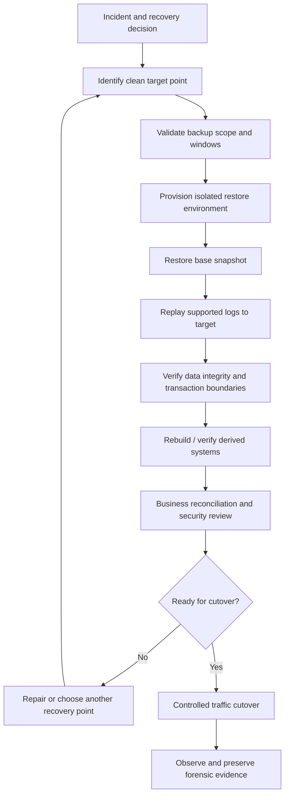

# Log thay đổi, point-in-time recovery và điều kiện hỗ trợ theo từng hệ

Một bản sao lưu được tạo lúc 01:00 không nhất thiết cứu được dữ liệu được ghi lúc 13:45 nếu database hỏng lúc 13:50. Ngược lại, có **change stream**, **commit log**, **oplog**, **append-only file** hoặc **CDC** cũng không có nghĩa ta có thể khôi phục cơ sở dữ liệu chính xác về 13:44:59. Những nhật ký đó có mục đích, phạm vi lưu giữ, thứ tự và cơ chế áp dụng khác nhau.

**Point-in-time recovery (PITR)** là khả năng đưa dữ liệu về một **điểm khôi phục đã chọn trong khoảng thời gian được hỗ trợ**, thay vì chỉ về thời điểm chụp một full backup gần nhất. Trong thực tế, PITR thường phụ thuộc một tổ hợp **base backup/snapshot nhất quán + lịch sử thay đổi liên tục có thể áp dụng lại**, hoặc một dịch vụ managed backup có giao thức tương đương. Từ "đúng thời điểm" còn phải xét mức độ chính xác của timestamp, transaction boundary, consistency giữa các shard và khả năng khôi phục *những dữ liệu nào*.

Bài học thuộc chương **Sao lưu và phục hồi** của module **Database No SQL**. Trọng tâm là đánh giá và vận hành PITR cho nhiều họ NoSQL: MongoDB, Cassandra, DynamoDB, Redis, Elasticsearch/OpenSearch và Azure Cosmos DB. Các sản phẩm, phiên bản, edition và loại triển khai có thể cung cấp **khả năng rất khác nhau**, vì vậy không được suy ra hỗ trợ PITR chỉ vì thấy một file log hoặc một nút "Restore" trong giao diện.

Sau bài học, bạn sẽ biết cách:

1. Phân biệt **backup, replica, transaction/commit log, CDC, event log và PITR**.
2. Xác định những **điều kiện bắt buộc** để khôi phục về một mốc hợp lệ, gồm snapshot, log continuity, retention, consistency, schema và khóa mã hóa.
3. Phân biệt **RPO, RTO, độ chính xác mốc khôi phục và tính nhất quán dữ liệu**.
4. Lập quy trình khôi phục vào môi trường cô lập, áp log an toàn, kiểm tra kết quả và chuyển traffic có kiểm soát.
5. Đọc đúng giới hạn của từng hệ NoSQL thay vì áp công thức của database khác.
6. Thiết kế bài kiểm thử và runbook cho xóa nhầm, corruption, ransomware, replica outage và disaster recovery.

> **Nguyên tắc cốt lõi:** Không được quảng bá "hỗ trợ PITR" chỉ dựa vào sự tồn tại của oplog/commitlog/CDC. Cần chứng minh có **một điểm nền đúng**, **mọi thay đổi cần thiết đến mốc đích**, **thứ tự và ranh giới transaction hợp lệ**, **quyền/khóa/cấu hình đủ để restore**, và **đã phục hồi thành công trong thử nghiệm**.

---

## 1. Năm khái niệm dễ bị nhầm

| Khái niệm | Mục đích chính | Điều chưa được bảo đảm |
| --- | --- | --- |
| **Replica** | Availability, read scale hoặc durability theo giao thức | Có bản lịch sử trước khi xóa nhầm |
| **Snapshot/full backup** | Lưu một trạng thái dữ liệu để phục hồi | Mọi lần ghi sau snapshot đều khôi phục được |
| **Transaction/commit log, oplog, AOF** | Ghi các operation/changes phục vụ durability hoặc replication | Có thể replay tới bất kỳ timestamp theo một API PITR |
| **CDC/change stream** | Cung cấp changes cho consumer và hệ dẫn xuất | Có base snapshot, lưu log vô hạn, multi-shard atomicity |
| **PITR** | Phục hồi trạng thái đã chọn trong một cửa sổ được hỗ trợ | Mọi mốc tuyệt đối, mọi region, mọi resource và ứng dụng đều nhất quán |

### 1.1. Replication không thay backup

Nếu ứng dụng xóa nhầm `order-1001`, thao tác delete hợp lệ có thể được nhân bản tới tất cả replica. Replica đồng bộ tốt không cung cấp trạng thái của ngày hôm qua nếu dữ liệu lịch sử không được bảo quản.

### 1.2. Backup không nhất thiết là PITR

Một daily snapshot cho phép khôi phục tại một vài mốc rời rạc. PITR cần những mốc bổ sung trong một cửa sổ phù hợp theo khả năng sản phẩm.

### 1.3. CDC không tự là backup

CDC có thể giữ ít field, không có before-image, không có initial state hoặc chỉ giữ lịch sử rất ngắn. Không thể dựng lại toàn bộ database từ một loạt event không đầy đủ.

---

## 2. Ví dụ xóa nhầm ở hệ thống đặt xe

Giả sử:

```text
00:00  Full snapshot S0
08:00  Booking A created
10:15  Booking A confirmed
13:40  Booking B created
13:45  Operator runs unintended delete
13:46  Error detected
```

Ba lựa chọn:

- **Restore S0**: mất dữ liệu thay đổi hợp lệ từ 00:00 đến 13:45.
- **Restore dữ liệu mới nhất tại 13:46**: thao tác xóa nhầm có thể đã có trong trạng thái được restore.
- **Restore về điểm ngay trước delete**, nếu PITR hỗ trợ mốc/độ chính xác phù hợp: có thể bảo toàn nhiều thay đổi hợp lệ hơn.

### 2.1. Không chọn mốc chỉ bằng cảm giác

Nếu delete được commit trong một transaction từ 13:44:59.990 tới 13:45:00.150, không thể mặc định restore tại `13:45:00` là trước hay sau transaction. Phải hiểu timestamp/commit boundary của engine.

### 2.2. Khôi phục toàn DB có thể làm mất writes hợp lệ sau mốc

Nếu khôi phục mọi thứ về 13:44, những booking được xác nhận 13:44–13:46 cũng có thể mất trong bản phục hồi. Cần kế hoạch **reconciliation, selective recovery hoặc replay nghiệp vụ** cho những operations cần giữ lại.

---

## 3. PITR được tạo ra bằng gì?

Một mô hình thường thấy:

```text
Time  ---------------------------------------------------->

T0                   T1              T2              T3
|                    |               |               |
Full snapshot S0     log segment 1   log segment 2   Incident
|--------------------|---------------|---------------|
                   choose target T*

Restore S0 -> apply changes in correct order -> stop at T*
```

Một hệ managed có thể thực hiện nội bộ theo cách khác; ứng dụng chỉ thấy API chọn thời điểm. Dù vậy, tư duy về **base state + liên tục thay đổi + mốc phục hồi** vẫn hữu ích để đánh giá điều kiện của dịch vụ.

### 3.1. Cần bản nền đúng

Snapshot phải nhất quán trong phạm vi được hứa (một item, collection, database, shard hay toàn cluster). Một bản copy của file đang được database viết không nhất thiết là backup có thể restore.

### 3.2. Cần lịch sử không có khoảng trống

Nếu có segments 1, 2, 4 nhưng thiếu 3, việc replay đến T3 có thể cho trạng thái sai dù hệ thống không báo lỗi.

### 3.3. Cần protocol áp lại được

Log phải chứa đủ thông tin cho đúng engine/version/schema, gồm operations và transaction boundaries liên quan. Không phải một file text bất kỳ đều có thể được replay.

---

## 4. Mô hình thời gian của phục hồi

Cần phân biệt:

1. **Event time:** thời gian nghiệp vụ diễn ra.
2. **Write/ack time:** lúc client nhận xác nhận.
3. **Commit order/sequence:** thứ tự có thẩm quyền của mutations.
4. **Log append position:** vị trí ghi vào history.
5. **Capture/backup arrival time:** lúc backup service nhận change.
6. **Restore target time:** mốc mà tính năng PITR chấp nhận.
7. **Visibility time:** lúc dữ liệu được query tại bản đã khôi phục.

### 4.1. Đồng hồ không tạo global total order

Giữa nhiều shards/regions, `updatedAt` do ứng dụng gắn không nhất thiết là thứ tự commit. Clock skew và concurrency khiến hai writes có timestamp không phản ánh quan hệ nhân quả.

### 4.2. Chọn mốc theo cam kết của hệ

Managed PITR thường cung cấp một API có bounds và granularity xác định. Self-managed restore có thể dựa vào log position/transaction boundary hơn là tùy ý milliseconds từ `Date.now()`.

### 4.3. "Khôi phục đến 12:00" nghĩa gì?

Cần hỏi: timezone nào, inclusive/exclusive ra sao, timezone database/server nào và cách xử lý transaction đang chạy ở mốc đó? Không dùng local timestamp mơ hồ.

---

## 5. RPO và RTO khác nhau

**Recovery Point Objective (RPO)** là mức mất dữ liệu tối đa cho phép theo thời gian.

**Recovery Time Objective (RTO)** là thời gian tối đa cho phép khôi phục dịch vụ sau sự cố theo phạm vi được định nghĩa.

Ví dụ SLO nội bộ minh họa:

```text
RPO mục tiêu: 5 phút
RTO mục tiêu: 60 phút
```

Một hệ có backup mỗi ngày nhưng không có log liên tục khó đáp ứng RPO 5 phút nếu mất toàn bộ cluster.

### 5.1. PITR không tự giảm RTO

Có thể chọn mục tiêu cách incident một giây nhưng restore 20 TiB mất 8 giờ. Recovery **precision** cao không nghĩa downtime thấp.

### 5.2. Replication RPO khác backup RPO

Một replica đồng bộ có thể giúp giảm dữ liệu mất do node failure, nhưng nó không bảo vệ khỏi delete logic được nhân bản. RPO cần định nghĩa theo **loại sự cố**.

### 5.3. RPO tính ở đâu?

`Source commit → log archived durably → safely restorable` là chuỗi khác `source commit → replica apply`. Đo từ **điểm cuối có thể phục hồi thực sự**, không phải chỉ mốc last change captured.

---

## 6. Một recovery window có bốn giới hạn

Một cửa sổ PITR thực tế bị ràng buộc bởi:

- **Mốc sớm nhất:** base backups/lịch sử log còn đủ.
- **Mốc muộn nhất:** changes đã được backup service lưu bền và có thể restore.
- **Mức chia nhỏ mốc:** độ phân giải/transaction boundary theo sản phẩm.
- **Phạm vi tài nguyên:** table, cluster, account, collection, region, point-in-time consistency.

Ví dụ:

```text
Earliest restorable:  2026-11-01 00:00 UTC
Latest restorable:    2026-11-14 08:43 UTC
Requested target:     2026-11-14 08:40 UTC
```

Đây là **dữ liệu giả lập**, không phải giới hạn hiện tại của một provider.

### 6.1. Latest restorable có thể trễ hiện tại

Nếu source đang ở 08:50 nhưng archive pipeline mới lưu bền tới 08:43, restore tới 08:49 chưa có cơ sở.

### 6.2. Gap làm cửa sổ bị chia cắt

Một đoạn log bị thiếu có thể khiến các mốc sau đoạn thiếu không thể được phục hồi đáng tin từ backup chain đó, cho dù latest timestamp trên dashboard còn rất mới.

---

## 7. Điều kiện tối thiểu để nhận một yêu cầu PITR

Một recovery plan nên trả lời:

1. Có **base backup/snapshot** nào được công nhận và đã verify?
2. Snapshot bảo đảm consistency ở cấp nào?
3. Mốc log/sequence gắn với snapshot là gì?
4. Những log segments tiếp theo còn đầy đủ không?
5. Có checksum/integrity và provenance không?
6. Có DDL/schema/configuration và metadata cần thiết không?
7. Có encryption keys và restore permissions không?
8. Engine/version đích có đọc được dữ liệu không?
9. Target time nằm trong cửa sổ được hỗ trợ không?
10. Có multi-shard/region consistency hay chỉ per-resource?
11. Sẵn disk/network/headroom để restore không?
12. Đã tính RTO của data copy + replay + verify + cutover chưa?
13. Có quyết định về events/writes sau target time chưa?
14. Có môi trường cô lập để test trước khi thay production không?

Không đầy đủ điều kiện nào thì phải ghi **rủi ro hoặc blocker**, thay vì công bố PITR chắc chắn thành công.

---

## 8. Base snapshot phải nhất quán với log

Vấn đề phổ biến:

```text
T0: Copy storage file X.
T1: Transaction writes X and Y.
T2: Copy storage file Y.
```

Bản copy có thể chứa X trước transaction nhưng Y sau transaction. Nếu không có snapshot/engine protocol đúng, không biết log nào cần replay để tạo state hợp lệ.

### 8.1. Quiesce hoặc snapshot protocol

Có thể dùng:

- Engine-provided logical consistent snapshot.
- Filesystem snapshot được phối hợp với database flush/lock/checkpoint theo tài liệu engine.
- Storage snapshots có database-aware integration.
- Managed backup mechanism.
- Transaction log coordinate recorded with base state.

### 8.2. Không copy trực tiếp file đang mở rồi coi là PITR backup

Một `cp -r data-directory` trong lúc server ghi có thể tạo file image không nhất quán. Cần phương pháp được engine hỗ trợ.

### 8.3. Snapshot metadata quan trọng

Manifest phải có ID, engine version, resource/shard scope, backup time, log position, checksum và encryption metadata.

---

## 9. Chuỗi log: liên tục không chỉ là đủ số file

Một manifest giả lập:

```json
{
  "snapshotId": "base-20261114-0000",
  "stream": "shard-A",
  "baseSequenceExclusive": 1000,
  "segments": [
    {"firstSequence": 1001, "lastSequence": 1500},
    {"firstSequence": 1501, "lastSequence": 2000},
    {"firstSequence": 2001, "lastSequence": 2450}
  ],
  "targetSequence": 2200
}
```

Giả định sequences **đơn điệu, không có gaps và có nghĩa phù hợp trong một stream**; thực tế mỗi engine có cursor/log format khác.

### 9.1. Một gap nhỏ cũng nguy hiểm

Nếu thiếu sequence 1501–1600, không thể chỉ tiếp tục từ 1601 và cho rằng dữ liệu đích đúng.

### 9.2. Trùng segment có thể xử lý nhưng cần protocol

Mỗi segment có thể chồng nhau trong backup retry. Restore engine cần biết de-duplicate, compare sequence, transaction boundaries, checksums.

### 9.3. Log position không tự là global position

Ở sharded cluster, mỗi shard có thể có sequence riêng. `shard-A=2200` không xác định vị trí commit tương ứng của shard-B.

---

## 10. WAL, oplog, commitlog và AOF khác nhau thế nào?

| Dạng log | Chức năng thường gặp | Lưu ý khi phục hồi |
| --- | --- | --- |
| Write-ahead/commit log | Ghi ý định hoặc mutation trước khi storage được cập nhật | Phụ thuộc log format, checkpoint, replay protocol |
| MongoDB oplog | Nhật ký replication của replica set | Retention giới hạn; dùng đúng backup/PITR tooling |
| Cassandra commitlog | Durability và recovery của writes trước SSTable flush | Archiving/replay có giới hạn version/config và consistency |
| Redis AOF | Persist các commands/mutations phục vụ restart recovery | Không tự là chọn arbitrary timestamp hay cluster-wide PITR |
| DynamoDB Streams | Stream thay đổi của items | Không phải backup chain/PITR, retention riêng |
| Cosmos DB change feed | Consumer đọc thay đổi theo chế độ hỗ trợ | Không tự là continuous backup/restore |
| Kafka/outbox events | Truyền domain events sang consumers | Có thể thiếu raw state, transactions, DDL, deletes |

### 10.1. Log phục vụ crash recovery không luôn là log phục vụ historical recovery

Một log có thể được truncate/rotate ngay khi checkpoint hoàn tất vì mục tiêu của nó là phục hồi **trạng thái mới nhất**, không phải giữ lịch sử nhiều ngày.

### 10.2. Log nội bộ không luôn có replay API công khai

Nhiều managed services che hoàn toàn physical logs. Nếu nhà cung cấp có PITR, phải dùng **API/feature chính thức** chứ không truy cập log nội bộ theo suy đoán.

---

## 11. CDC là tín hiệu cập nhật, không là backup chain mặc định

Ví dụ change event:

```json
{
  "type": "ProductUpdated",
  "productId": "sku-42",
  "revision": 81,
  "changedFields": {"priceMinorUnits": 250000}
}
```

Để rebuild toàn product store, có thể còn thiếu title, category, owner, schema history và những events từ trước khi consumer bắt đầu.

### 11.1. Delta-only cần baseline

Một stream `+1`, `-1` cho counter không cho biết tổng ban đầu nếu thiếu một event.

### 11.2. Retention có thể ngắn

Change streams/queues có thời gian lưu hạn chế, khác retention backup. Không mặc định events vẫn có thể replay một tháng sau.

### 11.3. Delete và expired data

Không phải mọi CDC mode giữ đầy đủ deletes hoặc before-images. Dựng lại dữ liệu từ CDC có thể bỏ sót logic xóa, index changes hoặc multi-document transaction semantics.

### 11.4. Event replay và PITR nghiệp vụ

Nếu hệ có **complete immutable event log** được thiết kế cho event sourcing, có thể rebuild state tới một mốc theo projectors/version rules. Đó là một thiết kế riêng, không suy từ mọi CDC stream.

---

## 12. Bản sao dữ liệu có thể cùng bị phá hủy logic

Một replica node hỏng có thể được cứu bằng secondary. Nhưng nếu thao tác hợp lệ `deleteMany()` hoặc `FLUSHALL` được nhân bản, mọi active replicas có thể mất cùng nội dung.

### 12.1. Ba loại sự cố khác nhau

| Sự cố | Replication hữu ích | Backup/PITR hữu ích |
| --- | --- | --- |
| Một node disk failure | Thường có, tùy redundancy | Có để bảo vệ trường hợp tệ hơn |
| Delete/corruption logic được nhân bản | Thường không khôi phục lịch sử | Có nếu historical restore point tồn tại |
| Mất toàn region | Tùy multi-region topology | Cần backup độc lập failure domain |

### 12.2. Replication lag không phải recovery point đáng tin

Một secondary bị tụt hậu có thể tạm giữ dữ liệu trước delete, nhưng không phải PITR strategy ổn định: nó có thể tự bắt kịp, có gaps hoặc không nhất quán.

---

# Phần I — Consistency trong phục hồi phân tán

## 13. Point-in-time của một record, một shard và toàn cụm

Giả sử booking liên quan:

- Document Booking ở shard A.
- Payment capture ở shard B.
- Seat reservation ở service C.
- Cache/search ở các hệ D/E.

Một mốc phục hồi "13:44" theo mỗi hệ **không tự bảo đảm toàn bộ workflow trở về trạng thái nghiệp vụ nhất quán**.

### 13.1. Độ nhất quán theo phạm vi

- **Per-item:** một item được trả về từ một version hợp lệ.
- **Per-partition/shard:** các mutations theo một log/ownership scope được apply nhất quán.
- **Per-database transaction:** không hồi phục nửa transaction trong phạm vi engine bảo đảm.
- **Cross-shard/cluster:** restore có consistent cut được engine/provider hỗ trợ.
- **Cross-service:** cần business reconciliation/saga/event authority ngoài database restore.

### 13.2. Không có global timestamp là đủ

Hai databases ở hai regions có clocks chênh lệch và asynchronous replication có thể chọn mốc khác nhau. Cần **vector of log positions/consistent snapshot protocol** hoặc thiết kế phục hồi nghiệp vụ.

---

## 14. Transaction boundaries trong log replay

Ví dụ một transaction cần:

```text
1. Deduct balance from account A
2. Credit balance to account B
COMMIT
```

Nếu replay dừng sau bước 1 nhưng trước bước 2 trong một transaction mà engine vốn bảo đảm atomic, bản restore sẽ sai.

### 14.1. Restore phải dùng protocol có transaction awareness

Một PITR engine đúng phải phục hồi theo transaction commit semantics trong phạm vi hỗ trợ. Không cắt file log theo một dòng text gần timestamp rồi tự chạy commands.

### 14.2. Event timestamp và commit timestamp

Một event tạo trước khi commit nhưng commit sau target time có thể **không** thuộc state hợp lệ tại mốc đó. Chỉ implementation/provider có thể định nghĩa cách chọn đúng.

### 14.3. Cross-shard transactions

Nếu engine có distributed transactions, backup/restore cần bảo toàn commit decision/metadata phù hợp. Per-shard replay riêng lẻ có thể gây split transaction nếu thiếu protocol phối hợp.

---

## 15. DDL, schema và index changes

Một restore point không chỉ có document payload. Trong lịch sử, có thể xảy ra:

```text
10:00  Create index on email
10:30  Rename field userName -> displayName
11:00  Change TTL policy
12:00  Drop old collection/table
```

### 15.1. Những gì cần được phục hồi?

- Dữ liệu và logical schema.
- Collection/table definitions.
- Indexes và search mappings.
- Database users/roles tùy backup scope.
- Cluster topology metadata nếu cần.
- Constraints, TTL và retention policies.
- Feature flags/application version liên quan.
- Encryption/KMS configuration.

### 15.2. Phần nào không thuộc backup mặc định?

Managed table restore có thể không mang mọi IAM policy, tags, Streams, alarms, autoscaling, TTL hoặc application config theo cùng cách. Phải lập **post-restore configuration checklist** cho đúng sản phẩm.

### 15.3. Đừng khởi động app mới trên schema quá cũ

Một phiên bản ứng dụng đã đổi data contract có thể ghi sai vào database phục hồi ở trạng thái trước migration. Cần compatibility strategy hoặc rollback app/schema nhất quán.

---

## 16. Tombstones, delete retention và chống dữ liệu "sống lại"

Xét:

```text
v7: item tồn tại
v8: item đã bị xóa
v9: item mới ở key khác
```

Nếu khôi phục về thời điểm v8 chưa xảy ra, item được khôi phục lại **là hành vi PITR có chủ ý**. Nhưng nếu restore tới sau v8 mà item v7 lại xuất hiện do thiếu tombstone/replay sai, đó là **resurrection bug**.

### 16.1. Phân biệt hai tình huống

- **Historical recovery trước delete**: chủ ý lấy lại dữ liệu, thường để điều tra/xuất một subset.
- **Current-state recovery sau delete**: delete phải tiếp tục có hiệu lực, không cho log cũ hồi sinh item.

### 16.2. Cassandra và delete markers

Trong một số LSM-based stores, tombstone retention gắn với replica repair. Không hạ grace/purge vội chỉ vì muốn giảm disk khi vẫn có replica offline hoặc backup/log replay cũ.

### 16.3. Xóa theo yêu cầu quyền riêng tư

PITR có thể phục hồi cả dữ liệu đã bị xóa vì quyền riêng tư. Quy trình restore phải **tái áp chính sách suppression/deletion** và kiểm soát quyền truy cập trước khi đưa hệ phục hồi vào phục vụ người dùng.

---

## 17. Snapshot consistency: sự khác nhau giữa logical và physical backup

| Loại | Đặc điểm | Rủi ro chính |
| --- | --- | --- |
| Logical export | Xuất các records theo schema/query API | Scan không nhất quán nếu writes đang diễn ra |
| Physical/database-aware snapshot | Sao lưu storage state bằng protocol được hỗ trợ | Phụ thuộc engine/checkpoint/file compatibility |
| Storage filesystem snapshot | Snapshot tầng block/storage | Cần phối hợp với database để nhất quán |
| Managed continuous backup | Provider duy trì lịch sử theo hợp đồng dịch vụ | Retention, supported scope và restore target limits |
| Application event log backup | Lưu domain events | Thiếu state/metadata nếu event contract không đủ |

### 17.1. Một full export không tự là snapshot tại cùng thời điểm

Nếu scan collection mất 5 giờ, các records đầu và cuối có thể được đọc từ hai trạng thái khác nhau, trừ khi dùng snapshot semantics hoặc catch-up protocol đúng.

### 17.2. Physical snapshot không thay log archiving

Nếu chỉ giữ snapshot mỗi ngày và không có log segments, vẫn chỉ restore tại các mốc snapshot.

---

## 18. Rủi ro từ retention và vòng quay log

Mỗi nguồn log có thời gian giữ lịch sử khác nhau:

```text
Source replication log window:      W1
CDC broker retention:               W2
Backup continuous log retention:    W3
Base backup retention:              W4
Tombstone/idempotency retention:     W5
```

**Không tự mặc định W1 = W3**, và không bảo đảm PITR chỉ vì một trong năm thời gian đủ dài.

### 18.1. Cửa sổ op log thay đổi theo tốc độ ghi

Một oplog có kích thước cố định có thể chứa ít **thời gian** hơn khi write volume tăng mạnh. Theo dõi actual history window chứ không chỉ dung lượng log.

### 18.2. Tính thời gian tối đa để bắt kịp

Nếu một initial backup mất 6 giờ nhưng log chỉ giữ 2 giờ, snapshot+log handoff có nguy cơ vượt khỏi history nếu không có cơ chế archiving riêng.

### 18.3. Không chỉ giữ file cuối

Để replay an toàn, cần toàn bộ chain từ base state tới target point, không phải một log file được tạo gần incident nhất.

---

## 19. Giám sát gaps, loss và corruption của log segments

Một backup pipeline nên có manifest:

```json
{
  "backupSet": "orders-prod-2026-11-14",
  "baseSnapshot": "snapshot-0001",
  "streams": [
    {
      "name": "shard-a",
      "lastArchivedOffset": "offset-A",
      "checksumsVerified": true
    },
    {
      "name": "shard-b",
      "lastArchivedOffset": "offset-B",
      "checksumsVerified": true
    }
  ],
  "encryptionKeyReference": "key-version-2026-11",
  "restoreTestStatus": "PASSED"
}
```

Đây là **manifest mẫu**, không phải output tiêu chuẩn của bất kỳ sản phẩm nào.

### 19.1. Những vấn đề cần phát hiện

- File chưa được upload xong nhưng marker đã báo complete.
- Log segment thiếu ở giữa.
- Checksum mismatch.
- Encryption key đã bị xóa/thu hồi.
- Backup set thiếu một shard hoặc account resource.
- Snapshot metadata/version không khớp log.
- Archive store bị xóa hoặc chỉnh sửa.
- Quyền restore đã hết hạn.

### 19.2. Last archived position khác latest restorable

Một stream nhanh nhất có offset mới không nghĩa mọi shard đã an toàn tới cùng global cut. Chỉ báo **latest restorable time** khi protocol đã xác minh toàn bộ nguồn cần thiết.

---

# Phần II — Quy trình PITR từ yêu cầu đến cutover

## 20. Quy trình tổng thể



### 20.1. Không restore đè production ngay

Nên dùng một cluster/table/account mới, cô lập, để kiểm chứng trước. Restore in-place có thể phá bằng chứng, thay dữ liệu khỏe và khiến rollback khó.

### 20.2. Quarantine luồng ghi

Trong sự cố xóa nhầm hoặc corruption, cần ngăn job đang gây lỗi tiếp tục ghi vào nguồn/đích. Có thể chặn writer, vô hiệu một workflow hoặc đặt read-only ở tầng phù hợp; không tự ý hạ consistency.

### 20.3. Chọn mốc sạch

Mốc chọn phải trước operation lỗi nhưng có thể sau những writes hợp lệ khác. Cần audit trail/correlation IDs/commit boundary để không cắt giữa một transaction.

---

## 21. Phục hồi vào môi trường cô lập

Một môi trường phục hồi thử nghiệm nên:

- Có mạng, IAM và database roles riêng.
- Không nhận traffic production tự động.
- Không kích hoạt cron/CDC producers ngoài ý muốn.
- Không gửi email, thanh toán hoặc webhooks khi replay.
- Có encryption keys và secrets đúng phạm vi.
- Không expose dữ liệu nhạy cảm ra mạng/công cụ không được phép.
- Ghi lại manifest/version/commands/time window.
- Có đủ disk/network/quota để restore.
- Có rollback và tiêu chí xóa môi trường thử nghiệm.

### 21.1. Side effects của ứng dụng nguy hiểm

Nếu job đọc lại 10.000 `OrderPaid` events rồi gửi lại email/charge payment do dùng cùng consumers production, dữ liệu có thể đúng mà nghiệp vụ sai. Consumer trong restore environment phải được **cô lập hoặc chạy ở verification-only mode**.

### 21.2. Backup không tự phục hồi hệ tích hợp

Cache, search index, read models và analytics thường phải được rebuild/reconcile từ nguồn phục hồi. Không trỏ chúng sang cluster mới cho đến khi revision/freshness/ACL hợp lệ.

---

## 22. Rà soát integrity trước khi ứng dụng đọc

Một kế hoạch kiểm chứng cần:

1. Dữ liệu đọc được, đúng engine/schema version.
2. Collection/table/keyspace/partition coverage.
3. Record counts theo partition/time/tenant, không chỉ tổng.
4. Checksums hoặc hashes theo fields đã định nghĩa.
5. Transaction/invariant checks: không double-booking, không negative balance, không mất ledger entries.
6. Thứ tự/commit metadata không bị gap.
7. Tombstones/deletes và TTL semantics.
8. Indexes/search mappings/constraints.
9. Users/roles/permissions phù hợp.
10. Restore point thực sự nằm trước/sau incident như dự kiến.
11. Application compatibility và read/write smoke tests.
12. Không còn malicious changes trong recovery target.

### 22.1. Row count bằng nhau chưa chứng minh đúng

Hai datasets đều có 1 triệu rows nhưng thiếu và thừa các keys khác nhau vẫn có cùng count.

### 22.2. Data correctness khác business correctness

Một booking `CONFIRMED` nhưng payment chưa capture có thể là hậu quả hai services được restore từ mốc khác nhau. Cần reconciliation nghiệp vụ riêng.

---

## 23. Selective restore hay toàn cluster restore?

Nếu chỉ một customer record bị xóa nhầm, **full cluster rollback** có thể xóa nhiều giờ cập nhật hợp lệ của khách khác.

Lựa chọn:

- Restore toàn cluster/table về target rồi cutover: đơn giản về data set nhưng ảnh hưởng mọi writes sau mốc.
- Restore toàn bộ vào môi trường riêng, **trích xuất records cần phục hồi** rồi merge có kiểm soát vào production hiện tại.
- Dùng versioned history/application event log nếu đã thiết kế để khôi phục từng entity.
- Rebuild một read model/index cụ thể nếu nguồn canonical vẫn đúng.

### 23.1. Merge phải có conflict policy

Một record cũ được lấy lại có thể tham chiếu customer đã bị xóa sau đó, hoặc payment đã được refund. Không upsert dữ liệu lịch sử trực tiếp mà không kiểm tra hiện trạng.

### 23.2. Không giả PITR hỗ trợ per-document restore

Nhiều managed PITR APIs khôi phục **cả table/account/cluster vào resource mới**, không phải một document tại tùy ý timestamp. Selective recovery cần bước riêng.

---

## 24. Cutover và việc giữ các writes sau mốc khôi phục

Có hai mốc:

```text
Recovery target T*  ----------- Incident detected T1
        |                                 |
  Restored clean data              Current production
```

Các writes giữa T* và T1 có thể gồm:

- Operations lỗi cần loại.
- Booking/payment hợp lệ cần giữ.
- Changes đã ảnh hưởng các hệ downstream.
- Events đã gửi tới khách hoặc đối tác.

### 24.1. Cần quyết định theo từng loại nghiệp vụ

- **Bỏ toàn bộ writes sau T***: dễ hơn nhưng có mất dữ liệu chấp nhận được không?
- **Chọn lọc replay các writes hợp lệ**: cần audit log, idempotency và thứ tự.
- **Giữ production rồi merge subset**: giảm blast radius nhưng phức tạp về consistency.
- **Compensate ở nghiệp vụ**: hoàn tiền/điều chỉnh booking thay vì rewrite history.

### 24.2. Không replay transaction payment mù

Một payment capture đã xảy ra ở external provider không biến mất chỉ vì database được restore về trước capture. Cần reconciliation provider, idempotency keys và audit trail.

---

## 25. CDC, offsets và consumers sau restore

Một source được restore về quá khứ có thể có revision/cluster identity/log position không giống nguồn cũ. Consumers đang giữ checkpoints của timeline cũ có thể:

- Skip các changes cần replay.
- Đọc lại trùng events.
- Ghi lùi search/cache/read model.
- Không resume được do resume token/offset invalid.
- Re-create records đã xóa.

### 25.1. Các phương án

- Rebuild derived stores từ source mới.
- Tạo consumer group/stream identity mới với bootstrap protocol.
- Cắt biệt traffic giữa restored epoch và old epoch.
- Dùng source revision + restore epoch/versioning guard.
- Reconcile projections trước cutover.
- Chọn lại checkpoint theo **timeline mới được hỗ trợ**, không chỉnh offset thủ công thiếu protocol.

### 25.2. Thế hệ dữ liệu (epoch)

Nếu một restored source quay về revision nhỏ hơn trước đó, sink có guard "chỉ nhận version lớn hơn" có thể từ chối mọi update mới. Cần thiết kế **restore epoch/cutover namespace** hoặc rebuild sink, không lách bằng cách bỏ version guard vô điều kiện.

---

# Phần III — Đối chiếu theo từng hệ NoSQL

## 26. Ma trận tổng quan

| Hệ | Lịch sử thay đổi | Khả năng PITR cần kiểm tra | Điều kiện/giới hạn nổi bật |
| --- | --- | --- | --- |
| **MongoDB self-managed** | Oplog replica set | Backup workflow phù hợp + log replay được công cụ hỗ trợ | Oplog window, consistency, sharded cluster complexity |
| **MongoDB Atlas** | Managed backup/continuous backup tùy tier/config | Continuous backup/PITR theo tính năng bật | Tier, project/region, retention, target bounds, restore resource |
| **Apache Cassandra** | Commitlog, SSTable snapshots, repair | Snapshot + commitlog archive/replay với giới hạn cấu hình/version | Per-node consistency, commitlog retention, schema, multi-node restore |
| **DynamoDB** | Managed internal history; Streams riêng | PITR nếu bật và hỗ trợ cho table | Sliding retention, restore to new table, resource/config scope |
| **Redis** | RDB snapshots, AOF | Không mặc định có arbitrary-time PITR | Persistence mode, AOF rewrite, replication, managed backup capabilities |
| **Elasticsearch/OpenSearch** | Translog và snapshots | Thường dùng snapshots/restore; không suy arbitrary-time PITR | Snapshot cadence, index/cluster state, managed-specific features |
| **Azure Cosmos DB** | Managed backup; change feed riêng | Continuous backup mode nếu chọn và API/region hỗ trợ | Backup mode/tier, restore scope, new account/resource behavior |
| **Couchbase và hệ khác** | DCP/change streams, backups | Tùy edition, managed service và backup tooling | Không suy DCP là history đủ cho PITR |

**Lưu ý:** Đây là khung đánh giá kiến trúc, không thay tài liệu chính thức của đúng **version, region, edition và gói dịch vụ**. Các tính năng, retention và khả năng API có thể thay đổi.

---

## 27. MongoDB: oplog là gì?

Trong replica set, **oplog** là một capped collection chứa các operations phục vụ replication, thường ở namespace nội bộ `local.oplog.rs` theo triển khai truyền thống.

### 27.1. Vai trò

- Secondary đọc và áp các writes từ primary theo replication protocol.
- Một node offline có thể catch up nếu history còn đủ.
- Một số backup workflows có thể phối hợp oplog để tạo bản copy nhất quán hoặc replay tới mốc được hỗ trợ.

### 27.2. Oplog không là immutable audit log vô hạn

Lịch sử bị giới hạn bởi kích thước/retention policies và tốc độ writes. Nếu incident được phát hiện sau khi vị trí cần thiết đã bị ghi đè, **không thể tự khôi phục bằng oplog còn lại**.

### 27.3. Oplog chứa thông tin nội bộ

Không dùng oplog dump như public event feed. Nó có format/version/semantics cần công cụ MongoDB phù hợp xử lý.

---

## 28. MongoDB self-managed: backup cộng oplog replay

Một workflow có thể dùng consistent logical/physical backup và oplog capture để khôi phục dữ liệu ở một mốc phù hợp theo khả năng phiên bản/công cụ.

Ví dụ **lab** tạo full logical dump của một **replica set**, nếu topology/công cụ đáp ứng yêu cầu:

```bash
mongodump \
  --uri="mongodb://backup-user@db-replica-internal:27017/?replicaSet=rs0" \
  --oplog \
  --out="./backup-lab"
```

Lệnh minh họa trong shell POSIX; mật khẩu nên lấy từ cơ chế secret phù hợp, **không hardcode vào command line hoặc lịch sử shell**.

### 28.1. Ý nghĩa `--oplog`

Trong những điều kiện được MongoDB Database Tools hỗ trợ, `--oplog` thu thêm operations trong lúc dump để hỗ trợ logical consistency khi khôi phục toàn bộ snapshot bằng công cụ tương ứng. Nó **không tạo tự động** chuỗi log archive liên tục nhiều ngày.

### 28.2. Không tự áp ví dụ lên sharded cluster

`mongodump --oplog` có điều kiện hỗ trợ cho replica set và không cung cấp một cơ chế PITR toàn sharded cluster chỉ bằng việc chạy qua `mongos`. Với sharded cluster, cần quy trình snapshot/backup cluster-consistent và oplog coordination theo công cụ được hỗ trợ.

### 28.3. Restore có `--oplogReplay`

`mongorestore` có lựa chọn `--oplogReplay` cho workflow tương ứng khi backup set hợp lệ. Không dùng nó với một bộ log chắp vá, không kiểm tra version, target constraints và transaction semantics.

### 28.4. Không coi dump là consistent khi thiếu protocol

Một dump từng collection trong lúc application tiếp tục ghi có thể nhìn dữ liệu ở các thời điểm khác nhau. Cần `--oplog` với điều kiện phù hợp hoặc database-aware snapshot/managed backup.

---

## 29. MongoDB sharded clusters: consistent cut khó hơn

Một cụm có:

```text
mongos router
   |
   +-- Shard A replica set
   +-- Shard B replica set
   +-- Config server replica set
```

Ghi dữ liệu và metadata có thể thay đổi trên nhiều shard trong lúc backup.

### 29.1. Rủi ro

- Backup shard A ở T1, shard B ở T2.
- Range migration diễn ra trong lúc copy.
- Transaction có ảnh hưởng nhiều shards.
- Config metadata/chunk placement không đồng bộ với data snapshots.
- Oplog windows khác nhau giữa các replica sets.

### 29.2. Điều kiện PITR

Một giải pháp phải có **cluster-aware consistent snapshot + log/transaction/metadata coordination**. Không ghép thủ công ba bản dump riêng rồi coi đó là một mốc toàn cluster.

### 29.3. Phương án

Dùng MongoDB Atlas continuous backup hoặc tooling/backup architecture được hỗ trợ cho self-managed sharded deployments, xác minh version/topology/retention, và thử restore vào cluster độc lập.

---

## 30. MongoDB Atlas: continuous backup và PITR

MongoDB Atlas cung cấp các lựa chọn backup khác nhau theo **cluster type/tier và cấu hình dịch vụ**. Khi tính năng continuous backup/PITR khả dụng và được bật, operator có thể chọn các mốc trong **restorable time window** theo giao diện/API tương ứng.

### 30.1. Những câu hỏi phải xác nhận

- Cluster/tier có hỗ trợ continuous cloud backup/PITR?
- Tính năng có được bật trước incident không?
- Restorable earliest/latest timestamps là gì?
- Retention được đặt bao lâu?
- Restore có thể vào cluster mới hay phương án đích nào?
- Cross-region/cross-project requirements?
- Encryption/KMS keys còn truy cập được không?
- Có giới hạn version, topology, shard count, maintenance state?
- Thời gian restore/cutover đã đo trong drill chưa?

### 30.2. Không dùng mặc định “7/30 ngày” cho mọi Atlas cluster

Các khoảng giữ data, snapshot và restore point phụ thuộc gói/config và có thể đổi. Chỉ lấy con số được API/console của **cluster cụ thể** xác nhận.

### 30.3. Backup đã bật sau incident không quay lại quá khứ

Nếu continuous backup chỉ được bật lúc 14:00, nó không tự tạo lịch sử cho 13:00. RPO phải được đánh giá bằng lịch sử **đã tồn tại trước** khi xảy ra sự cố.

---

## 31. Cassandra: commitlog là gì?

Apache Cassandra dùng **commit log** và memtables/SSTables trong write path. Commitlog hỗ trợ durability/recovery của những writes chưa được flush bền theo protocol.

### 31.1. Commitlog không tự là backup archive

Các log cũ có thể được recycle sau flush/checkpoint conditions. Nếu muốn historical recovery cần cấu hình **archiving** hoặc backup mechanism phù hợp từ trước.

### 31.2. Snapshot giữ SSTables

Cassandra snapshots có thể cung cấp base state ở cấp node/table theo cơ chế engine. Để có lịch sử sau snapshot, cần backup/log archive và restoration policy được hỗ trợ.

### 31.3. Phân tán theo replicas

Một cluster nhiều nodes có commitlog và SSTables trên từng node; không có nghĩa chụp từng node ở các thời điểm khác nhau là một global transaction-consistent snapshot.

---

## 32. Cassandra: commitlog archiving và point-in-time restore

Một số Cassandra deployments/versions hỗ trợ cấu hình archive/replay commitlogs thông qua `commitlog_archiving.properties` hoặc cơ chế tương ứng.

Những nhóm cấu hình cần xem theo đúng version:

```text
archive command / destination
restore command / source
restore directories
restore point in time
timestamp precision
```

Đây là **nhóm tùy chọn**, không phải file cấu hình có thể copy nguyên vào production.

### 32.1. Điều kiện điển hình

1. Snapshot hợp lệ của dữ liệu trước target.
2. Archived commitlog segments liên tục sau snapshot.
3. Restore command đọc được log và keys/permissions.
4. Cấu hình replay/target time khớp thời gian/precision của engine.
5. Schema/keyspace/table definitions tương thích.
6. Kịch bản restore từng node và cluster consistency được hoạch định.
7. Repair và tombstone/grace semantics không làm dữ liệu cũ hồi sinh.

### 32.2. Không hứa transaction toàn cluster

Cassandra không cung cấp một global ACID transaction snapshot cho mọi partition như một RDBMS tùy ý. Phục hồi per-node commitlogs tới timestamp không tự tạo một consistent cut giữa mọi partition/DC.

### 32.3. Node replacement khác PITR

Rebuild một replica từ peers thường tạo **current state**. PITR về quá khứ cần backup/history riêng, không dùng replica repair để “quay thời gian”.

---

## 33. Cassandra: những rủi ro riêng khi restore

### 33.1. Schema và token/ring layout

Snapshot/commitlog từ cluster cũ không tự tương thích với mọi topology/versions mới. Kiểm tra partitioner, schema, token assignments và restore strategy được tài liệu hỗ trợ.

### 33.2. TTL và tombstones

TTL có thời gian hết hạn, tombstones có retention và repair implications. Restore quá khứ có thể đưa records đã bị xóa trở lại theo mốc có chủ ý, nhưng restore vào cluster hiện tại có thể gây xung đột với markers mới.

### 33.3. Counters và special data types

Một số loại dữ liệu/operation có semantics backup/replay khác ordinary immutable rows. Phải thử riêng với counters, LWT/conditional writes, batches, secondary indexes và materialized views theo version được dùng.

### 33.4. Hướng an toàn

Restore vào một cluster cô lập với topology/schema đã chuẩn bị, validate per-table data và business invariants, sau đó dùng controlled reconciliation thay vì copy SSTables tùy ý vào nodes đang live.

---

## 34. DynamoDB PITR: dịch vụ quản lý history

Amazon DynamoDB cung cấp tính năng **point-in-time recovery cho table được hỗ trợ khi bật theo cấu hình dịch vụ**. Nó cho phép restore dữ liệu về thời điểm nằm trong **restorable window** mà dịch vụ công bố.

### 34.1. Các đặc điểm cần nắm

- PITR là **feature độc lập** với DynamoDB Streams.
- Thông thường restore tạo **table mới** thay vì ghi đè table hiện tại.
- Thời điểm restore phải nằm trong earliest/latest restorable bounds.
- Backup/restore có thời gian và phí/giới hạn resource theo dịch vụ.
- Cấu hình ancillary resources cần được đối chiếu sau restore.

### 34.2. Retention

DynamoDB PITR thường được mô tả với cửa sổ recovery linh hoạt đến **35 ngày** theo khả năng cấu hình và API; không dùng số này như lời hứa cho mọi table. Cần xem `RecoveryPeriodInDays`, earliest/latest restorable timestamps và trạng thái PITR **của table thực tế**.

### 34.3. Restore không phải rewind trong cùng table

Nếu client đang ghi table `OrdersProd`, restore point thường tạo `OrdersRecovered` (tên minh họa). Cần kiểm tra dữ liệu rồi quyết định migration/cutover và xử lý writes sau mốc.

---

## 35. DynamoDB: API điều tra PITR

Có thể dùng AWS CLI trong môi trường được cấp quyền để quan sát, với region/table đúng:

```bash
aws dynamodb describe-continuous-backups \
  --table-name OrdersProd \
  --region ap-southeast-1
```

Các trường trả về theo API/version có thể gồm thông tin PITR enabled và earliest/latest restorable timestamps.

Ví dụ **chỉ mô tả shape của một restore request**, không phải yêu cầu chạy trực tiếp trên production:

```json
{
  "SourceTableName": "OrdersProd",
  "TargetTableName": "OrdersRecovered",
  "RestoreDateTime": "2026-11-14T08:30:00Z"
}
```

### 35.1. Đừng tự phát lệnh restore trước khi quyết định mốc

Một restore thật có thể tạo một table lớn, gây chi phí và mở ra dữ liệu nhạy cảm. Xác minh IAM, region, KMS, target names và quota trước.

### 35.2. Post-restore checklist

Xác minh:

- Key schema, indexes, table/data counts.
- Billing/capacity mode và autoscaling policies.
- TTL/Streams/PITR settings.
- Encryption/KMS, tags và resource policies.
- CloudWatch alarms, Lambda/event-source mappings.
- Global table replication và region topology nếu có.
- IAM roles của ứng dụng và API routing.
- Consistency/business records.

Những properties nào được tự restore phải kiểm tra theo API/documentation hiện hành, không mặc định toàn bộ hạ tầng được nhân bản.

---

## 36. DynamoDB Streams không phải PITR

DynamoDB Streams giữ một chuỗi item changes với retention/semantics riêng và có thể cung cấp keys, new/old images theo cấu hình.

### 36.1. Khác nhau về mục tiêu

**Streams:** kích hoạt Lambda/consumers, cập nhật search/read tables, audit-like processing trong cửa sổ lưu giữ được hỗ trợ.

**PITR:** khôi phục table data về một thời điểm trong cửa sổ backup managed service.

### 36.2. Vì sao không tự replay Streams để rewind toàn table?

- Không có initial dataset trong stream trừ khi đã thiết kế backfill.
- Chế độ image có thể thiếu before/after data cần thiết.
- Retention ngắn hơn lịch sử backup nhiều tình huống.
- Cross-item global transaction ordering không giống một database backup protocol.
- DDL/TTL/IAM/secondary config không nhất thiết tái tạo được.

### 36.3. Sau restore, consumers cần bootstrap

Streams/consumer offsets của original table không mặc nhiên thích hợp cho restored table. Dùng config/stream identity mới, rebuild derived stores và xác minh replays.

---

## 37. Redis: RDB, AOF và giới hạn PITR

Redis có các cơ chế persistence tùy configuration:

- **RDB snapshot:** lưu dataset tại một thời điểm snapshot.
- **AOF (Append Only File):** ghi lại các operations thay đổi dữ liệu theo persistence/rewrite protocol.
- **Replication:** sao chép dataset/changes sang replicas.
- **Managed backup:** khả năng snapshot/restore tùy provider/plan.

### 37.1. RDB không phải arbitrary timestamp restore

Nếu có snapshots tại 00:00 và 12:00, không thể chọn 11:45 chỉ nhờ hai RDB files.

### 37.2. AOF không tự hứa PITR

AOF giúp persistence và restart recovery; qua rewrites, log lịch sử có thể được compact thành một base representation, không còn mọi mutation cũ để rewind tùy ý.

### 37.3. Mốc khôi phục theo command không bằng commit transaction toàn hệ

Ngay cả khi lưu AOF archive theo thiết kế riêng, cắt/replay ở command boundary phải giữ semantics của `MULTI/EXEC`, Lua, TTL và replication; Redis Cluster có nhiều nodes/slots với timelines khác nhau.

### 37.4. Phục hồi trong cache khác nguồn chính

Nếu Redis chỉ là cache dẫn xuất, thường nên rebuild từ canonical database hơn là cố PITR cache. Nếu Redis giữ dữ liệu có thẩm quyền, cần một recovery architecture nghiêm túc hơn: backup versioned, AOF archive đã kiểm chứng và restore drills.

---

## 38. Redis: ví dụ quan sát và câu hỏi phục hồi

Trong hệ có quyền quản trị:

```redis
INFO persistence
INFO replication
CONFIG GET appendonly
CONFIG GET save
```

Các lệnh chỉ để quan sát trong lab/đúng quyền, không đại diện cho việc đã thiết lập PITR.

### 38.1. Phải kiểm tra

- Persistence đã bật những mode nào?
- RDB/AOF files được sao lưu ra failure domain khác?
- Chính sách fsync và mức data loss khi crash?
- AOF rewrite/history retention có phù hợp recovery goal?
- Redis Cluster có nhất quán backup giữa primaries?
- Encryption/access control cho backup?
- Restore đã thử qua host/region khác?
- Có đủ RAM/disk để load dataset khi recovery?

### 38.2. Đừng đổi persistence trong incident theo cảm tính

Bật/tắt AOF, rewrite hoặc snapshot lớn khi node đang thiếu disk/RAM có thể làm tình trạng xấu đi. Phải theo runbook sản phẩm.

---

## 39. Elasticsearch/OpenSearch: snapshots và translog

Elasticsearch/OpenSearch có mechanisms như **translog**, index segments, shard recovery, snapshot repositories và Index Lifecycle Management.

### 39.1. Translog giúp durability/recovery

Nó không mặc nhiên là một audit log được giữ nhiều ngày để người quản trị chọn timestamp bất kỳ. Các records có thể được flush/trim theo engine lifecycle.

### 39.2. Snapshots lưu trạng thái index

Một snapshot có thể phục hồi search indexes/cluster metadata trong phạm vi tính năng; restore theo snapshot checkpoints đã có. Snapshot thường không tự tạo continuous PITR theo mọi transaction timestamp.

### 39.3. Search index có thể là dữ liệu dẫn xuất

Nếu canonical documents ở MongoDB/DynamoDB còn đúng, index có thể được **reindex** thay vì sử dụng snapshot để quay về quá khứ. Nhưng rebuild cần source coverage, CDC catch-up, ACL và index mappings.

### 39.4. Đừng lấy shard replica làm backup

Nếu một index bị delete/modify sai, thay đổi đó có thể được nhân bản tới replicas. Snapshot repository độc lập là tuyến phòng thủ riêng.

---

## 40. OpenSearch/Elasticsearch: điều kiện restore

Kiểm tra:

- Có snapshot repository hợp lệ và quyền truy cập?
- Snapshot cadence/RPO thực tế?
- Engine version và index format compatibility?
- Snapshot có chứa index/feature state/metadata cần thiết?
- Search cluster đang có index cùng tên hoặc allocation conflict?
- Có đủ disk/shard capacity và recovery bandwidth?
- Security roles, aliases, templates/ISM/ILM policies có được khôi phục không?
- Index restore xong đã searchable và mapping đúng?
- Có consumer/outbox/CDC để cập nhật những changes sau snapshot?
- Có nguy cơ phục hồi dữ liệu search đã bị thu hồi quyền?

### 40.1. Managed service khác self-managed

Amazon OpenSearch Service hoặc Elastic Cloud có thể có automated backup/snapshot và các tính năng riêng. Không dùng lịch snapshot của một service làm lời hứa chung cho mọi deployment.

### 40.2. Target time thường là mốc snapshot

Nếu không có continuous recovery mechanism được sản phẩm cung cấp, chọn một snapshot gần nhất **khác** với chọn arbitrary timestamp PITR.

---

## 41. Azure Cosmos DB: continuous backup và periodic backup

Azure Cosmos DB có các chế độ backup managed service, trong đó **continuous backup** cung cấp khả năng PITR trong cửa sổ và phạm vi được hỗ trợ; periodic backup tạo các recovery points theo lịch.

### 41.1. Khi đánh giá cần biết

- Account/API mode có hỗ trợ continuous backup không?
- Account đang ở continuous hay periodic backup mode?
- Backup tier/retention được áp dụng bao lâu?
- Tính năng có bật từ lúc nào?
- Regions và multi-region settings?
- Mốc earliest/latest restorable và độ chính xác?
- Scope restore: account/container/resource?
- Có được restore sang account mới hay target khác?
- Quotas, encryption keys, network/private endpoints và application routing?

### 41.2. Cosmos change feed không thay continuous backup

Change feed hỗ trợ đồng bộ downstream và processing updates theo mode; không mặc định lưu đầy đủ lịch sử để phục hồi toàn account tại mọi thời điểm. Đặc biệt cần hiểu behavior cho deletes và TTL theo mode API/tính năng.

### 41.3. Multi-region

Continuous backup và region restore có thể có giới hạn riêng. Không coi việc dữ liệu replicate nhiều regions là bằng chứng PITR đã được bật.

---

## 42. Couchbase, ScyllaDB và các hệ khác

### 42.1. Couchbase

Couchbase có backup/restore tooling và luồng DCP phục vụ mutation streaming. Nhưng **DCP không mặc định là backup đầy đủ**; khả năng khôi phục tới mốc cụ thể phụ thuộc edition, deployment, backup chain và dịch vụ managed.

### 42.2. ScyllaDB

ScyllaDB có kiến trúc LSM/replication và các tính năng snapshot/CDC/backup tùy phiên bản hoặc cloud service. Cần kiểm tra cơ chế được hỗ trợ cho historical restore, commitlog/CDC retention và cluster consistency. Không suy chỉ vì tương thích CQL với Cassandra thì tính năng PITR giống nhau.

### 42.3. Hệ document/graph/vector khác

Một vector database có thể hỗ trợ snapshots nhưng không có transaction log archive liên tục. Một graph database có thể có online backups và transaction log recovery trong một edition nhất định. Đọc **feature matrix chính thức**: cluster version, paid edition, managed service, retention, API và data scope.

---

# Phần IV — Quản lý backup chain, thời gian và chi phí

## 43. Full, incremental và differential backup

Ba phương án phổ biến:

- **Full backup:** sao lưu trạng thái đầy đủ theo phạm vi.
- **Incremental backup:** chỉ sao lưu phần thay đổi kể từ backup/checkpoint được hỗ trợ.
- **Differential backup:** sao lưu phần thay đổi kể từ một full baseline, nếu công cụ cung cấp.

### 43.1. Incremental backup không tự tương đương PITR

Một chuỗi backups mỗi 6 giờ cho phép khôi phục đến các mốc của những backup đó. Muốn lựa chọn điểm giữa chúng cần log/continuous history được cung cấp.

### 43.2. Chain dependency

```text
Full F0 -> Inc I1 -> Inc I2 -> Inc I3
```

Nếu I2 bị mất hoặc hỏng, I3 có thể không đủ để restore theo chain protocol. Cần inventory và checksum liên tục.

### 43.3. Compaction backup metadata

Không xóa full F0 chỉ vì vừa tạo một incremental I3 nếu I3 vẫn cần F0. Lifecycle/retention cần hiểu dependency graph của backup system.

---

## 44. Retention planning: một bài tính đơn giản

Giả định:

```text
Full backup: 2 TiB
Daily logical change archive: 100 GiB/day
Retention: 14 days
```

Một phép ước lượng thô không tính compression/dedupe/overlap:

\[
S_{\mathrm{backup}} \approx
2 \,\mathrm{TiB} + 14\times100\,\mathrm{GiB}
= 2\,\mathrm{TiB}+1400\,\mathrm{GiB}
\approx 3.37\,\mathrm{TiB}.
\]

### 44.1. Không dùng phép cộng này làm hóa đơn chính xác

Incremental snapshots, deduplication, oplog truncation, backup metadata, storage compression, multi-region replicas và egress có thể đổi tổng chi phí.

### 44.2. Recovery retention khác log retention

Một backup service có thể giữ restore history dài hơn native oplog/stream retention vì nó archive data riêng. Ngược lại, một ứng dụng giữ Kafka events 30 ngày không có nghĩa database backup cũng giữ được 30 ngày.

### 44.3. Không xóa mốc nền quá sớm

Cửa sổ 14 ngày chỉ đáng tin nếu mỗi mốc nằm trong cửa sổ vẫn có một restore chain đầy đủ sau khi lifecycle xóa snapshots cũ.

---

## 45. RPO thực tế và backup-lag budget

Giả sử:

```text
Source latest durable commit: 14:00
Latest fully archived log cut: 13:57
Last verified restore point:  13:55
RPO policy:                    5 minutes
```

Chỉ số cần quan sát:

\[
\mathrm{BackupLag}
=
t_{\mathrm{now}} - t_{\mathrm{latestRestorable}}.
\]

Nếu thời điểm hiện tại 14:00, điểm verified mới nhất 13:55, backup lag là 5 phút.

### 45.1. Không lẫn captured với verified

Một object upload xong nhưng checksum fail hoặc thiếu shard khác chưa là điểm phục hồi an toàn.

### 45.2. Clock skew và consistency

Nếu tính backup lag từ clocks khác nhau, có sai số. Ưu tiên source/provider timestamps có contract rõ và đo theo phạm vi từng stream.

### 45.3. Theo dõi p99 của backup lag

Một average 2 phút nhưng thỉnh thoảng gián đoạn 2 giờ không đạt RPO chặt. Theo dõi max/percentile và alert.

---

## 46. RTO: restore time có nhiều thành phần

Có thể ước tính:

\[
T_{\mathrm{RTO}} \approx
T_{\mathrm{provision}}
+
T_{\mathrm{copy}}
+
T_{\mathrm{logReplay}}
+
T_{\mathrm{verify}}
+
T_{\mathrm{rebuildDerived}}
+
T_{\mathrm{cutover}}.
\]

Các pha có thể song song phần nào, nên công thức là **mô hình lập kế hoạch**, không phải định luật tổng thời gian.

### 46.1. Ví dụ

- Provision isolated cluster: 15 phút.
- Restore base: 80 phút.
- Apply logs: 40 phút.
- Verify invariants: 20 phút.
- Rebuild indexes: 70 phút.
- Cutover: 15 phút.

Nếu chạy tuần tự, tổng 240 phút; RTO 60 phút không khả thi theo plan đó. Cần tối ưu topology, data subset, parallelism, pre-provisioning hoặc thay recovery strategy.

### 46.2. Restore bandwidth không bằng user traffic bandwidth

Restore có thể bị hạn chế bởi object storage, cross-region egress, read throttling, disk writes, index rebuild và encryption CPU. Đo bằng drill chứ không đoán theo quảng cáo peak network.

---

## 47. Backup integrity và tính độc lập failure domain

Một backup đáng tin nên:

- Nằm ngoài failure domain của source.
- Có encryption at rest/in transit.
- Có checksum/manifests.
- Dùng identity và quyền riêng.
- Có immutable/versioned retention khi rủi ro yêu cầu.
- Có object/resource deletion controls.
- Không phụ thuộc duy nhất một admin account có thể xóa cả source và backup.
- Có restore drill đã được đo.
- Có alarms khi backup/archiving thất bại.
- Có lifecycle/retention kiểm soát chi phí.

### 47.1. Nhân bản backup chưa chắc độc lập

Nếu source và backup cùng account/credentials và cùng có thể bị xóa bằng một token, replication sang region khác không hoàn toàn chống operator error hoặc ransomware.

### 47.2. Encryption keys là một phần của backup

Một file backup nguyên vẹn nhưng KMS key không còn hoạt động có thể không phục hồi được. Test restore với chính quyền/KMS path DR sẽ dùng.

---

## 48. Bảo mật khi restore

Restore point cũ có thể chứa dữ liệu nhạy cảm hoặc credentials đã bị thu hồi. Cần:

- Môi trường cô lập khỏi traffic thật.
- Quyền truy cập có thời hạn cho người thực hiện.
- TLS và network policies.
- Encryption keys được cấp đúng scope.
- Masking/không xuất raw data cho nhóm không được phép.
- Audit mọi thao tác đọc/export.
- Không bật CDC/webhooks producers ngoài ý muốn.
- Xử lý privacy deletion requests đã được thực hiện sau restore point.
- Xóa an toàn môi trường recovery sau khi không còn cần.
- Giữ bằng chứng sự cố theo retention/forensics policy.

### 48.1. Không restore trực tiếp vào máy developer cá nhân

Dữ liệu backup production thường có phạm vi nhạy cảm. Dùng recovery environment đã được cấp phép.

### 48.2. Chính sách lưu backup và quyền xóa có thể mâu thuẫn

Quy định retention, legal hold và yêu cầu xóa dữ liệu phải được hòa giải trong chính sách bảo mật/pháp lý, không tự bỏ qua một bên.

---

# Phần V — Java và tự động hóa kiểm tra restore chain

## 49. Tại sao cần manifest trước khi restore?

Một restore orchestrator phải biết:

```text
Base snapshot ID
Source resource/engine version
Source checkpoint/log position
List of verified archived segments
Coverage per stream/shard
Requested recovery target
Encryption key and storage location
Target environment and credentials
Verification policy
```

**Không suy** rằng việc `ls` thấy các files theo tên ngày tháng là đủ để biết chuỗi log liên tục.

### 49.1. Hash và chữ ký

Checksum phát hiện corruption vô tình. Nếu threat model gồm backup bị chỉnh sửa độc hại, có thể cần signed manifest/immutable storage và bảo vệ keys.

### 49.2. Chain verification phải do đúng protocol quyết định

Một log engine có thể cho phép segment boundaries overlap, có transaction sequence không liên tiếp bằng +1, hoặc chứa gaps hợp lệ về numbering. Manifest validator không được tự thiết lập giả định sai với source thực.

---

## 50. Java 17: kiểm tra coverage của log segments

Ví dụ độc lập chỉ dùng Java 17, **không kết nối database và không thực hiện restore**. Nó mô phỏng một stream có các sequence intervals `[fromInclusive, toExclusive)` liên tiếp. Trong sản phẩm thật cần thay sequence bằng log positions do engine cung cấp và verify integrity/transaction metadata.

```java
import java.util.Comparator;
import java.util.List;

public final class LogChainPlanner {

    public record Segment(
        String id,
        long fromInclusive,
        long toExclusive,
        boolean checksumVerified
    ) {}

    public record RestorePlan(
        long snapshotNextPosition,
        long targetExclusivePosition,
        List<Segment> segments
    ) {}

    public static List<Segment> validate(RestorePlan plan) {
        if (plan.targetExclusivePosition()
                < plan.snapshotNextPosition()) {
            throw new IllegalArgumentException(
                "Target precedes base snapshot"
            );
        }

        List<Segment> ordered = plan.segments()
            .stream()
            .sorted(Comparator.comparingLong(
                Segment::fromInclusive
            ))
            .toList();

        long next = plan.snapshotNextPosition();

        for (Segment segment : ordered) {
            if (next >= plan.targetExclusivePosition()) {
                break;
            }

            if (!segment.checksumVerified()) {
                throw new IllegalStateException(
                    "Unverified segment " + segment.id()
                );
            }

            if (segment.fromInclusive() != next
                    || segment.toExclusive() <= next) {
                throw new IllegalStateException(
                    "Gap/overlap at " + next
                    + " before segment " + segment.id()
                );
            }

            next = segment.toExclusive();
        }

        if (next < plan.targetExclusivePosition()) {
            throw new IllegalStateException(
                "Missing history at " + next
            );
        }

        return ordered;
    }

    public static void main(String[] args) {
        var plan = new RestorePlan(
            1001,
            2300,
            List.of(
                new Segment("part-2", 1501, 2001, true),
                new Segment("part-1", 1001, 1501, true),
                new Segment("part-3", 2001, 2501, true)
            )
        );

        validate(plan);
        System.out.println("Covered target sequence");
    }
}
```

### 50.1. Điều ví dụ làm được

- Không chấp nhận mốc trước snapshot.
- Sắp xếp segments theo điểm bắt đầu.
- Phát hiện gap và overlap theo **mô hình đơn giản của ví dụ**.
- Yêu cầu trạng thái checksum đã được xác nhận.
- Kiểm tra bao phủ đến target position.

### 50.2. Điều ví dụ không chứng minh

- Segment thực sự chứa những events đúng với sequence khai báo.
- Hash của dữ liệu và chữ ký hợp lệ.
- Replay không cắt giữa distributed transaction.
- Có consistent cut giữa nhiều shards.
- Target timestamp được ánh xạ đúng sang position.
- Engine version/schema/key metadata tương thích.
- Đích đã đủ disk/quota và phục hồi được.
- Cutover và business invariants đúng.

### 50.3. Hạn chế deliberate

Code này từ chối overlapping segments dù một backup system thật có thể hỗ trợ overlap và dedupe. Điều đó là chính sách **bảo thủ của ví dụ**, không phải sự thật chung cho mọi oplog/commitlog archive.

---

## 51. Restore orchestration: state machine phù hợp

```text
REQUESTED
   |
   v
AUTHORIZED
   |
   v
VALIDATING_SOURCE_AND_CHAIN
   |
   v
PROVISIONING_ISOLATED_TARGET
   |
   v
RESTORING_BASE
   |
   v
REPLAYING_HISTORY
   |
   v
VERIFYING_DATA
   |
   v
VERIFYING_BUSINESS_AND_SECURITY
   |
   v
READY_FOR_CUTOVER
   |
   v
CUTOVER_IN_PROGRESS
   |
   v
COMPLETED
```

Mỗi stage cần:

- Durable job ID.
- Actor/approval ticket.
- Scope và source resource ID.
- Backup manifest/target time immutable.
- Current checkpoint/progress.
- Idempotency và timeout/retry.
- Metrics và audit.
- Cancel/rollback semantics.
- Postconditions.

### 51.1. Retry restore không đồng nghĩa replay toàn bộ side effects

Restore tool có thể được chạy lại do timeout, nhưng không được gửi thêm email, thanh toán hoặc tạo external API mutations. Separation of concerns là bắt buộc.

### 51.2. Không đổi target time giữa chừng mà không tạo kế hoạch mới

Nếu operator sửa `13:44` thành `13:45` trong job đang replay, tiến độ cũ có thể không còn có nghĩa. Tạo versioned plan và require revalidation.

---

## 52. Kiểm chứng bằng application-level invariants

Một bảng có thể restore được về mặt lưu trữ nhưng sai về nghiệp vụ. Ví dụ hệ đặt xe:

- Mỗi xe không có hai booking **đang hiệu lực** trùng khoảng thời gian nếu invariant yêu cầu.
- Booking `PAID` có bằng chứng thanh toán theo ledger/provider.
- Một cancellation không tạo refund hai lần.
- Customer/tenant ownership đúng.
- Search listing không lộ xe hoặc booking đã bị chuyển private.
- TTL sessions không phục hồi thành active khi đã hết hạn.
- CDC read tables không chứa phiên bản cũ hơn nguồn.
- Retry requests có idempotency keys còn đúng.

### 52.1. Audit trail ở service ngoài phải được kiểm tra

Không thể restore external payment provider bằng việc restore MongoDB booking records. Cần reconciliation và compensating actions.

### 52.2. Cẩn thận thời gian hiện tại

Một session hợp lệ tại target T* nhưng đã hết hạn tại thời điểm phục hồi T1 có thể không nên được xem là active. Tách **historical data recovery** khỏi **current authorization**.

---

# Phần VI — Thử nghiệm, vận hành và tình huống sự cố

## 53. Các kiểu kiểm thử PITR cần có

| Kịch bản | Điều cần chứng minh |
| --- | --- |
| Full snapshot restore | Có thể mở database từ bản nền |
| Continuous log replay | Restore được mốc sau snapshot |
| Target ngoài window | API từ chối đúng |
| Thiếu log segment | Phát hiện gap, không báo success |
| Checksum lỗi | Không áp corrupted archive |
| Encryption key bị revoke | Có cảnh báo/blocker và DR path |
| Crash giữa replay | Job resume/idempotent đúng |
| Transaction crossing target | Không tạo nửa transaction |
| Multi-shard change | Consistent cut theo phạm vi được hỗ trợ |
| TTL/delete trước target | Trạng thái hợp với mốc |
| Delete sau target | Historical restore có dữ liệu và xử lý privacy |
| Post-restore CDC | Consumer bootstrap theo epoch mới |
| Index/search mismatch | Rebuild và verify visibility |
| Large dataset | RTO và storage headroom đạt mục tiêu |
| Region failover | Backup độc lập và IAM/network hợp lệ |
| App schema changed | Version compatibility và rollback |
| Ransomware/admin deletion | Immutable backup được bảo vệ |
| Cross-service booking/payment | Business reconciliation thành công |

### 53.1. Drill phải đo, không chỉ đọc hướng dẫn

Một tài liệu chưa bao giờ được thực thi không chứng minh RPO/RTO. Lập lịch restore drill trong environment được cấp phép với **dữ liệu có thể dùng để kiểm chứng**, ghi thời gian và sai lệch thực tế.

---

## 54. Runbook: xóa nhầm collection/table

**Tình huống:** Operator vô tình xóa collection Orders lúc T1.

### Giai đoạn A — Chặn hư hại

1. Ngăn lệnh/script gây lỗi chạy lại.
2. Ghi incident time, command, actor và target scope.
3. Giữ logs và backup manifests.
4. Kiểm tra những dữ liệu/tenants bị ảnh hưởng.
5. Hạn chế ghi nếu việc tiếp tục ghi làm recovery khó hơn.

### Giai đoạn B — Chọn kế hoạch

6. Xác định earliest/latest restorable time.
7. Chọn target trước delete theo commit semantics.
8. Xác minh snapshot/log chain hoặc managed PITR status.
9. Ước lượng RPO/RTO và dữ liệu hợp lệ sau target sẽ mất.
10. Quyết định restore toàn resource hay selective merge.

### Giai đoạn C — Khôi phục

11. Restore vào tài nguyên mới/cô lập.
12. Kiểm tra records, indexes, versions, rights và invariants.
13. Xác định những writes hợp lệ cần replay/merge.
14. Reconcile external systems/payment/provider.
15. Chặn consumers phát side effects từ historical replay.
16. Thử ứng dụng trên restored resource.

### Giai đoạn D — Cutover

17. Quản lý DNS/routing/table names/clients.
18. Reset/rebuild caches, CDC offsets và derived indexes.
19. Kiểm tra p95/p99, errors và data correctness.
20. Giữ bản cũ để forensic/rollback theo policy.
21. Báo cáo RPO/RTO thực tế và nguyên nhân gốc.

---

## 55. Runbook: log backup bị gap

Ví dụ:

```text
Base snapshot S0 = offset 1000
Segment A = 1001..2000
Segment B = missing
Segment C = 3001..4000
```

### 55.1. Không bỏ qua gap

Nếu replay A rồi C, dữ liệu có thể thiếu update/delete từ B. Một restore không báo lỗi ở application level vẫn có thể âm thầm sai.

### 55.2. Hướng xử lý

1. Xác nhận gap có thật, không chỉ metadata lỗi.
2. Tìm bản archive/replica độc lập có segment B.
3. Kiểm tra checksum và nguồn gốc.
4. Nếu không có, chọn target **trước gap** hoặc base backup mới hơn có chain đủ.
5. Nếu mất lịch sử vượt recovery capability, báo hạn chế RPO/blocker.
6. Không giả có thể bù bằng CDC nếu CDC không giữ đủ baseline/history.
7. Khắc phục archive lag và monitoring để ngăn tái diễn.

---

## 56. Runbook: ransomware hoặc xóa cả backup

Khi credential đặc quyền bị chiếm:

1. Khoanh vùng nguồn, ngừng destructive automation.
2. Bảo vệ recovery credentials và khóa không bị ảnh hưởng.
3. Dùng immutable/isolated backups đã có trước incident.
4. Xác minh backup manifests không bị chỉnh sửa độc hại.
5. Khôi phục vào môi trường kiểm soát riêng.
6. Kiểm tra software/configuration sạch, không mang malicious scripts.
7. Rotate credentials, certs và IAM roles.
8. Rebuild source/derived systems theo recovery epoch.
9. Chỉ cutover sau security review và data verification.
10. Ghi lại RPO/RTO và blast radius.

### 56.1. Snapshot cùng account không luôn chống ransomware

Nếu attacker có quyền xóa mọi backups, một backup mới nhất nhưng không immutable không bảo đảm khả năng phục hồi.

---

## 57. Giám sát để biết PITR có thực sự dùng được

| Metric | Mục đích |
| --- | --- |
| `earliestRestorableTime` | Biết mốc cũ nhất hiện còn |
| `latestRestorableTime` | Biết mốc mới nhất có thể phục hồi |
| `backupLagSeconds` | Đo khoảng cách với source now |
| `baseSnapshotAgeSeconds` | Base có quá cũ hoặc sắp mất dependency? |
| `logArchiveGapCount` | Có mất continuity? |
| `logArchiveUploadErrors` | Pipeline backup có lỗi? |
| `checksumFailures` | Archive integrity |
| `backupRetentionDays` | Cửa sổ theo chính sách |
| `restoreDrillLastSuccess` | Đã test restore gần đây chưa? |
| `restoreDrillDurationSeconds` | RTO có thực tế không? |
| `restoreDrillMismatchCount` | Data integrity |
| `backupStorageBytes` | Chi phí/capacity |
| `replication/CDC lag` | Rủi ro downstream nhưng không thay PITR |
| `KMSDecryptFailures` | Có thể restore không? |
| `unprotectedResourceCount` | Resource nào chưa bật backup/PITR? |
| `adminDelete/backupPolicyChanges` | Phát hiện destructive access |
| `restoreWindowShrinkAlerts` | Thời gian khôi phục sớm/muộn bị thu hẹp |

### 57.1. Alert dựa trên **restorable** chứ không chỉ “backup job success”

Job upload thành công nhưng checksum fail hoặc mất một shard không nên làm dashboard xanh.

### 57.2. Đừng để metrics chứa thông tin nhạy cảm

Backup paths, table IDs, KMS references và log details cần đúng quyền; không đưa credentials hoặc document payload vào metrics/logs.

---

## 58. Khi nào chọn PITR, snapshot hay rebuild?

| Nhu cầu | Lựa chọn thường phù hợp | Điều cần xác minh |
| --- | --- | --- |
| Một node mất disk | Replica rebuild/failover | Redundancy và latest state |
| Xóa nhầm toàn table | PITR hoặc historical snapshot | Restore window, RPO và writes sau target |
| Xóa nhầm một document | PITR vào resource tách rồi selective merge | Conflict/invariants |
| Search index bị hỏng | Reindex từ canonical source | Mapping, CDC catch-up, ACL |
| Redis cache mất | Rewarm/repopulate | Origin capacity, cache consistency |
| Source data corruption kéo dài | Snapshot/PITR về mốc sạch | Corruption bắt đầu khi nào |
| Mất region | Cross-region backup/DR | Independent failure domain, RTO |
| Ransomware | Immutable backup + clean restore | Backup/account/KMS isolation |
| Cần audit mọi thay đổi | Event audit log riêng | Completeness, ordering và retention |
| Cần replica lag thấp | Replication monitoring/tuning | Không thay backup/PITR |
| Multi-service rollback | Business recovery/reconciliation | No cross-service global PITR mặc định |

### 58.1. Có thể cần kết hợp nhiều cách

Một sự cố xóa nhầm có thể bắt đầu bằng PITR để lấy lại historical source, rồi merge một số records, rebuild search và chạy reconciliation với payment provider.

---

## 59. Những ngộ nhận thường gặp

### 59.1. “Có oplog là chắc chắn PITR”

Không. Oplog có retention, protocol và giới hạn cluster consistency; cần backup/snapshot + log archive được hỗ trợ.

### 59.2. “Replica set có ba bản sao là đã có ba backup”

Không. Delete/corruption hợp lệ có thể replicate cả ba.

### 59.3. “CDC là một bản sao transaction log hoàn chỉnh”

Không mặc định. CDC có thể thiếu full state, before-image, DDL và lịch sử ngoài retention.

### 59.4. “Có snapshot lúc 00:00 thì restore được 13:45”

Chỉ khi có lịch sử thay đổi hợp lệ giữa snapshot và mốc được chọn hoặc managed PITR có khả năng tương đương.

### 59.5. “Last streamed timestamp bằng latest restorable timestamp”

Không nhất thiết. Phải kiểm tra tất cả streams, base consistency và integrity.

### 59.6. “Giữ 30 ngày Kafka events là PITR database 30 ngày”

Không nếu events thiếu trạng thái nguồn, schema, transaction hoặc deletes.

### 59.7. “Chỉ cần cắt AOF ở timestamp mong muốn”

Không có một bảo đảm chung cho mọi Redis deployment; transaction/TTL/AOF rewrite và cluster ordering là vấn đề.

### 59.8. “DynamoDB Streams giống DynamoDB PITR”

Không. Đây là hai tính năng khác mục tiêu và retention.

### 59.9. “DynamoDB PITR khôi phục đè bảng đang chạy”

Thông thường nó khôi phục tới **bảng mới**; cutover cần bước riêng.

### 59.10. “Tất cả Atlas clusters đều có continuous backup mặc định”

Không. Tier/config và tình trạng bật dịch vụ phải được xác minh.

### 59.11. “Chạy `mongodump --oplog` qua `mongos` là full-cluster PITR”

Không. Sharded consistency cần phương pháp/backup tooling phù hợp, không ghép thủ công.

### 59.12. “Cassandra repair có thể quay dữ liệu về hôm qua”

Không. Repair đồng bộ replicas theo giao thức hiện tại, không cung cấp historical snapshot.

### 59.13. “Giảm `gc_grace_seconds` không liên quan restore”

Có thể ảnh hưởng tombstone safety và nguy cơ dữ liệu cũ sống lại.

### 59.14. “Search translog là timeline PITR nhiều ngày”

Không tự động. Translog chủ yếu phục vụ durability/recovery theo lifecycle.

### 59.15. “Snapshot index là backup nguồn canonical”

Nếu index là dẫn xuất thì không nhất thiết chứa mọi field/invariant của nguồn.

### 59.16. “Timestamp của hai shards giống nhau tạo consistent cut”

Không tự động; cần commit/transaction coordination.

### 59.17. “Dữ liệu snapshot restore được nghĩa mọi ứng dụng sẽ chạy”

Chưa. Schema, IAM, KMS, endpoints, CDC, index và external services có thể khác.

### 59.18. “Log segment đủ file là đúng”

Cần checksum/continuity/transaction compatibility, không chỉ file count.

### 59.19. “Backup encrypted là chắc chắn restore được”

Không nếu KMS key không còn hoặc quyền decrypt bị thiếu.

### 59.20. “PITR có RPO thấp thì RTO cũng thấp”

Không. Restore/copy/replay/verify có thể rất lâu.

### 59.21. “Khôi phục toàn cluster trước delete không làm mất dữ liệu”

Nó có thể bỏ tất cả writes hợp lệ **sau target time**.

### 59.22. “Khôi phục booking sẽ tự khôi phục payment bên ngoài”

Không. Payment provider và các services khác có timeline riêng.

### 59.23. “Sau restore có thể dùng lại consumer offsets cũ”

Không mặc định; log identities/epochs và snapshots có thể khác.

### 59.24. “Chỉ cần `COUNT(*)` bằng nhau là restore đúng”

Không. Cần keys, revisions, checksums và business invariants.

### 59.25. “Restore production in-place luôn nhanh nhất”

Có thể phá dữ liệu mới và bằng chứng; cô lập và verify thường an toàn hơn.

### 59.26. “PITR không ảnh hưởng quyền riêng tư”

Historical backups có thể chứa dữ liệu đã được xóa sau đó; cần suppression/deletion policy khi restore.

### 59.27. “Backup cùng cluster là đủ chống mất region”

Không. Cần độc lập failure domain và test restore ở vùng dự phòng.

### 59.28. “Một dashboard báo backup success là đã chứng minh DR”

Chỉ restore drill và invariant validation mới kiểm chứng được RTO/RPO.

### 59.29. “Cứ thêm storage là cửa sổ log tự kéo dài”

Retention còn phụ thuộc write rate, rotation/GC policy, service limits và archived history.

### 59.30. “PITR có nghĩa có thể chọn bất kỳ microsecond nào”

Granularity, supported bounds và transaction semantics do engine/provider quyết định.

---

## 60. Bài tập thực hành

### Bài 1 — Phân biệt các cơ chế

Hệ MongoDB có ba replicas và một daily backup. Operator xóa nhầm collection, mọi replica đều đồng bộ delete.

**Hỏi:** Vì sao replication không khôi phục được bản trước xóa?

**Gợi ý:** Replication lan truyền thao tác hợp lệ, cần historical snapshot/PITR.

### Bài 2 — Backup point

Snapshot lúc 00:00, incident lúc 18:00, không archive log.

**Hỏi:** Có thể chọn arbitrary target 17:59 từ snapshot không?

**Gợi ý:** Không có đủ lịch sử giữa hai mốc.

### Bài 3 — Oplog window

Một MongoDB replica set có oplog history window 2 giờ, node offline 5 giờ.

**Hỏi:** Có thể chắc chắn incremental catch-up không?

**Gợi ý:** Không; có thể cần initial sync/resnapshot theo protocol.

### Bài 4 — PITR target

Incident xảy ra 13:45, latest restorable 13:43, target 13:44.

**Hỏi:** Có thể yêu cầu restore tới target đó theo bounds đã biết không?

**Gợi ý:** Chưa; target vượt latest restorable.

### Bài 5 — Cross-shard cut

Shard A snapshot 13:00, shard B snapshot 13:10.

**Hỏi:** Có chứng minh snapshot cluster tại 13:05 không?

**Gợi ý:** Không, cần consistent-cut protocol.

### Bài 6 — Transaction boundary

Transaction chuyển tiền gồm debit và credit.

**Hỏi:** Tại sao không cắt log giữa hai operations?

**Gợi ý:** Phải bảo toàn atomic commit semantics.

### Bài 7 — DynamoDB

Table có PITR enabled, nhưng một API consumer chỉ theo DynamoDB Streams.

**Hỏi:** Stream consumer có thay backup table không?

**Gợi ý:** Không; cần dùng PITR restore feature cho table history.

### Bài 8 — DynamoDB restore

Bạn phục hồi table vào resource mới.

**Hỏi:** Những settings ngoài records cần kiểm tra?

**Gợi ý:** TTL, Streams, IAM/resource policies, autoscaling, alarms, KMS, global tables.

### Bài 9 — Redis AOF

Redis bật AOF và rewrite hàng ngày.

**Hỏi:** Vì sao không mặc định có tất cả commands của 10 ngày trước?

**Gợi ý:** AOF rewrite/retention không hứa lịch sử tùy ý.

### Bài 10 — Redis as cache

Redis cache bị hỏng, MongoDB canonical vẫn khỏe.

**Hỏi:** Tại sao rebuild cache có thể phù hợp hơn PITR Redis?

**Gợi ý:** Cache dẫn xuất có thể tạo lại với freshness/authorization contract.

### Bài 11 — Cassandra snapshots

Snapshots per-node được lấy lệch thời điểm, không có cluster coordination.

**Hỏi:** Có thể hứa global transaction-consistent PITR không?

**Gợi ý:** Chưa có cơ sở.

### Bài 12 — Tombstone

Một replica còn record cũ, các replica khác đã purge tombstone trước khi nó bắt kịp.

**Hỏi:** Nguy cơ gì?

**Gợi ý:** Resurrection trong những giao thức cần giữ delete marker/repair.

### Bài 13 — OpenSearch

Có snapshot search index mỗi 6 giờ, không có log archive riêng.

**Hỏi:** Đây có phải arbitrary-point PITR không?

**Gợi ý:** Không mặc định; chỉ có các restore points snapshot.

### Bài 14 — Cosmos DB

Account dùng periodic backup nhưng đội vận hành tưởng đang có continuous backup.

**Hỏi:** Cần xác nhận gì trước khi hứa RPO 5 phút?

**Gợi ý:** Backup mode, tier/window, latest restorable time và account/API support.

### Bài 15 — CDC gap

Log segments được lưu là `[1001,1500]`, `[1701,2000]`.

**Hỏi:** Vì sao không đánh dấu restore chain thành công tới 1900?

**Gợi ý:** Thiếu changes 1501–1700.

### Bài 16 — Application timestamp

Ứng dụng ghi `updatedAt` theo clock máy của hai services.

**Hỏi:** Có thể dùng field đó làm global commit position không?

**Gợi ý:** Không; clock skew và distributed ordering.

### Bài 17 — RPO

Latest verified restorable point là 10:54, hiện tại 11:00.

**Hỏi:** Backup lag bao nhiêu? Có đạt RPO 5 phút không?

**Gợi ý:** 6 phút, chưa đạt.

### Bài 18 — RTO

Restore base 50 phút, logs 25 phút, verify 15 phút, cutover 10 phút, tuần tự.

**Hỏi:** Total time? Có đạt RTO 60 phút không?

**Gợi ý:** 100 phút, không đạt.

### Bài 19 — Cross-service recovery

Booking source được restore về 13:40, payment provider vẫn ở 14:00.

**Hỏi:** Cần quy trình gì?

**Gợi ý:** Business reconciliation, idempotency, compensating actions.

### Bài 20 — Restore epoch

Search index lưu revision 200, DB phục hồi về revision 180.

**Hỏi:** Vì sao consumer version guard có thể bỏ events mới?

**Gợi ý:** Sink mang timeline cũ; cần rebuild/epoch/new namespace.

### Bài 21 — Encryption

Backup files còn nguyên nhưng KMS key đã xóa.

**Hỏi:** Có thể tuyên bố phục hồi thành công không?

**Gợi ý:** Không; cần decrypt/key recovery plan.

### Bài 22 — Selective restore

Một document bị xóa nhầm, nhưng toàn hệ có thêm 1 triệu writes hợp lệ sau mốc.

**Hỏi:** Vì sao cân nhắc restore vào môi trường mới rồi merge subset?

**Gợi ý:** Tránh rollback toàn cluster làm mất writes hợp lệ.

### Bài 23 — Privacy deletion

Một người dùng đã được xóa dữ liệu ở T1, PITR restore về trước T1.

**Hỏi:** Cần biện pháp gì trước cutover?

**Gợi ý:** Re-apply deletion/suppression, access review và backup retention policy.

### Bài 24 — Audit evidence

Một dashboard ghi backup `SUCCESS`, nhưng chưa từng chạy restore drill.

**Hỏi:** Thiếu bằng chứng nào?

**Gợi ý:** Restore integrity, usable backups, RPO/RTO, network/IAM/KMS và invariant checks.

### Bài 25 — Thiết kế tổng hợp

Một hệ Java có MongoDB sharded cluster, DynamoDB bảng đọc, Redis cache, OpenSearch và payment provider. Operator xóa nhầm 20.000 booking lúc 14:12; những booking hợp lệ vẫn được ghi đến 14:20.

Hãy thiết kế báo cáo gồm:

1. Incident timeline và phạm vi dữ liệu.
2. Source of truth của booking/payment.
3. Backup/PITR feature đã bật ở từng hệ.
4. Earliest/latest restorable timestamps.
5. RPO/RTO objectives và recovery target.
6. MongoDB sharded consistent backup/restore.
7. Lý do không dùng Redis cache hoặc search làm nguồn canonical.
8. DynamoDB table restore và derived view rebuild.
9. Cách cô lập replay side effects.
10. Selection giữa full cutover và selective merge.
11. Tương thích schema/app version.
12. Log continuity và checksum.
13. Transaction/business invariants.
14. Reconcile external payment provider.
15. CDC consumer offset/restore epoch plan.
16. Deletion/TTL/ACL và privacy policies.
17. RTO capacity, KMS và network paths.
18. Pre-cutover verification.
19. Rollback và rollback window.
20. Postmortem, backup monitoring và restore drills.

**Gợi ý:** Một kế hoạch đúng phải cho thấy bạn **phục hồi dữ liệu nào, bằng chứng nào chứng minh nó đúng, và nghiệp vụ sau restore sẽ xử lý thế nào**; không chỉ nêu câu lệnh restore.

---

## 61. Checklist PITR và log thay đổi

### A. Phân loại khả năng

1. Xác định source of truth.
2. Phân biệt replication, snapshot, log, CDC và managed PITR.
3. Ghi engine, version, edition, deployment tier/region.
4. Xác nhận feature đã bật trước incident.
5. Xác định restore scope: item/table/cluster/account/region.
6. Ghi độ phân giải mốc và transaction semantics.

### B. Backup chain

7. Có base snapshot nhất quán.
8. Có log/history liên tục từ base tới target.
9. Có manifest, source positions và checksums.
10. Có schema/DDL/index/config metadata cần thiết.
11. Có retention đủ và không bị gaps.
12. Có log/backup archive ngoài source failure domain.
13. Có immutable storage hoặc controls tương ứng threat model.
14. Có encryption keys và restore IAM.

### C. RPO/RTO

15. Earliest/latest restorable points được đo thực tế.
16. Backup/archive lag có alert.
17. RPO và RTO được định nghĩa theo incident class.
18. Restore bandwidth/capacity đã đo.
19. Có sufficient disk/temporary storage.
20. Có restore drills với dữ liệu đại diện.
21. Có phương án khi gap hoặc key/backup không khả dụng.

### D. Phục hồi

22. Chọn clean target theo commit/transaction boundary.
23. Restore vào environment cô lập khi có thể.
24. Không kích hoạt external side effects khi replay.
25. Verify key/row coverage và checksums.
26. Verify schema/app compatibility.
27. Verify business invariants và external systems.
28. Rebuild/cache/index/CDC read models nếu cần.
29. Reset/rebootstrap consumer positions theo epoch mới.
30. Chỉ cutover khi permissions, freshness và correctness đạt.

### E. Theo từng hệ

31. MongoDB: kiểm tra oplog window và backup tooling cho replica/sharded clusters.
32. MongoDB Atlas: xác nhận continuous backup/PITR tier và restorable window.
33. Cassandra: snapshot, commitlog archive/replay và per-node consistency.
34. DynamoDB: bật PITR, xem earliest/latest bounds, restore table mới.
35. Redis: hiểu RDB/AOF limitations và managed backup capabilities.
36. OpenSearch/Elasticsearch: snapshots/index recovery không tự là arbitrary-time PITR.
37. Cosmos DB: backup mode/continuous capability, region/API/restore scope.
38. Không áp retention/commands của một engine cho engine khác.

### F. Vận hành và bảo mật

39. Có IAM/MFA/JIT và audit cho backup/restore.
40. Backup scope/destination và encryption được quản trị riêng.
41. Có runbook xóa nhầm, corruption, ransomware và lost-region.
42. Có post-restore privacy-deletion/ACL policy.
43. Có canary cutover/rollback.
44. Có dashboard latest restorable point, gaps và drill success.
45. Có định kỳ so RPO/RTO thật với cam kết.
46. Có owner cho mọi backup chain và alert.

### Bảng chọn hướng xử lý

| Triệu chứng | Nguồn khôi phục phù hợp | Cảnh báo |
| --- | --- | --- |
| Một replica chết | Replica catch-up/rebuild | Không thay historical backup |
| Xóa nhầm sau snapshot | PITR nếu có continuous history | Target phải trước delete |
| Log archive thiếu segment | Earlier clean point hoặc chain khác | Không skip gap |
| Cluster MongoDB có nhiều shards | Cluster-consistent backup/PITR tooling | Không ghép dumps tùy ý |
| Cassandra muốn khôi phục lịch sử | Snapshot + commitlog archive/replay được hỗ trợ | Không mặc định global consistent cut |
| DynamoDB table xóa nhầm data | PITR restore sang table mới nếu đã bật | Kiểm tra ancillary configs |
| Redis chỉ là cache | Rebuild từ canonical source | Không cố bảo đảm arbitrary-time AOF |
| Search index bị hỏng | Snapshot hoặc reindex từ source | Translog không mặc định PITR |
| Cosmos DB muốn PITR | Continuous backup mode nếu hỗ trợ/bật | Kiểm tra window/API/region |
| Payment đã capture bên ngoài | Reconcile/compensate | DB rewind không rewind provider |
| Source restore revision cũ | New epoch/rebuild projections | Tránh stale consumer offsets |
| RTO quá dài | Selective restore, parallelism, preprovision | Phải đo bằng drill |
| Backup encrypted không decrypt được | Key/permission recovery plan | File backup chưa đủ |
| Ransomware xóa backup | Isolated/immutable backups | Cần account/identity separation |
| Privacy delete ở thời điểm sau target | Reapply suppression/deletions | Không đưa restored PII ra public |
| User cần một document cũ | PITR vào isolated resource rồi merge an toàn | Không rollback toàn DB khi không cần |

**Kết luận:** **Log thay đổi là một thành phần quan trọng của khôi phục, nhưng không tự tạo PITR.** Một khả năng khôi phục theo thời điểm đáng tin phải có **base state nhất quán**, lịch sử thay đổi đầy đủ và được lưu giữ đúng, giao thức replay bảo toàn transaction/replica semantics, **recovery window xác định**, cùng quyền/khóa và năng lực hạ tầng để restore. MongoDB có oplog và các lựa chọn backup phù hợp theo topology; Cassandra cần hiểu snapshots/commitlog archiving; DynamoDB và Cosmos DB có managed PITR theo cấu hình; Redis AOF/RDB và search snapshots không mặc nhiên cho phép chọn mọi timestamp. Quan trọng hơn câu hỏi “có tính năng không” là **“đã bật chưa, khôi phục được phạm vi nào, đến mốc nào, mất bao lâu, và đã kiểm chứng bằng restore drill chưa?”**. Với NoSQL phân tán, hãy tính cả **consistent cut, schema, privacy deletions, read models, CDC epochs và external business effects**, để kết quả phục hồi không chỉ đọc được mà còn **đúng với nghiệp vụ và an toàn khi đưa trở lại phục vụ người dùng**.
