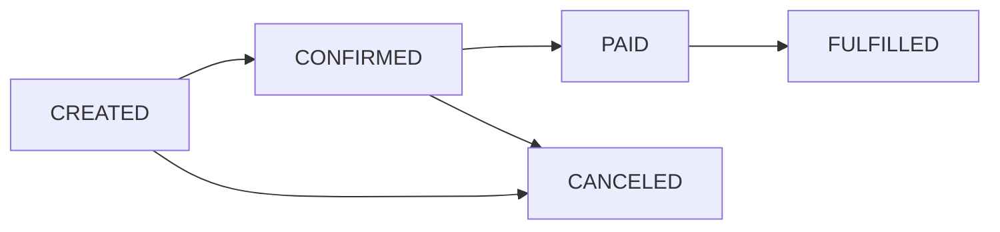

# Kiểm tra số lượng, tổng kiểm tra và bất biến nghiệp vụ sau restore

Khôi phục một bản sao lưu NoSQL không kết thúc khi tiến trình báo `RESTORE COMPLETED`, các node chuyển sang `UP` hoặc API trả lại HTTP 200. Những tín hiệu đó chủ yếu nói rằng hệ thống **có thể hoạt động**. Chúng chưa chứng minh dữ liệu được phục hồi **đúng**, **đủ**, **đúng mốc thời gian** và **vẫn thỏa các quy tắc nghiệp vụ**.

Ví dụ, trước sự cố hệ thống có 1.000.000 đơn hàng. Sau restore, lệnh đếm vẫn trả 1.000.000 bản ghi. Nhưng một đơn đã thanh toán có thể biến mất và một đơn cũ đã bị xóa có thể xuất hiện trở lại. Tổng số không đổi. Ngay cả khi mọi bản ghi đều đọc được, một lệnh tăng số dư đã được áp hai lần sau CDC replay cũng có thể phá tính đúng nghiệp vụ mà các metric về sức khỏe cluster không phát hiện.

Một kế hoạch xác minh tốt phải giải đáp ba câu hỏi khác nhau:

1. **Số lượng (counts):** tập dữ liệu sau restore có đúng số bản ghi/khóa/sự kiện theo từng phạm vi và trạng thái không?
2. **Tổng kiểm tra (checksums/digests):** nội dung bản ghi có khớp với tập dữ liệu kỳ vọng tại cùng mốc khôi phục không?
3. **Bất biến nghiệp vụ (business invariants):** những quan hệ và quy tắc bắt buộc của miền nghiệp vụ — chẳng hạn không thu tiền trùng, không giữ hàng vượt tồn kho, không bỏ qua trạng thái đã commit — có còn đúng không?

Bài thuộc **Database No SQL → Sao lưu và phục hồi**, tập trung vào việc biến ba câu hỏi thành **quy trình đối soát có bằng chứng**, thực hiện được trên dữ liệu phân tán và có thể dùng làm cổng nghiệm thu trước khi mở traffic trở lại.

> **Nguyên tắc cốt lõi:** `Restore job succeeded` chỉ là một mốc vận hành; `data verification passed` là một kết luận khác, cần bằng chứng độc lập. Mọi lệnh ví dụ đều phải được điều chỉnh theo engine/phiên bản, quyền, quy mô và tính nhất quán thật. Không thực hiện full scan, thay quyền, xóa hoặc ghi sửa dữ liệu production chỉ để kiểm nghiệm mà chưa được phê duyệt.

---

## 1. Mục tiêu học tập

Sau bài này, bạn cần có khả năng:

- Phân biệt **backup integrity**, **restore completeness**, **logical data equality** và **business correctness**.
- Xác định mốc thời gian/checkpoint chuẩn để so sánh snapshot, PITR và CDC replay.
- Định nghĩa **đơn vị đếm** và phạm vi đếm phù hợp với partition, tenant, loại bản ghi, soft delete và TTL.
- Phân biệt đếm chính xác với metadata count, approximate count và sample estimate.
- Thiết kế checksum ổn định qua JSON/BSON/CQL/codecs, thứ tự field, timestamps, số nguyên, số thập phân và Unicode.
- So sánh theo các bucket logic hoặc Merkle tree để khoanh vùng missing/extra/modified records.
- Kiểm **idempotency, uniqueness, referential integrity, trạng thái đơn hàng, giao dịch tiền và tồn kho**.
- Không nhầm replica lag, cache stale hoặc secondary-index lag với data loss.
- Xác minh deletes/tombstones không bị resurrect sau restore và replay.
- Kết hợp kiểm số lượng, checksum, business reconciliation và nguồn audit để ra quyết định `PASS`, `FAIL` hoặc `INCONCLUSIVE`.
- Tạo evidence report, kịch bản fault injection và runbook phục hồi.

## 2. Phân biệt các mức “khôi phục thành công”

| Mức xác minh | Câu hỏi | Bằng chứng ví dụ | Giới hạn |
| --- | --- | --- | --- |
| **Artifact integrity** | File backup có bị hỏng khi lưu/truyền không? | SHA-256/checksum của backup manifest | Không chứng minh dữ liệu nghiệp vụ đã đúng khi backup |
| **Process completion** | Restore tool đã hoàn thành bước kỹ thuật? | Job status/log | Không chứng minh mọi partition có nội dung kỳ vọng |
| **Structural health** | Cluster/node/index/schema hoạt động? | Node/replica health, index readiness | Không chứng minh bản ghi đúng |
| **Cardinality checks** | Số bản ghi/khóa có đúng? | Exact counts theo bucket | Không phát hiện hoán đổi hoặc sửa nội dung giữ nguyên count |
| **Logical content checks** | Bản ghi tương ứng có cùng nội dung logic? | Canonical digest/diff | Chỉ đúng cho các field và phạm vi được đưa vào |
| **Business reconciliation** | Các bất biến nghiệp vụ còn đúng? | Ledger, state-machine, uniqueness, inventory | Phải có quy tắc và nguồn thẩm quyền đúng |
| **User-facing verification** | API trả dữ liệu đúng ở thời điểm cần? | Synthetic probes và SLO/freshness | Chỉ kiểm những đường đã thử |

Không có một con số duy nhất đại diện cho cả bảy mức.

## 3. Restore không đồng nghĩa quay về “hiện tại”

Có ít nhất ba loại mốc:

```text
T0 = thời điểm tạo snapshot/backup.
T1 = thời điểm xảy ra sự cố.
T2 = thời điểm khôi phục xong và cho phép đọc.
```

Nếu backup chụp ở T0 rồi restore tại T2, tập dữ liệu đúng có thể là **trạng thái ở T0**, không phải toàn bộ trạng thái đã từng tồn tại trước T1.

Khi dùng **point-in-time recovery (PITR)** hoặc snapshot + log/CDC replay, cần một mốc đích:

```text
T_restore_target = 2026-11-14T08:37:00Z
```

Kết luận phải nói:

> “Đã khôi phục nhất quán tới mốc T_restore_target trong phạm vi các partition/bảng xác định.”

Không nên nói “đã khôi phục đầy đủ” khi chỉ biết restore job hoàn tất và chưa rõ RPO/last durable position.

## 4. RPO và RTO là hai ràng buộc khác nhau

**Recovery Point Objective (RPO):** lượng dữ liệu có thể mất tối đa theo chính sách nghiệp vụ. **Recovery Time Objective (RTO):** thời gian mục tiêu để phục hồi khả năng cung cấp dịch vụ đúng.

Ví dụ minh họa:

```text
Incident at:           09:40
Last consistent backup:09:00
Available log replay:  through 09:38
Business RPO:          5 minutes
Business RTO:          60 minutes
```

Restore bản backup 09:00 mà không replay log có thể vi phạm RPO 5 phút. Khôi phục tới 09:38 **có thể** đáp ứng khoảng mất tối đa hai phút nếu có bằng chứng rằng log/commit coverage đầy đủ và mốc thời gian đáng tin.

Đối soát cần biết **commit boundary** chứ không chỉ so đồng hồ tường. Trễ đồng hồ giữa nodes, failover và consistency của transaction log có thể khiến một timestamp đơn lẻ không đủ.

## 5. Mốc chụp nhất quán của hệ phân tán

Giả sử một đơn hàng được ghi ở hai nơi:

```text
orders partition A: order PAID
payments partition B: capture receipt
```

Nếu snapshot A ở 10:00:01 còn snapshot B ở 09:59:58, có thể thấy đơn đã thanh toán nhưng không thấy receipt tương ứng. Đây có thể là **snapshot không tạo một consistent cut**, chưa chắc dữ liệu nguồn bị corrupt.

Một kế hoạch restore phải chỉ rõ:

- Snapshot có bảo đảm consistency toàn collection/table, per partition hay per cluster không?
- Các transaction spanning collections/shards có được cắt cùng mốc không?
- Có cần dừng writes hoặc dùng cơ chế snapshot transaction-aware không?
- Nếu shards có vị trí log khác nhau, đã có **vector checkpoint/per-shard watermark** nào?
- CDC replay bắt đầu và dừng ở vị trí nào?
- Có event/transaction commit giữa hai boundary bị cắt ngang không?

Không tự tạo “global timestamp” rồi giả mọi engine có snapshot toàn cục tương ứng.

## 6. Chọn nguồn chuẩn để so sánh

Một phép đối soát đòi hỏi **expected state**. Nguồn chuẩn có thể là:

- Snapshot backup đã xác minh tại mốc T.
- PITR log/commit sequence tới watermark W.
- Một replica hoặc cluster nguồn vẫn còn và được xác nhận là authoritative.
- Immutable business ledger/outbox theo commit sequence.
- Audit records/receipts độc lập.
- Một bảng cân đối nghiệp vụ có nguồn gốc và mốc nhất quán.

Không phải nguồn nào cũng là authority:

```text
Cache Redis          -> có thể stale.
Search index         -> có thể lag.
Materialized view    -> có thể lag.
Client timeout log   -> không chứng minh write chưa commit.
```

Nếu nguồn chuẩn cũng có thể bị sai, phải tăng mức xác minh hoặc gắn `INCONCLUSIVE` thay vì giả rằng mọi khác biệt thuộc về target.

## 7. Tạo một “restore verification contract”

Trước khi chạy, ghi:

```yaml
verificationId: "restore-verify-20261114-example"
source:
  backupId: "snapshot-example"
  targetCheckpoint: "checkpoint-or-vector-W"
  coverage: "declared authoritative datasets"
target:
  environment: "isolated-restored-cluster"
  clusterGeneration: "restore-generation-01"
scope:
  datasets:
    - "orders"
    - "payment_ledger"
    - "inventory_ledger"
    - "processed_events"
  tenants: "all approved tenants"
comparison:
  logicalCut: "same committed boundary"
  includeFields: "versioned business canonical schema"
  ttlPolicy: "defined"
  tombstonePolicy: "defined"
  exactCounts: true
  canonicalHash: "SHA-256"
  bucketPartitionerVersion: "v1"
gates:
  unauthorizedAccess: "zero"
  businessInvariantMismatch: "zero for critical invariants"
  missingCommittedRecords: "zero outside approved RPO"
  unexplainedChecksumMismatch: "zero"
```

Đây là manifest minh họa, không phải cấu hình chính thức của database. Thay các placeholder bằng dữ kiện/phiên bản thật và ghi người phê duyệt phạm vi.

## 8. “Số lượng bản ghi” phải có đơn vị rõ

Một dataset có thể chứa:

```text
Active orders
Canceled orders
Soft-deleted orders
Tombstones
Expired TTL records
Version/history rows
Outbox events
CDC deduplication markers
```

Những số liệu này không tương đương:

- Tổng physical key/value entries.
- Tổng logical documents hiện hữu.
- Tổng unique business IDs.
- Tổng records active theo filter.
- Tổng receipts đã commit.
- Tổng events đã xử lý.
- Tổng indexed entries trong GSI/search.
- Tổng rows theo một time bucket/partition.

Một báo cáo ghi `count=10,000,000` không có collection, filter, thời điểm và phương pháp đếm là chưa đủ.

## 9. Đếm theo nhiều chiều, không chỉ global count

Tối thiểu với hệ multi-tenant:

| Chiều | Ví dụ | Phát hiện gì? |
| --- | --- | --- |
| Dataset | `orders`, `payments` | Bảng/collection bị thiếu |
| Tenant | T1, T2, T3 | Một tenant mất dữ liệu |
| Shard/partition bucket | B0..B255 | Thiếu một vùng dữ liệu |
| Business state | PENDING, PAID, CANCELED | Status chuyển sai |
| Time bucket | day/week/month | Mất một đoạn CDC |
| Record type | source, tombstone, ledger | Khác biệt lifecycle |
| Revision/generation | seq ranges | Bỏ sót update mới |
| Data class | active, archived | Khác biệt retention |
| Currency/region khi cần | VND, USD | Đối soát nghiệp vụ |

Global count có thể trùng do **một bucket thiếu 100 records và bucket khác thừa 100**. Count theo nhiều chiều giúp khoanh vùng trước khi chạy content diff sâu.

## 10. Count ở source và target phải dùng cùng predicate

Ví dụ sai:

```text
Source: COUNT active orders where deleted=false.
Target: COUNT all orders, including soft-deleted.
```

Hai số khác nhau không có ý nghĩa chẩn đoán.

Ví dụ đúng hơn:

```text
Source and target:
    tenant scope = same verified set.
    status in (PENDING, PAID, CANCELED).
    exclude logical deletes by same revision rule.
    event time <= chosen restoration boundary.
    TTL evaluation time = chosen reference time.
```

Không dùng `updatedAt <= T` một cách máy móc nếu một record được tạo trước T nhưng đã update sau T: query trên trạng thái hiện tại có thể không tái dựng được phiên bản cũ. Cần snapshot/PITR hoặc lịch sử thay đổi có semantics phù hợp.

## 11. Đếm chính xác và đếm ước lượng

Có ba nhóm:

**Exact logical count** — truy vấn/duyệt toàn bộ dữ liệu trong một view có tính nhất quán được xác định.

**Metadata count** — con số hệ thống duy trì; có thể trễ, ước lượng hoặc không cùng filter.

**Sample estimate** — ước lượng từ mẫu với sai số thống kê.

Không được thay một expected exact count bằng metadata estimate khi cần chứng minh không mất records. Đặc biệt:

```text
estimate ~= 1,000,000
```

không chứng minh:

```text
exact = 1,000,000
```

Với dataset lớn, có thể dùng metadata để sàng lọc, nhưng cổng kết luận cần phương pháp có độ bảo đảm phù hợp yêu cầu.

## 12. Đếm trong lúc writers tiếp tục chạy có thể không đáng tin

Giả sử:

```text
Source count at 10:00:00 -> 100000
Target count at 10:00:05 -> 100020
```

Nếu source hoặc target có 20 inserts trong 5 giây, chênh lệch không chứng minh restore sai.

Các lựa chọn:

1. **Quiesce writes** trong môi trường được phép và đo cùng lúc.
2. Dùng snapshot-consistent read ở cùng logical cut khi engine hỗ trợ.
3. Dùng transaction/commit watermark và lọc theo lịch sử có đủ semantics.
4. So các immutable event ranges/versions theo source sequence.
5. Nếu không thể tạo phép so sánh nhất quán, ghi rõ **không kết luận**.

Chọn snapshot cut đúng thường quan trọng hơn tối ưu câu lệnh COUNT.

## 13. Công thức đếm khi có snapshot + replay

Trong mô hình có **một logical record trên mỗi business key**, nếu các events được áp chính xác một lần về mặt hiệu ứng:

\[
N_W = N_B + I_{(B,W]} - D_{(B,W]}
\]

Trong đó:

- \(N_B\): số bản ghi hiện hữu tại snapshot B.
- \(I\): số key **mới xuất hiện** sau B tới watermark W.
- \(D\): số key **thật sự bị xóa** khỏi tập hiện hữu.
- Updates không tạo/xóa key không đổi count.

Ví dụ:

```text
Base snapshot:        100,000 orders
New keys inserted:      2,000
Existing keys deleted:    300
Status updates:         5,000
Expected at W:        101,700 orders
```

Đây là ví dụ khái niệm, không phải quy tắc áp dụng trực tiếp lên mọi CDC op code:

- Upsert vào key đã có không phải insert tăng count.
- Delete key không tồn tại không giảm count.
- TTL expiry có semantics riêng.
- Event bị redeliver không được đếm hai lần.
- Soft delete không nhất thiết xóa physical record.
- Một business ID có nhiều history records thì công thức phải sửa theo data model.

## 14. Dùng count vector thay một con số

Thay:

```text
orders count = 101,700
```

có thể ghi:

```json
{
  "dataset": "orders",
  "checkpoint": "W",
  "total": 101700,
  "byStatus": {
    "PENDING": 10000,
    "PAID": 80000,
    "CANCELED": 11700
  },
  "byBucket": {
    "00": 390,
    "01": 408,
    "02": 401
  }
}
```

`byBucket` chỉ trích một phần nên không suy tổng từ ba bucket minh họa. Dữ liệu report thật phải chứa đầy đủ mọi buckets hoặc chứng minh phần còn lại.

Một count vector tạo tín hiệu tốt hơn: nếu total khớp nhưng `PAID` giảm và `PENDING` tăng, có thể một số transitions chưa replay.

## 15. `COUNT(*)` không chứng minh uniqueness

Một hệ có 100 bản ghi với:

```text
99 unique orderIds
1 duplicate orderId
```

vẫn có `count=100`.

Cần phân biệt:

\[
N_{\mathrm{physical}}\quad\text{và}\quad
N_{\mathrm{uniqueBusinessKeys}}
\]

Một invariant:

```text
For every (tenantId, orderId):
    exactly one current authoritative record.
```

Nếu engine cho phép nhiều versions/history, phải xác định bản ghi “current” trước khi so uniqueness. Một unique index có thể bảo vệ một số keys, nhưng cần kiểm index đang tồn tại, hoạt động và có semantics đúng cho nullable/partial fields.

## 16. Chênh lệch số lượng không phải lúc nào cũng là dữ liệu mất

Khác biệt có thể đến từ:

- Soft delete vs hard delete.
- TTL expiry.
- Backup lấy trước/sau một batch insert.
- CDC replay chưa tới target watermark.
- Index/projection eventual lag.
- Quiesce không đầy đủ.
- Partition migration đang diễn ra.
- Different filter/tenant scope.
- Count API approximate.
- Duplicate records hoặc missing keys.
- Restore chỉ chứa một phần table/collection.
- Schema evolution thay đổi cách diễn giải “active”.

Phải **phân loại nguyên nhân** thay vì tự động “chèn bù” mọi chênh lệch.

## 17. Tổng kiểm tra: file backup và dữ liệu logic khác nhau

Có hai câu hỏi rất khác nhau.

**Checksum của artifact backup:**

```text
SHA256(backup-file)
```

giúp phát hiện thay đổi bytes trong lúc lưu, copy hoặc truyền tải.

**Checksum của logical records:**

```text
SHA256(canonical ordered business records at W)
```

giúp so nội dung kỳ vọng và nội dung đã restore, ngay cả khi internal storage format khác.

Ví dụ, hai MongoDB collections có cùng documents nhưng layout vật lý/index/page khác nhau. Hash raw storage files có thể khác trong khi logical data giống nhau. Ngược lại, file backup còn nguyên checksum không đảm bảo backup được tạo đúng mốc nghiệp vụ.

## 18. Checksum có thể phát hiện gì và không phát hiện gì?

Checksum của **tập records đã chuẩn hóa đầy đủ và ổn định** có thể phát hiện:

- Bản ghi missing.
- Bản ghi extra.
- Value thay đổi.
- Sai version/revision.
- Sai soft-delete state.
- Sai relationship field có trong canonical schema.
- Sai thứ tự hoặc sai tập keys nếu serialization bao gồm keys và sorting.

Nhưng **không thể tự chứng minh**:

- Tập expected đã đúng business logic.
- Những fields bị bỏ khỏi checksum là đúng.
- Snapshot/W được chọn đúng.
- Dữ liệu không vi phạm quy tắc giữa nhiều records.
- Mã checksum không lỗi ở cả hai phía.
- Source và target do hai phía độc lập cung cấp/thu thập.
- Không có người sửa cả data và expected hash sau đó.

**Digest trùng là bằng chứng mạnh cho phạm vi đã hash, không phải chứng nhận mọi khía cạnh nghiệp vụ.**

## 19. Vì sao phải chuẩn hóa dữ liệu trước khi hash?

Hai JSON documents:

```json
{"orderId":"O1","amountMinor":1000}
```

và:

```json
{"amountMinor":1000,"orderId":"O1"}
```

có thể tương đương về mặt field/value nhưng raw JSON strings khác byte.

Các nguồn khác biệt:

- Thứ tự object properties.
- Whitespace.
- Unicode normalization.
- Biểu diễn số `1`, `1.0`, `1e0`.
- Timezone/timestamp precision.
- Binary encoding.
- Missing field vs `null`.
- Array order.
- Numeric overflow/decimal conversion.
- Default fields sau schema migration.
- Internal IDs/version metadata.
- Encryption randomness/nonce.

Cần một **canonicalization contract có phiên bản**, không chỉ `toString()` rồi hash.

## 20. Canonicalization contract

Một contract có thể ghi:

```yaml
canonicalSchemaVersion: "orders-v3"
identity:
  - tenantId
  - orderId
fields:
  - status
  - totalMinor
  - currency
  - sourceRevision
  - deleted
encoding:
  text: "UTF-8 NFC"
  numbers: "fixed-scale or signed integer canonical encoding"
  timestamps: "UTC epoch with declared precision"
  objects: "field order fixed by schema"
  arrays: "preserve order unless domain defines set"
  missingVsNull: "distinct"
sorting:
  by: ["tenantId", "orderId"]
hashAlgorithm: "SHA-256"
```

Tất cả bên so sánh phải dùng **cùng contract/version**. Nếu source tạo digest `v2` còn target dùng `v3`, kết quả khác có thể chỉ do canonicalization, chưa chứng minh dữ liệu sai.

## 21. Chọn fields theo business, không hash mù mọi metadata

Một document:

```json
{
  "_id": "internal-01",
  "tenantId": "T1",
  "orderId": "O1",
  "status": "PAID",
  "totalMinor": 150000,
  "revision": 5,
  "restoredAt": "...",
  "lastIndexedAt": "..."
}
```

Nếu `restoredAt` và `lastIndexedAt` là metadata mới sinh khi restore, đưa chúng vào canonical hash sẽ tạo mismatch dù business data đúng.

Ngược lại, bỏ `status`, `totalMinor` hoặc `revision` có thể che mất thay đổi quan trọng.

Nên có:

- **Logical business hash** cho fields bất biến/authoritative.
- **Operational metadata checks** riêng cho TTL, timestamps, replication cursor hoặc index state.
- **Schema/index checks** riêng cho DDL/constraints.

Không loại bỏ `_id` nếu nó là business identity hoặc tham chiếu quan trọng; phải biết vai trò thật của field.

## 22. Missing, `null` và default không luôn tương đương

Ví dụ:

```json
{"orderId":"O1"}
```

và:

```json
{"orderId":"O1","discountMinor":null}
```

và:

```json
{"orderId":"O1","discountMinor":0}
```

có thể có semantics khác:

- Missing: chưa áp schema mới.
- `null`: chưa biết/chưa áp dụng.
- `0`: giá trị xác định bằng 0.

Nếu `canonical()` tự thay tất cả thành 0, checksum có thể không phát hiện sai schema.

Chỉ normalize các trường hợp **được hợp đồng nghiệp vụ định nghĩa là tương đương**; còn lại phải mã hóa riêng presence/type/value.

## 23. Arrays có thứ tự hay chỉ là tập?

Ví dụ:

```json
{"orderId":"O1","items":[{"sku":"A"},{"sku":"B"}]}
```

so với:

```json
{"orderId":"O1","items":[{"sku":"B"},{"sku":"A"}]}
```

Nếu `items` là danh sách theo thứ tự hiển thị/fulfillment, chúng khác nhau.

Nếu business định nghĩa tập các permission IDs không có thứ tự, có thể sort trước khi hash.

Không tự sort mọi array vì thao tác này có thể che một lỗi thứ tự quan trọng. Với multiset phải giữ multiplicity, không chuyển thẳng sang set làm mất duplicates.

## 24. Tiền và số thập phân: không dùng `double` để so chính xác

Một hóa đơn:

```text
totalMinor = 100050 VND minor units, as a signed integer
```

hoặc:

```text
amount = decimal with fixed scale
```

nên dùng numeric representation rõ ràng.

Không nên:

```java
double amount = ...;
```

rồi stringify để so dữ liệu tiền, vì biểu diễn floating-point và rounding có thể gây false mismatch hoặc bỏ qua lỗi.

Chọn:

- Integer minor units theo currency contract.
- `BigDecimal` với precision/scale thống nhất.
- Currency code đi cùng amount.
- Quy tắc tax/rounding và schema version rõ.
- Không cộng số tiền thuộc các currency khác nhau.

Hash phải bao gồm **kiểu và scale khi chúng mang ý nghĩa**, hoặc chuẩn hóa chỉ theo contract đã chốt.

## 25. Thời gian và precision

Hai giá trị:

```text
2026-11-14T08:00:00.123Z
2026-11-14T15:00:00.123+07:00
```

có thể là cùng instant.

Nếu business chỉ quan tâm instant, canonicalize về UTC epoch với precision chuẩn. Nhưng:

- Giữ nguyên timezone local nếu nó là thuộc tính nghiệp vụ.
- Không âm thầm cắt nanoseconds thành milliseconds nếu cần độ chính xác cao.
- Phân biệt `createdAt` sự kiện với `recordedAt` ingest.
- Đừng dùng wall-clock order làm thay thế commit sequence.
- Chọn precision consistent qua driver/engine.

Restore có thể thay serializer date type; so sánh cần kiểm logic, không chỉ chuỗi thời gian.

## 26. Unicode và khóa nhận dạng

Một số chuỗi Unicode có nhiều cách biểu diễn byte. Nếu hợp đồng cho phép equivalence, có thể dùng Unicode NFC. Nhưng:

- Không tự lower-case mọi tên/key nếu identity case-sensitive.
- Không trim whitespace nếu trường có thể chứa khoảng trắng hợp lệ.
- Không normalize email/usernames theo giả định không đúng.
- Khóa composite cần encoding không nhập nhằng.
- Unicode normalization version/algorithm phải nhất quán.
- Test ID chứa dấu tiếng Việt, ký tự đặc biệt và nhiều byte.

Khi so data cũ và mới, **canonicalization không được tự sửa identity policy**.

## 27. Chuẩn hóa khóa composite tránh va chạm

Cách nối:

```text
tenantId + ":" + orderId
```

có thể va chạm khi dữ liệu chứa dấu `:`:

```text
("A:B", "C")  -> A:B:C
("A", "B:C")  -> A:B:C
```

Nên mã hóa **length-prefixed**:

```text
length(tenant bytes) | tenant bytes
length(order bytes)  | order bytes
```

hoặc một serialization canonical có phân tách type/length rõ.

Dùng partition bucket theo **khóa logic** ổn định, không theo shard ID vật lý nếu muốn so sau resharding.

## 28. Thứ tự bản ghi phải cố định

Hash:

```text
SHA256(recordA || recordB)
```

khác:

```text
SHA256(recordB || recordA)
```

dù tập records giống nhau.

Vì vậy:

1. Chọn identity key.
2. Canonicalize key.
3. Sort ổn định theo canonical encoded key.
4. Serialize record với length prefix.
5. Update digest theo thứ tự.
6. Ghi số lượng records được hash.
7. Ghi canonical schema và hash algorithm version.

Nếu data quá lớn, dùng streaming sorted merge hoặc chia buckets. Không load toàn bộ database vào JVM chỉ để sort.

## 29. Checksum XOR/sum đơn giản có thể che lỗi

Một thiết kế yếu:

```text
checksum = SUM(amountMinor)
```

Nếu một record tăng 100 và record khác giảm 100, checksum vẫn trùng.

Cũng không nên chỉ XOR hash mỗi record:

```text
XOR(h(A), h(A)) = 0
```

Hai duplicate entries có thể triệt tiêu trong một số cách kết hợp.

Nên ưu tiên digest mật mã của **chuỗi records canonical có thứ tự và ranh giới rõ**, hoặc một Merkle tree xây theo quy tắc đã xác minh. Dù vậy, crypto hash không thay uniqueness count và business invariants.

## 30. SHA-256 và giới hạn của checksum

Với hash mật mã hiện đại như SHA-256, xác suất trùng tình cờ của hai chuỗi khác nhau là cực thấp trong bối cảnh kiểm integrity thông thường. Nhưng:

- Không phải chứng minh logic toán học tuyệt đối rằng datasets bằng nhau.
- Hash của source không tin cậy có thể phản ánh source sai.
- Nếu attacker có quyền thay cả data và manifest, hash đơn thuần không chứng minh authenticity.
- Nếu hash bao gồm PII có miền nhỏ, digest không phải ẩn danh tuyệt đối.
- Cần phân quyền evidence, provenance và có thể dùng chữ ký/HMAC theo threat model.

Một manifest có chữ ký được xác minh ở nơi tin cậy giúp tăng bảo đảm **nguồn gốc**, khác với tính toàn vẹn chỉ từ checksum bytes.

## 31. Dữ liệu nhạy cảm và HMAC

Hash trần một email/số điện thoại hoặc mã trạng thái có miền giá trị nhỏ có thể bị dictionary attack:

```text
SHA256("PAID")
```

không che được ý nghĩa `PAID`.

Nếu cần đối soát dữ liệu nhạy cảm mà không xuất raw values:

- Có thể dùng **HMAC-SHA-256 với key được bảo vệ**, chỉ khi cùng bên kiểm có quyền và cùng key/schema.
- Không log HMAC key hoặc canonical payload.
- Phân tách quyền read source, read target và read evidence.
- Không đưa toàn bộ digest theo từng user lên dashboard công khai.
- Có kế hoạch thay key/rotation; HMAC khác key không so trực tiếp được.
- Không giả HMAC thay mã hóa dữ liệu at rest hoặc transport.

Hash/HMAC để kiểm integrity cần thiết kế theo **privacy classification và access model** thật.

## 32. Bucket hashing để khoanh vùng

Với hàng trăm triệu records, một digest toàn collection chỉ nói:

```text
source hash != target hash
```

nhưng không biết sai ở đâu.

Chia theo hash của logical identity:

```text
bucket = first 8 bits of SHA256(canonical(tenantId, orderId))
```

tạo 256 buckets B00..BFF.

Cho mỗi bucket lưu:

```text
count
unique-key-count
business-status-counts
canonical-record-digest
min/max revision if useful
```

So sánh source và restored target:

```text
B00 MATCH
B01 MATCH
B02 MISMATCH
...
```

Chỉ B02 cần quét diff sâu.

**Bucket assignment phải dùng cùng schema/key hash algorithm**, độc lập với shard/partition vật lý để không bị thay khi rebalance.

## 33. Merkle tree: từ bucket tới record

Một **Merkle tree** ghép digest của từng nhánh:

```text
               Root digest
               /         \
           Hash L        Hash R
           /    \        /     \
         B00    B01    B02     B03
```

Nếu root khác:

1. So digest của các nhánh.
2. Đi xuống nhánh mismatch.
3. Tới bucket nhỏ.
4. So records từng key.

Lợi ích: giảm phạm vi so sánh khi đa số dữ liệu giống nhau.

Điều kiện:

- Cấu trúc cây và key-range boundaries ổn định.
- Các leaf hashes dùng canonical content và order.
- Có count hoặc leaf multiplicity để phát hiện duplicates.
- Mỗi phía được chụp cùng logical cut.
- Đảm bảo cây từ cùng data/schema version.

Không trộn hashes theo partition placement đã đổi và rồi gọi mismatch là data loss.

## 34. Hash theo shard vật lý có thể gây false alarm

Trước restore:

```text
Shard A: keys K1..K100
Shard B: keys K101..K200
```

Sau resharding:

```text
Shard A: keys K1..K70 + K150..K200
Shard B: keys K71..K149
```

Per-shard hash tất nhiên đổi, dù logical dataset không đổi.

Vì vậy có hai loại kiểm:

- **Logical hash** theo business key/partition function ổn định → so nội dung.
- **Physical topology check** theo shard/range placement hiện tại → so hiệu lực routing/replication, không đòi hash từng shard giữ nguyên.

Phân biệt hai loại giúp tránh “sửa dữ liệu” chỉ vì cluster đã cân bằng lại.

## 35. Checksum theo thời gian và immutable snapshots

Một manifest mỗi mốc:

```text
Snapshot S0:
    data cut = W0
    hash schema v3
    bucket root hashes ...

Snapshot S1:
    data cut = W1
    hash schema v3
    bucket root hashes ...
```

Không so:

```text
hash(S0) == hash(S1)
```

nếu ở giữa có các writes hợp lệ.

Có thể:

- Tái dựng expected state tại W1 bằng S0 + committed delta log.
- So S1 với expected W1.
- Đảm bảo không đọc trạng thái thay đổi trong khi hash.
- Lưu manifest immutable theo policy.
- Gắn source backup ID, object version và signer.

Một phép đối soát nhiều giờ có thể cần snapshot isolation hoặc reads từ frozen restored clone.

## 36. Mốc replay: event time khác commit order

CDC event có thể chứa:

```text
eventTime = thời điểm nghiệp vụ ghi.
ingestTime = thời điểm consumer nhận.
sourcePosition = thứ tự log/transaction.
```

Không dùng `eventTime <= W` nếu time không phản ánh commit cut.

Các hệ khác nhau có:

- Transaction commit sequence.
- Oplog positions/resume tokens.
- Partition offsets.
- LSN/sequence numbers.
- Snapshot watermark.
- Multiple per-shard cursors.

Một mốc W có thể là **vector positions** hơn là một scalar duy nhất. Cần đảm bảo transactions nhiều partitions không bị chia đôi tại boundary.

## 37. Dedupe khi replay và đối soát counts

CDC thường có at-least-once delivery:

```text
Event E applied.
Consumer crashes before ACK.
Event E delivered again.
```

Số deliveries tăng, nhưng business effect chỉ được áp một lần nếu consumer idempotent.

Đo riêng:

```text
source_distinct_events
deliveries
already_processed_events
newly_applied_events
target_business_effects
```

Không tính “số events đã consume” = “số records được thêm”:

- Một record có nhiều updates.
- Một event là delete.
- Một event là snapshot/backfill.
- Redeliveries không tạo hiệu ứng mới.
- Một transaction có thể sinh nhiều records.
- Một insert có thể bị undo theo lifecycle hợp lệ.

## 38. Delete, tombstone và chống hồi sinh dữ liệu

Ví dụ:

```text
Revision 5: order exists.
Revision 6: order deleted.
Restore snapshot at revision 5.
Replay event revision 6.
```

Expected state ở W≥6 là **không còn record active**, hoặc còn tombstone tùy data model.

Nếu consumer chỉ upsert các events mới nhưng bỏ delete:

```text
record deleted in source
record still visible in projection
```

Nếu late event rev5 chạy sau rev6:

```text
record resurrected
```

Kiểm:

- Delete event có trong replay range.
- Tombstone/generation/revision được giữ đủ lâu.
- Projection/cache delete propagation.
- Không áp version cũ đè lên version mới.
- TTL/soft-delete semantics.
- Snapshot-to-stream cutover không bỏ/gấp đôi delete.

Đối soát count phải tách **physical tombstones**, **logical live records** và **business deleted state**.

## 39. TTL khiến “exactly equal” cần điều kiện

Một record có:

```text
expiresAt = 2026-11-14T10:00:00Z
```

Nếu source được đếm 09:59 còn target được đếm 10:01, khác biệt có thể hợp lệ.

Cần chốt một trong các contract:

1. So **stored TTL metadata + absolute expiresAt**, tại cùng snapshot cut.
2. So **visible records at same reference time** nếu engine có semantics hỗ trợ.
3. So **expected retention state** có ngoại lệ đã mô tả cho expiry.
4. Tách records đã hết hạn khỏi nguồn kiểm exact live count.

Không kéo dài TTL tùy tiện trong restore vì có thể vi phạm chính sách xóa dữ liệu. Ngược lại, không coi tombstone/TTL cleanup làm data loss nếu business xác nhận record phải hết hạn.

## 40. Backup/restore có thể thay metadata TTL

Tùy công nghệ và cách backup:

- TTL có thể được lưu dưới dạng expiresAt tuyệt đối.
- Remaining TTL có thể bị tính lại.
- Thông tin TTL có thể nằm ở schema/index.
- Snapshot cũ có thể chứa record đã hết hạn nhưng chưa compact.
- Restore có thể kích hoạt cleanup sau khi process chạy.

Vì vậy cần test riêng:

```text
Record expires soon.
Backup before expiration.
Restore after expiration.
Check visibility and retention contract.
```

Không giả mọi engine giữ nguyên “remaining TTL seconds” khi restore. Mốc business retention quan trọng hơn count vật lý từng giây.

## 41. Phân biệt logical delete với legal retention

Một dữ liệu có:

```text
deleted=true
deletedAt=...
retentionHold=true
```

có thể phải được giữ trong ledger/audit để đáp ứng yêu cầu pháp lý, dù không được hiển thị trên API.

Kiểm riêng:

- Active view không chứa record.
- Archived/held evidence còn theo policy.
- Role không được đọc ngoài mục đích.
- Dữ liệu đã có yêu cầu xóa không bị khôi phục vào public read model.
- Retention/erasure pipeline sau restore vẫn hoạt động.

Restore không được biến một bản backup cũ thành cách đưa dữ liệu đã xóa hợp lệ quay lại sản phẩm.

## 42. Mất một partition có thể không thấy trong global count nhỏ

Giả sử 1.000 partitions:

```text
999 partitions restore đúng.
1 partition bị thiếu nhưng chứa 0.01% data.
```

Global count chênh ít và có thể bị bỏ qua dưới threshold 0.1%, dù partition đó chứa đơn hàng cực quan trọng.

Không dùng một tolerance global tùy tiện cho business-critical records. Nên:

- Exact count theo stable buckets/tenant.
- Kiểm mọi backup parts/segments theo manifest.
- Targeted probes cho các keys rủi ro cao.
- Full logical diff khi yêu cầu zero-loss.
- Business reconciliation independent.
- Cổng riêng cho dataset có yêu cầu tính đúng nghiêm ngặt.

**Một record thanh toán đã commit bị mất không thể được “bù” bằng 100.000 records catalog đúng.**

## 43. Khi nào sampling hữu ích?

Sampling phù hợp để:

- Phát hiện nhanh sự cố lớn trong canary restore.
- Ước lượng tỷ lệ lỗi trước full comparison.
- Kiểm encoder/schema edge cases.
- Kiểm tenants rủi ro cao.
- Kiểm tính hợp lệ của pipeline diff.

Nhưng sampling **không chứng minh toàn bộ datasets giống nhau**.

Nếu 100 trong 1.000.000 records sai và lấy 1.000 mẫu ngẫu nhiên độc lập có thay thế, xác suất phát hiện ít nhất một record sai xấp xỉ:

\[
1-\left(1-\frac{100}{1\,000\,000}\right)^{1000}
\approx 9.5\%
\]

Nghĩa là có thể **bỏ sót khoảng 90.5%** trong giả định này. Với sampling không thay thế, công thức chính xác hơi khác.

Với dữ liệu tài chính, chọn **full verification/ledger reconciliation** thay cho kết luận “không thấy lỗi trong mẫu”.

## 44. Lập kế hoạch kiểm theo mức dữ liệu và rủi ro

| Loại dữ liệu | Mức đối soát gợi ý | Lý do |
| --- | --- | --- |
| Payment ledger/receipts | Toàn bộ committed range + invariant checks | Sai một operation có hậu quả lớn |
| Inventory reservations | Toàn bộ active IDs và ledger arithmetic | Tránh oversell/giữ trùng |
| Orders authoritative | Full keys/revisions/hash theo cut | Tính đúng sản phẩm |
| User authorization records | Exact identities/roles/scope | Rò dữ liệu/quyền |
| CDN cache | Rebuild + freshness behavior | Thường không phải authority |
| Search projection | Rebuild/catch-up + reconciliation | Eventual read model |
| Analytics aggregate | Recompute and compare by partitions | Có thể chấp nhận thời gian dài hơn |
| Audit/retention logs | Completeness theo sequence và policy | Compliance/forensics |

Đây là **gợi ý phạm vi**, không phải quy định chung. Yêu cầu RPO, data classification và khả năng khôi phục thực mới quyết định gate.

## 45. Bất biến nghiệp vụ là gì?

**Bất biến nghiệp vụ (invariant)** là quan hệ phải đúng ở mọi trạng thái hợp lệ hoặc tại một mốc kiểm được định nghĩa.

Ví dụ:

```text
A captured payment must have a unique provider capture ID.
Refunded amount cannot exceed captured amount in the chosen ledger model.
One (tenantId, orderId) identifies one current authoritative order.
An inventory reservation cannot be applied twice for one operation ID.
A deleted object cannot reappear after older replay.
```

Bất biến có thể:

- Nội tại một record.
- Giữa nhiều records.
- Giữa nhiều collections/tables.
- Giữa database và hệ bên ngoài.
- Theo một state machine.
- Theo một khoảng thời gian và snapshot boundary.

**Hash từng record không chứng minh mọi invariant xuyên records.**

## 46. Bất biến uniqueness theo business key

Một ví dụ đơn hàng:

\[
\forall (tenantId,orderId):
\#\{currentOrder\}=1
\]

Đối soát:

- Có duplicate current records không?
- Có record cùng orderId nhưng sai tenant không?
- Có ghost record từ restore cũ không?
- Có mâu thuẫn giữa source và read model không?
- Có unique index/conditional write đúng scope không?
- Có historical versions cần được loại trước khi kiểm uniqueness không?

Nếu database dùng multi-version history, không nên đếm tất cả versions rồi kết luận duplicates; cần xác định current record bằng revision/generation rule.

## 47. Bất biến của state machine

Ví dụ state machine đơn hàng giản lược:



Một record sau restore có:

```text
state=FULFILLED
paymentCaptureReceipt missing
```

có thể vi phạm policy nếu quy trình yêu cầu capture trước fulfillment.

Cần đối chiếu:

- Authoritative business events/receipts.
- Allowed state transitions.
- Last applied revision/sequence.
- Causal dependencies.
- Duplicated/omitted transitions.
- Compensation events.
- Những ngoại lệ được mô hình hóa (COD, partial shipments, chargebacks).

Không áp state machine đơn giản này cho mọi hệ commerce; quy tắc thật phải được **business owner phê duyệt**.

## 48. Bất biến tiền: dùng ledger, không chỉ tổng trên bảng orders

Một mô hình thanh toán đơn giản theo currency:

```text
Authorized amount = 100000 minor units.
Unique captures sum = 60000.
Unique refunds sum = 10000.
Net captured = 50000.
```

Một số bất biến mẫu nếu sản phẩm không cho over-capture:

\[
0 \le \sum \mathrm{uniqueCaptured} \le \mathrm{authorized}
\]

\[
0 \le \sum \mathrm{uniqueRefunded} \le \sum \mathrm{uniqueCaptured}
\]

\[
\mathrm{netCaptured}
= \sum \mathrm{uniqueCaptured}
- \sum \mathrm{uniqueRefunded}
\]

Cần:

- Stable provider event/operation IDs.
- Idempotency của captures/refunds.
- Currency và scale đúng.
- Đối soát với payment provider khi có.
- Phân biệt authorization/capture/refund/chargeback.
- Không giả mọi nghiệp vụ đều có một capture và một refund.

**So tổng tiền của một ngày không đủ:** duplicate +100 và missing -100 có thể triệt tiêu. So cả unique IDs và per-order aggregates.

## 49. Bất biến tồn kho: một mô hình ledger đơn giản

Giả sử mô hình định nghĩa:

```text
Initial stock:           100
Restock:                 +20
Fulfilled sales:         -30
Active reservations:     -10
Available:                80
```

Khi đó:

\[
Available =
Initial + Restocked - Fulfilled - ActiveReservations
\]

với các điều chỉnh nghiệp vụ có dấu được xử lý nhất quán.

Sau restore cần kiểm:

- Mỗi reservation operationId chỉ đóng góp một lần.
- Reservation đã hủy/expired không còn active.
- Sale fulfillment không bị áp hai lần.
- `available >= 0` nếu sản phẩm không cho oversell.
- Ledger sum khớp materialized counter.
- Không trộn inventory của warehouses/SKUs/tenants.
- Nếu physical stock count khác ledger, có quy trình adjustment rõ.

Nếu công ty dùng mô hình `onHand` bao gồm reservations hoặc cho phép backorder, công thức phải điều chỉnh. **Không áp một công thức ví dụ như thể là chân lý của mọi inventory model**.

## 50. Referential integrity trong NoSQL

Nhiều hệ NoSQL không tự enforce foreign keys cho mọi relationship.

Ví dụ:

```text
orders.customerId -> customers
payments.orderId -> orders
order_items.productId -> products
```

Kiểm:

- Foreign references có target tại cùng logical cut?
- Có records bị soft-deleted hợp lệ không?
- Cách xử lý orphan records theo contract?
- Một event đang pending có được coi tạm hợp lệ không?
- Cross-tenant references có bị cấm không?
- Data model denormalized có snapshot copies hợp lệ không?

Nếu một reference được thiết kế eventual, không đánh giá ở hai watermark khác nhau. Có thể cần chờ catch-up hoặc kiểm trên authority first.

## 51. Bất biến idempotency và processed-event ledger

Sau replay, một event E có thể tới hai lần.

Một thiết kế dùng marker:

```text
processed_events:
    consumerId + eventId -> APPLIED
```

và effect:

```text
order_summary incremented
```

Nếu marker và effect không cùng atomic boundary, có thể gặp:

- Effect commit, marker chưa commit → replay áp trùng.
- Marker commit, effect chưa commit → event bị bỏ qua.
- Transaction partial giữa stores → cần saga/compensation.

Sau restore kiểm:

- Unique `(consumerId,eventId)` receipts.
- Marker và effect thực sự tương ứng.
- Version/source sequence tại projection.
- Không có event được đánh APPLIED nhưng thiếu effect.
- Không có duplicate business contributions.
- Ledger retention đủ vượt replay window.

**Đếm processed markers bằng số messages nhận không đủ chứng minh exactly-once business effects.**

## 52. Kiểm log sequence không có gaps

Với một immutable stream/range:

```text
expected sequence: 1001,1002,1003,1004,1005
restored range:    1001,1002,1004,1005
```

Đếm records giảm một, nhưng ở những trường hợp có extra records thì count có thể không đổi.

Các kiểm:

- Min/max committed sequence.
- Gaps trong ranges mà sequence được định nghĩa liên tục.
- Distinct event IDs và version.
- Per-partition offset/checkpoint.
- Duplicates/redelivery và applied effects.
- Transaction boundary.
- Tombstone events.
- Source-to-target applied watermark.

Không giả Kafka offsets hoặc database log positions luôn liên tục theo business entity; “gap” phải được định nghĩa đúng semantics của nguồn.

## 53. Đối soát source và read model có thể cần hai giai đoạn

Một restored architecture:

```text
Authoritative orders -> outbox/CDC -> orders_by_customer view
```

Giai đoạn A:

```text
Verify source authority at W.
```

Giai đoạn B:

```text
Replay through W.
Verify read model at source revision W.
```

Nếu consumer còn lag:

```text
source W=5000
projection W=4800
```

content hash có thể khác hoàn toàn hợp lệ trong quá trình recovery. Không gắn `FAIL_DATA_LOSS` khi mới thấy eventual lag; nhưng cũng không gắn `PASS` cho projection.

Có thể báo:

```text
SOURCE=PASS
PROJECTION=RECOVERING
OVERALL=INCONCLUSIVE until freshness gate.
```

## 54. Đối soát cache sau restore

Cache thường không phải dữ liệu thẩm quyền. Một chiến lược có thể:

- Tạo namespace/generation mới cho cache keys.
- Invalidate theo source revision/epoch.
- Warm các hot keys ở mức kiểm soát.
- Không đưa cache stale vào đường strong-read.
- Có fallback source với rate limit/concurrency.
- Đo cache hit/miss và query load.
- Kiểm read-your-writes/tenant scoping.

Một Redis cache có content hash khác authority **không tự** nghĩa source restore thất bại; nhưng user-facing API có thể vẫn sai nếu cache không được làm mới. Do đó cần gate riêng cho **API-visible data**.

## 55. Một tình huống xuyên suốt

Giả sử một hệ đơn hàng:

```text
Snapshot S at 09:00:
    live orders = 100000
    source ledger checkpoint = W0

PITR/replay target at 09:37:
    new live IDs = +2000
    hard/logical deletes = -300
    in-place updates = 5000
```

Expected logical live count:

\[
100000+2000-300=101700
\]

Restore target báo:

```text
live orders count = 101700
```

Nhưng kiểm theo bucket:

```text
B20 source digest != target digest.
```

Diff thấy:

```text
O-101 missing, O-555 unexpectedly extra,
O-777 amountMinor modified.
```

Hai missing/extra có thể triệt tiêu ở global count. Ngoài ra, payment ledger có một duplicate capture, inventory projection chưa catch-up. **Kết luận phải là FAIL hoặc INCONCLUSIVE theo bằng chứng**, không phải PASS vì `101700 = 101700`.

## 56. Ma trận kết quả đối soát

| Counts | Content digest | Business invariants | Kết luận |
| --- | --- | --- | --- |
| Khớp | Khớp | Khớp | Candidate PASS nếu cut/coverage/evidence hợp lệ |
| Khớp | Khác | Chưa biết | FAIL hoặc investigate; count không đủ |
| Khác | Khác | Chưa biết | FAIL hoặc xác minh sai mốc/phương pháp |
| Khớp | Khớp | Sai | FAIL nghiệp vụ |
| Khớp | Khớp | Chưa chạy | INCONCLUSIVE |
| Không thể đọc nhất quán | Không có | Chưa chạy | INCONCLUSIVE |
| Khác do TTL hợp lệ | Khác | Khớp theo retention contract | Cần đánh giá scope/time và expected exceptions |
| Read model lag | Chưa khớp | Source khớp | RECOVERING, chưa PASS toàn hệ |

**`PASS` không có nghĩa không bao giờ có lỗi; nó nói các phép kiểm đã xác định đạt trên phạm vi, mốc và nguồn chứng cứ được nêu.**

## 57. Các trạng thái báo cáo nên tách

Một tiêu chuẩn:

```text
PASS:
    All required checks passed at declared logical cut and scope.

FAIL:
    Confirmed violation, missing committed record or mismatch
    not covered by approved exception.

INCONCLUSIVE:
    Inadequate evidence, ambiguous snapshot boundary,
    incomplete scan or unavailable authoritative reference.

RECOVERING:
    Source may pass but dependent projections/replicas still catching up.

NOT_APPLICABLE:
    A check truly does not apply, with documented reason.
```

Không thay `INCONCLUSIVE` bằng `PASS_WITH_WARNING` khi business invariants chưa kiểm hoặc expected source không đáng tin.

## 58. Java 17: demo checksum canonical và diff theo key

Chương trình sau **biên dịch độc lập trên Java 17**. Nó mô tả một tập record đã trích xuất từ source và target ở **cùng một logical cut**. Mỗi record gồm tenant, ID, trạng thái, số tiền đơn vị nhỏ nhất, revision và cờ logical delete.

Demo thực hiện:

- Chuẩn hóa Unicode theo NFC.
- Mã hóa strings dạng UTF-8 có length prefix.
- Dùng byte encoding cố định cho long/boolean.
- Sắp xếp theo composite business key.
- Phát hiện duplicate identity trong mỗi dataset.
- Tính SHA-256 của **ordered canonical records**.
- So khớp missing/extra/modified keys.
- Minh họa trường hợp hai dataset có **cùng count nhưng khác dữ liệu**.

```java
import java.io.ByteArrayOutputStream;
import java.io.DataOutputStream;
import java.io.IOException;
import java.nio.ByteBuffer;
import java.nio.charset.StandardCharsets;
import java.security.MessageDigest;
import java.security.NoSuchAlgorithmException;
import java.text.Normalizer;
import java.util.Arrays;
import java.util.List;
import java.util.Map;
import java.util.NavigableMap;
import java.util.Set;
import java.util.TreeMap;
import java.util.TreeSet;

public final class RestoreVerificationDemo {

    record Key(String tenantId, String orderId)
            implements Comparable<Key> {

        @Override
        public int compareTo(Key other) {
            int t = tenantId.compareTo(other.tenantId);
            return t != 0 ? t : orderId.compareTo(other.orderId);
        }
    }

    record OrderDoc(
            String tenantId,
            String orderId,
            String status,
            long amountMinor,
            long revision,
            boolean deleted) {
    }

    static String normalize(String text) {
        if (text == null) {
            throw new IllegalArgumentException(
                "Unexpected null field");
        }
        return Normalizer.normalize(
            text, Normalizer.Form.NFC);
    }

    static Key keyOf(OrderDoc doc) {
        return new Key(
            normalize(doc.tenantId()),
            normalize(doc.orderId()));
    }

    static void writeString(
            DataOutputStream out, String text)
            throws IOException {

        byte[] bytes = normalize(text)
            .getBytes(StandardCharsets.UTF_8);

        out.writeInt(bytes.length);
        out.write(bytes);
    }

    static byte[] canonical(OrderDoc doc) {
        try {
            ByteArrayOutputStream bytes =
                new ByteArrayOutputStream();
            DataOutputStream out =
                new DataOutputStream(bytes);

            // Version prevents silent changes in canonical schema.
            out.writeInt(1);
            writeString(out, doc.tenantId());
            writeString(out, doc.orderId());
            writeString(out, doc.status());
            out.writeLong(doc.amountMinor());
            out.writeLong(doc.revision());
            out.writeBoolean(doc.deleted());
            out.flush();

            return bytes.toByteArray();
        } catch (IOException impossibleForMemoryBuffer) {
            throw new IllegalStateException(
                impossibleForMemoryBuffer);
        }
    }

    static NavigableMap<Key, OrderDoc> index(
            List<OrderDoc> records) {

        NavigableMap<Key, OrderDoc> result =
            new TreeMap<>();

        for (OrderDoc doc : records) {
            Key key = keyOf(doc);

            if (result.putIfAbsent(key, doc) != null) {
                throw new IllegalStateException(
                    "Duplicate current business key");
            }
        }
        return result;
    }

    static String sha256(NavigableMap<Key, OrderDoc> rows)
            throws NoSuchAlgorithmException {

        MessageDigest digest =
            MessageDigest.getInstance("SHA-256");

        for (Map.Entry<Key, OrderDoc> item
                : rows.entrySet()) {

            byte[] encoded = canonical(item.getValue());

            digest.update(ByteBuffer.allocate(4)
                .putInt(encoded.length).array());
            digest.update(encoded);
        }

        return java.util.HexFormat.of()
            .formatHex(digest.digest());
    }

    static void compare(
            NavigableMap<Key, OrderDoc> expected,
            NavigableMap<Key, OrderDoc> restored) {

        Set<Key> all = new TreeSet<>();
        all.addAll(expected.keySet());
        all.addAll(restored.keySet());

        for (Key key : all) {
            OrderDoc before = expected.get(key);
            OrderDoc after = restored.get(key);

            if (before == null) {
                System.out.println("EXTRA " + key);
            } else if (after == null) {
                System.out.println("MISSING " + key);
            } else if (!Arrays.equals(
                    canonical(before), canonical(after))) {
                System.out.println("CHANGED " + key);
            }
        }
    }

    public static void main(String[] args)
            throws NoSuchAlgorithmException {

        NavigableMap<Key, OrderDoc> source = index(
            List.of(
                new OrderDoc(
                    "T1", "O-101", "PAID", 5000, 3, false),
                new OrderDoc(
                    "T1", "O-102", "CANCELED", 3000, 4, false),
                new OrderDoc(
                    "T2", "O-103", "PAID", 7000, 1, false)
            )
        );

        NavigableMap<Key, OrderDoc> restored = index(
            List.of(
                new OrderDoc(
                    "T1", "O-101", "PAID", 5001, 3, false),
                new OrderDoc(
                    "T1", "O-999", "CANCELED", 3000, 4, false),
                new OrderDoc(
                    "T2", "O-103", "PAID", 7000, 1, false)
            )
        );

        System.out.println("Expected count=" + source.size());
        System.out.println("Restored count=" + restored.size());
        System.out.println("Source SHA-256=" + sha256(source));
        System.out.println("Target SHA-256=" + sha256(restored));
        compare(source, restored);
    }
}
```

Kết quả về mặt ý nghĩa:

```text
Expected count=3
Restored count=3
Source SHA-256=<digest A>
Target SHA-256=<digest B>
CHANGED Key[tenantId=T1, orderId=O-101]
MISSING Key[tenantId=T1, orderId=O-102]
EXTRA Key[tenantId=T1, orderId=O-999]
```

**Giới hạn của demo:**

- Toàn bộ datasets được giữ trong memory, không phù hợp billions of records.
- Ký tự normalization theo NFC chỉ đúng nếu được business identity policy chấp nhận.
- `status` được xem là string chính xác; schema thực cần enum/unknown-value policy.
- `null`, arrays, maps, decimals và timestamps chưa được mô hình hóa.
- Mã khóa composite dùng record `Key`, tránh nối delimiter nhập nhằng; cách sort theo Java string order phải được cố định giữa implementations.
- Có `revision` và `deleted`, nhưng không có TTL/commit watermark.
- Hash này không xác thực nguồn backup/manifest.
- Không chứng minh transactional consistency hoặc cross-collection invariants.
- Console in business IDs minh họa, còn production report phải redacted hoặc phân quyền phù hợp.
- Khi đưa vào thực tế phải chạy trên **snapshot/cut nhất quán, có streaming**, và tách canonicalization/schema phiên bản.

## 59. Mô hình streaming diff cho dữ liệu lớn

Không nên:

```text
SELECT all records into JVM heap.
Sort all in memory.
Hash and compare.
```

Với dữ liệu lớn:

```text
Source snapshot at W
    -> external sort or deterministic key range iterator
    -> canonical encode -> hash per bucket
                            |
Target restored at W        |
    -> external sort ... -> compare
```

Nếu engine hỗ trợ ordered iteration theo key, có thể dùng **merge join** với hai stream sorted:

```text
while source != EOF or target != EOF:
    if source.key < target.key:
        emit MISSING
        advance source
    else if source.key > target.key:
        emit EXTRA
        advance target
    else:
        if canonical(source) != canonical(target):
            emit CHANGED
        advance both
```

Memory gần với kích thước record/page; tốn I/O và thời gian. Phải giới hạn concurrency, read capacity, disk temp và data egress.

## 60. Pseudocode bucket-based verification

```text
for each stable logical bucket B:
    source = read_consistent_source_bucket(B, W)
    target = read_consistent_target_bucket(B, W)

    sourceCount = count_current_records(source)
    targetCount = count_current_records(target)

    sourceDigest = SHA256(orderedCanonical(source))
    targetDigest = SHA256(orderedCanonical(target))

    save_evidence(
        B, W,
        sourceCount, targetCount,
        sourceDigest, targetDigest
    )

    if sourceCount != targetCount or sourceDigest != targetDigest:
        run_sorted_key_diff(B)
        classify_missing_extra_modified_duplicates()
```

Trong thực tế không đọc cả bucket vào một list; `read_consistent_*` là abstraction **phải thực sự bảo đảm cut W** hoặc dùng frozen clones. Nếu một engine không cho snapshot cross-shard nhất quán, không thể chỉ đặt tên method như vậy rồi coi vấn đề đã giải quyết.

## 61. Verification có thể tiêu tốn tài nguyên lớn

Một full scan có thể:

- Tăng IOPS/RCU và tranh với API.
- Làm cold-cache/evict hot pages.
- Tăng network egress xuyên Region.
- Tốn chi phí cloud.
- Gây backpressure cho backup/CDC.
- Làm query p99 tăng.
- Đọc dữ liệu nhạy cảm ngoài scope.
- Kéo dài nhiều giờ và gặp TTL/time drift.

Kiểm soát:

- Chạy trên restored isolated cluster nếu được.
- Phân bổ read concurrency/rate limit.
- Ưu tiên per-partition scans có resume checkpoint.
- Ghi progress, coverage, errors, skipped pages.
- Hạn chế payload chỉ fields cần canonical hash.
- Dùng role read-only, không export PII tùy ý.
- Có timeout và stop conditions.
- Lưu evidence hashes/aggregates thay vì raw dumps khi có thể.

**Việc xác minh không được trở thành sự cố hiệu năng hoặc bảo mật thứ hai.**

## 62. Checkpoint của chính verification job

Một verifier chạy 6 giờ có thể bị crash.

Cần checkpoint:

```text
verification run ID
logical snapshot/cut W
canonicalization version
bucket / key range position
last completed page
count so far
digest state or finalized bucket hashes
error count
version of verifier
```

Lưu ý:

- `MessageDigest` state không phải lúc nào serialize portable; có thể dùng chunk/bucket digest độc lập.
- Nếu resume giữa một key range, đừng skip key cuối hoặc hash trùng.
- Một bucket hoàn thành phải có durable evidence receipt.
- Không tiến progress marker khi kết quả evidence chưa lưu.
- Nếu source snapshot đã hết hạn hoặc bị thay, không resume như thể cùng W.
- Có thể cần restart riêng bucket để dễ chứng minh correctness.

## 63. Phát hiện thao tác verifier thiếu coverage

Một báo cáo:

```text
Processed buckets: 250/256.
Matching processed buckets: 250.
```

không có nghĩa `PASS` toàn bộ.

Nên ghi:

```text
TOTAL_BUCKETS=256
VERIFIED_BUCKETS=250
SKIPPED_BUCKETS=6
ERROR_BUCKETS=0
COVERAGE=97.66%
OVERALL=INCONCLUSIVE
```

Nếu scope loại trừ sáu buckets theo policy, ghi exclusion rõ ràng; không “ẩn” chúng khỏi denominator khi nói full coverage.

Với dataset critical, **coverage là một acceptance gate riêng**, không phải metric trang trí.

## 64. MongoDB: count và snapshot consistency

MongoDB có các operations như:

```javascript
db.orders.countDocuments(
  { deleted: { $ne: true } }
);
```

Và một phép nhóm ở môi trường được cho phép:

```javascript
db.orders.aggregate([
  { $match: { deleted: { $ne: true } } },
  { $group: { _id: "$status", count: { $sum: 1 } } }
]);
```

Quan trọng:

- `countDocuments` có semantics khác các estimates/metadata counts.
- Nếu writers đang chạy, nhiều lệnh đếm liên tiếp có thể không cùng snapshot.
- Trong sharded deployment, cần hiểu query routing/read concern/session/transaction snapshot hỗ trợ trong phiên bản thực.
- Truy vấn count/aggregate có thể rất tốn CPU/I/O khi dataset lớn.
- Index/partial index/TTL có thể khiến phạm vi live documents khác dự kiến.
- `estimatedDocumentCount` và metadata estimate không thay exact reconciliation.

Trong quá trình nghiệm thu có thể dùng **restored cluster quiesced** để giảm biến động, hoặc snapshot/transaction mechanism được vendor hỗ trợ nếu cần đọc nhất quán.

## 65. MongoDB: `_id`, index và restored duplicates

MongoDB thường có unique `_id` trong collection, nhưng business uniqueness có thể là:

```text
(tenantId, externalOrderId)
```

Sau restore cần:

- Kiểm collection/index definitions và unique constraints.
- Kiểm mỗi business key có đúng số current documents không.
- Kiểm partial/sparse unique index semantics khi null/missing.
- Kiểm shard key/unique constraints applicability trong sharded topology.
- Kiểm TTL index và deletes.
- So revisions của records đã commit.
- Query/explain nếu verifier bất ngờ dùng full scan tốn kém.
- Đối soát outbox/change streams nếu dùng.

Không tự kết luận business uniqueness chỉ vì `_id` không trùng.

## 66. MongoDB: change streams và resume

Với snapshot + change streams:

```text
Snapshot at supported cut S.
Resume token/position captured.
Replay change stream to W.
```

Kiểm:

- Snapshot-to-stream handoff không bỏ một event.
- Transactions nhiều documents được áp theo contract.
- Stable event/operation IDs cho dedup.
- Delete events/tombstones.
- Resume token hợp lệ trong source log retention.
- Target revisions không bị old event overwrite.
- Rollback/failover behavior được xử lý.
- Projection lag trở về ngưỡng.

Nếu oplog/change stream history thiếu để replay đoạn cần, không tự `resume from latest` rồi tuyên bố dữ liệu đầy đủ; cần rebuild/restore strategy khác.

## 67. DynamoDB: `DescribeTable.ItemCount` không đủ để kết luận

Trong DynamoDB, một số metadata như table/index item counts có thể là **ước lượng hoặc được cập nhật theo chu kỳ**, không phải exact count ở thời điểm request.

Một cách kiểm chi tiết hơn có thể cần:

- `Query` theo partition keys đã biết.
- `Scan` có pagination qua toàn bảng trong môi trường được kiểm soát.
- `Count` và `ScannedCount` per-page/operation.
- `ReturnConsumedCapacity` để hiểu chi phí.
- Kiểm GSI riêng (vì update propagation/consistency).
- Chọn `ConsistentRead` theo API/target hỗ trợ khi cần.

**Ngay cả strongly consistent Scan cũng không tự tạo một snapshot transactionally consistent toàn bộ bảng khi có concurrent writes.** Cần frozen/restored dataset hoặc cơ chế có consistent cut đã được xác minh.

## 68. DynamoDB: phân biệt `Count` và `ScannedCount`

Ví dụ:

```text
Scan with FilterExpression status=PAID.

Page:
    ScannedCount = 5000
    Count        = 200
```

`ScannedCount` phản ánh items đã được scan trong phạm vi response trước filter; `Count` là số sau filter. Khi pagination, phải tiếp tục `LastEvaluatedKey` nếu còn.

Đừng gọi `Count=200` là **toàn bộ** số PAID orders nếu mới đọc một page.

Một `ProjectionExpression` không tự biến scan thành index query; read capacity phải đánh giá theo dữ liệu đọc và service semantics.

## 69. DynamoDB: PITR và Streams

Khi dùng DynamoDB PITR, cần xác định:

- Target restore time có được dịch vụ hỗ trợ không?
- Table restore ra resource/ARN mới hay cách nào?
- IAM/table/index configuration nào cần phục hồi/thiết lập lại?
- Streams/TTL/GSI và các integrations có cùng trạng thái như trước không?
- Global Tables/replication được xử lý thế nào?
- Consumer checkpoints có cần tái dựng không?
- SDK routes trỏ đúng target mới không?
- Data authority và projection replay boundary ở đâu?

Không tự coi `restore complete` là mọi cấu hình không thuộc data table sẽ giống hệt source. Phải đối chiếu service documentation/version và deployment config cụ thể.

## 70. Cassandra/ScyllaDB: đếm toàn bảng có thể đắt và không snapshot

Một CQL query:

```sql
SELECT COUNT(*) FROM orders_by_customer;
```

có thể phải duyệt rất nhiều partitions và tốn tài nguyên; nó **không phải phương án “constant time”** như một counter metadata. Trong môi trường đang có writes, một lần đếm có thể không phản ánh global snapshot nhất quán.

Nên:

- Dùng snapshot/backup manifests và known token ranges.
- Chia per-partition/token-range workloads.
- Rate limit verifier.
- Ghi coverage trên token ring.
- Đối chiếu logical primary keys và clustering keys.
- Phân biệt live rows, tombstones, TTL và compaction.
- Xác nhận version/schema/consistency.
- Không dựa vào aggregate counts ước lượng làm kết luận zero-loss.

Cần xem khả năng công cụ kiểm dữ liệu của Cassandra/ScyllaDB đúng phiên bản triển khai.

## 71. Cassandra/ScyllaDB: partition, clustering và TTL

Một logical identity có thể gồm:

```text
partition key: (tenantId, customerId)
clustering key: (createdAt, orderId)
```

Không chỉ hash `orderId` nếu cùng ID có thể xuất hiện ở nhiều tenants/customers hoặc multiple versions.

Đối soát:

- Token range completeness.
- Partition keys và clustering rows.
- TTL/cell tombstones theo read semantics.
- Static columns, collection types nếu có.
- Counter columns có behavior đặc biệt.
- Materialized/indexed views và dữ liệu nguồn.
- Repair/hinted handoff lag sau phục hồi.
- Consistency level của reads.
- Large partition scans có page boundaries đúng.

**SSTable file checksums chỉ kiểm bytes của file**, không chứng minh toàn bộ live CQL rows tại W bằng source.

## 72. Cassandra/ScyllaDB: counter và LWT invariants

Với distributed counters hoặc lightweight transactions:

- Counter operations có semantics khác idempotent set-value.
- Restore/replay counter increments có thể tạo double count.
- LWT timeout có thể là UNKNOWN, không chắc điều kiện chưa được áp.
- Business-safe receipt/ledger có thể cần thiết để tái tạo.
- Read consistency và replica repair ảnh hưởng khả năng quan sát.
- Không cộng số lượng committed writes từ driver attempts.

Khi cần độ chính xác tài chính/tồn kho, sử dụng ledger/unique operation IDs hoặc data model có conditional invariants phù hợp, không dựa vào cộng các increments chưa được dedup.

## 73. Redis: RDB/AOF integrity và logical key verification

Redis có thể dùng RDB snapshot, AOF hoặc các cơ chế persistence phù hợp với cấu hình. Khi restore:

- Kiểm artifact/checksum và tải dữ liệu thành công.
- Kiểm logical keys/values trong phạm vi.
- Kiểm types: string, hash, list, set, sorted set, stream...
- Kiểm TTL/expiry semantics.
- Kiểm stream IDs, consumer groups, pending/acked state khi có.
- Kiểm AOF replay boundary/manifest nếu dùng.
- Kiểm Redis ACL/module availability khi dữ liệu phụ thuộc module.
- Kiểm replication/cluster slot state riêng.

`DBSIZE` đếm keys theo phạm vi instance/database, **không chứng minh nội dung keys**. `SCAN` có semantics incremental và có thể không có snapshot nhất quán nếu keyspace đang đổi.

## 74. Redis: kiểm danh sách và set phải giữ đúng semantics

Các kiểu dữ liệu cần canonicalization riêng:

| Redis type | Cách so logic | Rủi ro |
| --- | --- | --- |
| String | Byte value + key identity | Encoding và TTL |
| Hash | Fields/values theo thứ tự canonical | Missing fields |
| List | Giữ nguyên thứ tự elements | Sort list sẽ che lỗi |
| Set | Sort canonical members | Duplicates không tồn tại theo set semantics |
| Sorted set | Member + score chính xác | Floating score normalization |
| Stream | Stream ID + fields + group state nếu cần | Replay/pending/trim |
| Module type | Versioned module-defined export | Không decode được nếu thiếu module |

Không được coi mọi Redis key là JSON string rồi hash một cách mặc định.

## 75. Redis cache vs source of truth

Nếu Redis chỉ là cache, việc so toàn bộ keys với backup cũ có thể không có giá trị:

- TTL và eviction thay đổi hợp lệ.
- Cache được rebuild từ authority.
- Keys có thể được namespaced bằng generation.
- Một số entries là negative cache.

Cổng đúng có thể là:

```text
Source NoSQL authoritative data = PASS.
Cache invalidation/generation = PASS.
API critical reads meet freshness contract = PASS.
```

Nhưng nếu Redis giữ sessions, durable stream hoặc business counters có thẩm quyền, phải dùng kiểm dữ liệu tương ứng, không gọi mọi thứ là “cache”.

## 76. Search index/materialized read model sau restore

Search index có thể:

- Được rebuild từ source.
- Có eventual update lag.
- Chứa normalized/tokenized fields không bằng raw source.
- Bị filter/sort theo analyzer khác.
- Lưu denormalized records và tombstones.

Không đòi byte-hash source documents bằng search index documents nếu schemas khác.

Thay bằng:

- Mapping function/version từ source sang projection.
- Canonicalized **expected projection** tại W.
- Compare target projection hash/count.
- Source revision/watermark tracking.
- Delete and tenant scoping checks.
- Query visibility/freshness tests.

**Projection correctness** là phép đối soát sau biến đổi, không chỉ raw equality.

## 77. Kiểm schema, index và quyền là cổng riêng

Restore dữ liệu có thể giữ đủ records nhưng khác:

- Primary/secondary indexes.
- Unique constraints.
- TTL policies.
- Partition/shard key definition.
- Role grants/IAM policies.
- TLS/authentication settings.
- Encryption keys.
- CDC stream configuration.
- Backup/retention schedules.

Cần ghi:

```text
DATA_COUNT=PASS
DATA_DIGEST=PASS
BUSINESS_INVARIANTS=PASS
SCHEMA_AND_ACCESS=FAIL
```

Kết quả chung vẫn không đạt điều kiện go-live nếu role sai cho phép cross-tenant read hoặc thiếu unique index bảo vệ lệnh ghi mới.

## 78. Đánh giá sự khác biệt do schema migration

Nếu restore sang schema version mới:

```text
Source record v1:
    total = "100.00"

Target record v2:
    totalMinor = 10000
```

Raw document hash khác, có thể đúng vì migration.

Phải chọn một trong hai:

1. Convert source v1 sang canonical business model v2 rồi so.
2. Convert target v2 về canonical domain model được cả hai thống nhất.
3. Kiểm transformation bằng schema mapping và invariants riêng.
4. Nếu migration làm mất thông tin cần bảo toàn, báo fail.

Không chỉ “bỏ qua trường mới/cũ” để làm hash trùng. Cần chứng minh transformation preserves semantics.

## 79. Restore có thể làm sai khóa mã hóa mà checksum không phát hiện ngay

Một dataset encrypted có thể:

- Được phục hồi đầy đủ ciphertext.
- File checksum khớp.
- Nhưng data-encryption key hoặc KMS grant không còn.
- Client không giải mã được.
- Một số records dùng key version cũ.

Cần kiểm:

- Key IDs, grants, rotation state.
- Sample và theo phạm vi decryption tests.
- TLS/transport khi đọc.
- Encryption metadata compatibility.
- Field-level encryption/queryability.
- Không log plaintext/keys khi debug.

**Bản backup có bytes hợp lệ nhưng không thể giải mã không đáp ứng recovery contract.**

## 80. Phép xác minh phải có security boundary

Một verifier có thể được cấp quyền đọc rất rộng để so dữ liệu. Rủi ro:

- Cross-tenant data export.
- Lưu raw PII vào temp files.
- Hash logs chứa business identifiers.
- Credentials nằm trong command lines.
- Kết nối tới cluster sai môi trường.
- Thư viện checksum chưa được duyệt.
- Verifier bị compromise có thể truy cập toàn bộ bản backup.

Biện pháp:

- Isolated environment/network.
- Read-only scoped identity.
- Temporary/JIT privileges.
- Encryption at rest và in transit.
- Redaction/access controls.
- Không cấp quyền sửa/xóa source khi chỉ kiểm.
- Audit command/report.
- Retention và secure deletion temp data theo policy.
- Xác minh target cluster ID trước khi scan.

Không sử dụng production root để chạy một chương trình Java chỉ làm hash.

## 81. Evidence report tối thiểu

Một kết quả theo bucket:

```json
{
  "verificationRunId": "RV-EXAMPLE-001",
  "dataset": "orders",
  "logicalCut": "W",
  "bucket": "B20",
  "canonicalVersion": "orders-v3",
  "hashAlgorithm": "SHA-256",
  "expectedCount": 400,
  "actualCount": 400,
  "expectedDigest": "<hex-from-source>",
  "actualDigest": "<hex-from-target>",
  "digestMatch": false,
  "missingKeys": 1,
  "extraKeys": 1,
  "modifiedKeys": 1,
  "coverage": "COMPLETE",
  "status": "FAIL",
  "sourceEvidenceId": "manifest-S0",
  "checkedAt": "2026-11-14T09:00:00Z"
}
```

Dữ liệu minh họa; không giả các placeholder là checksum thật. Một evidence thực nên có:

- Source/target cluster IDs.
- Snapshot/backup IDs.
- Logical cut/commit watermark.
- Verification tool and version.
- Schema/canonical version.
- Read consistency.
- Coverage and excluded ranges.
- Error and retry counts.
- Operator/approval.
- SHA-256/digital signature của report nếu policy yêu cầu.
- Security classification và retention.

## 82. Mismatch taxonomy

Không gộp tất cả thành `FAIL_COUNT`:

| Loại | Ý nghĩa | Điều tra tiếp |
| --- | --- | --- |
| `MISSING_KEY` | Expected có, target không có | Snapshot/CDC cut, delete, partial restore |
| `EXTRA_KEY` | Target có record không kỳ vọng | Stale restore, missed delete, ghost insert |
| `DUPLICATE_IDENTITY` | Nhiều current rows cùng business key | Dedupe/uniqueness/index |
| `FIELD_MISMATCH` | Same key, khác nội dung | Schema/codec/replay/order |
| `REVISION_REGRESSION` | Target giữ revision cũ | Out-of-order replay, partial failure |
| `TOMBSTONE_MISSING` | Delete không được giữ | Expiry/replay/retention |
| `TTL_POLICY_MISMATCH` | Lifecycle khác | Restore time/expiration semantics |
| `ORPHAN_REFERENCE` | Relationship không đúng | Partial snapshot/business workflow |
| `DOUBLE_EFFECT` | Một logical operation áp nhiều lần | Idempotency/ledger |
| `INVARIANT_VIOLATION` | Quy tắc nghiệp vụ bị phá | Data owner review |
| `UNREADABLE_DATA` | Bytes có nhưng không deserialize/decrypt | Schema/encryption |
| `COVERAGE_GAP` | Chưa kiểm hết ranges | Verification job failure |
| `SOURCE_UNCERTAIN` | Không đủ expected reference | Backup provenance/log gap |

Mỗi loại cần owner và remediation plan, không tự sửa bằng một script overwrite tất cả.

## 83. Phân biệt lỗi verifier với lỗi dữ liệu

Ví dụ `FIELD_MISMATCH` có thể do:

```text
Source writer emits decimal 100.00.
Verifier source canonicalizes as integer 100.
Verifier target serializes 100.00 with scale 2.
```

Khi đó hai chương trình không cùng canonical contract.

Các bước:

1. Kiểm cùng source/target cut.
2. Xác nhận schema/version và field set.
3. Kiểm charset, ordering, null, timestamps.
4. Kiểm pagination/scan không skip/duplicate page.
5. Kiểm lỗi timeout/retry của verifier.
6. Kiểm dataset có writers/TTL changes.
7. Dùng representative diff có redaction.
8. Chạy lại một bucket sau khi phương pháp được xác định.

Không gắn PASS chỉ vì “chắc do format”, nhưng cũng không ghi data corruption khi chưa phân biệt được với verifier bug.

## 84. Không sửa dữ liệu ngay sau mismatch đầu tiên

Một quy trình an toàn:

```text
Detect mismatch
    -> preserve original restore state and evidence
    -> classify root cause
    -> determine authoritative version
    -> estimate blast radius
    -> approve correction plan
    -> apply idempotent, bounded repair
    -> rerun verification
```

Blind repair có thể:

- Ghi đè một record target mới hơn.
- Khôi phục dữ liệu đã xóa hợp lệ.
- Phá idempotency ledger.
- Kích hoạt CDC side effects.
- Làm rối audit trail.
- Tạo data loss không thể hoàn tác.

Với dữ liệu financial/PII, luôn xem phê duyệt và trách nhiệm của data/security owner.

## 85. Cổng go-live: ba lớp bắt buộc

Một bảng quyết định:

```text
1) Data shape and counts
    all required partitions/datasets covered?
    counts/unique keys as expected?

2) Content integrity
    versioned canonical checksums match?
    all mismatches classified/resolved?

3) Business correctness
    critical invariants pass?
    replay/restore has no gaps/double effects?
    deletes and access control correct?
```

Cùng với:

```text
Cluster/replication health
Index readiness
Application auth/TLS
CDC/read-model freshness
Backup/restore repeatability
Performance/capacity SLO
Owner approval
```

Chỉ đưa hệ trở lại phục vụ theo **go-live policy** đã được xác nhận; `PASS` của một tầng không thay thế các tầng khác.

## 86. Cách ghi ngoại lệ RPO hợp lệ

Nếu business đã phê duyệt mất tối đa 5 phút dữ liệu, điều này không có nghĩa:

```text
Missing any 10,000 records -> acceptable.
```

Cần ghi:

```text
Last recovered committed boundary:
Last known acknowledged transaction:
Accepted data-loss time window:
Specific operations potentially affected:
External-system reconciliation scope:
Notification/compensation plan:
Approving data/business owner:
```

Một payment capture ở khoảng mất có thể đã xảy ra tại provider; không thể chỉ gọi nó “đã mất hợp lệ” rồi tạo charge mới.

**RPO là mục tiêu thời gian/phạm vi theo contract, không phải giấy phép bỏ qua bất biến nghiệp vụ.**

## 87. Không dùng số lượng từ projection làm nguồn chuẩn khi source mất

Tình huống:

```text
Source orders corrupted.
Search projection has 101,700 docs.
```

Có thể dùng projection làm **một nguồn tham chiếu điều tra**, nhưng không mặc nhiên source of truth:

- Có thể có indexed stale records.
- Delete propagation chưa tới.
- Projection chỉ giữ fields/subset.
- Duplicates/updates coalesced.
- Projection có khác tenant scope.
- Search refresh có eventual lag.

Nếu buộc dùng secondary source làm recovery reference, cần một quyết định data recovery cụ thể, provenance và đối soát với các ledgers/receipts độc lập.

## 88. Bài tập 1: đếm sau snapshot + replay

Thông tin:

```text
Snapshot live records: 500,000
New unique inserts:      15,000
Deletes of existing:      4,000
Updates in place:         20,000
Duplicate CDC deliveries:  1,500
```

Giả sử dedupe đúng, không TTL và mọi records cùng logical cut.

Yêu cầu:

1. Tính expected live records.
2. Duplicate deliveries có làm tăng expected count không?
3. Nếu restore count khớp, có thể kết luận không sai data không?
4. Nêu count vector cần có.
5. Nếu 10 inserts thực ra là upserts key đã có, expected count thay đổi thế nào?
6. Nếu deletes chỉ là soft delete, cần điều chỉnh loại count nào?

## 89. Bài tập 2: checksum trùng counts nhưng data sai

Hai datasets:

```text
Source:
    O1 amount=1000
    O2 amount=2000

Restored:
    O1 amount=1100
    O2 amount=1900
```

Câu hỏi:

- Số bản ghi có khớp không?
- Tổng amount có khớp không?
- Per-key canonical SHA-256 có khớp không?
- Vì sao dùng `SUM(amount)` là checksum yếu?
- Nếu cả hai records cùng tenant, bucket hashing giúp phát hiện như thế nào?
- Business invariant nào cần kiểm thêm?

## 90. Bài tập 3: TTL và mốc so sánh

```text
Snapshot at 09:59.
Record K expires at 10:00.
Target restored at 10:05.
```

Hãy:

1. Nêu ba count semantics khác nhau.
2. Record K “thiếu” có nhất thiết là restore thất bại?
3. Nếu K chứa idempotency marker có replay window tới 11:00, có rủi ro gì?
4. Phải chốt TTL policy nào trong manifest?
5. Cần kiểm purge/retention theo chính sách dữ liệu thế nào?
6. Khi nào phải đánh `INCONCLUSIVE`?

## 91. Bài tập 4: cross-shard snapshot không cùng cut

```text
Shard A snapshot at 10:00:01.
Shard B snapshot at 09:59:58.
Transaction updates A and B at 10:00:00.
```

Yêu cầu:

- Vì sao một invariant xuyên shards có thể sai?
- Điều gì phải chứng minh về snapshot consistency?
- Có dùng CDC replay để đưa B tới cùng cut không?
- Nếu không có global scalar LSN, cần dạng mốc nào?
- Tại sao current source query tại 10:20 không phải expected data của 10:00?
- Report `FAIL` hay `INCONCLUSIVE` trong từng trường hợp?

## 92. Bài tập 5: đối soát thanh toán

Một đơn:

```text
Authorized: 100000
Capture C1: 60000
Capture C1: 60000 (duplicate delivery)
Refund R1: 10000
```

Hãy:

- Phân biệt duplicate delivery và duplicate effect.
- Tính net captured đúng nếu C1 chỉ áp một lần.
- Nêu ledger fields cần unique.
- Nếu target lưu hai captures khác nhau cùng provider ID, vi phạm gì?
- Nếu client thấy timeout lúc capture, làm sao phân loại APPLIED/UNKNOWN?
- Những bằng chứng từ provider nào cần kết hợp với restored ledger?

## 93. Bài tập 6: tồn kho và reservation

Có:

```text
Initial: 100
Restocked: +20
Fulfilled: 30
Active reservations: 10
Stored available: 90
```

Theo **mô hình minh họa của bài**:

1. Tính available kỳ vọng.
2. Phát hiện sai lệch.
3. Nêu tình huống duplicate reservation do replay.
4. Cần so per SKU/warehouse/tenant thế nào?
5. Nếu business cho phép backorder, invariant cần thay đổi ra sao?
6. Vì sao checksum của riêng inventory counter không kiểm toàn ledger?

## 94. Bài tập 7: xây bucket hash

Một tập có 10 triệu records, source và target khác một record.

Thiết kế:

- Bucket assignment độc lập với physical shard.
- Canonical schema version.
- Hash algorithm.
- Sorting/record length encoding.
- Count/unique key count per bucket.
- Kế hoạch diff bucket mismatch.
- HMAC/privacy khi checksum từ dữ liệu nhạy cảm.
- Evidence proof và resume progress.

Giải thích vì sao hash của shard physical trước/sau rebalance không đủ.

## 95. Bài tập 8: restore sang schema mới

Source:

```json
{"orderId":"O1","total":"100.00","currency":"USD"}
```

Target:

```json
{"orderId":"O1","totalMinor":10000,"currency":"USD"}
```

Yêu cầu:

1. Vì sao raw JSON hashes khác?
2. Chọn một canonical business model.
3. Viết quy tắc decimal conversion.
4. Xử lý rounding/overflow/null.
5. Kiểm source và target có cùng business amount.
6. Nêu trường hợp migration làm mất thông tin, phải FAIL.

## 96. Bài tập 9: kế hoạch go-live

Nhận được:

```text
Restore process: PASS
Cluster health: PASS
Exact count: PASS
Canonical hash: PASS for 250/256 buckets
Remaining buckets: NOT_SCANNED
Payment invariant: PASS for selected sample
CDC projection lag: 30 minutes
```

Hãy:

- Xác định overall status.
- Liệt kê bằng chứng còn thiếu.
- Quyết định có thể mở chỉ read-only/safe subset không theo policy giả định.
- Nêu quyền phê duyệt cần thiết.
- Đề xuất stop conditions.
- Viết một go-live decision record có residual risks.

## 97. Ma trận kiểm thử kỹ thuật

| Mã | Tình huống | Kết quả kỳ vọng |
| --- | --- | --- |
| T01 | Restore backup file bị sửa bytes | Artifact checksum fail |
| T02 | Same records, field order JSON khác | Canonical digest match |
| T03 | Same count, một missing và một extra | Logical digest mismatch |
| T04 | Same count, amount modified | Field mismatch |
| T05 | Duplicate business key | Uniqueness fail |
| T06 | Canonical schema v2 vs v3 | Version mismatch/Inconclusive |
| T07 | Source/target khác snapshot cut | Không cho PASS |
| T08 | TTL expires giữa hai lần count | TTL policy được nhận diện |
| T09 | Soft vs hard delete | Count scopes phân biệt |
| T10 | Tombstone mất khi replay | Delete invariant fail |
| T11 | Event redelivered | Không double effect |
| T12 | Marker persisted but effect missing | Ledger/effect invariant fail |
| T13 | Effect persisted but marker missing | Không tự cho PASS |
| T14 | Transaction spanning shards bị cắt đôi | Consistent-cut validation fail |
| T15 | Source ledger gaps | Replay evidence fail |
| T16 | Replica stale NOT_FOUND | Không ghi false data loss |
| T17 | Search projection lag | RECOVERING không PASS |
| T18 | Restore chỉ 255/256 buckets | Coverage incomplete |
| T19 | Verifier crash giữa page | Resume không skip/duplicate |
| T20 | Verifier hết read capacity | Throttle/partial evidence |
| T21 | Schema v1->v2 decimal migration | Domain hash đúng |
| T22 | Encryption key unavailable | Readability gate fail |
| T23 | Unique index mất sau restore | Schema gate fail |
| T24 | Restore IAM role quá rộng | Security gate fail |
| T25 | MongoDB estimated count khác exact | Không nhầm estimate |
| T26 | DynamoDB Scan partial pagination | Không cho full count |
| T27 | Cassandra full count quá tốn I/O | Verification rate control |
| T28 | Redis cache TTL khác source | Cache contract được tách |
| T29 | Redis Stream pending state mất | Stream invariant fail |
| T30 | Inventory available sai ledger | Business invariant fail |
| T31 | Payment capture duplicate | Business invariant fail |
| T32 | Referential orphan cross-tenant | Security/data integrity fail |
| T33 | Restore after resharding | Logical bucket hashes vẫn đúng |
| T34 | Hash log có PII | Privacy control fail |
| T35 | SHA-256 manifest không có provenance | Limitations documented |
| T36 | Counts match but source reference unreliable | INCONCLUSIVE |
| T37 | RPO gap được phê duyệt | Scope recorded, exceptions audited |
| T38 | Delete request đã hoàn tất trước snapshot | Không resurrect |
| T39 | API 200 nhưng projection stale | User-facing gate fail |
| T40 | Canary looks good, full comparison pending | Không tuyên bố full PASS |

## 98. Acceptance criteria

| Mã | Điều kiện nghiệm thu | Bằng chứng |
| --- | --- | --- |
| AC-01 | Có backup/restore target ID và logical cut | Restore manifest |
| AC-02 | Snapshot/PITR/CDC boundary nhất quán | Checkpoint evidence |
| AC-03 | RPO gap được xác định và phê duyệt nếu có | Business decision |
| AC-04 | Dataset/tenant/bucket scope đầy đủ | Coverage report |
| AC-05 | Exact counts không lẫn estimate | Methodology |
| AC-06 | Count theo trạng thái/partition/tenant khi cần | Count vector |
| AC-07 | Unique business key count đúng | Duplicate scan |
| AC-08 | Canonicalization có phiên bản | Schema/version |
| AC-09 | Unicode/null/decimal/timestamp được quy định | Unit/integration tests |
| AC-10 | Raw binary artifact và logical data checksum phân biệt | Artifact + logical reports |
| AC-11 | SHA-256/Merkle leaves dùng sorting/length rõ | Algorithm spec |
| AC-12 | Digest mismatch được điều tra per key | Diff report |
| AC-13 | Sensitive hash/evidence được bảo vệ | Security controls |
| AC-14 | Verifier có read budget và isolation | Run config/metrics |
| AC-15 | Verifier resume không bỏ sót ranges | Checkpoint audit |
| AC-16 | Source/target compare tại cùng cut | Consistency evidence |
| AC-17 | TTL/soft-delete/tombstone semantics đúng | Lifecycle tests |
| AC-18 | Không resurrect deleted data | Replay test |
| AC-19 | CDC log không mất/gấp đôi effects | Event ledger proof |
| AC-20 | Payment/capture/refund invariants đạt | Financial reconciliation |
| AC-21 | Inventory/reservation ledger đúng | Warehouse reconciliation |
| AC-22 | Relationship/tenant isolation đúng | Referential/security checks |
| AC-23 | Source vs read model watermarks phù hợp | Projection verification |
| AC-24 | Cache invalidation/freshness đúng | End-user probe |
| AC-25 | Schema/index/TTL/roles được đối chiếu | Configuration diff |
| AC-26 | Mọi chưa rõ được ghi INCONCLUSIVE | Gate report |
| AC-27 | Data correction cần owner/approval | Decision log |
| AC-28 | Không kết luận từ sampling đơn độc khi yêu cầu full accuracy | Coverage evidence |
| AC-29 | Backup artifact có digest/provenance hợp lệ | Manifest/audit |
| AC-30 | Restore version/driver/codec decrypt được dữ liệu | Readability tests |
| AC-31 | Sau go-live có monitoring mismatch/lag | Dashboard/runbook |
| AC-32 | Quyết định mở traffic có chữ ký/owner và residual risk | Go-live record |

Các ngưỡng chính xác và bất biến phải do chủ sở hữu dữ liệu, bảo mật và sản phẩm xác nhận; bảng không thay chính sách phục hồi cụ thể.

## 99. Runbook hoàn chỉnh sau restore

### Pha A — Xác định quyền và mốc dữ liệu

1. Ghi incident/change ID, backup ID, nguồn và target cluster IDs.
2. Chỉ định incident commander, DB owner, verifier operator, data owner.
3. Xác định RPO/RTO và loại restore (snapshot/PITR/log replay).
4. Xác nhận expected logical cut và mọi per-shard checkpoints.
5. Kiểm backup artifact integrity và provenance.
6. Xác định data classification, quyền đọc và nơi lưu evidence.
7. Chốt phạm vi collections/tables/tenants và excluded ranges.
8. Chọn canonical schema/algorithm có phiên bản.

### Pha B — Kiểm hạ tầng và khả năng đọc

9. Xác nhận target không trỏ nhầm production source.
10. Kiểm restore job result/log và node/replica health.
11. Kiểm schema/indexes, TTL/retention, IAM/ACL và encryption keys.
12. Kiểm có thể đọc/deserialize/decrypt dữ liệu điển hình.
13. Xác nhận cut có tính nhất quán hoặc quiesced state.
14. Kiểm connectors/read models chưa gây writes ngoài ý muốn.
15. Thiết lập read budget, temp storage và verifier checkpoint.
16. Ghi pre-verification metrics và resource headroom.

### Pha C — Kiểm số lượng

17. Đếm exact logical records theo dataset/tenant/state/bucket.
18. Đếm unique current business keys.
19. Phân biệt physical row, tombstone và soft delete.
20. Áp TTL reference-time/retention policy.
21. Đối chiếu expected counts từ backup/W hoặc log delta.
22. Ghi count mismatch và coverage.
23. Nếu source đang thay đổi, dừng kết luận và sửa consistent-cut methodology.
24. Không bỏ qua small mismatches của critical data.

### Pha D — Kiểm checksum

25. Trích xuất fields theo canonical schema version.
26. Mã hóa null/missing/numeric/time/arrays theo contract.
27. Dùng stable logical bucket assignment.
28. Tính digest per bucket theo thứ tự record.
29. So nguồn và target ở cùng W.
30. Diff các buckets mismatch: missing/extra/changed/duplicates.
31. Giữ manifest/hash/evidence và sample redacted.
32. Đánh giá hash errors do schema/codec/tool vs data.
33. Rerun bucket khi cần sau khi khắc phục phương pháp.
34. Không sửa dữ liệu thiếu approval.

### Pha E — Kiểm bất biến nghiệp vụ

35. Kiểm payment unique captures/refunds và provider receipts.
36. Kiểm order state machine/unique IDs.
37. Kiểm inventory reservations, available và ledger sums.
38. Kiểm referential integrity, cross-tenant references.
39. Kiểm event ID uniqueness/idempotency receipts.
40. Kiểm CDC gaps, checkpoint, outbox và tombstone replay.
41. Kiểm source–projection reconciliation tại cùng watermark.
42. Kiểm TTL/legal deletion/retention obligations.
43. Kiểm API-visible data/freshness dưới credential hợp lệ.
44. Phân loại toàn bộ UNKNOWN outcomes thay vì retry mù.

### Pha F — Kết luận và go-live

45. Tổng hợp `PASS/FAIL/INCONCLUSIVE/RECOVERING` cho từng dataset.
46. Kiểm full coverage, source provenance và exclusions.
47. Đánh giá RPO gap/compensation nếu có.
48. Kiểm security/schema/role/index readiness.
49. Xác minh restored cluster capacity/replication và backup mới.
50. Review mismatches còn mở với data owner.
51. Chốt go-live permissions và gradual traffic plan.
52. Có stop/rollback criteria cho canary.
53. Giám sát read/write p99, CDC lag và data mismatch sau cutover.
54. Lưu report/evidence/approvals trong kho có phân quyền.
55. Cập nhật runbook, retention và lịch diễn tập lại.

## 100. Mẫu báo cáo nghiệm thu

```markdown
# Restore Verification Report

## Identification
- Verification run ID:
- Incident/change ID:
- Source cluster and target cluster:
- Engine/version/topology:
- Backup ID and artifact digest:
- Snapshot/PITR/CDC logical cut:
- RPO/RTO contract:
- Operators and approvers:

## Scope and methodology
- Authoritative datasets:
- Tenants/partitions/buckets included:
- Exclusions:
- Source-of-truth and provenance:
- Exact count method and consistency:
- Canonical schema/hash algorithm:
- Verifier tool version:
- Read budget and scan completion:

## Results by dataset
- Source expected count / target count:
- Unique business key count:
- Status/time/tenant count vectors:
- Bucket digest coverage:
- Matching/mismatching buckets:
- Missing / extra / changed / duplicate keys:
- TTL/soft-delete/tombstone findings:

## Business verification
- Order state machine and unique IDs:
- Payment capture/refund/provider receipts:
- Inventory/reservation ledger:
- Tenant isolation/reference integrity:
- Idempotency/outbox/CDC:
- Projection and cache freshness:
- Encryption/schema/ACL/index checks:

## Decision
- Dataset statuses:
- Overall: PASS / FAIL / INCONCLUSIVE / RECOVERING
- Accepted RPO scope and compensation:
- Open mismatches/uncertainties:
- Data/security owner approval:
- Go-live plan and rollback/stop conditions:
- Evidence manifest locations and hashes:
- Next review/reconciliation:
```

Mẫu báo cáo chỉ có giá trị khi các trường được điền bằng **bằng chứng thật**; không để `N/A` che khoảng thiếu source, tenant hoặc time range quan trọng.

## 101. Những hiểu nhầm phải loại bỏ

**“Restore job COMPLETED là có thể mở traffic.”** Chưa; chưa chứng minh data correctness.

**“Cluster GREEN chứng minh không mất dữ liệu.”** Không; health kiểm trạng thái vận hành.

**“Source và target có cùng COUNT thì bằng nhau.”** Không; missing và extra có thể triệt tiêu.

**“SUM(amount) trùng là checksum đủ.”** Không; giá trị bù trừ có thể che lỗi.

**“Hash file backup bằng nhau thì business data đúng.”** File integrity khác logical correctness.

**“Hash raw JSON là ổn.”** Thứ tự fields, numbers và Unicode có thể gây mismatch giả.

**“Cứ sort mọi array để hash.”** Sẽ che lỗi nếu array có thứ tự.

**“Missing và null luôn tương đương.”** Thường không.

**“Decimal có thể dùng double rồi stringify.”** Không an toàn cho financial precision.

**“SHA-256 trùng chứng minh tất cả invariants.”** Không; hash chỉ bao phủ fields và cut.

**“HMAC digest không còn nhạy cảm.”** Có thể vẫn cần bảo mật/giới hạn quyền.

**“Cùng một shard ID thì cùng logical keys sau resharding.”** Có thể không.

**“Count API metadata luôn chính xác.”** Nhiều engine trả estimate/cached count.

**“Scan mạnh nhất quán nghĩa có snapshot toàn bảng khi có writes.”** Không mặc nhiên, nhất là ở phân tán.

**“COUNT trong Cassandra là O(1).”** Có thể rất tốn tài nguyên.

**“Redis DBSIZE trùng nghĩa lists/streams đúng.”** Chỉ là key count.

**“Một query NOT_FOUND từ replica chứng minh record mất.”** Có thể stale.

**“Một request timeout chắc chắn chưa commit.”** Có thể commit rồi mất ACK.

**“CDC consumer đọc đủ số events nghĩa effect đúng.”** Có thể duplicate/missing marker.

**“Chỉ cần reset checkpoint tới latest để giảm lag.”** Có thể bỏ events vĩnh viễn.

**“TTL records hết hạn là restore sai.”** Phải xem reference time và retention.

**“Tombstone không cần restore vì user đã xóa.”** Có thể cần giữ để chống resurrection.

**“Một sampler kiểm 1.000 records không lỗi nghĩa full dataset đúng.”** Không có bảo đảm đó.

**“Một digest mismatch cứ sửa target theo source hiện tại.”** Source hiện tại có thể khác restoration cut.

**“Bản restore có đầy đủ ciphertext là dùng được.”** Có thể thiếu key để decrypt.

**“Đối soát read model trước khi CDC catch-up là data corruption.”** Có thể chỉ là projection lag.

**“Cấp verifier quyền root cho tiện.”** Gia tăng rủi ro xuất dữ liệu và thao tác sai.

**“Đã mở API 200 thì business recovered.”** Cần kiểm data, freshness và invariants.

**“Có RPO 5 phút thì được bỏ bất kỳ dữ liệu nào trong 5 phút.”** Vẫn cần xác định cụ thể committed ops và compensation.

**“Một count delta từ CDC deliveries bằng net inserts.”** Không, vì updates, deletes và retries.

**“Báo cáo PASS dù còn buckets chưa scan.”** Phải đánh thiếu coverage.

## 102. Checklist sử dụng ngay

```text
[ ] Đã ghi đúng backup ID, source/target và restore cut W.
[ ] Đã xác nhận snapshot/PITR/CDC consistent boundary.
[ ] Đã xác định RPO và những writes potentially missing.
[ ] Đã kiểm checksum/provenance backup artifacts.
[ ] Đã kiểm restore job và khả năng đọc/giải mã dữ liệu.
[ ] Đã có schema, index, TTL, ACL/IAM comparison.
[ ] Đã xác định authoritative datasets vs projections/caches.
[ ] Đã chọn exact count predicate/visibility semantics.
[ ] Đã phân biệt metadata estimate và exact count.
[ ] Đã đếm per tenant/status/time/logical bucket.
[ ] Đã đếm distinct current business IDs và duplicates.
[ ] Đã có canonicalization schema version.
[ ] Đã xử lý missing/null, Unicode, timestamps, decimal.
[ ] Đã giữ sort/array/type semantics đúng.
[ ] Đã hash logical keys và content với length prefixes.
[ ] Đã có per-bucket digest/coverage evidence.
[ ] Đã diff mọi unexplained mismatch theo key.
[ ] Đã kiểm TTL/soft-delete/tombstones không resurrect.
[ ] Đã kiểm transaction/write UNKNOWN receipts.
[ ] Đã kiểm payment/idempotency/ledger uniqueness.
[ ] Đã kiểm inventory/reservation invariants.
[ ] Đã kiểm referential và tenant isolation.
[ ] Đã kiểm CDC gap/lag, read model và cache freshness.
[ ] Đã bảo vệ PII và credential trong verifier/evidence.
[ ] Đã giới hạn read load, memory và resume checkpoints.
[ ] Đã phân loại PASS/FAIL/INCONCLUSIVE rõ.
[ ] Đã ghi approval và residual RPO/risk nếu có.
[ ] Đã kiểm user-facing API theo contract.
[ ] Đã có go-live/rollback/monitoring plan.
[ ] Evidence report có provenance, timestamp và integrity.
```

## Kết luận

**Kiểm tra số lượng, tổng kiểm tra và bất biến nghiệp vụ sau restore** là một chuỗi xác minh nhiều lớp, không phải ba phép đo thay thế nhau. **Counts** cho biết quy mô và phạm vi dữ liệu, nhưng có thể bỏ sót lỗi bù trừ. **Canonical checksums/Merkle hashing** giúp phát hiện records thiếu, thừa hoặc khác nội dung, nhưng chỉ đáng tin khi dữ liệu được so tại **cùng logical cut**, theo một schema/version/serialization ổn định và với coverage đầy đủ. **Business invariants** mới kiểm được những điều hệ phải bảo đảm: không duplicate captures, không sai tồn kho, không mất giao dịch đã commit, không orphan/cross-tenant references và không hồi sinh dữ liệu đã xóa.

Với hệ NoSQL phân tán, các yếu tố như replication lag, shards chụp không cùng mốc, TTL, tombstones, schema migration, CDC replay, eventual read models và cache làm việc so sánh phức tạp hơn một lệnh COUNT. Cần xây **restore verification contract** ghi rõ backup ID, RPO, expected checkpoint, source of truth, phạm vi, cách đọc nhất quán và acceptance gates. Từng mismatch phải được phân loại, có bằng chứng và chủ sở hữu; không tự sửa dữ liệu khi chưa biết nguồn authoritative.

Một restore chỉ nên được kết luận thành công ở mức nghiệp vụ khi **tất cả phạm vi bắt buộc đã kiểm**, **counts và logical contents khớp hoặc khác biệt được phê duyệt theo contract**, **critical invariants được chứng minh**, và **dịch vụ/CDC/projections đạt freshness, security và SLO cần thiết**. Khi còn thiếu nguồn chuẩn, chưa đủ coverage hoặc chưa xác định được commit boundary, kết quả đúng là **INCONCLUSIVE**, không phải PASS. Mục tiêu cuối cùng là phục hồi **dữ liệu có thể tin cậy**, chứ không chỉ phục hồi một cluster có thể chạy.
