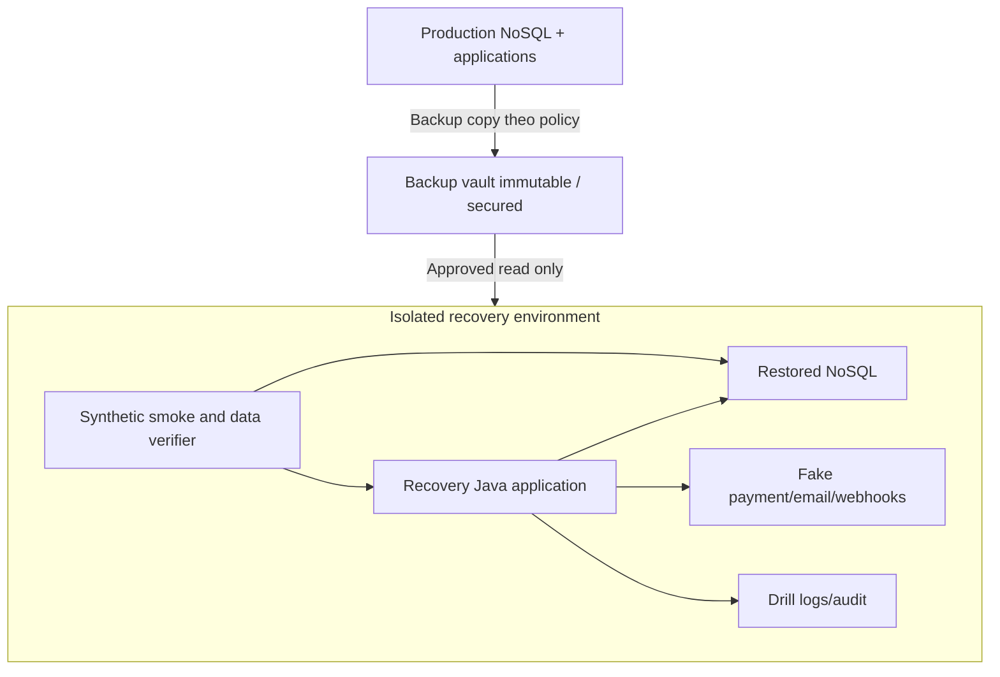
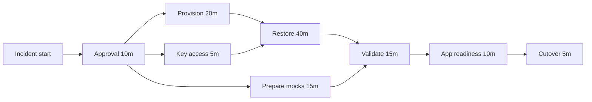
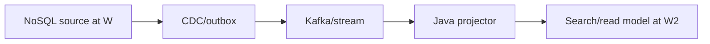

# Đo thời gian phục hồi và diễn tập định kỳ trên môi trường cô lập

## 1. Bản sao lưu “thành công” nhưng hệ thống vẫn không khôi phục được

Một nền tảng Java có NoSQL làm nguồn dữ liệu đơn hàng. Dashboard của hệ thống backup hiển thị:

```text
Backup completed: SUCCESS
Last snapshot: 01:00
Backup file: 1.8 TB
Archive retention: 30 days
```

Đến 10:15, một thao tác quản trị xóa nhầm collection. Đội vận hành bắt đầu phục hồi lúc 10:45. Đến 12:30, database đã khôi phục xong, nhưng ứng dụng vẫn lỗi vì:

- Key dùng để giải mã backup nằm trong tài khoản cloud khác mà restore worker chưa có quyền.
- Secondary indexes chưa xây xong, query có độ trễ hàng chục giây.
- Các collections đã có nhưng schema và event consumer chưa tương thích.
- CDC connector đã được khởi động với checkpoint quá cũ, phát sự kiện trùng.
- Một số bản ghi bị xóa theo chính sách riêng tư trước sự cố đã xuất hiện lại trong backup.
- Cutover DNS và connection pools chưa cập nhật.
- Không ai biết dữ liệu vừa khôi phục có giữ được những giao dịch đã xác nhận lúc 09:55 hay không.

Hệ thống có một **backup thành công**, nhưng **quy trình phục hồi dịch vụ** chưa hoàn tất. Nếu doanh nghiệp cam kết phục vụ trở lại trong 60 phút và mất tối đa 5 phút dữ liệu, bản backup lúc 01:00 rõ ràng không tự chứng minh hai cam kết này.

Vì vậy, không thể đánh giá khả năng phục hồi chỉ bằng trạng thái `backup=SUCCESS`. Cần **đo thời gian thực tế**, **xác định điểm dữ liệu có thể phục hồi**, **xác minh tính đúng đắn**, và **diễn tập định kỳ trong môi trường cô lập** trước khi phải xử lý thảm họa thật.

Bài học thuộc module **Database No SQL**, chương **Sao lưu và phục hồi**, chủ đề **“Đo thời gian phục hồi và diễn tập định kỳ trên môi trường cô lập”**.

> **Nguyên tắc:** Một bài diễn tập chỉ được xem là thành công khi khôi phục được **đúng dữ liệu, đúng quyền truy cập, đúng luồng ứng dụng** và đo được **thời gian kết thúc theo định nghĩa dịch vụ**, không phải chỉ vì lệnh restore trả exit code 0.

### Mục tiêu học tập

Sau bài học, bạn có thể:

1. Phân biệt RTO, RPO, MTTD, thời gian restore dữ liệu, thời gian phục hồi ứng dụng, thời gian cutover và thời gian kiểm chứng.
2. Xây timeline có các mốc định lượng, clock đúng và ngưỡng pass/fail.
3. Phân biệt RPO mục tiêu với **độ cũ dữ liệu khôi phục quan sát được**.
4. Xác định phạm vi bài diễn tập: khôi phục một record, một collection/table, một shard/cluster, một region hoặc toàn dịch vụ.
5. Thiết kế môi trường khôi phục **cô lập network, credentials, event side effects và dữ liệu nhạy cảm**.
6. Lựa chọn backup/PITR snapshot và xác minh có thể giải mã/đọc bằng role phục hồi thực.
7. Lập quy trình restore–replay–rebuild index–validate–cutover an toàn.
8. Dùng source positions, event IDs, checksums, manifests và business invariants để đo correctness.
9. Diễn tập MongoDB, Cassandra, DynamoDB, Redis và search/read model theo cơ chế tương ứng.
10. Đo và phân tích bottleneck: transfer, decrypt, import, index, replication, DNS, startup, data verification.
11. Lập script/Java telemetry để ghi lại các mốc thời gian mà không làm thay đổi dữ liệu production.
12. Tổ chức lịch diễn tập định kỳ, ownership, evidence, báo cáo, cải thiện runbook và tái thử.
13. Phân biệt **khôi phục đúng một lần trong sandbox** với **cam kết đáp ứng khi production đang gặp thảm họa**.

## 2. Khái niệm nền: backup, restore, recovery và disaster recovery

| Thuật ngữ | Ý nghĩa | Chỉ số hoặc bằng chứng liên quan |
|---|---|---|
| **Backup** | Tạo bản dữ liệu có thể dùng để phục hồi | Backup success, integrity, retention |
| **Snapshot** | Điểm chụp trạng thái dữ liệu theo một phạm vi/thời điểm | Snapshot ID, consistency point |
| **PITR** | Khôi phục về thời điểm hợp lệ trong khoảng retention được hỗ trợ | Earliest/latest restorable point |
| **Restore** | Đọc backup/log và dựng lại trạng thái lưu trữ | Bytes restored, stage duration, errors |
| **Recovery** | Đưa dữ liệu **và dịch vụ** trở lại trạng thái chấp nhận được | RTO, RPO, correctness, health |
| **Disaster recovery (DR)** | Khôi phục sau thảm họa ảnh hưởng quy mô lớn | Runbook, DR site, RTO/RPO, drills |
| **Failover** | Chuyển phục vụ sang instance/region khác | Detection + routing + data state |
| **Failback** | Chuyển từ DR về primary environment sau khi ổn định | Reconciliation, cutback risk |
| **Rebuild** | Dựng lại index/replica/projection từ nguồn có thẩm quyền | Completeness watermark, index correctness |
| **Recovery drill** | Diễn tập có đo thời gian và xác minh outcomes | Evidence, measured durations, gaps |
| **Isolated restore** | Phục hồi tại đích cách ly với production | Network/IAM/KMS/side-effect controls |
| **Chaos/fault test** | Cố tình tạo lỗi để thử phản ứng | Fault hypothesis và safety envelope |

### 2.1. Replication không phải backup

Một ứng dụng có RF=3 hoặc primary–secondary replication có thể chịu lỗi một node. Nhưng lệnh xóa nhầm hoặc thao tác write sai thường được replicate sang nhiều bản sao. Khi đó backup/PITR độc lập mới có cơ hội khôi phục trạng thái trước lỗi.

### 2.2. Có backup nhưng không restore được vẫn là rủi ro

Archive có thể tồn tại nhưng:

- Thiếu key mã hóa.
- Thiếu schema metadata.
- Bị corruption.
- Thiếu transaction/change log.
- Không đủ disk/capacity.
- Không còn quyền truy cập backup.
- Restore tool không còn tương thích version.

Vì vậy cần **restore test**, không chỉ checksum của file backup.

### 2.3. Restore thành công không đồng nghĩa service ready

Database có thể trả ping khi dữ liệu, indexes, read model, auth, connector hoặc query SLO chưa đạt. Định nghĩa “recovered” phải mô tả cụ thể **business-serving acceptance criteria**.

## 3. RTO là gì?

**Recovery Time Objective (RTO)** là khoảng thời gian mục tiêu tối đa mà chức năng/hệ thống có thể không đáp ứng sau sự cố, tính từ **mốc sự cố được định nghĩa** đến **mốc khôi phục dịch vụ theo tiêu chí đã thống nhất**.

\[
RTO_{\text{target}} = t_{\text{service\_restored}}-t_{\text{incident\_start}}
\]

Đây là mục tiêu của tổ chức, không phải giá trị backup tool tự báo.

### 3.1. Một timeline minh họa

```text
10:00  Dữ liệu gặp sự cố, API quan trọng không phục vụ đúng
10:08  Monitoring phát hiện
10:15  On-call xác nhận incident
10:25  Quyết định dùng restore
10:40  Tạo môi trường khôi phục
11:30  Restore database hoàn tất
11:45  Rebuild indexes và replay cần thiết hoàn tất
11:58  Kiểm dữ liệu và authorization đạt
12:10  Chuyển routing, API và synthetic checks đạt
```

Nếu lấy mốc 10:00 và kết thúc 12:10:

\[
RTO_{\text{observed}}=130\text{ phút}
\]

Nếu chỉ đo từ lúc “bắt đầu restore” 10:25 đến “restore database hoàn tất” 11:30, kết quả 65 phút **không phải RTO đầy đủ** trong ví dụ.

### 3.2. Phải định nghĩa bắt đầu từ đâu

Một số kịch bản đo từ outage onset, một số đo từ khi incident được tuyên bố hoặc khi disaster recovery được kích hoạt. Cần ghi rõ trong SLA/DR plan; không đổi mốc để làm số đo đẹp hơn.

- `t0`: thời điểm chức năng bắt đầu không đạt điều kiện.
- `t_detect`: thời điểm giám sát nhận ra.
- `t_ack`: người trực nhận incident.
- `t_decide`: quyết định kích hoạt DR.
- `t_restore_start`: restore workload bắt đầu.
- `t_data_ready`: storage đã dựng xong.
- `t_validation_pass`: checks data/security đạt.
- `t_service_restored`: app serving đúng theo acceptance.

### 3.3. Phân biệt mục tiêu và thực tế

- **RTO target:** doanh nghiệp yêu cầu ≤60 phút.
- **Observed exercise duration:** trong drill, 45 phút từ T0 giả lập đến tiêu chí dịch vụ.
- **Production RTO:** chỉ có thể đo từ sự cố thật khi có mốc tin cậy.

Bài drill 45 phút tạo bằng chứng hữu ích nhưng **không đảm bảo** mọi thảm họa thật sẽ khôi phục trong 45 phút.

### 3.4. Đừng kết thúc RTO ở “database port open”

Một mốc service restored có thể đòi:

- Đăng nhập được bằng identity hợp lệ.
- Đọc được hồ sơ/đơn hàng có dữ liệu đúng.
- Ghi được operation mới theo consistency contract.
- Giao dịch quan trọng và idempotency hoạt động.
- Không tạo side effect thật trong môi trường drill.
- Latency/error rate đạt ngưỡng.
- Projection/search đạt freshness đã chấp nhận hoặc có fallback.
- Không xuất hiện dữ liệu đã bị xóa theo policy.

Tùy hệ, một số read-only mode có thể được chấp nhận làm **partial recovery**, nhưng không được gọi là full recovery nếu write path chưa đáp ứng.

## 4. RPO là gì?

**Recovery Point Objective (RPO)** là lượng **mất tiến độ dữ liệu tối đa có thể chấp nhận** khi khôi phục, thường biểu diễn bằng khoảng thời gian giữa **điểm có sự cố** và **điểm dữ liệu mới nhất phục hồi được**.

\[
RPO_{\text{observed}}=t_{\text{failure}}-t_{\text{latest\_recoverable\_commit}}
\]

Công thức diễn tả độ cũ theo thời gian, cần có một định nghĩa consistent của `latest_recoverable_commit`; trong hệ phân tán nhiều partitions, có thể cần **vector checkpoints** và kiểm committed operations thay vì một timestamp toàn cục.

### 4.1. Ví dụ

```text
01:00  Full snapshot
09:55  Last durable change log available for replay
10:00  Failure
```

Nếu restore snapshot 01:00 rồi replay log hợp lệ đến 09:55, **khoảng mất tiến độ lý thuyết là 5 phút**, không phải 9 giờ. Nhưng phải xác minh log không gap, replay đúng và có đầy đủ key/schema để dùng.

### 4.2. RPO khác retention

Backup retention 30 ngày nghĩa có thể giữ những điểm khôi phục trong một khoảng thời gian, **không** có nghĩa độ mất dữ liệu tối đa 30 ngày hoặc 0 phút. Retention, backup frequency và PITR log coverage là các khái niệm khác.

### 4.3. RPO=0 không tự xảy ra vì RF=3

Nếu async replication có thể mất một số acknowledged writes khi failover, hoặc backup/log pipeline không giữ mọi commit, không thể hứa 0 dữ liệu mất chỉ nhờ ba copies. RPO target phải gắn với write acknowledgement, replication, WAL/oplog, PITR và disaster scope.

### 4.4. RPO theo dữ liệu quan trọng

Một ứng dụng có thể chấp nhận:

- Analytics aggregates: mất tiến độ 2 giờ rồi rebuild.
- Search index: rebuild từ source, nên có freshness SLA.
- Đơn hàng/ledger: không mất committed business facts.
- Cache: có thể làm trống.
- Session state: được phép yêu cầu đăng nhập lại.

Không cần ép mọi data store có cùng RPO nếu kiến trúc phân biệt source of truth và dữ liệu dẫn xuất.

### 4.5. RPO phải kiểm bằng dữ liệu, không chỉ timestamp của backup

Một file snapshot “createdAt=09:55” có thể không chứa các giao dịch được ACK lúc 09:55 nếu snapshot consistency hoặc log cutoff khác. Cần kiểm commit/operation ledger, source positions hoặc manifest.

## 5. Các chỉ số khác cần đo trong phục hồi

| Ký hiệu/metric | Ý nghĩa | Dùng để làm gì? |
|---|---|---|
| **MTTD** | Mean Time To Detect, thời gian trung bình phát hiện | Cải thiện monitoring |
| **MTTA** | Mean Time To Acknowledge, thời gian trung bình nhận xử lý | Tối ưu on-call |
| **MTTR** | Mean Time To Repair/Recover/Restore tùy định nghĩa | Xu hướng qua nhiều incidents/drills |
| **Restore duration** | Từ bắt đầu restore đến storage ready | Đo năng lực tool/data transfer |
| **Data verification duration** | Từ data ready đến correctness pass | Đo chi phí kiểm chứng |
| **App recovery duration** | Startup, dependency wiring và readiness | Đánh giá runtime dependencies |
| **Cutover duration** | Chuyển traffic/readers/writers | Rủi ro DNS, routing, credentials |
| **Time to durable checkpoint** | Thời gian thu được recovery point mới | Kiểm log/PITR |
| **Latest restorable age** | Độ cũ của điểm có thể phục hồi | Giám sát RPO |
| **Recovery completeness** | Tỷ lệ dữ liệu/operations/invariants phục hồi | Đánh giá correctness |
| **Drill coverage** | Bao nhiêu kịch bản/component đã diễn tập | Theo dõi readiness |
| **Recovery cost** | Compute/storage/network/egress/engineer time | Capacity planning |

### 5.1. MTTR là trung bình, RTO là mục tiêu

MTTR thấp không đảm bảo các sự cố hiếm có RTO thấp; cũng không đồng nghĩa P99 restore time đạt mục tiêu. Cần giữ **phân bố** durations và phân loại theo size/failure scenario.

### 5.2. Đừng cộng mọi stage một cách máy móc

Một số công đoạn chạy song song:

```text
             +--- restore catalog ---+
Provision ---|                       |--- validation --- cutover
             +--- restore orders ----+
```

Tổng elapsed time bằng **critical path**, không nhất thiết bằng tổng durations của từng task. Ghi cả per-stage durations và total wall-clock.

### 5.3. Đo thời gian tại đúng boundary

Ví dụ:

- RTO của API đặt hàng: đến khi create/read/idempotency đúng.
- RTO của dashboard analytics: đến khi dữ liệu báo cáo đủ và query đạt SLO.
- RTO của toàn nền tảng: đến khi tập critical services theo business contract phục hồi.

Một database ready nhưng API chết vì DNS/TLS là chưa đạt service RTO.

## 6. Từ yêu cầu nghiệp vụ đến mục tiêu RTO/RPO

Không chọn RTO/RPO chỉ vì sản phẩm backup quảng cáo “near-zero”.

### 6.1. Phân loại dữ liệu và hành trình

| Hạng mục | Khi không phục vụ gây gì? | Nguồn phục hồi |
|---|---|---|
| Payment ledger | Sai tài chính/khó đối soát | Durable source + logs/backup/settlement |
| Orders | Không đặt/tra cứu đơn được | NoSQL snapshots/PITR |
| Inventory reservations | Có thể oversell | Ledger + conditional writes |
| Search/read model | Kết quả stale/thiếu | Rebuild từ source/event log |
| User preferences | Trải nghiệm giảm | Backup, tùy criticality |
| Redis cache | Latency tăng | Refill từ source |
| Audit/security events | Mất bằng chứng và nghĩa vụ tuân thủ | Immutable log/retention riêng |

### 6.2. Business Impact Analysis (BIA)

Đặt câu hỏi:

- Mỗi phút downtime ảnh hưởng revenue/safety đến đâu?
- Có manual workaround không?
- Có thể vận hành read-only mode không?
- Dữ liệu nào không thể tái tạo?
- Các bước nào phụ thuộc dịch vụ ngoài?
- Pháp lý và privacy requirements nào áp dụng?
- RTO/RPO nào được owner phê duyệt?

### 6.3. Dependencies quyết định mục tiêu thực tế

Một API không thể khôi phục khi DB có dữ liệu nhưng authorization service, secret manager, KMS hoặc DNS vẫn chưa phục hồi. DR plan phải nhận diện dependencies và có phương án recovery/degraded mode phù hợp.

### 6.4. Phân lớp ưu tiên

Có thể có:

1. **Tier 0:** dữ liệu tài chính, identity/authorization, authoritative orders.
2. **Tier 1:** read model phục vụ người dùng.
3. **Tier 2:** analytics/search/report nội bộ.
4. **Tier 3:** cache và dữ liệu tái tạo dễ.

Tiers là ví dụ; không tự áp mục tiêu số phút cho mọi tổ chức. Từ BIA mới xây RTO/RPO và lịch drill.

## 7. RTO thực tế là một chuỗi công việc

Một mô hình:


### 7.1. Những khoảng hay bị quên

- On-call phải đánh giá có thật cần restore không.
- Quyền JIT để đọc backup vault/giải mã key.
- Provision nodes, disks, networks và quorum.
- Tải backup từ object storage.
- Decompress/decrypt rồi import.
- Rebuild secondary indexes.
- Replica initial sync, anti-entropy/repair.
- Recover transactions/PITR logs.
- Startup Java apps, migrations/configuration.
- Test tenant authorization và external services.
- Reroute clients, DNS, connection pools.
- Phát hiện data gap rồi rollback/fix trước cutover.

### 7.2. Critical path quan trọng hơn một lệnh

Nếu restore backup mất 20 phút nhưng cấp quyền KMS phải xin tay 2 giờ, RTO còn phụ thuộc quy trình cấp quyền. Drill phải **đi theo cùng quyền và workflow** như một incident thật, không cấp sẵn admin credentials làm số đẹp.

### 7.3. Cần kế hoạch cho đích khôi phục

Tạo cluster trong cùng region khi toàn region sập thì không đáp ứng DR scenario. Ngược lại, một drill “table bị xóa” có thể hợp lý khi restore trong cùng region nhưng khác account/project.

### 7.4. Loại sự cố quyết định con đường khôi phục

- Node chết: có thể replace/rebuild replica nhanh hơn full backup restore.
- Xóa nhầm table: cần PITR về trước sự cố.
- Dữ liệu bị ghi sai logic: restore + replay có chọn lọc/correction.
- Region outage: failover/cross-region restore.
- Ransomware/credential compromise: cần backup immutable/clean room/security clearance.
- Search index mất: dựng lại từ source; không nhất thiết restore toàn NoSQL source.

## 8. Điều kiện để bài diễn tập có ý nghĩa

Một bài drill phải định nghĩa rõ **đầu vào, giới hạn, mốc thành công và bằng chứng**.

### 8.1. Exercise charter

```yaml
exerciseId: "dr-orders-2026-11"
scenario: "Xóa nhầm collection orders tại source"
environment: "isolated-recovery-sandbox"
owner: "database-sre"
observer: "security-and-business-owner"
rtoObjectiveMinutes: 60
rpoObjectiveMinutes: 5
triggerDefinition: "thời điểm giả lập sự cố"
recoveryTarget:
  service: "orders API"
  mode: "read-write"
  expectedDataPoint: "last verified recoverable commit"
dataValidation:
  - "identity manifest khớp tại cutoff"
  - "ledger operations được ACK còn tồn tại hoặc phân loại gap"
  - "no duplicate orders"
  - "delete/tombstone suppression được bảo toàn"
  - "tenant permission tests pass"
safetyControls:
  - "không route production traffic"
  - "không gửi email/payment từ sandbox"
  - "không sử dụng production DB credentials"
  - "restore chỉ tới allowlisted destination"
stopConditions:
  - "production endpoint bị truy cập từ sandbox"
  - "external side effect có thể xảy ra"
  - "backup/data exposure ngoài phạm vi"
  - "môi trường cô lập mất isolation"
```

Đây là mẫu charter, không phải file config trực tiếp của một sản phẩm DR. Các ngưỡng số chỉ minh họa và phải đến từ business requirements.

### 8.2. Đặt rõ điều gì không được làm

Một môi trường có dữ liệu thật được restore phải **không thể**:

- Ghi đè production DB.
- Gửi payment capture/refund tới provider thật.
- Gửi email/SMS/push notification tới người thật.
- Publish event sang production broker.
- Gọi webhook production bên thứ ba.
- Đăng public backup/archive.
- Truy cập tenants ngoài quyền được cấp.
- Mở egress tùy ý khi chứa PII.

### 8.3. Diễn tập không được gây thảm họa

Thử restore từ **backup đã tạo** vào destination cô lập; không tạo ra sự cố thật trong production bằng cách drop table hoặc ngắt quorum chỉ để “giống thực tế”.

## 9. Môi trường cô lập cần cách ly những gì?



### 9.1. Mức cách ly tối thiểu

- Account/project hoặc namespace tách biệt, tùy threat model.
- Database cluster/table/collection **khác** source.
- Credentials/IAM role riêng cho restore worker.
- Network firewall/private subnets.
- Egress allowlist.
- DNS/hostnames không trỏ ngược production.
- Messaging topics/consumer groups riêng.
- Secret manager scope riêng.
- KMS grants giới hạn theo backup source và restore target.
- Object storage bucket/prefix riêng cho logs/results.
- Lifecycle cleanup và cost guard.
- Audit của mọi quyền elevated và data access.

### 9.2. Cách ly logic vs cách ly tài khoản

Một database tên `orders_dr_test` trên cùng production cluster có thể đủ cho một unit smoke test nhỏ, nhưng thường **không đủ** để đo đầy đủ DR: nó dùng chung failure domain, capacity, IAM và có nguy cơ chạy nhầm delete/import. Với dữ liệu nhạy cảm hoặc bài restore quy mô lớn, account/VPC/cluster độc lập giảm rủi ro rõ rệt.

### 9.3. Môi trường cô lập phải có đủ hạ tầng để đo

Nếu sandbox chỉ có 10% CPU/disk của production, RTO đo được không đại diện cho target DR. Ngược lại, nếu có storage/network cực nhanh khác thực tế, drill lại cho một kết quả quá lạc quan. Ghi resource equivalence và các khác biệt.

### 9.4. Bảo vệ data residency

Copy backup chứa PII sang region/third-party không được phép vẫn là vi phạm dù chỉ để diễn tập. Chọn region/account, encryption keys và retention theo policy.

### 9.5. Dọn môi trường là bước bắt buộc

Sau drill phải xóa/retire sandbox theo policy, revoke credentials/KMS grants tạm, xóa temporary exports, đóng firewall và lưu report/audit evidence. Nếu có yêu cầu bảo quản bằng chứng, tách dữ liệu evidence tối thiểu khỏi raw customer data.

## 10. Hai chiến lược dữ liệu diễn tập: synthetic hay backup production?

### 10.1. Synthetic fixtures

Ưu điểm:

- Không chứa dữ liệu khách hàng.
- Dễ tạo corner cases.
- Có expected checksums/IDs sẵn.
- Có thể tạo datasets nhỏ trong CI.

Nhược điểm:

- Không phản ánh phân bố kích thước, document shape, tombstones, indexes, hot keys và data skew của production.
- Không chứng minh backup production thật có thể decrypt/restore.

### 10.2. Backup production có bảo vệ

Ưu điểm:

- Đo đúng format, compression, volume, version/schema và restore chain.
- Phát hiện các dependencies thật của snapshot, WAL, key grants, manifests.

Nhược điểm:

- Chứa PII, secrets, dữ liệu đã bị xóa theo thời điểm.
- Có nguy cơ exfiltration và accidental side effects.
- Cần kiểm data residency và access log.
- Có thể tốn tài nguyên đáng kể.

### 10.3. Kết hợp hai loại

Một chương trình DR tốt có thể dùng:

- **Synthetic/obfuscated data** cho drills thường xuyên, fault injection và integration tests.
- **Restore backup production vào clean-room** theo policy để kiểm được khả năng thực tế.
- **Anonymized representative dataset** để benchmark throughput/query nếu việc ẩn danh không phá data shape quan trọng.
- **Test full-size** định kỳ để chứng minh capacity/time, không chỉ chạy demo 1 GB.

Không coi một restore synthetic 100 MB trong 30 giây là bằng chứng có thể restore 20 TB trong 30 phút.

## 11. Thiết kế kịch bản theo mức độ nghiêm trọng

Một chương trình diễn tập nên có ma trận:

| Kịch bản | Dữ liệu cần khôi phục | Thường kiểm gì? |
|---|---|---|
| Xóa một document | Một entity + version | Point-in-time correctness, no overwrite |
| Sửa sai hàng nghìn records | Phạm vi partition/collection | PITR vs selective replay |
| Xóa một collection/table | Dataset lớn | Schema/index/backup chains |
| Một node mất disk | Replica/state copy | Replication, rebuild, failover |
| Replica set không còn majority | Membership và history | DR boundaries, data loss risk |
| Cả region không phục vụ | Region/service | KMS, network, cross-region recovery |
| Backup object corrupted | Secondary backup/source | Integrity validation và fallback |
| KMS key không truy cập được | Encryption dependency | Key grants, escalation |
| CDC retention gap | Event pipeline | Snapshot+CDC no-gap rebuild |
| Ransomware/compromised admin | Clean backup + security clearance | Immutable vault, rotation, evidence |
| Search index mất toàn bộ | Derived read model | Rebuild from source/event archive |
| Redis cache mất | Cache/pending state | Source fallback; key rebuild |
| Authorization config sai | Credentials/ACL | Controlled permission restoration |

### 11.1. Không drill toàn bộ tình huống cùng ngày

Chọn theo risk, critical path, lịch sử sự cố, mới thay kiến trúc và yêu cầu tuân thủ. Một bài drill có phạm vi rõ và kết quả có thể đo đáng giá hơn thử mọi thứ sơ sài.

### 11.2. Full stack khác restore riêng DB

Một drill khôi phục database kiểm storage mechanics; một drill **end-to-end** còn kiểm ứng dụng Java, IAM, KMS, network, queues, schema, indexes, read model, DNS/cutover và external integrations.

### 11.3. Không bỏ qua sự cố được gây bởi người dùng hợp lệ

DR không chỉ dành cho hardware failure. Accidental delete, erroneous migration, bad bulk update và wrong tenant scope là các nguyên nhân cần PITR/reconciliation.

## 12. Những gì phải có trước khi bắt đầu đồng hồ diễn tập

Chuẩn bị sẵn **mục tiêu**, nhưng không “ăn gian” bằng cách chuẩn bị sẵn những bước mà incident thực phải làm.

- Inventory: database/table/collection/index, engine/server version.
- Source backup ID, PITR window, log chain/manifest.
- Critical entities/operation IDs dùng để đối soát.
- Permissions và KMS/key dependencies.
- IaC templates cho môi trường DR.
- Restore binary/driver tương thích.
- Capacity quota/reservations và cloud account.
- Recovery application image/config và mock integrations.
- Monitoring dashboard và event timestamp capture.
- Business acceptance test suite.
- Stop conditions và escalation contacts.
- Custodian độc lập giữ approval/evidence.
- Checklist cleanup và data retention.

### 12.1. Chuẩn bị nền tảng vs preprovision vô hạn

Có thể chuẩn bị IaC/template, nhưng nếu RTO tính cả provisioning một DR environment lạnh, phải **đo cả thời gian provision**. Nếu doanh nghiệp trả tiền cho warm standby sẵn, cần đo theo điều kiện warm standby và ghi rõ.

### 12.2. Định nghĩa trước pass/fail

Không đợi kết quả mới chọn mốc. Ví dụ một bài có target RTO 60 phút, RPO 5 phút và data invariants zero violations. Nếu data có gap không rõ, bài không “pass” chỉ vì uptime đáp ứng.

### 12.3. Không dùng production superuser làm fallback

Một role restore đúng quyền có thể gặp lỗi permission; điều đó là discovery của drill. Nếu sửa bằng cấp admin không kiểm soát, report phải ghi dependency và effective permission problem thay vì tuyên bố procedure chuẩn đã thành công.

## 13. Thiết kế mốc đo: checkpoint và event evidence

Một cuộc diễn tập có thể lưu các mốc:

```json
{
  "exerciseId": "dr-orders-2026-11",
  "scenario": "delete_collection",
  "environment": "isolated-sandbox",
  "rtoTargetSeconds": 3600,
  "rpoTargetSeconds": 300,
  "markers": [
    {"name": "incident_start", "time": "2026-11-14T10:00:00Z"},
    {"name": "detected", "time": "2026-11-14T10:08:00Z"},
    {"name": "recovery_decision", "time": "2026-11-14T10:20:00Z"},
    {"name": "restore_start", "time": "2026-11-14T10:35:00Z"},
    {"name": "db_data_ready", "time": "2026-11-14T11:15:00Z"},
    {"name": "data_verified", "time": "2026-11-14T11:30:00Z"},
    {"name": "service_ready", "time": "2026-11-14T11:45:00Z"}
  ]
}
```

Với mốc này, total elapsed là 105 phút, vượt RTO 60 phút. “DB restored in 40 minutes” không thay đổi kết luận.

### 13.1. Hệ ghi marker nên độc lập

Nếu metrics/logs của production bị lỗi khi xảy ra incident, recovery evidence phải lưu qua đường độc lập hoặc manual timestamp sheet có audit. Không dùng duy nhất log của database đã mất.

### 13.2. Đồng bộ đồng hồ

Timestamps từ nhiều máy có thể lệch. NTP và UTC là cần thiết. Nếu tính elapsed time của **một tiến trình chạy liên tục**, dùng monotonic clock (`System.nanoTime()` trong Java) để tránh thay đổi wall clock. Khi ghép milestones giữa nhiều hosts/restarts, dùng UTC timestamps, source identification và thông tin clock uncertainty.

### 13.3. Mỗi mốc phải có chủ sở hữu xác nhận

“DB ready” nên gắn với metric/command evidence, “data verified” gắn với checksum/report, “service ready” gắn với E2E synthetic test. Tránh mọi mốc đều được điền bằng cảm giác của người thực hiện.

### 13.4. Đo cả thất bại và thử lại

Nếu restore attempt 1 lỗi KMS lúc 10:50 rồi attempt 2 thành công lúc 11:15, total time vẫn tính từ incident start; không reset đồng hồ để chỉ báo thời gian attempt 2.
## 14. Thiết lập một hệ thống ghi mốc thời gian có thể kiểm tra

Mỗi stage nên có ba thông tin:

1. **Thời điểm:** UTC wall clock có timezone.
2. **Khoảng thời gian:** đồng hồ đơn điệu khi đo trong cùng tiến trình.
3. **Bằng chứng:** command output, operation ID, snapshot ID, log position, test report hoặc artifact digest.

### 14.1. Mẫu event cho stage

```json
{
  "exercise_id": "dr-orders-2026-11",
  "stage": "RESTORE_DATA",
  "event": "COMPLETED",
  "started_at_utc": "2026-11-14T10:35:00Z",
  "ended_at_utc": "2026-11-14T11:15:00Z",
  "duration_seconds_monotonic": 2400,
  "result": "SUCCESS",
  "evidence_ref": "restore-job/attempt-2",
  "bytes_processed": 900000000000,
  "retries": 1
}
```

Trường `duration_seconds_monotonic` chỉ thích hợp khi có start/end trong cùng một process/clock domain. Nếu worker restart, cần các events wall-clock có synchronized time và thông tin uncertainty/attempt segmentation.

### 14.2. Định nghĩa từ điển stage

| Stage | Start | End | Bằng chứng |
|---|---|---|---|
| Detect | Incident begins | Alert meets criterion | Alert timestamp |
| Triage | Alert acknowledged | DR decision | Ticket, approver |
| Provision | Infrastructure creation initiated | Cluster/identity available | IaC job logs |
| Backup locate | Select restore point | Backup chain/keys verified | Backup manifest |
| Transfer | Download/copy begins | Bytes available on target | Transfer job + checksums |
| Restore | DB restore begins | Storage engine reports complete | Restore job ID |
| Log replay | Replay begins | Target watermark reached | Log sequence |
| Index rebuild | Build starts | Index available/valid | Index status |
| Replica catch-up | Secondary starts sync | Required replicas ready | Replication metrics |
| Data validation | Verifier starts | Invariants pass | Verification report |
| Application startup | Start recovery app | API health/readiness pass | Deployment logs |
| Cutover | Routing change begins | Approved client path works | DNS/proxy evidence |
| Stabilization | Traffic served | Error/p99/lag within SLO over window | Metrics |

Stages có thể chồng lấn, lặp lại hoặc bỏ qua tùy scenario. Khi report, ghi rõ stage nào không áp dụng, không diễn giải nó thành “0 giây vì mọi việc hoàn hảo”.

### 14.3. Đo từ điểm khởi phát sự cố

Trong drill, thời điểm `incident_start` có thể là một mốc giả lập trong exercise controller. RTO observed drill tính từ mốc đó, không lấy thời điểm bản backup được chọn.

### 14.4. Các số đo khác nhau của cùng exercise

```text
Total simulated outage-to-service-ready: 105 min
Restore job duration:                 40 min
Data verification duration:          15 min
Cutover readiness:                    15 min
Approval + provisioning:             35 min
```

Vì nhiều công đoạn có thể chạy song song, đây chỉ là ví dụ khái niệm; khi một exercise cụ thể thực hiện tuần tự, tổng bằng các giai đoạn. Với concurrency, cần critical-path model thay vì cộng tất cả spans.

### 14.5. Stage có timeouts và deadline

Một restore job treo vô hạn không nên được coi “đang chạy tốt”. Đặt deadline cho từng phần để quyết định escalate, thay backup source, tăng capacity hoặc stop theo runbook. Ngưỡng cần dựa trên DR budget, không phải một số mặc định.

## 15. Java 17: đồng hồ đơn điệu và checkpoint RTO

Một helper đơn giản có thể ghi mốc elapsed trong **cùng tiến trình** bằng `System.nanoTime()` và UTC timestamp cho kiểm toán. Nó **không thay thế** distributed tracing/collector, nhưng giúp tránh sai lầm phổ biến khi dùng `System.currentTimeMillis()` trừ nhau để benchmark.

### 15.1. Code minh họa

```java
import java.time.Duration;
import java.time.Instant;
import java.util.ArrayList;
import java.util.List;
import java.util.Objects;

public final class RecoveryClock {
    public record Marker(
        String name,
        Instant observedAtUtc,
        Duration elapsedSinceStart
    ) {}

    private final long startedNano;
    private final Instant startedAtUtc;
    private final List<Marker> markers = new ArrayList<>();

    public RecoveryClock() {
        this.startedNano = System.nanoTime();
        this.startedAtUtc = Instant.now();
        markers.add(
            new Marker(
                "incident_start",
                startedAtUtc,
                Duration.ZERO
            )
        );
    }

    public synchronized Marker mark(String name) {
        Objects.requireNonNull(name, "name");

        if (name.isBlank()) {
            throw new IllegalArgumentException("name");
        }

        long elapsed = System.nanoTime() - startedNano;
        if (elapsed < 0) {
            throw new IllegalStateException(
                "Monotonic counter anomaly"
            );
        }

        Marker marker = new Marker(
            name,
            Instant.now(),
            Duration.ofNanos(elapsed)
        );

        markers.add(marker);
        return marker;
    }

    public synchronized List<Marker> snapshot() {
        return List.copyOf(markers);
    }

    public Instant startedAtUtc() {
        return startedAtUtc;
    }
}
```

### 15.2. Sử dụng

```java
RecoveryClock clock = new RecoveryClock();

// Khi controller xác định mốc incident_start giả lập.
performApprovedRestoreToSandbox();
clock.mark("db_data_ready");

verifyDataAndSecurityInSandbox();
clock.mark("data_verified");

runReadinessChecksAgainstSandbox();
RecoveryClock.Marker ready = clock.mark("service_ready");

long rtoSeconds =
    ready.elapsedSinceStart().getSeconds();

System.out.println("Observed drill RTO seconds = " + rtoSeconds);
```

`performApprovedRestoreToSandbox`, `verifyDataAndSecurityInSandbox` và `runReadinessChecksAgainstSandbox` là các hàm minh họa do ứng dụng triển khai với guardrails, không có implementations trong ví dụ. Đây không phải script khởi chạy trên production.

### 15.3. Giới hạn cần hiểu

- `System.nanoTime()` đo elapsed khi **cùng một JVM/process vẫn sống**, không dùng để so counter giữa hai hosts hoặc sau restart.
- `Instant.now()` ghi UTC thời điểm phục vụ audit nhưng có thể chịu clock skew/adjustment.
- Nếu controller restart, phải lưu checkpoints độc lập, dùng wall-clock đã đồng bộ và ghi sai số.
- Code không tự xác định thời điểm business outage thật.
- Marker `service_ready` chỉ hợp lệ **sau khi acceptance tests đã pass**.
- Không log raw backup credentials, KMS secret hoặc dữ liệu khách hàng.
- Trong multi-service drill, nên có một **exercise controller**/event sink nhận events có nguồn xác thực, không mỗi worker tự tính “RTO toàn hệ”.

### 15.4. Không chỉ tính số giây

Nên lưu structured events đủ để so sánh giữa nhiều drills:

```json
{
  "exercise_id": "dr-orders-2026-11",
  "stage": "SERVICE_READY",
  "elapsed_ms": 6300000,
  "clock_source": "monotonic-process-1",
  "wall_time_utc": "2026-11-14T11:45:00Z",
  "acceptance_ref": "e2e-verify-report-18"
}
```

`elapsed_ms` và `wall_time_utc` ở đây minh họa cấu trúc; khi triển khai thật chúng phải lấy từ cùng execution record và khớp các mốc drill đã định nghĩa.

## 16. Đo thời gian đồng thời bằng critical path

Một runbook có thể làm song song:

- Provision recovery cluster.
- Chuẩn bị mock integrations.
- Pre-create index templates.
- Chuẩn bị test harness.

Sau khi storage ready, mới chạy data verification và service startup.

### 16.1. DAG thay cho cộng durations



Trong ví dụ, khi thực thi không có delay khác, critical path qua Approval (10) + Provision (20) + Restore (40) + Validate (15) + Readiness (10) + Cutover (5) ≈100 phút; key access/mocks chạy song song không cộng thêm vào tổng.

### 16.2. Bottleneck không nhất thiết là restore

Nếu parallel work bị chặn bởi manual approval, vault grant, DNS cutover hoặc dataset validation, tối ưu compression thuật toán backup có thể không cải thiện RTO đáng kể.

### 16.3. Tạo một time budget

Ví dụ target RTO=90 phút:

```text
Detect/triage:     10m
Approval/trigger:   5m
Provision:         15m
Restore/replay:    35m
Validate:          15m
Cutover:           10m
Total budget:      90m
```

Đây là **phân bổ giả định**, không phải SLO khuyến nghị cho mọi hệ. Khi song song hóa, có thể dùng DAG/critical path để phân bổ thực tế.

### 16.4. Khi một stage vượt budget

Runbook phải quy định chuyển hướng: chọn incremental log copy khác, tăng resources, fallback read-only, activate secondary region hoặc escalate. Không tự bỏ validation để “kịp RTO” nếu hậu quả là dữ liệu sai/lộ thông tin.

## 17. Xác định điểm phục hồi trong PITR

PITR thường kết hợp một base backup/snapshot với chuỗi thay đổi cho tới một điểm được hỗ trợ.

```text
Base backup at T0
   -> WAL/oplog/change records T0..T1
   -> Replay target at T1
   -> Recovery consistent state
```

### 17.1. Bốn mốc không được nhầm

- **Time backup job started.**
- **Time snapshot has a consistent recovery point.**
- **Latest available/recoverable log commit time.**
- **Chosen point-in-time target for restore.**

Không mặc định backup end timestamp bằng transaction-consistent snapshot point.

### 17.2. Recover tới mốc nào?

Nếu một lỗi bulk delete bắt đầu lúc 10:00, có thể cần khôi phục về **trước** thời điểm delete xấu (ví dụ 09:59:59) thay vì latest possible restore point 10:05. Nhưng những legitimate commits từ 10:00 tới 10:05 cũng có thể cần được **chọn lọc replay**.

### 17.3. RPO thực tế trong khôi phục về trước thao tác sai

Nếu chủ đích dừng trước destructive write, gap dữ liệu không phải lỗi của backup service; nó là kết quả lựa chọn recovery point. DR report phải ghi rõ:

- Latest available backup/log point.
- Chosen restore point.
- Legitimate operations bị bỏ sau point.
- Khả năng replay được chọn lọc hoặc bù trừ.
- Residual business data loss/uncertainty.

Không báo RPO=0 chỉ vì PITR service có log tới hiện tại, khi bản trạng thái đã cutover cố ý bỏ toàn bộ writes sau thời điểm cũ.

### 17.4. Nguồn log có thể không đủ

- Oplog/WAL retention bị thiếu.
- Snapshot chain bị gián đoạn.
- KMS key đã hết hiệu lực.
- Checksum/corrupt segment.
- Metadata schema không đọc được.
- Source identity sau failover không khớp.
- Cross-region replication lag.

Mỗi thiếu sót có thể làm latest **recoverable** point cũ hơn latest **generated** commit.

### 17.5. Quorum/commit semantics

Trong hệ có replicated log, phải phân biệt entry đã append cục bộ, majority committed và client ACK. Bảo vệ “mọi write đã ACK” cần đúng write concern/consistency contract và DR fault model, không chỉ log có record.

## 18. Kiểm RPO bằng operation ledger và watermarks

Một thử nghiệm có thể tạo các synthetic operations với stable IDs trước sự cố giả lập:

```text
op-1001 committed at 09:55, ACK success
op-1002 committed at 09:56, ACK success
op-1003 committed at 09:57, ACK success
op-1004 committed at 09:58, ACK success
op-1005 committed at 09:59, ACK success
failure at 10:00
```

Sau restore, verifier đọc authoritative operation ledger:

| Operation | Có ACK trước failure? | Trạng thái ở recovered source | Kết luận |
|---|---|---|---|
| op-1001 | Có | COMMITTED | Giữ được |
| op-1002 | Có | COMMITTED | Giữ được |
| op-1003 | Có | COMMITTED | Giữ được |
| op-1004 | Có | COMMITTED | Giữ được |
| op-1005 | Có | MISSING | Mất tiến độ hoặc recovery gap |
| op-1006 | Không biết | UNKNOWN | Cần reconcile, không tự giả định |

### 18.1. Latest record không đủ

Nếu recovered source có op-1005 nhưng thiếu op-1003 do một gap, tính RPO chỉ từ timestamp mới nhất là sai. Cần kiểm **continuity/completeness** của log hoặc một tập IDs/sequence đã được cam kết.

### 18.2. Multi-partition log

Một event stream có thể có nhiều partitions/shards; một global timestamp không bảo đảm mọi partition đã phục hồi đến cùng mốc. Dùng watermark vector hoặc per-partition commit sequence/offset với semantics phù hợp.

### 18.3. Operation receipt và dedup

Synthetic operations nên giữ `operationId` ổn định. Khi restore và consumer retry, không được tăng số orders/payment effects hai lần. RPO correctness gồm **không mất và không nhân đôi logical business effects**.

### 18.4. Business state so với source log

Một event đã phát nhưng transaction nguồn chưa commit, hoặc source đã commit nhưng event outbox chưa publish, không được đối soát đơn giản bằng “có event trong Kafka” mà bỏ transaction semantics. Chọn source of truth rõ.

### 18.5. Đánh dấu RPO không thể xác minh

Nếu không có ledger/watermark/chứng cứ commit, report phải ghi **UNVERIFIABLE** hoặc range uncertainty, không tự ghi 0 phút.

## 19. Kiểm toàn vẹn backup trước khi restore

Một backup có thể đọc được vài bytes nhưng thiếu dữ liệu hoặc corrupt ở block cuối.

### 19.1. Metadata cần lưu cùng backup

```yaml
backupId: "orders-backup-2026-11-14-0100"
sourceClusterId: "orders-prod"
engine: "mongodb"
engineVersion: "version-from-backup-manifest"
snapshotConsistentPoint: "source-specific-token"
startTimeUtc: "2026-11-14T01:00:00Z"
endTimeUtc: "2026-11-14T01:25:00Z"
checksumAlgorithm: "SHA-256"
artifactManifest: "manifest-file-reference"
encryptionKeyRef: "authorized-key-id"
retentionPolicy: "production-dr"
storageLocation: "allowlisted-vault"
schemaMetadataRef: "schema-manifest"
logChainRef: "pitr-log-chain"
```

Đây là mẫu manifest, không phải output chuẩn mặc định của một sản phẩm MongoDB.

### 19.2. Phân loại checksum

- Object-level checksum: file chưa bị thay/corrupt trong transfer.
- Archive/manifest checksum: toàn backup chain đầy đủ và đúng thứ tự.
- Engine-specific consistency validation: backup có định dạng phục hồi hợp lệ.
- Logical data checksum: những business records khôi phục có đúng nội dung.
- Source/target reconciliation: trạng thái ứng dụng sau restore đúng tại cutoff.

Một checksum archive bằng nhau **không tự chứng minh** mọi record bên trong hợp lệ theo business invariant.

### 19.3. Encryption và key metadata

Nếu backup dùng envelope encryption, manifest cần key reference/version và restore role có `Decrypt`/grants đúng. Thử restore bằng **identity đúng**; nếu người trực dùng root console để cứu bài test, không thể kết luận workflow bình thường pass.

### 19.4. Backup chain completeness

Incremental backups và PITR log segments cần có base + chain không gap. Không chỉ kiểm backup object cuối cùng có tồn tại. Thử restore ở nhiều điểm thời gian, kể cả gần retention boundary.

### 19.5. Dữ liệu có thể tồn tại nhưng không giải mã được

Nếu schema registry/serialization metadata hoặc encryption key bị mất, raw bytes không đủ. Ví dụ backup về Kafka events có Avro writer schema IDs cần registry historical mapping. Đưa các dependencies đó vào restore inventory.

## 20. Đo restore throughput và dự đoán capacity

Một phép đo restore có thể ghi:

- Bytes raw stored.
- Bytes compressed.
- Bytes transferred.
- Bytes decrypted/decompressed.
- Bytes ingested.
- Documents/items/partitions restored.
- Effective MB/s theo stage.
- CPU, disk IO, network và memory utilization.
- Connection/worker concurrency.
- Retry, throttling và error rate.
- Index build time.
- Replica catch-up/compaction.

### 20.1. Phân biệt throughput storage và service

Nếu archive 1 TB compressed nhưng 3 TB uncompressed, bạn có thể đo:

\[
throughput_{\text{transfer}} =
\frac{1\text{ TB compressed}}{t_{\text{network}}}
\]

\[
throughput_{\text{ingest}} =
\frac{3\text{ TB logical/uncompressed}}{t_{\text{import}}}
\]

Không so trực tiếp 1 TB/scope với 3 TB/scope mà không ghi đơn vị dữ liệu và giai đoạn.

### 20.2. Ước lượng lower bound

Giả sử 2 TB compressed phải transfer qua đường truyền 250 MB/s:

\[
t_{\min}=\frac{2\times10^{12}}{250\times10^{6}}
=8000\text{ s}\approx2.22\text{ giờ}
\]

Đây là **lower bound lý tưởng** chỉ cho truyền dữ liệu, chưa tính decrypt, restore, index, validation, retries, shared network, egress hoặc cutover.

### 20.3. Không ngoại suy tuyến tính mù từ 1 GB lên 10 TB

Dữ liệu lớn có thể làm thay đổi:

- Compression ratio.
- Large partitions/records.
- Index build/sort costs.
- Number of files/objects.
- Storage throughput và write amplification.
- Network concurrency/limits.
- Throttling/capacity quotas.
- Replica initialization/compaction.
- Data skew.
- Memory/GC behavior của tool Java.

### 20.4. Đo trong điều kiện tải thực tế

Một drill khi storage/region rảnh có thể nhanh hơn lúc production outage làm nhiều khách hàng đồng thời phục hồi. Với DR budget nghiêm ngặt, cần có headroom/reservations/warm standby hoặc safety factor dựa trên thực nghiệm, không hứa số đo từ một lần thuận lợi.

## 21. Dựng môi trường khôi phục bằng IaC

Infrastructure-as-Code giúp lặp lại drill với ít thao tác thủ công.

### 21.1. Những tài nguyên cần mô tả

- Recovery account/project/VPC/subnets.
- Security groups/firewalls/private endpoints.
- NoSQL cluster/table/keyspaces/replica topology.
- VM/container/volume size.
- Restore worker service account.
- Backup read permissions và KMS grants.
- App namespace và secrets scope.
- Mock payment/email/webhook endpoints.
- Broker topic/consumer group sandbox.
- Verifier runner và metric sink.
- Retention/lifecycle/cleanup jobs.

### 21.2. Đừng dùng cùng một resource name production

Ví dụ mọi resources có tag `exerciseId` và suffix tách biệt. Dùng deny policy giới hạn destructive operations chỉ ở recovery namespace/account.

### 21.3. Provisioning cũng phải được đo

`terraform apply` hoặc cloud resource creation có thể mất 10–40 phút tùy service/quotas, nhưng đây chỉ là khoảng minh họa. Nếu RTO tính từ incident start, phải đưa provisioning vào timeline trừ khi DR target thật đã được warm-standby theo contract.

### 21.4. Secrets tạm thời

Không copy toàn bộ production env vars vào sandbox. Cấp workload identity riêng, cho phép decrypt backup đúng mục đích; external service credentials thật bị thay bằng sandbox tokens hoặc fake endpoints.

### 21.5. Cleanup có thể thất bại

IaC destroy/retire phải kiểm leftover snapshots, disks, public IP, IAM grants, KMS access, object exports và log files. Nếu dọn không thành công, có người chịu trách nhiệm và expiry alert, không coi bài drill kết thúc khi tài nguyên chứa PII còn tồn tại.

## 22. Side effects: lỗi nguy hiểm khi chạy ứng dụng trên backup đã khôi phục

Khôi phục database thường khởi động lại cả application code và background consumers. Một worker có thể thấy hàng nghìn “orders pending notification” và gửi lại email thật nếu không được cô lập.

### 22.1. Các nguồn side effect

- Payment capture, refund, payout.
- Email/SMS/push.
- External webhook callbacks.
- Shipping label creation.
- Kafka/stream publishing tới production.
- Search index writes tới production.
- Billing/analytics export.
- User notification retries.
- Scheduled jobs/cron.
- Trigger trên insert/update.
- CDC connector tự chạy sau restore.

### 22.2. Chặn theo nhiều tầng

- Network egress deny/allowlist.
- Dummy endpoints, test tenants và fake provider credentials.
- Disable outbox publisher/schedulers.
- Isolated messaging brokers/topics.
- CI/integration flags **không đủ nếu có đường gọi trực tiếp**: network policy vẫn cần chặn.
- Mặc định sink write deny production credentials.
- Seed dữ liệu synthetic để test side effects trong môi trường cô lập.
- Automated negative tests xác nhận không route được payment gateway thật.

### 22.3. Đừng chỉ tin biến `DR_MODE=true`

Một đường code không kiểm flag có thể vẫn gửi webhook. Side effect containment cần thực thi ở network/IAM/provider credentials chứ không chỉ application configuration.

### 22.4. Audit thật và log drill

Recovery worker cần audit operations; nhưng không được viết audit events vào production như một hành động nghiệp vụ thật nếu sandbox đang mô phỏng. Có thể gửi telemetry security theo cơ chế quản trị được phê duyệt và giữ sandbox business events riêng.

## 23. Danh tính, quyền và KMS trong diễn tập

Môi trường cô lập vẫn cần role có quyền đủ để restore, nhưng quyền ấy phải có mục đích/time window rõ.

| Vai trò | Quyền thường cần | Không cần mặc định |
|---|---|---|
| Drill controller | Trigger approved job, ghi evidence | Root DB/delete production |
| Backup reader | Read backup manifest/objects được duyệt | Alter/delete production backup |
| Restore worker | Create target & restore data tới sandbox | Restore-overwrite production |
| KMS grant | Decrypt đúng backup key theo policy | `kms:*` mọi keys |
| Data verifier | Read sandbox/source manifest ở scope cho phép | Update production |
| App test runner | Read/write sandbox synthetic records | Email/payment credentials thật |
| Security auditor | Read drill/audit findings | Thay đổi source data |
| Cleanup worker | Delete đúng sandbox tags sau approval | Wildcard delete account |

### 23.1. Không cấp quyền admin tạm rồi quên

Một temporary IAM role có thể tạo grants/credentials lâu dài. Sau drill phải kiểm cả temporary sessions lẫn persistent grants, trust policy, backup shares và resource policies.

### 23.2. Restore không nhất thiết cần quyền đọc production DB

Một managed snapshot API có thể restore từ backup vault bằng control-plane rights mà không cần `Scan` toàn production. Dùng đúng mechanism, không tự mở network to production data endpoints.

### 23.3. KMS rotation và old backups

Key bị rotate/disabling/deleting có thể ảnh hưởng khả năng decrypt archive lịch sử. Drill dùng **backup cũ đại diện**, không chỉ backup mới sau khi rotate key.

### 23.4. Ngân sách thao tác an toàn

Một restore test nên có max data transfer, max cloud spend, max duration và stop condition. Không cho chạy vô hạn trong account chứa tài nguyên nhạy cảm.

## 24. Post-restore verification: kiểm đúng dữ liệu gì?

Một bài test có thể bắt đầu bằng database health, nhưng phải đi đến business records.

### 24.1. Năm lớp xác minh

1. **Storage:** cluster/table tồn tại, node/replica/index ready.
2. **Schema:** collections/columns/mappings/TTL/indexes phù hợp.
3. **Dữ liệu:** stable IDs, counts, versions, checksums, tombstones tại cutoff.
4. **Nghiệp vụ:** uniqueness, inventory invariants, ledger balance, idempotency, tenant isolation.
5. **Ứng dụng:** E2E read/write, authentication, error/latency và derived data freshness.

### 24.2. Count không đủ

Trước backup có 100.000 orders, sau restore cũng 100.000 orders nhưng một order mất và một order bị nhân đôi. Count bằng nhau vẫn sai. Cần IDs/version manifest, canonical digest hoặc reconciliation theo scope.

### 24.3. Các lớp dữ liệu khác thời điểm

Một source database restore tới 09:59 nhưng search index snapshot tới 09:45. Nếu yêu cầu cutover search ready, cần replay CDC/rebuild index tới source watermark, không lấy source count so ngay với stale target rồi kết luận corruption.

### 24.4. Delete và privacy

Backup cũ có thể chứa record bị xóa sau điểm backup. Phải áp deletion/suppression ledger trước serving nếu policy yêu cầu. Có thể cần kiểm records ở storage, cache, search và derived exports.

### 24.5. Chứng minh application correct path

Một endpoint `GET /health` không chứng minh business readiness. Test một workflow có read, conditional update, idempotency và authorization trên **synthetic data**, đồng thời chặn side effects thật.
## 25. MongoDB: diễn tập replica restore, snapshot và PITR

MongoDB có nhiều deployment/backup mechanisms: self-managed `mongodump/mongorestore`, filesystem snapshots, replica set procedures và managed services như Atlas với các tùy chọn snapshot/PITR tương ứng. **Không có một lệnh duy nhất** đáp ứng mọi kiểu cluster/phiên bản.

### 25.1. Chọn phạm vi đúng

- Một document bị sửa sai: phục hồi tới sandbox, trích bản đúng và áp targeted correction có approval, không overwrite cả production.
- Collection bị xóa: chọn recovery point trước lệnh xóa, dựng collection/indexes.
- Replica set mất node: có thể rebuild secondary từ members khỏe, không nhất thiết restore backup.
- Cluster bị corrupt hoặc mất nhiều members: dùng backup/PITR theo recovery procedure.
- Sharded cluster: kiểm shard data, config metadata và consistency giữa shards.

### 25.2. Một drill với logical backup

Quy trình minh họa:

1. Chọn backup được bảo quản hợp lệ cùng version/schema metadata.
2. Cấp role restore chỉ tạo/ghi trong sandbox.
3. Provision replica set/shard resources phù hợp test target.
4. Restore từ archive vào **new database/cluster**.
5. Xây/kiểm indexes và read/write concerns theo contract.
6. Chạy integrity checks từ manifest.
7. Khởi động Java app trỏ sandbox.
8. Verify workflow, synthetic CRUD và no external side effects.
9. Đo từng stage và tổng RTO thực nghiệm.

Lệnh `mongorestore` có options khác nhau tùy version và dump format; không dùng `--drop` vào production. Cần test lệnh và credential trước trong sandbox.

### 25.3. Mốc replica readiness

- Primary elected/serving đúng.
- Secondary initial sync hoàn thành.
- Expected voting/data-bearing members healthy.
- Replication lag trong budget.
- Required write concern satisfiable.
- Indexes/metadata đúng.
- Clients có thể tìm primary và thực hiện reads/writes.

Restore dữ liệu trên một member rồi `ping` thành công không tự chứng minh fault tolerance của cả replica set.

### 25.4. PITR và oplog

Khi dùng snapshot + oplog/PITR, phải kiểm window log bao phủ target. Một backup mới nhưng thiếu khoảng oplog không bảo đảm restore đến giây cần thiết.

### 25.5. Sharded cluster

Snapshot/recovery phải hiểu sharded consistency: config server metadata, shards, chunk/range placement và các transactions/cutoffs liên quan. Không copy từng shard tại thời điểm bất kỳ rồi ghép lại nếu không có một protocol nhất quán.

### 25.6. Dữ liệu và query checks

- Stable `_id` và business keys.
- Compound/unique indexes.
- Schema validators.
- TTL indexes và expiration behavior.
- Transaction/outbox records.
- Roles/permissions và encryption configuration.
- Replica set/sharded router connection strings.
- CDC Change Stream resume/rebuild plan.

### 25.7. RTO bottlenecks phổ biến

- Time download/decompress BSON archive.
- Import throughput.
- Index builds.
- Replication initial sync.
- Disk IOPS.
- Reconfig/elections.
- Application driver topology discovery.

Đo theo stage thay vì chỉ stopwatch cho `mongorestore`.

## 26. Cassandra: snapshot/SSTables, commit logs và repairs

Cassandra dùng partitioning/token ranges, replication factor theo keyspace và SSTable storage. Phục hồi physical data có semantics khác MongoDB.

### 26.1. Những cơ chế cần phân biệt

- Snapshot SSTables.
- Incremental backup theo khả năng/version.
- Commit log archiving/PITR solutions nếu triển khai.
- Rebuild replica từ các nodes còn khỏe.
- Full cluster disaster recovery.
- Restore vào cluster mới ở sandbox.

Không tự hứa Cassandra native có một API PITR tương đương mọi managed DB; mức hỗ trợ phụ thuộc deployment và hệ thống backup/log được thiết kế.

### 26.2. Diễn tập đúng topology

Tạo sandbox có:

- Keyspaces/replication strategies phù hợp.
- DC/rack/zone labels đúng.
- Schema versions, user-defined types, indexes/materialized views theo hệ.
- Token/partition ownership và data placement có recovery path hợp lệ.
- Auth/TLS/secrets đủ.
- Disk capacity cho snapshot load và compaction.
- Client consistency levels tương đương ứng dụng.

### 26.3. Tại sao phục hồi SSTables chưa xong?

SSTables có thể tồn tại nhưng node/cluster chưa biết dữ liệu, ownership hoặc indexes chưa ready. Restore cần theo chính thức `sstableloader`/snapshot restore/streaming methods đúng version. Không đặt files tùy ý vào các nodes rồi coi là phục hồi.

### 26.4. Quan tâm tombstones và GC

Nếu backup snapshot cũ chứa rows đã bị delete sau thời điểm backup, phải có log/reconciliation để áp deletion history; policy `gc_grace_seconds`, repair frequency và tombstone propagation ảnh hưởng nguy cơ resurrect.

### 26.5. Kiểm consistency

- Keyspace/table schema.
- CQL reads ở consistency level app dùng.
- Partition key/tenant scoping.
- Per-DC replication factor.
- Streaming/repair/hints progress.
- Tombstone/TTL semantics.
- Data manifest theo token buckets.
- Read/write latency sau compaction.

### 26.6. RTO measured stage

`Provision cluster → restore SSTables/stream → schema agreement → repair/replication → index/query readiness → validation → client cutover`.

Một restore 500 GB có thể nhanh nhưng repair/compaction kéo dài; cần đo đến business-serving state.

### 26.7. Không hạ consistency cho bài test

Nếu app dùng `LOCAL_QUORUM`, một sandbox chỉ có một node với consistency `ONE` không chứng minh production recovery SLO và safety. Kịch bản simplified chỉ nên được ghi là unit/functional test, không phải full DR drill.

## 27. DynamoDB và AWS Backup: managed restore vẫn cần kiểm RTO/RPO

Với DynamoDB, người dùng không điều khiển ổ đĩa/nút vật lý; các cơ chế như on-demand backups, PITR, AWS Backup và export to S3 có control-plane APIs, permissions và quotas.

### 27.1. Restore thành table mới

Một drill thường restore backup/PITR vào **table name mới trong sandbox account/region** thay vì overwrite table hiện tại.

Có thể cần:

- Restore API action và backup resource access.
- IAM trust/role permissions, nếu service dùng.
- KMS key grants đúng.
- Capacity, quotas và billing.
- GSIs/LSIs/table settings verification.
- Streams, TTL, autoscaling, alarms và application config cần tái tạo/kiểm riêng theo restore mechanism.
- Dữ liệu validation và client tests.

Không mặc định mọi cấu hình ngoài table data (Streams, IAM grants, alarms, tags, capacity, point-in-time recovery settings...) được restore y hệt; kiểm tài liệu của cơ chế/version đang dùng.

### 27.2. PITR latest restorable timestamp

Không chỉ dùng timestamp “latest backup”. Kiểm window PITR và actual restorable point được service công bố, rồi tạo restore job ở **mốc được hỗ trợ**.

### 27.3. RPO cuối cùng

Dù PITR có điểm gần incident time, một job restore được tạo tại mốc cũ hơn do sai selection có thể làm data loss lớn hơn target. Report cần ghi cả **service available latest restorable point** và **chosen restore point**.

### 27.4. Thời gian restore và provisioning

Managed restore có thể mất thời gian phụ thuộc table size, indexes và service behavior. Đo:

- Request/approval/provisioning.
- Restore job accepted.
- Table state transitioned to active.
- Index read readiness.
- Application access by actual IAM role.
- Source data manifest.
- Streams/CDC/read-model continuity.
- Traffic cutover.

`ACTIVE` không thay business invariant checks.

### 27.5. IAM/KMS thật

Một test chạy bằng người dùng cloud admin không chứng minh restore automation có đủ permissions. Dùng role phục hồi được chấp thuận, check cross-account backup/vault/KMS restrictions và logs.

### 27.6. Global tables

Khi khôi phục hoặc thêm region replica, cần hiểu conflict resolution và consistency của global tables; **đó không phải bản sao PITR tự động bảo vệ khỏi xóa nhầm đa region**. Phải kiểm region replication, source authority và data conflicts theo service model.

### 27.7. Thử synthetic key correctness

Thay vì chỉ kiểm `DescribeTable=ACTIVE`, tạo synthetic item có tenant/operation ID, conditional update và đọc lại qua Java SDK với consistency/read path đúng, nhưng chỉ trên sandbox. Kiểm GSI eventual consistency/freshness riêng.

## 28. Redis: RDB/AOF và giới hạn khôi phục dữ liệu bất đồng bộ

Redis có nhiều vai trò: cache, stream, session, counter, locks hoặc authoritative data trong một số hệ. Cơ chế RDB snapshot và AOF log có tradeoffs durability, thời gian khởi động và RPO khác nhau.

### 28.1. Một drill phải nói Redis giữ dữ liệu gì

Nếu Redis chỉ là cache tái tạo từ NoSQL source, RPO của cache có thể chấp nhận mất toàn bộ. Thời gian phục hồi dịch vụ phụ thuộc cold cache/warm-up và read fallback.

Nếu Redis giữ Redis Streams, session state, counters hoặc business commands, phải xác định retention/persistence/ACK semantics, không coi “cache” là không quan trọng.

### 28.2. RDB snapshot

RDB chứa trạng thái ở một điểm snapshot; các writes sau snapshot có thể không tồn tại trong file. Đo:

- Snapshot file availability và integrity.
- Download/volume restore time.
- Redis load/start time.
- Memory footprint phù hợp instance.
- Cluster slots/replica topology.
- Client keyspace/TTL behavior.
- Backfill từ source nếu cache.

### 28.3. AOF

AOF có thể ghi lại các operations theo configured fsync policies, và recovery có thể cần đọc/rewrite file. Không đồng nhất “AOF enabled” với RPO=0 trong mọi crash/failover scenario; kiểm persistence settings và ACK semantics.

### 28.4. TTL/expiration khi restore

Một key với TTL 10 phút lúc backup có thể đã hết hạn khi restore hai ngày sau; việc không tìm thấy key có thể đúng theo contract. Dữ liệu phục hồi còn phải xét clock/expiry timestamp, không chỉ số lượng keys.

### 28.5. Redis Cluster

Một restore vào Redis Cluster phải đảm bảo slot ownership/replication roles, key hash tags, client `MOVED/ASK` routing, ACLs và nguồn dữ liệu từng shard. Restore một file vào một instance không tự dựng lại toàn bộ 16.384 slots và logical partition state.

### 28.6. Không replay locks/leases mù

Distributed locks và leases đã hết hạn không nên được khôi phục như còn có hiệu lực chỉ vì snapshot chứa chúng. Với business correctness, target-side fencing token/version checks mới bảo vệ stale worker writes; xác minh trong drill.

### 28.7. Đo cache warm-up

Có thể tách:

```text
Time Redis server is ready
Time cache is warmed to target hit ratio
Time application p99 returns to SLO
```

Nếu RTO target bao gồm p99 read API bình thường, chỉ kiểm Redis `PING` là chưa đủ.

## 29. Elasticsearch/OpenSearch: phục hồi index không đồng nghĩa phục hồi nguồn

Search index thường là derived data; nguồn có thẩm quyền nằm ở DB/CDC/event log.

### 29.1. Hai đường

- **Restore index snapshot:** nhanh trong một số trường hợp, nhưng snapshot có thể stale so với source.
- **Rebuild from source/CDC:** đảm bảo có thể tạo projection mới, nhưng cần ingest, index build, alias cutover và completeness verification.

Lựa chọn tùy RTO, backlog, snapshot age, mapping/schema version và data correctness.

### 29.2. Kiểm sau restore

- Primary/replica shards assigned.
- Index mappings/settings/analyzers.
- Index aliases.
- SourceVersion/revision.
- Document count và stable IDs cùng watermark.
- Search query relevancy/permission behavior.
- Refresh lag.
- Delete/tombstone propagation.
- p95/p99 query latency và storage merge pressure.

### 29.3. Không lấy cluster green làm đủ

Green thường biểu thị allocated shards; không chứng minh source event nào cũng đã vào index hoặc dữ liệu xóa không còn được trả. Phải đối soát cùng source watermark.

### 29.4. Side effects khi rebuild

Một projector/reindex job trong sandbox phải trỏ vào sandbox index, không ghi production alias. Permissions và network policy phải chặn nhầm destination.

### 29.5. RTO cho chức năng tìm kiếm

Nếu sản phẩm có fallback query nguồn nhưng chậm, có thể xác định partial RTO và full RTO riêng. Report phải ghi rõ lúc nào chức năng tìm kiếm đầy đủ và đạt latency SLO.

## 30. Kafka/CDC/outbox: khôi phục state phải nối được luồng sự kiện

Một hệ Java có thể lưu đơn hàng ở NoSQL source rồi phát events để cập nhật read model. Sau restore, source state và consumer offsets có thể không cùng thời điểm.



### 30.1. Hai mức thành công

- **Source recovery:** DB source phục hồi và đáp ứng authoritative read/write.
- **Derived pipeline recovery:** consumer nối đúng positions, xử lý đầy đủ events và projection đạt watermark tương ứng.

Tùy business, RTO full service có thể phải đợi derived pipeline hoặc dùng degraded fallback.

### 30.2. Offset không phải global timestamp

Kafka offsets theo partition; CDC resume tokens có semantics riêng theo source/connector. Không thể lấy một offset đơn lẻ để nói mọi partitions đã complete.

### 30.3. Snapshot + stream handoff

Một kịch bản phục hồi read model:

1. Chụp source snapshot tại `W`.
2. Dựng target từ snapshot.
3. Resume CDC/event stream từ checkpoint đồng bộ với `W`.
4. Apply events idempotently.
5. Catch up tới `W2`.
6. So source/target ở `W2`.
7. Enable read API khi đạt correctness/freshness contract.

Nếu snapshot và stream start position không khớp, có thể tạo gap hoặc duplicate; duplicate chỉ an toàn nếu consumer idempotent.

### 30.4. Không khởi động consumer production trong sandbox

Một consumer dùng cùng consumer group ID hoặc connector name với production có thể khiến rebalance/offset commits ảnh hưởng hệ thật. Dùng **separate broker/topic/group/connectors** hoặc chính sách cô lập có kiểm chứng.

### 30.5. Replay không được thực hiện lại payment/email

Khôi phục `PaymentCaptured` history để rebuild ledger/report **không** có nghĩa gọi payment gateway capture lại. Tách pure projection replay khỏi side-effect dispatch, dùng fake providers và egress deny.

### 30.6. Đo backlog riêng

Một consumer xử lý mỗi event 10 ms nhưng có backlog 30 phút vẫn làm dữ liệu stale. Đo:

- Source commit to publish lag.
- Broker queue lag.
- Consumer start to applied latency.
- Target visible freshness.
- Oldest pending event age.
- Missing gap/dedup counts.
- Per-partition watermarks.

### 30.7. Khi log retention hết

Một connector không còn checkpoint phù hợp phải báo recovery gap và thực hiện snapshot+CDC rebuild có protocol, không tự bắt đầu từ “latest” rồi coi dữ liệu đầy đủ.

## 31. Một script shell có an toàn để đo restore không?

Có thể dùng automation để điều phối và thu metrics, nhưng shell scripts chứa lệnh `drop`, `restore`, `delete` hoặc IAM change rất nguy hiểm nếu thiếu guardrails.

### 31.1. Wrapper cần preflight

Pseudocode:

```text
assert environment == approved_sandbox
assert current_identity == restore_role
assert target matches allowlisted_name
assert target_account != production_account
assert source_backup_id in approved_manifest
assert production_broker/payment/network inaccessible
assert required_kms_grant_valid
assert approval_ticket_exists

mark("restore_start")
run_version_specific_restore_job()
wait_until_job_succeeded_or_deadline()
mark("db_data_ready")

run_data_verification()
assert verification_passed()
mark("data_verified")

run_isolated_app_and_end_to_end_checks()
assert service_ready_and_no_real_side_effect()
mark("service_ready")
```

### 31.2. Không để script tự sửa guard khi bị deny

Nếu KMS access denied hoặc target name không khớp, script nên **fail closed** và ghi evidence, không fallback vào account admin. Drill vừa khám phá một dependency cần xử lý trong change request.

### 31.3. Idempotent orchestration

Nếu restore job bắt đầu rồi controller restart, chạy lại không được tạo 10 clusters hoặc xóa target đang dùng. Lưu exercise ID, resource tags, restore job ID và stage transitions trong durable workflow store.

### 31.4. Timeout và cancel

Một bước restore vượt deadline có thể được hủy/pause theo service API khi an toàn; nếu cancel không được hỗ trợ, phải giám sát/bảo vệ tài nguyên và ghi trạng thái chờ. Không terminate database trong lúc write metadata nếu docs cảnh báo corruption.

## 32. Java: một mô hình kết quả phục hồi có thể tính toán

Để report rõ ràng, có thể dùng Java records cho RTO/RPO objectives và kết quả.

```java
import java.time.Duration;
import java.time.Instant;
import java.util.Objects;

public record RecoveryAssessment(
    String exerciseId,
    Instant incidentStart,
    Instant serviceRestoredAt,
    Instant latestRecoverableCommit,
    Duration rtoObjective,
    Duration rpoObjective,
    boolean dataInvariantsPassed,
    boolean securityChecksPassed
) {
    public RecoveryAssessment {
        Objects.requireNonNull(exerciseId);
        Objects.requireNonNull(incidentStart);
        Objects.requireNonNull(serviceRestoredAt);
        Objects.requireNonNull(latestRecoverableCommit);
        Objects.requireNonNull(rtoObjective);
        Objects.requireNonNull(rpoObjective);
    }

    public Duration observedRto() {
        return Duration.between(
            incidentStart, serviceRestoredAt);
    }

    public Duration observedRpo() {
        return Duration.between(
            latestRecoverableCommit, incidentStart);
    }

    public boolean meetsObjectives() {
        Duration rto = observedRto();
        Duration rpo = observedRpo();

        return !rto.isNegative() &&
            !rpo.isNegative() &&
            rto.compareTo(rtoObjective) <= 0 &&
            rpo.compareTo(rpoObjective) <= 0 &&
            dataInvariantsPassed &&
            securityChecksPassed;
    }
}
```

### 32.1. Giới hạn của ví dụ

- Đây là model cho **một recoverable timepoint có thể kiểm chứng**, không tự giải quyết RPO nhiều partitions hoặc event gaps.
- `Duration.between(Instant,Instant)` phụ thuộc wall-clock timestamps có synchronized clock và cùng semantics; trong một process dùng monotonic clock để đo elapsed chắc hơn.
- `latestRecoverableCommit` phải đến từ **verified backup/log/operation ledger**; không dùng `Instant.now()` bừa.
- `dataInvariantsPassed` và `securityChecksPassed` chỉ được đặt true khi test evidence tồn tại.
- Nếu không thể xác minh RPO, **không khởi tạo object với điểm phục hồi suy đoán để pass**; hệ report nên có trạng thái `UNVERIFIABLE`.
- Một bài drill pass không tự chứng minh production DR luôn pass.

### 32.2. Pass/fail đa chiều

Nên report từng phần:

```json
{
  "exerciseId": "dr-orders-2026-11",
  "rtoTargetSeconds": 3600,
  "rtoObservedSeconds": 6300,
  "rtoPass": false,
  "rpoTargetSeconds": 300,
  "rpoObservedSeconds": 120,
  "rpoPass": true,
  "dataIntegrityPass": true,
  "securityIsolationPass": true,
  "overall": "FAILED_RTO",
  "measurementScope": "sandbox full service, simulated incident"
}
```

Nếu RTO vượt, không đổi kết quả thành pass vì RPO tốt. Nếu data verification fail, không tuyên bố full success vì thời gian đạt.

## 33. Cách kiểm data integrity sau khi restore

### 33.1. Ổn định phạm vi so sánh

Cần cùng source snapshot/cutoff. Nếu production tiếp tục có writes và sandbox đứng tại mốc quá khứ, raw count khác không tự là data loss.

### 33.2. Manifest theo stable business IDs

Ví dụ:

```text
(tenantId, orderId, revision, deletedFlag, amountMinor, currency)
```

Lưu manifest/digest trong scope an toàn. Dùng per-bucket counts và SHA-256 của canonical representation, đối chiếu với expected snapshot/ledger.

### 33.3. Không so raw JSON tùy ý

JSON field order, numeric types, timestamps và Unicode normalization có thể khác dù cùng semantics. Chuẩn hóa trước hashing; dùng length-prefix hoặc canonical serialization rõ version.

### 33.4. Business invariants

- Uniqueness theo tenant/business key.
- Không có order với trạng thái mâu thuẫn.
- Không có inventory < 0 nếu domain cấm.
- Ledger debits/credits cân đối theo quy tắc.
- Idempotency ledger nhận đúng operation IDs.
- Deletion/tombstone/privacy suppression.
- Aggregate revisions không lùi.
- Index query trả đúng và không lộ cross-tenant.

### 33.5. Không bắt production ngừng ghi chỉ để kiểm

Có thể dùng consistent snapshots, change logs, vector watermarks hoặc một nguồn manifest được tạo ở mốc backup. Đừng quét production không có cutoff rồi báo một triệu chênh lệch vì source vẫn đang hoạt động.

### 33.6. Drill với sự kiện đã xóa

Nếu backup chứa record từng hợp lệ nhưng hiện đã có privacy deletion, verifier phải phân biệt restore point business và quyền hiển thị hiện tại. Phải chạy suppression/reconciliation trước khi environment được phép phục vụ dữ liệu.

## 34. Index và schema: một phần thường làm RTO trượt

Một backup dữ liệu đầy đủ nhưng ứng dụng không thể chạy do thiếu:

- Secondary/compound/unique indexes.
- Search mappings/analyzers.
- TTL policies.
- Validation/schema rules.
- Materialized views.
- Partition/replication settings.
- Change stream/CDC connector configs.
- Queue/topic contracts.
- User/role permissions.
- Application config/secrets.

### 34.1. Khác biệt giữa phục hồi schema và triển khai schema mới

Restore một backup từ trước migration có thể tạo database schema cũ. App image mới yêu cầu schema mới. Runbook phải chỉ rõ:

1. Restore source format.
2. Migrate/upgrade theo đường được hỗ trợ.
3. Verify index/data behavior.
4. Deploy compatible app version.
5. Resume events/queries.

Không tự động chạy **mọi migration mới nhất** trên backup cũ mà không có golden fixture/cutoff plan.

### 34.2. Index build có thể chiếm nhiều thời gian

Đo riêng index creation/rebuild/validation; có thể có locks, write amplification, disk/sort overhead. Nếu index build được chạy song song với restore, kiểm snapshot consistency và engine support, không tự giả định tối ưu nào cũng an toàn.

### 34.3. Readiness phải theo query thực tế

Một table tồn tại nhưng query theo index `ordersByCustomer` chưa chạy được thì hành trình “xem đơn hàng” chưa recovered. Sử dụng E2E tests và p99/liveness với credentials đúng.

## 35. Kiểm network routing và cutover trong môi trường cô lập

Cutover production thật có thể gồm DNS, load balancer, service discovery, driver connection strings, secrets, endpoint allowlists, firewall và client reconnect.

### 35.1. Không trỏ hostname production vào sandbox

Trong drill, dùng **tên DNS test/override cô lập**, không sửa public production DNS. Mô phỏng cutover bằng config của synthetic clients hoặc network namespace dành riêng.

### 35.2. Driver topology discovery

Java MongoDB/Cassandra/Redis clients có discovery/connection pooling, không chỉ một TCP endpoint. Phải test sau restore:

- Client connect/new credential.
- TLS trust/cert hostname.
- Primary election/cluster slots/routing.
- Pool initialization và timeout.
- Automatic retries/idempotency.
- Heartbeats và node membership.
- Index/read preference/consistency.
- Connection refresh khi cutover.

### 35.3. DNS TTL không đủ mô tả thời gian chuyển

DNS caches, connection pooling, persistent gRPC/HTTP connections và SDK endpoint caching có thể làm clients tiếp tục dùng endpoint cũ. Đo request success sau cutover, không chỉ DNS record update time.

### 35.4. Read-only degraded mode

Một hệ có thể chọn khôi phục read-only trước. Report:

```text
Partial recovery (read-only): 40m
Full recovery (read/write):   65m
```

Không dùng partial RTO thay full RTO khi SLA của người dùng yêu cầu ghi được.

## 36. Dữ liệu đã được xác nhận nhưng thiếu sau restore: xử lý thế nào?

Ví dụ một order đã nhận `201 Created` lúc 09:58, nhưng restore point 09:55 không có order đó.

### 36.1. Không “đánh dấu thành công” bằng cách tạo lại tuỳ ý

Có thể tồn tại payment/fulfillment/outbox side effects ngoài DB. Tự tạo order mới với ID khác làm trùng nghiệp vụ hoặc phá reconciliation.

### 36.2. Đối soát theo operation ID

- Lấy client receipt/business operation ID.
- So authoritative payment/settlement ledger nếu có.
- Kiểm event log/outbox backup.
- Xác định command ACK semantics.
- Lập kế hoạch replay/correction với idempotency.
- Ghi uncertainty và business impact.

### 36.3. RPO có thể đạt nhưng vẫn có giao dịch quan trọng bị mất

RPO 5 phút nghĩa tổ chức chấp nhận một cửa sổ mất tiến độ **theo hợp đồng**, không có nghĩa bất kỳ mất đơn hàng tài chính nào cũng tự chấp nhận được. Phải có business priority, compensation/user notification/legal requirements tương ứng.

### 36.4. Thực hành reconcile trong sandbox

Bài drill nên có synthetic receipts đã ACK trước simulated incident và biết expected state. Nếu một receipt missing, ghi failure evidence và thực hiện recovery workflow; không rewrite expected data để bài pass.

## 37. Một phương trình tổng quát hơn cho RTO/RPO

Đối với recovery multi-stage có đường tuần tự:

\[
T_{\text{total}}
=T_{\text{detect}}+
T_{\text{triage}}+
T_{\text{provision}}+
T_{\text{restore}}+
T_{\text{replay}}+
T_{\text{validate}}+
T_{\text{cutover}}
\]

Trong thực tế stage song song, công thức này chỉ là xấp xỉ; **wall-clock RTO** là độ dài critical path từ incident_start tới service_ready.

Với RPO:

\[
RPO_{\text{effective}}
=\max\left(0,\ t_{\text{failure}}-t_{\text{last\ verified\ recoverable\ state}}\right)
\]

Biểu thức thể hiện độ cũ của một mốc phục hồi đã xác minh; nếu có multi-partition gaps hoặc restore cố ý về điểm cũ rồi selectively replay, cần mô hình hóa từng luồng/operation chứ không gói tất cả vào một timestamp.

### 37.1. Đừng dùng averages để che tail risk

Một chương trình diễn tập có các durations:

```text
32m, 40m, 45m, 47m, 112m
```

Mean=55,2 phút nhưng một bài vượt 100 phút. Nếu target 60 phút, không thể nói tất cả drills pass vì mean<60. Ghi per-scenario pass/fail, worst case và phân bố latency.

### 37.2. Một lần nhanh không phải capacity guarantee

“Đã restore 5 TB trong 40 phút một lần” là evidence của điều kiện test đó. Disaster thật có thể có regional congestion, KMS outage, on-call delays, quotas hoặc metadata corruption. Ghi assumptions và confidence, diễn tập theo kịch bản khác.
## 38. Bao lâu nên diễn tập một lần?

Không có lịch duy nhất cho mọi hệ. Tần suất phụ thuộc:

- Mức độ quan trọng của dữ liệu.
- RTO/RPO target.
- Tần suất thay đổi schema, topology, backup tool và keys.
- Compliance, ngành và data sensitivity.
- Khả năng làm lại data từ ledger/stream.
- Độ biến động dung lượng/traffic.
- Lịch sử incident và previous drill failures.
- Mức độ phụ thuộc nhà cung cấp cloud/region.
- Tuổi của restore evidence gần nhất.

### 38.1. Một lịch mẫu theo nhiều cấp

| Cấp diễn tập | Tần suất minh họa | Nội dung |
|---|---|---|
| **Automated backup integrity** | Mỗi ngày hoặc mỗi backup | Object/checksum/manifest, alerts |
| **Small isolated restore smoke** | Hàng tuần | Restore synthetic/small production-scoped backup theo policy |
| **Component recovery drill** | Hàng tháng | Một database/collection/index restore |
| **Full-size isolated restore** | Hàng quý hoặc theo risk | Dung lượng gần production, đo full timeline |
| **Cross-region/full-stack DR** | Nửa năm hoặc năm | IAM/KMS/network/DNS/Java/CDC/chaos |
| **After-change drill** | Khi có thay đổi trọng yếu | Engine major version, KMS rotation, backup policy, shard topology |
| **Unannounced/tabletop exercise** | Theo security/DR program | People/approval/on-call dependencies |

Đây là **ví dụ lập lịch**, không phải yêu cầu tiêu chuẩn áp cho mọi công ty. Một hệ tài chính có thể cần tần suất chặt hơn; hệ demo ít quan trọng có thể ít hơn.

### 38.2. Mỗi loại bài có tác dụng khác nhau

- Integrity check không thay restore test.
- Small restore không thay full-scale throughput test.
- Tabletop không chứng minh KMS/backup keys dùng được.
- End-to-end DR không thay test một bug logic cụ thể gây delete data.
- Restore vào region đang khỏe không chứng minh cross-region scenario.

### 38.3. Khi nào phải diễn tập lại ngoài lịch?

- Đổi backup vendor/format/tool.
- Nâng server major version.
- Đổi replication/shard key/topology.
- Đổi KMS key/rotation/cross-account trust.
- Đổi IAM restore roles.
- Thay region/data residency.
- Đổi CDC connector/offset scheme.
- Tăng data size vượt capacity assumption.
- Có incident thật cho thấy runbook thiếu bước.
- Một drill trước đã failed hoặc có unverified RPO.

## 39. Mô hình trưởng thành của chương trình diễn tập

### Mức 0 — Chưa có khả năng kiểm

- Có backup nhưng không biết restore được không.
- Không có RTO/RPO được phê duyệt.
- Không có người sở hữu runbook.
- Không rõ key, credential và restore dependencies.

### Mức 1 — Kiểm restore thủ công

- Có runbook cơ bản.
- Thử restore vào môi trường test.
- Đo thời gian bằng ghi chú thủ công.
- Chưa có dữ liệu lớn hoặc business correctness checks đầy đủ.

### Mức 2 — Tự động hóa một phần

- IaC dựng sandbox.
- Backup manifests/checksums được quản lý.
- Có mốc stage, metrics và report.
- Kiểm stable IDs, indexes và synthetic API workflow.
- Có lịch định kỳ.

### Mức 3 — Full-stack evidence

- Restore với production-like volume.
- Đồng bộ NoSQL, app, CDC, IAM/KMS, DNS/mock integrations.
- Đo observed RTO/RPO và phân tích pass/fail.
- Kiểm deletion/PII, idempotency và tenant boundaries.
- Thử các scenarios degraded, region loss, log gap.

### Mức 4 — Continuous resilience program

- Recovery budgets theo BIA.
- Automated isolated drill orchestration với guardrails.
- Khả năng DR được kiểm sau thay đổi lớn.
- SLO/incident learnings cập nhật runbooks.
- Có external audit/review khi phù hợp.
- Evidence dashboard, maturity/risk trend và owners đóng corrective actions.

### 39.1. Không tối ưu điểm maturity bằng cách bỏ scope khó

Nếu chỉ diễn tập backup 100 MB rồi tự xếp mức “full stack”, mức trưởng thành không phản ánh năng lực. Phải gắn mỗi kết luận với dataset size, sandbox topology, scope và giới hạn.

## 40. Kịch bản thất bại cần cố tình đưa vào bài diễn tập

Một bài drill “đường đẹp” có thể chạy nhanh nhưng không chứng minh khả năng xử lý bất thường.

### 40.1. Các bài chẩn đoán quan trọng

| Fault được giả lập trong sandbox | Điều cần phát hiện |
|---|---|
| Backup object bị corrupt | Integrity reject, chọn fallback |
| Missing incremental segment | Log gap, RPO uncertainty |
| Key KMS bị deny | Fail closed, workflow cấp quyền đúng |
| Restore role thiếu action | IAM test/approval, không root fallback |
| Snapshot version quá cũ | Compat upgrade/migration path |
| Disk/IOPS target thấp | Recovery time/capacity impact |
| Network transfer bị throttle | Retry, time budget và rate |
| Worker crash khi restore | Resume/idempotent job identity |
| Index build thất bại | Không công bố service ready |
| CDC resume token hết hạn | Snapshot+CDC rebuild, no-gap |
| Event redelivery | Không duplicate effect |
| Record đã privacy deleted xuất hiện lại | Suppression gate |
| Tenant isolation sai | Fail acceptance và security escalation |
| Redis key TTL đã hết hạn | Phân biệt expected expiry và loss |
| MongoDB secondary chưa initial sync | Write concern/availability chưa đạt |
| Cassandra thiếu repair/tombstone | Data safety chưa đạt |
| Search index green nhưng thiếu projection | Source-target manifest mismatch |
| Fake payment endpoint không được cấu hình | Egress deny chặn side effect |
| DNS cutover chưa cập nhật driver | App readiness chưa đạt |
| On-call approval chậm | Time budget phản ánh people dependency |

### 40.2. Điểm quan trọng: fault phải được cô lập

Không phá backup thật, xóa production table hoặc tắt security controls của production để diễn tập. Tạo đối tượng thử riêng và dùng sandbox policy.

### 40.3. Kịch bản không cần luôn chạy đến hết

Nếu sandbox bắt đầu gọi production payment endpoint, **dừng ngay**, cô lập network và ghi incident-like evidence. Không cần tiếp tục để lấy RTO nếu bài test đã vi phạm safety gate.

## 41. Một report diễn tập có thể kiểm toán

Sau mỗi drill, cần lưu một báo cáo có evidence và owner, không chỉ “restore OK”.

### 41.1. Mẫu kết quả

```yaml
exerciseId: dr-orders-2026-11
scenario: accidental-delete-collection
executedAtUtc: "2026-11-14T10:00:00Z"
environment: isolated-sandbox
scope:
  source: orders-nosql
  dataSizeBytes: 1800000000000
  engineVersion: "record-actual-version"
  recoveryPattern: "snapshot-plus-pitr"
objectives:
  rtoSeconds: 3600
  rpoSeconds: 300
observed:
  incidentStart: "2026-11-14T10:00:00Z"
  decisionAt: "2026-11-14T10:20:00Z"
  restoreStartedAt: "2026-11-14T10:35:00Z"
  storageReadyAt: "2026-11-14T11:15:00Z"
  dataVerifiedAt: "2026-11-14T11:30:00Z"
  appReadyAt: "2026-11-14T11:45:00Z"
  rtoSeconds: 6300
  latestRecoverableCommit: "2026-11-14T09:58:00Z"
  observedRpoSeconds: 120
verification:
  backupChainComplete: true
  criticalOperationsComplete: true
  sourceTargetChecksumPass: true
  tombstoneSuppressionPass: true
  tenantIsolationPass: true
  noExternalSideEffects: true
outcome: FAILED_RTO
blockers:
  - "restore provisioning và approvals vượt time budget"
actions:
  - owner: database-sre
    task: "giảm thời gian cấp role DR bằng pre-approved JIT workflow"
    due: "follow-up-date"
evidence:
  backupManifest: "artifact-reference"
  restoreJob: "job-reference"
  dataCheckReport: "report-reference"
  trafficHealth: "dashboard-reference"
  auditTrail: "audit-reference"
cleanup:
  sandboxResourcesDeleted: "verified-or-pending"
  temporaryCredentialsRevoked: "verified-or-pending"
```

Các IDs/timestamps/sizes là **ví dụ**, không phải kết quả đo của hệ có thật.

### 41.2. Định nghĩa overall pass

Có thể dùng điều kiện:

```text
PASS =
  (measured RTO <= RTO target)
  AND (verified RPO <= RPO target)
  AND (critical data invariants pass)
  AND (security/isolation checks pass)
  AND (business-serving acceptance pass)
  AND (required evidence exists)
```

Nếu một thành phần `UNVERIFIABLE`, report không được tự ghi PASS. Một vài exercise cố tình kiểm một subset có thể dùng `PARTIAL_SCOPE_PASS` kèm phạm vi, không được gắn nhãn full DR pass.

### 41.3. Tách metric và quyết định

Số đo: 105 phút. Quyết định: FAILED_RTO so target 60 phút. Nguyên nhân: provisioning 35 phút và restore 40 phút. Hành động: pre-approve JIT role/optimize restore. Ba lớp này không được trộn thành câu “drill tương đối tốt”.

### 41.4. Evidence không nên chứa plaintext không cần thiết

Backup manifests, hashes, job IDs và sanitized logs thường đủ; không đính kèm hàng GB raw PII trong ticket để chứng minh checksum.

## 42. Một dashboard cho chương trình DR

Một dashboard có thể theo dõi:

- Last verified backup age.
- Latest restorable point age.
- Backup success/failure rate.
- Restore drill success by component/scenario.
- RTO observed per drill và target.
- RPO observed + unverifiable rate.
- Median/p95 restore job duration by dataset size.
- Provisioning/index/validation/cutover bottleneck durations.
- % business data invariants pass.
- % full-stack and full-size drills trong chu kỳ.
- Days since last cross-region drill.
- KMS/permission failures during restore.
- Source/target data manifest mismatches.
- Cleanup overdue sandbox resources.
- Open remediation actions (owner/due date).
- Estimated recovery cost/egress.
- RTO/RPO coverage của critical services.

### 42.1. Không tạo metric label theo mỗi order/customer

`orderId` và `email` là high cardinality/PII. Dùng service, scenario, region, engine, stage, outcome và dataset size bucket làm labels; detailed IDs nằm trong secured evidence store nếu cần.

### 42.2. Cảnh báo có ý nghĩa

- Backup job fail liên tục.
- Latest restorable point vượt RPO error budget.
- Chưa có successful restore drill trong lịch.
- Restore role/KMS grant bị revoke ngoài plan.
- Backup source mất immutable retention.
- DR runbook chưa được cập nhật sau major upgrade.
- Latest exercise bị fail nhưng action overdue.

### 42.3. Automation không thay ownership

Một script gửi “drill PASS” vẫn cần người chịu trách nhiệm review scope, evidence, RTO/RPO criteria và findings. Không để một dashboard biến thành compliance checkbox.

## 43. Chi phí và tối ưu RTO có ý nghĩa

Khi một bài drill vượt RTO, có thể có nhiều giải pháp với cost/risk khác nhau.

| Bottleneck | Hướng cải thiện | Đánh đổi |
|---|---|---|
| Provision DR cluster chậm | IaC, reserved quota, warm standby | Chi phí idle resources |
| Backup transfer chậm | Data locality, throughput, parallel copy | Cost/network/egress |
| Decrypt/decompress chậm | CPU sizing, codecs, pipeline | CPU và format compatibility |
| Restore ingest chậm | Target capacity, bounded parallelism | Throttling, disk pressure |
| Index rebuild chậm | Precomputed indexes/snapshots, staged rebuild | Storage/complexity |
| Replica sync chậm | Seed snapshot, tuning, capacity | Data correctness/failure domains |
| Approval chậm | Pre-approved role/JIT workflow | Access risk/governance |
| CDC catch-up chậm | Increase bounded consumers, source replay | Load và ordered processing |
| Application startup chậm | Warm configs, startup optimization | Config/cost |
| DNS/client cutover chậm | Service discovery design, tests | Complex rollback |
| Data verification chậm | Incremental manifests, bucket checks | Evidence completeness/compute |

### 43.1. Không bỏ kiểm dữ liệu để giảm RTO

Nếu verification mất 15 phút nhưng bảo đảm không lộ dữ liệu của tenant khác, bỏ test có thể tạo một “RTO nhanh” nhưng hệ thống không đúng. Tối ưu bằng việc chuẩn hóa checks/incremental manifest/parallel safe verification, không bỏ tiêu chí.

### 43.2. Backup thường xuyên không đủ nếu restore throughput thấp

Tăng backup frequency có thể cải thiện RPO tiềm năng nhưng không nhất thiết giảm RTO restore 20 TB. Hai mục tiêu cần công cụ riêng.

### 43.3. Warm standby có thể cải thiện RTO

Nhưng có recurring cost, replication correctness và risk của corrupted changes cũng được nhân bản. Vẫn cần independent backup/PITR và diễn tập failover/failback.

### 43.4. Automated failover không thay sandbox restore drill

Failover giải quyết một nhóm lỗi; không bảo vệ khỏi delete/bug được replicate. DR program phải thử cả failover lẫn restore từ nguồn lịch sử đáng tin.

## 44. Những phản mẫu thường gặp

| Phản mẫu | Vì sao nguy hiểm | Cách xử lý |
|---|---|---|
| “Backup success = DR ready” | Chưa thử restore/readability | Isolated restore + validation |
| Chỉ đo `mongorestore` elapsed | Bỏ phát hiện/cutover/index | Full service RTO timeline |
| Reset đồng hồ khi retry | Che thời gian thất bại | Giữ incident start |
| Dùng backup timestamp làm RPO | PITR log/cutoff khác | Verified latest recoverable commit |
| Dùng latest recovered row timestamp | Có thể thiếu operations ở giữa | Ledger/gap validation |
| RPO=0 vì RF=3 | ACK/failover semantics khác | Kiểm durable commit theo contract |
| Test 1 GB và suy 20 TB tương đương | Throughput không tuyến tính | Full-scale representative drill |
| Restore vào production DB cùng tên | Destructive/tenant exposure | Sandbox resource/deny policies |
| Dùng production admin creds cho drill | Giấu IAM/KMS blocker | Real scoped restore identity |
| Mở outbound Internet trong sandbox | Email/payment/webhook thật | Egress deny/fake providers |
| Chỉ bật `DR_MODE=true` | Có path bỏ qua flag | Network/IAM enforcement |
| Khởi động production Kafka consumer group | Ảnh hưởng offsets/processing | Isolated broker/group |
| So counts ở hai thời điểm | False positive | Same-cutoff manifest |
| Chỉ kiểm count | Mất/trùng records vẫn pass | ID/version/checksum |
| Bỏ qua tombstones sau restore | Dữ liệu xóa hồi sinh | Suppression/deletion ledger |
| Kết thúc khi database `ACTIVE` | Index/app chưa phục vụ | E2E acceptance |
| Không thử DNS/driver reconnect | Clients vẫn tới endpoint cũ | Controlled cutover smoke |
| Không kiểm backup KMS key cũ | Archive còn nhưng không decrypt | Historical key drill |
| Không đo human approval | RTO quá lạc quan | Include triage/JIT timings |
| Skip failed test nhưng report PASS | Bằng chứng sai | BLOCKED/PARTIAL_SCOPE/FAIL |
| Logs chứa raw PII | Rủi ro riêng tư | Minimized evidence/RBAC |
| Không dọn sandbox | Lộ dữ liệu và chi phí | Cleanup stage/audit |
| Một bài drill pass rồi thôi | Architecture thay đổi | Periodic/after-change rehearsal |
| Dùng mean RTO che worst-case | Một số sự cố vượt target | Per-scenario pass/fail/tails |
| Không kiểm side effects | Gửi email/charge trùng | Isolated mocks + egress |
| Restore backup sau privacy delete | Resurrect personal data | Deletion gate |
| Fix permission bằng root | Runbook production vẫn fail | Least privilege, evidence |
| “Cluster healthy” là đủ | Business facts/index/CDC sai | Multi-layer verification |

## 45. Tình huống điển hình: restore hoàn tất nhưng RTO thất bại

Một giả định:

```text
RTO target = 90m
RPO target = 5m

00m  Incident start
08m  Detected
15m  On-call accepts
30m  Approval completed
55m  New cluster provisioned
95m  Restore job completed
108m Index rebuild completed
123m Data validation passed
133m App read/write workflow passed
138m Test routing cutover passed
```

Kết quả:

- Observed RTO = 138 phút → **FAIL**.
- Latest verified recoverable point nằm trước incident 4 phút → RPO 4 phút → **PASS** nếu không có log gaps.
- Data invariant/permissions đều pass.
- Overall full-stack drill **FAIL do RTO**.

### 45.1. Phân tích critical path

- Detection + approval: 30m.
- Provisioning: 25m.
- Restore: 40m.
- Index + validation: 28m.
- App + cutover: 15m.

Có thể cải thiện bằng automatic incident detection, pre-approved role workflows, warm standby hoặc faster index build. Không kết luận chỉ cần tối ưu restore command.

### 45.2. Hành động sau bài

- Owner A đo thời gian cấp quyền và giảm về budget.
- Owner B test preprovisioned network/cluster quotas.
- Owner C giảm index rebuild bằng snapshot/index pipeline phù hợp.
- Owner D tổ chức lại drill sau khi thay đổi.
- Mọi actions có due dates và pass criteria.

### 45.3. Không sửa giờ bắt đầu để pass

Nếu chuyển start time từ incident start sang restore start, báo cáo có thể “từ 138 phút thành 108 phút” nhưng đó là **thay định nghĩa** chứ không cải thiện recovery. Giữ cả hai số đo và dùng đúng RTO contract.

## 46. Tình huống điển hình: RTO đạt, RPO lại vượt

Giả sử:

```text
Incident start:                  10:00
Last complete recovery point:   09:45
Service ready:                  10:40

RTO target: 60m
RPO target:  5m
```

Kết quả:

- RTO=40 phút → **PASS**.
- RPO=15 phút → **FAIL**.
- Toàn bộ diễn tập **FAIL** nếu cả hai mục tiêu là bắt buộc.

### 46.1. Vì sao RPO không đạt?

- Snapshot frequency quá thưa.
- WAL/oplog archive lag.
- PITR log missing segment.
- Cross-region replica lag.
- Backup encryption/key access không dùng được log gần nhất.
- Restore job chọn recovery point cũ do thao tác.
- Không có verified commit ledger.

### 46.2. Không làm tăng độ mới bằng cách lấy dữ liệu chưa ACK mù

Một replica stale/newer khó xác định có thể chứa uncommitted operations. Recovery phải dựa vào engine/transaction semantics và authoritative logs, không trộn snapshots tùy ý.

### 46.3. Kết quả khi không chứng minh được

Nếu chỉ biết backup file created 09:45, chưa kiểm commit continuity, ghi `RPO_UNVERIFIABLE` hoặc một bound có chứng cứ, không tuyên bố chắc chắn RPO=15m.

## 47. Khi bài drill phát hiện rò rỉ hoặc side effect không mong muốn

Ví dụ sandbox restore lại dữ liệu đơn hàng và scheduler chạy, gửi email xác nhận thật.

### 47.1. Phải dừng và phân loại đúng

Đây là **vi phạm isolation/safety gate**, không phải lỗi nhỏ trong báo cáo thời gian. Cần ngắt route/credentials, bảo toàn evidence và xử lý theo security/incident policy.

### 47.2. Root causes có thể là

- Dùng production provider credentials.
- Network egress mở.
- Scheduler không tắt.
- Một code path bypass `DR_MODE`.
- Kafka topic/consumer group dùng nhầm.
- Webhook retries dựa trên restored stale state.

### 47.3. Recovery procedure cũng cần bảo vệ

- Separate staging/sandbox credentials.
- Fake providers có assertion không external call.
- Network egress policy deny.
- Namespace/topic routing fixed.
- Restore app không tự chạy background publishers cho tới khi owner cho phép.
- Test replay mode không gửi business side effect.
- Check audit records của sandbox.

### 47.4. Không report PASS vì thời gian nhanh

Dù database restored trong 20 phút, bài drill phải fail safety nếu gửi charge/email thật hoặc truy xuất sai tenant. Hiệu năng không được đánh đổi quyền riêng tư và tính đúng nghiệp vụ.
## 48. Bài tập thực hành

### Bài 1 — RTO không phải restore duration

Một sự cố bắt đầu 10:00, phát hiện 10:10, restore bắt đầu 10:35, data ready 11:15, API ready 11:50.

**Yêu cầu:** tính observed RTO theo incident start và riêng restore duration; giải thích vì sao hai số khác nhau.

### Bài 2 — RPO với snapshot và PITR

Snapshot lúc 01:00, log chain hoàn chỉnh tới 09:57, incident xảy ra 10:00.

**Yêu cầu:** ước lượng RPO nếu phục hồi tới 09:57; nêu điều kiện chứng minh không có log gap.

### Bài 3 — RTO target

RTO target=60 phút, restore complete ở phút 45 nhưng authentication, indexes và app queries chỉ pass phút 80.

**Yêu cầu:** đánh giá PASS/FAIL và mốc service_ready hợp lệ.

### Bài 4 — Multi-partition RPO

Kafka có ba partitions; offset checkpoints phục hồi lần lượt tới `(100, 200, 300)`; source đã tới `(110, 200, 305)`.

**Yêu cầu:** giải thích vì sao một offset toàn cục không đủ để chứng minh completeness; thiết kế per-partition comparison và idempotency.

### Bài 5 — Backup timestamp

Một snapshot file có `endTime=09:59` nhưng consistent point thực là 09:55.

**Yêu cầu:** xác định mốc cần dùng để đo RPO và metadata nào cần giữ.

### Bài 6 — PITR quay về trước thao tác sai

Bug xóa dữ liệu lúc 10:05, rollback về 10:04. Từ 10:04 đến 10:06 có 10 giao dịch hợp lệ.

**Yêu cầu:** thiết kế selective replay và report residual data loss, tránh lặp payment effects.

### Bài 7 — Clock

Một worker chạy trên host A, các markers khác trên host B bị lệch clock 90 giây.

**Yêu cầu:** phân biệt `System.nanoTime()` và UTC wall-clock, mô tả cách ghi uncertainty và đảm bảo marker order.

### Bài 8 — Critical path

Approval 10m; provision 20m, song song key access 5m; restore 40m; validate 15m; cutover 5m.

**Yêu cầu:** vẽ DAG, tính elapsed time nếu không có other dependencies và tìm stage cần tối ưu.

### Bài 9 — IaC sandbox

Production NoSQL nằm trong account A, backup vault trong account B.

**Yêu cầu:** thiết kế account C để restore, IAM, VPC, KMS, egress và resource naming ngăn overwrite production.

### Bài 10 — Side effects

Một worker khởi động từ backup có trạng thái `PENDING_EMAIL` của hàng nghìn orders.

**Yêu cầu:** thiết kế fake service và network deny để không gửi email người thật, dù app feature flag bị lỗi.

### Bài 11 — Restore role

Backup KMS key chỉ cho decrypt bởi một admin user, restore worker không có quyền.

**Yêu cầu:** mô tả permission dependency và kế hoạch JIT role/grant không dùng root fallback.

### Bài 12 — Backup chain corruption

Base snapshot đúng nhưng thiếu một incremental log segment.

**Yêu cầu:** phát hiện lỗi trước cutover, xác định latest recoverable point và fallback option.

### Bài 13 — Historical schema

Backup ba năm trước chứa JSON v1, Java app hiện tại chỉ hỗ trợ DTO v3.

**Yêu cầu:** thiết kế schema decoder/upcaster hoặc migration steps, giữ business meaning và event IDs.

### Bài 14 — MongoDB

Một MongoDB replica set được restore lên host mới và `ping` thành công, nhưng chưa có primary và indexes chưa sẵn.

**Yêu cầu:** thiết kế readiness checks và RTO endpoint không dừng ở DB port.

### Bài 15 — Cassandra

Một sandbox chỉ có một Cassandra node phục hồi snapshot, production dùng RF=3 `LOCAL_QUORUM`.

**Yêu cầu:** nói rõ test này kiểm điều gì và **không** kiểm được những gì về quorum/replicas/fault tolerance.

### Bài 16 — DynamoDB

PITR restore tạo table mới `OrdersDRTest` ở sandbox.

**Yêu cầu:** liệt kê dữ liệu, indexes, IAM/KMS, Streams, alarms, capacity và application integration cần verify.

### Bài 17 — Redis RDB/AOF

Redis snapshot mỗi giờ nhưng ứng dụng dùng Redis như authoritative session/state store.

**Yêu cầu:** xác định nguy cơ RPO, AOF policies và liệu có thể chấp nhận mất session hay không.

### Bài 18 — Redis TTL

Key `session:T1` có TTL 5 phút lúc snapshot, drill được chạy một ngày sau.

**Yêu cầu:** tại sao key không xuất hiện sau restore có thể là expected behavior? Nêu kiểm theo expiry semantics.

### Bài 19 — Search index

Restore OpenSearch snapshot xanh nhưng thiếu 20 phút events.

**Yêu cầu:** thiết kế source/target version reconciliation, CDC catch-up và partial/full recovery milestones.

### Bài 20 — CDC gap

Kafka connector resume từ offset “latest” sau restore, bỏ mất một giờ events.

**Yêu cầu:** vì sao lag=0 không đủ, làm sao chứng minh no-gap và khi nào phải rebuild snapshot+CDC?

### Bài 21 — Data count

Số orders trước và sau restore đều 100.000, nhưng order A bị mất và B bị trùng.

**Yêu cầu:** thiết kế stable-ID manifest, canonical checksums và source revision comparisons.

### Bài 22 — Privacy deletion

Backup cũ chứa một customer profile mà production đã xóa theo privacy request.

**Yêu cầu:** thiết kế suppression ledger và read authorization gate, không đưa profile trở lại API.

### Bài 23 — Operation ledger

Năm synthetic commands được ACK trước failure; sau restore thiếu command số 4.

**Yêu cầu:** tại sao nhìn thấy command số 5 không chứng minh RPO/completeness? Phân loại business impact.

### Bài 24 — Metric snapshot

Restore throughput dashboard báo 100 MB/s, nhưng đó là compressed bytes còn ingest uncompressed data gấp 4.

**Yêu cầu:** báo cáo hai throughput metrics với unit và stage boundary rõ.

### Bài 25 — Restore full-size

Một bài test 1 GB chạy 1 phút; data production là 8 TB.

**Yêu cầu:** giải thích vì sao không ngoại suy thẳng thành 8.000 phút/không nên dùng một lần làm guarantee; xác định dữ liệu cần đo cho capacity estimate.

### Bài 26 — Failure KMS

Trong drill, key decrypt của một historical backup đã bị disable.

**Yêu cầu:** lựa chọn recovery/approval đúng, không tự bật quyền vô hạn; cập nhật key lifecycle/retention plan.

### Bài 27 — Disaster scenario

Region A outage hoàn toàn, nhưng sandbox drill trước đây luôn restore trong region A.

**Yêu cầu:** bổ sung cross-region dependencies, data residency, backup copy, quota, DNS/connection và IAM/KMS test.

### Bài 28 — Runbook thiếu quyền

Restore vào sandbox fail vì `AccessDenied`, người chạy dùng admin console để làm tiếp.

**Yêu cầu:** phân biệt observed RTO của procedure đã định với ad-hoc manual recovery; cập nhật evidence và role policy.

### Bài 29 — Side-effect isolation

Một sandbox khởi động Kafka consumer group trùng production và có khả năng gọi payment API thật.

**Yêu cầu:** chọn stop conditions và remediation; tại sao bài drill phải fail safety dù restore nhanh?

### Bài 30 — Phân bố thời gian

Các durations của năm drills lần lượt `32, 40, 45, 47, 112` phút, RTO target 60 phút.

**Yêu cầu:** tính trung bình, xác định số lần không đạt, giải thích vì sao mean thấp không đủ.

### Bài 31 — Mục tiêu phục hồi từng tier

Hệ có payment ledger, order source, search index, Redis cache và BI reports.

**Yêu cầu:** thiết kế tiers RTO/RPO khác nhau theo business impact, nguồn sự thật và khả năng rebuild.

### Bài 32 — Drill sau nâng cấp

Nâng MongoDB/Cassandra major version, rotate KMS key và thay CDC connector trong cùng quý.

**Yêu cầu:** lịch test after-change ưu tiên và những assumptions cần xác minh lại.

### Bài 33 — Runbook theo người

Một hệ tự động restore mất 30 phút, nhưng approval/JIT role mất 90 phút.

**Yêu cầu:** tìm critical path và thiết kế workflow phê duyệt trước theo security policy, không dùng shared root.

### Bài 34 — Checklist toàn trình

Lập một drill cho ứng dụng Java sử dụng MongoDB authoritative orders, DynamoDB inventory, Redis cache, Kafka outbox/CDC và OpenSearch read model.

**Yêu cầu:** ghi charter, sandbox isolation, back-up/PITR selection, source/target manifests, operation ledger, app E2E tests, external-side-effect controls, time markers, SLOs, cost, cleanup và actions sau diễn tập.

## 49. Checklist triển khai

### Mục tiêu và kế hoạch

- [ ] Có BIA và RTO/RPO được business owner phê duyệt?
- [ ] RTO start/end định nghĩa rõ?
- [ ] RPO đo theo verified recoverable commit thay vì backup file timestamp?
- [ ] Các service/data tiers có target riêng?
- [ ] Kịch bản sự cố và phạm vi (node, table, cluster, region) rõ?
- [ ] Có exercise owner, observers, approval và stop conditions?
- [ ] Có kỳ vọng data integrity/security ngoài thời gian?
- [ ] Có restore dependencies: KMS, IAM, network, schema, indexes, CDC?
- [ ] Có lịch drills định kỳ/after-change và evidence gần nhất?

### Môi trường cô lập

- [ ] Restore không thể overwrite production theo IAM/DB/network?
- [ ] Sandbox account/VPC/namespace, resource names và identities khác production?
- [ ] Egress/payment/email/webhook tới production bị chặn?
- [ ] Broker/consumer groups/CDC connectors riêng?
- [ ] Secrets và KMS grants giới hạn, có expiry?
- [ ] Có data residency/PII policy và log redaction?
- [ ] Có capacity/disk/network đại diện nếu đo full-scale RTO?
- [ ] Có quota/cost/timeout guardrails?
- [ ] Có procedure cleanup/revoke/sanitize evidence?

### Đầu vào backup

- [ ] Backup ID, type, source/version và consistent point rõ?
- [ ] Manifest/size/checksum/chain integrity verified?
- [ ] PITR window có phủ target và không log gap?
- [ ] Restore tool/binary/schema compatible?
- [ ] Historical KMS keys và grants vẫn sử dụng được?
- [ ] Backup vault encryption, access, retention và immutable policies đúng?
- [ ] Có fallback nếu backup gần nhất corrupt?
- [ ] Không coi replica hoặc successful backup job là restore proof?

### Đo thời gian

- [ ] Incident start marker có evidence?
- [ ] MTTD/MTTA/decision time được ghi?
- [ ] Provision/transfer/decrypt/import/index/replay stages được đo?
- [ ] Đồng hồ đơn điệu dùng trong cùng process, UTC cho cross-system audit?
- [ ] Retry/failed attempts tính vào total elapsed?
- [ ] Critical path/parallel tasks được phân tích?
- [ ] Data verification và application readiness thời gian được tính?
- [ ] Cutover/DNS/client reconnect nằm trong RTO nếu contract yêu cầu?
- [ ] Stage deadline và escalation rõ?
- [ ] Không reset stopwatch làm đẹp kết quả?

### Dữ liệu và ứng dụng

- [ ] Stable IDs/revisions/checksums ở cùng snapshot/cutoff?
- [ ] Operation ledger kiểm ACKed business effects và gaps?
- [ ] Không duplicate business effects khi replay?
- [ ] TTL/tombstones/privacy deletion được phục hồi đúng?
- [ ] Multi-partition watermarks/offsets đủ no-gap evidence?
- [ ] Index/schema/mapping/unique constraints sẵn?
- [ ] Source và read model khớp cùng sourceVersion/cutoff?
- [ ] Tenant authorization và RBAC chạy đúng?
- [ ] Synthetic E2E read/write/idempotency pass?
- [ ] API p95/p99/error SLO đạt sau phục hồi?
- [ ] Không dùng `GET /health` làm tiêu chí duy nhất?

### Báo cáo và cải tiến

- [ ] RTO target và observed được phân biệt?
- [ ] RPO target và verified observed có evidence?
- [ ] Nếu RPO không kiểm được, ghi UNVERIFIABLE?
- [ ] Overall PASS chỉ khi time + data + security + app pass?
- [ ] Có scope limitations và resource equivalence?
- [ ] Có failure classification theo stage?
- [ ] Có owner/due date cho remediation actions?
- [ ] Có test lại sau fix?
- [ ] Có dashboard về latest restorable age, drill coverage, failures?
- [ ] Sandbox đã được xóa hoặc còn action theo dõi?
- [ ] Role/KMS temporary grants đã revoke?
- [ ] Runbook cập nhật theo engine/version thực?

## 50. Tài liệu tham khảo

Khi triển khai thực tế, hãy kiểm **đúng phiên bản** engine, cloud backup service, Java SDK và chính sách của tổ chức. Những nguồn chính thức và nền tảng sau có ích:

- [NIST SP 800-34 Rev.1 — Contingency Planning Guide for Federal Information Systems](https://csrc.nist.gov/pubs/sp/800/34/r1/upd1/final) — lập kế hoạch dự phòng, testing và recovery controls.
- [NIST SP 800-53 Rev.5 — Security and Privacy Controls](https://csrc.nist.gov/pubs/sp/800/53/r5/upd1/final) — phân quyền, backup, contingency, audit và bảo vệ dữ liệu.
- [NIST SP 800-61 — Computer Security Incident Handling Guide](https://csrc.nist.gov/pubs/sp/800/61/r2/final) — phản ứng sự cố (đối chiếu phiên bản hiện hành của NIST).
- [AWS Disaster Recovery of Workloads: Recovery in the Cloud](https://docs.aws.amazon.com/whitepapers/latest/disaster-recovery-workloads-on-aws/disaster-recovery-workloads-on-aws.html) — backup/restore, pilot light, warm standby, multi-site và objectives.
- [AWS Well-Architected Reliability Pillar](https://docs.aws.amazon.com/wellarchitected/latest/reliability-pillar/welcome.html) — backup, recovery, workload resilience.
- [AWS Backup](https://docs.aws.amazon.com/aws-backup/latest/devguide/whatisbackup.html) — backup plans, vaults, restore tests và service capabilities.
- [DynamoDB Backup and Restore](https://docs.aws.amazon.com/amazondynamodb/latest/developerguide/Backup-and-Restore.html) — on-demand backups và PITR.
- [DynamoDB PITR](https://docs.aws.amazon.com/amazondynamodb/latest/developerguide/PointInTimeRecovery.html) — supported restorable windows.
- [MongoDB Backup Methods](https://www.mongodb.com/docs/manual/core/backups/) — self-managed backup options.
- [MongoDB mongorestore](https://www.mongodb.com/docs/database-tools/mongorestore/) — restore tool/options theo phiên bản.
- [MongoDB Atlas Backup and Restore](https://www.mongodb.com/docs/atlas/backup-restore-cluster/) — managed snapshot/PITR.
- [MongoDB Replica Set Recovery](https://www.mongodb.com/docs/manual/core/replica-set-sync/) — initial sync và replication.
- [Apache Cassandra Backup and Restore](https://cassandra.apache.org/doc/latest/cassandra/operating/backups.html) — snapshots/restore patterns theo release.
- [Apache Cassandra Documentation](https://cassandra.apache.org/doc/latest/) — storage, replication, consistency, repair.
- [Redis Persistence](https://redis.io/docs/latest/operate/oss_and_stack/management/persistence/) — RDB, AOF và durability tradeoffs.
- [Redis Cluster Specification](https://redis.io/docs/latest/operate/oss_and_stack/reference/cluster-spec/) — slots, replication và failover.
- [Elasticsearch Snapshot and Restore](https://www.elastic.co/docs/deploy-manage/tools/snapshot-and-restore) — repository/snapshot restore guidance.
- [OpenSearch Snapshot API](https://docs.opensearch.org/latest/api-reference/snapshots/) — snapshots/recovery.
- [Apache Kafka Documentation](https://kafka.apache.org/documentation/) — consumer offsets/replay.
- [OpenTelemetry Java](https://opentelemetry.io/docs/languages/java/) — instrumentation/traces/metrics cho timings.
- [Google SRE Books](https://sre.google/books/) — availability/SLO, disaster recovery, incident response.
- [Designing Data-Intensive Applications](https://dataintensive.net/) — replication, snapshots, logs và recovery semantics.

Có những tài liệu hoặc URL thay đổi theo thời gian/major version. Không dùng ví dụ lệnh hoặc ngưỡng trong bài như một lệnh mặc định áp production mà chưa đối chiếu vendor docs, khả năng của phiên bản cụ thể và DR policy.

## 51. Kết luận

**Thời gian phục hồi phải được đo từ góc nhìn dịch vụ và dữ liệu mà người dùng nhận được**, không phải chỉ từ lúc bắt đầu tới khi một lệnh restore chạy xong. RTO là mục tiêu thời gian gián đoạn tối đa, còn RPO là mục tiêu mất tiến độ dữ liệu tối đa. Hai con số chỉ có ý nghĩa khi đã thống nhất **mốc đo, phạm vi, evidence và tiêu chí phục hồi đúng**.

Một chương trình diễn tập NoSQL đáng tin cần đồng thời:

1. **Xác định RTO/RPO đúng:** ghi incident start, data-ready, verification, cutover và latest verified recoverable commit.
2. **Khôi phục trong môi trường cô lập:** account/VPC/cluster, IAM/KMS, secrets, network và broker riêng; không thể gửi payment/email hoặc ghi đè production.
3. **Đo mọi stage của critical path:** detection, approvals, provisioning, transfer, import, log replay, index build, replication, validation, app readiness và cutover.
4. **Kiểm dữ liệu chứ không chỉ trạng thái DB:** stable IDs, versions, checksums, operation ledger, tombstones, tenant isolation và CDC no-gap.
5. **Đo theo từng engine:** MongoDB snapshot/oplog/replica, Cassandra SSTable/repair, DynamoDB managed PITR, Redis RDB/AOF và index rebuild cho search/read models.
6. **Diễn tập định kỳ và khi có thay đổi lớn:** engine version, KMS, backup retention, schema, CDC, topology hoặc data volume.
7. **Ghi thất bại trung thực:** nếu chưa kiểm được RPO, thiếu permissions, gửi side effect thật, sai dữ liệu hay vượt RTO thì đó là finding cần cải tiến, không phải thành công.
8. **Có remediation và tái diễn tập:** một report không cải thiện được khả năng phục hồi nếu không có owners, deadlines và bằng chứng bài test kế tiếp đạt mục tiêu.

Khi xem xét một hệ thống, hãy hỏi:

> **Nếu tối nay production NoSQL bị xóa nhầm hoặc không thể phục vụ, đội vận hành có thể lấy được backup nào, giải mã bằng quyền nào, khôi phục vào đâu mà không chạm hệ thật, chứng minh dữ liệu và giao dịch đã xác nhận còn đúng, và đo được bao nhiêu phút từ sự cố tới khi ứng dụng phục vụ trở lại — với bằng chứng từ một lần diễn tập gần đây hay không?**

Nếu trả lời được bằng **runbook đã chạy, số đo RTO/RPO thực nghiệm, kiểm chứng dữ liệu và môi trường diễn tập được cô lập**, hệ thống không chỉ “có backup” mà đã có một quy trình **sao lưu và phục hồi NoSQL được kiểm nghiệm**.


