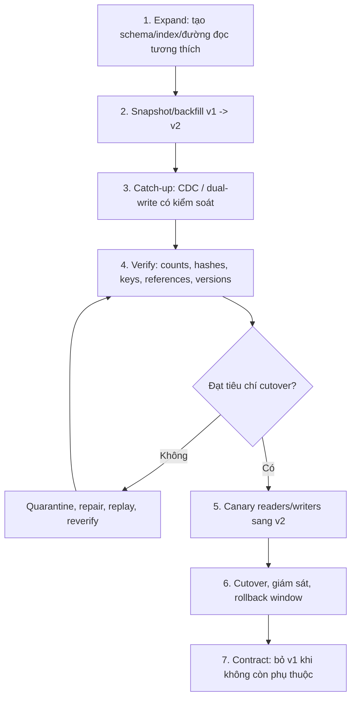

# Chuyển đổi kiểu dữ liệu, khóa và quan hệ có thể kiểm chứng

## 1. Bối cảnh: migration hoàn tất không có nghĩa dữ liệu đã đúng

Một ứng dụng Java ban đầu lưu đơn hàng trong MongoDB theo cấu trúc:

```json
{
  "_id": "O1008",
  "tenant": "shop-a",
  "total": "129.90",
  "created": "14/11/2026 09:30",
  "customer": "C77",
  "items": [
    {"sku": "P10", "quantity": "2"}
  ]
}
```

Phiên bản mới muốn dùng `totalMinor` dạng số nguyên, `createdAt` chuẩn UTC, khóa ghép tenant–order và tham chiếu có cấu trúc:

```json
{
  "_id": "shop-a|O1008",
  "tenantId": "shop-a",
  "orderId": "O1008",
  "totalMinor": 12990,
  "currency": "USD",
  "createdAt": "2026-11-14T02:30:00Z",
  "customerRef": {
    "tenantId": "shop-a",
    "customerId": "C77"
  },
  "lineItems": [
    {"productId": "P10", "quantity": 2}
  ],
  "schemaVersion": 2
}
```

Một script có thể đọc đủ một triệu documents, ghi đủ một triệu documents mới và báo `100% complete`. Nhưng điều gì xảy ra nếu:

- Chuỗi `"129.90"` bị chuyển qua `double` rồi nhân 100, dẫn tới làm tròn sai?
- Thời gian nguồn không ghi timezone, nhưng migration tự giả định UTC?
- Hai tenants đều có `orderId=O1008`, làm trùng khóa mới?
- Một `customerId` tồn tại trong tenant khác và được liên kết nhầm?
- `items` chứa chuỗi `"02"` hoặc giá trị âm?
- Một đơn hàng đổi trạng thái sau khi backfill đọc nhưng trước khi ghi đích?
- `customerRef` đã đổi sang khóa mới, còn bảng Customer vẫn dùng khóa cũ?
- Source có 1.000.000 records, target cũng có 1.000.000 records, nhưng 10.000 records bị gán nhầm tenant?

**Số lượng bằng nhau, job chạy thành công và checksum file hợp lệ không chứng minh dữ liệu đúng.** Migration phải chứng minh dữ liệu đích tương đương theo hợp đồng nghiệp vụ, không chỉ tương đương về số lượng bytes.

Bài học **Database No SQL → Di chuyển và thay đổi → Chuyển đổi kiểu dữ liệu, khóa và quan hệ có thể kiểm chứng** trình bày cách thiết kế những phép chuyển đổi có thể tái lập, kiểm chứng được và phục hồi an toàn.

---

## 2. Mục tiêu học tập

Sau bài học, bạn có thể:

1. Phân biệt chuyển đổi **kiểu dữ liệu**, **định danh/khóa** và **quan hệ**.
2. Thiết kế hợp đồng migration ghi rõ input, output, tiền điều kiện và cách xử lý dữ liệu bất thường.
3. Chuyển đổi tiền tệ, số nguyên, số thập phân, ngày giờ, enum, `null`, missing fields và dữ liệu đa hình mà không làm mất ý nghĩa.
4. Tạo khóa mới không va chạm, có thể truy vết và tương thích tenant isolation.
5. Dùng mapping table/ledger để chuyển foreign references và xây quan hệ mới.
6. Đánh giá khi nào cần embed, reference, denormalize hay materialize read model.
7. Triển khai backfill, change data capture (CDC), idempotency, checkpoints và replay có kiểm soát.
8. Thiết kế chiến lược **expand → migrate → verify → cut over → contract**.
9. Xác minh bằng invariants, record-level canonical hashes, group aggregates, đối soát quan hệ và mutation tests.
10. Phân biệt consistency tức thời, eventual convergence và trạng thái đọc trong khi migration đang chạy.
11. Xử lý rủi ro đặc thù MongoDB, DynamoDB, Cassandra, Redis, Elasticsearch/OpenSearch và graph databases.
12. Chuẩn bị canary, rollback, lưu vết quyết định và runbook phục hồi khi phát hiện sai lệch.

## 3. Ba nhóm thay đổi cần quản lý riêng

| Nhóm | Ví dụ trước → sau | Rủi ro cốt lõi |
| --- | --- | --- |
| Kiểu dữ liệu | `"129.90"` → `12990` cents | Mất độ chính xác/ngữ nghĩa |
| Khóa | `_id="O1008"` → `(tenantId, orderId)` | Va chạm, mất khả năng tìm bản ghi |
| Quan hệ | `customer="C77"` → reference/embedded snapshot | Tham chiếu sai hoặc mồ côi |
| Cấu trúc | `items[]` → `order_items` | Thiếu, trùng, lệch thứ tự |
| Phân vùng | shard theo thời gian → shard theo tenant | Key distribution, routing, hotspot |
| Read model | normalized records → projection | Cập nhật lệch, stale data |
| Quyền dữ liệu | shared table → per-tenant namespace | Rò dữ liệu khi chuyển đổi |

Một lần migration có thể thay nhiều nhóm, nhưng **mỗi nhóm cần bộ invariants và phép kiểm riêng**.

### 3.1. Thay đổi hình thức không được đổi ngữ nghĩa tùy tiện

Chuyển `total` từ chuỗi sang số nguyên là thay đổi biểu diễn. Nhưng chuyển từ “giá trước thuế” sang “giá sau thuế” là thay đổi **quy tắc nghiệp vụ**, không chỉ cast dữ liệu.

Tách rõ hai loại thay đổi để không bị nhầm giữa *schema migration* và *business recalculation*.

## 4. “Có thể kiểm chứng” nghĩa là gì?

Một phép biến đổi \(T\) nhận trạng thái nguồn \(S\) và tạo trạng thái đích \(D\):

\[
D = T(S, C)
\]

Trong đó \(C\) là **migration context** đã cố định: phiên bản code, schema, timezone, currency rules, key mapping, data cutoff và chính sách xử lý lỗi.

Một migration có thể kiểm chứng khi ta định nghĩa được những predicate:

\[
I_1(S,D)=\text{true}
\]

\[
I_2(S,D)=\text{true}
\]

\[
\cdots
\]

Ví dụ:

```text
Mỗi source Order hợp lệ có đúng một target Order.
totalMinor phản ánh chính xác total và currency của source.
Tenant ownership không thay đổi.
Mỗi customerRef trỏ tới Customer đúng tenant.
Không có target record thừa không có provenance hợp lệ.
Mọi thay đổi mới sau snapshot được áp theo version/order đúng.
```

### 4.1. Không bắt buộc bytes phải giống nhau

Nguồn chứa `"129.90"`, đích chứa `12990`; hash của raw JSON khác nhau hoàn toàn. Cần so **dữ liệu chuẩn hóa theo hợp đồng** hoặc kiểm invariants, không so file bytes.

### 4.2. Không chỉ tin script đã chạy

Phép kiểm phải dựa vào những bằng chứng độc lập nhất có thể:

- Mapping ledger và source snapshot/CDC checkpoint.
- Source và target reads.
- Bản kiểm soát số lượng theo tenant/partition.
- Canonical domain representation.
- Bộ kiểm tham chiếu và uniqueness.
- Kết quả restore/rollback rehearsal.
- Audit và exception quarantine.

## 5. Phạm vi migration: xác định chính xác dữ liệu và thời điểm

Một manifest kế hoạch:

```yaml
migration:
  id: orders-v1-to-v2
  source:
    system: mongodb
    collection: orders_v1
    logicalSnapshot: recovery-point-C
  target:
    system: mongodb
    collection: orders_v2
  codeVersion: migration-2.4.0
  dataContractVersion: 2
  businessRulesVersion: money-2026-11
  timezonePolicy: tenant-timezone-at-order-creation
  keyFormatVersion: 2
  cdcStartReference: checkpoint-C
  failureMode: quarantine-invalid-records
  verification:
    requireZeroUnmappedValidRecords: true
    requireZeroCrossTenantReferences: true
    requireExactMoneyMinorUnits: true
```

Đây chỉ là cấu trúc minh họa, không phải manifest có sẵn của MongoDB.

### 5.1. Những câu hỏi cần chốt

- Migration toàn bộ lịch sử hay chỉ dữ liệu active?
- Dữ liệu đã xóa/tombstone/TTL có thuộc phạm vi?
- Dữ liệu đang thay đổi trong lúc backfill được xử lý thế nào?
- Có multi-tenant và region-specific policies không?
- Indexes, projections, event history có phải chuyển không?
- Target có trở thành source of truth ngay không?
- Cutover có hỗ trợ rollback sau khi target nhận writes không?

## 6. Lập kiểm kê dữ liệu nguồn trước khi định nghĩa phép biến đổi

Với NoSQL, schema có thể khác nhau giữa records cùng collection:

```json
{"total":"129.90","created":"2026-11-14"}
{"total":129.9,"created":1731547800000}
{"total":{"amount":"129.90","currency":"USD"}}
{"total":null,"created":null}
{"created":"invalid-date"}
```

Trước migration cần đo:

- Số bản ghi theo `schemaVersion` hoặc shape.
- Tỷ lệ missing/null/empty.
- Những kiểu giá trị thực tế của từng field.
- Kích thước chuỗi, precision, overflow.
- Phân bố timezone/locale.
- Duplicate business IDs.
- Cardinality và foreign-reference coverage.
- Cross-tenant anomalies.
- Records bị tombstone/deleted.
- Các API hoặc jobs còn ghi format cũ.

### 6.1. Không suy schema từ vài mẫu đầu

Một collection có một triệu records có thể chứa 0,01% dữ liệu cũ bất thường. Tập mẫu phải hỗ trợ phát hiện các outliers quan trọng; khi cần bảo đảm tuyệt đối phải có validation trên toàn phạm vi.

### 6.2. Ghi tỷ lệ và số tuyệt đối

`0,01%` sai trên 100 triệu records là 10.000 records. Theo dõi cả `invalid_count`, `affected_tenants`, `invalid_types` và business impact.

## 7. Hợp đồng chuyển đổi: tiền điều kiện, phép biến đổi, hậu điều kiện

Mỗi field quan trọng nên có một bảng:

| Source | Điều kiện hợp lệ | Target | Bất biến |
| --- | --- | --- | --- |
| `total` string | Decimal, không âm, scale phù hợp currency | `totalMinor` long | Tiền không đổi |
| `created` | Parse được với timezone có căn cứ | `createdAt` UTC Instant | Cùng thời điểm |
| `status` | Trong mapping enum được hỗ trợ | Enum chuẩn | Không tự đổi trạng thái |
| `tenant` | Tenant tồn tại/được xác minh | `tenantId` | Không đổi ownership |
| `customer` | Lookup key đúng tenant | `customerRef` | Không tham chiếu tenant khác |
| `items[].quantity` | Integral, range hợp lệ | Integer | Số lượng không đổi |
| `_id` | Canonical old ID | Key mới | Một–một hoặc policy merge rõ |

### 7.1. Không có policy nghĩa là không nên đoán

Nếu `created="14/11/2026 09:30"` không có timezone và tenant cũng thiếu timezone lịch sử, **không thể suy UTC chính xác** từ dữ liệu. Một migration đúng cần quarantine, tra nguồn đáng tin hoặc quy tắc nghiệp vụ được phê duyệt — không im lặng thêm `Z`.

### 7.2. Nêu cả hành vi khi dữ liệu không hợp lệ

Ba chiến lược:

1. **Reject/halt:** dừng khi invariant quan trọng sai.
2. **Quarantine:** lưu reference, reason, source version và chờ xử lý.
3. **Explicit repair:** sửa theo mapping đã được phê duyệt và audit.

Không silently replace mọi giá trị parse lỗi thành `0`, `UNKNOWN` hoặc tenant mặc định.

## 8. Kiểu số: decimal, floating-point và integer

Dữ liệu tiền tệ không nên được chuyển bằng phép tính nhị phân thiếu kiểm soát:

```java
double amount = Double.parseDouble("0.29");
long cents = (long) (amount * 100);
```

Giá trị `double` có thể không biểu diễn chính xác nhiều số thập phân; ép về `long` bằng cast có nguy cơ làm mất phần lẻ do sai số.

### 8.1. Dùng decimal với policy rounding minh bạch

```java
import java.math.BigDecimal;
import java.math.RoundingMode;

public final class MoneyConverter {
    public static long usdToCents(String amountText) {
        BigDecimal amount = new BigDecimal(amountText);

        if (amount.signum() < 0) {
            throw new IllegalArgumentException("Negative amount");
        }

        BigDecimal cents = amount.movePointRight(2)
            .setScale(0, RoundingMode.UNNECESSARY);

        return cents.longValueExact();
    }
}
```

`UNNECESSARY` yêu cầu dữ liệu tương ứng chính xác với đơn vị nhỏ; `"12.345"` bị từ chối, không âm thầm round thành `"12.35"`.

### 8.2. Currency không phải lúc nào cũng có hai chữ số thập phân

Số chữ số đơn vị nhỏ phụ thuộc currency và chính sách thanh toán. Không mặc định mọi loại tiền đều scale=2; cũng cần xét phiên bản business rules khi currency metadata thay đổi.

### 8.3. Integer overflow

`int` 32-bit và `long` 64-bit có giới hạn. Một giá trị quá lớn phải bị phát hiện, không bị wrap. Dùng `intValueExact()`/`longValueExact()` sau khi kiểm scale.

## 9. Chuyển đổi từ BSON/JSON Number: đừng giả định mọi số đều là `double`

MongoDB có những kiểu như Int32, Int64, Double và Decimal128. JSON parser khác có thể biến số lớn thành `Double`, làm mất chữ số chính xác.

### 9.1. Quy tắc an toàn

- Ghi rõ source type.
- Với Decimal128, lấy giá trị decimal chính xác qua API phù hợp.
- Với chuỗi decimal, parse trực tiếp bằng `BigDecimal`.
- Với float/double lịch sử, xem contract: chấp nhận approximation hoặc đối soát với nguồn gốc chính xác.
- Không chuyển long IDs sang JavaScript Number nếu vượt safe integer range.
- Chọn target type đủ sức chứa.
- Test giá trị ở ranh giới và out-of-range.

### 9.2. Ví dụ mất precision

Một số nguyên 64-bit như `9007199254740993` không thể được biểu diễn chính xác dưới dạng IEEE-754 double precision trong nhiều luồng JSON/JavaScript. Nếu nó là business ID hoặc số tiền, chuyển qua `double` có thể tạo va chạm hoặc sai giá trị.

## 10. Chuyển đổi ngày giờ: Instant, LocalDateTime và timezone

Những giá trị sau khác nghĩa:

```text
2026-11-14T09:30:00Z
2026-11-14T09:30:00+07:00
14/11/2026 09:30
2026-11-14 (chỉ ngày, không có giờ)
1731547800000 (epoch? seconds? milliseconds?)
```

### 10.1. Phân biệt loại thời gian

- **Instant:** một mốc thời gian tuyệt đối.
- **LocalDate:** ngày lịch trong ngữ cảnh nghiệp vụ.
- **LocalDateTime:** giờ địa phương chưa gắn timezone.
- **OffsetDateTime:** có offset cố định.
- **ZonedDateTime:** có timezone rules theo khu vực.

Không biến một `LocalDate` thành `Instant` lúc 00:00 UTC mà không xem hợp đồng.

### 10.2. Java parse với timezone rõ

```java
import java.time.*;
import java.time.format.DateTimeFormatter;

public final class LegacyTimeConverter {
    private static final DateTimeFormatter LEGACY =
        DateTimeFormatter.ofPattern("dd/MM/uuuu HH:mm");

    public static Instant toInstant(
            String raw,
            ZoneId verifiedSourceZone) {

        LocalDateTime local = LocalDateTime.parse(raw, LEGACY);
        return local.atZone(verifiedSourceZone).toInstant();
    }
}
```

Ví dụ dùng quy tắc `atZone`, nhưng nếu thời điểm rơi vào DST gap/overlap, Java sẽ áp resolution rules. Khi nghiệp vụ yêu cầu không tự giải quyết ambiguity, phải **kiểm tra valid offsets/gap và quarantine** thay vì mặc định chọn một offset.

### 10.3. Không tự đoán epoch units

`1731547800` có thể là seconds; `1731547800000` có thể là milliseconds. Dùng metadata/schemaVersion để chọn, không chỉ thử độ dài chuỗi rồi tự suy tuyệt đối.

## 11. Boolean, enum và trạng thái nghiệp vụ

Dữ liệu lịch sử có thể biểu diễn:

```text
true / false
"true" / "false"
"1" / "0"
"Y" / "N"
1 / 0
null / missing
```

Chỉ cho phép các cách mã hóa được **định nghĩa**. Nếu field cũ cho phép `"unknown"`, chuyển mọi giá trị khác `"true"` thành `false` sẽ làm mất trạng thái thứ ba.

### 11.1. Enum mapping cần version

```text
old "PENDING_PAYMENT" -> new "AWAITING_PAYMENT"
old "SUCCESS"         -> new "PAID"
old "VOID"            -> new "CANCELLED"
old "REVERSED"        -> ? (cần quyết định nghiệp vụ)
```

Không để `default: return UNKNOWN` âm thầm che một giá trị mới chưa biết. Có thể lưu `UNKNOWN` khi hợp đồng cho phép và audit rõ, nhưng không nên biến thành giả định mặc định.

### 11.2. State transition không chỉ là rename

Nếu `REVERSED` có nghĩa đã hoàn tiền nhưng `CANCELLED` chỉ nghĩa hủy trước thanh toán, ánh xạ hai giá trị về một có thể phá quy trình báo cáo/đối soát.

## 12. `null`, missing, empty và default là bốn khái niệm khác nhau

Một document có thể là:

```json
{}
```

hoặc:

```json
{"phone": null}
```

hoặc:

```json
{"phone": ""}
```

hoặc:

```json
{"phone": "0000000000"}
```

Những trạng thái này có thể mang nghĩa:

- Chưa thu thập.
- Người dùng chủ động xóa.
- Chuỗi rỗng do lỗi nhập liệu.
- Có số điện thoại hợp lệ.

### 12.1. Không dùng default làm biến mất missing

Chuyển `missing -> false` cho `emailVerified` có thể hợp lý nếu được phê duyệt. Nhưng `missing -> true` có thể gây sự cố bảo mật. Cần lưu quyết định và số records bị áp default.

### 12.2. Unique indexes và null/missing

Nhiều NoSQL có semantics khác nhau về unique, null, missing, sparse/partial index. Khi đổi schema, kiểm tra chỉ mục mục tiêu có chấp nhận dữ liệu lịch sử hay không.

## 13. Chuỗi, Unicode, canonicalization và dữ liệu định danh

Ví dụ:

```text
"Khách hàng A"
"Khách hàng A"  (Unicode tổ hợp có thể khác biểu diễn)
" ABC "
"abc"
```

Nếu đổi key từ tên/email sang lowercase hoặc Unicode normalization, có thể tạo va chạm.

### 13.1. Không canonicalize business keys mà không tìm collision

Cùng một chuỗi sau `trim/lowercase/NFC` có thể đại diện nhiều records cũ. Cần lập danh sách collision trước khi tạo unique index.

### 13.2. Email không phải lúc nào cũng là identity key tốt

Email có thể đổi, có rules case khác nhau ở local part và có nhiều users chia sẻ cùng email theo domain; không dùng phép lowercase tùy tiện làm chứng minh hai account là một.

### 13.3. Dấu phân cách và encoding

Khi ghép `tenantId + ":" + orderId`, cần ngăn trường hợp:

```text
tenantId = "A:B", orderId = "C"
tenantId = "A",   orderId = "B:C"
```

Hai cặp tạo cùng chuỗi nếu không escape/encode. Dùng canonical binary/length-prefix encoding hoặc format có escaping và version.

## 14. Mảng, tập hợp và thứ tự

Một array chứa `items` có thể có thứ tự có ý nghĩa (thứ tự hiển thị, ưu tiên, lịch sử) hoặc chỉ là tập không thứ tự.

Khi chuyển thành collection/table riêng:

```text
Order O1001:
  item[0] = P1
  item[1] = P2
```

nếu target chỉ có `orderId + productId`, thứ tự bị mất. Nếu P1 xuất hiện hai lần với promotion khác nhau, khóa `(orderId, productId)` cũng có thể làm mất một dòng.

### 14.1. Dùng line ID/ordinal theo contract

```text
tenantId
orderId
lineId
ordinal
productId
quantity
```

Phải xác định `lineId` ổn định hay derive từ index nguồn; nếu mảng có thể được reorder khi live migration, index làm ID có thể không ổn định. Có thể cần stable item ID hoặc mapping ledger.

### 14.2. Null array, empty array và missing field

`items=[]` khác `items=null` trong một số domain. Không tự coi cả hai bằng nhau nếu tính hợp lệ của Order phụ thuộc trạng thái.

## 15. Documents đa hình và phiên bản schema

NoSQL có thể lưu nhiều shapes:

```json
{"kind":"BOOKING","details":{"checkIn":"2026-12-01"}}
{"kind":"DIGITAL","details":{"downloadCount":3}}
```

Một converter thống nhất phải có dispatch theo `kind`/`schemaVersion`, tránh parse `details` của BOOKING như DIGITAL.

### 15.1. Strategy registry

```text
schemaVersion 1 / kind BOOKING -> BookingV1Converter
schemaVersion 1 / kind DIGITAL -> DigitalV1Converter
schemaVersion 2 / kind BOOKING -> passthrough/verify
```

### 15.2. Future schema không phải invalid tùy tiện

Khi rolling deploy, có thể xuất hiện version mới mà worker cũ chưa hiểu. Worker nên quarantine/stop theo contract, không overwrite record mới với schema cũ.

## 16. Binary/blob và giới hạn dữ liệu lớn

Các records có thể chứa:

- Base64 string.
- Native binary BSON/Redis values.
- Compressed payload.
- Object storage references.
- Checksums.
- Encryption envelope.

Nếu chuyển embedded binary sang object storage:

1. Upload object trước theo key idempotent.
2. Kiểm checksum/size/media type.
3. Ghi reference có tenant scope và access policy.
4. Chỉ xóa blob cũ sau khi xác minh object tồn tại, decrypt được và rollback window kết thúc.

### 16.1. Không lấy bytes hash thay semantic check

SHA-256 giống nhau giúp phát hiện binary payload bị sửa, nhưng không chứng minh object ACL đúng tenant hoặc metadata/content type tương thích.

## 17. Đổi khóa: ID kỹ thuật và business ID

Một record có thể có:

```text
Mongo _id             = ObjectId(...)
Business order number = "O1008"
Tenant ID             = "T-A"
External ERP ID       = "ERP-778"
```

Mỗi ID có vai trò riêng. Không đổi `_id` thành `businessOrderNumber` chỉ vì dễ đọc nếu business number có thể trùng, đổi hoặc được tái sử dụng.

### 17.1. Những thuộc tính cần xác định

- Uniqueness scope: global hay per tenant?
- Stability: ID có thay khi nghiệp vụ thay đổi không?
- Format: string/UUID/long/ULID/ObjectId?
- Routing: partition/shard key có cần chứa tenant?
- Sortability: ID có được dùng để sắp theo thời gian không?
- Exposure: có được đưa ra API public không?
- Idempotency: retry có tạo cùng key không?
- Compatibility: clients cũ có giữ old ID trong links/events không?

## 18. Ánh xạ khóa cũ → khóa mới phải là dữ liệu chính thức

Ví dụ:

| Tenant | Old ID | New key | Trạng thái |
| --- | --- | --- | --- |
| T-A | O1008 | v2/T-A/O1008 | MAPPED |
| T-B | O1008 | v2/T-B/O1008 | MAPPED |
| T-A | O1050 | v2/T-A/O1050 | MAPPED |

Một **key mapping ledger** giúp:

- Tìm record target cho source record.
- Dịch foreign references.
- Xử lý retry/backfill idempotent.
- Phân tích collisions.
- Giữ đường tra cứu old IDs trong thời gian compatibility.
- Đối soát và rollback.

### 18.1. Những field nên lưu

```json
{
  "migrationId": "orders-v2",
  "sourceSystem": "orders-v1",
  "sourceTenantId": "T-A",
  "sourceId": "O1008",
  "sourceVersion": 17,
  "targetKey": "v2/T-A/O1008",
  "keyFormatVersion": 2,
  "mappingStatus": "MAPPED",
  "provenance": "backfill-2026-11-14"
}
```

### 18.2. Mapping ledger phải có uniqueness constraints

Tối thiểu:

- Một `(migrationId, sourceTenantId, sourceId)` không map tới hai target keys trái phép.
- Một target key không nhận từ hai nguồn khác nhau khi phép biến đổi phải một–một.
- Nếu merge/dedup là chủ đích, phải có **explicit many-to-one policy**.

## 19. Composite key: cách encode không nhập nhằng

Một định dạng dễ kiểm chứng là length-prefixed:

```text
v2|3:T-A|5:O1008
```

Ý tưởng:

- Prefix version.
- Mỗi thành phần ghi độ dài và giá trị.
- Decoder đọc đúng số ký tự/bytes đã quy định.
- Không bị nhầm khi ID có dấu phân cách.

### 19.1. Chọn độ dài theo bytes hay ký tự?

Nếu dùng UTF-8, số bytes khác số ký tự Java UTF-16 cho nhiều Unicode values. Hợp đồng encode phải nói rõ độ dài đo theo **UTF-8 bytes** hay code points, và code encode/decode phải thống nhất.

### 19.2. Có thể dùng thành phần mã hóa riêng

Base64url trên bytes của từng thành phần, kết hợp separator ngoài tập ký tự Base64url, cũng là một cách. Nhưng cần versioning, giới hạn độ dài và canonicalization.

### 19.3. Thử round-trip

Bất biến:

\[
decode(encode(tenantId,oldId))=(tenantId,oldId)
\]

với mọi input hợp lệ, kể cả Unicode, separator, empty/numeric-like strings theo schema.

## 20. Va chạm khóa: không tự chọn record thắng

Giả sử sau lowercase:

```text
Source user key "Alice" -> "alice"
Source user key "alice" -> "alice"
```

Nếu script dùng upsert và overwrite, một user sẽ mất.

### 20.1. Quy trình collision

1. Phát hiện trước khi ghi đích nếu có thể.
2. Lưu full source references và lý do.
3. Phân loại thật sự duplicate hay hai entity khác nhau.
4. Xin quyết định nghiệp vụ về merge/rename/reject.
5. Ghi mapping và audit.
6. Chạy lại phép kiểm uniqueness.
7. Không xóa một record nguồn để cho test xanh.

### 20.2. Dedup không phải luôn một–một

Nếu hai source records phải merge thành một target, định nghĩa explicit field precedence, history preservation, event idempotency và quyền sở hữu. Đối soát counts phải dùng **mapping cardinality policy**, không chỉ `sourceCount == targetCount`.

## 21. ID do database sinh và tính deterministic

Một backfill bị retry không nên tạo record mới mỗi lần:

```text
Attempt 1 -> target ID random-A
Attempt 2 -> target ID random-B
```

Nếu target ID là random mới không có mapping được ghi bền, retry dễ tạo duplicate.

### 21.1. Lựa chọn

- Derive deterministic target key từ stable source identity khi được phép.
- Hoặc cấp target ID một lần rồi lưu mapping ledger bền trước khi dùng.
- Dùng conditional insert để phát hiện tranh chấp.
- Giữ idempotency key cho mỗi source mutation.

### 21.2. Deterministic không có nghĩa đủ an toàn

Key có thể đoán được; API vẫn cần authorization theo tenant/resource. Không dùng độ khó đoán ID làm thay cho AuthZ.

## 22. Tách identity khỏi partition key

Khi chuyển từ một NoSQL sang hệ khác, ID ổn định không nhất thiết phải chính là partition key.

Ví dụ:

```text
Entity identity = (tenantId, orderId)
Physical partition key = TENANT#T-A#BUCKET#2026-11
Sort key = ORDER#O1008
```

Mapping và route cần biết bucket/routing attributes. Nếu bucket theo createdAt mà timestamp thay đổi, record có thể chuyển partition; cân nhắc immutable creation bucket hoặc lưu routing directory.

### 22.1. Đổi shard key có thể là thay đổi vật lý lớn

Ngay cả khi business ID không đổi, repartitioning tạo streaming, fan-out và throughput impacts. Đo tải trong migration và kiểm tra hot partition, không chỉ correctness.

## 23. DynamoDB: khóa ghép và điều kiện ghi

Một thiết kế mới:

```text
PK = TENANT#<tenant-id>
SK = ORDER#<order-id>
```

Cần rõ rằng `Query` yêu cầu key condition đúng partition; `Scan` toàn table rồi filter tenant không phải đường truy vấn được ưu tiên.

### 23.1. Ví dụ Java SDK v2: tạo key theo trusted context

```java
import software.amazon.awssdk.services.dynamodb.model.AttributeValue;
import java.util.Map;

public final class OrderKeys {
    public static Map<String, AttributeValue> key(
            String verifiedTenantId,
            String orderId) {
        return Map.of(
            "PK", AttributeValue.fromS(
                "TENANT#" + verifiedTenantId),
            "SK", AttributeValue.fromS(
                "ORDER#" + orderId)
        );
    }
}
```

Ví dụ giả định IDs đã validated/canonicalized trước đó. Nếu IDs có separator và không giới hạn, dùng key encoder an toàn thay string concat.

### 23.2. Conditional insert

Dùng `PutItem` với condition tránh ghi đè ngoài ý muốn:

```java
var put = PutItemRequest.builder()
    .tableName("OrdersV2")
    .item(newItem)
    .conditionExpression("attribute_not_exists(PK)")
    .build();
db.putItem(put);
```

Với item có composite primary key, `attribute_not_exists(PK)` là một mẫu condition ngăn ghi đè item tồn tại ở key được chỉ định. Kết quả `ConditionalCheckFailedException` cần được kiểm xem là **retry của cùng nội dung** hay collision thật; không coi mọi conflict là thành công.

### 23.3. GSI là access path độc lập

Chuyển primary key mà quên đổi GSI keys có thể trộn tenants hoặc làm query không target đúng. Đối soát từng access pattern, không chỉ GetItem theo PK/SK.

## 24. MongoDB: `_id` bất biến và chiến lược tạo collection mới

Trong MongoDB, `_id` của một document là immutable. Không thể đơn giản `updateOne` để thay `_id` từ old key sang composite key.

Một chiến lược phổ biến:

```text
orders_v1 (đọc/ghi hiện tại)
      |
      | read -> transform -> validate
      v
orders_v2 (collection mới, index mới)
```

### 24.1. Tại sao collection mới dễ kiểm chứng?

- Có thể so song song v1/v2.
- Có thể build indexes/validators mới.
- Không sửa/xóa old `_id` khi chưa đạt cutover.
- Rollback đọc về v1 có đường rõ, nếu vẫn duy trì source state phù hợp.
- Dễ cô lập records chưa chuyển và data quality exceptions.

### 24.2. Cảnh báo

Collections mới không tự tạo atomic migration. Nếu old và new cùng nhận writes, cần thiết kế CDC/dual-write/transaction semantics. `renameCollection` hoặc đổi alias ở tầng ứng dụng cũng có giới hạn topology/privileges và không giải quyết data synchronization.

## 25. Cassandra: thay primary key thường là chuyển bảng

Cassandra/CQL partition key và clustering columns quyết định physical data model. Muốn thay primary key từ:

```sql
PRIMARY KEY ((order_id))
```

sang:

```sql
PRIMARY KEY ((tenant_id, order_day), created_at, order_id)
```

thường cần tạo **table mới** theo query pattern, backfill và chuyển đường đọc/ghi.

### 25.1. Denormalized tables có nhiều phiên bản cùng record

Một Order có thể xuất hiện trong:

```text
orders_by_id
orders_by_tenant_day
orders_by_customer
```

Backfill phải kiểm coverage và correctness **của từng projection**. Cassandra write thành công vào một table không tự chứng minh mọi table liên quan đã đồng bộ.

### 25.2. Không dùng broad scan để “lấy dữ liệu dễ hơn” ở production

CQL truy vấn tốt phụ thuộc partition key. Với dữ liệu lớn, dùng cơ chế export/scan phân tán được hỗ trợ, có throttling, checkpoint và quan sát tombstones; không tự dùng `ALLOW FILTERING` trên toàn bộ bảng như đường backfill mặc định.

### 25.3. Batch không luôn là distributed transaction

CQL `BATCH` có semantics và giới hạn riêng; không suy nó luôn tương đương một ACID transaction tổng quát xuyên nhiều partitions và read models. Cần mô hình idempotent/eventual update hoặc transaction capability thực của hệ nếu nghiệp vụ đòi.

## 26. Redis: đổi key phải bảo toàn TTL và namespace

Giả sử key cũ:

```text
order:O1008
```

chuyển thành:

```text
tenant:T-A:order:O1008
```

Không chỉ copy value. Cần xem:

- TTL còn lại.
- Value encoding/serialization version.
- ACL key patterns.
- Memory/eviction policy.
- Cluster hash slots.
- Delete/tombstone events.
- Cache invalidation và race với writes mới.

### 26.1. TTL có ý nghĩa nghiệp vụ hay chỉ cache?

Nếu Redis là cache, có thể tốt hơn **không backfill toàn bộ**, mà dùng namespace v2 và refill theo nhu cầu.

Nếu Redis giữ session hoặc authoritative state, TTL là một phần contract; đặt TTL mới bằng giá trị ban đầu sẽ kéo dài thời hạn không được phép.

### 26.2. `RENAME` không đồng nghĩa migration online an toàn

Lệnh đổi tên key (nếu được phép và áp dụng) có semantics và giới hạn riêng; Redis Cluster còn có slot constraints. Không tự phát `RENAME` hàng triệu keys production khi chưa xác minh blocking, atomicity và collision behavior.

## 27. Quan hệ trong NoSQL: không chỉ foreign key

Những kiểu quan hệ thường gặp:

- `Order -> Customer` reference.
- `Order -> LineItems` embedded one-to-many.
- `User <-> Group` many-to-many.
- `Product -> Category` hierarchy.
- `GraphNode -[FOLLOWS]-> GraphNode`.
- `Event -> Aggregate` và version.
- `SearchDocument -> SourceRecord`.
- `CacheKey -> SourceVersion`.

NoSQL thường không có foreign-key constraints như RDBMS ở tất cả sản phẩm/modes. Vì vậy **referential integrity phải được thiết kế ở model, write protocol và verification**.

## 28. Quyết định embed hay reference bằng access patterns

| Lựa chọn | Khi phù hợp | Rủi ro migration |
| --- | --- | --- |
| Embed | Dữ liệu nhỏ, đọc cùng nhau, vòng đời chung | Kích thước document và cập nhật nhiều nơi |
| Reference | Entity có vòng đời riêng, được chia sẻ | Dangling references, lookup/fan-out |
| Denormalize | Đường đọc cần tốc độ và query shape cố định | Projection stale, multiple writes |
| Join/materialize | Truy vấn tổng hợp/quan hệ nhiều | Snapshot consistency và cost |
| Graph edge | Traversal nhiều hops/quan hệ động | Cross-tenant traversal, missing edges |

### 28.1. Không embed không giới hạn

Một Customer có hàng triệu Orders không nên tự động embed toàn bộ Orders vào Customer document. Phải xét size limits, write contention và access patterns.

### 28.2. Không đổi quan hệ chỉ để giảm số collections

Đổi reference sang embed có thể làm mất independent lifecycle, quyền riêng của field hoặc khả năng update atomically theo domain.

## 29. Chuyển quan hệ một–nhiều: giữ identity từng thành phần

Nguồn:

```json
{
  "_id": "O1008",
  "items": [
    {"sku": "P1", "qty": "2"},
    {"sku": "P1", "qty": "3"}
  ]
}
```

Đích có table/collection `order_items`:

```text
tenantId | orderId | lineId | ordinal | productId | quantity
T-A      | O1008   | L1     | 0       | P1        | 2
T-A      | O1008   | L2     | 1       | P1        | 3
```

Nếu key chỉ có `(tenantId,orderId,productId)`, hai lines cùng P1 bị gộp nhầm.

### 29.1. Invariants

\[
\sum_{\text{lines of order}} quantity_{\text{source}}
=
\sum_{\text{lines of order}} quantity_{\text{target}}
\]

Nhưng tổng bằng nhau chưa chứng minh line identity và discount/tax đúng. Cần cả line count và line-level mapping/semantic comparison.

### 29.2. Xử lý reorder đồng thời

Nếu items có thể đổi thứ tự trong lúc migration, `ordinal` từ lần scan đầu có thể stale. Dùng record version và CDC to update/remove/reorder lines chính xác, hoặc freeze mutation domain trong migration window.

## 30. Chuyển quan hệ nhiều–nhiều

Nguồn có:

```json
{"groupId":"G1","members":["U1","U2","U3"]}
```

Đích:

```text
group_membership:
  tenantId
  groupId
  userId
  role
  joinedAt
```

Cần xác minh:

- Không mất membership.
- Không tạo duplicate edges.
- Role không bị ghi đè về mặc định.
- User/group phải thuộc cùng tenant trừ khi có sharing policy rõ.
- Delete/revoke events được áp, không hồi sinh membership cũ.
- Membership có thứ tự/attributes hay không.

### 30.1. Đếm edges và kiểm hai chiều

```text
source memberships per group
target edges per group
target edges per user
dangling group references
dangling user references
```

Một count tổng thể giống nhau không loại trừ việc nhóm G1 mất một user và G2 thừa một user.

## 31. Quan hệ có vòng và dependency graph

Ví dụ:

```text
A references B
B references C
C references A
```

Nếu converter đòi target key của B mới tạo A, rồi lại đòi C và A, sẽ gặp vòng phụ thuộc.

### 31.1. Chiến lược hai pha

1. **Phase 1:** cấp và lưu mapping keys cho **mọi entities**.
2. **Phase 2:** chuyển records và edges/references dựa trên mapping đã có.

Cách này tách việc xác định danh tính khỏi tạo nội dung, giảm khó khăn do cycles.

### 31.2. Missing references không được nối sang tenant khác

Nếu Customer `C77` không có trong T-A nhưng có ở T-B, không được tự ghép sang Customer của B vì ID trùng. Quarantine hoặc sửa theo authoritative owner mapping.

## 32. Delete, TTL và tombstone khi thay mô hình quan hệ

Một migration dễ mắc lỗi chỉ xử lý creates/updates và bỏ deletes.

Ví dụ:

```text
T0: Backfill reads Order O1008
T1: User deletes O1008
T2: Backfill writes O1008 into target
T3: No delete CDC event was processed
```

Target đã **hồi sinh record bị xóa**.

### 32.1. Quy tắc

- Lưu source version/sequence.
- Capture cả delete/tombstone events.
- Chặn event cũ overwrite tombstone mới.
- Giữ tombstone đủ lâu cho CDC lag/backfill window.
- Xác định TTL semantics và expire-at timestamp rõ.
- Kiểm quyền xóa dữ liệu và retention requirements.

### 32.2. Expiry không luôn là event có thứ tự đơn giản

TTL expiration có thể không tạo CDC event giống explicit delete ở mọi engine. Cần hiểu backend specifics và có một lần reconciliation với source/source snapshot tại cutover.

## 33. Referential integrity không tự có ở shared collections

Mô hình:

```text
orders(tenantId, orderId, customerId)
customers(tenantId, customerId)
```

Invariant:

\[
\forall o \in Orders_{\text{active}},
\exists c \in Customers:
o.tenantId=c.tenantId
\land o.customerId=c.customerId
\]

Nếu domain cho phép “guest orders” không có Customer, invariant phải được điều chỉnh theo `customerType`, không tự bắt mọi record có reference.

### 33.1. Tham chiếu sai tenant là lỗi bảo mật

Một `customerId` trùng giữa T-A và T-B nhưng được resolve bằng global ID lookup có thể lộ PII. Migration phải verify tenant **ở cả nguồn lẫn đích**, không chỉ link count.

### 33.2. Dangling reference có thể là trạng thái tạm hợp lệ?

Trong eventual consistency, target Order có thể xuất hiện trước target Customer trong quá trình backfill. Điều đó được chấp nhận tạm thời nếu **có checkpoint/expiry và final verification**. Không biến “tạm” thành “mãi mãi”.

## 34. Snapshot nguồn: tạo tập dữ liệu có thể đối soát

Nếu backfill kéo dài hàng giờ, source vẫn thay đổi. Muốn biết “1.000.000 records nào phải ở target?”, cần một mốc nhất quán:

- Supported database snapshot/backup.
- Change stream resume point và snapshot boundary.
- Một transaction/snapshot read trong phạm vi engine hỗ trợ.
- Quiescence hoặc maintenance window khi không có cơ chế online phù hợp.

### 34.1. Snapshot cục bộ khác global cut

Nếu dữ liệu trải trên nhiều shards/tables, không được giả định mỗi shard snapshot độc lập cùng UTC time là một điểm nguồn nhất quán xuyên giao dịch.

### 34.2. Phạm vi nguồn phải biết

```text
Source baseline at C
  + ordered changes after C
  = target candidate state at cutover K
```

Đây là mô hình logic; thứ tự và semantics log khác nhau theo engine, có thể chỉ là per-partition ordering.

## 35. Expand → migrate → verify → cut over → contract

Một vòng đời migration online:



### 35.1. Không gộp mọi pha trong một deployment

Nếu vừa thay schema, đổi keys, xóa old collection và chuyển toàn bộ traffic, khi phát hiện lỗi bạn có rất ít đường khôi phục.

### 35.2. Backward/forward compatibility

Trong giai đoạn rolling deployment, có thể có app v1/v2 đồng thời. Cần xác định:

- V1 đọc được records mới?
- V2 đọc được records cũ?
- Những fields mới có optional/default đúng?
- Writers cũ còn ghi dạng đã deprecated không?
- Client API old IDs được redirect/map thế nào?

## 36. Backfill: một lần chạy không nên gắn với một lần thành công tuyệt đối

Backfill thường chia theo:

```text
tenant
partition/range
document ID interval
time bucket
shard/token range
```

Mỗi worker nên có:

- Stable task ID.
- Input snapshot/checkpoint.
- Retry-safe transform.
- Bounded batch size.
- Concurrency/rate limit.
- Progress theo **confirmed writes**.
- Quarantine records.
- Metrics và checkpoint bền.
- Resume sau crash.

### 36.1. Offset pagination dễ bị lệch

Khi source collection thay đổi, page bằng `skip/offset` có thể bỏ qua/lặp records. Ưu tiên stable keyset cursor/snapshot cursor hoặc source-specific scan mechanism.

### 36.2. Checkpoint sau khi ghi bền

Nếu worker ghi checkpoint “đã xử lý đến O2000” trước khi target ACK, crash có thể bỏ mất O1999. Thường cần ghi target có idempotency rồi cập nhật checkpoint theo giao thức chấp nhận at-least-once/replay.

## 37. CDC và order of operations

Một luồng:

```text
Source writes:
  Order O1 version=10
  Order O1 version=11
  Order O1 DELETE version=12

Target apply order:
  v10 -> v11 -> v12 tombstone
```

Nếu events đến sai thứ tự, target có thể bị lùi trạng thái.

### 37.1. Version fencing

Một policy:

```text
Accept incoming record if incomingSourceVersion > storedSourceVersion.
Ignore if incomingSourceVersion < storedSourceVersion.
If equal, compare deterministic payload hash and classify duplicate/conflict.
```

### 37.2. Version phải có scope và semantics phù hợp

Một timestamp do client gán không phải luôn monotonic trên mọi writers. Nên dùng authoritative database version/LSN/sequence hoặc application versioning có CAS hợp lệ.

### 37.3. Cross-partition ordering

CDC có thể bảo đảm thứ tự **trong một partition/key** nhưng không cung cấp một thứ tự toàn cục cho mọi keys. Nếu quan hệ giữa Order và Customer cần ordering xuyên keys, cần protocol reconciliation/gating riêng.

## 38. Dual-write: dễ hình dung nhưng dễ tạo sai lệch

Một API ghi hai nơi:

```text
Write source v1
Write target v2
```

Nếu v1 thành công, v2 thất bại, ta có partial write. Nếu đảo thứ tự, vẫn có trường hợp một nơi thành công một nơi lỗi.

### 38.1. Không coi try/finally là transaction phân tán

```java
writeV1();
writeV2();
```

không cung cấp atomicity giữa hai database nếu chúng không cùng transactional boundary.

### 38.2. Cách cải thiện

- Transactional outbox khi source hỗ trợ.
- CDC từ authoritative source.
- Idempotent target writes.
- Retry/backoff có giới hạn.
- Dead-letter/quarantine không hợp lệ.
- Continuous reconciliation.
- Chỉ dùng dual-write trực tiếp khi failure semantics được chấp nhận và có cơ chế sửa sai.

## 39. Shadow reads và so sánh kết quả

Trong thời gian migration, có thể:

```text
API đọc v1 -> trả user
          \-> đọc v2 -> compare normalized result (không trả user)
```

### 39.1. Những điều cần phân biệt

- Response semantic equivalence, không chỉ JSON string equality.
- Eventual lag được cho phép là bao nhiêu?
- Read concern/snapshot point có giống nhau không?
- User identity và tenant scope có được giữ không?
- V2 query có tự gây side effects không?
- Shadow traffic có gây quá tải source/target không?

### 39.2. So sánh theo nguồn phiên bản

Nếu v1 đã ở version 17 nhưng v2 mới ở 16, một mismatch có thể chỉ là CDC lag. Bộ so sánh cần nêu **expected convergence deadline** và ưu tiên các lỗi không thể chấp nhận, như sai tenant/amount.

## 40. Canary và cutover có thể đảo lại

Thay vì chuyển 100% traffic ngay:

```text
0% -> 1% -> 5% -> 25% -> 50% -> 100%
```

Tỷ lệ chỉ minh họa, tùy risk/capacity.

Ở mỗi pha:

- Tính success/error và p95/p99.
- Kiểm semantic mismatches.
- Kiểm uniqueness và referential invariants.
- So target write conflicts.
- Kiểm CDC lag.
- Kiểm tenant isolation.
- So business outcomes và audit.
- Kiểm rollback path.

### 40.1. Router phải ổn định theo entity nếu cần

Một user/request đọc v1 rồi ghi v2 có thể gặp mismatch do consistency. Cân nhắc routing theo tenant/entity/session trong canary; không tùy tiện random từng request nếu workflow đòi read-your-writes.

### 40.2. Không xóa v1 trong rollback window

Duy trì old read/write compatibility và data replay plan trong thời gian đã định. Sau khi target là authority, rollback sang v1 **không tự an toàn** nếu writes mới không được phản chiếu trở lại.

## 41. Cutover write authority: điểm chuyển rủi ro nhất

Tại thời điểm K, cần rõ:

```text
Before K: v1 authoritative
After K:  v2 authoritative
```

Nếu cả hai cùng nhận writes mà không có fencing, có thể split-brain ở tầng ứng dụng.

### 41.1. Một protocol cutover mẫu

1. Chặn/giới hạn writers mới theo policy.
2. Đợi in-flight operations và CDC catch-up đến watermark K.
3. Đóng writer path cũ hoặc đánh dấu epoch cũ.
4. Kích hoạt v2 write authority với epoch mới.
5. Xác minh idempotency/dedup.
6. Cho traffic đi qua routing mới.
7. Theo dõi divergence và failover readiness.

### 41.2. Fencing epoch

Một write có `writerEpoch=old` không được ghi đè state đã chuyển sang `writerEpoch=new`. Cần enforcement thật ở backend/coordination protocol, không chỉ một field log.

## 42. Rollback: đảo code khác đảo dữ liệu

Có thể rollback code deploy nhưng không rollback được mọi record mới nếu target schema có fields không biểu diễn được ở v1.

### 42.1. Ba trường hợp

- **Read rollback:** v1 vẫn có dữ liệu và tiếp tục là source, đơn giản hơn.
- **Write rollback:** v2 đã nhận writes, cần reverse CDC hoặc protocol chuyển authority lại.
- **Data restore:** phục hồi snapshot trước migration, có thể mất writes mới và tạo side effects bên ngoài; cần RPO/reconciliation.

### 42.2. Bất đối xứng của chuyển đổi

Nếu transform gộp hai enums thành một, bỏ field hoặc round số, phép nghịch đảo có thể không tồn tại. Cần giữ source/lineage trước khi cho phép rollback.

### 42.3. Đừng hứa “rollback một click”

Một chiến lược rollback chỉ hợp lệ khi đã diễn tập từ **trạng thái sau cutover có writes mới**, không chỉ từ trạng thái v2 chưa nhận traffic.

## 43. Bất biến đếm và bijection

Nếu phép đổi khóa là một–một:

\[
|\text{ValidSourceAtC}| = |\text{TargetMappedAtC}|
\]

và:

\[
\forall s,\ \exists! t:\ t.key=map(s.key)
\]

Đồng thời kiểm ngược:

\[
\forall t \in Target,\ \exists s:\ t=transform(s)
\]

### 43.1. Count cần phân nhóm

Không chỉ:

```text
source=1.000.000
target=1.000.000
```

Mà kiểm theo:

```text
tenant
entity type
schema version
status
source partition/range
date bucket
```

Một nhóm thiếu 100 records và nhóm khác thừa 100 sẽ không bị che bởi tổng chung.

### 43.2. Distinct keys quan trọng

`count(target)==count(source)` không chứng minh uniqueness khi một record bị trùng và record khác bị thiếu. Kiểm distinct keys và mapping cardinality.

## 44. Bất biến số tiền và các phép tổng hợp

Ví dụ với Orders:

\[
\sum_{\text{orders of tenant T}} totalMinor_{\text{source-normalized}}
=
\sum_{\text{orders of tenant T}} totalMinor_{\text{target}}
\]

Nên đối soát theo:

- Tenant.
- Currency.
- Khoảng thời gian.
- Order status.
- Invoice/tax category nếu nghiệp vụ yêu cầu.

### 44.1. Không cộng tiền khác currency

`100 USD + 100 JPY` không bằng `200` với một đơn vị chung. Nếu cần quy đổi, phải dùng exchange-rate snapshot và business rule version rõ, không tùy lấy tỷ giá hiện tại.

### 44.2. Tổng bằng nhau vẫn có thể sai từng record

Hai records bị swap số tiền có thể giữ tổng không đổi. Dùng group sums để tìm vùng lỗi, **sau đó record-level verification**.

## 45. Bất biến tham chiếu và đồ thị quan hệ

Các kiểm tra:

```text
Target Orders referencing absent Customers
Target edges whose endpoints have different tenant scope
Target items without parent Order
Target duplicate line IDs
Target Customer with impossible membership count
Graph nodes not reachable under expected relation
```

### 45.1. Một bảng đối soát

| Kiểm tra | Expected | Actual | Kết quả |
| --- | ---: | ---: | --- |
| Valid Orders | 1.000.000 | 1.000.000 | PASS (số lượng) |
| Distinct target order keys | 1.000.000 | 999.998 | FAIL |
| Dangling customerRefs | 0 | 2 | FAIL |
| Cross-tenant references | 0 | 0 | PASS |
| Orders with invalid money | 0 | 13 | FAIL |
| Target docs ahead of source watermark | Theo policy | 0 | PASS |

Số liệu chỉ minh họa. Một dòng FAIL với invariants quan trọng có thể chặn cutover dù tổng records đúng.

## 46. Hash canonical: so ngữ nghĩa chứ không so thứ tự JSON

Raw JSON có thể khác do:

- Thứ tự fields.
- Dạng số `"1.0"` và `"1.00"`.
- Timezone representation khác nhưng cùng Instant.
- Array order có hoặc không có ý nghĩa.
- `null` vs missing theo policy.
- Fields được rename hoặc bỏ.

Một **canonical domain record** phải được định nghĩa:

```text
canonicalOrder(
  tenantId,
  orderId,
  amountMinor,
  currency,
  createdAtEpochMicros,
  orderedLineItems,
  normalizedStatus
)
```

Sau đó hash bằng thuật toán ổn định, ví dụ SHA-256.

### 46.1. Định nghĩa serialization

Cần chốt:

- Version của canonicalization.
- Encoding UTF-8.
- Field ordering.
- Cách biểu diễn null/missing.
- Decimal scale và số nguyên.
- Timestamp precision.
- Array ordering và sort key.
- Normalization/escaping.

Nếu canonicalization không versioned, đổi Java serializer cũng có thể tạo false mismatches.

### 46.2. Hash không chứng minh uniqueness hoặc quyền

Hai hashes giống nhau theo canonical representation giúp xác nhận nội dung được so giống nhau dưới hợp đồng đó. Nó không tự chứng minh record đúng tenant, mapping đầy đủ hoặc source data không hỏng từ trước.

### 46.3. Bảo vệ dữ liệu nhạy cảm trong fingerprint

Hash giá trị có entropy thấp (ví dụ trạng thái, số điện thoại) có thể bị đoán bằng brute force. Không công bố per-record hashes chứa PII không được bảo vệ; lưu trong môi trường/audit store có quyền, cân nhắc HMAC keyed theo policy.

## 47. Merkle tree và kiểm từng vùng dữ liệu lớn

Với hàng trăm triệu records, full record comparison lặp lại có thể tốn kém.

Một cách:

1. Canonicalize records theo version.
2. Sắp theo stable `(tenantId,sourceId)` hoặc target mapping.
3. Hash record.
4. Hash groups/ranges.
5. Xây cây Merkle để tìm vùng khác nhau.
6. Drill down vào leaves mismatching.

### 47.1. Cây chỉ tốt khi đầu vào cùng snapshot/canonicalization

Nếu source thay đổi trong lúc target được hash và không có watermark chung, mismatch không nhất thiết do transform lỗi.

### 47.2. Cần cùng membership semantics

Nếu dữ liệu nguồn chứa tombstones hoặc target intentionally filters soft-deleted records, hai cây phải so những tập tương đương theo hợp đồng.

## 48. Sampling không đủ chứng minh không có lỗi hiếm

Một shadow compare kiểm 1% traffic có thể hữu ích để phát hiện regressions sớm, nhưng không thể chứng minh toàn bộ hàng triệu records đã được map đúng.

Kết hợp:

- **Full structural checks:** counts, uniqueness, mapping coverage, invariants có thể tính toàn bộ.
- **Targeted high-risk full checks:** tiền, quyền, tenant ownership, identity.
- **Statistical sampling:** response semantics và performance.
- **Risk-stratified samples:** dữ liệu cũ, tenants lớn, edge-case formats.
- **Canary online comparisons:** phát hiện mismatch mới phát sinh.

### 48.1. Confidence phải được diễn đạt đúng

Một mẫu ngẫu nhiên không gặp lỗi chỉ cho ước lượng tỷ lệ lỗi với assumptions cụ thể; không tương đương đảm bảo zero lỗi. Với dữ liệu tài chính hoặc rò tenant, có thể cần kiểm tra toàn phạm vi.

## 49. Kiểm dữ liệu không hợp lệ: quarantine cần có trạng thái

Không nên chỉ:

```text
try transform
catch -> log "skip"
```

Quarantine record nên có:

```json
{
  "migrationId": "orders-v2",
  "sourceTenantRef": "T-A",
  "sourceRecordRef": "O1081",
  "sourceVersion": 3,
  "failureCategory": "AMBIGUOUS_TIMEZONE",
  "rawValueStoredSecurely": false,
  "firstDetectedAt": "2026-11-14T03:00:00Z",
  "attemptCount": 1,
  "decisionStatus": "PENDING_REVIEW",
  "resolutionPolicyVersion": null
}
```

### 49.1. Không lưu plaintext nhạy cảm vào DLQ mặc định

Quarantine có thể lưu an toàn source reference và diagnostic category, còn raw payload nếu cần phải theo policy quyền/encryption/retention riêng.

### 49.2. Có đường repair

```text
PENDING_REVIEW -> APPROVED_MAPPING -> RETRY -> VERIFIED
```

Không “xử lý xong” bằng cách xóa record khỏi failed counter. Cần audit người phê duyệt và phép chuyển đổi sửa lại.

## 50. Java: converter có kiểu rõ, không mutate nguồn

Một converter nên là hàm thuần trong phạm vi có thể:

```java
import java.time.Instant;
import java.util.List;

record LegacyLine(String sku, String quantityText) {}

record LegacyOrder(
    String tenantId,
    String orderId,
    String totalText,
    Instant createdAt,
    List<LegacyLine> lines,
    long sourceVersion
) {}

record TargetLine(
    String lineId,
    String productId,
    int quantity
) {}

record TargetOrder(
    String targetKey,
    String tenantId,
    String orderId,
    long totalMinor,
    Instant createdAt,
    List<TargetLine> lines,
    long sourceVersion,
    int schemaVersion
) {}
```

```java
import java.math.BigDecimal;
import java.math.RoundingMode;
import java.util.ArrayList;

public final class OrderV2Converter {

    public static TargetOrder convert(LegacyOrder old) {
        if (old.tenantId() == null
                || old.tenantId().isBlank()) {
            throw new IllegalArgumentException(
                "Missing tenant");
        }

        BigDecimal minor = new BigDecimal(old.totalText())
            .movePointRight(2)
            .setScale(0, RoundingMode.UNNECESSARY);

        long totalMinor = minor.longValueExact();

        var lines = new ArrayList<TargetLine>();

        for (int i = 0; i < old.lines().size(); i++) {
            LegacyLine line = old.lines().get(i);

            int quantity = Integer.parseInt(
                line.quantityText());

            if (quantity <= 0) {
                throw new IllegalArgumentException(
                    "Invalid quantity");
            }

            String lineId = old.orderId() + "#line-" + i;

            lines.add(new TargetLine(
                lineId,
                line.sku(),
                quantity
            ));
        }

        return new TargetOrder(
            composeKey(old.tenantId(), old.orderId()),
            old.tenantId(),
            old.orderId(),
            totalMinor,
            old.createdAt(),
            List.copyOf(lines),
            old.sourceVersion(),
            2
        );
    }

    private static String composeKey(
            String tenantId, String orderId) {
        // Ví dụ này chỉ chấp nhận IDs đã có format cố định,
        // không cho phép dấu phân cách '|' hoặc '#'.
        if (!tenantId.matches("[A-Za-z0-9_-]+")
                || !orderId.matches("[A-Za-z0-9_-]+")) {
            throw new IllegalArgumentException("Invalid key");
        }
        return "v2|" + tenantId + "|" + orderId;
    }
}
```

### 50.1. Giới hạn cần biết

- Ví dụ cố định currency scale=2 để tập trung vào transform; production cần currency rule per record.
- `lineId` từ index chỉ ổn định nếu source line ordering/identity được khóa theo version hoặc có mapping.
- Converter không tự xác minh Customer references; cần resolver và verification stage khác.
- Không kiểm `totalMinor` bằng tổng line prices vì source demo chưa có giá/thuế/discount.
- Dữ liệu nguồn phải được parse và xác minh từ schema thật trước khi tạo `LegacyOrder`.

## 51. Java: bộ kiểm chuyển đổi theo miền nghiệp vụ

Một validator minh họa:

```java
import java.util.HashSet;

public final class OrderV2Validator {

    public static void verify(
            LegacyOrder source,
            TargetOrder target) {

        if (!source.tenantId().equals(target.tenantId())) {
            throw new SecurityException(
                "Tenant changed during conversion");
        }

        if (!source.orderId().equals(target.orderId())) {
            throw new IllegalStateException(
                "Business ID mismatch");
        }

        if (source.sourceVersion() != target.sourceVersion()) {
            throw new IllegalStateException(
                "Source version mismatch");
        }

        if (source.lines().size() != target.lines().size()) {
            throw new IllegalStateException(
                "Line count changed");
        }

        var lineIds = new HashSet<String>();

        for (TargetLine line : target.lines()) {
            if (!lineIds.add(line.lineId())) {
                throw new IllegalStateException(
                    "Duplicate target line");
            }
        }

        if (target.schemaVersion() != 2) {
            throw new IllegalStateException(
                "Wrong schema version");
        }
    }
}
```

Đây là **validator chưa đầy đủ**. Một bài kiểm thực tế còn cần so amount/currency, createdAt semantics, line values, refs, discount/tax, statuses và active/deleted state.

### 51.1. Không viết bộ kiểm sử dụng nguyên một hàm chuyển đổi rồi tự so với nó

Nếu `expected = converter(source)` và `actual = converter(source)`, cả hai chứa cùng bug cũng PASS. Kết hợp oracle độc lập: raw source semantics, approved mapping tables, domain calculations, grouped totals và chuyên gia nghiệp vụ.

## 52. JUnit: table-driven edge cases

Ví dụ:

```java
import static org.junit.jupiter.api.Assertions.*;
import org.junit.jupiter.api.Test;

import java.math.BigDecimal;
import java.math.RoundingMode;

final class MoneyMigrationTest {

    private long toMinor(String input) {
        return new BigDecimal(input)
            .movePointRight(2)
            .setScale(0, RoundingMode.UNNECESSARY)
            .longValueExact();
    }

    @Test
    void exactMoneyConversion() {
        assertEquals(12990L, toMinor("129.90"));
        assertEquals(1L, toMinor("0.01"));
        assertEquals(0L, toMinor("0.00"));
    }

    @Test
    void rejectsUnsupportedScale() {
        assertThrows(ArithmeticException.class,
            () -> toMinor("1.005"));
    }

    @Test
    void rejectsOverflow() {
        assertThrows(ArithmeticException.class,
            () -> toMinor("99999999999999999999.00"));
    }
}
```

### 52.1. Những test khác cần bổ sung

- Negative amount nếu domain cấm.
- Currency scale khác hai.
- Null/missing money.
- Unicode ID.
- Key collisions sau normalization.
- DST gap/overlap.
- Reference tới tenant khác.
- Duplicate line items.
- Stale CDC update sau delete.
- Backfill retry cùng source ID.

## 53. Property-based và metamorphic tests

Một bộ test sinh nhiều records ngẫu nhiên có thể kiểm:

```text
convert(source) luôn có tenantId = source.tenantId
convert(source) không tạo negative quantity hợp lệ
decode(encode(key)) == key
convert(source) deterministic khi context cố định
retry apply không thay target nếu source version không đổi
```

### 53.1. Metamorphic relation

Ví dụ, nếu chỉ đổi một field không liên quan đến money, `totalMinor` không được đổi.

Hoặc thêm một Order của tenant B không được làm kết quả truy vấn đối soát tenant A thay đổi.

### 53.2. Sinh cả dữ liệu bẩn

Random test chỉ sinh dữ liệu hợp lệ dễ bỏ sót vấn đề. Thêm malformed dates, unicode separators, duplicate IDs, missing fields, numeric extremes và orphan refs.

### 53.3. Không tạo data thật trên production

Fuzz/property-based tests phải chạy với fixtures hoặc staging có quyền, không tạo giao dịch tài chính thật.

## 54. Kiểm mapping bảng lớn bằng phân vùng và checkpoints

Một quy trình có thể lưu:

```text
Partition P01:
  sourceSnapshotCount
  targetMappedCount
  sourceCanonicalHash
  targetCanonicalHash
  lastVerifiedVersion

Partition P02:
  ...
```

Khi một partition mismatch, chỉ recheck/reprocess vùng đó, thay vì restart toàn bộ backfill.

### 54.1. Checkpoint phải gắn recovery epoch

Nếu data source được restore về trạng thái cũ, checkpoint từ một timeline mới hơn có thể không còn hợp lệ. Lưu source epoch/stream identity và kiểm trước khi resume.

### 54.2. Đừng dùng offset làm định danh record

Offset trang/trình tự scan không thay stable source key. Khi reshard, offset có thể đổi; mapping phải dựa trên identity và version có hợp đồng rõ.

## 55. Đo chênh lệch liên tục khi vẫn có writes

Một dashboard:

```text
backfill_records_read_total
backfill_valid_records_total
backfill_target_writes_confirmed_total
backfill_quarantined_total
cdc_events_applied_total
cdc_events_ignored_stale_total
cdc_lag_seconds
mapping_collisions_total
duplicate_target_keys_total
semantic_mismatch_total
dangling_references_total
cross_tenant_reference_total
unverified_oldest_age_seconds
```

Các tên là đề xuất, không phải metrics có sẵn của backend.

### 55.1. Theo dõi backlog lâu nhất

Nếu CDC consumer đứng, `last_completed_event_latency` có thể vẫn đẹp do không còn event hoàn tất. Theo dõi `oldest_pending_age`, checkpoint freshness và bytes/events backlog.

### 55.2. Không dùng raw tenant/user IDs làm metric labels vô hạn

Sử dụng bounded labels như `migrationPhase`, `entityType`, `errorClass`, `region`, `schemaVersion`. Tenant-level exception records cần ở một ledger có phân quyền, không thổi phồng time series.

## 56. Xử lý sai lệch: không phải mọi mismatch đều giống nhau

| Loại | Ví dụ | Cách xử lý |
| --- | --- | --- |
| Missing mapping | Không có target key cho source | Quarantine/retry |
| Collision | Hai nguồn cùng target key | Dừng vùng ảnh hưởng, review |
| Type loss | Money bị round | Không cutover; sửa converter |
| Temporal ambiguity | Thiếu timezone | Tra nguồn đáng tin |
| Stale target | CDC lag | Chờ tới watermark nếu trong SLA |
| Dangling ref | Customer target chưa có | Phase dependency/reconcile |
| Cross-tenant ref | Order A tới Customer B | Security blocker |
| Duplicate target | Retry insert sinh ID khác | Idempotency/mapping sửa |
| Deleted resurrected | Stale event ghi sau delete | Version/tombstone guard |
| Hash mismatch | Canonical representation khác | Drill down semantic diff |
| Extra target record | Không có source provenance | Investigate unknown writes |
| Projection mismatch | Search chưa nhận event | Catch-up/rebuild |

### 56.1. Severity theo bất biến

Không nhất thiết dừng cả migration vì một description field bị chuẩn hóa whitespace theo policy; nhưng sai tenant, tiền hoặc quyền access thường phải được xem là **blocker**.

## 57. Đường nghiệp vụ đang chạy: tránh race giữa read–transform–write

Một backfill worker:

```text
T1: read O1008 version=10
T2: source update O1008 to version=11
T3: worker writes target version=10
T4: CDC applies target version=11
```

Nếu T4 xảy ra thì target đúng. Nhưng có thể đảo:

```text
T3: CDC applies version=11
T4: backfill writes version=10 (overwrite)
```

Nếu backfill không có version condition, target bị **lùi trạng thái**.

### 57.1. Atomic compare-and-set trên target

Cần protocol kiểu:

```text
Apply incoming version V only if
  target absent OR target.sourceVersion < V
```

Thực thi bằng conditional write/update hoặc transaction phù hợp backend.

### 57.2. Equal-version conflict

Cùng version nhưng payload hash khác là dấu hiệu idempotency không bảo đảm hoặc source version semantics sai. Không tự chọn write đến sau; quarantine và điều tra.

## 58. MongoDB: ví dụ cập nhật v2 theo source version

Một hướng minh họa với single-document atomic update:

```java
import static com.mongodb.client.model.Filters.*;
import static com.mongodb.client.model.Updates.*;

Bson filter = and(
    eq("_id", targetId),
    lt("sourceVersion", incomingVersion)
);

Bson update = combine(
    set("totalMinor", incomingTotalMinor),
    set("sourceVersion", incomingVersion),
    set("tenantId", verifiedTenantId),
    set("schemaVersion", 2)
);

var result = targetCollection.updateOne(filter, update);
```

### 58.1. Hạn chế quan trọng

- Nếu target document **chưa tồn tại**, filter này không tự insert; cần protocol insert/conditional upsert đã thiết kế.
- Nếu sourceVersion field **missing**, `$lt` có thể không khớp theo semantics cụ thể; xử lý records thiếu version riêng.
- Không để targetId do client chưa xác thực quyết định.
- Nếu một record có nested relations/arrays, update fields phải đầy đủ theo semantic transform; ví dụ trên chỉ minh họa concurrency guard.
- Với `upsert=true` và filter chứa version conditions, có thể phát sinh duplicate-key conflicts; cần xử lý bằng read/retry theo protocol, không coi một câu lệnh là toàn bộ giải pháp.

### 58.2. Chuyển `_id`

Tạo `orders_v2` riêng và insert bằng target `_id` đã được mapping, không update `_id` trực tiếp trong `orders_v1`.

## 59. DynamoDB: version guard và giới hạn batch operations

Một `UpdateItem` có thể áp condition:

```text
attribute_not_exists(sourceVersion)
OR sourceVersion < :incomingVersion
```

trên item được định danh bởi PK/SK phù hợp, kết hợp với `UpdateExpression` set dữ liệu cần thiết.

### 59.1. Điều cần kiểm

- Correct condition trên **target item** thực.
- Cả key và tenant ownership đúng.
- `ConditionalCheckFailedException` được phân loại là stale/duplicate/conflict.
- Source version và data fields được cập nhật cùng một write atomic trên item đó.
- Nếu cần atomicity nhiều items, xem transaction API và giới hạn của nó.

### 59.2. `BatchWriteItem` không có điều kiện per item

`BatchWriteItem` hỗ trợ batch put/delete theo contract API nhưng không thay conditional writes dùng để fencing version. Ngoài ra có thể trả `UnprocessedItems` cần retry/backoff có giới hạn. Không dùng nó rồi khẳng định mọi item đã ghi đúng thứ tự/version.

## 60. Cassandra: replay và timestamps cần đặc biệt cẩn thận

Cassandra dùng timestamps/conflict resolution theo mô hình của nó; application version field không tự thành CAS atomic nếu dùng câu INSERT/UPDATE bình thường.

### 60.1. LWT khi có bất biến phù hợp

Lightweight transactions/conditions có thể được dùng cho một số trạng thái cần compare-and-set. Tuy nhiên nó có cost/semantics riêng và không phải giải pháp universal cho bulk backfill trên hàng tỷ records.

### 60.2. CDC/write ordering

Một event có application version lớn hơn nhưng CQL timestamp nhỏ hơn có thể bị lấn át tùy model. Thiết kế source version và write timestamp strategy rõ, thử delete/tombstone behavior và CL.

### 60.3. Không “backfill cuối cùng là thắng” nếu old state có thể overwrite mới

Điều này đặc biệt nguy hiểm khi backfill run nhiều ngày và CDC worker đang cập nhật liên tục.

## 61. Search/analytics read models: khôi phục từ source, không đảo vai trò

Elasticsearch/OpenSearch documents thường là projections:

```json
{
  "tenantId": "T-A",
  "orderId": "O1008",
  "totalMinor": 12990,
  "customerName": "Customer C77",
  "sourceVersion": 17
}
```

Khi đổi schema nguồn:

- Tạo index version mới.
- Backfill projections có tenant scope.
- Theo dõi CDC/source version.
- So canonical searchable fields và aggregation invariants.
- Cutover alias/query router theo supported mechanism.
- Không để index cũ phục vụ dữ liệu không tương thích.

### 61.1. Search có consistency model riêng

Ngay sau write, document có thể chưa search-visible tùy refresh settings. Shadow comparisons cần window/freshness policy, không coi mọi mismatch tức thời là mất dữ liệu.

### 61.2. Vector embeddings

Nếu dữ liệu mới dùng embeddings từ model khác, thay schema chỉ là một phần; cần version của embedding model, dimension, normalization và retrieval semantics. Không so raw vector hash với old model rồi kết luận invalid.

## 62. Migration khi có nhiều hệ và external side effects

Một ứng dụng có:

```text
MongoDB Orders
DynamoDB idempotency ledger
Kafka events
Redis cache
OpenSearch projections
Payment provider
```

Một conversion từ Order v1 sang v2 có thể ảnh hưởng tất cả những đường đó.

### 62.1. Source of truth và derived stores

Xác định nguồn authoritative, tập business events có thể replay, và những projections có thể rebuild. Không bắt mọi store phải có transaction chung nếu domain cho phép eventual convergence.

### 62.2. Outbox và idempotency

Event sau migration nên có:

```json
{
  "eventId": "E1008-17",
  "tenantId": "T-A",
  "sourceOrderId": "O1008",
  "targetOrderKey": "v2|T-A|O1008",
  "schemaVersion": 2,
  "sourceVersion": 17
}
```

Consumers cần xử lý duplicate/out-of-order events, không tự tạo Payment charge mới khi thấy Order migration event.

### 62.3. Bảo vệ thông điệp cũ

Khi broker còn events v1, consumers v2 phải biết decode/mapping hoặc tiếp tục hỗ trợ compatibility cho đến khi retention hết và replay window đóng.

## 63. Bảo mật và quyền trong quá trình chuyển dữ liệu

Migration worker thường cần quyền đọc nguồn và ghi target lớn hơn một service thông thường. Điều đó làm tăng blast radius nếu script hoặc credential bị lộ.

Biện pháp:

- Dùng principal riêng cho migration, quyền tối thiểu.
- Không ghi raw documents chứa PII vào logs.
- Không truyền tenantId từ event ngoài đáng ngờ mà không kiểm nguồn.
- Không bỏ tenant scope ở mapping và foreign keys.
- Mã hóa artifacts/backup/transfer.
- Giới hạn bandwidth, concurrency, time window và data residency.
- Audit những decisions sửa dữ liệu.
- Thu hồi credentials sau migration.
- Không dùng production data trong sandbox nếu không có policy phù hợp.

### 63.1. Hạn chế quyền xóa

Worker backfill thường **không cần quyền xóa source**. Tách giai đoạn contract/cleanup với phê duyệt khác; tránh một bug biến backfill thành bulk delete.

## 64. Hiệu năng trong migration: đừng làm chết hệ đang phục vụ

Một backfill có thể quét toàn bộ collection và xây index mới trong lúc source nhận peak traffic.

Theo dõi:

```text
documents/bytes scanned per second
target write rate
source/target p95 p99
CPU, disk IOPS, queue depth, network
replication lag
CDC backlog and oldest pending age
index build progress
throttling/retries
hot key/partition load
backup/compaction overlap
```

### 64.1. Rate và concurrency theo tenant/partition

Nếu một tenant rất lớn, backfill của nó có thể monopolize resources. Có thể schedule theo tenant, giới hạn concurrent tasks, và giữ headroom cho interactive operations.

### 64.2. Check capacity khi mất node

Một cluster khỏe có thể chịu backfill nhưng trở nên quá tải khi node mất/rebalance. Có degraded-mode policy giảm background throughput mà vẫn giữ log retention/CDC catch-up phù hợp.

## 65. Mẫu báo cáo đối soát sau một đợt migration

```markdown
# Migration verification — orders-v2

## Scope và watermark
- Source product/version/topology:
- Source snapshot/recovery point:
- CDC stream ID và checkpoint:
- Target product/schema version:
- Converter version:
- Key encoding version:

## Structural coverage
| Group | Source valid | Target mapped | Missing | Extra | Duplicate |
| --- | ---: | ---: | ---: | ---: | ---: |

## Semantic invariants
- Money conversion errors:
- Invalid/ambiguous timestamps:
- Enum mapping exceptions:
- Tenant ownership mismatches:
- Broken references:
- Duplicate line IDs:
- Missing tombstones:
- Canonical hash mismatches:

## Live synchronization
- CDC backlog:
- Oldest pending age:
- Stale update rejects:
- Equal-version conflicts:
- Last verified cutover watermark:

## Performance
- Source p99:
- Target p99:
- Peak IOPS/network:
- Backfill credits/rate:
- Index build and throttling:

## Decision
- PASS / FAIL / BLOCKED:
- Approved exception list:
- Remaining rollback window:
- Canary owner:
- Remediation/next verification:
```

Các số đếm phải có query/run IDs và nguồn telemetry. Không thay bằng “migration 100%” nếu còn lỗi chưa giải quyết.

## 66. Cutover gates phải có tiêu chí định lượng

Một ví dụ:

```yaml
cutoverGate:
  allSourceRangesCovered: true
  targetKeyCollisions: 0
  crossTenantReferences: 0
  moneyConversionErrors: 0
  unexplainedRecordMismatches: 0
  staleCDCUpdatesApplied: 0
  mappingLedgerCompleteness: 100_percent
  CDCCheckpointAtOrBeyondTarget: true
  verificationWatermark: "K"
  criticalAPIp99WithinSLO: true
  rollbackPlanRehearsed: true
```

Các tiêu chí là minh họa. Mọi *allowed exceptions* cần được phê duyệt với business impact; không biến ngưỡng sai lệch 0 thành chỗ bỏ qua dữ liệu bằng cách exclude khỏi denominator mà không báo cáo.

### 66.1. Không gate chỉ theo độ trễ

Target có p99 tốt nhưng sai 0,1% số tiền là FAIL nếu nghiệp vụ yêu cầu chính xác. Ngược lại, dữ liệu đúng nhưng target quá tải cũng chưa đủ điều kiện cutover production.

## 67. Runbook: tiền lệch sau chuyển decimal → minor units

1. Khoanh nhóm currencies, source schema versions và converter builds.
2. Dừng cutover/giới hạn writes mới nếu nguy cơ lan rộng.
3. Xác định raw source value và type thực tế.
4. Kiểm parsing qua `double`, rounding mode, scale, overflow.
5. Xem currency minor-unit mapping và rule version.
6. So canonical money bằng independent oracle.
7. Liệt kê impacted source/target IDs có quyền.
8. Sửa converter theo approved policy.
9. Reprocess/reconcile theo source version, không overwrite target mới.
10. Chạy lại group sums, per-record verification và integration tests.
11. Nếu dữ liệu đã phục vụ khách hàng, thực hiện incident/business reconciliation.

## 68. Runbook: khóa mới va chạm

1. Tạm dừng writes cho vùng key liên quan.
2. Giữ source và target artifacts, mapping ledger, conflict logs.
3. Xác định mapping algorithm/version.
4. So canonicalization, delimiter escaping, length encoding.
5. Tìm toàn bộ source IDs cùng target ID.
6. Kiểm duplicate thật hay entities khác nhau.
7. Chọn merge/rename/quarantine theo domain owner approval.
8. Cập nhật mapping và mọi foreign references liên quan.
9. Chạy uniqueness, reverse lookup và relation checks.
10. Test rollback/canary lại trước khi mở đường ghi.

## 69. Runbook: quan hệ bị mồ côi sau backfill

1. Đếm missing refs theo tenant/entity type.
2. Xem referenced entity đã có mapping chưa.
3. Phân biệt target lag, source orphan, delete và mapping bug.
4. Kiểm chính sách cross-tenant reference.
5. Xem thứ tự phases và CDC checkpoints.
6. Không tự nối sang entity có cùng ID ở tenant khác.
7. Dùng key ledger để resolve chính xác.
8. Reprocess phụ thuộc theo stable source version.
9. Kiểm cycle/two-phase mapping nếu graph phức tạp.
10. Chạy relation coverage và business invariants sau sửa.

## 70. Runbook: target lùi version hoặc hồi sinh dữ liệu đã xóa

1. Dừng/giảm writer path gây stale overwrites.
2. Xác minh source authoritative record version và tombstone.
3. So thứ tự backfill/CDC operations, retries, duplicate deliveries.
4. Kiểm atomic conditional write/compare-and-set.
5. Xác định old event hoặc worker epoch đã vượt fencing.
6. Replay lại trạng thái mới nhất đúng watermark.
7. Kiểm idempotency và deletes/TTL semantics.
8. Đối soát derived Search/cache và consumer offsets.
9. Bổ sung failure/concurrency test.
10. Theo dõi stale attempts rejected sau khi khôi phục.

## 71. Những sai lầm thường gặp

| Anti-pattern | Vì sao sai | Cách tốt hơn |
| --- | --- | --- |
| Copy fields rồi đổi tên là xong | Ngữ nghĩa có thể khác | Transform contract |
| Dùng `double` cho tiền | Mất decimal precision | Decimal + exact units |
| Cast overflow âm thầm | Corrupt values | Exact conversion/range checks |
| Mặc định mọi currency scale=2 | Currency rules khác nhau | Rule version theo currency |
| Đoán timezone bằng server timezone | Mốc thời gian sai | Verified source zone |
| Đồng nhất missing và null | Mất semantics | Explicit policy |
| Mọi enum lạ thành `UNKNOWN` | Che trạng thái nghiệp vụ | Quarantine/review |
| Dùng lowercase làm key mà không collision scan | Gộp nhầm entities | Mapping/uniqueness |
| UUID khó đoán thay tenant scope | BOLA/IDOR | AuthZ và tenant keys |
| Đổi `_id` MongoDB bằng updateOne | `_id` immutable | New collection/map |
| Composite key nối chuỗi không escape | Key collisions | Versioned encoding |
| Backfill tạo random target ID mỗi retry | Duplicate records | Deterministic mapping |
| Ghép foreign key chỉ theo local ID | Cross-tenant references | Scoped mapping |
| Chỉ verify line counts | Có thể đảo giá trị | Per-line semantics |
| Count nguồn=đích là PASS | Mất/thừa bù nhau | Keys/hashes/invariants |
| Hash raw JSON | False mismatches | Canonical domain hash |
| Chỉ dùng sample 1% để khẳng định zero bug | Không chứng minh toàn bộ | Full critical invariants |
| Không lưu source watermark | Không biết tập cần so | Consistent baseline |
| Skip lỗi để đạt 100% tiến độ | Lỗ dữ liệu ẩn | Quarantine ledger |
| Ghi checkpoint trước target ACK | Có thể bỏ mất records | Durable replay-safe checkpoint |
| Dual-write = atomic | Partial failures | CDC/outbox protocol |
| Backfill đè version CDC mới | State regression | Conditional apply |
| Không truyền deletes | Hồi sinh records | Tombstone/version |
| `BatchWriteItem` là CAS | Không có item conditions | Conditional API |
| Cassandra batch là global ACID | Semantics hạn chế | Đúng transaction model |
| Tạo index trước khi xử lý collisions | Build có thể fail | Data quality/collision plan |
| Chuyển toàn traffic một lần | Khó phát hiện và rollback | Canary/routing |
| Rollback code = rollback dữ liệu | Target đã nhận writes | Reverse sync/fencing |
| Xóa source ngay sau backfill | Mất đường khôi phục | Contract sau verification |
| Bỏ cache/search projections | Đọc stale/wrong keys | Rebuild/version |
| Migration worker admin vĩnh viễn | Blast radius lớn | Least privilege + revoke |
| Không đo source p99 trong backfill | Noisy-neighbor overload | Rate/admission budgets |

## 72. Checklist trước khi cho phép chuyển traffic

- [ ] Source/target và quyền sở hữu dữ liệu được xác định.
- [ ] Kiểu dữ liệu từng field có contract và failure policy.
- [ ] Money, date/timezone, boolean, enum, null/missing được xử lý minh bạch.
- [ ] Legacy formats và schema versions đã được kiểm kê.
- [ ] Không mất precision/overflow trong numeric conversion.
- [ ] ID mới stable, unique và có encoding version.
- [ ] Mapping ledger có cả chiều source→target và reverse uniqueness.
- [ ] Tenant scope được giữ trên mọi key/reference/query.
- [ ] Không có key collision chưa giải quyết.
- [ ] Relations/embed/edges có invariants, ownership và delete behavior.
- [ ] Có xử lý cycles và missing foreign keys.
- [ ] Source snapshot/CDC watermark có phạm vi nhất quán.
- [ ] Backfill partitioned, bounded, idempotent và resumable.
- [ ] CDC retries, ordering, deletes và equal-version conflict đã test.
- [ ] Conditional writes chặn stale backfill overwrites.
- [ ] Shadow reads so ngữ nghĩa với freshness policy.
- [ ] Counts, distinct keys, group sums, canonical hashes được đối soát.
- [ ] Unmatched/quarantined records được tính vào denominator.
- [ ] Critical money/ownership/security invariants có tiêu chí nghiêm ngặt.
- [ ] Indexes và query plans đáp ứng performance SLO.
- [ ] Background job không làm quá tải source.
- [ ] Canary routing ổn định theo tenant/entity khi cần.
- [ ] Cutover ownership và writer fencing được xác định.
- [ ] Có đường rollback thật sau khi target nhận writes.
- [ ] Cache/Search/events/analytics projections được quản lý theo version.
- [ ] Dữ liệu nhạy cảm không rò vào logs/checksums công khai.
- [ ] Migration principal có quyền tối thiểu và expiry.
- [ ] Có audit, manifest, dashboards, alerts, runbooks.
- [ ] Không xóa source trước khi hết rollback window và DR checks.
- [ ] PASS/FAIL được ký nhận bởi domain owner theo mức rủi ro.

## 73. Bài tập thực hành

### Bài 1 — Số tiền dạng chuỗi

Nguồn `"129.90"` USD, đích cần cents.

**Hỏi:** Kết quả và API Java nên dùng?

**Gợi ý:** `12990`, dùng `BigDecimal` và exact conversion.

### Bài 2 — Scale không hợp lệ

Nguồn `"12.345"` USD, contract chỉ có cents và không cho rounding.

**Hỏi:** Làm gì?

**Gợi ý:** Reject/quarantine, không tự round.

### Bài 3 — Currency khác nhau

Nguồn có JPY và USD.

**Hỏi:** Có thể nhân mọi amount với 100 không?

**Gợi ý:** Không, quy tắc minor unit theo currency/version.

### Bài 4 — Epoch nhầm đơn vị

Một field chứa `1731547800000`.

**Hỏi:** Vì sao không thể mặc định là seconds?

**Gợi ý:** Cần schema contract/metadata; milliseconds và seconds khác xa.

### Bài 5 — Timezone thiếu

Nguồn `"14/11/2026 09:30"` không lưu timezone.

**Hỏi:** Có thể gắn `Z` rồi PASS?

**Gợi ý:** Không; phải có nguồn xác minh zone hoặc quarantine.

### Bài 6 — DST overlap

Một LocalDateTime thuộc giờ lặp lại ở một timezone có DST.

**Hỏi:** Chỉ biết LocalDateTime có xác định duy nhất Instant không?

**Gợi ý:** Không; cần offset/policy rõ.

### Bài 7 — Missing vs null

Một record thiếu `status`, record khác có `status:null`.

**Hỏi:** Có thể mặc định cả hai `ACTIVE` không?

**Gợi ý:** Chỉ nếu business contract chứng minh tương đương.

### Bài 8 — Enum merge

`REFUNDED` và `CANCELLED` đều đổi thành `CLOSED`.

**Hỏi:** Rủi ro gì?

**Gợi ý:** Mất nghiệp vụ và không thể rollback nghịch đảo.

### Bài 9 — Unicode key

Hai source names chỉ khác normalized representation.

**Hỏi:** Vì sao cần collision scan?

**Gợi ý:** Canonicalization có thể gộp hai identities.

### Bài 10 — Separator collision

`tenant="A:B", order="C"` và `tenant="A", order="B:C"`.

**Hỏi:** Nếu key bằng `tenant:order`, điều gì xảy ra?

**Gợi ý:** Va chạm; dùng versioned escaping/length-prefix.

### Bài 11 — Retry random ID

Backfill chạy lại tạo target ID mới.

**Hỏi:** Cần gì?

**Gợi ý:** Deterministic key hoặc mapping ledger bền.

### Bài 12 — Tenant ID trùng

T-A và T-B đều có `orderId=O1008`.

**Hỏi:** Khóa mới chỉ theo orderId có đủ không?

**Gợi ý:** Không; uniqueness/authorization scope theo tenant.

### Bài 13 — MongoDB `_id`

Muốn đổi `_id` trên document đã tồn tại.

**Hỏi:** Hướng migration?

**Gợi ý:** Tạo target collection với `_id` mới và data/key mapping.

### Bài 14 — DynamoDB GSI

Đã đổi PK/SK nhưng GSI vẫn chỉ theo customer email.

**Hỏi:** Rủi ro?

**Gợi ý:** Access path có thể trộn tenants; thiết kế lại index key và scope.

### Bài 15 — Cassandra primary key

Muốn đổi partition key sang `(tenantId, day)`.

**Hỏi:** Có nên chỉ sửa query?

**Gợi ý:** Cần table/data model mới, backfill và cutover theo CQL semantics.

### Bài 16 — Redis TTL

Key nguồn còn TTL 10 phút, key đích được tạo TTL 24 giờ.

**Hỏi:** Điều gì sai?

**Gợi ý:** Đã kéo dài lifetime; phải theo expiration contract.

### Bài 17 — Mảng trùng SKU

Một Order có hai line items cùng productId.

**Hỏi:** Có thể dùng `(orderId, productId)` làm unique line key không?

**Gợi ý:** Không nếu hai dòng cần độc lập; dùng lineId.

### Bài 18 — Quan hệ mồ côi

Order T-A tham chiếu Customer C77, nhưng chỉ thấy C77 ở T-B.

**Hỏi:** Có được tự ghép không?

**Gợi ý:** Không; cross-tenant security blocker.

### Bài 19 — Cycle

A→B, B→C, C→A.

**Hỏi:** Làm sao map IDs?

**Gợi ý:** Two-phase key mapping rồi tạo edges/references.

### Bài 20 — Source đổi trong backfill

Backfill đọc version 10, CDC áp version 11 rồi backfill viết version 10.

**Hỏi:** Cần guard gì?

**Gợi ý:** Atomic version check/CAS.

### Bài 21 — Xóa sau snapshot

Order bị delete sau khi backfill đọc nhưng trước khi worker ghi đích.

**Hỏi:** Điều gì xảy ra nếu bỏ delete CDC?

**Gợi ý:** Record hồi sinh; cần tombstones/ordering.

### Bài 22 — Dual-write partial failure

Write v1 thành công, v2 timeout.

**Hỏi:** Có transaction toàn cục tự động không?

**Gợi ý:** Không; dùng CDC/outbox và reconciliation.

### Bài 23 — Count bằng nhau

Nguồn và đích đều một triệu records.

**Hỏi:** Đã có bằng chứng đúng chưa?

**Gợi ý:** Chưa; key uniqueness, semantic hash, group sums và refs.

### Bài 24 — Hash raw JSON

Source JSON field order khác target.

**Hỏi:** Vì sao raw hash mismatch có thể giả?

**Gợi ý:** Cần canonical domain serialization.

### Bài 25 — Quarantine

Một nghìn records không parse được timezone, worker bỏ qua rồi báo `100% complete`.

**Hỏi:** Vấn đề?

**Gợi ý:** Missing valid data và không có error ledger; cần report exclusions.

### Bài 26 — Backfill checkpoint

Checkpoint được ghi trước khi target ACK, worker crash.

**Hỏi:** Rủi ro?

**Gợi ý:** Bỏ mất records khi resume; checkpoint theo durable/idempotent protocol.

### Bài 27 — Canary

1% traffic đọc v2, 99% v1; một user có read-your-writes.

**Hỏi:** Điều gì cần lưu ý?

**Gợi ý:** Routing stickiness/consistency và CDC lag.

### Bài 28 — Rollback sau cutover

V2 nhận 10.000 writes mới, v1 không đồng bộ.

**Hỏi:** Có thể chỉ đổi config về v1 không?

**Gợi ý:** Không an toàn; cần reverse sync/reconciliation/fencing.

### Bài 29 — Quan hệ và số tiền

Total order-level sum bằng nhau nhưng một Order lệch +100 cents, Order khác lệch -100.

**Hỏi:** Tổng đã chứng minh correctness chưa?

**Gợi ý:** Chưa; cần per-record domain verification.

### Bài 30 — Thiết kế end-to-end

Một ứng dụng Java dùng MongoDB source Order v1, Cassandra read model, Redis cache, DynamoDB idempotency ledger và OpenSearch index. Cần đổi:

- `amount` chuỗi sang minor units theo currency.
- Timestamps địa phương sang UTC có timezone hợp lệ.
- `_id` đơn thành khóa tenant–order có version.
- Customer reference và line items sang mô hình mới.
- CDC/outbox sang event schema v2.
- Query route sang collections/tables mới.
- Không có sai lệch số tiền, mất Order hay liên kết chéo tenant.

**Yêu cầu:**

1. Viết manifest, invariants và failure policies cho từng field/key/relation.
2. Thiết kế key mapping ledger và uniqueness constraints.
3. Chọn baseline snapshot/CDC checkpoint.
4. Định nghĩa converter deterministic và quarantine.
5. Thiết kế backfill theo partitions với bounded throughput.
6. Chống stale CDC/backfill và xử lý deletes.
7. Đối soát counts, sums, hashes, foreign refs và provenance.
8. Thiết kế shadow reads/canary/fencing/cutover.
9. Nêu rollback khi target đã nhận writes.
10. Viết ít nhất 12 negative tests cho overflow, DST, collisions, orphan refs, cross-tenant data, stale replay và partial failures.

**Gợi ý:** Bắt đầu từ hợp đồng ngữ nghĩa và tính đúng đắn của dữ liệu, không bắt đầu từ script copy. Chỉ cutover khi key mapping, amount, refs, CDC watermark và business invariants đạt tiêu chí.

## 74. Tài liệu tham khảo và hướng mở rộng

Khi triển khai, tra cứu tài liệu **đúng phiên bản sản phẩm và SDK**:

- MongoDB data modeling: https://www.mongodb.com/docs/manual/data-modeling/
- MongoDB Java Sync Driver: https://www.mongodb.com/docs/drivers/java/sync/current/
- MongoDB change streams: https://www.mongodb.com/docs/manual/changeStreams/
- MongoDB update operations: https://www.mongodb.com/docs/manual/tutorial/update-documents/
- DynamoDB data modeling: https://docs.aws.amazon.com/amazondynamodb/latest/developerguide/bp-modeling-nosql.html
- DynamoDB conditional writes: https://docs.aws.amazon.com/amazondynamodb/latest/developerguide/Expressions.ConditionExpressions.html
- AWS SDK for Java v2 DynamoDB: https://docs.aws.amazon.com/sdk-for-java/latest/developer-guide/examples-dynamodb.html
- Apache Cassandra documentation: https://cassandra.apache.org/doc/latest/
- Redis keyspace and TTL: https://redis.io/docs/latest/develop/data-types/
- Elasticsearch reindexing: https://www.elastic.co/guide/en/elasticsearch/reference/current/docs-reindex.html
- OpenSearch documentation: https://docs.opensearch.org/
- Neo4j migration documentation: https://neo4j.com/docs/
- Java BigDecimal: https://docs.oracle.com/en/java/javase/17/docs/api/java.base/java/math/BigDecimal.html
- Java time API: https://docs.oracle.com/en/java/javase/17/docs/api/java.base/java/time/package-summary.html
- OpenTelemetry Java: https://opentelemetry.io/docs/languages/java/
- OWASP authorization guidance: https://cheatsheetseries.owasp.org/cheatsheets/Authorization_Cheat_Sheet.html

Liên kết hỗ trợ tra cứu. Tên tính năng, API signatures, consistency guarantees và migration tooling có thể khác theo phiên bản/managed mode; luôn dựa vào contract của deployment thực tế.

## 75. Kết luận

**Chuyển đổi kiểu dữ liệu, khóa và quan hệ chỉ thành công khi dữ liệu mới bảo toàn ý nghĩa nghiệp vụ và có bằng chứng để kiểm chứng điều đó.** Việc đổi `String` thành `long`, đổi ObjectId thành composite key hay tách một array thành bảng quan hệ mới có thể phá độ chính xác số tiền, thời gian, danh tính và quyền truy cập nếu chỉ làm bằng những phép cast hoặc copy đơn giản.

Một quy trình vững cần **hợp đồng chuyển đổi có version, key mapping ledger, referential invariants, deterministic/idempotent backfill, CDC có ordering và version fencing, xử lý deletes/tombstones, quarantine cho dữ liệu không xác định, cùng đối soát theo số lượng, keys, semantic hashes, totals và quan hệ**. Các giao thức chuyển authority và rollback phải được thiết kế trước khi target nhận traffic, không thêm sau khi xảy ra sự cố.

Cuối cùng, **đừng dùng số “100% records copied” làm định nghĩa hoàn thành**. Migration đáng tin là migration mà bạn có thể chỉ ra: nguồn nào tương ứng với đích nào, giá trị và quan hệ được giữ đúng ra sao, thay đổi trong lúc migration không bị mất hoặc đảo thứ tự, những ngoại lệ nào đã được xử lý, và vì sao toàn bộ tập dữ liệu ở mốc cutover đáp ứng bất biến đã cam kết. Khi những bằng chứng đó tồn tại và việc rollback đã được diễn tập, thay đổi mô hình NoSQL mới thật sự có thể triển khai an toàn.
