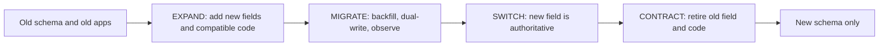
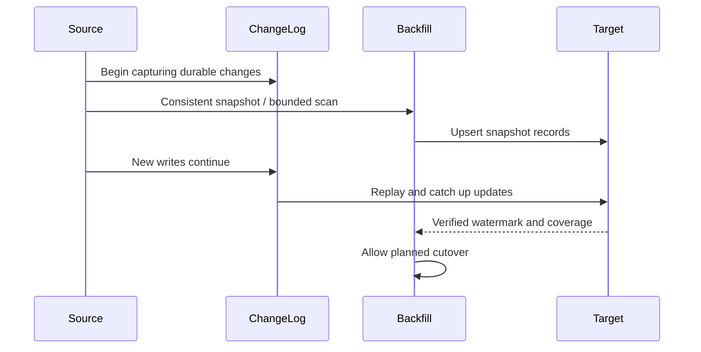

# Expand/contract và tương thích với nhiều phiên bản ứng dụng

Thay đổi cấu trúc dữ liệu trong NoSQL thường không giống sửa một class Java rồi deploy lại toàn bộ dịch vụ. Trong thực tế, **nhiều phiên bản ứng dụng có thể cùng truy cập một collection/table/keyspace trong một khoảng thời gian dài**: một nhóm pod đã chạy bản mới, các pod còn lại vẫn chạy bản cũ; một worker chưa được triển khai; một ứng dụng di động ngoại tuyến nhiều tuần; một job CDC đang xử lý event cũ; hoặc một region chưa hoàn tất rolling deployment.

Nếu triển khai một thay đổi phá vỡ tương thích quá sớm, hệ thống có thể gặp những lỗi khó thấy:

- Bản Java mới chỉ đọc `renterName`, nhưng phần lớn documents cũ còn `customerName`.
- Bản cũ dùng `replaceOne()` và vô tình **xóa field mới** do bản mới vừa ghi.
- Backfill hoàn tất 99% rồi job cũ chạy lại, đưa giá trị cũ vào record đã chuyển đổi.
- Search index mới đã được dựng nhưng consumer CDC còn 30 phút backlog.
- App mới ghi giá trị enum `CONFIRMED_V2` khiến app cũ không parse được.
- Hai nhóm writer ghi hai field với giá trị khác nhau; sau rollback không biết field nào đúng.
- Một index hoặc column cũ bị xóa khi vẫn còn pod, batch job hoặc mobile client phụ thuộc vào nó.

**Expand/contract** là cách triển khai thay đổi **qua nhiều giai đoạn có tương thích chồng lấn**. Ta **mở rộng** khả năng đọc/ghi và cấu trúc lưu trữ trước, **chuyển đổi** dữ liệu/traffic có đo lường, rồi **thu hẹp** bỏ cấu trúc cũ khi đã chứng minh không còn ai phụ thuộc vào nó.

Bài học thuộc chương **Di chuyển và thay đổi** của module **Database No SQL**. Ta sẽ học cách thiết kế hợp đồng giữa reader/writer phiên bản cũ và mới, quản lý backfill, CDC, version, concurrency, index, rollout, rollback và sự khác nhau giữa MongoDB, Cassandra, DynamoDB, Redis và hệ tìm kiếm.

> **Nguyên tắc cốt lõi:** Với mọi thay đổi, không chỉ hỏi “code mới chạy được không?” mà phải hỏi **“trong từng giai đoạn, mọi cặp reader–writer–data-version đang cùng tồn tại có hiểu và bảo toàn dữ liệu của nhau không?”**. Chỉ được `contract` khi các đường cũ thực sự không còn phục vụ workload hoặc rollback cần thiết.

---

## 1. Expand/contract giải quyết bài toán gì?

Một hệ thống không có deployment đồng thời tức thì. Có thể có:

```text
Time ------------------------------>

App v1: [========== running =========]
App v2:               [========== running =========]
Worker v1:        [===============]
Worker v2:                        [========]
Documents v1: [========================= ...]
Documents v2:           [====================== ...]
```

Trong vùng chồng lấn, các thành phần phải tương tác an toàn.

### 1.1. Mục tiêu

1. Không ngắt dịch vụ chỉ để sửa schema.
2. Không làm reader cũ crash khi gặp dữ liệu mới.
3. Không làm writer cũ âm thầm làm mất field mới.
4. Có thể chuyển đổi dữ liệu lớn theo từng batch.
5. Có tín hiệu biết phần nào đã chuyển đổi và phần nào chưa.
6. Có cửa sổ rollback với giới hạn rõ ràng.
7. Loại bỏ cấu trúc cũ một cách có bằng chứng.

### 1.2. Điều phương pháp này không tự bảo đảm

Expand/contract **không tự tạo atomic cross-system migration**, không sửa được mọi thay đổi business semantics và không biến NoSQL thành hệ có transaction toàn cục. Phải thiết kế idempotency, ordering, source of truth và invariants cho trường hợp cụ thể.

---

## 2. Ví dụ xuyên suốt: đổi tên field người thuê xe

Collection `bookings` trước đây lưu:

```json
{
  "_id": "booking-1001",
  "tenantId": "rental-a",
  "customerName": "Nguyen Van A",
  "status": "CONFIRMED",
  "revision": 17
}
```

Yêu cầu mới: tên field chuẩn là `renterDisplayName`.

Kết quả mong muốn sau khi hoàn tất migration:

```json
{
  "_id": "booking-1001",
  "tenantId": "rental-a",
  "renterDisplayName": "Nguyen Van A",
  "status": "CONFIRMED",
  "revision": 23
}
```

Đây không chỉ là một phép rename nếu hệ đang có nhiều phiên bản ứng dụng. Một pod cũ có thể tiếp tục ghi `customerName`; một API mới có thể đọc `renterDisplayName`; một backfill có thể chạy song song với cả hai.

### 2.1. Rollout nguy hiểm

```text
Deploy v2, chỉ đọc renterDisplayName
-> đọc documents cũ không thấy tên
-> API trả null hoặc lỗi

Rename field trên mọi documents ngay
-> ứng dụng v1 còn chạy không thấy customerName
-> lỗi hoặc ghi ngược dữ liệu
```

### 2.2. Hướng an toàn

1. Phân tích writers/readers và phạm vi dữ liệu.
2. Expand reader/writer để hiểu **cả hai field**.
3. Đặt rõ field nào là canonical từng thời kỳ.
4. Backfill các documents cũ với guards.
5. Chuyển traffic/đọc sang field mới khi đủ điều kiện.
6. Ngừng writes vào field cũ.
7. Chỉ xóa field/index cũ khi đã qua cửa sổ tương thích và rollback.

---

## 3. Định nghĩa ba pha

**Expand:** Bổ sung cấu trúc/khả năng mới nhưng vẫn phục vụ code và dữ liệu cũ.

**Migrate/transition:** Backfill, dual-read/dual-write nếu cần, chuyển quyền sở hữu và theo dõi trạng thái tương thích.

**Contract:** Gỡ field, index, endpoint hoặc behavior cũ khi không còn phụ thuộc.



### 3.1. Expand trước deploy code phụ thuộc

Nếu code mới cần một index/table mới, tạo và verify nó **trước** khi bật tính năng sử dụng. Nếu code mới có thể xử lý khi index đang build, phải có fallback và performance budget.

### 3.2. Contract là bước cuối, thường khác release

Xóa cấu trúc cũ sớm làm mất khả năng rollback. Nhiều hệ tách contract ra một release hoặc một change window sau khi mọi phiên bản cũ đã ngừng.

### 3.3. Migrate không nhất thiết là một job duy nhất

Một migration có thể gồm initial scan, CDC catch-up, canary, dual-write, verification, cutover và dọn dữ liệu; mỗi bước cần checkpoint và điều kiện hoàn thành riêng.

---

## 4. Tương thích ngược và tương thích xuôi

**Backward compatibility** trong một thiết kế thường có nghĩa **reader mới có thể hiểu dữ liệu tạo bởi writer cũ**, theo phạm vi đã định nghĩa.

**Forward compatibility** thường có nghĩa **reader cũ vẫn xử lý được dữ liệu do writer mới tạo**, ít nhất bằng cách bỏ qua phần chưa hiểu mà không làm sai nghiệp vụ.

### 4.1. Không chỉ parse được là tương thích

App v1 có thể bỏ qua field mới, nhưng nếu nó dùng `replaceOne()` để ghi lại whole document, field mới có thể bị xóa. Đó là **mất tương thích khi ghi**, dù deserialize thành công.

### 4.2. Các khía cạnh tương thích

| Loại | Câu hỏi |
| --- | --- |
| Structural | Field mới có làm parser cũ lỗi? |
| Type | `int` chuyển thành `string` có đọc được? |
| Semantic | `status=PAID` còn mang cùng ý nghĩa? |
| Write-preservation | Writer cũ có giữ dữ liệu không hiểu? |
| Query | Index, sort, filter và partition key có còn đúng? |
| Contract | API/event schema có chấp nhận cả hai dạng? |
| Security | ACL/tenant scope có giữ nguyên? |
| Performance | Dual-write/backfill có làm vượt SLO? |

---

## 5. Ma trận reader–writer–data-version

Đặt:

- `R1`: reader v1, chỉ hiểu `customerName`.
- `R2`: reader chuyển tiếp, hiểu cả `customerName` và `renterDisplayName`.
- `R3`: reader cuối, chỉ hiểu `renterDisplayName`.
- `W1`: writer v1, chỉ ghi `customerName`.
- `W2`: writer chuyển tiếp, giữ cả hai trường đồng bộ.
- `W3`: writer cuối, chỉ ghi `renterDisplayName`.
- `D1`: document chỉ có field cũ.
- `D2`: document có cả hai.
- `D3`: document chỉ có field mới.

| Reader | D1 | D2 | D3 |
| --- | --- | --- | --- |
| R1 | Đọc được | Đọc được field cũ nếu còn đúng | Không đọc được |
| R2 | Đọc được | Đọc được theo quy tắc ưu tiên/consistency | Đọc được |
| R3 | Không đọc được nếu không fallback | Đọc được field mới | Đọc được |

### 5.1. Ma trận này chưa đủ nếu chưa xét writes

Nếu W1 viết D2 và xóa field mới, dữ liệu quay về D1. Nếu W2 không biết field nào authoritative, hai giá trị có thể diverge. Cần thêm ma trận **writer behavior**.

### 5.2. Mục tiêu của rollout

Trong một giai đoạn, chỉ cho những tổ hợp tương thích tồn tại. Không cho R3 vào production khi D1 vẫn còn trên đường đọc mà R3 cần phục vụ.

---

## 6. Data contract phải được ghi rõ

Trước khi đổi một field, định nghĩa:

```yaml
entity: Booking
fieldOld: customerName
fieldNew: renterDisplayName
semantics: "Tên hiển thị của người thuê tại thời điểm đặt xe"
canonicalDuringTransition: customerName
canonicalAfterCutover: renterDisplayName
nullable: false_for_confirmed_booking
normalization: trim_preserve_unicode
tenantScope: tenantId
retention: business_policy
migrationOwner: booking-platform
```

Đây là **hồ sơ thiết kế minh họa**, không phải cấu hình engine.

### 6.1. Tên field không phải toàn bộ hợp đồng

Phải biết giá trị được chuẩn hóa thế nào, nullable ra sao, ai được ghi, có PII hay không, format date/currency, và field dùng cho index/shard key/authorization không.

### 6.2. Không đổi nghĩa ngầm

Nếu `customerName` là tên người dùng hiện tại nhưng `renterDisplayName` là snapshot tên lúc booking, copy field cũ sang field mới có thể sai semantics. Migration cần quy tắc transform được duyệt.

---

## 7. Phân loại thay đổi theo mức độ phá vỡ

| Thay đổi | Nguy cơ | Chiến lược thường phù hợp |
| --- | --- | --- |
| Thêm optional field | Thấp–trung bình | Readers tolerate missing, add writer |
| Thêm required field | Trung bình–cao | Add optional, backfill, enforce sau |
| Rename field | Cao nếu rolling deploy | Dual-read/write, backfill, contract |
| Đổi kiểu dữ liệu | Cao | Field mới typed, transform/verify |
| Đổi enum semantics | Cao | Reader fallback, gated emission |
| Tách document lớn | Cao | Read bridge và new lookup path |
| Embed → reference | Cao | Dual model/read projection |
| Đổi partition/shard key | Rất cao | New table/collection, backfill/cutover |
| Đổi secondary index | Trung bình | Build first, query switch, drop later |
| Đổi TTL/retention | Cao về dữ liệu | Explicit expiry/deletion policy |
| Đổi event schema | Cao vì async consumers | Producer–consumer compatibility window |
| Xóa legacy field | Cao nếu old consumers còn | Contract sau telemetry |

### 7.1. “Schema-less” không nghĩa “không có schema”

NoSQL có thể chấp nhận documents nhiều hình dạng, nhưng ứng dụng Java, index, validation, stream schema và các truy vấn vẫn dựa trên **hợp đồng dữ liệu**. Không khai báo schema chỉ làm lỗi xuất hiện muộn hơn.

---

# Phần I — Thiết kế rollout nhiều phiên bản

## 8. Một rolling deployment thực tế

Giả sử 30 pod Booking API triển khai rolling:

```text
00:00  30 pods v1
00:05  25 pods v1 + 5 pods v2
00:10  15 pods v1 + 15 pods v2
00:15   5 pods v1 + 25 pods v2
00:20  30 pods v2
```

Trong 15 phút chồng lấn, `v1` và `v2` có thể cùng đọc/ghi những documents giống nhau.

### 8.1. Nhìn cả workers và integrations

Ngoài API pods còn:

- Scheduler và batch jobs.
- CDC/outbox consumers.
- Kafka consumers chạy lại events cũ.
- Cron trong region khác.
- CLI/admin scripts.
- Offline mobile clients gọi API cũ.
- ETL/reporting/indexing pipelines.
- Replica/read models có lag.
- Disaster recovery deployments cũ.

Không đếm đủ writers/readers thì điều kiện contract sai.

### 8.2. Định nghĩa “old version gone”

Không chỉ Kubernetes Deployment đã có 100% pods mới. Cần xem sessions, tasks, queues, cron jobs, client versions, delayed events, retries và rollback binaries còn dùng.

---

## 9. Chọn thời điểm field mới trở thành canonical

Một chiến lược rõ ràng:

```text
Phase E0: old field canonical, old apps active
Phase E1: bridge code reads both, writes both; old canonical
Phase M1: backfill new field from canonical old field
Phase M2: old writers drained, verify equality and coverage
Phase S1: new field canonical; bridge readers still understand old
Phase S2: emit new-only writes after no old readers/writers
Phase C1: delete old field/index; remove bridge code later
```

### 9.1. Không cho cả hai field độc lập cùng là nguồn sự thật

Nếu API A sửa `customerName` và API B sửa `renterDisplayName`, việc merge theo “field nào không null” không giải quyết conflict. Một giai đoạn nên có **một authority** cho dữ liệu và quy tắc cập nhật cả hai bản thể.

### 9.2. Cần migration epoch

Khi chuyển quyền từ old sang new, lưu migration phase/feature flag hoặc versioned release decision trong hệ điều phối. Một worker chậm không được tự chuyển ngược authority.

### 9.3. Các pha có thể kéo dài nhiều ngày

Nếu có mobile/offline clients hoặc jobs hiếm khi chạy, cần quyết định compatibility retention rõ thay vì contract ngay khi server rollout xong.

---

## 10. Pha 0: lập inventory tất cả consumers

Trước khi sửa code:

1. Tìm nơi đọc `customerName` trong API, workers và reports.
2. Tìm nơi ghi field này.
3. Kiểm tra whole-document replace vs field-level update.
4. Xem index, sort, filter, validator, export và backup schemas.
5. Kiểm tra stream/event transformations và search mappings.
6. Kiểm tra mobile clients và external integrations.
7. Xác định dữ liệu đã tồn tại bao lâu, bao nhiêu documents, giá trị null/missing.
8. Định nghĩa release rollback horizon.
9. Đo SLO hiện tại và khả năng chịu backfill.
10. Đặt owner và dashboard cho quá trình migration.

### 10.1. Read-only consumers dễ bị bỏ sót

Một job export chạy mỗi quý có thể dùng field cũ dù logs 30 ngày gần nhất không có traffic. Contract cần inventory code/dependency, không chỉ quan sát runtime ngắn hạn.

---

## 11. Pha expand: đưa reader tương thích vào trước

Reader mới nên hiểu cả dạng cũ và mới trong một khoảng chuyển tiếp:

```text
Document D1: {customerName: "A"}
Document D2: {customerName: "A", renterDisplayName: "A"}
Document D3: {renterDisplayName: "A"}
```

### 11.1. Nhưng ưu tiên field nào?

Nếu **old field còn canonical**, reader phải ưu tiên old field khi cả hai cùng tồn tại; nếu đọc new trước, một giá trị stale do W1 ghi old mà chưa cập nhật new có thể được trả sai.

Một quy tắc theo pha:

```text
OLD_CANONICAL:
  read customerName if present
  otherwise read renterDisplayName if valid

NEW_CANONICAL:
  read renterDisplayName if present
  otherwise use documented legacy fallback
```

### 11.2. Không fallback khi hai field mâu thuẫn mà không đo

Khi cả hai có giá trị khác nhau, ghi metric mismatch và trace/sampling phù hợp. Nếu app chỉ chọn một field theo `??` rồi che lệch giá trị, migration có thể hoàn tất “trên giấy” nhưng sai dữ liệu.

---

## 12. Pha expand: writer tương thích và field preservation

Writer mới có thể cập nhật cả hai field:

```javascript
db.bookings.updateOne(
  { _id: "booking-1001", tenantId: "rental-a" },
  {
    $set: {
      customerName: "Nguyen Van B",
      renterDisplayName: "Nguyen Van B"
    },
    $inc: { revision: 1 }
  }
);
```

Đây là ví dụ `mongosh` minh họa, giả định kiểm soát định danh/tenant và phiên bản ghi bằng giao thức ứng dụng.

### 12.1. Cùng document update thường tốt hơn hai network calls

Trong MongoDB, một update đơn-document là atomic theo phạm vi document. Nếu cùng thay hai field bằng một update phù hợp, giảm tình huống một field thành công và field kia thất bại.

### 12.2. Không luôn có một atomic write cho hai nơi

Nếu field mới ở table/index khác, dual-write qua hai requests có thể partial succeed. Phải dùng outbox/CDC/reconciliation hoặc transaction được engine hỗ trợ với giới hạn rõ.

### 12.3. Old writers có thể phá dual-write

Nếu W1 còn update `customerName` và W2 đã đồng bộ cả hai, `renterDisplayName` có thể stale. Giữ old canonical hoặc chặn old write path sau khi chuyển phase.

---

## 13. Whole-document replacement là một bẫy lớn

Writer cũ:

```javascript
db.bookings.replaceOne(
  { _id: "booking-1001" },
  {
    _id: "booking-1001",
    tenantId: "rental-a",
    customerName: "Nguyen Van C",
    status: "CONFIRMED"
  }
);
```

Nếu document trước đó chứa `renterDisplayName`, thao tác replace có thể làm field mới biến mất.

### 13.1. Giải pháp

- Ưu tiên field-level updates.
- Đảm bảo các writers cũ không replace documents mới.
- Cập nhật bridge code trước rollout.
- Khi phải replace, bảo toàn unknown fields theo contract hoặc dùng optimistic concurrency guard.
- Đo số documents bị “regress” về schema cũ.

### 13.2. `save()` không tự an toàn

Một ORM/ODM tự serialize lại toàn document có thể có semantics replace tương tự tùy thư viện. Kiểm tra câu lệnh thực chạy và serialization behavior, không suy từ tên method.

### 13.3. Unknown fields và bảo mật

Giữ unknown fields không có nghĩa cho client tự ghi mọi field tùy ý. API vẫn phải dùng allowlist/authorization; unknown-field preservation ở repository khác chuyện mass assignment từ HTTP body.

---

## 14. Feature flags để tách deploy và chuyển quyền

Không nên gắn mọi hành vi migration vào một Boolean `newSchema=true`.

Một tập flags có thể là:

```yaml
bookingName:
  readerMode: old_preferred
  writerMode: dual_write
  backfillEnabled: true
  mismatchSamplingRate: 0.01
  contractEligible: false
```

Đây là **cấu hình mô hình**, không phải file của một framework cụ thể.

### 14.1. Các chiều độc lập

- `readOld/ReadNew`.
- `writeOld/WriteNew`.
- `backfill`.
- `shadowCompare`.
- `canaryPercent`.
- `contract`.
- `fallback`.
- `newIndexQueryRouting`.

### 14.2. Không tạo trạng thái bất khả thi

Ví dụ `reader=new_only`, `writer=old_only`, `backfill=off` có thể làm dữ liệu mới không đọc được. Thiết kế state machine/validation để chỉ cho phép tổ hợp hợp lệ.

### 14.3. Flag phải có owner và ngày dọn

Một hệ giữ mã dual-write mãi mãi làm tăng chi phí, rủi ro split-brain giữa fields và độ khó về sau. Flag lifecycle là một phần của contract phase.

---

## 15. Compatibility window phải gồm delayed messages

Một CDC consumer có thể bị pause 3 ngày; một queue có retention 7 ngày; mobile clients có thể offline 30 ngày. Nếu contract sau 1 giờ, một worker/app cũ khi quay lại có thể:

- Không parse event schema mới.
- Ghi `customerName` khi field đã bị xóa.
- Ghi lùi từ snapshot cũ.
- Bỏ qua thêm field mới.
- Gây duplicate external effects khi retry.

### 15.1. Chọn window theo dữ liệu vận hành

Quy tắc:

```text
Compatibility window >=
  rollout duration
  + max expected message/worker lag
  + supported rollback window
  + mobile/client compatibility policy
```

Đây là một **mô hình lập kế hoạch**, không phải công thức đủ cho mọi trường hợp.

### 15.2. Có thể phải version API công khai

Nếu không thể buộc old mobile clients cập nhật, giữ adapter `v1` tại boundary và chuyển đổi sang canonical model nội bộ. Không giữ schema nội bộ cũ vô hạn chỉ vì một public endpoint có version cũ.

---

## 16. Deploy bridge trước khi chuyển cách ghi

Trình tự an toàn thường là:

```text
Release A:
  readers understand old/new
  writers preserve new fields
  no new-only data emitted yet

Release B:
  dual-write introduced
  old field still canonical

Backfill:
  populate new fields in bounded batches

Release C:
  switch read preference and authority

Release D:
  new-only writes and later contract
```

### 16.1. Vì sao bridge release quan trọng?

Nếu W2 bắt đầu ghi new values trước khi mọi R1 được thay, R1 có thể không hiểu. Nếu một field được rename ở DB trước bridge, cả API hiện hành và workers có thể hỏng.

### 16.2. Thứ tự khác theo rủi ro

Có thay đổi chỉ cần reader tolerance trước, có thay đổi cần index trước, có thay đổi cần snapshot/CDC trước. Nguyên tắc chung là **không phát dữ liệu ngoài tập mà consumers hiện tại hiểu được**.

---

# Phần II — Backfill và chuyển đổi dữ liệu

## 17. Backfill là gì?

**Backfill** là việc đọc dữ liệu đã tồn tại theo schema cũ và tạo giá trị/representation mới.

Ví dụ:

```text
D1: {customerName:"A"}
       |
       v
Backfill
       |
       v
D2: {customerName:"A", renterDisplayName:"A"}
```

### 17.1. Khó khăn thực tế

- Dataset có thể gồm hàng trăm triệu records.
- Các writers vẫn cập nhật trong lúc scan.
- Dữ liệu không đều, có tenants rất lớn.
- Có null, empty, duplicate, invalid field types.
- Retry hoặc worker restart khiến record bị xử lý lại.
- Index mới có thể chưa build xong.
- Dùng query quét lớn có thể làm p99 tăng.
- Privacy/TTL khiến records biến mất giữa hai bước.

### 17.2. Không chạy một `updateMany` toàn database trong giờ cao điểm

Một bulk update cực lớn có thể tạo nhiều writes, replication/CDC events, cache invalidations và index maintenance. Thiết kế bounded batches, rate limits, checkpoints và pauses.

---

## 18. Hai hướng backfill: in-place và side-by-side

**In-place:**

```text
Collection bookings:
  add renterDisplayName to existing documents
```

Ưu điểm: một nguồn dữ liệu, không cần cross-table join. Rủi ro: write amplification, contention và rollback khó nếu overwrite.

**Side-by-side:**

```text
bookings_v1 -> bookings_v2
```

Ưu điểm: có thể tạo schema/index/shard key mới độc lập và test song song. Rủi ro: dual-storage, CDC catch-up, cutover/routing, nhiều consistency states.

### 18.1. Chọn theo loại thay đổi

- Thêm optional field: thường có thể in-place.
- Đổi partition key/collection semantics: có thể cần new collection/table.
- Đổi search mapping không tương thích: thường blue/green index.
- Tách aggregate: có thể cần read model mới với outbox/CDC.

---

## 19. Backfill phải idempotent

Một migration tốt cho phép chạy lại:

```text
process booking-42
worker crash
process booking-42 again
```

Kết quả vẫn hợp lệ.

### 19.1. Ví dụ guard khi field mới chưa tồn tại

```javascript
db.bookings.updateOne(
  {
    _id: "booking-1001",
    tenantId: "rental-a",
    revision: 17,
    renterDisplayName: { $exists: false }
  },
  {
    $set: { renterDisplayName: "Nguyen Van A" },
    $inc: { revision: 1 }
  }
);
```

Giả định worker đã đọc document ở `revision=17`; mọi writer cạnh tranh **cũng tăng revision theo protocol**. Nếu có writer không tuân thủ, CAS giả này **không đủ** bảo vệ khỏi ghi lùi.

### 19.2. Check result

Nếu `matchedCount=0`, không ép cập nhật mù. Record có thể đã được user sửa, bị xóa hoặc đã được migrator khác xử lý. Đọc lại hoặc xếp lại vào queue theo chính sách.

### 19.3. Backfill không được tự gửi side effects

Migration field tên hiển thị không được tạo email xác nhận đặt xe hay gọi lại payment API. Nếu pipeline sự kiện tự phát trên mọi update, phải phân loại migration writes và bảo vệ consumers phù hợp.

---

## 20. Race giữa backfill và writes trực tiếp

Tình huống:

```text
T1 Backfill reads customerName="A", revision=17.
T2 User changes customerName="B", revision=18.
T3 Backfill writes renterDisplayName="A".
T4 New reader prefers renterDisplayName -> returns stale "A".
```

### 20.1. Vì sao nguy hiểm?

Một job chỉ copy field có thể tạo giá trị cũ ngay trên bản ghi vừa được cập nhật. Khi có nhiều tenant/writers, race hiếm nhưng đủ gây sai dữ liệu.

### 20.2. Cách ngăn

- Conditional update theo version/revision/source snapshot.
- Nếu cả hai field trong một document, dùng update atomic có điều kiện phù hợp.
- CDC correction sau snapshot.
- Quy tắc authority rõ trong thời gian W1 còn tồn tại.
- Reconciliation kiểm tra equality và recency.

### 20.3. Không tin client read-then-write không có CAS

Hai requests tách biệt tạo cửa sổ race. Một truy vấn `find()` rồi `updateOne({_id})` không chặn writer khác thay đổi giữa hai bước.

---

## 21. Snapshot + CDC khi tạo collection/table mới

Khi chuyển từ `bookings_v1` sang `bookings_v2`, chỉ quét source lúc T0–T1 có thể bỏ những cập nhật xảy ra giữa quá trình.

Một quy trình:



### 21.1. Capture phải không bỏ khoảng chuyển tiếp

Nếu chỉ subscribe changes **sau** scan, updates trong scan window có thể mất. Dùng engine-provided snapshot+log protocol hoặc source-revision/CDC handoff được chứng minh.

### 21.2. Snapshot cũ có thể đến sau event mới

Target phải xử lý out-of-order: một upsert revision 40 từ CDC không được bị snapshot revision 39 ghi đè.

### 21.3. Watermark không phải chỉ “queue rỗng”

Một queue lag bằng 0 không chứng minh những mutations đang in-flight đã visible/searchable ở sink. Cần applied/visible watermark theo contract.

---

## 22. Version guard cho dữ liệu dẫn xuất

Giả sử:

```text
snapshot -> booking-42 rev=100
CDC      -> booking-42 rev=102
replay   -> booking-42 rev=101
```

Sink nên cho phép `rev=102` thắng, không nhận `rev=101` sau đó.

### 22.1. Thứ tự cần được xác lập tại authority

Nếu `revision` do nhiều services tự tăng độc lập hoặc dựa trên `System.currentTimeMillis()`, có thể bị trùng/lùi. Cần revision/commit position thực sự có semantics phù hợp.

### 22.2. Kiểm tra nguyên tử tại sink

Một worker tự đọc target revision rồi mới ghi có race. Guard phải được thực hiện bằng conditional write/CAS/serialized per-key processing khi cần.

### 22.3. Delete marker cũng có version

Nếu source delete `booking-42` tại rev=103, một snapshot rev=100 không được resurrect record sau khi delete. Giữ tombstone/high-watermark đủ lâu so với replay retention.

---

## 23. Pagination ổn định và checkpoint

Một backfill lớn cần có thể pause/restart.

```json
{
  "jobId": "booking-name-migration-v2",
  "segment": "tenant-a/partition-003",
  "cursor": "booking-01000031",
  "snapshotRevision": "source-checkpoint-abc",
  "processed": 1200000,
  "status": "RUNNING"
}
```

Các giá trị minh họa.

### 23.1. Keyset/range scan thay offset sâu

Nếu dữ liệu liên tục thêm/xóa, `skip(1000000)` hoặc `OFFSET` có thể tốn nhiều work và không ổn định. Ưu tiên paging theo key/range và snapshot semantics do engine hỗ trợ.

### 23.2. Checkpoint sau durable apply

```text
Read batch
  -> transform
  -> durable target write (idempotent)
  -> confirm
  -> advance checkpoint
```

Nếu checkpoint trước target write, crash có thể bỏ batch vĩnh viễn.

### 23.3. Không thể chỉ tin checkpoint để công bố hoàn tất

Có thể đã bỏ các records được tạo sau khi cursor đi qua. Cần catch-up, coverage check, reconciliation và explicit completion criteria.

---

## 24. Phân chia job theo shard/tenant để không tạo hotspot

Một worker đọc 1 triệu documents từ một tenant cực lớn có thể làm một shard nghẽn.

Có thể chia:

```text
tenant-a / date 2026-01
tenant-a / date 2026-02
tenant-b / date 2026-01
...
```

### 24.1. Giới hạn nhiều chiều

- `maxConcurrentJobs` toàn cluster.
- Per-source-shard read budget.
- Per-target-shard write budget.
- Bytes/s và items/s.
- CPU/IOPS headroom.
- Per-tenant fairness.
- Retry budget khi throttled.
- Giới hạn memory/page size.
- Maintenance windows.

### 24.2. Khi SLO vượt ngưỡng

Pause optional backfill, giữ trạng thái có thể resume và theo dõi workload. Nhưng migration có retention deadline thì cần escalations thay vì tạm dừng vô hạn.

---

## 25. Dual-write trên hai NoSQL systems

Ví dụ ứng dụng ghi vào MongoDB và một read table DynamoDB:

```text
Booking API
  |
  +--> MongoDB canonical
  |
  +--> DynamoDB materialized view
```

Nếu hai requests độc lập:

```text
MongoDB success
DynamoDB timeout / failed
```

Lúc này code không thể kết luận cả hai đã ghi thành công.

### 25.1. Transactional outbox là một lựa chọn

```text
MongoDB transaction / durable change:
  booking updated + outbox event
                 |
                 v
CDC/relay
                 |
                 v
DynamoDB conditional idempotent upsert
```

Điều kiện: outbox và authoritative mutation được commit trong cùng transactional scope phù hợp; relay có retry và idempotency.

### 25.2. Đừng hứa exactly-once xuyên biên

Một event có thể bị delivery nhiều lần. Thiết kế at-least-once + idempotent sink/version guard và reconciliation; biết rõ provider API nào hỗ trợ điều kiện.

### 25.3. Tách loại lỗi

- Source write chưa commit.
- Source commit nhưng response timeout.
- Event chưa publish.
- Event published nhưng sink timeout.
- Sink applied nhưng ACK thất bại.
- Read model đã apply nhưng chưa visible do refresh/replication.

Mỗi loại cần recovery/observability khác.

---

## 26. Reconciliation: so dữ liệu thay vì tin “job done”

Một dashboard nên đo:

```text
documentsMissingNewField
documentsWithMismatch
documentsOnOldShape
oldWriterRequestsPerMinute
newWriterRequestsPerMinute
backfillLag
CDCReplayLag
targetAppliedWatermark
targetVisibleWatermark
```

### 26.1. Coverage và correctness khác nhau

`99.99%` documents có new field chưa chứng minh đúng; có thể 1 triệu records mang **giá trị stale**. So equality/transform invariants và revision trong sample/partition batches.

### 26.2. Không quét toàn database liên tục

Các phép `countDocuments({renterDisplayName:{$exists:false}})` hoặc aggregation toàn collection có thể đắt. Dùng index có chủ đích, sampled scans, snapshot metrics và batch reconciliation.

### 26.3. Zero missing cần kiểm tra thời gian

Một lần đo `missing=0` không đủ nếu W1 vẫn ghi thêm documents chỉ có field cũ sau đó. Yêu cầu **zero ở nhiều cửa sổ và old writer drained** trước khi contract.

---

# Phần III — Tương thích trong Java và API

## 27. Java 17: reader có xử lý dữ liệu cũ/mới

Đoạn Java dưới đây dùng `Map<String,Object>` để minh họa core logic, không phụ thuộc driver. `Map` đại diện cho document đã được driver giải mã.

```java
import java.util.Map;
import java.util.Objects;

public final class BookingNameCompatibility {

    public enum Authority {
        OLD_FIELD,
        NEW_FIELD
    }

    public record BookingView(
        String id,
        String renterName
    ) {}

    public static BookingView read(
            Map<String, Object> doc,
            Authority authority) {
        Objects.requireNonNull(doc);
        Objects.requireNonNull(authority);

        String oldValue = validName(doc.get("customerName"));
        String newValue = validName(doc.get("renterDisplayName"));

        String selected = switch (authority) {
            case OLD_FIELD ->
                oldValue != null ? oldValue : newValue;
            case NEW_FIELD ->
                newValue != null ? newValue : oldValue;
        };

        if (selected == null) {
            throw new IllegalArgumentException(
                "Booking has no valid renter name"
            );
        }

        return new BookingView(
            String.valueOf(doc.get("_id")),
            selected
        );
    }

    private static String validName(Object value) {
        if (!(value instanceof String text)) {
            return null;
        }
        String trimmed = text.trim();
        return trimmed.isEmpty() ? null : trimmed;
    }
}
```

### 27.1. Mục tiêu

- Không crash chỉ vì field đang chuyển tiếp còn missing.
- Không dùng `String.valueOf(null)` làm giá trị nghiệp vụ `"null"`.
- Quy tắc chọn field phụ thuộc authority rõ ràng.
- Có thể unit-test D1/D2/D3 và giá trị invalid.

### 27.2. Điều ví dụ chưa giải quyết

- Không tự kiểm tra `customerName != renterDisplayName` và phát mismatch metric.
- Chưa áp tenant/authorization.
- Không xác định giá trị nào đúng nếu cả hai diverge.
- Không chứng minh dữ liệu không thay đổi đồng thời.
- Không chuyển đổi `null` tùy tiện thành tên mặc định mang nghĩa khác.

---

## 28. Java 17: tạo document transitional write

Ví dụ xây dữ liệu cho **field-level update**:

```java
import java.util.Map;

public final class BookingNameWriter {
    public static Map<String, Object> dualWriteFields(
            String renterName) {
        if (renterName == null || renterName.isBlank()) {
            throw new IllegalArgumentException(
                "Name must be nonblank"
            );
        }

        String normalized = renterName.trim();

        return Map.of(
            "customerName", normalized,
            "renterDisplayName", normalized
        );
    }
}
```

Các fields có thể được truyền cho một atomic document update của driver.

### 28.1. Đừng dùng map này để `replaceWholeDocument()` mù

Đây chỉ là tập fields cần update. Các fields khác như `tenantId`, `status`, `revision` phải được giữ đúng bằng update protocol, không bị xóa do replace.

### 28.2. Việc đồng bộ field có thể cần điều kiện

Nếu writer đang cập nhật theo revision cũ, dùng optimistic concurrency/CAS để không ghi đè thay đổi vừa xảy ra từ writer khác.

---

## 29. Java: tolerant reader không phải permissive writer

Khuyến nghị:

- **Reader:** hiểu legacy fields/values trong compatibility window, có fallback rõ.
- **Writer:** chỉ chấp nhận những fields mà API contract cho phép, và ghi representation theo phase được quản lý.

### 29.1. Mass assignment risk

Không deserialize toàn bộ HTTP JSON rồi ghi thẳng vào MongoDB. Một client có thể gửi `tenantId`, `isAdmin`, `priceOverride` hoặc field tương lai; việc chấp nhận unknown fields vô điều kiện mở lỗ hổng logic/authorization.

### 29.2. Domain DTO và storage DTO

Nên tách:

```text
HTTP BookingRequest DTO
      |
      v
Validated domain command
      |
      v
Domain Booking model
      |
      v
Storage compatibility adapter
      |
      v
MongoDB document
```

Adapter có thể chứa dual-write/fallback mà không bắt toàn business code phải biết `customerName` và `renterDisplayName`.

---

## 30. Thay đổi kiểu dữ liệu: ví dụ tiền tệ

Schema cũ:

```json
{"totalPrice": "199.99"}
```

Schema mới:

```json
{
  "totalMinorUnits": 19999,
  "currency": "USD"
}
```

Đây không phải đổi tên đơn thuần.

### 30.1. Những câu hỏi bắt buộc

- `totalPrice` trước đây luôn theo currency nào?
- Chuỗi `"199.99"` có thể có locale separator?
- Số thập phân có rounding rule nào?
- Currency có decimal digits khác nhau?
- Data cũ có lưu discount/tax theo tỷ giá không?
- Writer nào đang là authority cho tổng tiền?
- Audit/ledger/legal retention ra sao?

### 30.2. Dùng decimal exact, không dùng floating point mù

Một conversion có thể dùng `BigDecimal`/currency scale theo contract rồi validate round-trip. Không nhân `double × 100` rồi cast tùy tiện cho dữ liệu tài chính.

### 30.3. Có thể cần field mới thay vì sửa type tại chỗ

Nếu v1 vẫn parse `totalPrice` là `String`, đổi thành number trong cùng field sẽ làm v1 lỗi. Giữ cả hai representations có quy tắc cho đến khi không còn reader cũ.

---

## 31. Enum và trạng thái nghiệp vụ

Ví dụ v1 hiểu:

```text
PENDING, CONFIRMED, CANCELLED
```

v2 bổ sung:

```text
PAYMENT_REVIEW_REQUIRED
```

Một `Enum.valueOf()` ở v1 sẽ ném exception nếu gặp giá trị mới.

### 31.1. Chuẩn bị trước khi producer phát enum mới

- Reader v1.5 có mapping/fallback cho unknown values.
- Producer chỉ emit new enum sau khi mọi consumers cần thiết hiểu.
- Business behavior cho unknown phải an toàn, không tự coi là `CONFIRMED`.
- Metrics phát hiện unknown enum và contract violations.

### 31.2. Không dùng `UNKNOWN` như trạng thái có thể xác nhận booking

Một fallback có thể là "cần kiểm tra" hoặc read-only; không để giá trị mới vượt qua authorization/payment state machine sai.

---

## 32. Optional, absent và null không giống nhau

Trong document store, các trạng thái khác nhau:

```json
{}
```

```json
{"renterDisplayName": null}
```

```json
{"renterDisplayName": ""}
```

```json
{"renterDisplayName": "A"}
```

### 32.1. Cần contract cho từng dạng

- **Absent:** legacy document chưa backfill hay field thật sự không áp dụng?
- **Null:** chủ ý không có dữ liệu hay writer không biết?
- **Empty string:** invalid hay allowed?
- **Nonempty:** giá trị hợp lệ theo normalization?

### 32.2. Required field enforcement phải tới sau

Nếu bật validator yêu cầu new field quá sớm, W1 có thể bị từ chối và làm traffic lỗi. Có thể mở validator chấp nhận cả hai shapes rồi thắt dần sau khi old writers drained.

---

## 33. Event schema và asynchronous consumers

Một NoSQL migration thường kéo theo event thay đổi:

```json
{
  "eventType": "BookingUpdated",
  "schemaVersion": 2,
  "bookingId": "booking-1001",
  "renterDisplayName": "A"
}
```

Một consumer v1 chỉ hiểu `customerName` có thể không parse được hoặc bỏ qua dữ liệu cần thiết.

### 33.1. Tách storage schema và event schema

Không nên serialize nguyên MongoDB document ra event rồi coi tất cả services phải cập nhật cùng lúc. Dùng event contract/versioning với chính sách compatibility.

### 33.2. Expand event producers

Trong window, producer có thể phát cả hai fields hoặc hai event versions nếu schema registry/contract hỗ trợ. Đừng tự phát hai sự kiện business độc lập nếu consumer có thể thực hiện side effect hai lần.

### 33.3. Outbox và replay

Event cũ có thể được replay sau nhiều tháng. Consumer mới nên hiểu historical event schema hoặc có upcaster/transformation theo từng version, với tests/retention cụ thể.

---

## 34. Event upcasting và semantic drift

**Upcaster** chuyển event payload version cũ sang domain representation mới lúc đọc.

```text
BookingUpdated v1
    {customerName}
          |
       upcaster
          |
          v
BookingUpdated v2 canonical view
    {renterDisplayName}
```

### 34.1. Khi nào dùng?

- Historical events không thể rewrite.
- Consumers mới cần một model thống nhất.
- Schema changes tương thích về semantics.

### 34.2. Không upcast bằng cách bịa dữ liệu

Nếu event cũ không có currency, không thể đoán tất cả đều `"USD"` nếu nghiệp vụ có nhiều currencies. Cần enrichment từ authority hoặc đánh dấu unknown/invalid.

### 34.3. Version của event không là revision của record

`schemaVersion=2` nói về format. `aggregateRevision=81` nói về thứ tự trạng thái của một booking. Hai thông tin không thay thế nhau.

---

## 35. Mobile clients, offline writes và API compatibility

Một ứng dụng di động có thể gửi lệnh sau 30 ngày ngoại tuyến:

```json
{
  "bookingId": "booking-1001",
  "customerName": "A",
  "clientSchemaVersion": 1
}
```

### 35.1. Không nhất thiết giữ database field cũ mãi

Server API có thể tiếp tục chấp nhận request v1 rồi map vào canonical model mới. Điều này khác với việc giữ mọi collection/index ở schema cũ.

### 35.2. Offline conflict policy

Nếu mobile client ghi một booking stale, server phải kiểm tra revision/version, authorization và business state; không cho client cũ overwrite booking mới chỉ vì request parse được.

### 35.3. API deprecation

Đặt ngày sunset, metrics theo version/consumer, thông báo và chính sách từ chối theo độ nhạy dữ liệu. Những clients không thể cập nhật cần một đường adapter được quản trị.

---

# Phần IV — Thực hành theo từng hệ NoSQL

## 36. MongoDB: thêm field không cần sửa mọi document ngay

Document database cho phép documents cùng collection có cấu trúc khác nhau, nếu validator/index/ứng dụng không yêu cầu ngược lại.

### 36.1. Pha expand

- Cập nhật reader hiểu cả `customerName` và `renterDisplayName`.
- Writer cập nhật đồng thời hai fields khi đang ở bridge stage.
- Chỉ thêm validator/index sau khi xét compatibility.
- Không chạy `$rename` hàng loạt khi W1 còn đọc/ghi field cũ.

### 36.2. Pha migrate

- Dùng batch scan và update có guards.
- Theo dõi versions/retries/replica pressure.
- Không đồng thời chạy nhiều scripts không có ownership.
- Đối chiếu mismatches và backfill coverage.
- Chờ old writers/CDC lag về mức an toàn.

### 36.3. Pha contract

- Dừng/khóa old write path.
- Xác nhận readers không còn cần old field.
- Xóa old field theo batches nếu có yêu cầu.
- Drop old indexes sau khi query plans đã chuyển.
- Siết schema validation khi mọi writes tương thích.

---

## 37. MongoDB: một backfill có điều kiện

Ví dụ trong `mongosh` cho một document, không phải khuyến nghị chạy bulk trực tiếp trên production:

```javascript
const doc = db.bookings.findOne(
  { _id: "booking-1001", tenantId: "rental-a" },
  { customerName: 1, renterDisplayName: 1, revision: 1 }
);

if (
  doc &&
  typeof doc.customerName === "string" &&
  doc.renterDisplayName === undefined &&
  typeof doc.revision === "number"
) {
  const result = db.bookings.updateOne(
    {
      _id: doc._id,
      tenantId: "rental-a",
      revision: doc.revision,
      renterDisplayName: { $exists: false }
    },
    {
      $set: {
        renterDisplayName: doc.customerName
      },
      $inc: { revision: 1 }
    }
  );

  printjson({
    matched: result.matchedCount,
    modified: result.modifiedCount
  });
}
```

### 37.1. Điều kiện quan trọng

**Mọi writer** phải tuân thủ revision/CAS. Nếu tồn tại một writer thay `customerName` mà không tăng revision, migration có thể dùng dữ liệu stale dù filter match.

### 37.2. Migrate update có tạo CDC event

Một update field mới có thể xuất hiện trong change streams và kích hoạt downstream. Consumers phải phân biệt migration-origin events nếu side effects không được phép, đồng thời không bỏ qua dữ liệu cần cập nhật.

### 37.3. Bulk batching

Trong thực tế, cần chia theo `_id` range/partition tenant, dùng `bulkWrite` với giới hạn batch, cursor, retries có backoff, checkpoint bền và rate budget. Không để script ôm toàn bộ documents vào RAM.

---

## 38. MongoDB: schema validator và thứ tự triển khai

MongoDB có cơ chế collection validation, nhưng chế độ validation và quy tắc áp dụng cần được xem theo version/config.

Một validator kiểu JSON Schema có thể chấp nhận **ít nhất một trong hai shape** trong giai đoạn bridge, sau đó mới thắt thành `renterDisplayName` required.

### 38.1. Cần tránh

```text
Step 1: validator requires renterDisplayName
Step 2: deploy bridge writer next hour
```

W1 vẫn ghi documents thiếu field mới trong khoảng giữa và có thể bị validation rejection.

### 38.2. Chọn phase thích hợp

- Expand validator chấp nhận old/new.
- Backfill.
- Ngừng old writes.
- Verify all required records have new field.
- Contract validator sang new-only.

### 38.3. Validation không kiểm tra nghiệp vụ hoàn chỉnh

Một field đúng type không chứng minh tenancy authorization, currency scale hoặc booking interval invariant. Vẫn cần domain validation.

---

## 39. MongoDB: đổi index mà không phá query cũ

Giả sử v1 filter:

```javascript
db.bookings.find({
  tenantId: "rental-a",
  customerName: "Nguyen Van A"
});
```

v2 filter:

```javascript
db.bookings.find({
  tenantId: "rental-a",
  renterDisplayName: "Nguyen Van A"
});
```

Một kế hoạch:

1. Quan sát query pattern v1 và index đang dùng.
2. Tạo index v2 có prefix phù hợp (ví dụ `{tenantId:1,renterDisplayName:1}`).
3. Chờ index build hoàn tất, đo planner/executionStats.
4. Chuyển một phần traffic sang query v2.
5. Xác nhận dữ liệu đã backfill và query trả cùng tập hợp hợp lệ.
6. Chuyển tất cả readers sang v2.
7. Đợi old queries/rollback horizon kết thúc.
8. Drop index v1 khi đã bảo đảm không còn phụ thuộc.

### 39.1. Index mới không miễn phí

Index build/maintenance dùng disk/CPU/write throughput, nhất là khi migration update rất nhiều documents.

### 39.2. Unique indexes

Tạo unique index mới có thể thất bại vì dữ liệu đã có duplicates hoặc `null/missing` semantics khác. Cần kiểm tra uniqueness policy, partial indexes và cách bỏ duplicate trước khi enforce.

---

## 40. MongoDB: đổi shard key không chỉ là rename

Nếu `tenantId` được dùng làm shard key và muốn chuyển sang `(tenantId, customerId)`, thay một field trong document không có nghĩa shard placement tự đổi.

### 40.1. Rủi ro

- Client query routing thay đổi.
- Hot partition/fan-out.
- Shard key uniqueness constraints.
- Migration streaming/disk overhead.
- Zones/data residency policies.
- Transactions/cutover trong lúc writes.
- Rollback topology và time window.

### 40.2. Quy trình tư duy

Dùng feature/resharding mechanism phù hợp với phiên bản/topology hoặc tạo collection mới cùng CDC/cutover plan. Không tự viết script di chuyển raw chunks và xóa nguồn.

### 40.3. Contract phải chờ routing ổn

Xác minh new query shape targeted shards đúng, replica health và per-shard load trước khi gỡ old routing/index.

---

## 41. Cassandra: thêm column không tự tạo dữ liệu cũ

Trong Cassandra CQL, có thể thêm một regular column vào table bằng `ALTER TABLE` theo version/schema constraints.

Ví dụ, giả định keyspace/table đã tồn tại:

```sql
ALTER TABLE rental.bookings_by_customer
ADD renter_display_name text;
```

### 41.1. Dữ liệu cũ

Rows hiện hữu không tự nhận giá trị meaningful cho cột mới. Reader phải hiểu giá trị thiếu/null; nếu cần field required theo nghiệp vụ thì cần backfill với access path phù hợp.

### 41.2. Chú ý schema agreement

Các nodes cần đồng bộ schema theo cơ chế cluster. Không cho app dùng field mới trước khi schema change đã sẵn sàng ở những nodes nó có thể kết nối.

### 41.3. Không giả Cassandra hỗ trợ đổi tên mọi column

Primary key/partition/clustering design có ràng buộc mạnh; nhiều thay đổi cần **table mới + dual-read/write + backfill** thay vì rename trực tiếp.

### 41.4. Tránh `ALLOW FILTERING` như lối tắt

Nếu query mới không khớp partition/clustering key, thêm `ALLOW FILTERING` không giải quyết data modeling/performance. Tạo read table theo access pattern nếu cần.

---

## 42. Cassandra: chuyển từ bảng cũ sang bảng mới

Ví dụ:

```text
bookings_by_customer_v1
PK=(tenant_id, customer_id)
CK=booking_time, booking_id

bookings_by_customer_v2
PK=(tenant_id, yyyy_mm, customer_id)
CK=booking_time, booking_id
```

Nếu key layout thay đổi, cần:

1. Tạo table mới/schema agreement.
2. Phát triển writer/CDC đồng bộ từ authoritative writes.
3. Backfill history qua reads có budget.
4. Chống duplicate/out-of-order ở target.
5. Đọc bóng và so kết quả trong cửa sổ đại diện.
6. Cutover theo canary/tenant ranges.
7. Duy trì rollback nếu cần.
8. Contract bảng v1 khi chắc chắn không ai còn phụ thuộc.

### 42.1. Hệ quả read fan-out

Bucket theo tháng có thể chia wide partitions nhưng query 12 tháng phải truy cập nhiều partitions. Đo latency và consistency, không chỉ storage skew.

### 42.2. Delete/tombstone

Nếu CDC thiếu delete hoặc backfill replay ghi lại row đã xóa, bảng v2 có thể resurrect record. Cần event/version/deletion protocol nhất quán.

### 42.3. LWT/CAS không miễn phí

Nếu cần per-key conditional writes, Cassandra hỗ trợ các cơ chế phù hợp với chi phí/giới hạn riêng. Không dùng LWT trên mọi backfill update mà chưa đo throughput và semantics.

---

## 43. DynamoDB: thêm attribute và giữ nhiều shapes

DynamoDB items trong cùng table có thể chứa bộ attributes khác nhau. Một thay đổi additive có thể không cần sửa “table schema” cho regular attributes.

### 43.1. Nhưng không phải mọi field đều tự do

Partition/sort key của table/index, key schema types, `KeyConditionExpression`, GSI/LSI và item size constraints vẫn ảnh hưởng mạnh.

### 43.2. Reader phải chịu field thiếu

Một `GetItem` có thể trả item cũ thiếu attribute mới. Java SDK/application không được cast null sang primitive rồi sai logic.

### 43.3. Conditional UpdateItem

Backfill có thể dùng `ConditionExpression` và optimistic locking theo `revision` để tránh ghi stale; không cần Scan toàn table liên tục sau mỗi attempt.

---

## 44. DynamoDB: tạo GSI trước khi chuyển truy vấn

Giả sử v2 cần query theo `tenantId` và `renterDisplayName`, nhưng table hiện chỉ hỗ trợ một access pattern khác.

Một plan GSI có thể là:

```text
Create GSI with appropriate partition/sort key design
      |
      v
Wait until index becomes ACTIVE
      |
      v
Check coverage and eventual consistency behavior
      |
      v
Canary v2 query traffic
      |
      v
Monitor throttling/capacity/hot keys
      |
      v
Retire old read model when safe
```

### 44.1. GSI không bảo đảm strong consistent reads

DynamoDB global secondary index reads có eventual consistency semantics. Không dùng GSI kết quả stale cho invariant đòi authoritative write decision.

### 44.2. GSI backfill là một background workload

Index creation có thể cần backfill từ table và có giới hạn/ảnh hưởng về capacity, storage và write throttling theo dịch vụ. Theo dõi actual index status và metrics.

### 44.3. “Index ACTIVE” chưa đủ để đổi business contract

Phải kiểm chứng app queries, item keys/attributes, stale read tolerance và source-to-index lag. Một read model có conditional/version semantics khác scan/index trực tiếp.

### 44.4. Không suy TTL/Streams tự migrate

TTL, Streams, backups/PITR, alarms và IAM settings có lifecycle riêng; kế hoạch đổi table/restore/cutover phải liệt kê chúng.

---

## 45. Redis: versioned cache keys

Cache schema v1:

```text
booking:1001 -> JSON {"customerName":"A"}
```

Cache schema v2:

```text
booking:v2:1001 -> JSON {"renterDisplayName":"A"}
```

### 45.1. Vì sao version key hữu ích?

Old clients có thể tiếp tục đọc format cũ; new clients đọc format mới mà không phải ép mọi cache entries thay đổi đồng thời.

### 45.2. Giá phải trả

- Dùng thêm memory.
- Cold misses khi v2 cache mới.
- Dual invalidation trên update.
- Có nguy cơ hai versions lệch nhau.
- TTL và eviction policies phải phù hợp.
- Khi contract phải xóa hoặc để keys v1 hết hạn có kiểm soát.

### 45.3. Không dùng cache là authority migration

Nếu Redis chỉ là cache, hãy quyết định canonical source ở DB và rebuild/invalidate theo source revision. Một cache hit không chứng minh source đã backfill xong.

---

## 46. Redis Hash fields và atomic update

Nếu cache dùng Redis Hash:

```redis
HSET booking:1001 customerName A renterDisplayName A
```

Một `HSET` có thể cập nhật cả hai fields của cùng hash key atomically theo Redis command semantics.

### 46.1. Rủi ro

Old writers có thể chỉ `HSET customerName B`, làm field mới stale. Nếu new readers ưu tiên `renterDisplayName`, kết quả sai.

### 46.2. Giải pháp

- Old field authority trong bridge stage.
- Proxy/adapter cập nhật cả hai.
- Lua/script/transaction hoặc versioned compare-and-set khi cần.
- TTL/key-version invalidation và source-of-truth reconciliation.

### 46.3. Không dùng `KEYS *` để migrate cache prod

Nếu cần duyệt keys, dùng iteration strategy/scan, rate limit và hạn chế memory/network. Với cache có thể tái tạo, thường đơn giản hơn chuyển sang namespace mới rồi để namespace cũ expire.

---

## 47. OpenSearch/Elasticsearch: thay mapping bằng blue/green index

Một mapping thay đổi không tương thích có thể không sửa trực tiếp trên index hiện hữu theo cách mong muốn. Ví dụ cần `renterDisplayName` là analyzed text với keyword subfield, hoặc đổi analyzer.

```text
bookings_search_v1
        |
        | snapshot/backfill + CDC
        v
bookings_search_v2
        |
        | verify/reindex/catch up
        v
alias bookings_search -> v2
```

### 47.1. Các bước

1. Tạo index v2, mapping/settings và ACL.
2. Bắt change stream/outbox trước hoặc phối hợp snapshot.
3. Reindex documents từ canonical database.
4. Apply deltas/version-guard.
5. Shadow query hoặc so result sets/relevance.
6. Chờ target searchable watermark.
7. Atomically đổi alias bằng API được hỗ trợ trong cluster.
8. Giữ v1 trong rollback window.
9. Xóa index cũ sau khi không còn traffic/consumer phụ thuộc.

### 47.2. Alias cutover không tự bảo đảm dữ liệu đúng

Một alias có thể đổi đích nhất quán ở metadata nhưng nếu target thiếu last-minute updates hoặc deletes, users vẫn thấy dữ liệu sai.

### 47.3. Search relevance cũng là compatibility

New analyzer/mapping có thể đổi top-K results dù record count đúng. Đo recall/precision/query relevance cho workload đại diện, không chỉ `COUNT`.

---

## 48. Graph, document, wide-column và managed NoSQL khác

Cùng một ý tưởng expand/contract nhưng thao tác cụ thể thay đổi:

- **Graph DB:** thêm labels/relationships/properties, chuyển edge direction; cần traversal compatibility và uniqueness constraints.
- **Wide-column:** schema agreement, clustering/partition key thay đổi thường cần table mới.
- **Document:** tolerance với field shapes, validators/indexes và update/replace behavior.
- **Key-value:** namespace/version key, value serialization, TTL và hot keys.
- **Search/vector:** index generation, schema/mapping, embedding-model version và alias cutover.
- **Managed NoSQL:** permissions/quotas/index build/backup/restore API theo provider.

### 48.1. Không biến đây thành một script chung

Một migration library có thể quản lý checkpoints/rates/observability, nhưng **trình tự correctness và API write conditions** phải phù hợp với từng storage engine.

---

# Phần V — Rollback, contract và quản trị rủi ro

## 49. Rollback code khác rollback dữ liệu

Ví dụ:

```text
v1 knows only customerName
v2 writes customerName + renterDisplayName
v3 writes renterDisplayName only
```

Nếu deploy v3 rồi rollback về v1, v1 có thể mất khả năng đọc những documents v3 vừa tạo.

### 49.1. Code rollback chỉ an toàn khi data còn tương thích

Điều kiện rollback phải ghi rõ:

- Old reader còn hiểu dữ liệu mới?
- Old writer có preserve fields mới?
- Old indexes/columns/table còn?
- New-only writes đã bắt đầu chưa?
- CDC/derived stores có hiểu old event format?
- Rollback có làm mất dữ liệu hợp lệ/side effects không?

### 49.2. Forward fix có thể an toàn hơn

Sau new-only write và contract, quay lại binary quá cũ đôi khi không thể thực hiện an toàn. Khi đó dùng forward fix hoặc deploy bridge version thay vì v1 nguyên bản.

### 49.3. Backup không phải rollback vô hại

Restore dữ liệu về mốc cũ có thể loại các writes hợp lệ sau mốc và không rollback external payment/email. Không dùng PITR làm cơ chế đổi code thường quy.

---

## 50. Đặt điều kiện được phép contract

Chỉ contract khi **bằng chứng** cho thấy:

1. Mọi server/service versions cần thiết có thể đọc/write new schema.
2. Không còn old writers được phép tạo old-only records.
3. Queue/CDC/batch jobs cũ đã xử lý xong hoặc có upcaster.
4. Backfill coverage và mismatch checks đạt ngưỡng đã duyệt.
5. New indexes/read paths đã khỏe dưới tải thật.
6. Rollback window và app compatibility policy đã hết.
7. API/mobile legacy adapter đã được thiết kế nếu còn clients cũ.
8. Không còn reporting/export/DR scripts phụ thuộc field cũ.
9. Retention/privacy/backup/restore implications được xử lý.
10. Có kế hoạch rollback/forward fix nếu contract gây lỗi.

### 50.1. Không xóa old field và old index cùng một lúc nếu khó xác định lỗi

Nên tách các bước để đo tác động, dễ canary và xác định root cause.

### 50.2. Contract có thể mất hàng tuần

Chi phí lưu thêm field trong một khoảng rõ ràng thường nhỏ hơn rủi ro ngắt dịch vụ và mất dữ liệu khi xóa quá sớm.

---

## 51. Không xóa dữ liệu cũ chỉ vì bản mới đã chạy

Trong cửa sổ rollback, old representation có thể vẫn cần thiết. Nhưng giữ mãi có rủi ro:

- Hai nguồn dữ liệu diverge.
- Dữ liệu nhạy cảm bị giữ thừa.
- Index/storage cost tăng.
- Code fallback khó bảo trì.
- Schema validation lỏng hơn cần thiết.

### 51.1. Hợp đồng retention

Định nghĩa thời điểm:

```text
old write disabled
old read disabled
old field eligible for deletion
old index eligible for drop
old backup retention expires
old API adapter sunset
```

Các mốc có thể khác nhau.

### 51.2. Privacy compliance

Nếu field cũ chứa PII, giữ duplicated fields lâu hơn cần thiết có thể tăng rủi ro. Migration phải phối hợp mục đích xử lý, quyền xóa, audit và retention.

---

## 52. Dữ liệu đã xóa và backfill resurrection

Tình huống:

```text
T0 snapshot contains booking X
T1 user deletes booking X
T2 CDC applies deletion at target
T3 old snapshot worker upserts X again
```

Nếu sink không lưu tombstone/revision, target có thể **hồi sinh record đã bị xóa**.

### 52.1. Giải pháp

- Versioned deletes.
- Tombstone ledger hoặc high-watermark theo key.
- Snapshot/CDC ordering guard.
- Retention đủ dài so với replay window.
- Reconciliation với canonical source.
- Bảo vệ user privacy/ACL tại read path.

### 52.2. Bản cũ của record có thể tồn tại trong backups

Xóa khỏi live collection không tự xóa mọi backup snapshot. Có policy rõ khi restore về quá khứ, đặc biệt với yêu cầu xóa PII.

---

## 53. Đổi authorization/tenant fields cần cẩn trọng hơn

Ví dụ v1 lưu:

```json
{"tenantId":"rental-a","ownerId":"u42"}
```

v2 thêm:

```json
{"tenantId":"rental-a","permissions":{"read":["u42"]}}
```

Nếu writer mới bỏ `ownerId` khi vẫn còn app v1, reader v1 có thể vô tình truy cập sai hay từ chối người hợp lệ. Nếu fallback permissive, có thể lộ dữ liệu.

### 53.1. Default deny

Khi authorization migration chưa đủ thông tin, không cho phép đọc/ghi dựa trên inferred permission không chắc chắn.

### 53.2. Không dùng backfill để tự mở quyền

Permission fields phải được tính từ authority đáng tin. Nếu old role semantics không rõ, không bịa ACL mặc định `public=true`.

### 53.3. Test đa tenant

Canary và reconciliation phải xác minh không có cross-tenant records, gồm reads từ secondary indexes, CDC projections và search results.

---

# Phần VI — Quan sát, kiểm chứng và vận hành

## 54. Dashboard migration

Một dashboard có thể gồm:

| Chỉ số | Mục đích |
| --- | --- |
| `appsByVersion` | Phân phối v1/v2/v3 đang phục vụ |
| `oldWriterOpsPerMinute` | Có còn ai tạo old shape? |
| `oldReaderOpsPerMinute` | Ai còn phụ thuộc field cũ? |
| `dualWriteFailures` | Partial/semantic mismatch |
| `missingNewFieldCount` | Backfill coverage |
| `fieldMismatchCount` | Equality/transform correctness |
| `backfillProcessed/Remaining` | Tiến độ, không phải correctness |
| `backfillCheckpointAge` | Worker có kẹt? |
| `cdcLag` | Changes đã áp tới sink? |
| `targetVisibleWatermark` | Read model/search đã thấy dữ liệu? |
| `schemaValidationErrors` | Writer old bị chặn do enforce sớm? |
| `queryDocsExamined` | Index/query regression |
| `read/writeP95P99` | SLO trong migration |
| `retry/timeout/throttle` | Overload/race |
| `tenantMismatchTopK` | Có skew/hot tenant? |
| `cutoverRollbackEligibility` | Phase có thể chuyển tiếp/rollback? |

### 54.1. Metrics có nguồn và scope

Một `missingNewFieldCount` có thể là estimate từ sample; không ghi 0 nếu không có cách đo. Với data lớn, có thể dùng offline reconciliation hoặc rolling sample.

### 54.2. Không đưa raw IDs lên time-series labels

Dùng query shape, tenant tier và partition buckets; log chi tiết được kiểm soát quyền. Tránh cardinality explosion và lộ PII.

---

## 55. Điều kiện canary

Một migration nên bật lần lượt:

```text
0% new reads
1% new reads
5% new reads
25% new reads
50% new reads
100% new reads
```

Ở mỗi mức:

1. So old/new results trên cùng entity set.
2. Kiểm tra correctness và freshness.
3. Theo dõi p95/p99, error rate và CPU/IOPS.
4. Xem index usage và scatter-gather.
5. Xem field mismatch/read fallback frequency.
6. Xem CDC lag/backfill progress.
7. Xem tenant/range outliers.
8. Có guard tự dừng nếu metric vi phạm ngưỡng.

### 55.1. Shadow read không nên gây side effects

Chạy query mới ở nền để so kết quả, nhưng không tạo writes, thanh toán hoặc email. Giới hạn shadow traffic để tránh nhân đôi tải database không kiểm soát.

### 55.2. So kết quả đúng semantics

Nếu query mới trả kết quả khác vì default sorting thay đổi, cần phân biệt lỗi logic và thay đổi product contract có chủ đích. So stable IDs, predicates và order theo hợp đồng.

---

## 56. Query performance trong giai đoạn hai schema

Một query tolerant thường có dạng:

```javascript
db.bookings.find({
  tenantId: "rental-a",
  $or: [
    { customerName: "Nguyen Van A" },
    { renterDisplayName: "Nguyen Van A" }
  ]
});
```

Đây là **ví dụ chẩn đoán**, không mặc định là cách phục vụ production.

### 56.1. Vì sao nó có thể đắt?

Hai fields/indexes, `OR` plan, nhiều documents được xét, sort/limit semantics và de-duplication có thể tăng cost so với point query theo một field chuẩn.

### 56.2. Transitional query không nên tồn tại vô hạn

Khi backfill/reader switch thành công, quay về query chỉ dùng field chuẩn sẽ giúp giảm complexity và chi phí index.

### 56.3. Đo real work

So `keysExamined`, `docsExamined`, shards/partitions touched, bytes read và p99 trước/sau; không chỉ đo số records trả.

---

## 57. Runbook: phát hiện old writer vẫn còn

Triệu chứng:

```text
missingNewFieldCount tăng trở lại
backfill completed từ 2 giờ trước
new-read fallback rate tăng
```

### 57.1. Khoanh vùng

1. Xác định new documents hay existing documents bị regress.
2. Ghi query shape/trace ID/operation source, không lộ PII.
3. Kiểm tra v1 pods, jobs, retries, stale deployments.
4. Kiểm tra whole-document replacement.
5. Kiểm tra CDC replay từ version cũ.
6. So commit/revision của record.
7. Xem feature flag đã được áp đồng đều ở mọi region?

### 57.2. Can thiệp

8. Tạm ngừng chuyển sang new-only reads nếu chưa an toàn.
9. Ngăn old-only writer bằng deploy bridge, routing hoặc permission policy phù hợp.
10. Re-run targeted backfill với CAS.
11. Reconcile mismatches/revisions.
12. Chờ old writer rate bằng 0 trong cửa sổ đủ dài.
13. Tiếp tục canary rồi mới contract.

### 57.3. Không xóa dữ liệu sai để dashboard về 0

Nếu records bị regress chứa update hợp lệ, không overwrite từ snapshot cũ chỉ để new-field coverage hoàn hảo.

---

## 58. Runbook: migration làm p99 tăng đột ngột

1. Xem thời điểm start backfill/index build/reindex.
2. So per-node max CPU, disk IOPS, queue, network, cache hit.
3. Kiểm tra write amplification/compaction/replica lag.
4. Phân biệt tăng tải vì query dual-read hay background scan.
5. Giảm concurrency/rate của optional migration.
6. Pause workers ở checkpoint khi có thể.
7. Kiểm tra CDC log retention nếu pause dài.
8. Đo backlog catch-up và estimated time.
9. Chọn thêm capacity/rate budget nếu deadline không thể đạt.
10. Chạy lại canary workload và verify SLO.
11. Không bỏ CAS/version guard để tăng tốc.

### 58.1. Foreground safety và correctness cùng quan trọng

Một migration không được phá SLO nghiêm trọng, nhưng việc hạ safety guard để lấy throughput cũng không phải phương án chấp nhận được.

---

## 59. Runbook: cần rollback sau new-only writes

Nếu ứng dụng đã viết những records chỉ có field mới, không thể giả binary v1 vẫn chạy.

### 59.1. Các lựa chọn

- Deploy lại bridge version có thể đọc cả hai.
- Dùng feature flag chuyển new-read logic về compatible mode nếu dữ liệu hỗ trợ.
- Forward fix ở v2/v3.
- Reconstruct old field từ new field theo transform đã kiểm chứng, nếu business semantics còn tương đương.
- Trong tình huống đặc biệt, restore/subset merge có kiểm soát với cost và data loss được xét.

### 59.2. Tránh làm

- Rollback v1 mù.
- Xóa new fields để “đúng schema cũ”.
- Replay old event stream không có version guards.
- Chuyển lại search alias khi index cũ không còn nhận updates.
- Rollback data mà không đối soát payment/notifications/booking confirmations.

---

# Phần VII — Kiểm thử compatibility và kế hoạch chuyển đổi

## 60. Test matrix tối thiểu

| Input/phase | Reader cũ | Bridge reader | New reader | Hành vi kỳ vọng |
| --- | --- | --- | --- | --- |
| D1 old-only | Pass | Pass | Fail nếu không fallback | Chỉ tồn tại trước S1 |
| D2 both equal | Pass | Pass | Pass | State chuyển tiếp hợp lệ |
| D2 both mismatch | Có thể đọc old | Phải log/handle | Có thể đọc new sai | Không được che lỗi |
| D3 new-only | Fail | Pass | Pass | Chỉ sau khi old readers gone |
| Unknown enum | Có thể fail | Safe fallback | Domain rule | Không xác nhận sai booking |
| Null/missing field | Theo v1 contract | Explicit validation | Theo new contract | Không tự fake dữ liệu |
| Old W1 update | Có thể phá new field | Guard/old authority | Rủi ro | W1 phải được loại trước switch |
| Snapshot old revision | Không liên quan | Version guard | Version guard | Không ghi lùi dữ liệu |
| Delete then replay upsert | N/A | Tombstone guard | Tombstone guard | Không resurrect |
| API v1 mobile call | Parse cũ | Map vào domain | API adapter | Không mất update hợp lệ |
| CDC event v1 | Legacy consumer | Upcaster | Schema-aware | Replay được lịch sử |
| New GSI building | V1 query | Fallback | No cutover | Chờ ACTIVE + validation |

### 60.1. Test phải gồm deployment chéo

Không chỉ unit-test v2 với v2. Có thể chạy integration/load tests với `writer v1 + reader v2`, `writer v2 + reader v1` trong những giai đoạn cho phép.

### 60.2. Test dữ liệu thật về phân phối, không nhất thiết thật về PII

Dùng sample đã che thông tin, dữ liệu thiếu field, tenants lớn/nhỏ, null, duplicates, hot partitions và delayed events.

---

## 61. Timeline đề xuất cho migration có kiểm soát

Một lịch **minh họa**, không phải SLA:

| Mốc | Thay đổi | Gate |
| --- | --- | --- |
| T0 | Inventory, design contract, rollback plan | Ownership và invariants rõ |
| T1 | Deploy bridge readers/writers | 100% active server writers compatible |
| T2 | Expand index/validator/flags | Query plan, schema agreement ổn |
| T3 | Enable dual-write, old canonical | No mismatches tăng |
| T4 | Backfill theo ranges/batches | Progress, retries, p99 trong SLO |
| T5 | CDC catch-up và reconciliation | Lag/watermark và equality pass |
| T6 | Canary new-read | Kết quả và performance đạt |
| T7 | Switch new canonical | Old writer rate = 0; policy approved |
| T8 | Stop old writes, giữ bridge reads | Rollback horizon đang đếm |
| T9 | Remove old API/internal dependencies | No old readers/events |
| T10 | Contract old field/index/table | Security/backup/rollback approved |
| T11 | Post-migration monitoring | Drift/mismatch không tái diễn |

### 61.1. Một gate fail thì dừng, không bỏ qua

Nếu `oldWriterRate>0` hoặc CDC lag chưa đủ, chưa contract dù lịch project đã định ngày.

### 61.2. Không hardcode cả rollout một ngày

Với systems có offline/mobile consumers hoặc dữ liệu hàng tỷ rows, việc contract có thể phải ở release khác.

---

## 62. Checklist trước deploy

1. Đề bài đổi field/type/query/key được mô tả chính xác.
2. Semantic contract và authority mỗi giai đoạn được ghi rõ.
3. Writers/readers và versions được kiểm kê.
4. API/event/mobile/worker compatibility windows được xác định.
5. Có migration state machine/flags hợp lệ.
6. Có kế hoạch index/schema agreement/validator.
7. Có tests D1/D2/D3 và missing/null/invalid values.
8. Có CAS/versioning cho concurrent writes/backfill.
9. Có source-of-truth cho new representation.
10. Có scan/pagination/checkpoint ổn định.
11. Có CDC snapshot+stream handoff hoặc phương án bắt changes.
12. Có bounded batches, retries và resource budgets.
13. Có SLO baseline/p99 và query plan.
14. Có privacy/ACL/tenant-isolation tests.
15. Có rollback/forward-fix plan theo từng phase.
16. Có owner/approval và canary thresholds.

---

## 63. Checklist trong khi migration

17. Quan sát app version distribution.
18. Theo dõi old/new writer rates.
19. Theo dõi records còn thiếu new field.
20. Theo dõi mismatch/conflict counts.
21. Theo dõi CDC lag và applied/visible watermarks.
22. Theo dõi index build/mapping status.
23. Theo dõi per-shard CPU, IOPS, disk và network.
24. Theo dõi backfill checkpoints và worker leases.
25. Không tạo external side effects từ replay.
26. Dừng hoặc giảm tải khi foreground SLO vi phạm.
27. Không bypass authorization khi đọc dual fields.
28. Không ghi lùi revisions hay resurrect deleted records.
29. Kiểm tra data quality bằng reconciliation nhiều cửa sổ.
30. Thực hiện canary trước khi new canonical cutover.

---

## 64. Checklist trước khi contract

31. Không còn active old-only writers.
32. Không còn old-only readers trong supported deployments.
33. Đã xử lý delayed events/batch/mobile paths.
34. Coverage và mismatches đạt tiêu chí đã duyệt.
35. New indexes/read models đáp ứng SLO và query semantics.
36. CDC/replica/index visibility đạt watermark.
37. Old data cần cho rollback được giữ đủ window.
38. Có kế hoạch privacy retention và xóa fields trùng.
39. Các jobs/dr/restore scripts đã chuyển schema.
40. Đã đánh giá tác động drop old index/field/table.
41. Có rollback/forward-fix nếu contract lỗi.
42. Contract được rollout có giám sát và owner chịu trách nhiệm.
43. Sau contract, dọn flags/legacy adapters theo kế hoạch.
44. Có postmortem/knowledge update cho lần migration sau.

---

## 65. Những ngộ nhận phổ biến

### 65.1. “NoSQL schema-less nên không cần migration”

Sai. Ứng dụng, indexes, event schemas và phân vùng vẫn có hợp đồng dữ liệu.

### 65.2. “Deploy code mới xong là có thể xóa field cũ”

Không. Có thể còn v1 pods, jobs, CDC consumers, mobile clients, backup scripts và rollback.

### 65.3. “Bật reader fallback thì mọi dual-write đều an toàn”

Không. Nếu hai fields mâu thuẫn và ưu tiên sai canonical, reader có thể trả stale value.

### 65.4. “Writer cũ không biết field mới thì sẽ giữ nguyên”

Không chắc; whole-document replace có thể xóa unknown fields.

### 65.5. “Rename field bằng một updateMany là xong”

Không khi old writers/readers cùng tồn tại hoặc khi dataset lớn/tải cao.

### 65.6. “Có hai field thì đã có hai nguồn sự thật”

Đây là điều **cần tránh**: phải có authority và conflict resolution theo phase.

### 65.7. “Đổi field name không ảnh hưởng index”

Query theo field mới có thể không tận dụng index cũ. Phải build/verify index phù hợp.

### 65.8. “Thêm required field có thể enforce ngay”

Không nếu dữ liệu cũ và writers cũ chưa tương thích.

### 65.9. “Backfill chạy 100% là dữ liệu đúng”

Chưa. Cần verify, CDC catch-up, version guards và absence of old writers.

### 65.10. “Chỉ cần đếm documents có new field”

Một field mới có thể stale hoặc sai transform dù hiện diện.

### 65.11. “`skip/offset` là cách tốt nhất để backfill dữ liệu đang thay đổi”

Không. Có nguy cơ read amplification và bỏ/lặp records; cần stable scan protocol.

### 65.12. “Snapshot rồi bắt CDC sau là không mất changes”

Có thể mất changes giữa snapshot và subscription. Cần handoff đúng.

### 65.13. “CDC event luôn đến đúng thứ tự toàn cluster”

Không mặc định. Order per-key/partition/stream và global order khác nhau.

### 65.14. “Client-side if revision mới hơn đủ chặn ghi lùi”

Không nếu check và write không atomic tại sink.

### 65.15. “Có lock TTL thì không thể chạy trùng worker”

Một worker cũ có thể tiếp tục sau lease expire; dùng fencing/idempotency theo protocol.

### 65.16. “Dual-write hai databases là atomic”

Không. Có thể partial succeed và unknown outcomes; cần outbox/CDC hoặc transaction phù hợp.

### 65.17. “Thêm GSI là strong consistent read”

DynamoDB GSI có eventual consistency semantics.

### 65.18. “Cassandra ALTER ADD tự backfill mọi row”

Không. Dữ liệu cũ không tự nhận giá trị có nghĩa cho field mới.

### 65.19. “Redis key TTL hết nghĩa mọi client đã đổi schema”

Không; client có thể tái tạo key cũ hoặc dùng namespace cũ.

### 65.20. “Search alias đã switch nên index mới chắc chắn đầy đủ”

Alias switching không tự bảo đảm CDC catch-up, source coverage hoặc ACL.

### 65.21. “App v1 parse được dữ liệu v2 thì có thể rollback vô hạn”

Không nếu app v1 writes làm mất fields mới hoặc new-only data đã xuất hiện.

### 65.22. “PITR là rollback code/schema dễ dàng”

Restore data về quá khứ có thể làm mất writes hợp lệ và không rollback external effects.

### 65.23. “Unknown enum nên được map thành CONFIRMED để tránh crash”

Nguy hiểm: có thể vi phạm business state machine/authorization.

### 65.24. “Có field mới nghĩa có thể bỏ field cũ trong cùng release”

Không nếu compatibility window/rollback còn mở.

### 65.25. “Mọi migration cần dual-write vĩnh viễn”

Không. Dual-write là một trạng thái tạm; phải có giai đoạn contract.

### 65.26. “Thay đổi kiểu giá tiền có thể dùng float”

Không an toàn cho dữ liệu tiền tệ; cần exact decimal/currency contract.

### 65.27. “Một tenant sample pass nghĩa mọi tenants pass”

Không nếu tenants có skew, legacy shapes, custom workflows hoặc data volumes khác.

### 65.28. “Không còn old pods nghĩa không còn old consumers”

Có thể còn queues, scheduled jobs, mobile clients, DR regions và external integrations.

### 65.29. “Xóa field cũ không liên quan privacy”

Duplicated PII có thể làm tăng phạm vi dữ liệu nhạy cảm và retention burden.

### 65.30. “Thêm schema version thay cho source revision”

`schemaVersion` mô tả format; `sourceRevision` mô tả thứ tự trạng thái. Cần phân biệt.

### 65.31. “Không cần test rolling old/new cùng lúc”

Đó chính là vùng rủi ro lớn nhất của expand/contract.

### 65.32. “Nếu migration gây p99 cao, cứ tăng concurrency cho nhanh”

Có thể làm CPU/disk/replica lag tệ hơn; cần resource budgets.

### 65.33. “Có thể gỡ old index chỉ vì không thấy query hôm nay”

Một job chạy hàng tháng có thể vẫn cần. Kiểm kê code và observation window đủ dài.

### 65.34. “Không cần theo dõi mismatch vì reader có fallback”

Fallback che lỗi nhưng không sửa dữ liệu lệch. Mismatch rate là một correctness signal.

### 65.35. “Forward compatibility chỉ là bỏ qua unknown fields”

Còn write-preservation, semantics, enum values, tenant/security và event contract.

---

# Phần VIII — Bài tập thực hành

## 66. Bài tập 1: Xác định pha

`v1` đọc `customerName`, `v2` đọc cả hai fields, một job đang backfill `renterDisplayName`.

**Hỏi:** Đang ở pha nào?

**Gợi ý:** Expand/migrate, chưa phải contract.

---

## 67. Bài tập 2: Reader–writer matrix

Cho `R1` chỉ đọc field cũ, `R2` đọc cả hai, `W2` ghi cả hai, `D3` chỉ có field mới.

**Hỏi:** `R1` đọc `D3` được không?

**Gợi ý:** Không; cần bridge/adapter hoặc chưa cho D3 xuất hiện.

---

## 68. Bài tập 3: Old writer regresses schema

Một document D2 đang có cả `customerName` và `renterDisplayName`, nhưng ứng dụng cũ gọi `replaceOne()` chỉ chứa field cũ.

**Hỏi:** Điều gì xảy ra và cách phòng tránh?

**Gợi ý:** Field mới có thể bị mất; đổi old writer sang field-level updates hoặc bảo toàn unknown fields theo contract.

---

## 69. Bài tập 4: Field mismatch

Document:

```json
{"customerName":"A","renterDisplayName":"B"}
```

Đang ở pha `OLD_CANONICAL`.

**Hỏi:** Reader nên ưu tiên giá trị nào và ghi metric gì?

**Gợi ý:** Ưu tiên old field theo contract, log mismatch/repair thay vì lặng lẽ chọn B.

---

## 70. Bài tập 5: Required field quá sớm

Bạn bật MongoDB validator yêu cầu `renterDisplayName` trước khi cập nhật toàn bộ writer v1.

**Hỏi:** Rủi ro?

**Gợi ý:** Old writes có thể bị từ chối; expand validator trước, enforce sau.

---

## 71. Bài tập 6: CAS

Backfill đọc revision 10, user update record lên 11, backfill update với filter revision 10.

**Hỏi:** `matchedCount` nên là bao nhiêu, và worker làm gì?

**Gợi ý:** Thường 0; worker đọc lại/retry an toàn, không ghi stale.

---

## 72. Bài tập 7: Backfill duplicate

Worker ghi target xong nhưng crash trước checkpoint. Khi restart nó xử lý lại record.

**Hỏi:** Cần tính chất gì?

**Gợi ý:** Idempotent operation và checkpoint-after-durable-apply.

---

## 73. Bài tập 8: CDC race

Snapshot record rev7 được ghi vào target **sau** CDC rev8.

**Hỏi:** Target cần làm gì?

**Gợi ý:** Atomic version guard chặn rev7 ghi lùi.

---

## 74. Bài tập 9: Delete resurrection

Record bị xóa ở rev12, một backfill snapshot rev10 đến sau.

**Hỏi:** Vì sao có thể bị phục hồi sai?

**Gợi ý:** Thiếu tombstone/version high-watermark.

---

## 75. Bài tập 10: Migration data quality

Một triệu documents đều có `renterDisplayName`, nhưng 10.000 records có field mới khác field cũ.

**Hỏi:** Có được công bố migration hoàn tất không?

**Gợi ý:** Chưa; coverage không bằng correctness.

---

## 76. Bài tập 11: Rolling deploy

Có 20 pod v1 và 20 pod v2 cùng active. `v2` muốn ghi giá trị enum mới chưa có ở v1.

**Hỏi:** Cần điều kiện nào trước khi emit?

**Gợi ý:** Mọi consumers/old readers phải xử lý được hoặc có routing/adapter, tránh parse error và business semantic drift.

---

## 77. Bài tập 12: Mobile offline

Mobile v1 offline 45 ngày và gửi `customerName` sau khi server đã contract DB field cũ.

**Hỏi:** Có phải giữ DB field cũ không?

**Gợi ý:** Có thể giữ API v1 adapter map vào canonical field mới, cùng revision/auth checks.

---

## 78. Bài tập 13: Event upcaster

Event v1 không có currency, v2 bắt buộc có `currency`.

**Hỏi:** Có thể mặc định `"USD"` cho tất cả không?

**Gợi ý:** Chỉ khi business source và dữ liệu chứng minh; nếu không cần enrichment/unknown handling.

---

## 79. Bài tập 14: Schema version vs source revision

Một event có `schemaVersion=3`, `aggregateRevision=10`.

**Hỏi:** Hai con số biểu thị gì?

**Gợi ý:** Format contract khác thứ tự dữ liệu.

---

## 80. Bài tập 15: DynamoDB GSI

App mới query trên GSI vừa build, trạng thái index chưa ACTIVE.

**Hỏi:** Có thể bật 100% traffic mới không?

**Gợi ý:** Không; cần hoàn tất build và kiểm chứng consistency/capacity/query semantics.

---

## 81. Bài tập 16: Cassandra key migration

Một table dùng partition key `(tenantId, customerId)`, muốn thêm `yyyyMM` vào partition key.

**Hỏi:** Có thể chỉ `ALTER ADD yyyyMM` và coi key layout đã đổi không?

**Gợi ý:** Không; cần table mới/data migration theo primary-key design.

---

## 82. Bài tập 17: Redis versioned keys

Ứng dụng v2 dùng `booking:v2:{id}` nhưng v1 vẫn dùng `booking:{id}`.

**Hỏi:** Những rủi ro nào xuất hiện?

**Gợi ý:** Dual invalidation, stale data, tăng RAM, cold misses, TTL và old client lifecycle.

---

## 83. Bài tập 18: Search alias

Blue/green index v2 đã nhận 100% snapshot, nhưng CDC còn 20 phút lag.

**Hỏi:** Có nên chuyển alias?

**Gợi ý:** Chưa nếu freshness/correctness requirements chưa đạt.

---

## 84. Bài tập 19: Đổi kiểu tiền tệ

`"price":"19.99"` chuyển thành `priceMinor=1999`.

**Hỏi:** Vì sao phải biết currency và rounding semantics?

**Gợi ý:** Scale không giống nhau theo currency; floating point/culture formatting có thể gây sai.

---

## 85. Bài tập 20: Query transitional `OR`

Truy vấn `customerName=A OR renterDisplayName=A` khiến `docsExamined` tăng gấp 30.

**Hỏi:** Cần đo và tối ưu gì?

**Gợi ý:** Index/query plan, backfill completeness, chuyển dần sang field chuẩn, p99 và write cost.

---

## 86. Bài tập 21: Cắt rollback

Đã chuyển sang new-only writes, binary v1 chỉ hiểu old field.

**Hỏi:** Có thể rollback v1 ngay không?

**Gợi ý:** Không an toàn; cần bridge/forward fix hoặc compatibility reconstruction có kiểm chứng.

---

## 87. Bài tập 22: Worker cũ chạy lại

Một batch job theo lịch tháng vẫn dùng `customerName`, nhưng dashboard 7 ngày qua không có old traffic.

**Hỏi:** Có thể contract không?

**Gợi ý:** Chưa có bằng chứng; cần inventory scheduled/rare jobs và compatibility window đủ.

---

## 88. Bài tập 23: Thay đổi quyền

Field mới `permissions` được backfill từ field `ownerId` cũ. Một record không có `ownerId`.

**Hỏi:** Có thể mặc định `permissions.public=true` không?

**Gợi ý:** Không; fail closed, điều tra source of authority.

---

## 89. Bài tập 24: Bảo vệ tenant

Một backfill worker chỉ update theo `_id`, không lọc `tenantId`.

**Hỏi:** Rủi ro gì?

**Gợi ý:** Nếu ID không globally unique/tenant scope bị nhập sai, có thể ghi chéo tenants; dùng authorized tenant-scoped conditions.

---

## 90. Bài tập 25: Migration làm p99 tăng

Backfill tăng từ 10 lên 100 workers, p99 từ 90 ms lên 1.200 ms, disk queue cao.

**Hỏi:** Hướng xử lý?

**Gợi ý:** Resource budget/adaptive rate/per-shard concurrency; không bỏ CAS để lấy tốc độ.

---

## 91. Bài tập 26: Two-system dual-write

MongoDB write success, DynamoDB update timeout.

**Hỏi:** Có thể coi cả hai thành công không?

**Gợi ý:** Unknown outcome/partial success; dùng outbox/CDC/idempotency và reconciliation.

---

## 92. Bài tập 27: TTL và retention

Trong schema v2, TTL mới ngắn hơn schema v1. Có nên áp TTL lên tất cả dữ liệu cũ ngay?

**Gợi ý:** Cần đánh giá policy, legal retention, users đang đọc, backup và operational deletion semantics.

---

## 93. Bài tập 28: Cleanup old index

Bạn muốn drop index cũ sau khi deploy v3.

**Hỏi:** Bằng chứng cần gì?

**Gợi ý:** Old query/consumer inventory, query plans, observation window, rollback horizon và canary.

---

## 94. Bài tập 29: Thiết kế compatibility matrix

Thiết kế bảng cho ba versions `v1`, `bridge`, `v3`; ba document shapes `D1`, `D2`, `D3`; và ba writer behaviors `W1`, `W2`, `W3`.

**Yêu cầu:** Ghi `read pass/fail`, `field preservation`, `canonical authority` và `rollback allowed` cho từng pha. Không chỉ kiểm tra deserialize.

---

## 95. Bài tập 30: Kịch bản tổng hợp

Ứng dụng Java cho thuê xe lưu bookings trong MongoDB, lưu read model DynamoDB, cache Redis, search OpenSearch và publish events qua outbox. Cần chuyển `customerName` thành `renterDisplayName`, đồng thời chuyển `totalPrice` string sang `totalMinorUnits` integer và thay OpenSearch mapping.

Hãy đề xuất:

1. Inventory readers/writers/API/mobile/CDC/analytics.
2. Canonical data contract của tên và tiền tệ.
3. Lý do cần các pha expand/migrate/contract.
4. Compatibility matrix giữa old/new apps và documents.
5. Bridge readers, write preservation và validator policy.
6. Trình tự index build trước query switch.
7. Backfill batch segmentation, CAS, checkpoints.
8. Snapshot+CDC handoff và version guards.
9. Outbox/idempotency cho DynamoDB/cache/search.
10. Delete/tombstone replay protection.
11. Big tenant/hot shard load budgets.
12. Shadow-read comparison và canary percentages.
13. GSI eventual consistency/consumption concerns.
14. Redis v1/v2 key invalidation/TTL.
15. OpenSearch v2 reindex/visible watermark/alias cutover.
16. Mobile API compatibility và unknown enum policy.
17. Privacy/tenant authorization checks.
18. Observability: mismatches, old writers, SLO, lag.
19. Rollback/forward-fix options theo từng phase.
20. Contract gates và lịch xóa legacy fields/indexes.

**Gợi ý:** Một migration đúng phải chứng minh **bất kỳ yêu cầu hợp lệ nào chạy trong vùng các phiên bản chồng lấn cũng không làm mất, ghi lùi hoặc lộ dữ liệu**.

---

## 96. Bảng quyết định cuối

| Tình huống | Cách tiếp cận thường phù hợp | Điều cần xác minh |
| --- | --- | --- |
| Thêm optional document field | Expand reader, add writer | Missing/null behavior |
| Thêm required field | Optional trước, backfill, enforce sau | Old writers drained |
| Rename field | Bridge read + dual-write + backfill | Authority và field mismatch |
| Đổi kiểu tiền | New typed field + exact conversion | Currency, rounding, ledger invariants |
| Đổi enum | Reader tolerance trước producer emission | Unknown-state safety |
| Old writer dùng replace | Patch updates hoặc preservation bridge | Unknown fields không bị xóa |
| Backfill có concurrent writes | CAS/version guard | Không ghi lùi |
| New collection/table | Snapshot + CDC | Log gap, coverage, consistency |
| Out-of-order CDC | Atomic source-revision guard | Delete tombstones |
| New MongoDB index | Build + explain + canary | p99/write cost |
| New DynamoDB GSI | Build/ACTIVE + eventual-consistency checks | GSI hot keys, throttling |
| Cassandra new partition key | New table + migration | Query fan-out, tombstones |
| Redis cache schema | Versioned keys hoặc adapter | TTL, dual invalidation |
| New OpenSearch mapping | Blue/green reindex + alias | Source coverage, visible watermark |
| Offline mobile clients | Versioned API adapter | Auth and optimistic concurrency |
| Contract old field | Gate on telemetry and dependencies | Rollback horizon |
| Need rollback after new-only data | Bridge/forward fix | Old binary may not parse |
| Privacy-bearing field duplicated | Retention and deletion plan | No unauthorized historical access |
| Migration SLO regression | Throttle/pause/backpressure | Correctness guard stays intact |

**Kết luận:** **Expand/contract** không phải chỉ là thêm field mới rồi xóa field cũ. Đó là cách **thiết kế một khoảng tương thích an toàn giữa dữ liệu, readers, writers, events và các phiên bản ứng dụng**, khi deployment và backfill không thể xảy ra tức thời. Hãy **expand** bằng readers/writers có bridge và các indexes/tables mới, **migrate** bằng batches/checkpoints/CAS/CDC/reconciliation, **switch authority** khi mọi đường ghi và đọc đáp ứng contract, rồi **contract** sau khi old consumers, rollback window và dữ liệu cũ đã được xử lý. Với NoSQL, sự khác biệt giữa document/partition/index/cache/search khiến một bộ lệnh chung không đủ; điều quan trọng là **bảo toàn nghiệp vụ, version và quyền truy cập** trong suốt quá trình. Một migration chỉ hoàn tất khi có thể chứng minh **không còn writer làm dữ liệu quay về schema cũ, không còn reader phụ thuộc cấu trúc cũ, bản mới đã đúng và đủ, và hệ vẫn phục vụ người dùng trong SLO**.
