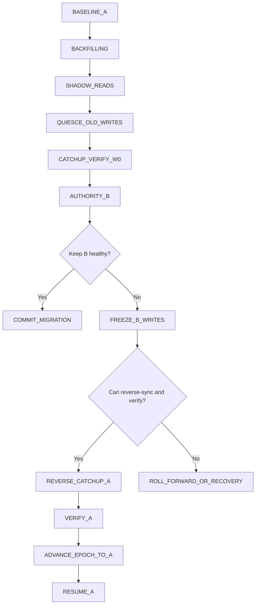

# Kế hoạch quay lui và dữ liệu phát sinh sau thời điểm chuyển đổi

Chuyển dữ liệu NoSQL từ cụm cũ sang cụm mới thường có một thời điểm được gọi là **cutover**: ứng dụng bắt đầu đọc hoặc ghi vào đích mới. Trước cutover, hệ cũ thường là nguồn có thẩm quyền; sau cutover, dữ liệu **tiếp tục thay đổi** trên hệ mới. Chính những thay đổi này làm cho thao tác “quay lui” phức tạp hơn việc đổi lại connection string.

Ví dụ, hệ bán hàng chuyển từ cụm A sang B lúc 10:00:

```text
09:59:58  B được đối soát tới checkpoint W0 của A.
10:00:00  API bắt đầu ghi vào B.
10:00:02  Đơn O-1001 được tạo trên B.
10:00:03  Thanh toán P-1001 được xác nhận trên B.
10:00:05  B bắt đầu timeout.
10:00:06  Nhóm trực ca muốn đổi traffic về A.
```

Nếu A vẫn chỉ chứa dữ liệu đến W0, **O-1001 và P-1001 có thể chưa tồn tại ở A**. Đổi router về A lập tức có thể khiến người dùng không thấy đơn đã được xác nhận, worker lặp thanh toán, cache làm sai trạng thái hoặc một event CDC cũ ghi đè kết quả mới. Nếu đồng thời A và B đều nhận writes mà không có quyền sở hữu rõ ràng, hai hệ có thể tạo ra các trạng thái xung đột.

Bài học thuộc **Database No SQL → Di chuyển và thay đổi** tập trung vào cách lập **kế hoạch quay lui (rollback/backout)**, quản lý **dữ liệu phát sinh sau cutover**, và lựa chọn giữa rollback, roll-forward hoặc tạm dừng ghi. Mục tiêu là phục hồi dịch vụ **mà không đánh tráo tính an toàn dữ liệu lấy một đèn health xanh**.

> **Điểm mấu chốt:** một rollback chỉ an toàn khi ta chứng minh được những lệnh ghi đã được chấp nhận sau cutover được **bảo tồn, áp lại đúng một lần về mặt hiệu ứng, hoặc xử lý theo một quyết định nghiệp vụ được phê duyệt**. “Đổi DNS về máy cũ” không đáp ứng điều kiện này.

---

## 1. Mục tiêu học tập

Sau bài này, bạn cần có thể:

- Phân biệt **rollback ứng dụng**, **rollback tuyến traffic**, **rollback dữ liệu**, **restore backup** và **roll-forward**.
- Xác định chính xác mốc cutover và **nguồn có thẩm quyền** ở từng pha.
- Biết dữ liệu nào được sinh sau cutover: insert, update, delete, TTL, transaction, outbox, CDC, cache, external effects.
- Thiết kế **write fence/ownership epoch** để tránh hai hệ cùng nhận ghi trái phép.
- Xây phương án **reverse replication/CDC**, change journal hoặc reconciliation để đưa delta từ hệ mới về hệ cũ khi cần.
- Xử lý **UNKNOWN commit outcome**, retry, duplicate delivery, idempotency, out-of-order events và conflict.
- Nhận diện thay đổi schema/format **không thể downgrade** hoặc không thể chuyển đổi ngược đầy đủ.
- Thiết kế checkpoints/watermarks và điều kiện cutover/rollback có bằng chứng.
- Đối soát counts, stable-key digests, revisions, tombstones và bất biến nghiệp vụ trước khi mở ghi trở lại.
- Lập runbook phân vai, quyền thao tác, điều kiện dừng, nghiệm thu và fault-injection tests.
- Giải thích trade-off theo đặc tính MongoDB, DynamoDB, Cassandra/ScyllaDB, Redis và các read models liên quan.

## 2. Các từ khóa phải tách bạch

| Thuật ngữ | Nghĩa | Không nên đánh đồng với |
| --- | --- | --- |
| **Cutover** | Chuyển quyền phục vụ đọc/ghi theo kế hoạch | Copy dữ liệu đã hoàn tất |
| **Rollback application** | Quay lại phiên bản ứng dụng trước | Quay dữ liệu về phiên bản trước |
| **Traffic rollback** | Chuyển request về endpoint/cụm cũ | Dữ liệu cụm cũ đã có mọi write mới |
| **Data rollback** | Khôi phục/trả dữ liệu về trạng thái đã định | Rollback binary hoặc DNS |
| **Backout** | Rời bỏ đích mới có kiểm soát | Gạt một feature flag |
| **Roll-forward** | Sửa đích mới rồi tiếp tục tại đó | Chấp nhận mọi lỗi và không có điểm dừng |
| **Reverse sync** | Truyền thay đổi từ đích mới về nguồn cũ | Đồng bộ hai chiều tự động an toàn |
| **Recovery point** | Mốc dữ liệu được chứng minh đã phục hồi | Thời điểm bắt đầu chạy restore |
| **Fence/epoch** | Cơ chế chặn writer cũ/sai thế hệ | Một biến Boolean chỉ nằm trong memory |
| **RPO** | Mục tiêu tổn thất dữ liệu cho phép | Quyền bỏ qua writes đã xác nhận |
| **RTO** | Mục tiêu thời gian phục hồi | Chỉ cần process `UP` |

Một tài liệu viết “rollback được trong 5 phút” nhưng không nêu rollback **cái gì** thường không đủ để triển khai production.

## 3. Trục thời gian của một lần di chuyển

```text
                       CUTOVER
                          |
---------- A authoritative|B authoritative ------------------->
       snapshot W0        |    E1    E2    E3 ...
       catch-up           |    new writes on B

A: source of truth        |B: source of truth
B: copy / candidate      |A: old copy, unless reverse sync active
```

Mỗi thay đổi cần một mốc:

- **T_prepare**: xác nhận nguồn và đích.
- **T_snapshot**: tạo bản sao nền.
- **W_base**: watermark của bản sao nền.
- **W_catchup**: đích đã áp các thay đổi nguồn đến đâu.
- **T_cutover**: chuyển authority/routing.
- **E_cutover**: generation/epoch của quyền ghi.
- **T_decide**: quyết định giữ B hoặc quay về A.
- **W_reverse**: A đã nhận delta từ B đến đâu.
- **T_resume**: mở ghi/read traffic trở lại trên authority đã chọn.

Không chỉ dùng giờ đồng hồ. Một mốc có thể là commit sequence, oplog/resume token, per-partition offsets hoặc **vector watermark** vì các shards không có một thứ tự toàn cục duy nhất.

## 4. Những dữ liệu mới sau cutover gồm những gì?

Không chỉ là `INSERT`.

Một hệ thương mại điện tử có:

```text
Create order O1
Update order status PENDING -> PAID
Reserve inventory SKU-A
Insert payment-capture receipt
Delete a canceled draft order
Expire a session or idempotency key
Append outbox event
Acknowledge a consumer offset
Generate a refund
Send external webhook
```

Khi quay về A, phải xét:

- Bản ghi mới.
- Bản ghi cũ được cập nhật.
- Xóa cứng, xóa mềm, tombstone.
- Tăng/giảm counters.
- Conditional writes, CAS/LWT.
- Transaction nhiều đối tượng.
- Idempotency receipts.
- Outbox/CDC event state.
- Projection/cache/index mutations.
- TTL và thời điểm hết hạn.
- Những hiệu ứng **ngoài database** như gửi thanh toán, email, webhook, shipping.

**Không thể quay lui external side effects chỉ bằng chép lại database.**

## 5. Phân loại đường rollback

### 5.1. Chỉ quay ứng dụng

Khi B vẫn là authority và dữ liệu/schema tương thích, có thể triển khai lại bản Java trước:

```text
App v2 -> App v1
Data still in B
```

Điều kiện: app v1 đọc/ghi đúng dữ liệu mới, API/codec/retry/schema tương thích. Không quay router về A.

### 5.2. Quay traffic về A

```text
App -> B
     rollback routing
App -> A
```

Chỉ an toàn khi A có trạng thái business cần thiết **tới mốc quyết định**, hoặc đã có quyết định rõ về các thay đổi không thể bảo tồn. Đây là chủ đề chính của bài.

### 5.3. Restore B tại backup cũ

```text
B now -> B snapshot at T0
```

Có thể mất writes từ T0 tới hiện tại nếu không có journal/PITR/replay. Restore khác rollback app.

### 5.4. Roll-forward sửa B

Khi A đã quá cũ, schema không thể lùi, hoặc delta đảo chiều rất khó, sửa lỗi/scale B có thể ít rủi ro hơn việc quay traffic về A.

### 5.5. Tạm khóa ghi, tiếp tục phục vụ đọc có kiểm soát

Nếu chưa biết nguồn nào đúng, **read-only/degraded mode** với thông báo rõ freshness có thể an toàn hơn cho phép hai hệ ghi tiếp trong lúc điều tra.

## 6. Một rollback có thể đảo ngược hay không?

Không có tính “rollbackable” tuyệt đối. Phải xét các lớp:

| Lớp | Ví dụ đảo ngược được | Ví dụ khó đảo ngược |
| --- | --- | --- |
| Application binary | Image cũ tương thích schema | Old code không hiểu field bắt buộc mới |
| Connection routing | Repoint tới A có đủ dữ liệu | A thiếu toàn bộ post-cutover writes |
| Database schema | Thêm field tùy chọn | Mất field cũ không thể tái tạo |
| Data format | Dual-write format cũ/mới | One-way rewrite/encryption/codec |
| Index | Index mới có thể bỏ | Custom index/plugin-owned data |
| Partitioning | Cùng key semantics | Re-shard với key encoding mới |
| CDC | Replay từ durable checkpoint | Log retention đã mất đoạn cần |
| External API | Notification có thể bù | Capture tiền đã gửi ra provider |
| Tenant isolation | Policy có thể đổi | Dữ liệu tenant trộn hoặc đã bị lộ |

Một thay đổi được gọi “reversible” phải có **bài diễn tập đảo chiều**, không chỉ một đoạn kế hoạch trên wiki.

## 7. Câu hỏi quyết định: ta đang cố bảo vệ điều gì?

Một quyết định rollback phải tuyên bố bất biến:

```text
No acknowledged order disappears.
No payment is captured twice.
No inventory reservation is applied twice.
No deleted user data resurrects.
No cross-tenant read is introduced.
All post-cutover operations are either preserved or explicitly reconciled.
```

Cùng với:

- RPO/RTO đã được phê duyệt.
- Read-after-write/consistency contract.
- Scope affected tenants/collections.
- Auditability.
- Privacy/retention obligations.
- Downgrade/recovery compatibility.

Nếu có đánh đổi, **data/business owner** phải tham gia quyết định, không để lệnh vận hành vô tình đổi lời hứa với người dùng.

## 8. Ba mô hình vận hành sau cutover

### Mô hình A — Old cluster đóng ghi, không reverse-sync

```text
A: immutable at W0
B: receives writes E1,E2,E3...
```

Ưu điểm: đơn giản, tránh split-brain. Nhược điểm: càng lâu, A càng không phải fallback tức thời. Muốn quay về A, cần replay/rebuild delta hoặc chấp nhận một recovery point theo policy.

### Mô hình B — B authoritative, reverse stream liên tục về A

```text
Clients -> B (only writer)
            |
            +--> B->A change stream
```

A có thể gần B, nhưng vẫn **có lag**. Muốn rollback phải fence B, catch up A tới mốc cuối và đối soát; không được chỉ thấy lag `0s` trên dashboard rồi giả mọi transaction đã commit tại A.

### Mô hình C — Dual-write A và B

```text
Clients -> logical write coordinator
              +-> A
              +-> B
```

Rủi ro cao: partial writes, timeout unknown, ordering khác, delete lệch, hai stores không có transaction atomic xuyên hệ. Không nên coi dual-write là giải pháp mặc định tạo rollback dễ. Nếu buộc dùng, cần outbox/idempotency/receipt và reconciliation.

## 9. Nguồn có thẩm quyền phải duy nhất cho mỗi business key

Lý tưởng:

\[
\forall k,t:\quad |\mathrm{AuthorizedWriters}(k,t)| \le 1
\]

Nghĩa là tại mỗi thời điểm, mỗi key/partition/tenant chỉ có tối đa một đường ghi có thẩm quyền.

Có thể chia authority theo tenant:

```text
Tenant T1 -> A
Tenant T2 -> B
```

nhưng chỉ khi routing có quy tắc và version/epoch rõ, không tạo overlap. Cần đánh giá những invariants xuyên tenant hoặc global unique IDs.

**Hai cụm cùng chấp nhận ghi cho một key không có conflict protocol sẽ tạo split-brain ở tầng dữ liệu**, ngay cả khi mỗi cụm riêng lẻ vẫn healthy.

## 10. Cutover barrier: khái niệm

Một **cutover barrier** là điểm điều phối giúp biết:

1. Những writes trước barrier thuộc authority cũ.
2. Những writes sau barrier thuộc authority mới.
3. Không có nhóm writes “không biết thuộc bên nào” bị bỏ rơi.
4. Các requests in-flight đã được xác định kết quả hoặc có durable journal.

Một chuỗi khái niệm:

```text
PREPARED
   -> DRAIN/REJECT OLD WRITES
   -> CONFIRM OLD COMMIT WATERMARK W0
   -> CATCH TARGET UP THROUGH W0
   -> VERIFY
   -> ADVANCE OWNERSHIP EPOCH
   -> OPEN NEW WRITES
```

Không nhất thiết phải dừng mọi reads; phạm vi fence là các writes có thể phá invariant. Cách xây barrier phụ thuộc dịch vụ/router/DB, không phải một primitive chung có sẵn trong mọi NoSQL.

## 11. In-flight writes là nguồn dữ liệu “lửng”

Ở thời điểm 10:00:

```text
Request R1 sent to A at 09:59:59.900
Cutover router switched at 10:00:00.000
A commits R1 at 10:00:00.100
```

Nếu W0 chụp tại 10:00:00.000 và R1 commit sau đó, dữ liệu có thể thiếu ở B nếu không drain/fence A đúng.

Cần:

- Stop accepting **new** writes to A.
- Track in-flight requests đã gửi trước fence.
- Wait bounded time hoặc classify outcomes.
- Observe authoritative commit journal/position.
- Catch B through final old-source watermark.
- Handle UNKNOWN outcomes bằng operationId/receipt.
- Chỉ sau đó chuyển quyền ghi.

Không lấy timestamp của HTTP router làm commit barrier nếu database vẫn có thể hoàn tất writes cũ sau thời điểm đó.

## 12. Write fencing và ownership epoch

Một thiết kế có thế hệ quyền ghi:

```text
Epoch 17: A owns tenant T1.
Epoch 18: B owns tenant T1.
```

Mỗi mutation mang expected epoch. Authority phải kiểm epoch trước khi commit nếu hệ hỗ trợ đúng boundary.

Khái niệm:

```text
write(orderId, expectedEpoch=18):
    if currentEpoch != 18:
        REJECT_STALE_WRITER
    else:
        apply conditional business update
```

Cảnh báo quan trọng: nếu epoch chỉ là biến trong Java process hoặc cache có thể stale, một writer cũ có thể bỏ qua nó. **Fencing phải được enforce tại nơi ghi hoặc thông qua cơ chế coordination có bảo đảm phù hợp**, và mọi đường ghi — API, worker, admin job, CDC sink — phải tuân thủ.

## 13. Lease không tự thay fencing token

Một service có lease 30 giây:

```text
A writer lease expires.
B starts writing.
A process paused by GC resumes, still believes it owns lease.
```

Nếu A vẫn có quyền DB và không kiểm fencing token, A có thể ghi muộn sau khi B bắt đầu.

Thiết kế tốt hơn:

- Monotonic epoch/fencing token.
- Target-side conditional rejection of stale epoch.
- Durable owner state.
- Không cho hai writers cùng dùng broad credential không kiểm soát.
- Kiểm clock skew/lease expiry.
- Kiểm failover và paused process.
- Có manual override/administrative procedure được duyệt.

**Lease-based leader election và fencing là hai yêu cầu liên quan nhưng không đồng nhất.**

## 14. Chặn mọi đường ghi cũ, không chỉ HTTP endpoint

Trong một hệ thực tế, writes có thể đến từ:

```text
HTTP order API
Scheduled jobs
Payment callbacks
CDC consumers
Queue workers
Admin reconciliation scripts
Backfill jobs
TTL/lifecycle processors
Mobile offline sync
```

Nếu chỉ đổi endpoint của order API mà để payment webhook worker vẫn ghi A, sau cutover A và B có thể diverge.

Lập **writer inventory** theo business key và kiểm cho từng writer:

| Writer | Before | After | Fence/owner test |
| --- | --- | --- | --- |
| Order command API | A | B | Old epoch denied |
| Payment webhook | A | B | Idempotent receipt |
| Inventory worker | A | B | CAS + fence |
| CDC read-model sink | A source | B source | Checkpoint migration |
| Backfill/admin script | Paused/limited | Re-authorized | No stale writes |
| Mobile offline sync | A via API | B via API | Version/epoch validation |

Không có writer inventory thì khó chứng minh old cluster không còn nhận commits.

## 15. Router và DNS không phải quyền sở hữu dữ liệu

Thay DNS, service discovery, connection URI hoặc load balancer có độ trễ:

- Clients cache DNS.
- Connection pools giữ sockets cũ.
- Long-lived sessions vẫn tới A.
- Sidecars dùng config cũ.
- Retries có thể chọn endpoint cũ.
- Background jobs không dùng cùng router.
- Multi-region propagation không đồng thời.

Thời điểm router “đã đổi” khác thời điểm **old writer bị fence thật**.

Đo:

```text
requests to A after barrier
commits accepted by A after barrier
connections still open to A
applications using previous routing epoch
```

Kết quả cần chứng minh **0 unauthorized old-epoch commits** trong scope, không chỉ tỷ lệ traffic đến B đạt 99.9%.

## 16. Giai đoạn rollback window

Một mô hình:

```text
T_cutover ------------------ T_end_of_backout_window
             window W
```

Trong W, giữ A ở trạng thái có thể phục hồi (nhưng có thể thiếu delta) và giữ các cơ chế reverse sync/journal.

Điều kiện window:

- Old binary/schema còn tương thích.
- Reverse change log/CDC retention đủ.
- Old cluster không bị decommission.
- Backup/recovery key material còn.
- Data mapping có đường chuyển ngược.
- Data correctness checks còn vận hành.
- Cost hai cụm trong ngân sách.

**Giữ A chạy thêm bảy ngày không tự tạo một rollback window bảy ngày** nếu reverse CDC chỉ lưu một giờ và dữ liệu mới đã không còn chuyển ngược được.

## 17. Định nghĩa “last safe rollback point”

Một mốc an toàn có thể mô tả:

```text
Source A last verified baseline: W0
B accepted commits through: W_B
A reverse-applied through: W_A
Outstanding UNKNOWN operations: N
Outstanding unverified deletes: M
External reconciliation complete? Y/N
```

Traffic quay về A chỉ khi:

```text
W_A covers all required committed operations through W_B
AND ownership B is fenced
AND business reconciliation passes
AND A schema/security/read-write readiness passes
```

Trong hệ nhiều partitions, không so `W_A >= W_B` như một số vô nghĩa; cần per-partition/transaction-aware coverage hoặc chứng minh equivalent cut.

## 18. “Backout instant” thường chỉ đúng trước khi có ghi mới

Trước khi B nhận ghi:

```text
A authoritative, B candidate.
```

Có thể rollback một lần thử route read-only bằng cách quay reads về A khá đơn giản.

Sau khi B đã chấp nhận các lệnh ghi:

```text
B authoritative, A stale.
```

Rollback phải là **một migration ngược** hoặc một recovery có quyết định RPO, không phải thao tác routing tức thì.

Đây là lý do nên chia canary thành:

1. Shadow reads.
2. Read-only canary.
3. Bounded writes có authority/fencing.
4. Full cutover.

Mỗi bước cần điều kiện quay lui khác nhau.

## 19. Shadow read và so sánh dữ liệu trước cutover

Một ứng dụng có thể:

```text
Production request -> A returns user response.
Shadow query -> B (not returned to user).
```

Lợi ích:

- So business result theo query shape.
- Phát hiện thiếu index/routing.
- Đo p95/p99 và read amplification.
- Kiểm authorization/tenant scoping.
- Không cấp authority ghi cho B.

Nhưng shadow reads:

- Có thể tạo tải hoặc chi phí.
- Có thể thấy snapshot/lag khác.
- Phải không gây side effect.
- Có thể đọc dữ liệu nhạy cảm.
- Không chứng minh write semantics sau cutover.
- Cần cùng read consistency/cut để tránh false mismatches.

Shadow read an toàn hơn dual-write nhưng không thay kiểm chính xác của writes.

## 20. Canary ghi sau cutover: giới hạn blast radius

Một cách chọn cohort:

```text
Tenant cohort C1 -> B writable
Remaining tenants -> A writable
```

Chỉ nên làm nếu data/operations có **partition ownership tách biệt thật**.

Điều kiện:

- Không có unique constraint/invariant xuyên cohort không được bảo vệ.
- Mỗi tenant có routing epoch rõ.
- Retry/background writers nhất quán với owner.
- Read models không ghi ngược authority sai.
- Có cách reverse sync delta của cohort C1.
- Không có cross-tenant joins/aggregates với semantics chưa xác định.
- Metrics và audit theo cohort.

Nếu business giao dịch giữa hai tenants, partitioned canary có thể đòi cross-cluster transaction design không được hỗ trợ. Không tự tuyên bố “chỉ 1% tenants” nghĩa 1% rủi ro.

## 21. Dữ liệu phát sinh cần một **durable change journal**

Nếu phải chuyển post-cutover delta ngược về A, cần biết chính xác những thay đổi nào đã được B **commit**.

Nguồn khả dĩ:

- DB change stream/CDC theo supported semantics.
- Application transactional outbox.
- Immutable event/business ledger.
- Append-only audit log có commit receipts.
- Backup/PITR log phù hợp.

Một journal hữu ích chứa:

```text
operationId
sourceEpoch
entityBusinessKey
mutationType
sourceRevision / sequence
commitPosition
payload or reconstructable reference
deleted / tombstone information
transaction grouping if relevant
schemaVersion
```

Không coi một HTTP request log là commit journal: request đã gửi có thể chưa commit, và một commit có thể xảy ra dù response timeout.

## 22. Transactional outbox hỗ trợ replay

Khi B nhận một thay đổi nghiệp vụ:

```text
Transaction on B:
    update authoritative order
    insert outbox event E with same operationId
    commit atomically
```

Sau đó connector chuyển event E về A/projections.

Lợi ích:

- Không bị “DB commit nhưng event không có” nếu cùng atomic boundary thật.
- Có stable operation ID và revision.
- Có thể retry delivery.
- Có thể audit những committed effects.

Giới hạn:

- NoSQL engine phải hỗ trợ atomicity đúng tập records/partition cần.
- Nếu outbox và business write khác transactions/partitions, cần thêm protocol.
- CDC event có thể bị giao trùng.
- Connector có thể lag/hết retention.
- External side effects vẫn nằm ngoài transaction DB.

Outbox làm replay **khả thi hơn**, không tự làm tác động giữa A và B exactly-once.

## 23. At-least-once delivery và exactly-once effect

Ví dụ:

```text
B commits E1.
B->A consumer applies E1.
Consumer crashes before acknowledging E1.
E1 is delivered again.
```

Điều mong muốn:

```text
deliveries(E1) >= 1
appliedBusinessEffect(E1) = 1
```

Giải pháp có thể là:

```text
On A:
    IF operationId not in applied_operations:
        apply mutation
        mark operationId applied
    ELSE:
        return ALREADY_APPLIED
```

Marker và mutation cần có atomic boundary phù hợp. Nếu marker commit trước mutation, có thể bỏ sót effect; nếu mutation commit trước marker, có thể áp trùng.

Với hệ không hỗ trợ cross-record atomicity, cần thiết kế per-key conditional writes, reconciler hoặc khác biệt semantic rõ.

## 24. Giữ identity và operationId ổn định qua hai cụm

Nếu B tạo một ID khác khi replay về A, có thể xuất hiện:

```text
B: orderId=O-500
A: orderId=O-901 (same logical operation)
```

Khi quay về A:

- Người dùng thấy hai đơn.
- Payment receipt tham chiếu O-500 không liên kết.
- Duplicate suppression không hoạt động.
- API retry tạo thêm đơn thứ ba.

Nên chọn:

- Business IDs được cấp trước/độc lập với cluster khi phù hợp.
- Stable idempotency key.
- Deterministic mapping nếu IDs cần chuyển.
- Referential mappings có kiểm soát.
- Không sửa identity vì thứ tự sequence/generator khác nhau.
- Bảo đảm multi-tenant uniqueness scope.

Nếu old/new schema dùng ID khác nhau, mapping phải là một phần **durable migration ledger**, không phải dictionary tạm trong memory.

## 25. Commit UNKNOWN: không được suy từ client timeout

Một timeline:

```text
Client -> B: reserve inventory for op-123
B commits.
Network response lost.
Client sees timeout.
```

Trong rollback, `op-123` có thể đã được B thực thi nhưng không xuất hiện trong HTTP success logs.

Cần:

- Stable operationId.
- Authoritative readback/receipt từ B.
- CDC/outbox event/cut coverage.
- Phân biệt `APPLIED`, `NOT_APPLIED_CONFIRMED`, `UNKNOWN`.
- Không retry side effect với operationId mới.
- Nếu B không còn truy cập, khôi phục journal/backup và reconciliation với external systems.

**Không thể bỏ qua UNKNOWN operations chỉ vì client báo error.**

## 26. Write acceptance ledger cho cutover

Một ledger có thể lưu:

```text
operationId
tenantId
entityKey
authorityEpoch
receivedAt
commitPosition
resultState
externalEffectReference
```

Một ví dụ:

```text
op-A: epoch=18, B commit seq=541, APPLIED
op-B: epoch=18, B commit seq=542, APPLIED
op-C: epoch=18, B response LOST, source receipt UNKNOWN to caller
op-D: epoch=17, old writer rejected
```

Kiểm:

- `op-A/op-B` được reverse-applied.
- `op-C` được tra cứu/đối soát trước khi quyết định.
- `op-D` không trở thành commit trên A sau fence.
- Không có gaps/duplicate applied effects.

Ledger có thể là một phần business source, nhưng nếu ledger phụ thuộc cùng database hỏng, cần một **evidence/recovery strategy** không giả nó luôn sẵn.

## 27. Thứ tự replay rất quan trọng

Các operations trên cùng key:

```text
rev 5: order CREATED
rev 6: order PAID
rev 7: order CANCELED according to policy
```

Nếu reverse consumer áp:

```text
rev 7 first
rev 5 later
```

một upsert mù có thể làm order “quay về CREATED”.

Giải pháp:

- Revision/version monotonic theo entity.
- Conditional `apply only if sourceRev > targetRev`.
- Stable per-key order nếu stream hỗ trợ.
- Barrier cho những operations có quan hệ nhân quả nhiều keys.
- Idempotency marker.
- Reconciliation và exception handling khi có gap.

Không lấy wall-clock `updatedAt` làm revision nếu đồng hồ có thể lệch và nhiều writers cạnh tranh.

## 28. Conditional replay theo revision

Pseudo-code:

```text
apply(event e):
    current = read(target, e.key)

    if current.appliedEventId == e.id:
        return DUPLICATE

    if current.revision > e.revision:
        return STALE_REPLAY

    if current.revision == e.revision:
        return CHECK_EQUALITY_OR_CONFLICT

    if e.revision == expectedNextRevision(current):
        updateWithCASAndDedup(e)
        return APPLIED

    return GAP_REQUIRES_RECONCILIATION
```

Không dùng `current.revision < e.revision` như giấy phép bỏ qua tất cả intermediate steps nếu nghiệp vụ dựa vào transitions. Một state projection có thể lấy phiên bản cuối, nhưng một financial ledger cần đủ contributions/receipts.

## 29. Tại sao “last write wins” có thể phá dữ liệu?

Giả sử:

```text
A restored state: amountMinor=1000, updateAt=10:00:10
B authoritative:  amountMinor=2000, updateAt=10:00:08
```

Nếu A có clock đi nhanh hoặc updateAt bị set lúc restore, LWW theo timestamp có thể giữ giá trị 1000 dù B có commit mới.

Nguy cơ:

- Clock skew.
- Two clocks không biểu diễn causality.
- UpdateAt bị sửa bởi backfill.
- Transaction update nhiều fields.
- Concurrent writes trên hai cụm.
- Deletes bị overwrite.

LWW chỉ phù hợp khi business **chấp nhận mất cập nhật và quy tắc tie-breaker được định nghĩa**. Với tiền/tồn kho hoặc trạng thái đơn, thường cần conditional version, ledger hoặc manual reconciliation.

## 30. Conflict taxonomy sau cutover

| Loại | Ví dụ | Cách xử lý |
| --- | --- | --- |
| `NEW_ONLY_ON_B` | Đơn mới | Reverse-create với stable ID |
| `UPDATED_ON_B` | Trạng thái PAID mới | Apply theo revision/invariant |
| `DELETED_ON_B` | User xóa record | Propagate tombstone đúng generation |
| `UPDATED_BOTH` | A/B cùng sửa field | Escalate conflict policy |
| `DELETE_UPDATE_CONFLICT` | B delete, A update | Authority/epoch quyết định |
| `SCHEMA_INCOMPATIBLE` | B field mới A không hiểu | Transform hoặc không rollback |
| `DUPLICATE_EFFECT` | Payment capture hai lần | Ledger/provider reconciliation |
| `MISSING_EVENT` | CDC gap | Rebuild from source/backup |
| `CONFLICTING_IDS` | Cùng entity, hai IDs | Identity mapping |
| `UNKNOWN_COMMIT` | Timeout trước ACK | Receipt lookup và recovery |
| `TTL_MISMATCH` | Marker hết hạn lệch | Retention policy |
| `EXTERNAL_EFFECT` | Shipment đã gửi | Compensation/manual workflow |

Mỗi loại cần owner, mức độ nghiêm trọng và gate; không gom tất cả thành “sync conflict resolved” mà không chứng cứ.

## 31. Delete là một sự kiện phải bảo tồn

Một khách hàng xóa dữ liệu lúc 10:05 trên B:

```text
B: record deleted, tombstone rev 14.
A: record still exists at rev 10.
```

Nếu quay về A mà không replay delete:

```text
deleted record reappears
```

Có thể vi phạm quyền riêng tư và business semantics.

Nên có:

- Tombstone hoặc deletion ledger có revision/generation.
- Stable record identity.
- Retention đủ cho rollback/replay window.
- Conditional rejection of older upserts.
- Propagate deletion tới cache/search/projections.
- Kiểm TTL và legal retention.
- Không xóa tombstone sớm để tiết kiệm disk khi còn nguồn replay cũ.

**Missing delete nghiêm trọng không kém missing insert**; kế hoạch rollback phải xử lý cả hai.

## 32. TTL và deduplication marker sau chuyển đổi

Giả sử idempotency marker:

```text
operationId=pay-123
expires after 1 hour
```

Rollback mất 2 giờ, trong khi external retries vẫn còn. Nếu marker hết hạn, một event cũ có thể được áp lại.

Cần xác định:

```text
dedup retention >= maximum retry + replay + rollback exposure window
```

theo business scope, đồng thời kiểm policy xóa dữ liệu.

TTL ở A và B có thể khác:

- Snapshot restore tạo lại thời hạn tính từ lúc restore.
- TTL được lưu dưới dạng absolute expiration.
- Engine chậm cleanup nên physical count khác logical visible state.
- Idempotency receipts có lifecycle riêng.

Không giả TTL của mọi engine giống nhau, và không dùng cache TTL làm protection duy nhất cho money operations.

## 33. Schema evolution làm rollback khó

Ví dụ B viết schema mới:

```json
{
  "orderId": "O1",
  "totalMinor": 10500,
  "currency": "USD",
  "captureMode": "PARTIAL"
}
```

A chỉ hiểu:

```json
{
  "orderId": "O1",
  "total": "105.00"
}
```

Một phép chuyển ngược phải định nghĩa:

- `totalMinor` → `total` theo currency/scale chính xác.
- `captureMode` có semantics tương ứng không?
- Field mới nào có thể bỏ mà không mất nghiệp vụ?
- Validation/index/constraints của A có chấp nhận không?
- References mới có map về key cũ không?
- Event schema mới có decode bởi old consumers không?

Nếu `PARTIAL` không được biểu diễn đúng trong A, **rollback A có thể không tương thích với dữ liệu post-cutover**, dù convert giá trị tiền được.

## 34. Expand–migrate–contract cho khả năng quay lui

Một trình tự bảo thủ:

```text
EXPAND:
    Old and new apps accept compatible schema.

MIGRATE:
    Backfill old -> new; dual-read or source-driven replication;
    observe while old fields remain.

CUTOVER:
    New becomes authoritative, post-cutover mutations journaled.

CONTRACT:
    Remove old fields/protocol only after rollback window ends
    and operational sign-off.
```

Trong rollback window, tránh **destructive contract** quá sớm: xóa field cũ, thay IDs một chiều, drop table nguồn, bỏ decoder cũ.

Đừng coi expand–contract là bảo đảm rollback nếu data semantic mới không thể đại diện trên schema cũ.

## 35. Data format không thể hạ phiên bản

Một số server migrations thay:

- Storage engine data format.
- Index encoding.
- Encryption format/key derivation.
- Protocol/feature compatibility.
- Plugin-owned data structures.
- Transaction/log structure.

Trong trường hợp đó:

```text
Run old server binary on new data directory
```

có thể bị từ chối hoặc phá dữ liệu.

Cần:

- Vendor-supported downgrade path.
- Feature compatibility gating.
- Backup của old format.
- Restore vào old-version cluster nếu tương thích.
- Forward/reverse logical migration.
- Không bật irreversible feature trước khi rollback plan được duyệt.

**Rollback dữ liệu có thể cần dựng một hệ mới tương thích, không phải restart binary cũ.**

## 36. Write freeze: công cụ giảm rủi ro có chi phí

Khi B gặp sự cố:

```text
Set critical writes temporarily unavailable.
Drain or reject new writes.
Preserve B commit journal.
Catch A up.
```

Ưu điểm:

- Tạo điểm ổn định để xác minh.
- Không thêm post-cutover delta trong lúc reverse.
- Tránh split-brain.
- Giúp xác định recovery point.

Nhược điểm:

- Làm giảm availability.
- Có thể tồn tại in-flight retries.
- Có thể gây queue buildup.
- Một số external callbacks vẫn đến.
- Cần biết mối quan hệ với RTO và business impact.

Write freeze chỉ an toàn nếu **enforced ở mọi write path**, có bounded queue/retry, và caller nhận status rõ như `RETRY_LATER`, không “thành công giả”.

## 37. Trạng thái xử lý chuyển đổi

Một state machine khái niệm:



State machine không thay được durable authority enforcement. Khi process crash/restart, hệ phải biết đang ở state nào và owner nào đang được phép ghi.

## 38. Rollback về A cần một cutover ngược

Cơ chế tương tự cutover ban đầu:

```text
B authoritative epoch 18
    |
    +-- Stop new writes to B.
    +-- Drain/resolve in-flight B writes.
    +-- Capture final committed watermark W_B.
    +-- Apply B->A delta until A covers W_B.
    +-- Verify data and business invariants.
    +-- Advance authority epoch to 19 with A owner.
    +-- Ensure B epoch 18 writes are denied.
    +-- Open writes on A.
```

Không dùng lại epoch 17 khi quay về A; **epoch nên tăng đơn điệu** để stale writer từ thời A cũ không được hồi sinh.

Nếu B không thể phục vụ journal hoặc readback, có thể phải dùng backup/recovery flow; không giả A có delta đầy đủ.

## 39. Rollback trong cùng Region và cross-Region khác nhau

Cùng Region vẫn có:

- DNS/pool caching.
- Different topology/index settings.
- Quorum/failover.
- Replication lag.

Cross-Region còn thêm:

- Network latency và packet loss.
- Cross-region replication semantics.
- Different IAM/trust/ACLs.
- KMS key availability.
- Data residency requirements.
- Different backup/PITR coverage.
- Region-specific external endpoints.
- CDC retention while link is down.

Một mốc “lag dưới 1 giây” không chứng minh **mọi committed events** đã tới Region còn lại. Gắn recovery point và source/target verification riêng cho từng Region.

## 40. Cảnh báo khi rollback nhiều lần (ping-pong)

Một hệ có thể:

```text
A -> B -> A -> B
```

trong vài phút vì health checks dao động.

Rủi ro:

- Chồng lấn writers.
- Thay authority epoch liên tục.
- CDC reverse/forward loops.
- Cursors/checkpoints khó truy.
- Duplicate external effects.
- DNS/cache chưa hội tụ.
- Split-brain ở các clients.

Nên có:

- Chống tự động ping-pong bằng cooldown/manual gate.
- Epoch monotonic.
- One-way stream direction tương ứng authority.
- Evidence và stop criteria cho mỗi chuyển.
- Chặn event phản xạ bằng origin metadata/operationId.
- Không tạo một vòng sao chép B→A→B không có idempotency.

## 41. Ranh giới giao dịch xuyên hệ

Ví dụ một nghiệp vụ:

```text
B: update order to PAID
B: append outbox event
External PSP: capture payment
Search projection: reflect PAID
```

Không nhất thiết có một transaction atomic bao trùm cả bốn nơi.

Cần xác định:

- **Authoritative local transaction** và commit receipt.
- External transaction/reference/idempotency key.
- Outbox event ID.
- Consumer applied markers.
- Compensation nếu một bước đã xảy ra ngoài DB.
- Mốc reconciliation với provider.
- Những effects không đảo ngược được.

Rollback database không hủy capture đã được PSP thực hiện. Việc `refund` là **một nghiệp vụ bù trừ mới có audit**, không phải “xóa dòng payment đã commit” cho đẹp.

## 42. Số liệu cần nắm ngay lúc quyết định quay lui

Một dashboard rollback nên có:

```text
business writes accepted since cutover
committed operations by type
UNKNOWN outcomes still unresolved
number of B-only keys
number of B updates/deletes since cutover
B->A reverse CDC lag and oldest outstanding event
A applied watermark coverage by partition
conflicts/gaps/duplicates
source and target count/hash mismatch
business invariant mismatches
external side-effect reconciliation backlog
old/new writer traffic and forbidden commits
schema compatibility readiness
RPO/RTO exposure
```

Không có một chỉ số duy nhất đủ để quyết định. Một lag-time nhìn có vẻ 0 vẫn có thể che event bị drop, missing delete hoặc A đã bị ghi từ một writer cũ.

## 43. Cách xác định độ lớn delta sau cutover

Không chỉ tính:

```text
B documentCount - A documentCount
```

vì updates/deletes không thể hiện đầy đủ.

Một delta inventory:

```text
new business keys
modified existing business keys
deleted keys/tombstones
new external receipts
unique committed operations
new schema values/types
new CDC/outbox events
new idempotency markers
```

Có thể đối chiếu theo `(tenant, stable key, revision)` và so canonical content tại cùng target watermark, hoặc dựa trên log mutations được chứng minh đầy đủ.

Một update từ `PENDING` sang `PAID` không đổi count nhưng **có thể quan trọng hơn hàng nghìn inserts**.

## 44. Dùng counts, digests và business invariants cùng nhau

Một bảng:

| Kiểm | Phát hiện | Không chứng minh |
| --- | --- | --- |
| Exact live count | Missing/extra tổng thể | Same count không có wrong value |
| Count theo tenant/state | Skew, thiếu nhóm | Same subgroup count vẫn có swapped keys |
| Unique business key count | Duplicate identities | Field values đúng |
| Canonical per-key digest | Value/revision differences | Business rules xuyên records |
| Tombstone/revision diff | Missing delete/stale replay | External effects đã xử lý |
| Idempotency ledger | Duplicate operation ID/effect | Foreign provider outcome đúng |
| Financial/inventory invariant | Quan hệ nghiệp vụ | Mọi record thuộc scope đã scan |
| CDC watermark/gap proof | Replay coverage | Mapping schema đúng |
| API canary | End-user path hoạt động | Toàn hệ không có hidden mismatch |

Cổng quay lui phải kết hợp nhiều lớp; không tuyên bố PASS chỉ vì số lượng và hash của một mẫu nhỏ trùng.

## 45. Consistent cut để so A và B

Giả sử B vẫn ghi khi verifier chạy:

```text
A count at 10:10:00 = 100000
B count at 10:10:05 = 100020
```

Chênh lệch có thể do 20 writes hợp lệ. So sánh cần:

- Freeze/quiesce writes trong phạm vi.
- Hoặc snapshot-consistent reads cùng cut.
- Hoặc versioned data/event log để tái dựng trạng thái tại W.
- Hoặc compare B at W_B to A after A applied exactly through W_B.

Với nhiều partitions, W_B có thể là vector per-partition positions. Nếu không có một consistent cut, **không thể lấy phép so ngẫu nhiên làm bằng chứng đã mất dữ liệu**.

## 46. Tập dữ liệu nào cần đối soát?

Lập inventory:

```text
Authoritative business collections/tables
Uniqueness and idempotency ledgers
Payment provider references
Inventory reservations
Transactional outbox
CDC checkpoints / applied markers
Soft deletes and tombstones
Schema/index/role configuration
Read models/projections
Caches
Audit/retention data
```

Phân loại:

- **Authority**: dữ liệu quyết định đúng/sai nghiệp vụ.
- **Derived**: có thể tái dựng, nhưng phải bắt kịp trước khi phục vụ các API tương ứng.
- **Operational state**: offsets/cursors/roles/indexes có thể quyết định replay và truy cập.
- **External effects**: phải reconcile theo reference ID, không thể restore bằng dữ liệu DB.

## 47. Transaction và thứ tự giữa nhiều collections

Nếu một giao dịch cập nhật:

```text
orders.status=PAID
payments.captureReceipt=R1
outbox.orderPaid=E1
```

một consumer đảo chiều từng collection độc lập có thể tạm đưa A tới trạng thái:

```text
Order PAID but no capture receipt.
```

Nếu mở traffic vào A giữa chừng, ứng dụng có thể quan sát dữ liệu sai.

Cần:

- Transaction-aware CDC nếu engine hỗ trợ.
- Grouping/barrier theo transaction IDs.
- Apply atomic tại target khi schema/engine cho phép.
- Hoặc chỉ mở traffic sau khi toàn bộ target cut thỏa invariant.
- Durable replay journal.
- Error handling khi một event trong group thất bại.

Không suy “đúng thứ tự trong mỗi partition” đồng nghĩa có global transaction order giữa mọi partitions.

## 48. Query/load sau rollback có thể khác trước

A có thể đủ data nhưng:

- Chưa tạo index mới.
- Không còn đủ capacity cho traffic hiện tại.
- Có ít shards hơn B.
- Driver đang dùng new protocol không tương thích.
- Cache lạnh.
- Connection pools trỏ sai Region.
- Old application behavior không hiểu dữ liệu mới.
- Read consistency defaults khác.
- RBAC/key policies lỗi.

Vì vậy rollback readiness gồm **data safety + functional compatibility + performance/capacity + security**. Không đưa traffic 100% về A ngay khi hash data vừa khớp nếu A chưa chịu được tải.

## 49. Chuẩn bị “rollback rehearsal” trước cutover

Một diễn tập đúng nên gồm:

1. Snapshot A ở checkpoint kiểm được.
2. Catch up B.
3. Cutover thử với writers trong môi trường cô lập.
4. Phát sinh post-cutover inserts/updates/deletes.
5. Tạo ACK-loss và duplicate CDC deliveries.
6. Fencing B.
7. Reverse/reconcile delta về A.
8. Verify counts/digests/business invariants.
9. Advance authority epoch sang A.
10. Restart/reconnect old clients, xác nhận stale writers bị chặn.
11. Kiểm API readiness và load.
12. Ghi thời gian, steps và residual risks.

Chỉ thử **cutover forward** mà không thử reverse sẽ không chứng minh rollback window hoạt động.

## 50. Một phương án quay lui mẫu cho hệ đơn hàng

Giả sử:

```text
A = MongoDB old cluster
B = MongoDB new cluster
Cutover at 10:00
B accepted 5000 orders and 800 updates after cutover
Reverse stream B->A runs asynchronously
```

Sự cố 10:10 cần quay về A.

**Bước 1 — Stop authority B**

- Từ chối các mutation mới theo epoch.
- Drain/resolve in-flight operations.
- Ghi final committed watermark, không chỉ clock time.

**Bước 2 — Catch A up**

- Đợi reverse stream áp mọi events đến W_B.
- Kiểm retry/duplicate/tombstone/transactions.
- Nếu gap, dừng và chọn restore/rebuild.

**Bước 3 — Verify**

- So stable keys/revisions/digests tại W_B.
- Đối soát 5000 orders và 800 updates, deletes nếu có.
- Đối soát payments/outbox/receipts.
- Kiểm schema/index/ACL, cache/read model.

**Bước 4 — Switch**

- Tăng epoch và đặt A làm authority.
- Xác minh B không còn nhận writes.
- Chuyển canary traffic, quan sát p99/correctness.
- Mở rộng theo gate.

## 51. Khi không có reverse CDC

Nếu từ B về A **không có stream khả dụng**:

- Có thể tạm dừng B writes.
- Lấy snapshot/consistent export từ B.
- So source A baseline và B.
- Xác định B-only/modified/deleted keys.
- Chuyển logical delta hoặc rebuild A từ B bằng data migration có kiểm soát.
- Apply transformations và reconcile.
- Chỉ mở A sau khi đạt full coverage.

Nhưng nếu B hoàn toàn mất và không có journal/backup post-cutover, có thể **không thể bảo tồn mọi acknowledged write**. Phải báo trung thực `DATA_RECOVERY_GAP` và kích hoạt quy trình RPO/external reconciliation; không tuyên bố “rollback thành công 100%”.

## 52. Trường hợp roll-forward tốt hơn rollback

Nên cân nhắc giữ B khi:

- B có lượng writes mới lớn mà A thiếu.
- Không có reverse sync đủ tin cậy.
- Schema mới không thể biểu diễn trong A.
- Hệ B chỉ có lỗi routing/index/capacity có thể sửa an toàn.
- Backward migration tốn hơn thời gian phục hồi cho phép.
- A đã bị decommission hoặc không đủ capacity.
- External side effects gắn chặt vào B new IDs.
- Rollback có nguy cơ phá tenant isolation/financial ledger.

Roll-forward vẫn cần stop conditions, bảo vệ data và backup. Không vì “rollback khó” mà chấp nhận tiếp tục ghi dữ liệu sai.

## 53. Quyết định rollback, roll-forward hay read-only

Một bảng:

| Điều kiện | Hướng ưu tiên cân nhắc |
| --- | --- |
| B chưa có ghi mới, A còn authority | Quay read-only canary về A |
| B có delta, reverse sync hoàn chỉnh và đã verify | Controlled rollback sang A |
| B có delta, A chưa bắt kịp nhưng có journal | Freeze writes, catch-up rồi quyết |
| B có data format một chiều mới | Roll-forward hoặc logical restore/migration |
| B bị lỗi nhưng có authoritative backups và replay | Recovery có kiểm chứng |
| Không biết write outcomes | Freeze/ràng buộc nghiệp vụ, reconcile |
| A/B đều có writes xung đột | Cô lập writers, conflict/owner resolution |
| B đúng data nhưng quá tải | Mitigate/scale B hoặc controlled rollback nếu đủ điều kiện |
| Security/data corruption nghiêm trọng | Incident safety-first, giữ evidence |

Không chọn phương án chỉ theo “bản nào trả HTTP 200 nhanh hơn”.

## 54. Quyết định RPO khi không thể tránh data gap

Giả sử:

```text
A recovered through 10:03.
B had committed writes through 10:05.
B log for 10:03–10:05 unavailable.
```

Khoảng chưa chứng minh được không tự biến thành “hai phút dữ liệu có thể bỏ”.

Cần:

- Xác định tập business operations khả nghi.
- So provider receipts, outbox, user confirmations, audit logs.
- Xác định những acknowledged writes có thể bị mất.
- Đối chiếu RPO và mức độ nghiêm trọng của từng loại dữ liệu.
- Quyết định compensation/manual recovery.
- Data/business/security owner phê duyệt.
- Thông báo theo policy khi cần.
- Ghi những điều chưa thể xác định.

**RPO là một ràng buộc phục hồi, không phải sự cho phép âm thầm xóa giao dịch tiền.**

## 55. Backup/PITR và rollback window

Có thể giữ:

```text
Last pre-cutover backup of A
Post-cutover backups of B
CDC journal both directions as needed
Schema/credential/config snapshots
Rollback artifact for old app/driver
```

Kiểm:

- Backup có thể restore vào phiên bản cần không?
- PITR log retention đủ cho window?
- KMS keys/roles còn sử dụng được?
- Backup có consistente cut với outbox không?
- Restoring A từ old snapshot rồi replay B delta có đường thật không?
- Schema migration có làm old app không đọc được không?
- Backup có được thử restore trong isolated environment?

**Backup có thể khôi phục bytes mà không tự khôi phục authority, routing, CDC offsets và external side effects.**
## 56. MongoDB: replica set/cluster migration và quyền ghi

Trong MongoDB, các nguồn bằng chứng có thể gồm:

- Replica set health, primary/secondary election state.
- Sharded topology/routing và shard-key coverage.
- Session/retryable write behavior.
- Transaction commit receipts nếu sử dụng.
- Change streams và resume tokens theo khả năng phiên bản.
- Oplog window/retention.
- `clusterTime`/causal information trong phạm vi hỗ trợ.
- Unique indexes, TTL indexes và collation.
- Driver read/write concern, read preference, retry policy.

Một mô hình:

```text
Old MongoDB A
    -> initial backup/restore
    -> change stream/catch-up
New MongoDB B
    -> authority after cutover
    -> reverse journal to A if supported/designed
```

Đặc biệt **không suy rằng chỉ cần giữ resume token là có thể tự động phát ngược mọi thay đổi theo đúng business semantics**. Change streams, transaction grouping, supported resume boundaries và topology có giới hạn. Cần kiểm rõ với phiên bản, độ dài oplog và data mapping thực.

## 57. MongoDB: retryable writes và giao dịch

Một driver có thể hỗ trợ retry cho một số operations theo điều kiện. Nhưng rollback phải phân biệt:

```text
logical business operation: create order O1
driver attempts: 1,2
database commits: 0 or 1 under supported retry contract
external effects: payment callback may be independent
```

Cần:

- Giữ `operationId` ở tầng nghiệp vụ.
- Đối soát các writes bị timeout sau commit.
- Kiểm write concern/durability tương đương trên A và B.
- Nếu dùng transactions, giữ grouping và `commitTransaction` outcome semantics.
- Không đổi `retryWrites` hoặc read preference tùy tiện để “khắc phục” mất ACK.
- Kiểm các indexes unique theo `(tenantId, externalId)` sau restore.
- Không giả `_id` unique tự bảo vệ một business identity được cấp ở tầng khác.

Nếu B đã commit một transaction nhiều collections, reverse phải làm target A hội tụ về một trạng thái hợp lệ, không mở user traffic giữa những bước apply rời rạc.

## 58. MongoDB: `changeStream` không thay transactional outbox ở mọi bài toán

Ví dụ:

```javascript
// Chỉ minh họa cách theo dõi thay đổi; không phải một rollback tool.
const stream = db.orders.watch(
  [{ $match: { operationType: { $in: ["insert", "update", "replace", "delete"] } } }]
);
```

Muốn dùng change stream để reverse cần định nghĩa:

- Source namespace và source cluster generation.
- Resume token/stream position và transaction semantics.
- Full document lookup có thể thấy phiên bản khác lúc event phát sinh không?
- Khi nhận `update`, làm sao xác định diff và source revision?
- Khi `delete`, có đủ identity và tombstone để xóa đúng trên A?
- Khi cursor hết hạn hoặc oplog history mất, chuyển sang rebuild nào?
- Event khởi tạo sau snapshot có bị thiếu hoặc áp trùng không?
- Không để reverse consumer ghi vào A kích hoạt luồng A→B tạo vòng phản xạ.

Không copy tùy tiện raw event payload sang A: schema/index và `updateDescription`/lookup fields có thể cần biến đổi.

## 59. DynamoDB: chuyển table và quyền ghi theo IAM/API

Với DynamoDB, một kế hoạch chuyển table/Region có thể sử dụng:

- Export/backup/restore tới resource mới.
- Application dual-read/cutover.
- DynamoDB Streams và consumer CDC phù hợp.
- Global Tables replication nếu kiến trúc thực sự dùng.
- IAM roles/trust policy và per-table/index ARNs.
- PITR, TTL và GSI policies.
- Conditional writes và transaction APIs theo phạm vi hỗ trợ.

Một workload có IAM policy cho table A có thể không được phép ghi table B. Nhưng đổi policy tự nó không bảo đảm **mọi cached credentials, Regions và sidecar workers** không còn đường cũ.

Cần mapping chính xác:

```text
A table ARN / index ARNs
B table ARN / index ARNs
IAM source and target roles
per-tenant partition key routing
Streams consumers and checkpoints
PITR/backup configuration
```

Không coi `DescribeTable ACTIVE` là bằng chứng table mới đã chứa tất cả post-cutover writes.

## 60. DynamoDB: condition/version khi reverse

Một item minh họa:

```json
{
  "PK": "TENANT#T1",
  "SK": "ORDER#O1",
  "revision": 12,
  "status": "PAID",
  "lastAppliedOperationId": "op-771"
}
```

Một consumer có thể dùng conditional update:

```text
Apply mutation only if:
    target revision matches expected predecessor
    or same operationId is already applied
```

DynamoDB cung cấp điều kiện và transaction primitives trong phạm vi API tương ứng. Tuy nhiên:

- Không suy một `ConditionExpression` tự bảo đảm transaction xuyên hai accounts/tables/Regions.
- `TransactWriteItems` có giới hạn về phạm vi/tài nguyên/Region theo dịch vụ.
- `Streams` là cơ chế giao sự kiện, không phải cơ sở dữ liệu ledger exactly-once cho mọi target.
- GSI có eventual propagation; không dùng GSI để kết luận authoritative write chưa commit.
- TTL expiry có thể phát sinh stream delete với semantics cần kiểm.

Với money/inventory, giữ operation receipts/ledger độc lập thay vì chỉ dùng last-write timestamp.

## 61. DynamoDB Global Tables không phải rollback hai chiều tự động an toàn

Nếu A và B là các replicas trong một Global Tables setup, khả năng ghi nhiều Region và conflict resolution phụ thuộc vào phiên bản/mô hình được sử dụng. Một số mô hình có thể giải quyết conflicts bằng last-writer-wins hoặc semantics khác theo cấu hình.

Điều đó **không đảm bảo**:

- Mọi business invariant xuyên Regions được giữ.
- Không mất update khi writers cạnh tranh.
- Một event được xử lý đúng một lần tại downstream.
- Giao dịch và external side effects có thể đảo ngược.
- Delete/TTL và replication lag không tạo dữ liệu xuất hiện lại.

Nếu mục tiêu là **một writer duy nhất** trong rollback window, phải có write ownership/routing/IAM policy tương ứng. Không dùng tên tính năng “global replication” làm bằng chứng rằng quay traffic là an toàn.

## 62. Cassandra/ScyllaDB: partition và consistency

Với Cassandra/ScyllaDB, cần xem:

- Partition key và token ranges.
- Replica placement theo DC/rack.
- Consistency level cho reads/writes.
- LWT/CAS semantics nếu có.
- Tombstone/TTL retention và repair windows.
- Snapshot/SSTable backup và log/CDC nếu cấu hình.
- Large partitions/counters.
- Schema agreement và driver protocol.
- Paging state và cross-DC latency.

Một reverse stream có thể phải xử lý **cùng một logical mutation** thành một CQL write với semantics khác nếu target schema không giống nguồn. Bảo vệ bằng business key/revision và readback, không chỉ copy các mutation statements.

## 63. Cassandra/ScyllaDB: TTL, tombstone và timestamp conflicts

Các hệ wide-column có timestamp/tombstone semantics đặc thù. Trong một số mô hình, replay một update cũ với timestamp mới hoặc thiếu tombstone có thể làm record bị **hồi sinh** hoặc ghi đè value mới.

Do đó:

- Đừng tự gán “thời gian apply” là “thời gian nghiệp vụ của write cũ”.
- Ghi source revision/generation và tombstone events.
- Hiểu last-write/timestamp conflict semantics của engine/version.
- Chú ý clock skew giữa clusters.
- Không giả repair sẽ tự sửa mọi business conflict.
- Test expiration và GC grace/tombstone retention trong rollback window.
- Tách counters khỏi idempotent set-value writes.
- Dùng LWT có kiểm soát khi cần conditional ownership, hiểu timeout UNKNOWN.

Không chọn reverse replay kiểu `UPDATE table SET counter = counter + 1` mà không có deduplication ledger phù hợp.

## 64. Redis: thay cache khác chuyển dữ liệu nguồn

Redis có thể đóng vai trò:

```text
Cache
Session store
Stream/queue
Rate limiter
Inventory counter
Primary key-value store
```

Kế hoạch rollback phụ thuộc vai trò.

**Redis chỉ là cache**:

- Có thể tạo cache generation mới trên authority.
- Kiểm TTL và invalidation.
- Giới hạn fallback để tránh source overload.
- Không cần reverse từng cache key nếu được phép rebuild.

**Redis giữ trạng thái có thẩm quyền**:

- Cần persistence RDB/AOF/replay boundary.
- Kiểm key types và bytes, list order, sorted-set scores.
- Kiểm Redis Streams consumer groups, pending/ACK state.
- Kiểm Lua/functions/modules và custom data types.
- Kiểm replication/failover semantics và mất ACK.

Không áp kiểu “flush cache rồi warm lại” cho Redis Streams chứa business jobs chưa xử lý.

## 65. Redis Cluster và slot/key ownership

Khi đổi cụm/slot:

- Client có thể cache slot map cũ.
- Một số multi-key scripts yêu cầu keys cùng slot.
- `MOVED`/`ASK` redirects có thể tăng trong quá trình chuyển.
- Key TTL/expiration và module data formats khác.
- Stream consumers có offsets/Pending Entries List.
- Thao tác cluster reset/reshard có thể mất dữ liệu nếu làm sai.

Rollback router về Redis A phải bảo đảm A có đúng **post-cutover durable state** nếu Redis không chỉ là cache; `PING` và `INFO replication` không chứng minh tất cả keys/business effects.

## 66. Search/graph/read-model: derived data cần kế hoạch riêng

Khi hệ mới ghi vào source B và search index cũng chuyển:

```text
B -> CDC -> search_B
```

Rollback authority sang A có thể cần:

```text
A -> CDC -> search_A
```

Nếu search_A đã ngừng nhận events từ T_cutover, API tìm kiếm có thể stale dù source A được reverse thành công.

Kế hoạch:

- Source authority trước, projection sau.
- Restore/rebuild projection với schema transform đúng.
- Bắt kịp cùng watermark.
- Kiểm deletes/tenant access và sorting.
- Không dùng search index làm source of truth chỉ vì nó có nhiều documents.
- Cache invalidation bằng generation/epoch.
- Có degraded search mode nếu projection chưa đạt freshness SLO.

## 67. Quan hệ giữa router epoch và cache generation

Một pattern:

```text
authorityEpoch = 19
cache key = "orders:e19:T1:O1"
```

Sau quay về A ở epoch 19, cache cũ của epoch 18 không được xem là authoritative.

Nhưng:

- Đổi prefix có thể gây cache cold-start.
- Fallback đọc authority phải có bounded rate.
- Không được dùng cache generation để thay DB writer fencing.
- Các background workers cần epoch giống API.
- Cần tránh memory leak vì các generations cũ tồn tại mãi.
- Session/authorization cache có lifecycle riêng.

**Cache namespace versioning giúp tránh stale reads, không bảo đảm write safety**.

## 68. Một yêu cầu ngoài database có thể không rollback được

Ví dụ:

```text
10:02 B accepted order.
10:03 B called shipping provider.
10:04 Provider created shipment.
10:05 Migration rollback proposed.
```

Đưa order về A không làm shipment biến mất.

Cần một **external effect inventory**:

| Hiệu ứng | Reference | Có đảo không? | Đối soát |
| --- | --- | --- | --- |
| Capture thanh toán | providerCaptureId | Refund là effect mới | Provider ledger |
| Shipment | shipmentId | Có thể cancel nếu chưa giao | Shipping API |
| Email | messageId | Không “thu hồi” được | Delivery audit |
| Loyalty points | operationId | Compensating ledger entry | Points ledger |
| Webhook | eventId | Consumer có thể đã xử lý | Receipt/ack |
| Inventory reserve | reservationId | Release có điều kiện | Reservation ledger |

Không tự xóa bằng chứng một giao dịch đã được thực hiện chỉ để tạo illusion rằng rollback chưa từng xảy ra.

## 69. Rủi ro khi cutover vào database có chỉ mục/chính sách khác

Đích B có thể không giống A:

```text
A unique order key: (tenantId, orderId)
B missing unique constraint
```

B có thể chấp nhận hai business records cùng key. Khi reverse về A, một bản sẽ bị từ chối hoặc không thể biểu diễn cùng lúc.

Trước cutover kiểm:

- Schema/data validation.
- Unique constraints, index collation và null semantics.
- Conditional write/transaction support.
- TTL/delete policies.
- AuthZ/tenant isolation.
- Driver error mapping.
- Field codecs/decimal/date.
- Encryption-at-rest và key access.

Nếu B đã sinh trạng thái không hợp lệ theo A, cần **classify conflicts** và data owner quyết định trước khi quay về.

## 70. Không đo delta bằng timestamp lọc trên trạng thái hiện tại

Một anti-pattern:

```text
SELECT all records WHERE updatedAt >= cutoverTime
```

để lấy “tất cả thay đổi mới”.

Nó có thể bỏ sót:

- Records bị xóa hẳn.
- TTL expired records.
- Values bị update rồi update lại.
- Transactions commit sau nhưng eventTime trước.
- Client clock skew.
- Changes mà application không update field timestamp.
- Side effects ngoài DB.
- Lịch sử state transitions cần replay.

Nếu muốn tính delta đáng tin, cần **commit-aware journal/change feed** hoặc so hai consistent snapshots với tombstone/deletion evidence, không chỉ quét `updatedAt`.

## 71. Bảng quyết định cho `APPLIED`, `NOT_APPLIED`, `UNKNOWN`

| Bằng chứng | Phân loại | Hành động |
| --- | --- | --- |
| Durable receipt/ledger ở authority, state khớp | `APPLIED` | Reverse/reconcile effect nếu cần |
| Authoritative proof abort/condition rejected | `NOT_APPLIED` | Không tạo effect phantom |
| Client timeout, không có receipt đủ tin cậy | `UNKNOWN` | Investigate, không retry mù |
| Stale replica trả NOT_FOUND | Chưa đủ | Read authority/consistent path |
| Event trong CDC nhưng target chưa apply | `APPLIED_SOURCE_PENDING_TARGET` | Catch-up/dedup |
| Consumer marker có nhưng target effect thiếu | `INCONSISTENT` | Data repair/invariant incident |
| External provider xác nhận charge, DB thiếu receipt | `EXTERNAL_APPLIED_DB_MISSING` | Financial reconciliation |

Không đổi `UNKNOWN` thành `NOT_APPLIED` chỉ vì deadline đã qua. Quyết định compensation có thể cần phản hồi từ hệ bên ngoài và sự phê duyệt của nghiệp vụ.

## 72. Kế hoạch kiểm tra sau rollback

Một bộ gates:

```text
1. Ownership:
   exactly one authoritative writer per key/tenant.
   stale epochs rejected.

2. Completeness:
   A covers all required B commits through W_B.
   no unresolved gaps or UNKNOWN effects beyond approved handling.

3. Contents:
   exact business keys/revisions and tombstones match.
   canonical digests match at same cut.

4. Business invariants:
   payment/inventory/order relationships pass.
   external effects reconciled.

5. Access:
   IAM/DB roles, TLS, tenant isolation correct.

6. Readiness:
   indexes, capacity, driver/protocol, cache, CDC healthy.

7. Observability:
   alerting, audit and recovery evidence preserved.
```

Go-live không chỉ dựa trên việc `COUNT(*)` của A trùng với B. Missing record và extra record có thể triệt tiêu ở tổng số.

## 73. RTO thực: thời gian catch-up và verify

Một cách ước lượng:

```text
Post-cutover delta backlog: 2,000,000 mutations
Safe reverse apply rate:   20,000 mutations/min
```

Thời gian **chỉ để apply** lý thuyết:

\[
T_{\mathrm{apply}}\approx 100 \text{ phút}
\]

Chưa tính:

- Quiesce/drain writers.
- Validate commit boundary.
- Rebuild indexes.
- Backpressure/throttling.
- Resolve conflicts.
- Business reconciliation.
- Cache/read model catch-up.
- Canary traffic.
- Investigate UNKNOWN operations.

Nếu RTO là 30 phút, phương án reverse như trên **không đáp ứng RTO**. Cần cải thiện reverse-sync liên tục, tối ưu apply, chọn roll-forward hoặc có một recovery mode được nghiệp vụ phê duyệt.

## 74. RPO thực: không đánh đồng “lag 0” với đủ dữ liệu

CDC lag dashboard:

```text
lag = 0 seconds
```

có thể chỉ phản ánh:

- Consumer không còn nhìn thấy records mới.
- Source change feed bị lỗi và không phát events.
- Metrics không cập nhật.
- Chỉ một partition đã bắt kịp.
- Checkpoint nhảy qua một gap.
- A đã nhận events nhưng target writes thất bại âm thầm.

Cần:

- Committed source high watermark.
- Consumer durable applied watermark.
- Coverage per partition/transaction.
- Data digest/count reconciliation.
- Alerts cho dead connector và stale metrics.
- External event/ledger validation.

Không quyết định rollback chỉ dựa vào một gauge độ trễ.

## 75. Dùng write freeze để tạo deterministic reconciliation cut

Một trình tự:

```text
B writers fenced at epoch 18.
Last B committed vector = W_B.
A reverse consumers continue until applied(W_B).
Reverse consumers paused at W_B.
A and B snapshots at W_B compared.
```

Ưu điểm: giảm dữ liệu thay đổi trong khi so sánh.

Nhưng cần xác minh:

- Không có in-flight writer bỏ qua fence.
- TTL/cleanup/maintenance không khiến snapshot thay đổi ngoài phạm vi.
- Các consumer không áp events sau W_B một cách sai thứ tự.
- Replicas đọc theo consistency đúng.
- Transaction boundaries toàn vẹn.
- Verifier hoàn thành toàn bộ scope hoặc báo coverage gap.

Nếu không thể tạo consistent cut, kết luận đúng có thể là `INCONCLUSIVE`, không phải tự ép matching checksum bằng cách bỏ fields.

## 76. Evidence manifest cho một quyết định rollback

Ví dụ:

```yaml
migrationId: "MIG-ORDERS-EXAMPLE"
decisionId: "BACKOUT-2026-11-14-001"
cutover:
  from: "cluster-A"
  to: "cluster-B"
  authorityEpochBefore: 17
  authorityEpochAfter: 18
  cutoverCommitBoundary: "<verified-W0>"
rollback:
  proposedTarget: "cluster-A"
  freezeBAt: "<verified-WB>"
  aAppliedThrough: "<verified-vector-WB>"
  newAuthorityEpoch: 19
  noStaleWriters: "<evidence-link>"
dataVerification:
  scope: "orders,payments,inventory,outbox"
  counts: "<evidence-link>"
  canonicalDigests: "<evidence-link>"
  deletesAndTombstones: "<evidence-link>"
  businessInvariants: "<evidence-link>"
  unresolvedUnknownOperations: 0
operationalReadiness:
  schemaCompatible: true
  indexesReady: true
  securityChecksPassed: true
  capacityAndSloGatePassed: true
approvals:
  incidentCommander: "<recorded-approver>"
  databaseOwner: "<recorded-approver>"
  dataOwner: "<recorded-approver>"
overallDecision: "PENDING_UNTIL_EVIDENCE_COMPLETE"
```

Đây là mẫu quản trị, không phải schema production của một orchestrator. Các chuỗi `<verified-...>` phải thay bằng chứng thật, không được tự điền vào một báo cáo hoàn thành.

## 77. Quyền thao tác khi rollback

Một rollback có thể cần quyền:

- Freeze app writes.
- Reconfigure routes/feature flags.
- Pause/restart CDC consumers.
- Inspect source commit log.
- Write reverse delta to A.
- Restore backup.
- Modify schema/index.
- Change security policies.
- Advance authority epoch.

Không nên giao tất cả quyền cho một runtime service account. Một ma trận gợi ý:

| Hành động | Người thao tác | Kiểm soát |
| --- | --- | --- |
| Xem metrics và trạng thái | Incident observer | Read-only, redaction |
| Pause noncritical jobs | Application/DB operator | Có stop/undo |
| Fence writes và chuyển epoch | Migration controller/DB lead | Approved change, audit |
| Reverse apply dữ liệu | Scoped migration worker | Limited keys/resources |
| Restore backup | Recovery operator | Data-owner approval |
| Change IAM/DB roles | Security admin | Separate review |
| Reconcile payment/external effects | Business/data owner | Ledger evidence |
| Mở production traffic | IC + technical/data owner | Go-live gates |

Một secret root dùng chung trong runbook phá nguyên tắc quyền tối thiểu và làm khó audit.

## 78. Điều kiện dừng trong rollback

Ví dụ:

```text
STOP if:
    B still accepts writes after fencing.
    reverse CDC detects a gap beyond retention.
    any payment capture id appears duplicate.
    unexplainable record/delete mismatch appears.
    A lacks compatibility with new schema values.
    A replication/quorum health becomes unsafe.
    old apps fail tenant authorization tests.
    known RPO/RTO assumptions are no longer valid.
    restore tool reports corrupted artifact.
    cutover controller cannot establish unique authority.
```

Khi STOP:

1. Giữ B fenced theo mức an toàn cần thiết.
2. Bảo toàn logs/backup/evidence.
3. Không tăng quyền admin hoặc hạ consistency mù.
4. Escalate data/security owner.
5. Chọn roll-forward hoặc recovery path được hỗ trợ.
6. Thông báo trạng thái degraded/read-only rõ.
7. Chỉ tiếp tục khi có quyết định và bằng chứng mới.

## 79. Java 17: mô hình một mutation để replay

Ví dụ các loại:

```java
enum MutationType {
    UPSERT,
    DELETE
}

record Mutation(
    String operationId,
    String tenantId,
    String entityId,
    long authorityEpoch,
    long revision,
    MutationType type,
    String payload
) {}
```

Đặc tính cần giữ:

- Stable `(tenantId, entityId)`.
- Unique operationId theo business effect.
- Monotonic revision trong scope.
- Authority epoch.
- Delete được biểu diễn tường minh.
- Payload mang schema version khi cần.
- Không đưa raw PII vào log.

Đây là mô hình khái niệm; một hệ production thường cần transaction ID, commit position, field-level schema version, checksum và external reference IDs.

## 80. Java 17: ví dụ runnable về fencing, dedup và replay

Chương trình sau chạy độc lập trên Java 17, dùng bộ nhớ để mô phỏng một **target apply**:

- Từ chối mutation ở epoch không được phép.
- Dedupe theo operationId.
- Áp mutation khi revision là successor hợp lệ.
- Không cho revision cũ ghi đè.
- Bảo tồn tombstone ở revision xóa.
- Phát hiện gap và conflicting same-revision payload.

Mô hình chỉ minh họa, **không thay transaction/CAS của database**.

```java
import java.util.HashMap;
import java.util.HashSet;
import java.util.Map;
import java.util.Set;

public final class CutoverReverseReplayDemo {

    enum Kind {
        UPSERT,
        DELETE
    }

    record Key(String tenant, String id) {}

    record Mutation(
            String operationId,
            Key key,
            long epoch,
            long revision,
            Kind kind,
            String value) {}

    record Stored(long revision, boolean deleted, String value) {}

    static final class Target {
        private final long authorizedSourceEpoch;
        private final Map<Key, Stored> state = new HashMap<>();
        private final Set<String> appliedOperationIds = new HashSet<>();

        Target(long authorizedSourceEpoch) {
            this.authorizedSourceEpoch = authorizedSourceEpoch;
        }

        String apply(Mutation m) {
            if (m.epoch() != authorizedSourceEpoch) {
                return "REJECT_EPOCH";
            }

            if (appliedOperationIds.contains(m.operationId())) {
                return "DUPLICATE";
            }

            Stored current = state.get(m.key());
            long currentRevision =
                    current == null ? 0 : current.revision();

            if (m.revision() <= currentRevision) {
                return "STALE_OR_CONFLICT";
            }

            if (m.revision() != currentRevision + 1) {
                return "GAP";
            }

            boolean deleted = m.kind() == Kind.DELETE;
            state.put(m.key(), new Stored(
                    m.revision(), deleted, deleted ? null : m.value()));

            // In a real database, marker and effect must share
            // an appropriate atomicity boundary.
            appliedOperationIds.add(m.operationId());
            return "APPLIED";
        }

        Stored get(Key key) {
            return state.get(key);
        }
    }

    public static void main(String[] args) {
        Target oldCluster = new Target(18);
        Key order = new Key("T1", "O100");

        Mutation created = new Mutation(
                "op-1", order, 18, 1, Kind.UPSERT, "CREATED");
        Mutation paid = new Mutation(
                "op-2", order, 18, 2, Kind.UPSERT, "PAID");
        Mutation deleted = new Mutation(
                "op-3", order, 18, 3, Kind.DELETE, null);

        System.out.println(oldCluster.apply(created));
        System.out.println(oldCluster.apply(created));
        System.out.println(oldCluster.apply(paid));
        System.out.println(oldCluster.apply(deleted));

        Mutation late = new Mutation(
                "old-op", order, 17, 4, Kind.UPSERT, "CREATED");
        System.out.println(oldCluster.apply(late));
        System.out.println(oldCluster.get(order));
    }
}
```

Output dự kiến:

```text
APPLIED
DUPLICATE
APPLIED
APPLIED
REJECT_EPOCH
Stored[revision=3, deleted=true, value=null]
```

**Giới hạn cần nhớ:**

- `HashMap`/`HashSet` không bền vững, không đồng thời và mất khi process restart.
- `apply()` chưa có transaction; hai threads có thể race nếu dùng thật.
- Epoch check ở đây là logic nội bộ của demo, không phải enforcement trên A/B database.
- Strict `revision+1` phù hợp cho một chuỗi sự kiện có revisions liên tục; một target snapshot có thể bắt đầu từ revision lớn hơn 0, khi đó cần xác nhận baseline trước.
- `STALE_OR_CONFLICT` phải được phân loại sâu hơn bằng persisted receipts/canonical payload.
- Operation IDs cần scope tenant/business tương ứng; chỉ so string toàn cục là giả định demo.
- Tombstone retention, TTL, external payments và cross-key transactions chưa được mô hình hóa.
- Trong production, dùng conditional writes/transactions với marker atomic, không copy nguyên demo như một CDC consumer.

## 81. Đặc tả replay có tính lũy đẳng

Một giao thức nên định nghĩa:

```text
Input:
    source operation id, logical entity key,
    source epoch, revision, mutation type,
    commit position, schema version, payload.

Target precondition:
    operation id not already applied,
    expected predecessor revision present,
    target schema supports mutation,
    target is in MIGRATION_REPLAY mode,
    no ordinary business writers active on A.

Atomic effect:
    mutate target entity,
    persist applied-operation receipt,
    persist source replay checkpoint when safe.

Return:
    APPLIED / ALREADY_APPLIED / GAP /
    CONFLICT / INVALID_SCHEMA / UNKNOWN.
```

Checkpoint có thể được tiến sau effect commit với cơ chế retry/dedup đủ, không đánh dấu một event đã áp trước khi business effect thực sự bền vững.

Không phải engine nào cũng cho effect+marker+checkpoint trong một transaction. Khi không có, phải mô hình hóa fault boundary và cách khôi phục khi crash giữa các bước.

## 82. Replay không phải copy lại những commands gốc một cách mù

Một log:

```text
INCREMENT inventory.available BY -1
```

nếu replay hai lần làm available giảm hai.

Tốt hơn, nơi phù hợp:

```text
SET inventory projection to source revision 42
    with expected previous revision 41
```

hoặc:

```text
Apply unique ledger contribution reservationId=R1 once
```

Tuy nhiên đổi command increment thành set-value phải giữ **concurrency semantics**: không overwrite một update mới hơn và không bỏ state transitions cần tính toán.

Khi có business transitions phức tạp, replay event với invariant/receipt chặt hơn là “copy last field value” vô điều kiện.

## 83. Multi-key và transaction replay

Ví dụ operation:

```text
reserve inventory at warehouse A
create reservation R1
decrement available counter
append event E1
```

Nếu chỉ reverse reservation R1 mà chưa update counter, target A có trạng thái không nhất quán.

Cần chọn:

- Transaction atomic trong cùng NoSQL transaction scope nếu hỗ trợ.
- Single-partition data model cho invariant local.
- Transactional outbox và projection replay.
- Saga với compensation đã thiết kế.
- Chỉ mở read/write traffic khi reconciliation hoàn tất.

Không giả tất cả NoSQL có multi-partition ACID transaction như một relational database.

## 84. Payment và order state sau rollback

Một trạng thái:

```text
B:
    Order O1 PAID
    Capture C1 APPLIED at provider
A:
    Order O1 PENDING at snapshot
```

Nếu A được mở trước khi receipt C1 reverse:

- UI có thể cho phép thanh toán lại.
- Worker có thể tạo capture mới.
- Người dùng thấy trạng thái sai.

Cổng:

```text
provider reference C1 reconciled
payment_ledger contains unique C1
order state derives consistently from C1
deduplication key preserved
no duplicate capture at provider
```

Nếu provider API không thể tra cứu tức thì, giữ order/payment ở trạng thái `RECONCILIATION_REQUIRED` có kiểm soát thay vì tự gán `FAILED`.

## 85. Inventory reservation sau rollback

Một ví dụ:

```text
A at cutover:
    available=100

B after cutover:
    reservation R1 -5
    fulfillment F1 -3
    restock X1 +10
```

Expected available theo mô hình:

\[
100 - 5 - 3 + 10 = 102
\]

Nhưng phải biết định nghĩa `available` của sản phẩm có trừ fulfillment từ stock hay đã tính trong reservation, để tránh **double subtraction**.

Đối soát:

- Unique reservations/fulfillments/restocks.
- Idempotent operation IDs.
- Per SKU/warehouse/tenant balances.
- No oversell condition theo contract.
- Expired/canceled reservations.
- External warehouse acknowledgments.
- Updates ở A/B có xung đột không.

Không chỉ so `available=102` vì duplicate -5 và +5 khác có thể triệt tiêu.

## 86. Khoanh vùng conflicts theo stable buckets

Với dữ liệu lớn:

```text
bucket = SHA256(canonical(tenantId, entityId)) prefix
```

Ghi:

```text
count
unique business key count
max revision
canonical-record digest
tombstone count
```

cho mỗi bucket ở B tại W_B và A sau reverse tại cùng W_B.

Nếu một bucket khác digest:

- Diff per-key.
- Phân loại missing/extra/changed/deleted/duplicate.
- Xác định source authority/revisions.
- Kiểm schema/canonical version.
- Giữ evidence.

Không hash theo physical shard ID nếu hai clusters có partitioning khác nhau; logical buckets ổn định hơn khi resharding.

## 87. Schema-compatible rollback cần thử cả người đọc và người ghi cũ

Một old Java app có thể:

```text
READ fields from new schema -> works.
WRITE old payload -> clears unknown new field.
```

Tức read compatibility **không đảm bảo write compatibility**.

Test:

- Create/update/delete với old code trên new/reverse data.
- Field default và null/missing.
- Numeric/decimal precision.
- Required validators/constraints.
- Transaction/conditional write behavior.
- Unique index and collation.
- TTL and encrypted fields.
- Event schema của old consumers.
- Failover/retry/ACK-loss.
- Authorization/tenant guard.

Nếu old app không bảo tồn field mới khi update, rollback app có thể phá data dù B vẫn healthy.

## 88. Driver/protocol và credential trong phương án rollback

Giả sử B dùng driver/server version mới, A ở bản cũ. Khi rollback route:

- Driver hỗ trợ protocol A không?
- TLS trust/hostname của A còn hợp lệ?
- Old credentials/roles còn, có bị rotate không?
- KMS decryption keys có hoạt động ở Region cũ?
- SDK retry/consistency defaults có khác?
- Connection pool có kết nối cũ nào tồn tại?
- DNS/service discovery propagation đã hội tụ?
- CDC consumer có secret riêng không?
- Có nguy cơ chạy app cũ chứa CVE đã vá?

Một plan chỉ chứa “đổi environment variable DATABASE_URL” là thiếu phần lớn kiểm chứng.

## 89. Ma trận kiểm thử cutover và rollback

| Mã | Tình huống | Kỳ vọng |
| --- | --- | --- |
| T01 | Snapshot A/B trước cutover | Stable-key counts/digests khớp |
| T02 | In-flight A write commit gần barrier | Không mất commit |
| T03 | Old API giữ connection A | Fence từ chối old-epoch write |
| T04 | Scheduler cũ còn chạy | Không ghi A ngoài authority |
| T05 | B tạo key mới sau cutover | A nhận đủ key trước rollback |
| T06 | B sửa key cũ | A nhận đúng revision/content |
| T07 | B delete record | A giữ delete/tombstone |
| T08 | B TTL expiry | Retention semantics đúng |
| T09 | B commit nhưng client mất ACK | UNKNOWN reconciled |
| T10 | CDC redelivery | Không duplicate business effect |
| T11 | CDC event đảo thứ tự | Gap/stale replay bị phát hiện |
| T12 | Marker ghi nhưng effect thiếu | Không cho PASS |
| T13 | Effect ghi nhưng marker thiếu | Dedupe/reconciliation |
| T14 | CDC log hết retention | Stop rollback, recovery path |
| T15 | Reverse consumer crash | Resume không skip events |
| T16 | Consumer loops A→B→A | Origin/epoch prevents feedback |
| T17 | A/B cùng ghi một key | Conflict isolated, not silently LWW |
| T18 | Epoch 17 stale writer after epoch 19 | Denied |
| T19 | DNS cache chưa cập nhật | Old-route write denied |
| T20 | Schema B không thể biểu diễn trên A | Rollback blocked |
| T21 | Decimal/date codec khác | Exact business representation |
| T22 | New unique constraint thiếu ở B | Violation detected |
| T23 | MongoDB change stream gap | Rebuild plan / no false PASS |
| T24 | DynamoDB stream replay | Conditional version/idempotency |
| T25 | Cassandra TTL/tombstone late write | No resurrection |
| T26 | Redis cache invalidation generation | No stale result |
| T27 | Redis stream pending state | No lost/duplicated effect |
| T28 | External payment capture C1 | Provider/ledger reconciled |
| T29 | Shipping action occurred | Compensation workflow, not fake undo |
| T30 | Reverse applied watermark lags B | No early route switch |
| T31 | Count matches, content differs | Digest detects mismatch |
| T32 | Hash matches subset only | Coverage gate blocks PASS |
| T33 | A too small for current load | Capacity gate blocks cutover |
| T34 | Old auth role too broad | Security gate blocks |
| T35 | Rollback after irreversible format | Supported logical recovery only |
| T36 | Multi-Region link flaps | No split-brain/dual authority |
| T37 | Canary cohort has cross-tenant op | Ownership invariant upheld |
| T38 | Automated rollback ping-pongs | Cooldown/manual gate |
| T39 | RPO acceptance needed | Explicit business approval |
| T40 | Post-cutover backup missing | Recovery risk visible |
| T41 | Roll forward fixes B in place | No data loss, safety verified |
| T42 | Read-only mode during uncertainty | Accurate caller response |
| T43 | Replay two related records out of sync | Cross-record invariant gate |
| T44 | App old codec drops new fields | Write compatibility test fails |
| T45 | User writes through offline client | Server-validated epoch |
| T46 | Verifier workload overloads A | Rate limit/abort |
| T47 | Restore reintroduces deleted PII | Privacy lifecycle fails |
| T48 | Business API 200 but CDC stale | Not declared fully restored |

Các kịch bản phá dữ liệu, đổi quorum hoặc tạo dual-writer cần chạy ở môi trường cô lập hoặc theo diễn tập được phê duyệt; không thử destructive commands trực tiếp trên production.

## 90. Tiêu chí nghiệm thu trước cutover

| Mã | Tiêu chí | Bằng chứng |
| --- | --- | --- |
| AC-C01 | Tập writers và route scope đầy đủ | Writer inventory |
| AC-C02 | Nguồn/đích authority và epoch rõ | Controller state |
| AC-C03 | Cutover barrier có supported commit cut | Checkpoint evidence |
| AC-C04 | Snapshot/catch-up không missing gap | CDC coverage |
| AC-C05 | Counts/digests/keys tại W0 khớp | Verification report |
| AC-C06 | Tenant/identity/unique constraints đúng | Security/data tests |
| AC-C07 | In-flight old writes được drain/classify | Receipt journal |
| AC-C08 | Old writers bị fence | Negative write tests |
| AC-C09 | B nhận writes với correct durability/consistency | Driver/DB tests |
| AC-C10 | B có backup/PITR và journal sau cutover | Recovery drill |
| AC-C11 | Reverse strategy được thử với dữ liệu mới | Rehearsal |
| AC-C12 | Schema/driver/rollback window khả thi | Compatibility matrix |
| AC-C13 | Alerts và stop conditions hoạt động | Canary drill |
| AC-C14 | Data/business owner duyệt RPO/RTO | Decision record |
| AC-C15 | External side effects có idempotency IDs | Ledger/protocol tests |
| AC-C16 | Mọi principal chỉ có quyền cần | IAM/DB audit |

Cutover “PASS” không tự bảo đảm rollback sẽ “PASS” sau vài giờ ghi mới; phải đo lại trong window thực tế.

## 91. Tiêu chí nghiệm thu trước rollback traffic sang A

| Mã | Tiêu chí | Bằng chứng |
| --- | --- | --- |
| AC-R01 | B không nhận new writes sau fence | DB-side/route evidence |
| AC-R02 | In-flight và UNKNOWN ops được phân loại | Operation ledger |
| AC-R03 | Final committed W_B đáng tin | Commit log/receipt |
| AC-R04 | A đã apply đầy đủ through W_B | Per-partition watermark |
| AC-R05 | Replay không gaps/duplicate effects | Stream/consumer audit |
| AC-R06 | Deletes/tombstones/TTL đúng | Lifecycle checks |
| AC-R07 | Stable-key counts/digests phù hợp | Full coverage report |
| AC-R08 | Payments/external receipts khớp | Provider reconciliation |
| AC-R09 | Inventory/orders state-machine đúng | Domain invariant tests |
| AC-R10 | A schema/codec đọc và ghi data mới đúng | Compatibility tests |
| AC-R11 | A indexes/storage/capacity phù hợp | Load/preflight |
| AC-R12 | Auth/TLS/tenant isolation đúng | Positive/negative tests |
| AC-R13 | Authority epoch tăng đơn điệu khi quay về | Fence audit |
| AC-R14 | B stale writers tiếp tục bị từ chối | Negative write tests |
| AC-R15 | Cache/read models có generation/watermark đúng | Freshness probes |
| AC-R16 | Có rollback/stop plan cho chính cutover ngược | Incident decision |
| AC-R17 | RPO gap/irreversible effects được phê duyệt | Data owner approval |
| AC-R18 | Evidence/incident log được giữ an toàn | Audit manifest |
| AC-R19 | Canary app SLO và business probes đạt | Traffic metrics |
| AC-R20 | Chỉ mở full traffic khi các gates đã đạt | Signed go-live decision |

Nếu một critical gate thất bại hoặc chưa có bằng chứng, dùng trạng thái `FAIL` hoặc `INCONCLUSIVE`, không tự nhận PASS.

## 92. Trạng thái kết luận nên dùng

**PASS:** đã kiểm đầy đủ scope, cut/watermarks hợp lệ, delta và invariants đạt, có approval.

**FAIL:** một yêu cầu bắt buộc không đạt, ví dụ missing committed payment, stale writer còn commit, hoặc xung đột không giải quyết.

**INCONCLUSIVE:** thiếu log/backup, chưa đủ scan coverage, không biết write outcome, hoặc không xác định được consistent cut.

**RECOVERING:** B đã dừng, A đang reverse catch-up, vẫn có backlog/lag.

**ROLL_FORWARD_REQUIRED:** rollback không an toàn/không thể biểu diễn dữ liệu, có phương án sửa B hoặc restore bằng đường khác.

Một số hệ sẽ cần `DEGRADED_READ_ONLY` khi phục vụ đọc được nhưng chưa thể cho ghi. Đừng biến các nhãn này thành cách che rủi ro; chúng cần metric và người chịu trách nhiệm.

## 93. Diễn tập 1: post-cutover insert

```text
A at W0: O1, O2
B at W0: O1, O2
B post-cutover: O3 created
```

Yêu cầu:

1. Xác định B authoritative lúc O3 commit.
2. Liệt kê evidence của O3: operationId/commit position/outbox.
3. Nếu A không có O3, có thể rollback routing ngay không?
4. Mô tả reverse create với stable O3 ID.
5. Đề xuất negative test stale writer.
6. Kiểm record count và digest tại W_B.
7. Viết quyết định khi B không thể lấy log của O3.

## 94. Diễn tập 2: update và mất ACK

```text
B commit:
    O1 status PENDING -> PAID, revision 5

Client:
    timeout, no response
```

Hỏi:

- Client timeout chứng minh write chưa xảy ra không?
- Làm sao tra authoritative receipt?
- Có được chạy `mark paid` lần nữa với operationId mới không?
- Reverse sang A phải dùng revision nào?
- Nếu A đang ở revision 3, thiếu revision 4 phải xử lý sao?
- Payment provider có thể đã capture không?
- Gắn status nào nếu chưa thể xác minh?

## 95. Diễn tập 3: delete và late replay

```text
B rev 10: customer record exists
B rev 11: deletion request committed
A rev 9: customer still exists

Late event rev 10 arrives after delete.
```

Yêu cầu:

1. Propagate deletion tombstone rev 11.
2. Rejected stale update rev 10 được chứng minh thế nào?
3. Nếu TTL của tombstone hết trước replay window, rủi ro gì?
4. Phân biệt legal retention với public deletion.
5. Kiểm cache/search projection không resurrect.
6. Nếu old schema không hỗ trợ deleted generation, có rollback an toàn không?

## 96. Diễn tập 4: dual-write partial failure

```text
Application writes O1 to A -> SUCCESS
Application writes O1 to B -> TIMEOUT
Application responds SUCCESS to user
```

Hãy:

- Phân loại commit của B là `UNKNOWN` cho tới khi readback.
- Giải thích vì sao success trên A không đảm bảo B đã nhận.
- Thiết kế durable operation journal.
- Đề xuất idempotency/retry và reconciliation.
- Kiểm source of truth trong giai đoạn dual-write.
- Đề xuất cách loại bỏ dual-write bằng authority + CDC.
- Xác định điều kiện không được chuyển B thành authority.

## 97. Diễn tập 5: RTO xung đột với bảo toàn dữ liệu

```text
RTO target: 30 minutes
Reverse backlog: 1,200,000 events
Safe apply rate: 20,000/minute
```

Yêu cầu:

1. Ước tính thời gian chỉ để replay.
2. Có thể rollback trong 30 phút không?
3. Nếu tối ưu bằng 10 consumers song song, cần chứng minh partition ordering gì?
4. Có được bỏ 20 phút events mới nhất không?
5. Nêu lựa chọn roll-forward, read-only hoặc alternate recovery.
6. Data owner cần phê duyệt điều gì?
7. Cách giám sát backlog/gap/unknown outcomes.

## 98. Diễn tập 6: schema một chiều

B tạo:

```text
payment capture mode = SPLIT_CAPTURE
```

A không hỗ trợ:

```text
payment capture mode = only SINGLE_CAPTURE
```

Hãy:

- Xác định dữ liệu nào không thể mapping back một cách không mất mát.
- Giải thích vì sao drop field không đủ.
- Chọn giữ B hay triển khai backward-compatible support trước.
- Nếu đã có captures tại provider, đối soát theo reference IDs.
- Lập một compatibility gate.
- Chỉ ra khi nào rollback app có thể an toàn nhưng rollback data không.

## 99. Diễn tập 7: rollback canary theo tenant

Một hệ chuyển 2% tenants sang B. Có một thao tác `transferCredit` giữa tenant ở A và tenant ở B.

Hỏi:

1. Invariant xuyên tenants là gì?
2. Vì sao canary “chỉ 2%” không mặc nhiên an toàn?
3. Cần routing/transaction/ledger design gì?
4. Nếu chỉ A nhận một nửa effect, khôi phục ra sao?
5. Có nên loại cross-tenant operations khỏi canary hoặc dùng single authority không?
6. Kiểm security isolation và eventual projection thế nào?

## 100. Diễn tập 8: CDC checkpoint nhảy qua gap

```text
B source committed E101,E102,E103,E104
A reverse consumer shows applied through E104
But E103 failed and was skipped
```

Yêu cầu:

- Vì sao high-watermark E104 chưa đủ chứng minh completeness?
- Thiết kế gap/processed-events receipt.
- Khi nào cần rebuild target range?
- Làm sao bảo đảm E103 không bị áp hai lần nếu retry?
- Có thể dùng root digest và business invariant để phát hiện gì?
- Nêu điều kiện `INCONCLUSIVE` thay vì PASS.

## 101. Runbook: quay lui sau khi B đã nhận writes

### Pha A — Triệu tập và phân loại

1. Tạo migration/incident ID, nêu users/tenants/Regions affected.
2. Xác định data owner, DB lead, application owner, IC và security lead khi cần.
3. Ghi B current authority epoch, A last valid checkpoint.
4. Phân biệt lỗi B: data corruption, auth, capacity, routing, index, infrastructure.
5. Xem còn khả năng roll-forward ít rủi ro hơn không.
6. Ghi RPO/RTO và khả năng mất business effects.
7. Chọn read-only/degraded mode nếu kết quả ghi đang không xác định.

### Pha B — Bảo toàn post-cutover writes

8. Kiểm writer inventory gồm API, workers, CDC, webhooks, admin jobs.
9. Fence B new writes tại durable authority boundary.
10. Drain/resolve in-flight requests; ghi UNKNOWN outcomes.
11. Capture B final committed watermark per partition/transaction.
12. Giữ backup, logs, stream checkpoints và evidence manifests.
13. Xác định external side effects/receipts đã xảy ra.
14. Không xóa B hoặc log của B khi A chưa được xác minh.

### Pha C — Kiểm đường reverse

15. Kiểm A schema/driver/roles/indices/keys/readiness.
16. Kiểm B→A CDC/outbox availability/retention.
17. Kiểm reverse mapping schema và stable business keys.
18. Đảm bảo consumer không tạo feedback loop A→B.
19. Bảo vệ against duplicate/stale/out-of-order mutations.
20. Xác định transaction grouping/consistency boundary.
21. Nếu log gap, chuyển rebuild/restore strategy được duyệt.
22. Nếu không có đường bảo toàn data, ghi `ROLLBACK_UNSAFE`.

### Pha D — Áp delta vào A

23. Chạy reverse consumer với rate/concurrency budgets.
24. Ghi per-partition progress và applied receipts.
25. Không tiến checkpoint trước khi effect durable.
26. Throttle khi A bị read/write saturation.
27. Kiểm tombstones, TTL, schema, unique constraints.
28. Phân loại conflicts/UNKNOWN thay vì silently overwrite.
29. Catch A up tới W_B final boundary.
30. Ghi evidence cho từng range đã hoàn tất.

### Pha E — Kiểm business và vận hành

31. Đối chiếu counts/unique keys theo stable logical buckets.
32. So canonical digests/revisions tại cùng W_B.
33. Kiểm deletes không resurrect.
34. Kiểm payment provider receipts và refunds.
35. Kiểm inventory/reservations, order state machine.
36. Kiểm idempotency ledger và outbox/CDC gaps.
37. Kiểm tenant access/ACL/TLS.
38. Kiểm cache/search/read model watermarks.
39. Test old app read **và write** trên dữ liệu mới.
40. Benchmark/canary A cho tải dự kiến.

### Pha F — Chuyển authority trở lại

41. Ghi approval rõ cho reverse cutover.
42. Tăng epoch monotonic, gán A owner.
43. Xác minh mọi đường B epoch cũ bị từ chối ghi.
44. Chuyển canary traffic sang A.
45. Monitor business correctness và p95/p99/errors/retries.
46. Chỉ tăng traffic sau khi gates đạt.
47. Giữ B/evidence trong safety window theo policy.
48. Định nghĩa trạng thái reverse CDC sau rollback để không tạo vòng.

### Pha G — Hậu kiểm

49. Ghi recoverable/unrecoverable gap và owner.
50. Kiểm source-vs-projection sau catch-up.
51. Khẳng định không còn writer cũ hoạt động trái phép.
52. Cập nhật backup/PITR/retention ở A.
53. Review external effects/compensations.
54. Đóng sự cố khi safety, SLO và audit đều đạt.
55. Cập nhật tài liệu và diễn tập lại failure mode mới.

## 102. Runbook: không thể rollback an toàn

Khi phát hiện:

```text
reverse CDC missing
new schema irreversible
B-only operations cannot be reconstructed
external effects still unknown
```

không ép chuyển authority.

1. Giữ/fence các đường ghi có nguy cơ mất dữ liệu.
2. Bảo toàn B, backups và operation evidence.
3. Xác định phương án roll-forward sửa B.
4. Nếu B không thể phục vụ, lập recovery từ backup + available committed logs.
5. Tra receipts từ external providers.
6. Chọn explicit RPO recovery point theo policy.
7. Ghi set UNKNOWN và plan manual compensation.
8. Đối soát business-critical operations.
9. Chỉ mở traffic khi đã xác nhận an toàn và thông báo mức phục hồi.
10. Không viết báo cáo “rollback PASS” nếu không có nguồn bằng chứng.

## 103. Mẫu báo cáo quyết định rollback

```markdown
# Rollback Decision – <MIGRATION-ID>

## Phạm vi
- Nguồn A / đích B:
- Engine/driver/schema versions:
- Tenant/partition scope:
- Cutover time, authority epoch:
- Incident trigger and affected SLIs:

## Data cut
- Last A baseline W0:
- Last B committed W_B:
- B->A replay applied through:
- In-flight/UNKNOWN operation count:
- Missing log or coverage gaps:
- Snapshot/transaction consistency:

## Dữ liệu phát sinh
- Inserts/updates/deletes since cutover:
- Tombstones/TTL:
- Unique operation IDs and dedup receipts:
- External payment/shipping effects:
- New schema/features impossible to reverse:

## Verification
- Stable-key counts and digests:
- Source/target revisions:
- Order/payment/inventory invariants:
- CDC/outbox/projections/cache:
- Security and tenant isolation:
- Operational capacity and SLO:

## Decision
- Rollback / Roll-forward / Read-only / Recover:
- Risk and RPO/RTO assessment:
- Stop conditions:
- Approvers, timestamps:
- Evidence links and digests:
- Outstanding mismatches:
- Communication and follow-up:
```

Một báo cáo phải nêu chính xác **điều đã chứng minh và điều còn không chắc**, không điền `PASS` chỉ để đóng ticket.

## 104. Các hiểu nhầm thường gặp

**“Rollback = đổi DNS về cụm cũ.”** Sai khi cụm mới đã nhận writes.

**“A vẫn chạy nên chắc có toàn bộ dữ liệu.”** Không nếu không có reverse sync/catch-up.

**“Dual-write nghĩa hai cụm luôn giống nhau.”** Partial failure và ordering có thể tạo divergence.

**“CDC lag=0 là đủ.”** Có thể có gap, stale metric hoặc mismatch.

**“Tất cả request timeout đều chưa commit.”** Commit có thể đã xảy ra trước khi ACK mất.

**“Retry với ID mới sẽ an toàn hơn.”** Có thể tạo duplicate business effect.

**“Replica NOT_FOUND chứng minh dữ liệu không tồn tại.”** Có thể là replica lag hoặc stale read.

**“Một backup cũ là phương án quay lui hoàn chỉnh.”** Backup thiếu các writes mới và external effects.

**“Chỉ so `count` là đủ.”** Missing và extra có thể bù nhau.

**“Chỉ cần hash tài liệu là biết business đúng.”** Không kiểm invariants xuyên documents.

**“LWW theo timestamp luôn giải quyết conflict.”** Có thể làm mất committed update.

**“Thời điểm đổi router là commit watermark.”** Old in-flight requests có thể commit muộn.

**“Lease hết hạn nghĩa writer cũ không thể ghi.”** Cần fencing enforce tại write boundary.

**“Quay về epoch cũ là quay về trạng thái cũ.”** Epoch cần tăng để loại stale writers.

**“TTL chỉ là tối ưu lưu trữ.”** TTL có thể bảo vệ idempotency/privacy/replay windows.

**“Delete không cần reverse vì record đã mất.”** Nếu A còn record, delete phải được propagate.

**“Schema mới chỉ thêm field nên app cũ ghi an toàn.”** App cũ có thể làm mất field khi update.

**“MongoDB change stream tự biến mọi update thành transaction cross-cluster.”** Không có bảo đảm đó.

**“DynamoDB Global Tables luôn giải quyết mọi conflict nghiệp vụ.”** Multi-Region replication không thay ledger/invariant.

**“Cassandra repair sẽ giải quyết mọi conflict giữa hai cụm.”** Không thay business reconciliation.

**“Redis là cache nên có thể xóa mọi trạng thái.”** Redis có thể chứa durable stream/session/counters.

**“Một canary 1% traffic có thể rollback instant.”** Writes trong cohort vẫn cần bảo toàn.

**“Roll-forward nghĩa bỏ qua lỗ hổng dữ liệu.”** Vẫn cần preserve/correctness gates.

**“External payment bị rollback cùng database.”** Provider đã commit có thể vẫn giữ effect.

**“Giảm consistency để qua migration không phải thay đổi contract.”** Có thể đổi durability và RYW.

**“Đã phục hồi API 200 là migration rollback xong.”** Cần data, CDC, cache và security checks.

**“RPO cho phép xóa bất kỳ writes nào trong cửa sổ.”** Cần business owner và reconciliation.

**“Có runbook thì không cần diễn tập.”** Chỉ test thật mới chứng minh assumptions.

## 105. Checklist chuẩn bị trước cutover

```text
[ ] Có writer inventory, gồm webhooks/workers/CDC/backfill.
[ ] Authority/epoch model được thiết kế và enforcement thật.
[ ] Có cutover barrier và drain/UNKNOWN protocol.
[ ] Snapshot + change log catch-up có consistent cut.
[ ] Có business IDs và operation IDs ổn định.
[ ] Có idempotent effect/receipt model.
[ ] Có delete/tombstone/TTL lifecycle plan.
[ ] Có reverse delta journal và retention đủ.
[ ] Có RPO/RTO, rollback window và owner rõ.
[ ] Schema/data model chuyển ngược được hoặc risk ghi rõ.
[ ] Driver/protocol/auth/TLS tương thích cả hai cụm.
[ ] Old cluster còn capacity/backup/indices thích hợp.
[ ] External side effects có reconciliation/compensation plan.
[ ] Không dùng dual-write thiếu atomicity/reconciler.
[ ] Canary read/write được phân pha theo authority.
[ ] Có stop/roll-forward/read-only alternatives.
[ ] Có proof rằng old writer không thể commit sau fence.
[ ] Test ACK-loss, duplicates, out-of-order, CDC gaps.
[ ] Test restore/reverse với post-cutover writes thật trong staging.
[ ] Có escalation/approval và evidence capture.
```

## 106. Checklist quyết định rollback sau cutover

```text
[ ] Đã xác minh B là authority và hiểu current epoch.
[ ] Đã chặn mọi đường B nhận ghi mới.
[ ] Đã xác định final B committed watermark W_B.
[ ] Không còn in-flight op không được track.
[ ] Tất cả UNKNOWN operations có receipt hoặc xử lý riêng.
[ ] Có reverse journal/snapshot đủ tới W_B.
[ ] Không có gap/duplicate effect/replay conflict chưa giải quyết.
[ ] Đã áp inserts, updates, deletes, tombstones.
[ ] Đã kiểm schema/codec và business ID mapping.
[ ] A data count/unique keys/canonical digests khớp.
[ ] Payment/inventory/order invariants được kiểm.
[ ] External effects đã đối soát.
[ ] TTL/idempotency retention chưa tạo replay risk.
[ ] Read models/cache/CDC có kế hoạch và watermark.
[ ] A replication/quorum/index/capacity đủ.
[ ] IAM/ACL/TLS/tenant isolation đạt.
[ ] Epoch mới tăng và B stale writers bị từ chối.
[ ] Canary A read+write tests và SLO đạt.
[ ] Có rollback stop conditions trong chuyển ngược.
[ ] Data/DB/incident owners đã phê duyệt.
[ ] Report kết luận PASS/FAIL/INCONCLUSIVE chính xác.
[ ] Evidence được lưu theo nguồn/thời điểm/phân quyền.
```

## Kết luận

**Kế hoạch quay lui và dữ liệu phát sinh sau thời điểm chuyển đổi** là phần quyết định tính an toàn của một migration NoSQL. Trước cutover, cụm cũ thường có thể giữ vai trò dự phòng. Sau khi cụm mới bắt đầu chấp nhận lệnh ghi, cụm cũ trở thành một bản sao có thể thiếu **inserts, updates, deletes, tombstones, giao dịch, idempotency receipts và hiệu ứng bên ngoài**. Vì vậy rollback traffic không còn là một thao tác router đơn giản mà là **một lần chuyển quyền ghi ngược kèm bảo toàn dữ liệu mới**.

Một thiết kế đáng tin cậy xác định **authority duy nhất theo key/tenant, cutover barrier, write fencing với epoch tăng đơn điệu, committed watermarks, stable operation IDs và journal/outbox/CDC có replay được**. Khi cần quay lui, hệ phải **fence writer mới, giải quyết in-flight/UNKNOWN operations, đưa dữ liệu cũ bắt kịp tới mốc cuối, kiểm contents/deletes/bất biến nghiệp vụ, rồi mới mở quyền ghi trên cụm quay về**. Những thay đổi schema một chiều, cross-system transactions, TTL và external effects là các giới hạn cần được ghi rõ trước khi cam kết “rollback được”.

Không phải lúc nào rollback cũng là lựa chọn an toàn nhất. Nếu reverse data không đủ, schema cũ không chứa được trạng thái mới hoặc khôi phục vượt RTO, có thể cần **roll-forward, read-only mode hoặc recovery từ backup và committed logs có kiểm chứng**. Dù chọn hướng nào, một quyết định đúng phải dựa trên **bằng chứng data completeness, business invariants, security và SLO**, không chỉ việc cluster trả lời `PING` hay traffic đã đổi endpoint.

Mục tiêu cuối cùng không phải **quay về trạng thái cũ bằng mọi giá**, mà là **phục hồi dịch vụ với một nguồn dữ liệu có thẩm quyền duy nhất, không đánh mất những thay đổi người dùng đã được xác nhận, không tạo hiệu ứng trùng và có thể giải thích đầy đủ mọi ngoại lệ còn lại**.
