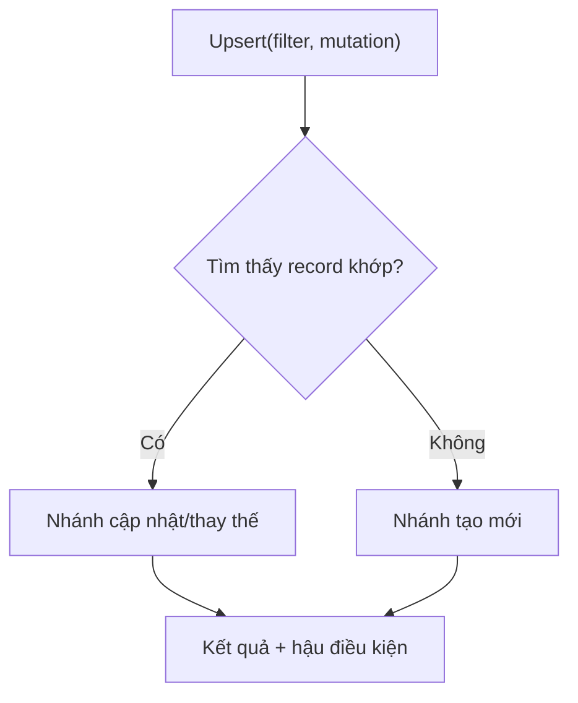

# Kiểm thử CRUD và phân biệt tạo mới, ghi đè, upsert hoặc cập nhật từng phần

## 1. Tình huống mở đầu: cùng trả HTTP 200 nhưng thay đổi dữ liệu hoàn toàn khác nhau

Một ứng dụng Java quản lý hồ sơ sản phẩm trong MongoDB. Tại thời điểm đầu, collection có document:

```json
{
  "_id": "tenant-A|P100",
  "tenantId": "tenant-A",
  "productId": "P100",
  "name": "Bàn làm việc",
  "priceMinor": 1250000,
  "currency": "VND",
  "attributes": {
    "color": "walnut",
    "material": "wood"
  },
  "tags": ["office", "new"],
  "version": 3
}
```

Một request muốn đổi tên sản phẩm:

```json
{"name": "Bàn làm việc cao cấp"}
```

Bốn cách ghi sau có thể cho kết quả khác nhau:

1. **Create/insert:** chỉ thêm nếu chưa có; nếu khóa `tenant-A|P100` tồn tại thì báo trùng, không tự thay thế.
2. **Replace/ghi đè:** thay cả document bằng biểu diễn mới; các field không được gửi có thể biến mất.
3. **Upsert:** nếu không tìm thấy thì tạo, nếu tìm thấy thì cập nhật hoặc thay thế theo operation được chọn.
4. **Partial update:** chỉ thay field `name`, giữ nguyên `priceMinor`, `attributes`, `tags` và các field khác.

Một test chỉ xác nhận `HTTP 200` hoặc `acknowledged=true` sẽ không nhận ra việc `priceMinor`, `tags` hay `tenantId` bị xóa nhầm.

Đó là lý do bài học **Database No SQL → Kiểm thử tính đúng → Kiểm thử CRUD và phân biệt tạo mới, ghi đè, upsert hoặc cập nhật từng phần** tập trung vào **trạng thái trước–sau, điều kiện thực thi, bất biến và kết quả trong các failure modes**. Đích của kiểm thử là hợp đồng dữ liệu thực sự, không chỉ tên method.

---

## 2. Mục tiêu học tập

Sau bài học, bạn có thể:

1. Phân biệt Create, Read, Update, Delete ở API và ở database.
2. Nêu rõ semantics của **insert-only**, **replace**, **update existing**, **upsert**, **patch** và **delete**.
3. Xây ma trận đầu vào: record tồn tại/không tồn tại, dữ liệu hợp lệ/không hợp lệ, field có/missing/null.
4. Kiểm tra việc giữ hoặc loại bỏ field khi replace và partial update, kể cả nested objects và arrays.
5. Kiểm định uniqueness, tenant isolation, ownership, status transitions và optimistic locking.
6. Kiểm tra `matchedCount`, `modifiedCount`, `upsertedId`, affected item và response code mà không suy luận quá mức.
7. Phân biệt một request idempotent với một phép tăng bộ đếm, append mảng hoặc hành động có side effects.
8. Thử duplicate requests, timeout có kết quả chưa biết, retry, concurrent writes và race conditions.
9. Viết integration tests với Java/JUnit và NoSQL thật trong môi trường thử nghiệm.
10. Hiểu khác biệt giữa MongoDB, DynamoDB, Cassandra, Redis và Elasticsearch/OpenSearch về các thao tác ghi.
11. Thiết kế kiểm thử cross-store, CDC, cache, Search projection và xóa dữ liệu theo mốc nhất quán.
12. Xây checklist, runbook và tiêu chí PASS/FAIL cho thay đổi CRUD trước production.

## 3. CRUD là bốn nhãn lớn, không phải bốn semantics duy nhất

| Nhóm | Câu hỏi trước khi viết test | Hành vi cần phân biệt |
| --- | --- | --- |
| Create | Nếu ID đã tồn tại thì sao? | Reject, replace hay merge? |
| Read | Nếu thiếu quyền, field missing hoặc replica lag thì sao? | Not found, denied, stale read |
| Update | Thay toàn bộ hay một phần? Nếu không có record thì sao? | Replace, set, increment, append, upsert |
| Delete | Xóa cứng, xóa mềm hay đặt tombstone/TTL? | Hard delete, soft delete, expire |
| Bulk operations | Một phần thành công thì sao? | Ordered/unordered, partial progress |
| Transaction | Có nhiều records liên quan thì đảm bảo gì? | Atomicity, conditional failure, unknown outcome |

**Không được suy ra `update` là partial hay `save` là upsert chỉ từ tên API wrapper.** Mỗi driver, ODM và repository framework có các lựa chọn/defaults khác nhau. Bài kiểm thử phải nhìn vào command thực tế và state sau đó.

## 4. Phát biểu hợp đồng dưới dạng trạng thái

Với một record khóa \(k\), định nghĩa:

- \(S\): trạng thái database trước thao tác.
- \(op\): thao tác CRUD.
- \(S'\): trạng thái database sau thao tác khi thành công.
- \(e\): error/result theo hợp đồng.

\[
(S,op)\rightarrow(S',e)
\]

Bộ test phải phân biệt:

```text
PRECONDITION:
  Record tồn tại? Phiên bản? Tenant? Trạng thái? Quyền?

ACTION:
  Insert / Replace / Update / Upsert / Delete

POSTCONDITION:
  Record nào tồn tại?
  Field nào đổi? Field nào giữ?
  Count/version/TTL/index/quan hệ thay đổi thế nào?
  Có side effects hoặc events nào?
```

Không chỉ assert `e == SUCCESS`; phải assert `S'` phù hợp.

## 5. Quy ước mẫu dữ liệu trong bài

Các ví dụ dùng entity Product:

```json
{
  "_id": "T-A|P100",
  "tenantId": "T-A",
  "productId": "P100",
  "name": "Bàn làm việc",
  "priceMinor": 1250000,
  "stock": 12,
  "status": "ACTIVE",
  "attributes": {
    "color": "walnut",
    "material": "wood"
  },
  "tags": ["office", "new"],
  "version": 3
}
```

**Bất biến cơ bản:**

- `_id` thuộc tenant được xác thực.
- `tenantId` không được đổi từ request của client.
- `priceMinor` không âm; `stock` tuân domain policy.
- `version` dùng để kiểm tra tranh chấp nếu workflow yêu cầu.
- Field không thuộc phạm vi request không tự biến mất.
- Lệnh ghi từ tenant khác không được tác động record này.

Các giá trị và business rules chỉ minh họa; trong ứng dụng thật cần có schema, quyền, điều kiện nghiệp vụ và type mapping riêng.

## 6. Cần phân biệt API intent và database operation

HTTP convention thường gợi ý:

| HTTP | Intent thường gặp | Không nên mặc định |
| --- | --- | --- |
| `POST /products` | Tạo resource hoặc thực hiện command | Luôn có insert-only |
| `PUT /products/{id}` | Đưa resource về biểu diễn được gửi | Mọi PUT đều replace vật lý |
| `PATCH /products/{id}` | Chỉnh một phần theo patch format | Mọi PATCH đều dùng `$set` |
| `GET /products/{id}` | Đọc | Luôn đọc được dữ liệu vừa ghi |
| `DELETE /products/{id}` | Xóa hoặc đưa về trạng thái deleted | Luôn xóa cứng |

Định nghĩa REST không ép engine NoSQL dùng một method cụ thể. Ví dụ `PUT` có thể được ứng dụng triển khai bằng các `$set` có validation để giữ metadata server-managed. **Hợp đồng API** mới là điều test phải bảo vệ.

### 6.1. Xác định rõ HTTP response

Ví dụ một hợp đồng có thể dùng:

```text
POST create success      -> 201 Created
POST duplicate ID        -> 409 Conflict
PUT replace success      -> 200/204
PATCH update success     -> 200/204
PATCH missing record     -> 404
POST async accepted      -> 202 Accepted
Conditional version fail -> 409 hoặc 412 theo API contract
```

Đây là **lựa chọn thiết kế**, không phải tất cả database drivers tự trả mã HTTP tương ứng. Hãy test mapping ở API layer và outcome ở DB layer riêng.

## 7. Insert-only: tạo mới và từ chối khi trùng khóa

Hành vi mong muốn:

```text
State: no key K
Insert(K,V) -> K=V, created

State: K exists
Insert(K,V2) -> conflict, K remains unchanged
```

Một insert chỉ thực sự “chỉ tạo mới” khi backend hoặc một ràng buộc nguyên tử **ngăn ghi đè record tồn tại**.

### 7.1. Test happy path

1. Xác nhận không có key K trong test namespace.
2. Gọi create với payload hợp lệ.
3. Assert status/result là created.
4. Đọc lại K bằng cùng consistency contract.
5. Assert đầy đủ fields, defaults, server-generated timestamps/IDs.
6. Assert record count tăng chính xác một.

### 7.2. Test duplicate

1. Tạo K.
2. Gọi create lại với cùng K và payload khác.
3. Assert error class `ALREADY_EXISTS`/duplicate key theo hợp đồng.
4. Đọc K: **payload đầu tiên vẫn được giữ**.
5. Assert không tạo record phụ/event kinh doanh ngoài dự kiến.

Một request create trả lỗi nhưng âm thầm thay giá là bug nghiêm trọng.

## 8. Uniqueness không chỉ ở primary key

Một sản phẩm có:

```text
_id = T-A|P100
externalSku = SKU-123
```

Nếu nghiệp vụ yêu cầu `externalSku` duy nhất **trong tenant**, test phải kiểm constraint `(tenantId, externalSku)`:

```text
T-A / SKU-123  -> first create allowed
T-A / SKU-123  -> second product rejected
T-B / SKU-123  -> allowed nếu policy cho phép
```

### 8.1. App-level pre-check chưa đủ

Sai lầm:

```text
if (!existsBySku(sku)) {
    insert(product);
}
```

Hai requests đồng thời đều có thể thấy `exists=false`, sau đó cả hai insert. Cần **unique index/conditional write/LWT** phù hợp ở backend, hoặc giao thức độc quyền khác có bằng chứng atomicity.

### 8.2. Null/missing trong unique index

Semantics của `null`, missing fields, sparse/partial indexes và collation khác giữa các hệ. Test với record thiếu SKU, SKU null, SKU rỗng, chữ hoa/thường và Unicode normalization theo contract.

## 9. Replace: ghi đè biểu diễn của record

Giả sử record trước:

```json
{
  "_id": "T-A|P100",
  "name": "Bàn làm việc",
  "priceMinor": 1250000,
  "attributes": {"color":"walnut","material":"wood"},
  "tags": ["office","new"]
}
```

Replace bằng:

```json
{
  "_id": "T-A|P100",
  "name": "Bàn gỗ"
}
```

Kết quả replace theo semantics full document thông thường:

```json
{
  "_id": "T-A|P100",
  "name": "Bàn gỗ"
}
```

`priceMinor`, `attributes`, `tags` **không được giữ** trừ khi API/service chủ động tái dựng chúng vào replacement hoặc engine có semantics khác được tài liệu hóa.

### 9.1. Test cần xác minh fields bị xóa

Một test chỉ kiểm `name == "Bàn gỗ"` chưa đủ. Cần assert:

```text
name = "Bàn gỗ"
priceMinor absent
attributes absent
tags absent
```

hoặc theo hợp đồng khác, nếu API phải giữ `priceMinor`, test phải thể hiện rằng **service đang triển khai patch chứ không phải full replacement**.

### 9.2. Fields server-managed

Nếu `createdAt`, `tenantId` hoặc `version` được server bảo vệ, full replace phải có quy tắc preserve/recompute riêng. Không copy `tenantId` từ raw request body để “đủ các field”.

## 10. Replace và thay đổi `_id` không giống nhau

Trong MongoDB, `_id` là immutable cho document hiện có. `replaceOne` không phải lệnh đổi identity: replacement có thể giữ `_id` cũ (khi không cung cấp `_id` thích hợp) hoặc phải trùng `_id` hiện tại.

Một test nên thử:

- Replacement hợp lệ cùng `_id`.
- Replacement không chứa `_id`.
- Replacement chứa `_id` khác.
- Filter chọn đúng record tenant.
- Record bị đổi field sau replace.
- Không có record mới ở `_id` khác nếu operation không upsert.

Không dùng replace để “di chuyển document sang khóa mới”; với đổi `_id` cần migration/mapping riêng.

## 11. Partial update: chỉ sửa trường được nêu

Payload:

```json
{"name": "Bàn gỗ"}
```

Một partial update mong muốn giữ những field khác:

```json
{
  "_id": "T-A|P100",
  "name": "Bàn gỗ",
  "priceMinor": 1250000,
  "attributes": {"color":"walnut","material":"wood"},
  "tags": ["office","new"]
}
```

### 11.1. Test không chỉ các field đổi

Test cần khẳng định:

- Field `name` thay đúng.
- `priceMinor` không đổi.
- `tenantId`, `_id`, `createdAt`, owner không đổi.
- Nested object/array không bị xóa bất ngờ.
- Version có đổi đúng nếu contract dùng optimistic locking.
- Không có bản ghi mới khi operation là **update-existing-only**.

### 11.2. `PATCH` không đồng nghĩa auto-create

Một số APIs quy định `PATCH` tới ID không tồn tại phải trả `404`; một số product có upsert semantics riêng. Đừng để driver default tạo record ngoài ý muốn khi API contract là **chỉ cập nhật record đang tồn tại**.

## 12. Upsert: hai nhánh tạo và cập nhật

**Upsert** = update/replace nếu tìm thấy; insert nếu không tìm thấy, theo command tương ứng.



### 12.1. Hợp đồng phải có hai bộ test

**Case 1 — record tồn tại:** thử update đúng fields, không tạo duplicate, không xóa field ngoài contract.

**Case 2 — record chưa tồn tại:** thử fields mặc định, keys, `createdAt`, `tenantId`, required fields và uniqueness constraints.

### 12.2. Upsert update khác replace upsert

- `updateOne(..., {$set:...}, upsert=true)` thêm/sửa fields theo update operators.
- `replaceOne(..., replacement, upsert=true)` tạo/thay **toàn bộ** representation theo replacement semantics.

Chỉ cùng có chữ `upsert=true` không có nghĩa state đích giống nhau.

## 13. Ma trận trạng thái trước–sau tối thiểu

| Operation | K chưa tồn tại | K tồn tại |
| --- | --- | --- |
| Insert-only | Tạo K | Conflict, giữ K |
| Replace-existing-only | Not found/no match | Thay representation của K |
| Replace-upsert | Tạo từ replacement | Thay representation của K |
| Partial update existing-only | Not found/no match | Chỉnh fields được chỉ định |
| Partial update upsert | Tạo từ filter và update operators theo backend | Chỉnh fields chỉ định |
| Delete existing-only | Not found/idempotent no-op theo API | Xóa hoặc đánh dấu deleted |
| Increment | Không có: tùy backend/guard | Tăng giá trị; retry có thể tăng thêm |

**Bài test bắt buộc** nêu contract cho nhánh missing-record. Không để hành vi bất ngờ là “do driver mặc định”.

## 14. `null`, missing và remove không giống nhau

Ba thao tác khác nhau:

```text
A. Không gửi field email trong patch
B. Gửi email = null
C. Gửi lệnh xóa field email
```

Có thể có nghĩa:

| Trường hợp | Hợp đồng minh họa |
| --- | --- |
| Missing trong partial patch | Giữ nguyên email |
| Explicit null | Lưu email=null |
| Remove/unset | Xóa field email khỏi document |
| Missing trong full replacement | Field email biến mất |
| Explicit null trong replacement | Field email tồn tại với null |

### 14.1. Không viết DTO làm mất phân biệt

Một `record PatchRequest(String email)` có thể không phân biệt JSON `"email":null` với JSON thiếu `email`, tùy serializer. Nếu API cần cả ba trạng thái, dùng một representation hỗ trợ **absent/null/value**, hoặc JSON Patch operation có chủ đích.

### 14.2. Query trên null có thể gây hiểu lầm

Trong MongoDB, query bằng `{"email": null}` có thể match documents `email=null` **và** documents thiếu field theo semantics query. Dùng operators như `$exists`/type checks phù hợp khi test cần phân biệt.

## 15. JSON Merge Patch và JSON Patch không giống partial `$set`

**JSON Merge Patch (RFC 7396)** có quy tắc riêng:

```json
{"email":null}
```

thường có nghĩa **remove field** khỏi target trong merge-patch object, không phải đặt `email` thành JSON null. Mảng được xử lý như giá trị thay thế toàn bộ.

**JSON Patch (RFC 6902)** là danh sách operations:

```json
[
  {"op":"replace","path":"/name","value":"Bàn gỗ"},
  {"op":"remove","path":"/attributes/color"},
  {"op":"test","path":"/version","value":3}
]
```

### 15.1. Media type là một phần contract

```http
Content-Type: application/merge-patch+json
```

khác:

```http
Content-Type: application/json-patch+json
```

Và cả hai khác custom JSON update DTO. Test phải xác minh đúng media type, semantics của `null`, array, `remove`, `test` và invalid paths.

### 15.2. JSON Patch `test` chưa tự là atomic DB CAS

Nếu service đọc resource, kiểm `test`, rồi ghi sau trong hai bước không nguyên tử, concurrent writer có thể thay resource giữa hai bước. Cần đồng bộ bằng version/conditional update ở database khi correctness yêu cầu.

## 16. Nested object: update cả object hay chỉ một đường dẫn?

Nguồn:

```json
{
  "attributes": {
    "color": "walnut",
    "material": "wood"
  }
}
```

Hai lệnh MongoDB khác nhau:

```javascript
{$set: {"attributes": {"color": "black"}}}
```

và:

```javascript
{$set: {"attributes.color": "black"}}
```

Lệnh đầu **thay object `attributes`** bằng object chỉ có `color`, làm mất `material`; lệnh sau chỉ đổi nested field `color` và giữ `material`.

### 16.1. Một test rất quan trọng

Trước update, đặt hai nested fields. Sau update, assert `material` còn tồn tại. Nếu chỉ check `color`, bug sẽ thoát.

### 16.2. Dynamic field names

Không cho client gửi dotted paths hoặc MongoDB update operators tùy ý mà không validate/allowlist. Một patch có thể cố sửa `tenantId`, `ownerId`, `status` hoặc các fields nhạy cảm.

## 17. Arrays: replace, append, add-to-set và remove

Với:

```json
{"tags":["office","new"]}
```

Các thao tác mang nghĩa khác:

- Replace array bằng `["office"]`.
- Append `"sale"` vào cuối (có thể trùng).
- Add-to-set `"office"`: không thêm phần tử trùng theo equality semantics của engine.
- Remove `"new"` khỏi array.
- Update một phần tử theo điều kiện/position.

### 17.1. Idempotency khác nhau

```text
SET tags = ["office","sale"]  // Lặp lại thường giữ state
PUSH "sale"                   // Lặp lại có thể thêm hai lần
ADD_TO_SET "sale"             // Lặp lại có thể không tạo duplicate
PULL "sale"                   // Lặp lại thường giữ state sau lần đầu
```

Nhưng dù state không đổi khi lặp, events, `updatedAt`, version increments và audit logs có thể đổi. **State idempotence** khác **side-effect idempotence**.

### 17.2. Test arrays chứa duplicate hợp lệ

Không dùng add-to-set nếu domain cần hai line items cùng productId. Phải có stable `lineId` và policy riêng.

## 18. Set, increment và append: phép cập nhật nào có thể retry?

| Phép | Lặp cùng payload trên cùng state | Thận trọng |
| --- | --- | --- |
| `set(price=100)` | Thường idempotent về value | Side effects/version có thể tăng |
| `unset(field)` | Thường idempotent về state | Audit/event behavior |
| `inc(stock,+1)` | Không idempotent | Double increment sau retry |
| `push(tags,"x")` | Không idempotent | Trùng phần tử |
| `addToSet(tags,"x")` | Thường idempotent theo equality | Document equality/order |
| Conditional insert | Lần 2 conflict | Cần đối chiếu cùng intent |
| Conditional update/version CAS | Retry thường fail sau lần đầu | Cần authoritative lookup |
| Delete key | Lặp lại thường state vẫn absent | Response/event semantics khác |

Không đánh giá idempotency chỉ từ tên HTTP method; phải xét source state, version, điều kiện, side effects và retry protocol.

## 19. Idempotency key của operation nghiệp vụ

Một create có thể timeout sau khi commit. Client không biết kết quả, gửi lại request.

Một thiết kế dùng:

```text
tenantId + operationType + idempotencyKey
```

với ledger chứa:

```json
{
  "tenantId":"T-A",
  "operationType":"CreateOrder",
  "idempotencyKey":"R-9001",
  "payloadFingerprint":"approved-fingerprint",
  "status":"SUCCEEDED",
  "resultResourceRef":"O1001"
}
```

### 19.1. Test cần kiểm

1. Gửi lần một: thành công.
2. Gửi cùng key/cùng payload: trả cùng outcome theo contract, không tạo thêm record.
3. Gửi cùng key/khác payload: conflict.
4. Hai requests cùng key đồng thời: chỉ một intent có side effect.
5. Ledger expiry và retry window nhất quán.
6. Không lộ result của tenant khác nếu key trùng giữa tenants.

Không mặc định một duplicate-key error là “idempotent success” nếu chưa xác minh record tương ứng cùng intent.

## 20. MongoDB `insertOne`: tạo mới

Java Sync Driver minh họa:

```java
import com.mongodb.client.MongoCollection;
import org.bson.Document;

public final class CreateProduct {
    public static void insert(
            MongoCollection<Document> products,
            String tenantId,
            String productId) {

        String id = tenantId + "|" + productId;

        Document newProduct = new Document("_id", id)
            .append("tenantId", tenantId)
            .append("productId", productId)
            .append("name", "Bàn gỗ")
            .append("priceMinor", 1250000L)
            .append("version", 1L);

        products.insertOne(newProduct);
    }
}
```

Nếu `_id` đã có, unique constraint sẽ ngăn duplicate insert. Ví dụ rút gọn chưa bao gồm validator, authz, tenant ID encoding và exception mapping.

### 20.1. Test duplicate key

```java
products.insertOne(new Document("_id", "T-A|P100")
    .append("name", "A"));

assertThrows(MongoWriteException.class,
    () -> products.insertOne(
        new Document("_id", "T-A|P100")
            .append("name", "B")));
```

Sau test, đọc document và assert `name=="A"`; đừng dừng ở `assertThrows`. Bổ sung `getError().getCode()`/category nếu cần mapping và driver version phù hợp.

## 21. MongoDB `replaceOne`: thay document

```java
import static com.mongodb.client.model.Filters.*;

Document replacement = new Document("_id", "T-A|P100")
    .append("tenantId", "T-A")
    .append("productId", "P100")
    .append("name", "Bàn gỗ mới")
    .append("version", 4L);

var result = products.replaceOne(
    and(
        eq("_id", "T-A|P100"),
        eq("tenantId", "T-A")
    ),
    replacement
);
```

Nếu record ban đầu có `priceMinor`, `stock`, `attributes`, `tags`, replacement trên **không bảo tồn chúng**. Test phải assert fields biến mất hoặc API không được phép gọi replace với payload thiếu required fields.

### 21.1. `replaceOne` không mặc định upsert

Khi không có `ReplaceOptions().upsert(true)`, trường hợp không match thường không tạo document.

### 21.2. Test negative: không tìm thấy

```text
Given no T-A|P999
When replaceOne({_id:"T-A|P999"}, replacement) without upsert
Then matchedCount=0
And no new document exists
```

Một API có thể map thành 404; driver thường chỉ trả write result. Phải test ở hai tầng.

## 22. MongoDB `updateOne`: cập nhật từng field

```java
import static com.mongodb.client.model.Filters.*;
import static com.mongodb.client.model.Updates.*;

var result = products.updateOne(
    and(
        eq("_id", "T-A|P100"),
        eq("tenantId", "T-A")
    ),
    combine(
        set("name", "Bàn mới"),
        set("attributes.color", "black"),
        inc("version", 1)
    )
);
```

Test:

```text
name chuyển đúng
attributes.color chuyển đúng
attributes.material giữ nguyên
priceMinor giữ nguyên
tags giữ nguyên
tenantId giữ nguyên
version tăng đúng một lần
```

### 22.1. `updateOne` thông thường không tự tạo nếu thiếu

Nhánh missing không tạo trừ khi có `UpdateOptions().upsert(true)` hoặc cơ chế khác. Cần test rõ.

### 22.2. Không dùng update operators từ client

Không truyền nguyên JSON body vào `$set` nếu nó chứa `tenantId`, `ownerId`, `isAdmin` hoặc dotted paths không cho phép. Dùng DTO/allowlist và giá trị tenant từ verified security context.

## 23. MongoDB `upsert=true`: phân biệt nhánh insert và update

```java
import com.mongodb.client.model.UpdateOptions;
import static com.mongodb.client.model.Filters.*;
import static com.mongodb.client.model.Updates.*;

var result = products.updateOne(
    eq("_id", "T-A|P100"),
    combine(
        set("name", "Bàn mới"),
        set("tenantId", "T-A"),
        setOnInsert("createdAt", java.util.Date.from(
            java.time.Instant.parse("2026-11-14T02:00:00Z")))
    ),
    new UpdateOptions().upsert(true)
);
```

Nếu record tồn tại, `$set` sửa `name`, `tenantId`; `$setOnInsert` chỉ áp cho nhánh insert. Nếu record không tồn tại, operation tạo document theo filter equality/update operators, bao gồm trường do `$setOnInsert` quy định.

### 23.1. Test cả hai nhánh

**Nhánh insert:**

```text
upsertedId khác null theo driver result
new document có required fields
createdAt được đặt
created audit event chỉ xuất hiện một lần theo contract
```

**Nhánh update:**

```text
matchedCount phù hợp
upsertedId null
createdAt cũ được giữ
field không update được giữ
```

### 23.2. `upsert` có thể sinh record thiếu field

Nếu chỉ `$set name`, nhánh insert có thể thiếu `priceMinor`, currency, schemaVersion và các field required. Test schema validator/DTO của insert path, không chỉ happy-path update.

## 24. MongoDB: matchedCount, modifiedCount, upsertedId

`UpdateResult` có thể cung cấp:

```text
wasAcknowledged
matchedCount
modifiedCount
upsertedId
```

Diễn giải:

| Trường hợp | Quan sát thường gặp |
| --- | --- |
| Match và đổi dữ liệu | matched=1, modified=1 |
| Match nhưng set cùng giá trị | matched=1, modified=0 |
| Không match, không upsert | matched=0, modified=0 |
| Không match, upsert thành công | upsertedId có giá trị |
| Write concern/result unacknowledged | Không được suy counts đáng tin |

### 24.1. `modifiedCount=0` không chứng minh không có record

Record có thể tồn tại nhưng value mới bằng value cũ. Ngược lại, `matchedCount=0` có thể do filter version/tenant/status không khớp, không chỉ do ID không tồn tại.

### 24.2. Ack không chứng minh data đã tồn tại ở mọi replica

Write acknowledgement/durability phụ thuộc write concern. Test read-after-write theo read preference/read concern/consistency contract, tránh kết luận “mất ghi” từ secondary chưa bắt kịp.

## 25. MongoDB: `findOneAndUpdate` và giá trị trước/sau

Một API cần trả document sau update. Với MongoDB, `findOneAndUpdate` có thể cấu hình trả **before** hoặc **after** image, theo driver options.

### 25.1. Test trả đúng phiên bản

```text
Given stock=10
When increment stock by 1
Then final stock=11
And returned document reflects selected BEFORE or AFTER contract
```

Nếu ứng dụng mong stock=11 nhưng driver trả before image=10, business response có thể sai dù database đúng.

### 25.2. Atomic trên một document không đồng nghĩa transaction toàn hệ

Một `findOneAndUpdate` có thể atomic trên document mục tiêu, nhưng không tự cập nhật một read model Cassandra hoặc sự kiện Kafka theo cùng transaction. Test outbox/reconciliation ở tầng hệ thống.

## 26. MongoDB nested/array operators: test trước và sau chi tiết

Một số update operators:

```javascript
{$set: {"attributes.color":"black"}}
{$unset: {"attributes.material":""}}
{$inc: {"stock":2}}
{$push: {"tags":"sale"}}
{$addToSet: {"tags":"office"}}
{$pull: {"tags":"new"}}
```

### 26.1. Bộ test cần có

- `$set` nested không xóa sibling.
- `$unset` khiến field absent, không chỉ null.
- `$inc` tăng đúng và xử lý value absent/type không hợp lệ theo engine.
- `$push` cho phép trùng theo semantics.
- `$addToSet` không tạo duplicate theo equality.
- `$pull` xóa các phần tử phù hợp.
- Positional/array filter chỉ sửa phần tử dự kiến.
- Không đổi order của phần tử ngoài vùng cập nhật.

### 26.2. Field array object có identity

Nếu hai line items có cùng `productId` nhưng khác `lineId`, update theo `productId` có thể sửa cả hai ngoài ý định. Cần stable line identity và test nhiều phần tử trùng thuộc tính.

## 27. Java/JUnit: bộ kiểm thử MongoDB ở mức integration

Ví dụ dùng một MongoDB instance thử nghiệm được quản lý riêng, truyền URI qua biến môi trường thay vì dùng production connection string.

```java
import com.mongodb.client.MongoClient;
import com.mongodb.client.MongoClients;
import com.mongodb.client.MongoCollection;
import org.bson.Document;
import org.junit.jupiter.api.*;

import static com.mongodb.client.model.Filters.*;
import static com.mongodb.client.model.Updates.*;
import static org.junit.jupiter.api.Assertions.*;

class MongoCrudContractTest {
    private static MongoClient client;
    private MongoCollection<Document> products;

    @BeforeAll
    static void connect() {
        String uri = System.getenv("TEST_MONGODB_URI");
        assertNotNull(uri, "Test MongoDB URI required");
        client = MongoClients.create(uri);
    }

    @AfterAll
    static void close() {
        if (client != null) client.close();
    }

    @BeforeEach
    void setup() {
        products = client
            .getDatabase("crud_contract_test")
            .getCollection("products");

        // Chỉ dùng database dành riêng cho thử nghiệm.
        products.deleteMany(new Document());
        products.insertOne(new Document("_id", "T-A|P100")
            .append("tenantId", "T-A")
            .append("name", "Old")
            .append("priceMinor", 1200L)
            .append("attributes", new Document("color", "red")
                .append("material", "wood")));
    }

    @Test
    void partialUpdateKeepsOtherFields() {
        var result = products.updateOne(
            eq("_id", "T-A|P100"),
            set("attributes.color", "black"));

        assertEquals(1L, result.getMatchedCount());

        Document after = products.find(
            eq("_id", "T-A|P100")).first();

        assertNotNull(after);
        assertEquals(1200L, after.getLong("priceMinor"));
        Document attributes =
            (Document) after.get("attributes");
        assertEquals("black", attributes.getString("color"));
        assertEquals("wood", attributes.getString("material"));
    }

    @Test
    void replaceRemovesUnspecifiedFields() {
        var result = products.replaceOne(
            eq("_id", "T-A|P100"),
            new Document("_id", "T-A|P100")
                .append("tenantId", "T-A")
                .append("name", "New"));

        assertEquals(1L, result.getMatchedCount());

        Document after = products.find(
            eq("_id", "T-A|P100")).first();

        assertNotNull(after);
        assertFalse(after.containsKey("priceMinor"));
        assertFalse(after.containsKey("attributes"));
    }
}
```

### 27.1. Phạm vi và giới hạn

- Ví dụ dùng database `crud_contract_test` và chủ động xóa fixture; **chỉ kết nối tới môi trường thử nghiệm cô lập**, không trỏ biến tới production.
- Khi các tests chạy song song, dùng collection hoặc namespace riêng cho mỗi test.
- Độ chính xác kiểu `Long`/`Integer` phụ thuộc cách seed dữ liệu BSON.
- Chưa có testcontainers/replica set/failover; cần test thêm theo deployment thật.

## 28. JUnit: test upsert hai nhánh

Một skeleton:

```java
@Test
void updateWithUpsertCreatesOnlyWhenMissing() {
    products.deleteOne(eq("_id", "T-A|P200"));

    var first = products.updateOne(
        eq("_id", "T-A|P200"),
        combine(
            set("name", "First"),
            set("tenantId", "T-A"),
            setOnInsert("createdBy", "migration-test")
        ),
        new UpdateOptions().upsert(true));

    assertNotNull(first.getUpsertedId());

    var second = products.updateOne(
        eq("_id", "T-A|P200"),
        set("name", "Second"),
        new UpdateOptions().upsert(true));

    assertEquals(1L, second.getMatchedCount());
    assertNull(second.getUpsertedId());

    Document after = products.find(
        eq("_id", "T-A|P200")).first();

    assertNotNull(after);
    assertEquals("Second", after.getString("name"));
    assertEquals("migration-test",
        after.getString("createdBy"));
}
```

Snippet là phương thức bổ sung vào class fixture ở phần trước; cần imports `UpdateOptions` và setup phù hợp. Bài test quan trọng: **lần thứ hai không làm mất field chỉ dành cho nhánh insert**.

## 29. Testcontainers và database thật: vì sao cần integration tests?

Mock repository có thể xác nhận service gọi `updateOne`, nhưng không xác nhận:

- MongoDB xử lý `$set`, `$unset`, `_id` như kỳ vọng.
- DynamoDB thực thi conditions đúng.
- Cassandra timestamp/TTL/tombstone semantics.
- Redis TTL và `SET` options.
- Search refresh/version behavior.
- Unique indexes/collation và transaction constraints.

Một bộ test nên có:

```text
Unit tests:
  validation, state machine, key building, policy.

Integration tests:
  driver + database engine, indexes, conditional writes.

API tests:
  authz + HTTP mapping + serialization + retries.

Failure/concurrency tests:
  race, timeout, duplicate delivery, failover.
```

### 29.1. Không dùng mock như nguồn sự thật cuối cùng

Mock có thể được lập trình để trả `modifiedCount=1` ngay cả khi lệnh thật sẽ `matchedCount=0` vì thiếu tenant filter. Mỗi phép ghi quan trọng cần ít nhất một lớp test với backend thật hoặc môi trường có semantics tương đương được xác nhận.

### 29.2. Version parity

Tốt nhất dùng bản database/driver gần với production, cùng kiểu deployment và indexes/validators. Emulator hoặc local standalone có thể không phản ánh cluster consistency, IAM, quorum và failover đầy đủ.

## 30. DynamoDB `PutItem`: thường là full replacement tại key

DynamoDB `PutItem` có thể **tạo item mới hoặc thay item cũ có cùng primary key**. Nếu muốn create-only, cần condition.

Ví dụ key:

```text
PK = TENANT#T-A
SK = PRODUCT#P100
```

Một `PutItem` không có condition với item chỉ có `name` có thể làm mất attributes trước đó của item tại cùng key.

### 30.1. Create-only có điều kiện

```java
import software.amazon.awssdk.services.dynamodb.model.*;
import java.util.Map;

var request = PutItemRequest.builder()
    .tableName("Products")
    .item(Map.of(
        "PK", AttributeValue.fromS("TENANT#T-A"),
        "SK", AttributeValue.fromS("PRODUCT#P100"),
        "name", AttributeValue.fromS("Bàn gỗ")
    ))
    .conditionExpression("attribute_not_exists(PK)")
    .build();

db.putItem(request);
```

Với table có composite primary key, condition này kiểm item đích tại key cụ thể chưa tồn tại theo semantics DynamoDB. Nếu tồn tại sẽ nhận conditional failure, không overwrite.

### 30.2. Test bắt buộc

- Key absent: tạo thành công.
- Key exists: conditional failure.
- Existing item không bị thay fields.
- Gửi lại cùng request không tạo duplicate.
- Không gán nhầm tenant trong PK.

## 31. DynamoDB `UpdateItem`: partial update nhưng có thể tạo item

DynamoDB `UpdateItem` cho phép update attributes bằng expressions như:

```text
SET #name = :name
REMOVE obsoleteField
ADD counter :delta
DELETE setAttribute :members
```

**Điểm dễ nhầm:** `UpdateItem` không nhất thiết là “update-only”. Với key chưa tồn tại và biểu thức phù hợp, nó có thể **tạo item mới** nếu không có điều kiện ngăn lại.

### 31.1. Cần condition cho update-existing-only

```java
var request = UpdateItemRequest.builder()
    .tableName("Products")
    .key(Map.of(
        "PK", AttributeValue.fromS("TENANT#T-A"),
        "SK", AttributeValue.fromS("PRODUCT#P100")))
    .updateExpression("SET #name = :name")
    .conditionExpression("attribute_exists(PK)")
    .expressionAttributeNames(Map.of(
        "#name", "name"))
    .expressionAttributeValues(Map.of(
        ":name", AttributeValue.fromS("Bàn mới")))
    .build();

db.updateItem(request);
```

### 31.2. Test cả hai trạng thái

- Existing item: `name` đổi, các attributes khác giữ.
- Missing item: condition failed; không có item rỗng/một phần được tạo.

Đừng đặt tên method `updateExisting()` nếu nó thực sự gọi `UpdateItem` vô điều kiện.

## 32. DynamoDB `UpdateExpression`: `SET`, `REMOVE`, `ADD`, `DELETE`

Các thành phần update khác nhau:

| Expression | Ý nghĩa trong phạm vi được hỗ trợ |
| --- | --- |
| `SET` | Gán/sửa attribute; có biểu thức như `if_not_exists` |
| `REMOVE` | Xóa attribute |
| `ADD` | Tăng/giảm số hoặc thêm phần tử vào set type theo API |
| `DELETE` | Xóa phần tử khỏi set type theo API; khác `DeleteItem` |

### 32.1. `DELETE` của UpdateExpression không xóa cả item

Đây là một bẫy tên gọi: `DELETE setAttribute :values` làm thay đổi **set attribute**, còn `DeleteItem` xóa **item**.

### 32.2. Condition và UpdateExpression có vai trò riêng

```text
ConditionExpression:
  Có được phép thực hiện operation không?

UpdateExpression:
  Nếu được phép, fields nào thay đổi?
```

Test nên tạo record thỏa và không thỏa condition, rồi assert state không thay đổi khi denied.

## 33. DynamoDB: `BatchWriteItem` không phải conditional upsert

`BatchWriteItem` dùng batch `PutRequest` hoặc `DeleteRequest`, nhưng không có per-item conditional expression tương tự `PutItem`/`UpdateItem`.

Điều cần kiểm thử:

- Put tại key tồn tại có thể thay item.
- Batch không bảo đảm atomicity cho tất cả items.
- `UnprocessedItems` cần retry/backoff có giới hạn.
- Không tự coi HTTP-level success là mọi item đã xử lý.
- Retry các thao tác không idempotent trong hệ thống liên quan cần có protocol.
- Không dùng batch như thay thế optimistic locking.

Nếu nghiệp vụ cần create-only từng item, lựa chọn thường là conditional API hoặc transaction phù hợp, không dùng batch blind put.

## 34. DynamoDB: transaction và multi-item correctness

Một thao tác tạo Order có thể cần:

```text
Put Order (if not exists)
Update Inventory (if enough stock)
Put Idempotency record (if not exists)
```

Nếu cần atomicity trong phạm vi DynamoDB hỗ trợ, dùng transaction APIs phù hợp. Test:

1. Cả ba điều kiện hợp lệ → tất cả mutations được áp.
2. Inventory không đủ → không tạo Order/ledger sai.
3. Idempotency key tồn tại → không double reserve.
4. Timeout có unknown outcome → authoritative lookup.
5. Retry cùng transaction intent không gây side effects trùng.

DynamoDB transaction capability có limits, token semantics và API constraints theo phiên bản; không suy nó liên kết atomically với external payment provider hay Kafka.

## 35. Cassandra CQL: `INSERT` có thể mang nghĩa upsert

Trong Cassandra, CQL `INSERT` thường cập nhật hoặc tạo row theo primary key; không giống insert-only SQL với unique key mặc định trên record tồn tại.

Ví dụ:

```sql
INSERT INTO products_by_id (
  tenant_id,
  product_id,
  name
) VALUES ('T-A', 'P100', 'Bàn mới');
```

Nếu row `(T-A,P100)` đã tồn tại, statement có thể **ghi những cột được chỉ định** và giữ một số cột khác, theo timestamp/reconciliation semantics. Không mặc định nó xóa toàn bộ row hoặc báo duplicate như `MongoDB insertOne`.

### 35.1. Test cột chưa được gửi

Seed:

```text
name="Old", price_minor=1200
```

CQL INSERT chỉ gửi `name="New"`. Đọc lại kiểm `price_minor` còn theo semantics expected. Đây là điểm khác full-document replacement.

### 35.2. Timestamp và last-write-wins

Một write đến sau theo network không chắc thắng nếu write timestamp nhỏ hơn. Test out-of-order source timestamps, TTL, deletes và conflicts theo deployment thật; không suy server order từ thời gian gọi Java.

## 36. Cassandra `IF NOT EXISTS` và Lightweight Transactions

Nếu cần create-only, CQL có conditional insert kiểu:

```sql
INSERT INTO products_by_id (
  tenant_id, product_id, name
) VALUES (?, ?, ?)
IF NOT EXISTS;
```

LWT/Paxos path giúp thực hiện conditional semantics trong phạm vi Cassandra hỗ trợ và có chi phí khác write bình thường.

### 36.1. Test applied flag

- Key absent → `[applied]=true` theo result semantics.
- Key exists → `[applied]=false`; row trước được giữ.
- Concurrent attempts cùng key → không có hai tạo mới theo contract.
- Timeout sau proposal/commit → xử lý unknown outcome cẩn thận.

### 36.2. Không chọn LWT cho mọi bulk write vô điều kiện

LWT có latency/throughput trade-offs và constraints. Dùng cho invariants cần conditional write; các projections có thể chấp nhận eventual upsert theo model riêng.

## 37. Cassandra `UPDATE` cũng có thể tạo row/columns

CQL:

```sql
UPDATE products_by_id
SET name = 'Bàn mới'
WHERE tenant_id = 'T-A'
  AND product_id = 'P100';
```

không tự chứng minh row có từ trước. Theo semantics CQL thông thường, update theo primary key có thể tạo cell/row nếu chưa có dữ liệu.

Nếu API là `PATCH existing product`, cần một cơ chế phù hợp:

- Conditional update/LWT với điều kiện hiện có, nơi được hỗ trợ.
- Hoặc domain-level record existence/version protocol.
- Hoặc thiết kế sao cho upsert thực sự là semantics cho phép.

### 37.1. Test create-vs-update

Một test chỉ đo row-count cuối cùng sẽ không phân biệt insert và update nếu cả hai tạo same row. Cần assert behavior khi missing record, conditional application và audit/action contract.

## 38. Cassandra TTL, tombstone và xóa không giống null đơn giản

Cassandra có TTL, tombstones và reconciliation theo timestamps. Một câu lệnh set value null hoặc delete có thể tạo tombstone theo semantics tương ứng, không chỉ “JSON field = null”.

Các trường hợp cần test:

```text
Write A with TTL 60s
Update B without TTL
Delete A
Replay older write A
Read at different consistency levels
```

Kết quả phụ thuộc dữ liệu, timestamps, TTL và clustering/table semantics; không giả định `DELETE` ngay lập tức loại bỏ bytes khỏi SSTables.

### 38.1. Nguy cơ dữ liệu hồi sinh

Nếu restore/replay thiếu tombstone hoặc có timestamp handling sai, dữ liệu bị xóa có thể xuất hiện lại. Đây là hậu quả correctness, không chỉ storage detail.

## 39. Redis `SET`: ghi đè giá trị key

Với Redis string:

```text
SET product:T-A:P100 <serialized-product-v1>
SET product:T-A:P100 <serialized-product-v2>
```

Lệnh sau **thay giá trị** key. Nó không phân tích JSON để merge một field.

### 39.1. Thao tác create-only và update-only

Redis `SET` hỗ trợ lựa chọn như:

```text
SET key value NX   # chỉ set nếu chưa có
SET key value XX   # chỉ set nếu đã có
```

Semantics phụ thuộc phiên bản/config và dữ liệu/expiry. Test cả trường hợp key tồn tại, không tồn tại, bị expire giữa các thao tác.

### 39.2. `SET` và TTL

Redis `SET` thông thường có thể làm mất TTL cũ trừ khi dùng các lựa chọn giữ TTL phù hợp (như `KEEPTTL` ở phiên bản được hỗ trợ) hoặc thiết kế expiration mới. Kiểm bằng `PTTL`, không chỉ đọc value.

## 40. Redis Hash: `HSET` cập nhật một field

Với Hash:

```text
HSET product:T-A:P100 name "Bàn gỗ"
HSET product:T-A:P100 priceMinor "1250000"
```

`HSET key field value` cập nhật hoặc tạo **field** trong Hash và có thể tạo key Hash mới nếu key chưa tồn tại. Đây không phải full-document replace.

### 40.1. Test những field không bị tác động

Seed `name`, `priceMinor`, `currency`. Gọi HSET chỉ `name`. Đọc HGETALL: `priceMinor`, `currency` phải giữ nguyên.

### 40.2. HDEL khác `HSET field ""`

```text
HDEL key name    -> xóa field
HSET key name "" -> field còn tồn tại với chuỗi rỗng
```

Không tự dùng chuỗi rỗng như dấu xóa nếu domain không định nghĩa như vậy.

## 41. Redis JSON và Lua: không mặc định giống Hash

Nếu dùng RedisJSON hoặc một document module khác, update tại JSONPath có semantics riêng. Không suy `JSON.SET`, `HSET` và `SET` giống nhau vì đều có từ `SET`.

### 41.1. Read–modify–write có race

```text
Client A GET value
Client B GET value
Client A SET modified A
Client B SET modified B
```

Có thể mất cập nhật của A. Nếu cần CAS, xem cơ chế như `WATCH`/`MULTI` hoặc Lua script atomic trên phạm vi được hỗ trợ.

### 41.2. Test race thay vì chỉ test tuần tự

Hai thao tác không tranh chấp có thể pass cả trăm lần. Kiểm thử cần điều khiển interleaving/điều kiện cùng phiên bản để chứng minh không lost update theo contract.

## 42. Elasticsearch/OpenSearch: `index`, `create`, `update` khác nhau

Trong Elasticsearch/OpenSearch, các API ghi documents có các semantics cần phân biệt:

- **Index document** tại ID có thể tạo hoặc thay representation hiện có.
- **Create-only** yêu cầu chế độ `create`/`op_type=create` tương ứng; ID đã tồn tại thì conflict.
- **Update** có thể thực hiện partial document update, script hoặc upsert tùy request.
- **Delete** có versioning/realtime/search visibility semantics riêng.

### 42.1. Partial update không có nghĩa immediate search visibility

Engine có thể áp write thành công nhưng search chưa thấy phiên bản mới cho tới refresh. Test phải phân biệt:

```text
GET by ID thấy state mới
Search query chưa thấy state mới
Search sau refresh/visibility deadline thấy state mới
```

Không kết luận data lost khi một index search vẫn eventual.

### 42.2. `doc_as_upsert` / scripted upsert

Khi bật upsert options, nhánh missing có thể tạo document từ payload hoặc script theo API cụ thể. Test cả hai nhánh và định nghĩa `createdAt`/schemaVersion/tenant field.

### 42.3. External versioning

Nếu Search là read model từ CDC, test incoming source version không bị event cũ ghi đè. Khả năng versioning và conflict handling phụ thuộc API/version, không thể chỉ dựa vào thời điểm event đến.

## 43. Couchbase: KV insert, upsert, replace và mutateIn

Trong Couchbase KV SDK, thường có các operations như:

```text
insert    -> create-only
upsert    -> create-or-replace
replace   -> update existing full document (CAS/options)
mutateIn  -> subdocument mutation
remove    -> delete
```

Semantics chính xác và API signatures phụ thuộc SDK/server versions.

### 43.1. Test document identity và CAS

- Insert key tồn tại phải thất bại theo contract.
- Upsert thay document.
- Replace thiếu key không tự tạo.
- Replace có stale CAS bị conflict.
- Subdocument `mutateIn` chỉ đổi path dự kiến.
- Expiry có bị preserve/reset theo options không?

### 43.2. N1QL/SQL++ và KV không hoàn toàn giống nhau

Query service và KV lookups có consistency/visibility settings riêng. Không mặc định update qua KV lập tức phản ánh ở mọi index query theo cùng cách.

## 44. Firestore và document `set`/merge/update

Trong nhiều Firestore SDKs:

- `set` có thể tạo hoặc thay document.
- `set` với merge options có thể cập nhật một phần.
- `update` thường yêu cầu document tồn tại.
- Transactions/field transforms có semantics riêng.

Trong Java Admin/Server SDK, cần tham khảo capability và quyền IAM cụ thể; client security rules và server IAM **không luôn cùng đường enforcement**.

### 44.1. Test cả security path

- User không thuộc tenant B không đọc/sửa document B.
- Server/Admin SDK không được bỏ qua business AuthZ chỉ vì có credential rộng.
- Merge không xóa fields ngoài phạm vi.
- Update missing document có outcome đúng.
- Timestamp/server sentinel transforms được kiểm theo contract.

## 45. Một bảng so sánh nhiều NoSQL

| Product/operation | Khi key có | Khi key chưa có | Điểm test quan trọng |
| --- | --- | --- | --- |
| MongoDB `insertOne` | Duplicate error | Tạo | Uniqueness |
| MongoDB `replaceOne`, no upsert | Thay document | No match | Field mất |
| MongoDB `updateOne` `$set`, no upsert | Sửa field | No match | Partial state |
| MongoDB `updateOne` upsert | Sửa field | Tạo | Set-on-insert |
| DynamoDB `PutItem` | Thường thay item | Tạo | Condition nếu create-only |
| DynamoDB `UpdateItem` | Sửa attributes | Có thể tạo | `attribute_exists` |
| Cassandra CQL `INSERT` | Upsert columns | Tạo | Timestamps/tombstones |
| Cassandra LWT `IF NOT EXISTS` | Not applied | Tạo | Applied flag |
| Redis `SET` | Replace value | Tạo | TTL, `NX/XX` |
| Redis `HSET` | Set hash field | Có thể tạo hash | Partial field |
| Search `index` | Tạo/thay doc | Tạo | Search visibility |
| Search `create` | Conflict | Tạo | Version conflict |
| Couchbase `upsert` | Replace | Tạo | CAS/expiry |
| Firestore `set` | Replace theo options | Tạo | Merge behavior |

Bảng là hướng định vị, **không thay official docs của sản phẩm, phiên bản, consistency mode và điều kiện cụ thể**.

## 46. Optimistic locking: chống lost update

Hai client đọc cùng record `version=3`:

```text
Client A reads v3
Client B reads v3
A changes price -> writes v4
B changes name  -> writes v4 based on v3
```

Nếu B replace toàn document sau A, có thể làm mất giá mới của A.

Một hướng là conditional write:

```text
UPDATE K WHERE version=3
SET requested fields, version=4
```

Chỉ một operation dựa trên `version=3` được phép thành công; operation còn lại thấy conflict.

### 46.1. Test conflict thật

- Seed version=3.
- Cho hai writers bắt đầu từ v3.
- Assert chỉ một conditional write thành công nếu tranh chấp cùng version.
- Assert không có field bị overwrite bởi stale payload.
- Writer thua nhận conflict, không báo success.
- Client có thể re-read và merge theo business policy, không tự retry stale replace.

## 47. MongoDB CAS: điều kiện version phải nằm trong write

```java
var result = products.updateOne(
    and(
        eq("_id", productKey),
        eq("tenantId", trustedTenant),
        eq("version", expectedVersion)
    ),
    combine(
        set("priceMinor", newPriceMinor),
        inc("version", 1)
    )
);
```

Nếu `matchedCount=0`:

```text
ID absent?
Tenant mismatch?
Version conflict?
Record status khác?
```

Không tự trả thông báo `"record thuộc tenant B"` cho client A; phản hồi có thể giữ opaque theo security policy.

### 47.1. Read-check-write riêng lẻ không CAS

```java
Document before = products.find(eq("_id", id)).first();
if (before.getLong("version") == expected) {
    products.updateOne(eq("_id", id), set("name", "new"));
}
```

Giữa read và write có thể có concurrent mutation. **Điều kiện version phải nằm trong atomic write filter** nếu muốn chặn race.

## 48. Update nhiều document: không suy atomicity từ tên method

Một lời gọi `updateMany` sửa nhiều records. Với MongoDB, từng document update có atomicity phù hợp, nhưng toàn tập records không tự có atomicity như một multi-document transaction.

Ví dụ:

```text
100 products cần đổi status
50 products đã đổi
Service gặp error/timeout
```

Test nên kiểm:

- Số records thật đã đổi.
- Có records không hợp lệ không được động đến?
- Retry có idempotent không?
- Có cần transaction/saga/compensation?
- Client response có minh bạch partial outcome không?
- Những writes đã ACK có bền theo write concern không?

### 48.1. BulkWrite ordered vs unordered

Một batch có duplicate-key error ở item thứ 3 có thể cho phần trước đã thành công; unordered mode có thể tiếp tục những operations khác. Test phải biết batch result và records thực, không suy `exception -> zero writes`.

## 49. Concurrency test: kiểm tra có điều khiển, không dựa vào may mắn

Một test race dạng tổ chức:

```java
import java.util.concurrent.*;

class ConcurrentCreateTest {
    void raceTwoCreates() throws Exception {
        ExecutorService pool =
            Executors.newFixedThreadPool(2);

        CountDownLatch ready = new CountDownLatch(2);
        CountDownLatch start = new CountDownLatch(1);

        Callable<Boolean> attempt = () -> {
            ready.countDown();
            start.await();
            return tryCreateSameKeyInTestDatabase();
        };

        try {
            Future<Boolean> a = pool.submit(attempt);
            Future<Boolean> b = pool.submit(attempt);

            ready.await();
            start.countDown();

            boolean first = a.get();
            boolean second = b.get();

            // Với create-only: một create thành công,
            // một nhận conflict do unique/conditional guard.
            if (first == second) {
                throw new AssertionError(
                    "Expected exactly one successful create");
            }
        } finally {
            pool.shutdownNow();
        }
    }

    boolean tryCreateSameKeyInTestDatabase() {
        // Adapter: chỉ trả true khi insert-only thành công,
        // false khi đúng duplicate-key conflict.
        throw new UnsupportedOperationException();
    }
}
```

### 49.1. Đây là skeleton, không thể chạy nguyên trạng

Cần adapter thật, database fixture sạch và cleanup; nếu backend trả timeout/unknown result phải phân loại riêng thay vì ép mọi exception thành `false`.

### 49.2. Không đồng nhất bắt đầu cùng lúc và interleaving mong muốn

Latch tăng xác suất đua nhưng không chứng minh mọi interleaving. Với bug nhạy cảm, cần test deterministic barriers trong adapter/fault injection, lặp nhiều lần và kiểm linearizability theo contract.

## 50. Linearizability, serializability và eventual consistency trong test

Các thuật ngữ khác nhau:

- **Linearizability:** operation quan sát như xảy ra tại một thời điểm giữa invocation và response, theo object semantics.
- **Serializability:** kết quả tương đương một lịch giao dịch tuần tự (không nhất thiết tuân real-time order).
- **Snapshot isolation:** giao dịch đọc một snapshot nhất quán trong phạm vi hỗ trợ, có thể có write skew.
- **Eventual consistency:** replicas/projections có thể lệch rồi hội tụ nếu ngừng writes và assumptions phù hợp.

### 50.1. Không test eventual system như strongly consistent

Sau ghi thành công, một secondary/read model có thể trả bản cũ tạm thời. Test cần:

```text
Expected immediate behavior on primary/strong read path
Allowed staleness on eventual path
Convergence deadline
No forbidden intermediate state
```

### 50.2. Nhưng không dùng eventual để hợp thức hóa mọi lỗi

Một record của tenant B xuất hiện trong response của A không được coi là “eventual consistency tạm thời”. Tenant isolation và invariants an toàn vẫn phải giữ.

## 51. Kiểm thử read-after-write cho từng loại mutation

Bảng test:

| Mutation | Read ngay sau ghi cần thấy gì? |
| --- | --- |
| Insert | Record tồn tại theo read guarantee |
| Replace | Không còn fields bị loại; version đúng |
| Partial update | Chỉ fields dự kiến đổi |
| Upsert insert branch | Record mới đầy đủ required/default fields |
| Upsert update branch | Không tạo duplicate, không sửa create-only fields |
| Delete | Record absent hoặc marked deleted theo policy |
| Increment | Counter tăng đúng một lần theo operation intent |
| Append | Phần tử mới xuất hiện đúng số lần |
| TTL | Key/item biến mất theo expiration contract, không nhất thiết tức thì |

Một read trả stale phải được đánh giá theo read consistency contract. Đừng dùng `Thread.sleep(1000)` tùy tiện làm oracle duy nhất; dùng polling có deadline ở eventual projections và strong/authoritative reads cho kiểm chứng chính.

## 52. Delete: hard delete, soft delete, tombstone và TTL

**Hard delete:** resource không còn được truy cập như record đang tồn tại, bytes có thể vẫn còn trong storage/backup theo cơ chế engine.

**Soft delete:**

```json
{
  "_id": "T-A|P100",
  "status": "DELETED",
  "deletedAt": "2026-11-14T02:00:00Z"
}
```

**Tombstone:** đánh dấu xóa ở engine để replica/compaction reconcile.

**TTL:** record/key hết hạn theo chính sách thời gian.

### 52.1. Test delete thiếu record

```text
DELETE K when absent
```

Có thể trả 204/404 theo API; trạng thái cuối cùng đều absent, nhưng response contract và audit có thể khác. Đừng ép mọi hệ trả 404.

### 52.2. Soft delete ảnh hưởng unique constraints

Nếu externalSku phải unique trong những product active, test tạo product mới cùng SKU sau soft delete. Có thể cần partial unique index hoặc domain rule; không suy unique index tự bỏ qua soft-deleted documents.

### 52.3. Không coi TTL như transaction clock chính xác

TTL expiration thường có độ trễ thực thi/visibility phụ thuộc engine. Test theo contract và không dùng TTL như đồng hồ nghiệp vụ để bảo đảm xóa đúng mili giây.

## 53. Bảo vệ xóa và cập nhật theo tenant

Một update:

```java
products.updateOne(eq("_id", productId), update);
```

có thể nguy hiểm nếu `productId` chỉ unique trong tenant hoặc caller có thể đoán ID của tenant khác.

Filter an toàn hơn:

```java
products.updateOne(
    and(
        eq("_id", storedKey),
        eq("tenantId", context.tenantId()),
        eq("status", "ACTIVE")
    ),
    update
);
```

### 53.1. Test cross-tenant

Seed:

```text
T-A / P100 -> price=100
T-B / P100 -> price=200
```

Gọi update từ T-A với ID tương ứng B, assert **cả giá trị và version B không đổi**. Test không chỉ HTTP 403/404.

### 53.2. Upsert có thể phá tenant isolation

Nếu filter thiếu tenant hoặc `$setOnInsert` dùng tenantId từ raw request, một upsert có thể tạo/match record sai tenant. Test nhánh missing và existing với ID trùng giữa tenants.

## 54. Mass assignment: client không được ghi mọi field

Một request:

```json
{
  "name": "Bàn gỗ",
  "tenantId": "T-B",
  "isAdmin": true,
  "priceMinor": -1,
  "version": 999
}
```

không được tự biến thành:

```javascript
{$set: requestBody}
```

Phải có:

- Allowlist fields.
- Type/range validation.
- Server-managed tenant/owner/version.
- Operation-specific permissions.
- State transition validation.
- Reject hoặc ignore unknown fields theo API contract.
- Audit những thay đổi nhạy cảm.

### 54.1. Kiểm thử negative payload

Gửi fields bổ sung, nested paths, operators, values ngoài range, chuỗi Unicode dài và payload lớn. Assert database không đổi ngoài các field được phép — kể cả khi API trả validation error.

## 55. State machine: một cập nhật hợp lệ không chỉ do field type

Ví dụ đơn hàng có trạng thái:

```text
DRAFT -> CONFIRMED -> SHIPPED -> DELIVERED
   \-> CANCELLED
```

Một partial update có thể hợp lệ về schema:

```json
{"status":"DRAFT"}
```

nhưng không hợp lệ nếu Order đã `SHIPPED`.

### 55.1. Test chuyển trạng thái

| Trạng thái trước | Yêu cầu | Kỳ vọng |
| --- | --- | --- |
| DRAFT | CONFIRMED | Allow |
| CONFIRMED | SHIPPED | Allow khi điều kiện đủ |
| SHIPPED | DRAFT | Deny |
| CANCELLED | SHIPPED | Deny |
| SHIPPED | CANCELLED | Theo business policy |

### 55.2. Kiểm điều kiện ngay trong write

Nếu trạng thái có thể đổi đồng thời, một read-check rồi update không điều kiện dễ bị race. Dùng conditional update theo current state/version khi cần atomicity.

## 56. Schema validation khi replace và upsert insert

Một API update có thể chỉ kiểm `name`, nhưng nhánh upsert insert đòi các fields `currency`, `priceMinor`, `tenantId`, `schemaVersion`.

### 56.1. Hai bộ validation

```text
Update existing:
  allowed fields and transitions
  version/tenant condition
  no accidental field deletion

Create branch:
  complete required fields
  defaults, timestamp, identity
  uniqueness and authorization
```

### 56.2. Test chuyển đổi schema

Seed record v1 thiếu `schemaVersion`, gọi partial update v2. Có được tự nâng schema? Nếu có, migration phải xử lý đầy đủ, không chỉ set `schemaVersion=2` trong khi fields vẫn ở format cũ.

### 56.3. Driver/ODM có thể bỏ field null

Serializer có thể bỏ fields null hay dùng defaults khác nhau. Test qua JSON API → DTO → BSON/item thật, không chỉ test converter riêng lẻ.

## 57. API error mapping phải dựa vào loại lỗi thật

| DB/driver observation | API class đề xuất theo contract |
| --- | --- |
| Duplicate key/create-only violation | Conflict/AlreadyExists |
| Conditional version failed | Conflict/PreconditionFailed |
| Authentication failed | Unauthenticated |
| Permission denied | Forbidden/opaque not found |
| Invalid payload/type | Validation error |
| Record not found on update-only | Not found |
| Timeout after write sent | Unknown outcome/operation status |
| Throttling | Retryable overload với backoff |
| Schema mismatch/bug | Internal error + alarm |

### 57.1. Không phải mọi error là có thể retry

- Duplicate key với payload khác: không retry vô hạn.
- Permission denied: không retry để “chờ mở quyền”.
- Validation error: cần sửa input.
- Throttling/network: có thể retry theo budget.
- Unknown outcome: cần idempotency/lookup.
- CAS conflict: client cần refresh/rebase intent.

## 58. Timeout: không biết ghi đã thành công hay chưa

Timeline:

```text
Client sends UpdateItem
Server commits change
Network drops ACK
Client sees timeout
```

Nếu mutation là:

```text
stock += 1
```

retry có thể tăng thành `+2`, dù user chỉ muốn `+1`.

### 58.1. Test lỗi sau commit

Trong môi trường fault-injection:

1. Gửi mutation có operation ID.
2. Cho backend commit.
3. Cắt/chặn response tới client.
4. Client nhận timeout.
5. Retry cùng operation ID theo protocol.
6. Assert exactly-once **business effect** theo ledger/CAS/dedup.
7. Assert API không trả “chắc chắn failed” nếu chưa xác minh outcome.

Không cần yêu cầu network delivery exactly once để đạt idempotent business behavior; cần protocol phù hợp.

## 59. Read-before-write và stale state

Một flow:

```text
GET product v3
Client edits name
PATCH product with If-Match: v3
```

Nếu record đã v4, API nên áp policy version precondition và không tự overwrite field khác.

### 59.1. HTTP ETag/If-Match

Ví dụ:

```http
PATCH /products/P100
If-Match: "v3"
Content-Type: application/merge-patch+json

{"name":"Bàn mới"}
```

Một API có thể trả `412 Precondition Failed` nếu ETag không khớp. Nhưng việc check phải liên kết tới **conditional write thật**, không chỉ so header với cache rồi ghi vô điều kiện.

### 59.2. ETag không phải database transaction tự động

ETag chỉ có giá trị nếu server bảo đảm precondition khi commit hoặc dùng cơ chế tương đương. Test concurrent clients để phát hiện race.

## 60. Sự kiện và read models sau CRUD

Một write ở MongoDB có thể phát event đến Kafka rồi cập nhật OpenSearch/Redis cache.

```text
MongoDB update
  -> Outbox event ProductUpdated(v4)
  -> Broker
  -> Search projection
  -> Cache invalidation
```

### 60.1. Test endpoint không chỉ dừng ở source

Với SLA end-to-end, kiểm:

- Source state đúng.
- Event ID/version đúng và không duplicate business effects.
- Search nhận đúng fields (replace vs patch).
- Cache key được invalidate đúng tenant.
- Delete/tombstone được propagate.
- Event cũ không ghi đè version mới.
- Projection hội tụ trong deadline.

### 60.2. Khi nào cho phép eventual?

Nếu Search là read model, có thể cho phép convergence trong 5 giây theo hợp đồng; nếu Inventory reservation quyết định oversell, không thể tùy dùng stale Search làm nguồn sự thật.

### 60.3. Không tự coi projection mismatch là source write failure

Điều tra từng tầng: source commit, outbox, broker, consumer, projection, cache. Đôi khi CRUD thành công nhưng read model chưa catch up.

## 61. Test fixtures: dữ liệu phải làm lộ bug

Một bộ fixture hữu ích:

```text
T-A / P100: đầy đủ fields và nested object
T-A / P101: thiếu attributes
T-A / P102: field attributes=null
T-A / P103: tags chứa duplicate
T-A / P104: version cũ
T-B / P100: cùng productId, khác tenant
T-A / P105: soft-deleted
T-A / P106: TTL sắp hết
T-A / P107: field unknown từ schema cũ
```

### 61.1. Không chỉ fixture “đẹp”

Nếu mọi document có name/price nhưng không có nested field, test replace sẽ không thấy lỗi xóa nested. Nếu mọi ID global unique, test tenant scoping có thể không thấy bug.

### 61.2. Có cả missing record

Mọi operation cần test nhánh key absent. Đây là nơi `insert`, `update`, `replace` và `upsert` khác nhau rõ nhất.

## 62. Bảng quyết định đầy đủ cho bộ kiểm thử CRUD

| Scenario | Insert | Replace-only | Partial-only | Upsert |
| --- | --- | --- | --- | --- |
| Key absent | Create | No match | No match | Create |
| Key exists | Conflict | Replace | Partial update | Update/replace |
| Field omitted | Dùng default/validation | Có thể bị loại | Giữ | Tùy nhánh |
| Field explicit null | Lưu/deny theo schema | Lưu/deny | Lưu/xóa tùy patch semantics | Tùy op |
| Duplicate request | Conflict cần verify intent | Có thể state-idempotent | Tùy operators | Tùy operators |
| Stale version | Tùy unique key | Reject nếu có CAS | Reject nếu có CAS | Phải thiết kế rõ |
| Tenant mismatch | Deny | Deny/no match | Deny/no match | Không được tạo sai tenant |
| Concurrent writers | Unique constraint | Risk lost update | CAS nếu cần | Race create/update |
| Timeout after commit | Ambiguous | Ambiguous | Ambiguous | Ambiguous |
| Required fields missing | Reject/default | Reject nếu full schema | Có thể chấp nhận | Reject create branch |

Bảng giúp tạo test cases, nhưng không có một semantics universal áp cho mọi engine; hãy ghi rõ contract cho backend đang dùng.

## 63. Property-based tests: bất biến tổng quát

Một số tính chất:

```text
For any valid record r:
  create(r) then authoritative read(key(r)) == r normalized.

For any existing r and allowed field f:
  patch(f=v) changes f,
  and preserves every unrelated protected field.

For any absent key:
  update-only cannot create an item.

For any existing key:
  insert-only cannot alter its prior value.

For any tenant A != B:
  mutations by A cannot modify B-owned records.

For any version v:
  stale conditional write cannot overwrite version > v.

For any idempotency key k:
  same intent repeated cannot create extra business effects.
```

### 63.1. Data generator

Sinh các records có:

- Null/missing, nested objects, arrays.
- Strings Unicode và dấu phân cách.
- Extreme integers, decimals, empty strings.
- Duplicate candidate keys, tenants trùng resource IDs.
- Status/version transitions.
- TTL boundaries.
- Large documents và deep paths.

### 63.2. Mutation testing

Trong bộ test, cố tình đổi `updateOne` thành `replaceOne` hoặc bật `upsert(true)` rồi xem tests có fail không. Nếu không, coverage về semantics chưa đủ. Chỉ thực hiện mutation trong môi trường kiểm thử.

## 64. Metamorphic tests: đổi đầu vào không liên quan thì đầu ra phải giữ

Một phép thử:

1. Seed record `r` với price=100, status=ACTIVE.
2. Thêm field mới `shippingNote="fragile"` vào schema fixture.
3. Chạy PATCH chỉ đổi `name`.
4. Assert `shippingNote` vẫn còn.

Đây là test hữu ích khi schema mở rộng: partial update **không được xóa những fields mà version code cũ chưa biết**.

Một test khác: đổi thứ tự fields JSON trong request mà semantics không đổi → kết quả cuối không đổi, nếu API không quy định thứ tự là có nghĩa.

### 64.1. Replace có contract khác

Với PUT full replacement, field mới bị bỏ nếu không có trong replacement có thể là **đúng** theo contract. Đừng dùng chung oracle “mọi field khác đều phải giữ” cho replace và patch.

## 65. Kiểm thử hiệu năng và giới hạn tài nguyên

CRUD nhỏ có thể chịu tải lớn:

- Upsert vào một hot key gây contention.
- CAS retry storms.
- Bulk writes lớn làm lag replicas.
- Replace document lớn tăng write amplification.
- Partial updates trên arrays lớn có cost cao.
- Delete nhiều records tạo tombstones/compaction.
- Secondary index changes tốn throughput.

### 65.1. Đo cả đúng và nhanh

```text
create_success_ratio
duplicate_conflict_ratio
update_matched_rate
noop_update_rate
upsert_insert_branch_rate
cas_conflict_rate
delete_replay_rate
unknown_write_outcome_rate
source_write_latency_p95_p99
cdc_projection_lag
```

Tên metric minh họa, không mặc định từ driver.

### 65.2. Workload skew

Thử nhiều writes cùng một key, nhiều tenants, một tenant nóng và cluster thiếu một replica. PASS không chỉ p99 thấp mà còn không mất cập nhật hoặc tạo duplicate business effects.

## 66. Logging và audit để phân biệt các operation

Một audit event có thể ghi:

```json
{
  "timestamp":"2026-11-14T03:00:00Z",
  "service":"catalog-api",
  "tenantRef":"T-A",
  "resourceType":"Product",
  "resourceRef":"opaque-ref",
  "operationClass":"PARTIAL_UPDATE",
  "expectedVersion":3,
  "outcomeClass":"UPDATED",
  "sourceVersionAfter":4,
  "idempotencyRef":"operation-781",
  "requestId":"req-001",
  "traceId":"4bf92f3577b34da6a3ce929d0e0e4736"
}
```

### 66.1. Không log raw payload hoặc credentials

Price/PII/customer notes có thể nhạy cảm. Log action, version, sanitized field names và result class; raw diffs chỉ ở audit store có quyền nếu thực sự cần.

### 66.2. Không biến trace ID thành quyền truy cập

Một ID trong log không chứng minh caller có quyền xem record. Mọi API lookup/audit query vẫn cần authorization.

## 67. Anti-patterns thường gặp

| Anti-pattern | Vì sao sai | Cách đúng hơn |
| --- | --- | --- |
| Test chỉ status 200 | Không đo state | Assert before/after |
| Gọi `save` rồi tự đoán semantics | Framework defaults khác nhau | Xác định driver command |
| `insert` có sẵn ID thì ghi đè | Trái create-only | Unique/conditional insert |
| PUT và PATCH dùng cùng replace | Patch xóa fields | Tách hợp đồng |
| `$set` nested object toàn bộ khi chỉ cần một field | Mất sibling fields | Dotted path/patch AST |
| `null` luôn nghĩa remove | Patch formats khác nhau | Absent/null/remove policy |
| `updateOne` luôn tạo khi thiếu | Sai Mongo default | Test absent branch |
| DynamoDB UpdateItem luôn update-only | Có thể tạo item | `attribute_exists` condition |
| DynamoDB PutItem luôn insert-only | Có thể replace item | `attribute_not_exists` |
| Cassandra INSERT báo duplicate như SQL | Upsert semantics | LWT nếu create-only |
| Redis SET merge JSON | Full overwrite | Hash/JSON path/update protocol |
| Search index success nghĩa search thấy ngay | Refresh lag | Visibility tests |
| `modifiedCount=0` nghĩa missing | No-op có thể match | Dùng matchedCount và state |
| `matchedCount=0` nghĩa không tồn tại | Tenant/version predicate có thể fail | Opaque classification |
| Lặp `$inc` khi timeout | Double increment | Operation ID/dedup |
| Retry upsert bằng ID random mới | Duplicate records | Stable identity |
| Read-then-write làm CAS | Race | Atomic conditional write |
| Chỉ test sequential | Bỏ missed conflicts | Concurrent tests |
| Gán `tenantId` từ request body | Cross-tenant risk | Trusted context |
| Truyền mọi JSON fields vào `$set` | Mass assignment | Allowlist DTO |
| Dùng test double làm oracle DB | Không phản ánh engine | Integration tests |
| Dùng sleep cố định để check eventual | Flaky/false signal | Polling deadline |
| Nhầm DELETE set attribute với DeleteItem | Xóa sai scope | Test exact operation |
| Dùng BatchWrite như transaction | Partial success | Per-item reconciliation |
| Test count mà không test content | Mất fields | Canonical state asserts |
| Success API nhưng cache/search stale mãi | Cross-store drift | CDC/visibility tests |
| Test trên production | Gây mất dữ liệu | Isolated test resources |
| Ignoring tombstone/TTL | Dữ liệu hồi sinh | Delete/expiry tests |
| Upsert mà thiếu required fields | Tạo bản ghi không hợp lệ | Validate create branch |
| Rollback code mà không đối soát writes | Outcome không biết | Versioned migration protocol |

## 68. Checklist trước khi merge code CRUD

- [ ] Hợp đồng API nêu rõ create/replace/patch/upsert/delete.
- [ ] Mỗi thao tác có case key absent và key existing.
- [ ] Create-only được chặn overwrite bằng constraint nguyên tử.
- [ ] Replace xác định rõ fields bị loại và server-managed fields.
- [ ] Partial update giữ các fields không liên quan.
- [ ] Nested paths và arrays được kiểm khi có siblings/duplicates.
- [ ] Missing, explicit null và remove có semantics rõ.
- [ ] JSON Patch/Merge Patch media type được test nếu dùng.
- [ ] Upsert có test cả create branch và update branch.
- [ ] `createdAt`, `updatedAt`, version và defaults đúng từng nhánh.
- [ ] Unique business keys và tenant-scoped keys có constraints.
- [ ] Mọi write dùng verified tenant/ownership scope.
- [ ] Không có mass assignment cho fields nhạy cảm.
- [ ] Status transitions và business invariants được kiểm.
- [ ] CAS/ETag conditions nằm trong atomic write.
- [ ] Race tests kiểm lost update/duplicate create.
- [ ] Timeout-after-commit và stable retry intent được xử lý.
- [ ] Bounded retries theo error class, không retry vô hạn.
- [ ] Tests phân biệt no-op và not found.
- [ ] Bulk partial success và UnprocessedItems được xử lý.
- [ ] Delete, soft delete, TTL và tombstones được kiểm.
- [ ] Source read consistency và eventual projection contract rõ.
- [ ] Cache/Search/outbox không xử lý sai replace vs patch.
- [ ] Test với backend thật hoặc môi trường tương thích.
- [ ] Test fixtures có schema cũ, null, missing, nested arrays.
- [ ] Metrics/audit phân biệt inserted, updated, replaced, upserted.
- [ ] Không log raw credentials/payload nhạy cảm.
- [ ] Cleanup chỉ tác động namespace test.
- [ ] Error mapping từ driver tới HTTP/gRPC có chủ đích.
- [ ] Có runbook và rollback path nếu CRUD thay đổi semantics.

## 69. Runbook: update làm mất field không liên quan

1. Xác định API method/DTO/driver command.
2. So before/after document tại một record có audit và quyền.
3. Kiểm `replaceOne` có bị dùng thay `updateOne` không.
4. Kiểm `$set` trên nested object vs dotted path.
5. Kiểm serializer bỏ fields null hoặc schema cũ.
6. Khoanh phạm vi records và versions đã bị ghi.
7. Tạm ngăn write path gây mất dữ liệu theo runbook.
8. Sửa code và thêm test sibling fields.
9. Khôi phục các fields thiếu từ authoritative source/backup/events theo protocol.
10. Chạy canary + reconciliation, không ghi đè phiên bản mới.
11. Đánh giá external side effects và audit.
12. Ghi regression test, rollout và cách phòng ngừa.

## 70. Runbook: upsert tạo record không mong muốn

1. Tìm driver call và `upsert=true`/condition options.
2. Xác minh filter key/tenant/version và uniqueness.
3. Xem nhánh missing có tạo required fields đủ không.
4. Phân biệt intended create-or-update và update-only API.
5. Xác định client có dùng ID/tenant từ payload chưa xác thực không.
6. Kiểm concurrent upserts hoặc retry after timeout.
7. Khoanh records orphan/partial, giữ evidence.
8. Sửa condition hoặc tắt upsert tại endpoint cần update-only.
9. Dùng migration/reconciliation để repair records sai.
10. Thêm absent/existing/tenant/race tests.
11. Kiểm Search/cache/projections có records sai không.
12. Canary và theo dõi `upsert_insert_branch_rate`.

## 71. Runbook: duplicate side effect sau retry

1. Lấy operation ID/idempotency key và timeline.
2. Xác minh timeout xảy ra trước/sau commit có bằng chứng gì.
3. Đọc authoritative resource/ledger, không đoán từ client error.
4. Kiểm idempotency key scope tenant+operation+payload.
5. Xem retries có tạo ID mới không.
6. Kiểm `$inc`, append, payment/reservation side effects.
7. Kiểm events/outbox/consumer dedup và versioning.
8. Chặn retry storm/giới hạn attempts nếu cần.
9. Repair/compensate theo domain owner policy.
10. Thêm fault-injection test làm mất ACK sau commit.
11. Đối soát business invariant và audit trail.
12. Không tuyên bố exactly-once nếu protocol chưa chứng minh.

## 72. Runbook: lost update do concurrent writers

1. Lấy hai hoặc nhiều request IDs, versions, timestamps.
2. Phân biệt full replacement và partial field update.
3. Xem filter có expectedVersion/owner/status không.
4. Kiểm read-check-write tách rời có race không.
5. Kiểm SDK retry/optimistic-lock behavior.
6. Xác định bản ghi authoritative và writes được ACK.
7. Sửa bằng atomic conditional write/CAS hoặc giao thức phù hợp.
8. Với overlapping field edits, định nghĩa conflict/merge policy.
9. Chạy concurrent test có barrier/fault injection.
10. Kiểm Audit, CDC, cache/Search projection không bị lùi version.
11. Deploy canary và giám sát CAS conflict rate.

## 73. Bài tập thực hành

### Bài 1 — Insert-only

Một key K đã có `name="A"`. Client gửi create cùng K với `name="B"`.

**Hỏi:** Hậu điều kiện đúng của insert-only?

**Gợi ý:** Conflict, record vẫn `"A"`.

### Bài 2 — Replace

Record có `name`, `price`, `tags`. Replace payload chỉ có `name`.

**Hỏi:** Các field còn lại ra sao trong full replacement?

**Gợi ý:** Có thể bị loại; test đúng full replacement contract.

### Bài 3 — Partial update

Record có nested `attributes.color` và `attributes.material`. PATCH chỉ đổi `color`.

**Hỏi:** Cần assert gì?

**Gợi ý:** `material` không đổi; dùng dotted/nested patch đúng.

### Bài 4 — Upsert absent

Upsert chỉ `$set name`, nhưng schema yêu cầu `currency` và `priceMinor`.

**Hỏi:** Nguy cơ?

**Gợi ý:** Nhánh insert tạo record thiếu required fields.

### Bài 5 — Upsert existing

Record đã có `createdAt`, update upsert có `$setOnInsert(createdAt,new)`.

**Hỏi:** `createdAt` có bị đổi không?

**Gợi ý:** Không ở nhánh update theo semantics `$setOnInsert`.

### Bài 6 — `matchedCount` vs `modifiedCount`

`matched=1`, `modified=0`.

**Hỏi:** Có chắc record không tồn tại?

**Gợi ý:** Không; có thể set cùng value.

### Bài 7 — Missing update-only

PATCH `/products/P999` nhưng P999 không tồn tại.

**Hỏi:** Hệ có nên tạo mới không?

**Gợi ý:** Chỉ nếu API contract cho phép; update-only thường không.

### Bài 8 — Null vs missing

Một PATCH không gửi email; PATCH khác gửi `"email":null`.

**Hỏi:** Có bắt buộc giống nhau?

**Gợi ý:** Không; xét patch format và contract.

### Bài 9 — JSON Merge Patch

Request `application/merge-patch+json` gửi `{"email":null}`.

**Hỏi:** Ý nghĩa thông thường?

**Gợi ý:** Remove field theo RFC 7396.

### Bài 10 — JSON Patch

Patch có `test /version=3`, rồi `replace /name`. Server kiểm `test` trong memory, viết DB không condition.

**Hỏi:** Có chống race chắc chắn?

**Gợi ý:** Không; cần atomic precondition/CAS khi commit.

### Bài 11 — Array append

Một client gửi `$push "sale"` hai lần do retry.

**Hỏi:** Hậu quả?

**Gợi ý:** Có thể append trùng; cần operation ID/dedup hoặc set semantics đúng.

### Bài 12 — Counter

`stock += 1` timeout sau commit, retry.

**Hỏi:** Nguy cơ?

**Gợi ý:** Increment hai lần; không dùng blind retry.

### Bài 13 — MongoDB `_id`

`replaceOne` cố đổi `_id` sang key mới.

**Hỏi:** Điều gì cần lưu ý?

**Gợi ý:** `_id` immutable; không dùng replace để chuyển identity.

### Bài 14 — MongoDB upsert

`updateOne` với `upsert=false` và filter không match.

**Hỏi:** Có record mới không?

**Gợi ý:** Không theo default thông thường.

### Bài 15 — MongoDB nested `$set`

`$set: {"attributes":{"color":"black"}}`.

**Hỏi:** Có giữ `material` không?

**Gợi ý:** Không nếu object được thay toàn bộ.

### Bài 16 — DynamoDB PutItem

Một item đã có 8 attributes, `PutItem` gửi cùng key với 3 attributes.

**Hỏi:** Hành vi thường gặp?

**Gợi ý:** Thay item, có thể mất 5 attributes.

### Bài 17 — DynamoDB UpdateItem

`UpdateItem` cho key chưa tồn tại và không có condition.

**Hỏi:** Có thể tạo item không?

**Gợi ý:** Có thể; cần `attribute_exists` để update-only.

### Bài 18 — DynamoDB BatchWrite

Batch gửi 25 puts, API trả `UnprocessedItems`.

**Hỏi:** Coi batch hoàn thành chưa?

**Gợi ý:** Chưa; retry/backoff những items chưa xử lý theo contract.

### Bài 19 — Cassandra INSERT

CQL INSERT vào row có cùng primary key.

**Hỏi:** Có nhất thiết duplicate error?

**Gợi ý:** Không; CQL thường upsert columns.

### Bài 20 — Cassandra LWT

Hai clients cùng `INSERT ... IF NOT EXISTS`.

**Hỏi:** Test thế nào?

**Gợi ý:** Một applied true khi key ban đầu absent, còn lại không được tạo duplicate theo contract.

### Bài 21 — Redis SET và TTL

Key có TTL 30s, gọi SET giá trị mới không yêu cầu giữ TTL.

**Hỏi:** Điều gì cần kiểm?

**Gợi ý:** TTL có thể bị xóa/reset; kiểm PTTL.

### Bài 22 — Redis HSET

Hash có `name`, `price`, gọi `HSET name`.

**Hỏi:** `price` có bị xóa không?

**Gợi ý:** Không theo semantics cập nhật hash field.

### Bài 23 — Search index

Index API trả success nhưng `_search` chưa thấy document.

**Hỏi:** Có chắc write mất không?

**Gợi ý:** Chưa; refresh/visibility semantics.

### Bài 24 — Cross-tenant update

T-A và T-B đều có productId P100. API update dùng filter chỉ `productId=P100`.

**Hỏi:** Rủi ro?

**Gợi ý:** Sửa nhầm tenant; điều kiện tenant phải từ security context.

### Bài 25 — Lost update

A và B cùng đọc v3, A sửa price, B replace full doc từ v3.

**Hỏi:** Điều gì có thể bị mất?

**Gợi ý:** Giá mới của A; dùng CAS hoặc merge protocol.

### Bài 26 — Soft delete

Một product bị soft-delete nhưng unique SKU vẫn bị chiếm.

**Hỏi:** Cần quyết định gì?

**Gợi ý:** Business uniqueness của active/deleted và index/constraint tương ứng.

### Bài 27 — Bulk partial failure

Batch 100 updates lỗi ở item thứ 40.

**Hỏi:** Có chắc zero records đã đổi?

**Gợi ý:** Không; xem ordered/unordered và actual results.

### Bài 28 — Consistency

Write thành công trên primary, secondary read tức thì còn cũ.

**Hỏi:** Có tự kết luận data lost không?

**Gợi ý:** Không; kiểm read/write concern và replica lag contract.

### Bài 29 — Test double

Mock trả `modifiedCount=1`, nhưng câu lệnh thật chứa sai nested path.

**Hỏi:** Test loại nào phát hiện?

**Gợi ý:** Integration test với backend thật và before/after assertions.

### Bài 30 — Thiết kế bộ kiểm thử end-to-end

Một ứng dụng Java quản lý đơn hàng dùng MongoDB làm source, Redis cache, DynamoDB idempotency ledger, Kafka outbox và OpenSearch read model. API hỗ trợ:

```text
POST /orders               (create-only)
PUT /orders/{id}           (full representation)
PATCH /orders/{id}         (partial update)
POST /orders/{id}/reserve  (conditional stock reservation)
DELETE /orders/{id}        (soft delete)
```

**Yêu cầu:**

1. Viết contract cho mỗi operation khi record có/không.
2. Thiết kế ma trận missing/null/remove và nested fields.
3. Chọn MongoDB operations đúng, tránh accidental upsert.
4. Xác định required fields/defaults cho create branch.
5. Thiết kế conditional update để tránh lost update.
6. Chọn idempotency key ledger scoped theo tenant.
7. Test timeout sau commit và duplicate retries.
8. Test race hai clients cùng create/reserve/patch.
9. Đối soát Redis TTL/invalidation và OpenSearch refresh/convergence.
10. Kiểm Kafka events và không trùng side effects.
11. Test tenant isolation, owner/status permissions.
12. Xây release gate theo correctness, latency, error rate và rollback.

**Gợi ý:** Kiểm *state transition*, không chỉ status codes; dùng integration tests, forced concurrency, idempotency ledger, conditional writes và authoritative readback.

## 74. Tài liệu tham khảo

Khi áp dụng, cần đọc tài liệu **đúng sản phẩm, phiên bản, SDK và deployment mode**:

- MongoDB CRUD Operations: https://www.mongodb.com/docs/manual/crud/
- MongoDB Update Documents: https://www.mongodb.com/docs/manual/tutorial/update-documents/
- MongoDB Java Sync Driver: https://www.mongodb.com/docs/drivers/java/sync/current/
- MongoDB Write Concern: https://www.mongodb.com/docs/manual/reference/write-concern/
- DynamoDB PutItem: https://docs.aws.amazon.com/amazondynamodb/latest/APIReference/API_PutItem.html
- DynamoDB UpdateItem: https://docs.aws.amazon.com/amazondynamodb/latest/APIReference/API_UpdateItem.html
- DynamoDB Condition Expressions: https://docs.aws.amazon.com/amazondynamodb/latest/developerguide/Expressions.ConditionExpressions.html
- DynamoDB BatchWriteItem: https://docs.aws.amazon.com/amazondynamodb/latest/APIReference/API_BatchWriteItem.html
- Cassandra CQL: https://cassandra.apache.org/doc/latest/
- Redis `SET`: https://redis.io/docs/latest/commands/set/
- Redis `HSET`: https://redis.io/docs/latest/commands/hset/
- Elasticsearch Document APIs: https://www.elastic.co/docs/reference/elasticsearch/rest-apis/document-apis
- OpenSearch Document APIs: https://docs.opensearch.org/latest/api-reference/document-apis/
- Couchbase Java SDK KV operations: https://docs.couchbase.com/java-sdk/current/howtos/kv-operations.html
- Firebase Firestore add/set/update data: https://firebase.google.com/docs/firestore/manage-data/add-data
- JSON Merge Patch (RFC 7396): https://www.rfc-editor.org/rfc/rfc7396
- JSON Patch (RFC 6902): https://www.rfc-editor.org/rfc/rfc6902
- OWASP API Security: https://owasp.org/API-Security/

Các liên kết là điểm tra cứu; API defaults, error types, consistency guarantees và phiên bản tính năng có thể khác khi triển khai thực tế.

## 75. Kết luận

**Kiểm thử CRUD có ý nghĩa khi xác nhận chính xác thao tác đã làm gì với dữ liệu — không chỉ xác nhận driver trả thành công.** Insert-only phải bảo toàn record cũ khi khóa trùng; replace phải có hợp đồng rõ về các field bị thay; partial update phải giữ những fields không liên quan; upsert phải được kiểm cả nhánh create lẫn update; delete/TTL phải tuân semantics và chính sách dữ liệu.

Trong NoSQL, cùng một tên thao tác có thể mang ý nghĩa khác nhau: **MongoDB `insertOne`, `replaceOne`, `updateOne` và upsert; DynamoDB `PutItem` so với `UpdateItem` có điều kiện; Cassandra CQL INSERT/UPDATE theo kiểu upsert; Redis SET so với HSET; Search index/create/update với refresh khác biệt**. Bài kiểm thử cần soi field `null`/missing/remove, nested objects, arrays, required defaults, tenant scopes, version/CAS và quan hệ giữa source với read models.

Cuối cùng, **concurrency, retries và timeout có kết quả chưa biết mới là nơi nhiều lỗi nghiêm trọng xuất hiện**. Một lệnh tăng số hoặc thêm phần tử không thể được retry mù; một check-before-write không nguyên tử không ngăn lost update; một API success chưa chứng minh Search/cache đã hội tụ. Bộ kiểm thử đáng tin kết hợp **ma trận before/after, negative scenarios, integration tests với backend thật, condition/version guards, duplicate-request/fault injection, audit và đối soát state cuối**. Khi làm được điều đó, mỗi thay đổi CRUD mới có thể được phát hành với bằng chứng về tính đúng đắn thay vì niềm tin vào tên method.
