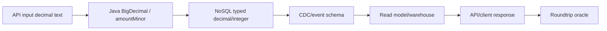

# Kiểm thử thiếu trường, NULL, số chính xác và ngày giờ

## 1. Một lỗi nhỏ về kiểu dữ liệu có thể trở thành lỗi nghiệp vụ lớn

Giả sử ứng dụng Java lưu đơn hàng trong một cơ sở dữ liệu NoSQL. Một bản ghi có dạng:

```json
{
  "orderId": "O-1001",
  "customerId": "C-22",
  "discount": null,
  "amount": "199.90",
  "createdAt": "2026-11-14T08:30:00Z",
  "deliveryDate": "2026-11-16"
}
```

Một API cập nhật gửi:

```json
{
  "deliveryDate": null
}
```

Cần hiểu `deliveryDate: null` là **xóa ngày giao dự kiến**, **chưa biết ngày giao**, hay **không thay đổi**? Nếu API gửi hoàn toàn không có `deliveryDate` thì có khác không? `discount: null` có nghĩa là không có mã giảm giá, số tiền giảm bằng 0 hay giá trị chưa được tính? Khi Java đọc `amount` qua kiểu `double`, tiền có còn chính xác? Nếu trường `createdAt` được lưu thành chuỗi không ghi offset, hai máy khác múi giờ có hiểu cùng một thời điểm?

Những câu hỏi này không chỉ là chuyện biểu diễn JSON. Chúng quyết định cách NoSQL lưu dữ liệu, xử lý điều kiện cập nhật, truy vấn chỉ mục, tính toán số tiền, sắp xếp thời gian và đồng bộ sang hệ khác.

Bài học thuộc module **Database No SQL**, chương **Kiểm thử tính đúng**, với chủ đề **“Kiểm thử thiếu trường, NULL, số chính xác và ngày giờ”**.

> **Nguyên tắc quan trọng:** Đừng chỉ kiểm một giá trị bình thường có thể ghi rồi đọc lại. Hãy xác minh điều gì xảy ra khi trường **không tồn tại**, trường **tồn tại với NULL**, giá trị **bằng 0 hoặc rỗng**, số **vượt giới hạn độ chính xác**, và thời gian **đổi múi giờ, đổi ngày hoặc hết TTL**.

### Mục tiêu học tập

Sau bài này, bạn có thể:

1. Phân biệt **missing**, **explicit null**, **empty**, **zero** và **default** trong JSON/API và từng loại NoSQL.
2. Thiết kế contract riêng cho thao tác create, replace, upsert, PATCH và migration.
3. Kiểm tra Java serialization/deserialization để không âm thầm gộp missing với NULL.
4. Dùng truy vấn phù hợp để phân biệt missing và explicit null trong MongoDB, DynamoDB và hiểu giới hạn Cassandra/Redis.
5. Kiểm tra kiểu số, overflow, độ chính xác, scale, rounding và tính toán tài chính qua nhiều tầng lưu trữ.
6. Dùng `BigDecimal`, integer minor units, BSON Decimal128 hoặc kiểu numeric tương ứng theo đúng giới hạn.
7. Phân biệt `Instant`, `LocalDate`, `LocalDateTime`, `OffsetDateTime` và `ZonedDateTime`.
8. Thiết kế test cho UTC, epoch seconds/milliseconds, DST, precision loss, inclusive/exclusive ranges và TTL.
9. Viết unit tests, integration tests, contract tests và property-based tests để phát hiện lỗi biên.
10. Kiểm chứng dữ liệu qua luồng API → Java → NoSQL → CDC/read model → backup/restore.
11. Tổ chức test matrix, xác định oracle và báo cáo khác biệt một cách có thể tái hiện.

## 2. Mô hình năm trạng thái dễ bị nhầm lẫn

Một trường logic `discount` có thể xuất hiện dưới nhiều dạng:

| Trạng thái | JSON minh họa | Ý nghĩa *có thể* | Kiểm thử cần hỏi |
|---|---|---|---|
| **Missing** | `{}` | Chưa từng khai báo, bỏ qua khi PATCH, dùng mặc định | Có tạo field không? |
| **Explicit NULL** | `{"discount":null}` | Biết là chưa có giá trị, yêu cầu clear | Có khác missing không? |
| **Zero** | `{"discount":0}` | Giá trị số hợp lệ bằng 0 | Có bị nhầm là null/false không? |
| **Empty string** | `{"discount":""}` | Chuỗi trống, có thể invalid | Có được validate không? |
| **Concrete value** | `{"discount":12.50}` | Số đã xác định | Kiểu/precision/scale thế nào? |

Với một field khác, còn có `false`, mảng rỗng `[]`, object rỗng `{}` hoặc tập rỗng. Đây là các giá trị **có mặt**, không đồng nghĩa missing hoặc null.

### 2.1. Missing là thông tin về *sự hiện diện*

Trong JSON object, missing nghĩa không có property name. Nó không phải JSON literal và không có cú pháp `"field": missing`. `null` lại là JSON value hợp lệ.

### 2.2. NULL không có nghĩa giống nhau ở mọi hệ

- MongoDB có kiểu BSON Null và có thể phân biệt với field không tồn tại.
- DynamoDB có `AttributeValue.NULL` riêng, khác attribute không tồn tại.
- Cassandra thường biểu diễn CQL null/không có cell theo semantics tombstone; nó không giữ cùng khả năng phân biệt present-null trong document.
- Redis key không tồn tại khác key có chuỗi rỗng, nhưng không có JSON NULL native trong kiểu string.

### 2.3. Zero là một giá trị

Một khoản giảm giá 0 có thể là kết quả tính hợp lệ. Test sai như `if (!discount)` trong JavaScript sẽ gộp 0, empty string, false, null và undefined. Ở Java, `BigDecimal.ZERO` không phải `null`.

### 2.4. Empty có thể là trạng thái nghiệp vụ

`"notes":""` có thể nghĩa người dùng xóa nội dung ghi chú, còn `"notes":null` nghĩa chưa xác định. Hoặc cả hai đều invalid tùy contract. **Không tự suy nghĩa từ kiểu dữ liệu.**

### 2.5. Default chỉ nên xuất hiện khi contract quy định

Khi record thiếu `currency`, có thể dùng default `VND` nếu schema version cho phép, hoặc reject vì không thể biết đơn vị thật. Một default không đúng có thể làm sai số tiền dù hệ “chạy được”.

## 3. Lập hợp đồng dữ liệu trước khi viết test

Một contract nên ghi rõ cho từng field:

| Field | Required khi create? | Null hợp lệ? | Missing khi PATCH | Kiểu và ràng buộc |
|---|---|---|---|---|
| `orderId` | Có | Không | Không đổi, thường immutable | String, nonblank |
| `customerId` | Có | Không | Không đổi, tùy API | String |
| `discountMinor` | Tùy | Không nếu có | Không đổi | Integer >= 0 |
| `deliveryDate` | Không | Có nếu cho phép clear | Không đổi | ISO local date |
| `createdAt` | Do server tạo | Không | Không đổi | UTC Instant, immutable |
| `amount` | Có | Không | Chỉ change theo workflow | Exact decimal string/typed decimal |
| `metadata` | Không | Theo policy | Không đổi | Object có schema |
| `tags` | Không | Không nếu có | Không đổi | Array/set, có thể rỗng |

Đây là **contract minh họa**, không áp cho mọi sản phẩm.

### 3.1. Câu hỏi theo đường đi

1. Client gửi gì?
2. JSON parser nhận kiểu nào?
3. Java DTO phân biệt missing/null được không?
4. Validation có reject/default/normalize không?
5. Driver chuyển dữ liệu sang kiểu NoSQL nào?
6. DB ghi/đọc lại khác gì không?
7. Query/index có nhìn thấy giá trị đúng không?
8. CDC/search/cache/backup có giữ ý nghĩa không?
9. Client khác phiên bản có giải mã được không?

### 3.2. Ba loại bất biến

**Presence invariant:** field bắt buộc luôn có khi record ở trạng thái hợp lệ.

**Value invariant:** nếu field có giá trị, nó thỏa miền giá trị (ví dụ amount >= 0).

**Transition invariant:** PATCH thiếu field không được sửa nó, còn PATCH explicit null chỉ clear khi cho phép.

### 3.3. Điều gì là expected?

Nếu endpoint create nhận `{"amount":null}`, hợp đồng có thể yêu cầu HTTP 400/422 và không ghi DB. Nếu PATCH missing `amount`, hợp đồng có thể yêu cầu giữ nguyên, không tạo default amount=0. Test phải có oracle từ contract trước khi assert.

## 4. Phân biệt create, replace, upsert và PATCH

Cùng payload có thể có semantics khác nhau theo thao tác.

### 4.1. Create

Payload thiếu field bắt buộc → reject. Payload thiếu optional field → có thể lưu missing, hoặc apply default đã công bố.

### 4.2. Replace

Replace thường thay toàn bộ resource/document theo representation mới. Missing optional field có thể bị loại khỏi bản ghi, khác PATCH. Cần kiểm update tool có thực hiện full replacement hay selective mutation.

### 4.3. PATCH

Một hợp đồng phổ biến:

```text
field absent          => giữ nguyên
field present as null  => clear/unset nếu field nullable/clearable
field present as value => validate và set
```

Nhưng **JSON Merge Patch (RFC 7396)** thường dùng null để **remove member**, không có nghĩa “lưu explicit null”. **JSON Patch (RFC 6902)** dùng operations như add/replace/remove và có thể thiết lập JSON null như một value. Không trộn hai chuẩn hoặc gọi mọi JSON object là Merge Patch.

### 4.4. Upsert

Nếu record chưa tồn tại, upsert có thể tạo mới; field missing/default semantics có thể khác khi record đã tồn tại. Test **cả nhánh insert và update**. Đặc biệt đừng để `$setOnInsert` hoặc default serializer vô tình ghi `null` vào trường của record hiện hữu.

### 4.5. Migration

Schema migration xử lý records đời cũ: missing có thể là “chưa có feature” chứ không phải null người dùng chọn. Upcaster cần biết schema version và tránh ghi default đoán mò lên dữ liệu lịch sử.

## 5. Test matrix cho ba trạng thái create/PATCH

Giả sử `nickname` là nullable và cho phép clear trên PATCH.

| Stored trước | PATCH body | Expected sau | Lỗi thường gặp |
|---|---|---|---|
| Missing | `{}` | Missing | Tự tạo null |
| `null` | `{}` | `null` | Xóa field |
| `"An"` | `{}` | `"An"` | Reset default |
| `"An"` | `{"nickname":null}` | Clear theo API contract | Bỏ qua null |
| Missing | `{"nickname":null}` | Explicit null hoặc remove theo chuẩn đã chọn | Gộp semantics |
| `"An"` | `{"nickname":""}` | Empty string hoặc validation reject | Coi empty là null |
| `"An"` | `{"nickname":"Bình"}` | `"Bình"` | Cập nhật sai field |
| `"An"` | `{"nickname":false}` | Reject kiểu sai | Coerce sang string |
| `"An"` | `{"nickname":0}` | Reject kiểu sai | Coerce thành missing |

Một hệ dùng JSON Merge Patch sẽ chọn **remove member** cho explicit null; nếu muốn lưu present-null, cần API/operation semantics khác. Hãy chốt contract rồi cập nhật expected trước khi chạy test.

### 5.1. Negative tests quan trọng

- Gửi wrong type không được silently coerced.
- Gửi field immutable không được thay đổi.
- Gửi null cho required không được chuyển thành default.
- Gửi payload missing required create không tạo record thiếu dữ liệu.
- Gửi PATCH cùng payload hai lần không tạo side effects lặp nếu contract idempotent.

## 6. Java DTO: vì sao `Optional<T>` không đủ?

Một DTO:

```java
public record PatchOrder(
    String note,
    java.math.BigDecimal discount
) {}
```

có thể được deserialized để `note == null` khi cả hai JSON bodies đều xảy ra:

```json
{}
```

```json
{"note":null}
```

Nếu logic chỉ thấy Java `null`, không thể biết client **bỏ qua** hay **muốn clear**.

`Optional.ofNullable(value)` cũng gộp missing và explicit-null thành `Optional.empty()`. Nó hữu ích khi API không cần phân biệt, nhưng không phải giải pháp cho three-state PATCH.

### 6.1. Một đại số trạng thái ba nhánh

```java
public sealed interface FieldPatch<T>
    permits FieldPatch.Absent,
            FieldPatch.Clear,
            FieldPatch.SetValue {

    record Absent<T>() implements FieldPatch<T> {}
    record Clear<T>() implements FieldPatch<T> {}
    record SetValue<T>(T value) implements FieldPatch<T> {
        public SetValue {
            java.util.Objects.requireNonNull(value);
        }
    }
}
```

Ý nghĩa:

- `Absent`: không đổi.
- `Clear`: xóa/đặt null theo contract.
- `SetValue`: giá trị không null đã validate.

**Không đưa trực tiếp interface này làm DTO Jackson nếu chưa cấu hình parser**. Một cách dễ kiểm soát là đọc JSON tree và map rõ ba trường hợp.

### 6.2. Logic áp patch minh họa

```java
static String applyNote(
    String oldValue,
    FieldPatch<String> patch
) {
    if (patch instanceof FieldPatch.Absent<?>) {
        return oldValue;
    }
    if (patch instanceof FieldPatch.Clear<?>) {
        return null;
    }
    return ((FieldPatch.SetValue<String>) patch).value();
}
```

Ở Java thật, việc lưu `null` lại khác việc **remove field khỏi NoSQL record**. Hệ repository phải thể hiện operation đúng: `$set: null` khác `$unset` trong MongoDB.

### 6.3. Không để patch clear rơi vào default create

Đặt default value thường phù hợp với create/insert branch, không phải PATCH. Nếu có `Optional<String> note` mà sử dụng `orElse("")` trong patch, một request thiếu field có thể xóa ghi chú cũ.

## 7. Jackson JsonNode: kiểm explicit null và missing

Jackson tree model hữu ích để giữ thông tin presence khi đọc PATCH JSON.

```java
import com.fasterxml.jackson.databind.JsonNode;
import com.fasterxml.jackson.databind.ObjectMapper;
import java.util.Objects;

public final class PatchReader {
    private static final ObjectMapper JSON = new ObjectMapper();

    public static FieldPatch<String> notePatch(String body)
        throws Exception {
        JsonNode root = JSON.readTree(body);

        if (root == null || !root.isObject()) {
            throw new IllegalArgumentException("JSON object required");
        }

        if (!root.has("note")) {
            return new FieldPatch.Absent<>();
        }

        JsonNode node = Objects.requireNonNull(root.get("note"));
        if (node.isNull()) {
            return new FieldPatch.Clear<>();
        }
        if (!node.isTextual()) {
            throw new IllegalArgumentException("note must be text or null");
        }
        return new FieldPatch.SetValue<>(node.textValue());
    }
}
```

### 7.1. Những hàm dễ nhầm

| Jackson API | Missing field | Explicit JSON null | Concrete value |
|---|---|---|---|
| `root.has("note")` | false | true | true |
| `root.hasNonNull("note")` | false | false | true |
| `root.get("note")` | Java null | `NullNode` | Node tương ứng |
| `root.path("note")` | `MissingNode` | `NullNode` | Node tương ứng |

**Không dùng `hasNonNull` để quyết định PATCH có chỉ định trường hay không**, vì nó gộp missing và explicit-null.

### 7.2. JUnit 5 kiểm sự khác biệt

```java
import org.junit.jupiter.api.Test;
import static org.junit.jupiter.api.Assertions.*;

class PatchReaderTest {
    @Test
    void distinguishesAbsentNullAndValue() throws Exception {
        assertInstanceOf(
            FieldPatch.Absent.class,
            PatchReader.notePatch("{}")
        );

        assertInstanceOf(
            FieldPatch.Clear.class,
            PatchReader.notePatch("{\"note\":null}")
        );

        FieldPatch<String> result =
            PatchReader.notePatch("{\"note\":\"ABC\"}");

        assertInstanceOf(FieldPatch.SetValue.class, result);
        assertEquals(
            "ABC",
            ((FieldPatch.SetValue<String>) result).value()
        );
    }

    @Test
    void rejectsWrongTypes() {
        assertThrows(
            IllegalArgumentException.class,
            () -> PatchReader.notePatch("{\"note\":123}")
        );
    }
}
```

Đây là **unit test cho parser**, chưa chứng minh DB lưu/đọc đúng; cần integration test xuống repository.

## 8. Serialization: khi một cấu hình “bỏ null” phá semantics

Các thư viện JSON có tùy chọn chỉ serialize non-null properties, ví dụ Jackson `JsonInclude.Include.NON_NULL`. Nếu một API patch cần phát explicit-null để clear field, cấu hình này có thể loại property khỏi output và biến “clear” thành “không thay đổi”.

### 8.1. Test hai chiều

- Serialize DTO có `note=null`: output là `{"note":null}` hay `{}`?
- Deserialize `{}` có khác `{"note":null}` không?
- Serialize rồi deserialize có giữ semantics patch không?
- DTO mới có field default có tự được ghi khi record đời cũ thiếu không?

### 8.2. Getter default nguy hiểm

`getDiscount()` trả `BigDecimal.ZERO` khi backing value null có thể che thiếu dữ liệu. Điều này có thể phù hợp view hiển thị, nhưng persistence hoặc reconciliation phải giữ nguyên “không biết” để không biến dữ liệu không đầy đủ thành zero hợp lệ.

### 8.3. Kiểu nguyên thủy Java

`int`, `long`, `boolean` không biểu diễn null. Nếu parser map missing `quantity` về `0`, hoặc absent `enabled` về `false`, sẽ mất sự phân biệt. Dùng boxed type với validation hoặc presence-aware DTO tùy contract.

### 8.4. Không tin test của JSON parser là đủ

DTO serialization test cần đi kèm database driver conversions, index/query và CDC pipeline, vì mỗi tầng có thể thêm default, remove null hoặc đổi kiểu.

## 9. MongoDB: thiếu field khác BSON Null

Trong MongoDB, document có thể:

```javascript
db.orders.insertMany([
  { _id: "m1" },
  { _id: "n1", discount: null },
  { _id: "z1", discount: 0 },
  { _id: "v1", discount: NumberDecimal("12.50") },
  { _id: "e1", discount: "" }
])
```

### 9.1. Query tìm cả null và missing

```javascript
db.orders.find({ discount: null })
```

Theo MongoDB query semantics thông dụng, equality với `null` khớp documents **có explicit null hoặc thiếu field**. Không dùng truy vấn này một mình để chứng minh đã phân biệt hai trạng thái.

### 9.2. Query explicit null

```javascript
db.orders.find({
  discount: { $type: 10 }
})
```

BSON type number 10 là `Null`. Với query path phức tạp/mảng, xem documentation và test trên schema cụ thể; biểu thức này minh họa field scalar trực tiếp.

### 9.3. Query missing

```javascript
db.orders.find({
  discount: { $exists: false }
})
```

### 9.4. Query field present, kể cả null

```javascript
db.orders.find({
  discount: { $exists: true }
})
```

### 9.5. Query non-null

Một pattern MongoDB thường dùng là:

```javascript
db.orders.find({
  discount: { $ne: null }
})
```

Khi cần strict kiểu và miền giá trị, kết hợp schema/type validation thay vì chỉ dựa vào `$ne:null`. Ví dụ số decimal và string `"12.50"` không nên được coi tương đương chỉ vì cùng hiển thị.

### 9.6. Bảng expected minh họa

| `_id` | `{discount:null}` | `$type:10` | `$exists:false` |
|---|:---:|:---:|:---:|
| `m1` | Có | Không | Có |
| `n1` | Có | Có | Không |
| `z1` | Không | Không | Không |
| `v1` | Không | Không | Không |
| `e1` | Không | Không | Không |

### 9.7. Đừng suy từ output một query

Đặc biệt khi dữ liệu có arrays/nested documents, dot-path query và null checks có thể có nhiều edge cases. Test với shape thực: field scalar, array, nested object, missing parent, explicit-null parent và missing child.

## 10. MongoDB: `$set`, `$unset` và replace có hệ quả khác nhau

Giả sử:

```javascript
{ _id: "O42", note: "Gọi trước khi giao" }
```

### 10.1. Đặt explicit null

```javascript
db.orders.updateOne(
  { _id: "O42" },
  { $set: { note: null } }
)
```

Sau đó field `note` **tồn tại** với BSON Null.

### 10.2. Xóa field

```javascript
db.orders.updateOne(
  { _id: "O42" },
  { $unset: { note: "" } }
)
```

Sau đó `note` **không tồn tại**.

### 10.3. Không thay đổi

Nếu payload PATCH không chứa `note`, builder của update statement không nên thêm operation cho `note`. Cả `$set:null` và `$unset` đều là mutation chứ không phải no-op.

### 10.4. Replace

`replaceOne` thay thế document (trừ các giới hạn identity/`_id` của MongoDB). Nếu replacement thiếu `note`, field có thể biến mất dù client chỉ muốn sửa `status`. Test mỗi API sử dụng update hay replace, đặc biệt trong repository abstractions.

### 10.5. Upsert

Khi `upsert:true`, cần test cả case document tồn tại và không tồn tại. `$setOnInsert` có thể cung cấp defaults cho nhánh insert, nhưng không nên biến request PATCH hiện hữu thành reset dữ liệu.

### 10.6. Race với concurrent updates

Hai PATCH cùng lúc có thể cần CAS/version guard. Test missing/null semantics cùng optimistic locking: một update stale không được vô tình clear field do đã parse absent thành null.

## 11. MongoDB: JSON Schema validation và index với null

MongoDB có thể định nghĩa document validation theo `$jsonSchema`, nhưng phải hiểu:

- `required` kiểm sự hiện diện của field.
- `bsonType` ràng buộc kiểu BSON.
- Một field có thể present-null và vẫn thỏa `required` nếu schema cho phép null.
- Nếu field bắt buộc vừa phải hiện diện vừa không-null, phải đặt ràng buộc kiểu/giá trị tương ứng.
- Hệ có schema version/migration cần test documents đời cũ và validation mode/action đúng.

### 11.1. Schema minh họa

```javascript
{
  $jsonSchema: {
    bsonType: "object",
    required: ["orderId", "amount"],
    properties: {
      orderId: { bsonType: "string" },
      amount: { bsonType: "decimal" },
      note: { bsonType: ["null", "string"] }
    }
  }
}
```

Đây là fragment validation để tham khảo, không phải một lệnh tạo collection hoàn chỉnh. `amount` là BSON Decimal128; gửi Java double rồi lưu BSON Double có thể bị reject thay vì tự chuyển đúng kiểu.

### 11.2. Unique index và missing/null

MongoDB single-field unique indexes có quy tắc cụ thể cho missing/null keys, và index loại sparse/partial/multikey/compound có behavior khác nhau. Một test quan trọng là tạo **nhiều documents thiếu email** và **nhiều documents email null**, xem unique constraints theo đúng index definition.

Không mặc định một sparse index tự phân biệt mọi null/missing theo business requirement. Khi yêu cầu “unique email nếu là non-null string”, có thể dùng **partial filter expression** tương thích với data type/schema, rồi kiểm positive/negative insert tests.

### 11.3. Truy vấn và index không phải cùng oracle

Một query `{field:null}` có thể trả cả missing và explicit null, còn index key behavior có chi tiết riêng. Test query semantics và constraint/index semantics **tách biệt**.

## 12. DynamoDB: AttributeValue.NULL và attribute không tồn tại

DynamoDB Item là map các attributes có kiểu tường minh. Một attribute có thể hoàn toàn không có hoặc có kiểu `NULL`:

```json
{
  "PK": {"S": "ORDER#O42"},
  "SK": {"S": "DETAIL"},
  "discount": {"NULL": true}
}
```

Nếu không có khóa `discount` trong map, đó là **missing**. `{"NULL":true}` không tương đương `{"N":"0"}` hoặc `{"S":""}`.

### 12.1. Kiểm sự hiện diện

Condition expression:

```text
attribute_exists(discount)
attribute_not_exists(discount)
```

`attribute_exists(discount)` kiểm attribute present, kể cả khi type là `NULL`. Vì vậy nếu muốn kiểm giá trị usable, chỉ kiểm exists là không đủ.

### 12.2. Kiểm kiểu NULL

DynamoDB supports `attribute_type(path, type)` trong expressions, với token kiểu như `NULL` được truyền qua expression attribute value dạng string.

Ví dụ ý tưởng:

```text
ConditionExpression: "attribute_type(#d, :nullType)"
ExpressionAttributeNames:  {"#d":"discount"}
ExpressionAttributeValues:
  {":nullType":{"S":"NULL"}}
```

Đây là fragment ở dạng DynamoDB JSON conventions, không phải một request HTTP hoàn chỉnh. Phải test expression với đúng SDK/operation/engine.

### 12.3. Kiểm field present-number

Có thể xây điều kiện:

```text
attribute_exists(#d) AND attribute_type(#d, :numberType)
```

với `:numberType` là string `"N"`. Khi nghiệp vụ cần amount >= 0, thêm condition numeric tương ứng và validation ở Java.

### 12.4. `if_not_exists` không phải `if_null`

Expression `if_not_exists(path, value)` chỉ dùng fallback khi attribute **không tồn tại**. Nếu attribute tồn tại với type `NULL`, không nên coi nó như missing. Test trường hợp này trực tiếp để tránh default amount=0 bất ngờ.

### 12.5. UpdateExpression và Remove

- `SET #d = :v` với `:v` kiểu NULL tạo explicit-null attribute.
- `REMOVE #d` xóa attribute.
- Không đề cập `#d` trong update → giữ nguyên.

Test những operations này với cùng item và conditional version để xác minh semantics.

### 12.6. Không nhầm String rỗng và Set rỗng

DynamoDB có quy tắc riêng cho empty strings/binary ở non-key attributes và không cho empty set theo service semantics; key attributes có constraints khác. Nếu application coi `""` là null và serializer đổi kiểu, cần test rõ theo SDK/validation. Không phỏng đoán “mọi empty đều bị cấm”.

### 12.7. DynamoDB Local không chứng minh mọi production policy

Local emulator hữu ích cho expression logic, nhưng không thay kiểm IAM, throttling, Streams, TTL và cloud-service limits với môi trường được phép. Test correct mapping và condition expressions ở cả cấp unit/integration.

## 13. DynamoDB SDK Java: ba trạng thái của một attribute

Ví dụ xây item từ Java SDK v2:

```java
import java.util.HashMap;
import java.util.Map;
import software.amazon.awssdk.services.dynamodb.model.AttributeValue;

public final class DynamoNullable {
    public static Map<String, AttributeValue> missing() {
        Map<String, AttributeValue> item = new HashMap<>();
        item.put("PK", AttributeValue.builder().s("ORDER#O42").build());
        return item;
    }

    public static Map<String, AttributeValue> explicitNull() {
        Map<String, AttributeValue> item = missing();
        item.put(
            "discount",
            AttributeValue.builder().nul(true).build()
        );
        return item;
    }

    public static Map<String, AttributeValue> zero() {
        Map<String, AttributeValue> item = missing();
        item.put(
            "discount",
            AttributeValue.builder().n("0").build()
        );
        return item;
    }
}
```

Đây là phần tạo item fragments để so representation, **chưa phải PutItem**. Sau khi gửi/lấy item, test:

```java
Map<String, AttributeValue> item = DynamoNullable.explicitNull();

boolean present = item.containsKey("discount");
boolean isNullType = present &&
    Boolean.TRUE.equals(item.get("discount").nul());

org.junit.jupiter.api.Assertions.assertTrue(present);
org.junit.jupiter.api.Assertions.assertTrue(isNullType);
```

Nếu `AttributeValue` không có `discount`, `item.get("discount")` trả Java `null`. Nếu có `AttributeValue.NULL`, map value là object hợp lệ với `nul()==true`. Không gộp hai trường hợp.

## 14. Cassandra: CQL null, missing cell và UNSET

Cassandra có schema định nghĩa columns, nhưng không nhất thiết lưu một cell cho mọi column ở mỗi row. Ở API đọc CQL, giá trị không có cell thường xuất hiện là `null`. Vì vậy nó **không bảo toàn khái niệm “field missing” vs “field explicitly stored BSON Null” giống document stores**.

### 14.1. Hai loại thao tác Java driver khác nhau

Trong driver CQL có phân biệt:

- **Unset bind variable:** không áp dụng mutation cho column đó trong statement thích hợp.
- **Bind null:** áp dụng semantics null/delete cell theo CQL mutation rules, có thể tạo tombstone.

Tùy version DataStax/Apache Java driver API có các methods kiểu `unset(...)` và `setToNull(...)` trên statement builder. Đừng coi chúng bằng nhau.

### 14.2. Ví dụ logic

```text
Existing row:
  order_id=O42, note="Giao buổi sáng"

UPDATE note = UNSET
  -> note không bị thay đổi bởi binding đó

UPDATE note = null
  -> note bị xóa/null theo CQL mutation semantics
```

Đây là mô hình để giải thích binding; syntax của `UNSET` ở client driver không đồng nghĩa literal CQL phổ quát. Dùng prepared/bound statements phù hợp driver version.

### 14.3. Cassandra null và tombstone

Delete một cell có thể để lại tombstone cho consistency/compaction. Không tự suy `SELECT note = null` nghĩa “field explicit-null tồn tại trong storage” như MongoDB. Nếu domain phải phân biệt **never supplied** và **intentionally cleared**, cần lưu trạng thái bổ sung như `note_state`/revision/event ledger.

### 14.4. Empty string và zero

Cassandra `text` có thể chứa chuỗi rỗng, `decimal` có thể chứa 0. Không chuyển chúng thành null ở Java setter mà không có validation.

### 14.5. Tests cho Cassandra

- Insert row không bind optional cell.
- Update có `unset` và xác nhận giá trị cũ còn.
- Update có `setToNull` và xác nhận giá trị bị clear.
- Read bằng consistency level phù hợp.
- Test TTL/expiration và tombstone behavior.
- Test concurrent conditional writes/LWT nếu dùng.

Để kiểm database permission/quorum/repair, dùng Cassandra staging nhiều nodes; single-node mock không đủ.

## 15. Redis: key missing, empty string và sentinel

Redis string key không có typed JSON-null native. Ví dụ:

```text
GET order:O42:note
-> nil (key không tồn tại)

SET order:O42:note ""
GET order:O42:note
-> "" (chuỗi rỗng, key có tồn tại)

SET order:O42:note "null"
GET order:O42:note
-> "null" (bốn ký tự văn bản, không phải JSON NULL type)
```

### 15.1. Test đúng loại lưu trữ

Redis HASH có field riêng, `HGET` có thể trả nil khi hash field thiếu; RedisJSON module, nếu dùng, có JSON semantics của module và cần test riêng. Không gộp mọi Redis types thành một contract.

### 15.2. Sentinel string dễ gây nhầm

Lưu `"NULL"` hoặc `"-"` như sentinel là một thỏa thuận ứng dụng; nếu dữ liệu thật có thể bằng sentinel, gây collision. Có thể dùng structured serialization có type-tag khi cần bảo toàn three-state.

### 15.3. TTL và missing

Một key không tồn tại có thể là:

- Chưa từng ghi.
- Đã bị delete.
- Đã hết TTL.
- Bị eviction do memory policy.
- Chưa được cache fill.
- Mất sau failover/persistence gap.

`GET=nil` không tự chứng minh business field missing ở authoritative DB. Test cache fallback, invalidation và data version/expiry.

### 15.4. Không dùng Redis cache làm oracle duy nhất

Nếu MongoDB source có explicit null nhưng cache layer bỏ field khi serialize, test chỉ nhìn cache sẽ không phát hiện được nguồn semantic drift. So API, source, cache và fallback riêng.

## 16. Mapping qua nhiều hệ: không được “mất một trạng thái”

Giả sử nguồn MongoDB có ba trường hợp:

```text
A: field missing
B: field BSON Null
C: field Decimal128("0.00")
```

Một CDC projector chuyển sang DynamoDB hoặc search index. Nếu mapper đơn giản:

```java
if (value == null) {
    return null;
}
```

thì A và B có thể bị gộp. Một client chỉ đọc DynamoDB target không còn biết nguồn thực là missing hay explicit null.

### 16.1. Mapping contract minh họa

| Source state | Transport schema | Target representation |
|---|---|---|
| Missing | Trường không có trong event, hoặc presence flag false | Target missing |
| Explicit null | Presence true + null value | DynamoDB NULL / JSON null nếu hợp |
| Zero decimal | Value + decimal type/scale | DynamoDB N("0.00") |
| Empty string | Value type string length 0 | Empty string nếu target cho phép |
| Delete event | Operation type DELETE/tombstone | Remove record/field theo protocol |

### 16.2. Không mọi target chứa đủ trạng thái

Nếu target (ví dụ Cassandra cell) không phân biệt null/missing theo đúng domain, phải chọn biểu diễn rõ như `field_state`, event type hoặc document blob có presence markers; hoặc chấp nhận mất thông tin với contract đã công bố.

### 16.3. Schema evolution

Một schema mới thêm `discount` không đồng nghĩa các events/records đời cũ phải có `discount:null`. Version-aware deserializer quyết định missing field ở v1 có được default sang zero hay thuộc trạng thái unknown.

### 16.4. Bài kiểm end-to-end

Tạo bộ dữ liệu A/B/C, ghi qua API, đọc source, phát CDC, đọc target, restore backup rồi đọc lại. Assert **presence + type + value + version**, không chỉ `String.valueOf(value)`.
## 17. “Số” không phải một kiểu duy nhất

Một số có thể trải qua các representation:

```text
HTTP JSON number
    -> Java parser (Integer, Long, Double, BigDecimal)
       -> driver type (BSON Int64, Double, Decimal128, DynamoDB N ...)
          -> NoSQL storage/index/aggregation
             -> CDC serializer / JSON API
                -> JavaScript Number / BigInt / decimal library
```

Mỗi lần chuyển đổi đều có thể:

- **Làm tròn**.
- **Tràn miền giá trị**.
- **Mất chữ số có nghĩa**.
- **Mất scale** (0.10 trở thành 0.1).
- **Đổi dấu/đơn vị**.
- **Đổi kiểu** (integer sang floating point).
- **Đổi sort order** (numeric sort thành lexicographic sort).
- **Biến invalid thành default** (missing amount thành 0).
- **Thất bại serialization** khi không represent được NaN/Infinity.

### 17.1. Kiểu số cần chọn theo domain

| Nhu cầu | Biểu diễn gợi ý | Vì sao |
|---|---|---|
| Số lượng nguyên nhỏ | `int`/`Integer` khi miền đủ | Nhẹ và dễ kiểm |
| Bộ đếm rất lớn | `long`/`BigInteger` | Kiểm overflow/limits |
| Tiền theo đơn vị nhỏ nhất | `long amountMinor` + currency nếu giới hạn phù hợp | Cộng/trừ chính xác |
| Tiền/giá cần nhiều chữ số thập phân | `BigDecimal` + precision/scale contract | Không nhị phân floating |
| Đại lượng khoa học gần đúng | `double` với error tolerance | Hiệu năng và sai số có định nghĩa |
| Phần trăm/tỷ giá cần chính xác | `BigDecimal` và rounding mode | Có policy domain |
| ID có chữ số dài | String hoặc precise integer encoding | Không mất identity qua JS Number |
| Unix timestamp | Integer seconds/millis với unit rõ | Không dùng floating date |

### 17.2. “Có 2 chữ số sau dấu phẩy” chưa đủ

Một giá trị tiền còn cần:

- Currency code.
- Minor-unit convention của currency.
- Có thể âm hay không.
- Giới hạn tối đa.
- Rounding mode.
- Precision trong trung gian tính toán.
- Tax/rate semantics.
- Conversion/aggregation invariants.

### 17.3. Không so chuỗi thay số nếu không cố ý

`"9"` > `"10"` theo thứ tự từ điển trong nhiều trường hợp, dù 9 < 10 theo số học. Nếu lưu decimal dưới dạng string, index/range query phải dùng encoding sortable phù hợp hoặc chuyển thành typed numeric.

## 18. Vì sao `double` không phù hợp cho giá tiền chính xác?

Trong binary floating point, nhiều phân số thập phân như 0.1 không thể biểu diễn chính xác. Ví dụ Java:

```java
double a = 0.1;
double b = 0.2;
System.out.println(a + b); // thường: 0.30000000000000004
System.out.println(a + b == 0.3); // false
```

Đây không phải bug Java riêng lẻ; nó là đặc điểm biểu diễn IEEE 754 binary floating point.

### 18.1. Vì sao lỗi nghiêm trọng?

Với kế toán, giảm giá và thuế, chênh lệch tích lũy có thể dẫn tới:

- Trả sai số tiền.
- Tính thuế khác expected.
- Sai ledger invariants.
- Truy vấn equals/range không khớp.
- Reconciliation source/target báo chênh lệch.
- Tổng cộng bị sai khi thứ tự tính thay đổi.

### 18.2. Thử cả phép toán, không chỉ lưu/đọc

Một field lưu chính xác `0.10` không có nghĩa tổng `0.10+0.20` được tính chính xác nếu Java tạm chuyển nó sang `double`. Test từ nhập liệu qua **calculation, persistence, query và output**.

### 18.3. Tolerance chỉ phù hợp khi business cho phép

Với sensor/machine learning, có thể assert `abs(a-b) <= epsilon` dựa trên error budget. Với tiền đã định nghĩa là số chính xác, “chênh vài đồng là được” không phải giải pháp chung.

## 19. Java BigDecimal: khởi tạo, scale và rounding

### 19.1. Khởi tạo từ chuỗi

```java
import java.math.BigDecimal;

BigDecimal price = new BigDecimal("0.10");
BigDecimal tax = new BigDecimal("0.20");
BigDecimal total = price.add(tax);

System.out.println(total.toPlainString()); // 0.30
```

Tránh:

```java
BigDecimal inaccurate = new BigDecimal(0.1);
```

Constructor từ `double` nhận giá trị nhị phân thực tế rồi chuyển thành decimal, có thể tạo một chuỗi chữ số dài không mong muốn. `BigDecimal.valueOf(0.1)` dùng canonical string representation của `double` nên thường phù hợp hơn constructor trực tiếp, nhưng với input nghiệp vụ dạng decimal nên **parse từ string/integer minor units từ đầu**.

### 19.2. Scale và equality

```java
BigDecimal x = new BigDecimal("1.0");
BigDecimal y = new BigDecimal("1.00");

System.out.println(x.equals(y));    // false
System.out.println(x.compareTo(y)); // 0
```

`equals` của BigDecimal xét cả value và scale. `compareTo` so giá trị số học. Test phải xác định domain có yêu cầu giữ scale gốc không.

### 19.3. Rounding bắt buộc ở điểm nào?

```java
import java.math.BigDecimal;
import java.math.RoundingMode;

BigDecimal gross = new BigDecimal("10.005");

BigDecimal money = gross.setScale(
    2,
    RoundingMode.HALF_UP
);
// money = 10.01
```

Nếu không quy định rounding mode, các tầng có thể cho kết quả khác. Với phép chia không có biểu diễn thập phân hữu hạn (ví dụ 1/3), `BigDecimal.divide` không có rounding context có thể ném `ArithmeticException`.

### 19.4. Test phép chia

```java
BigDecimal ratio = BigDecimal.ONE.divide(
    new BigDecimal("3"),
    6,
    RoundingMode.HALF_EVEN
);
// 0.333333
```

Không áp cùng rounding mode tùy tiện cho mọi domain: tiền, lãi suất, tỷ giá và phí có requirements khác nhau.

### 19.5. Lưu scale hay chuẩn hóa?

Một hệ tài chính có thể quy định giá tiền lưu scale=2, còn tỷ giá scale=8. `stripTrailingZeros()` có thể thay scale/representation thành scientific notation trong một số trường hợp. Nếu scale có ý nghĩa nghiệp vụ, normalize theo **schema contract**, không đơn giản strip mọi trailing zero.

## 20. Java: kiểm tiền bằng số nguyên minor units

Ví dụ VND hoặc một currency có đơn vị nhỏ nhất được xác định, ứng dụng có thể lưu:

```json
{
  "amountMinor": 19990,
  "currency": "VND"
}
```

Lưu ý `amountMinor` là integer theo **đơn vị nhỏ nhất của business schema**, không mặc định mọi currency có hai decimal places. Số 19990 trong ví dụ chỉ là dữ liệu giả định; quy tắc chuyển đổi phải được xác định theo currency/contract.

### 20.1. Chuyển BigDecimal sang minor units

```java
import java.math.BigDecimal;
import java.math.RoundingMode;

public final class MoneyCodec {
    private MoneyCodec() {}

    public static long toMinorUnits(
        String decimalText,
        int fractionDigits
    ) {
        BigDecimal amount = new BigDecimal(decimalText);

        return amount
            .setScale(fractionDigits, RoundingMode.UNNECESSARY)
            .movePointRight(fractionDigits)
            .longValueExact();
    }

    public static BigDecimal fromMinorUnits(
        long minorUnits,
        int fractionDigits
    ) {
        return BigDecimal.valueOf(minorUnits)
            .movePointLeft(fractionDigits);
    }
}
```

Nếu input có nhiều chữ số thập phân hơn được phép, `RoundingMode.UNNECESSARY` gây lỗi (trừ khi các chữ số bỏ đi đều là zero và exact vẫn được giữ). `longValueExact()` sẽ ném lỗi nếu không biểu diễn được bằng long hoặc có fractional part sau conversion.

### 20.2. Unit tests

```java
import org.junit.jupiter.api.Test;
import static org.junit.jupiter.api.Assertions.*;

class MoneyCodecTest {
    @Test
    void roundTripsWithoutLoss() {
        long units = MoneyCodec.toMinorUnits("123.45", 2);
        assertEquals(12345L, units);

        assertEquals(
            0,
            MoneyCodec.fromMinorUnits(units, 2)
                .compareTo(new java.math.BigDecimal("123.45"))
        );
    }

    @Test
    void rejectsFractionalMinorUnit() {
        assertThrows(
            ArithmeticException.class,
            () -> MoneyCodec.toMinorUnits("1.234", 2)
        );
    }

    @Test
    void rejectsOverflow() {
        assertThrows(
            ArithmeticException.class,
            () -> MoneyCodec.toMinorUnits(
                "999999999999999999999", 2
            )
        );
    }
}
```

### 20.3. Arithmetic overflow

Tính tổng:

```java
long sum = Math.addExact(amountA, amountB);
```

`Math.addExact` ném `ArithmeticException` nếu tràn `long`. Không dùng `amountA + amountB` rồi kiểm `sum < 0` như một quy tắc overflow đầy đủ.

### 20.4. Không cho client tự chọn currency scale tùy ý

Nếu caller truyền `fractionDigits=0` để tránh validation, có thể phá contract. Fraction digits và rounding policy phải đến từ schema/currency configuration được tin cậy, không phải từ request parameter không kiểm soát.

## 21. JSON number và giới hạn số nguyên qua JavaScript

JSON grammar cho phép các token số có phần thập phân hoặc số mũ, nhưng **JSON không bắt buộc** mọi parser giữ toàn bộ precision.

JavaScript `Number` dùng binary64 và chỉ giữ chính xác mọi số nguyên trong phạm vi:

\[
[-(2^{53}-1),\,2^{53}-1]
\]

Với số lớn hơn, hai integer IDs khác nhau có thể bị parse thành cùng value.

### 21.1. Test vượt ngưỡng

```javascript
const n = 9007199254740993;
console.log(n === 9007199254740992); // true trong JS Number
```

Nếu server gửi numeric ID 9007199254740993 trong JSON number, frontend có thể mất một đơn vị ngay khi parse.

### 21.2. Biện pháp

- Dùng string cho IDs/counters lớn nếu API cần exact roundtrip qua JS.
- Dùng BigInt với parser/serializer chuyên biệt theo contract; JSON.stringify không tự hỗ trợ serialize BigInt trực tiếp.
- Dùng decimal string hoặc typed representation cho tiền lớn/giá thập phân.
- Test với client thật, không chỉ Java backend.

### 21.3. Test các mốc boundary

- `2^31-1`, `2^31`.
- `2^63-1`, `2^63`.
- `2^53-1`, `2^53` và `2^53+1`.
- `0`, `-0` (nếu ngôn ngữ/kiểu có thể phân biệt), số âm.
- Số rất nhỏ, exponent, nhiều chữ số decimal.
- Leading zeros ở ID string (ví dụ `"00042"`) phải bảo toàn.

### 21.4. Không coi mọi JSON number là BigDecimal tự động

Jackson có cấu hình deserialization để giữ `BigDecimal` cho floating values hoặc parse trực tiếp từ chuỗi, nhưng behavior phụ thuộc target type/config. Test exact lexical representation khi scale phải giữ, không chỉ numerically equal.

## 22. MongoDB BSON numeric types và Decimal128

MongoDB BSON có những numeric types phổ biến:

- `Int32`.
- `Int64`.
- `Double`.
- `Decimal128`.

Chúng có representation/range/index/aggregation/serialization semantics không đồng nhất. MongoDB Decimal128 cho **tối đa 34 significant decimal digits** theo IEEE 754 decimal128, không phải BigDecimal tùy ý bao nhiêu chữ số cũng lưu được.

### 22.1. Test đúng BSON type

```javascript
db.prices.insertMany([
  { _id: "p1", price: NumberInt(1) },
  { _id: "p2", price: NumberLong("1") },
  { _id: "p3", price: 1.0 },
  { _id: "p4", price: NumberDecimal("1.00") }
])
```

Các giá trị có thể so sánh bằng số trong một số operation, nhưng **type identity** và precision/scale vẫn cần kiểm. Test type qua `$type` hoặc driver codec, không chỉ dựa vào UI hiển thị “1”.

### 22.2. Decimal128 từ Java

Java MongoDB driver có kiểu `org.bson.types.Decimal128`. Mẫu:

```java
import java.math.BigDecimal;
import org.bson.types.Decimal128;

BigDecimal amount = new BigDecimal("199.90");
Decimal128 bson = new Decimal128(amount);

BigDecimal roundTrip = bson.bigDecimalValue();
assert roundTrip.compareTo(amount) == 0;
```

Phải kiểm dải precision/exponent của BSON Decimal128 và driver behavior trước khi lưu. Một `BigDecimal` quá dài không thể được biểu diễn chính xác dưới dạng Decimal128; cần reject/validate thay vì im lặng cắt chữ số.

### 22.3. Mixed numeric schema

Nếu records cũ lưu Double còn mới lưu Decimal128, một query/aggregation có thể cho behavior khác kỳ vọng. Migration cần xác định quy tắc chuyển: không thể luôn khôi phục decimal gốc từ double đã mất precision.

### 22.4. Decimal128 và JSON API

MongoDB Extended JSON có thể biểu diễn Decimal128 bằng structured marker kiểu `{"$numberDecimal":"199.90"}`. Nếu REST API cần contract generic, có thể chọn decimal string thay vì JSON number. Test client parse, sort, format và equality riêng.

### 22.5. Unique/index/range với số khác kiểu

Khi dữ liệu có int32, int64, double, decimal, phải kiểm business comparisons và index constraints theo MongoDB version, chứ không suy rằng cùng display string thì identity chắc chắn giống. Với monetary fields, chọn một representation nhất quán và enforce qua validator/migration.

## 23. DynamoDB: số được truyền như chuỗi decimal

Trong DynamoDB low-level AttributeValue, kiểu số `N` truyền qua string:

```json
{
  "amount": {"N": "199.90"},
  "quantity": {"N": "3"}
}
```

DynamoDB giới hạn numeric precision theo service (thông thường tối đa **38 decimal digits**). Vì vậy không gửi `BigDecimal` vượt độ chính xác cho phép rồi mong database giữ nguyên.

### 23.1. Java SDK v2

```java
import java.math.BigDecimal;
import software.amazon.awssdk.services.dynamodb.model.AttributeValue;

BigDecimal amount = new BigDecimal("199.90");

AttributeValue av = AttributeValue.builder()
    .n(amount.toPlainString())
    .build();

BigDecimal decoded = new BigDecimal(av.n());
```

Test với `GetItem`/`Query` thật trong sandbox để xác nhận roundtrip và numeric operations, không dừng ở test `AttributeValue.builder()` vì nó chỉ tạo request object.

### 23.2. Bảo vệ precision và scale

DynamoDB number semantics tập trung vào giá trị số, không nên dựa vào service giữ nguyên lexical formatting/scale như `"1.00"` so với `"1"` trên mọi đường đọc. Nếu scale mang business meaning, lưu scale/unit metadata riêng hoặc canonicalize trước.

### 23.3. Conditional update với số

Ví dụ inventory:

```text
SET available = available - :qty
CONDITION available >= :qty
```

Test rằng `available` là numeric AttributeValue và operation diễn ra atomically theo service expression/condition semantics. Missing/NULL không được âm thầm thành 0.

### 23.4. Overflow/precision boundary

Test số có 37, 38, 39 significant digits và exponent/range trong môi trường thật theo giới hạn vendor. Nếu reject, API nên trả validation error có ý nghĩa, không tự cắt xuống 38 digits mà vẫn nhận đơn hàng.

### 23.5. Sort key type

Nếu dùng String sort key cho number: `"10"` và `"2"` có thứ tự lexicographic khác numeric. Nếu cần range query theo số, thiết kế numeric key hoặc fixed-width/order-preserving encoding đúng contract.

## 24. Cassandra: decimal, varint và floating types

Cassandra CQL có kiểu:

- `tinyint`, `smallint`, `int`, `bigint` cho signed integers.
- `varint` cho số nguyên độ dài biến đổi.
- `decimal` cho số thập phân chính xác theo kiểu BigDecimal.
- `float`/`double` cho floating-point approximate.

### 24.1. Java Driver mapping

Với driver hỗ trợ, CQL `decimal` tương ứng Java `BigDecimal` và CQL `varint` tương ứng `BigInteger`. Dù kiểu DB là decimal chính xác, **tầng application** vẫn cần validation precision/scale và rounding.

### 24.2. Timestamp khác số

CQL `timestamp` là thời điểm, không nên lưu như arbitrary decimal fraction. Nếu cần nanosecond precision, phải chọn kiểu/schema phù hợp và test; không mặc định Cassandra timestamp giữ đủ 9 chữ số nanosecond.

### 24.3. Aggregation/overflow

Các phép cộng/sum/count có thể chịu kiểu kết quả và giới hạn cụ thể. Test result type theo driver, nhiều rows, values âm, lớn, null/missing cells; không parse aggregate kết quả qua `double` khi cần exact.

### 24.4. Empty/NULL về CQL

`decimal` value 0 khác cell null. Các queries, serialization và upsert semantics phải giữ khác biệt hoặc mô tả rõ khi domain gộp chúng.

## 25. Redis: integer counters khác floating counters

Redis có commands như `INCRBY` dùng integer arithmetic, và `INCRBYFLOAT` dùng floating numeric representation có giới hạn/behavior riêng theo Redis.

### 25.1. Khi cần tiền chính xác

Đừng dùng `INCRBYFLOAT` cho money ledger chỉ vì cú pháp đơn giản. Dùng minor-unit integer (và overflow kiểm soát), một script/protocol atomic hợp lệ hoặc database hỗ trợ exact decimal/transactions theo requirements.

### 25.2. Kiểm string parsing

Redis string `"0010"`, `"10"`, `"10.0"` có lexical differences. Nếu app đọc bằng `Long.parseLong` hay `BigDecimal`, xác định format canonical và lỗi invalid.

### 25.3. Test overflow/atomicity

Kiểm:

- Integer max/min.
- Đồng thời nhiều clients tăng counter.
- Retry sau timeout/outcome unknown.
- Replication/failover durability.
- TTL/eviction.
- Key absent khi INCR (server command có semantics riêng) vs explicit application sentinel.

Một counter tăng chính xác trong một process không bảo đảm **exactly-once** qua failover/retry. Operation ID/idempotency vẫn cần khi mỗi increment là nghiệp vụ.

## 26. Test numeric rounding: bảng tình huống biên

| Dữ liệu | Đường kiểm | Kỳ vọng/điều phải xác định |
|---|---|---|
| `0.1+0.2` | Java double | Nhận diện inexact |
| `0.10+0.20` | Java BigDecimal strings | Numeric result đúng |
| `1.0` vs `1.00` | BigDecimal equals/compareTo | Scale vs numeric equality |
| `1/3` | BigDecimal divide | Có precision/rounding policy |
| `10.005` | Rounding to 2 decimals | Mode rõ |
| `-0.00` | API/DB serialization | Normalize hay giữ sign/scale |
| `999...` 39 digits | DynamoDB Number | Reject nếu vượt limit |
| `999...` 35 digits | BSON Decimal128 | Validate precision/range |
| `2^53+1` | JavaScript JSON Number | Không mất integer identity |
| `2^63` | Java long parser | Reject/BigInteger |
| `""` vs `"0"` | Redis numeric parser | Không gộp |
| `null` vs `0` | Aggregate sum | Contract rõ |
| `1e-9` | Decimal storage | Không round thành 0 ngoài policy |
| `NaN`/`Infinity` | JSON/DB parser | Standard JSON không có những literal này |
| `1000000000000.01` | Decimal serial/DB/CDC | Exactness end-to-end |
| `"00042"` | ID string | Bảo toàn leading zeros |

### 26.1. Kiểm API response type

Nếu DB giữ `Decimal128("199.90")` nhưng API trả `199.9` dưới dạng JSON number, data business value có thể vẫn bằng nhưng lexical scale mất. Nếu hợp đồng yêu cầu fixed decimal strings, response phải đúng format `"199.90"`.

### 26.2. Không chọn expected chỉ dựa trên log text

Một log formatter có thể in `1.0` và `1.00` giống nhau. Oracle phải so typed value, scale nếu cần và exact persisted representation.

### 26.3. Kiểm aggregation xuyên records

Tổng 10.000 item prices phải đúng theo domain rounding, kể cả khi shard distribution/aggregation order thay. Nếu dùng float, thay đổi thứ tự cộng có thể làm sai số khác nhau; exact decimal hoặc minor units giảm rủi ro.

## 27. Test chuyển đổi số giữa Java–NoSQL–JSON–CDC

Một lộ trình kiểm từ đầu tới cuối:



Tại mỗi boundary kiểm:

1. Presence và null status.
2. Numeric type.
3. Exact value.
4. Scale/format nếu contract có.
5. Unit/currency.
6. Overflow/error handling.
7. Schema version.
8. Query sorting/filtering.
9. Idempotent update/replay.
10. Backup/restore compatibility.

### 27.1. CDC không được biến decimal thành double

Nếu CDC serializes BigDecimal qua một JavaScript Number-based JSON parser, 19-digit decimals có thể bị thay đổi. Nên có decimal logical type/string schema được version hóa và contract tests cho producer/consumer.

### 27.2. Dữ liệu phục hồi phải khớp logical value

Đọc backup rồi dựng source mới có thể đổi representation (ví dụ Decimal128 → String) nhưng nếu migration được công bố, verifier cần so **typed logical value** và schema version; không chỉ raw JSON bytes.

### 27.3. Không dùng numeric string làm khóa truy vấn tùy ý

Nếu target index của read model lưu `amount` thành string, range filter theo giá có thể sai. Schema mapping và query tests phải có.
## 28. “Ngày giờ” thực ra gồm những khái niệm khác nhau

Một hệ phân tán có thể lưu:

- Thời điểm một request được server nhận.
- Ngày sinh chỉ có ngày/tháng/năm.
- Giờ giao hàng do khách chọn theo múi giờ địa phương.
- Hạn thanh toán sau 15 phút.
- Thời điểm một token được cho hết hạn.
- Ngày kế toán, có thể khác ngày UTC.
- Thời điểm database commit, không nhất thiết trùng application request timestamp.

Nếu dùng cùng kiểu `String`/`Date` cho tất cả, test có thể pass trong máy developer nhưng sai khi region/timezone thay.

### 28.1. Java time types cần chọn đúng

| Java type | Biểu diễn | Dùng khi |
|---|---|---|
| `Instant` | Một thời điểm trên timeline UTC | createdAt, event committedAt |
| `LocalDate` | Ngày lịch không kèm zone | Ngày sinh, ngày nghiệp vụ |
| `LocalTime` | Giờ-phút-giây trong ngày không có zone | Giờ mở cửa biểu diễn theo lịch |
| `LocalDateTime` | Ngày+giờ nhưng **không có zone/offset** | Input trước khi gắn zone |
| `OffsetDateTime` | Local date-time và offset cụ thể | API nhận `+07:00` hoặc `-04:00` |
| `ZonedDateTime` | Ngày+giờ và IANA zone rules | Lịch hẹn theo `Asia/Ho_Chi_Minh` |
| `Duration` | Khoảng thời gian chính xác trên timeline | Timeout 15 phút |
| `Period` | Khoảng lịch theo ngày/tháng/năm | Cộng một tháng lịch |
| `Clock` | Nguồn thời gian inject được | Test deterministic |
| `ZoneId` | Rule set của một timezone | Chuyển ngày business sang UTC |

### 28.2. UTC không đồng nghĩa mọi field là Instant

`deliveryDate="2026-11-16"` không nhất thiết là `2026-11-16T00:00:00Z`. Nếu khách ở Việt Nam, “ngày 16” là một ngày lịch của khu vực; chuyển sang midnight UTC có thể hiển thị ngày 15 ở khu vực khác.

### 28.3. Một Instant có nhiều biểu diễn local

```text
2026-11-14T08:30:00Z
2026-11-14T15:30:00+07:00
```

Hai chuỗi diễn tả **cùng thời điểm**. Test nên so `Instant` nếu ý nghĩa là cùng một event, không assert chuỗi phải giống hệt.

### 28.4. Offset không phải timezone

`+07:00` là offset ở một thời điểm. `Asia/Ho_Chi_Minh` là tên vùng với quy tắc thời gian theo IANA timezone database. Khi lập lịch tương lai ở một vùng có DST, chỉ lưu offset hiện tại không đủ để diễn giải các thay đổi luật giờ địa phương.

## 29. Java: cùng Instant, khác cách hiển thị

```java
import java.time.Instant;
import java.time.ZoneId;
import java.time.ZonedDateTime;

Instant instant = Instant.parse("2026-11-14T08:30:00Z");

ZonedDateTime local = instant.atZone(
    ZoneId.of("Asia/Ho_Chi_Minh")
);

System.out.println(local);
// 2026-11-14T15:30+07:00[Asia/Ho_Chi_Minh]
```

Trong test:

```java
import static org.junit.jupiter.api.Assertions.*;

assertEquals(
    instant,
    local.toInstant()
);
```

### 29.1. Test không dùng default timezone

Một đoạn:

```java
LocalDateTime.now()
```

phụ thuộc timezone của JVM và clock thật. Nếu ứng dụng cần log timestamp UTC, dùng `Instant.now(clock)` và serialize có offset rõ. Khi cần ngày lịch nghiệp vụ, truyền `ZoneId` của nghiệp vụ, không lấy ngầm từ server machine.

### 29.2. Tại sao format string có thể khác?

`Instant.toString()` có thể ghi độ dài phần fractional seconds khác nhau tùy giá trị. Nếu hợp đồng chỉ đòi cùng instant, so typed `Instant`. Nếu protocol đòi fixed-width text cho lexical sort, phải xác định formatter chuẩn có cùng precision.

### 29.3. Cách kiểm khi input có offset

```java
import java.time.OffsetDateTime;

OffsetDateTime value = OffsetDateTime.parse(
    "2026-11-14T15:30:00+07:00"
);

assertEquals(
    Instant.parse("2026-11-14T08:30:00Z"),
    value.toInstant()
);
```

Không bỏ offset rồi parse thành `LocalDateTime` nếu client thực sự gửi một thời điểm.

## 30. Lưu thời gian trong NoSQL: mỗi hệ có kiểu riêng

### 30.1. MongoDB BSON Date

BSON Date biểu diễn thời điểm bằng **milliseconds kể từ Unix epoch** (64-bit signed). Nó không tự giữ IANA timezone gốc hoặc nanosecond precision.

```javascript
db.events.insertOne({
  eventId: "E1",
  occurredAt: ISODate("2026-11-14T08:30:00.123Z")
})
```

Khi đọc từ Java, test expected `Instant` đã truncate đến milliseconds nếu dữ liệu đầu vào có nanoseconds.

### 30.2. DynamoDB không có native timestamp attribute

Một cách thông dụng:

```json
{
  "createdAt": {"S":"2026-11-14T08:30:00.123Z"},
  "expiresAtEpochSeconds": {"N":"1794650000"}
}
```

Giá trị `expiresAtEpochSeconds` ở đây chỉ minh họa kiểu numeric; khi làm bài test, **tự tính từ Instant fixture** để không nhầm giá trị giả định là epoch thực.

Có thể lưu epoch millis/seconds ở Number hoặc ISO 8601 UTC string. Cần thống nhất **unit/precision/format** xuyên services và dùng mapping phù hợp query/sort.

### 30.3. Cassandra CQL date/time

Cassandra có kiểu `date`, `time`, `timestamp` và các kiểu liên quan như `timeuuid`, với precision/semantics khác nhau. CQL `timestamp` lưu milliseconds epoch, không lưu original zone; driver conversions cần test.

### 30.4. Redis

Redis value có thể chứa epoch timestamp dạng string/integer hoặc JSON khi có module. Redis TTL lại quản lý expiration riêng, không đồng nghĩa field `expiresAt` ứng dụng tự lưu.

### 30.5. Type in document/index

Một field `createdAt` lưu BSON Date trong source nhưng thành String trong search index có thể đổi range/sort behavior nếu formatter không nhất quán. Test query/index mapping, không chỉ roundtrip một record.

## 31. Precision loss: nano → micro → milli → second

Một thời điểm Java có độ chính xác nanoseconds:

```java
Instant original =
    Instant.parse("2026-11-14T08:30:00.123456789Z");
```

Nếu lưu vào BSON Date (milliseconds) rồi đọc lại, kỳ vọng:

```java
import java.time.temporal.ChronoUnit;

Instant expected = original.truncatedTo(ChronoUnit.MILLIS);
// 2026-11-14T08:30:00.123Z
```

### 31.1. Test đúng contract precision

Không assert `original.equals(roundTrip)` nếu storage chỉ giữ milliseconds và contract đã nói truncate/round theo unit nào. Thay vào đó:

```text
roundTrip == normalizeToStoragePrecision(original)
```

Nhưng **chỉ normalize khi business contract cho phép mất precision**. Nếu hệ cần ordering ở microseconds, chọn storage/representation phù hợp.

### 31.2. Làm tròn khác cắt bớt

`2026-11-14T08:30:00.123900Z` về milliseconds có thể thành `.123` khi truncation hoặc `.124` khi rounding. Driver/schema phải định rõ behavior. Test timestamps ngay hai bên ranh giới.

### 31.3. Precision và unique key

Nếu event ID dùng `createdAt` nanoseconds mà DB chỉ lưu milliseconds, hai events có thể va cùng key/time bucket. Không dùng timestamp có precision chưa chắc chắn làm unique ID một mình; thêm sequence/UUID/operation ID.

### 31.4. Negative epoch

Với thời điểm trước 1970, phép chia nguyên kiểu cắt về zero có thể khác floor division. Test time conversions ở phía âm của Unix epoch nếu domain chứa lịch sử trước 1970.

### 31.5. Epoch second vs millisecond

`2026` epoch seconds là cỡ 10 chữ số, milliseconds cỡ 13 chữ số. Đừng dựa duy nhất vào “độ dài 10/13” vì boundary/negative epochs và số không padding; lưu unit trong schema và validate.

## 32. ISO 8601 string và sắp xếp theo thứ tự thời gian

Một API có thể lưu `createdAt` dạng ISO string. Lexicographic sort trùng chronological sort **chỉ khi** format được chuẩn hóa phù hợp.

### 32.1. Dữ liệu có offset khác nhau

```text
2026-11-14T15:30:00+07:00
2026-11-14T08:30:00Z
```

Hai strings có lexical order khác dù chỉ cùng instant. Nếu dùng string sort key để query thời gian, normalize về UTC.

### 32.2. Dữ liệu có precision khác nhau

```text
2026-11-14T08:30:00Z
2026-11-14T08:30:00.100Z
```

Với lexical comparison thuần, ký tự `Z` đứng sau `.` trong ASCII, nên thứ tự văn bản có thể **không** bằng thứ tự thời gian nếu fractional digits không cố định.

### 32.3. Formatter có quy ước rõ

Có thể dùng text UTC fixed-width với fractional milliseconds:

```text
2026-11-14T08:30:00.000Z
2026-11-14T08:30:00.100Z
2026-11-14T08:31:00.000Z
```

Hoặc dùng numeric epoch timestamp với unit rõ. Khi app cần query khoảng thời gian, verify index/sort behavior bằng nhiều records, không chỉ một scalar value.

### 32.4. Date-only string khác timestamp string

`2026-11-14` (LocalDate) sắp xếp từ điển theo lịch ngày với ISO chuẩn và zero padding, nhưng không có nghĩa đó là midnight UTC. Đừng tự convert birth date thành instant để “dễ tìm kiếm”.

## 33. Ngày lịch nghiệp vụ và truy vấn theo múi giờ

Giả sử người dùng muốn xem đơn hàng **ngày 14/11/2026 theo giờ Việt Nam**. Không nên query dữ liệu nguồn UTC bằng khoảng:

```text
[2026-11-14T00:00:00Z, 2026-11-15T00:00:00Z)
```

vì đó là ngày UTC, khác ngày tại `Asia/Ho_Chi_Minh`.

### 33.1. Khoảng UTC đúng cho ngày địa phương

```text
Local business day: 2026-11-14
Zone: Asia/Ho_Chi_Minh

Start: 2026-11-13T17:00:00Z
End:   2026-11-14T17:00:00Z
```

Dùng khoảng **start inclusive, end exclusive**:

\[
start\le timestamp<end
\]

Điều này tránh thủ thuật đặt end ở `23:59:59.999` không bao phủ đầy đủ khi source có micro/nanosecond precision.

### 33.2. Java chuyển LocalDate thành UTC window

```java
import java.time.Instant;
import java.time.LocalDate;
import java.time.ZoneId;

public record UtcWindow(Instant startInclusive,
                        Instant endExclusive) {

    public static UtcWindow forDay(
        LocalDate day,
        ZoneId businessZone
    ) {
        Instant start = day
            .atStartOfDay(businessZone)
            .toInstant();

        Instant end = day.plusDays(1)
            .atStartOfDay(businessZone)
            .toInstant();

        return new UtcWindow(start, end);
    }
}
```

### 33.3. Unit test theo múi giờ

```java
import org.junit.jupiter.api.Test;
import java.time.*;
import static org.junit.jupiter.api.Assertions.*;

class UtcWindowTest {
    @Test
    void convertsVietnameseDayToUtc() {
        UtcWindow w = UtcWindow.forDay(
            LocalDate.of(2026, 11, 14),
            ZoneId.of("Asia/Ho_Chi_Minh")
        );

        assertEquals(
            Instant.parse("2026-11-13T17:00:00Z"),
            w.startInclusive()
        );
        assertEquals(
            Instant.parse("2026-11-14T17:00:00Z"),
            w.endExclusive()
        );
    }
}
```

### 33.4. Không dùng `plus(Duration.ofHours(24))` cho mọi ngày địa phương

Ở những timezone có DST, một ngày lịch có thể dài 23 hoặc 25 giờ. `day.plusDays(1).atStartOfDay(zone)` là cách thể hiện **ngày lịch kế tiếp**; cộng 24 giờ vào Instant không luôn tương đương.

## 34. DST: giờ không tồn tại và giờ bị lặp

Việt Nam hiện không có DST, nhưng ứng dụng toàn cầu có khách dùng các zones có DST. Ví dụ `America/New_York` năm 2026:

- **2026-03-08 02:30** là local time **không tồn tại** do đồng hồ nhảy từ 02:00 sang 03:00.
- **2026-11-01 01:30** là local time **mơ hồ**, xuất hiện hai lần trong ngày đồng hồ lùi.

### 34.1. Không gắn ZoneId vào LocalDateTime rồi mặc định không lỗi

Java `LocalDateTime.atZone(zone)` có resolution rules cho gap/overlap; có thể dịch giờ ở gap hoặc chọn offset ở overlap. Nếu lịch hẹn có yêu cầu chính xác, phải định nghĩa policy: reject, chọn earlier/later offset, hoặc yêu cầu client gửi offset.

### 34.2. Kiểm valid offsets

```java
import java.time.*;
import java.time.zone.ZoneRules;
import java.util.List;

ZoneId zone = ZoneId.of("America/New_York");
ZoneRules rules = zone.getRules();

LocalDateTime gap =
    LocalDateTime.of(2026, 3, 8, 2, 30);
List<ZoneOffset> gapOffsets = rules.getValidOffsets(gap);
// Expected: 0 offsets (giờ không tồn tại)

LocalDateTime overlap =
    LocalDateTime.of(2026, 11, 1, 1, 30);
List<ZoneOffset> overlapOffsets =
    rules.getValidOffsets(overlap);
// Expected: 2 offsets (giờ bị lặp)
```

### 34.3. Test lịch hẹn đúng semantics

Nếu người dùng yêu cầu 01:30 ngày DST fall-back, API chỉ nhận `2026-11-01T01:30` mà không có zone/offset thì chưa xác định được duy nhất Instant. Test contract: reject/ask offset/choose documented policy.

### 34.4. Một ngày có 23 hoặc 25 giờ

```java
import java.time.*;

ZoneId ny = ZoneId.of("America/New_York");

Duration springDay = Duration.between(
    LocalDate.of(2026, 3, 8).atStartOfDay(ny).toInstant(),
    LocalDate.of(2026, 3, 9).atStartOfDay(ny).toInstant()
);

Duration fallDay = Duration.between(
    LocalDate.of(2026, 11, 1).atStartOfDay(ny).toInstant(),
    LocalDate.of(2026, 11, 2).atStartOfDay(ny).toInstant()
);

// Expected: springDay = 23 hours, fallDay = 25 hours.
```

Đừng chọn assertion dựa trên default timezone của test host hoặc phiên bản timezone rules không được ghi nhận; với lịch hẹn tương lai, timezone database updates cũng có thể thay expected behavior.

## 35. Date-only và LocalDate không phải timestamp UTC midnight

Các fields như:

```json
{
  "birthDate": "1997-02-01",
  "accountingDate": "2026-11-14",
  "appointmentLocalDate": "2026-11-16"
}
```

là những **ngày lịch**, không nhất thiết ứng với một thời điểm duy nhất.

### 35.1. Một bug thường gặp

Ứng dụng lưu `LocalDate` bằng `2026-11-14T00:00:00Z` rồi frontend ở timezone âm UTC hiển thị `2026-11-13`. Nếu semantic field là date-only, API nên truyền `YYYY-MM-DD` hoặc kiểu Date tương đương, không ép qua UTC instant để hiển thị.

### 35.2. Khi thực sự cần timestamp

Một lịch hẹn 09:00 ở Hà Nội cần thêm `ZoneId=Asia/Ho_Chi_Minh` và quy tắc chuyển sang Instant. Một event createdAt cần Instant trực tiếp.

### 35.3. Kiểm tháng nhuận và cuối tháng

- 2024-02-29 là LocalDate hợp lệ.
- 2026-02-29 không hợp lệ.
- `2026-01-31.plusMonths(1)` có calendar normalization rules.
- `Period.ofMonths(1)` khác `Duration.ofDays(30)`.

Test theo domain “thêm một tháng lịch” hay “sau 30 × 24 giờ”, không trộn.

## 36. TTL trong DynamoDB: epoch seconds không phải milliseconds

DynamoDB Time to Live (TTL) dùng attribute kiểu **Number chứa epoch time tính bằng giây** theo cơ chế của service. Một lỗi rất phổ biến là gửi epoch milliseconds.

### 36.1. Java tính TTL đúng đơn vị

```java
import java.time.Clock;
import java.time.Duration;
import java.time.Instant;

public final class TtlCalculator {
    public static long expiresAtSeconds(
        Clock clock,
        Duration ttl
    ) {
        Instant now = Instant.now(clock);
        return now.plus(ttl).getEpochSecond();
    }
}
```

### 36.2. Test không phụ thuộc thời gian thực

```java
import org.junit.jupiter.api.Test;
import java.time.*;
import static org.junit.jupiter.api.Assertions.*;

class TtlCalculatorTest {
    @Test
    void addsMinutesInSeconds() {
        Clock fixed = Clock.fixed(
            Instant.parse("2026-11-14T00:00:00Z"),
            ZoneOffset.UTC
        );

        long value = TtlCalculator.expiresAtSeconds(
            fixed, Duration.ofMinutes(15)
        );

        assertEquals(
            Instant.parse("2026-11-14T00:15:00Z")
                .getEpochSecond(),
            value
        );
    }
}
```

### 36.3. DynamoDB TTL deletion không đồng bộ tức thì

DynamoDB TTL background deletion không có SLA “xóa đúng giây expiresAt” theo nghĩa một synchronous delete; expired items có thể còn được trả về trong khoảng thời gian sau mốc TTL trước khi hệ xóa.

Do đó, nếu ứng dụng cần không phục vụ token sau expiry, **read path phải tự kiểm `expiresAt <= now`** và fail closed. Không dùng “database chưa delete” như bằng chứng token còn hiệu lực.

### 36.4. Kiểm TTL qua nhiều tầng

- Stored epoch is seconds.
- Query reads numeric type.
- Application rejects expired.
- Background deletion eventual.
- Stream events/derived projection cleanup nếu cần.
- Backup/restore không hồi sinh quyền truy cập đã hết hạn.
- Clock skew/security tolerance theo policy.

## 37. Cassandra TTL và Redis expiration

### 37.1. Cassandra TTL

Cassandra TTL được áp dụng với thời hạn tính bằng giây theo operations/schema support. Một cell/row có thể expired logically trước khi tombstone được compaction dọn. Test:

- TTL=0 hoặc không set TTL có semantics riêng theo version.
- Thao tác update có thay/giữ TTL như mong đợi không?
- Cell missing vs expired value.
- Tombstone/reconciliation khi replica offline.
- Read consistency level và clock skew.
- Restore snapshot cũ có hồi sinh value cần expired không?

Không đo TTL chỉ bằng “file disk đã giảm” vì compaction và expired logical visibility là hai thứ khác.

### 37.2. Redis expiration

Redis hỗ trợ expiration với seconds/milliseconds tùy command, ví dụ:

```text
EXPIRE session:abc 900
PEXPIRE session:abc 900000
TTL session:abc
PTTL session:abc
```

Thông dụng, `TTL` trả:

- `-2` nếu key không tồn tại.
- `-1` nếu key tồn tại nhưng không có expiration.
- Giá trị không âm biểu diễn TTL còn lại theo seconds (với command `TTL`).

Test không nhầm TTL=0 còn rất ít thời gian với key đã chắc chắn bị remove; expiration có độ phân giải và scheduling behavior riêng.

### 37.3. Cache TTL và security expiry

Nếu token hết hạn lúc 10:00, dù Redis key còn vì lazy expiration hoặc bug, API vẫn phải reject token sau expiry theo authority. Security invariant không nên chỉ dựa vào background eviction.

### 37.4. Khi khôi phục backup

TTL keys trong snapshot có thể hết hạn theo timestamp và không còn visible khi restore sau nhiều giờ/ngày. Test phải phân biệt **expected expiration** với **unintended data loss**.

## 38. Đồng hồ phân tán, clock skew và thứ tự sự kiện

NoSQL cluster có nhiều máy; timestamps do mỗi node tạo có thể lệch.

### 38.1. Timestamp không phải sequence number phổ quát

Hai event có `createdAt`:

```text
A: 10:00:00.100Z
B: 10:00:00.099Z
```

không nhất thiết có thứ tự nhân quả B trước A nếu clocks lệch. Nếu cần ordering, dùng commit index/log offset/revision/causal metadata hoặc protocol phù hợp.

### 38.2. Last-write-wins có điều kiện

Một số storage engines/conflict policies dùng timestamps để chọn giá trị. Clock skew có thể khiến write mới thực tế có timestamp thấp hơn write cũ hoặc ngược lại. Test concurrent updates và consistency semantics theo engine, không dùng `updatedAt` làm CAS token trừ khi contract thật sự cho phép.

### 38.3. Timestamp do client cung cấp không được tin mù

Một user có thể gửi `createdAt` trong tương lai xa. Nếu field có nghĩa server creation time, server nên cấp/validate timestamp. Client event time có thể được giữ riêng với receivedAt/committedAt.

### 38.4. Đo elapsed bằng monotonic clock

`Instant.now()` tốt để ghi wall time, nhưng khi đo timeout/latency bên trong một JVM nên dùng monotonic time như `System.nanoTime()` (hoặc API timeout tương ứng) để tránh hệ thống thay giờ/NTP adjustment.

### 38.5. Timestamp từ backup/CDC có provenance

Đừng coi mọi `event.timestamp` là source commit time. Có thể là time phát sự kiện, broker ingestion time hoặc processing time. Test so freshness/RPO cần chỉ rõ clock nguồn và scope.

## 39. Test thời gian bằng Clock cố định

Một service tự gọi `Instant.now()` trong mọi hàm khó kiểm tra ở boundary; inject `Clock`.

```java
import java.time.Clock;
import java.time.Duration;
import java.time.Instant;
import java.util.Objects;

public final class TokenPolicy {
    private final Clock clock;

    public TokenPolicy(Clock clock) {
        this.clock = Objects.requireNonNull(clock);
    }

    public boolean isValid(Instant expiresAt) {
        Objects.requireNonNull(expiresAt);
        return Instant.now(clock).isBefore(expiresAt);
    }

    public Instant newExpiry(Duration ttl) {
        if (ttl.isNegative() || ttl.isZero()) {
            throw new IllegalArgumentException("Positive TTL required");
        }
        return Instant.now(clock).plus(ttl);
    }
}
```

### 39.1. Unit tests tại ranh giới

```java
import org.junit.jupiter.api.Test;
import java.time.*;
import static org.junit.jupiter.api.Assertions.*;

class TokenPolicyTest {
    @Test
    void expiresExactlyAtBoundary() {
        Instant t = Instant.parse("2026-11-14T10:00:00Z");
        TokenPolicy policy = new TokenPolicy(
            Clock.fixed(t, ZoneOffset.UTC)
        );

        assertTrue(policy.isValid(t.plusNanos(1)));
        assertFalse(policy.isValid(t));
        assertFalse(policy.isValid(t.minusNanos(1)));
    }
}
```

Một policy có thể chấp nhận grace period do clock skew cho một số workflows, nhưng phải định nghĩa riêng. Không vô tình thêm grace khi security protocol yêu cầu hết hạn chính xác.

### 39.2. Thử múi giờ khác nhau

Cùng Instant fixture, chạy logic với businessZone `Asia/Ho_Chi_Minh` và `America/New_York`; expected date-only/day bucket có thể khác nhưng Instant phải giữ đúng.

### 39.3. Tránh flaky test

Đừng viết:

```java
Thread.sleep(1000);
assertEquals(0, ttl(...));
```

rồi kỳ vọng chính xác trong mọi CI environment. Dùng fake clock cho application expiry logic; integration TTL của DB dùng polling bounded với timeout, chấp nhận độ trễ được tài liệu mô tả thay vì assert millisecond chính xác.

## 40. Ma trận kiểm thử ngày giờ và TTL

| Tình huống | Dữ liệu | Điều phải xác minh |
|---|---|---|
| ISO có Z | `2026-11-14T08:30:00Z` | Parse đúng Instant |
| ISO có offset | `2026-11-14T15:30:00+07:00` | Cùng Instant |
| Không có zone | `2026-11-14T08:30:00` | Reject hoặc contract local |
| Date-only | `2026-11-14` | Không biến thành timestamp sai ngày |
| Micro/nano precision | `.123456789Z` | Storage precision/normalize |
| 1970 boundary | Epoch -1/0/+1 | No unit/sign errors |
| Epoch seconds vs millis | `17946...` | Schema unit được enforce |
| DST spring gap | New York 2026-03-08 02:30 | Reject/resolve theo policy |
| DST fall overlap | New York 2026-11-01 01:30 | Offset ambiguity |
| Local day query | 2026-11-14 ở Việt Nam | UTC range đúng |
| Start/end boundary | event đúng endExclusive | Không tính trùng ngày |
| Month end | Jan 31 + one month | Calendar semantics |
| Leap date | 2024-02-29, 2026-02-29 | Valid/invalid đúng |
| Future date | 2100 hoặc 9999 | Range/format/DB limits |
| Large past date | Trước 1970 | Epoch conversion |
| TTL just before expiry | expiresAt = now + 1 ns | Chưa expired theo app |
| TTL exactly expiry | expiresAt = now | Expired theo app |
| TTL DB asynchronous | expired vẫn còn stored | Read path fail closed |
| Redis TTL -1/-2 | No expiry vs missing | Không gộp |
| Cassandra tombstone | Expired cell + replica lag | Không resurrect |
| Backup/restore | Old snapshot + later deletion | No stale permission/data |

### 40.1. Type/precision của timestamp phải được kiểm qua source thật

Một test `Instant.parse` không chứng minh BSON Date/Cassandra timestamp đã giữ precision. Làm thêm integration write–read và CDC–restore.

### 40.2. Test sorting/range query

Tạo records ngay trước, đúng bằng, ngay sau `startInclusive` và `endExclusive`; xác minh query trả đúng, không trùng ngày khi pagination và không bỏ fraction nanoseconds.

### 40.3. Test clock skew và timeouts

Nếu ứng dụng dựa vào client-provided timestamps, tạo các fixtures lệch ±5 phút theo policy để xác nhận reject, bound hoặc ghi rõ clientEventTime khác serverReceivedTime.
## 41. Chiến lược kiểm thử theo tầng

Một test suite tốt không đặt tất cả vào một integration test nặng, nhưng cũng không chỉ mock repository.

| Tầng | Cái gì cần chứng minh? | Công cụ/kỹ thuật |
|---|---|---|
| **Unit** | Presence mapping, validation, BigDecimal math, date conversion | JUnit 5, Jackson, java.time |
| **Serialization contract** | JSON absent/null/type/precision qua wire format | ObjectMapper cấu hình thật, golden fixtures |
| **Repository integration** | Driver chuyển BSON/AttributeValue/CQL/Redis đúng | Database test instance |
| **Query/index integration** | `$exists`, condition expressions, range/unique/TTL behavior | Indexes và schema thật |
| **Service integration** | API create/PATCH/upsert không mất trạng thái | HTTP test + DB container/emulator |
| **Event contract** | Producer/consumer giữ decimal/date/null semantics | Schema registry/CDC fixtures |
| **End-to-end** | API→source→events→read model→API đúng | Staging/test environment |
| **Restore/migration** | Backup, schema version và deletion history đúng | Isolated restore/replay |
| **Concurrency** | CAS, retries và idempotency không phá dữ liệu | Parallel clients, fault injection |
| **Property-based** | Miền giá trị rộng, invariant, roundtrip | jqwik/QuickTheories hoặc custom generators |

### 41.1. Unit test không chứng minh persistence

Một phép `BigDecimal.add` trong bộ nhớ có thể chính xác, nhưng MongoDB codec lại lưu Double. Cần test write–read bằng driver thật với đúng collection validator/index definition.

### 41.2. Emulator không phải cloud service tuyệt đối

DynamoDB Local hữu ích cho biểu thức/serialization; không giả định nó tái hiện mọi IAM, TTL background scheduling, transaction limits, Streams hoặc production throttling. Tương tự Redis standalone không tái hiện Redis Cluster slot routing.

### 41.3. Staging multi-node cho consistency/tombstone

Một single-node Cassandra test không chứng minh tombstone repair/CL behavior qua replica lag. Những properties đó cần môi trường nhiều node, failure injection và protocol phù hợp; test suite phải ghi rõ phạm vi.

### 41.4. Cấu hình driver là phần của test

Một test chạy với codec/serializer mặc định khác production có thể bỏ qua lỗi. Pin versions, indexes, schema validators, credentials, read/write concerns, consistency levels, timezone settings và TTL policies khi chạy integration tests.

## 42. Property-based testing cho missing/null/numeric/date

Thay vì chỉ 10 ví dụ cố định, property-based test tạo nhiều tổ hợp theo miền dữ liệu.

### 42.1. Generator cho presence

```text
FieldState<T> =
  Missing
  | ExplicitNull
  | Value(T)
```

Tạo cả:

- Missing parent và missing child.
- Explicit-null parent và explicit-null child.
- Empty array/object/text.
- Boolean false/true.
- Zero/negative/positive.
- Concrete values ở giới hạn độ dài và Unicode.

**Property:** Với PATCH, field missing phải không đổi business state. Explicit null phải thực hiện đúng clear/reject contract. Concrete value phải được validate và ghi đúng.

### 42.2. Generator số

Chọn `BigDecimal` theo sign, precision, scale, integer part, exponent, fraction digits, currency và rounding case. Nên tăng xác suất ở boundaries:

- 0, -0 (khi representation cho phép), ±1.
- 0.1, 0.2, 0.3.
- .005, .015, .025, .995.
- Giá trị cực đại được schema cho phép.
- 2^31/2^53/2^63 boundaries.
- 34/35 significant digits (Decimal128).
- 38/39 significant digits (DynamoDB).
- Very small positive numbers.

**Property:** Nếu giá trị hợp lệ trong miền lưu trữ, encode–decode giữ exact logical value; nếu ngoài miền, reject có kiểm soát, không truncate silently.

### 42.3. Generator thời gian

- Random `Instant` trong supported range.
- Random `ZoneId` và LocalDate.
- DST gap/overlap fixtures.
- Leap dates, month ends.
- Exact expiry boundaries.
- Fractional nanoseconds.
- Before/after Unix epoch.
- Offset variants cho cùng Instant.

**Property:** Chuyển một Instant sang zone rồi quay về Instant giữ thời điểm; nhưng LocalDateTime thiếu zone không tự bảo đảm roundtrip duy nhất.

### 42.4. Không lấy cùng code làm oracle

Nếu helper serialize và helper test expected cùng gọi một hàm conversion bị bug, property-based test có thể pass dù logic sai. Dùng độc lập chuẩn/fixtures, ví dụ expected UTC interval biết trước hoặc minor units tính từ exact decimal strings.

### 42.5. Shrinking và reproducibility

Khi test fail, giữ seed và input thu gọn; log typed values, schema version và timezone, tránh log PII. Một lỗi hiếm ở precision 35 digits chỉ có giá trị khi có thể tái chạy.

## 43. Golden fixtures và contract theo phiên bản

NoSQL schema evolution khiến records cũ, mới và events từ service phiên bản khác cùng tồn tại.

### 43.1. Một tập golden fixtures

```json
{
  "schemaVersion": 1,
  "orderId": "OLD-01",
  "amount": 199.9
}
```

```json
{
  "schemaVersion": 2,
  "orderId": "NEW-01",
  "amount": "199.90",
  "currency": "USD",
  "createdAt": "2026-11-14T08:30:00Z"
}
```

Những records trên **không thể tự coi là tương đương** nếu không có migration contract giải thích v1 numeric amount và currency source. Test upcaster phải quyết định rõ thiếu currency ở v1 là default được chứng minh hay unknown/reject.

### 43.2. Các tình huống cần giữ

- v1 thiếu field vì schema chưa có.
- v2 field explicit null do user clear.
- v2 amount là exact decimal string.
- v3 đổi date từ timestamp sang LocalDate.
- v3 thay default.
- Legacy documents có wrong type do bug cũ.
- CDC events chưa cập nhật schema dù DB đã nâng phiên bản.

### 43.3. Quy tắc quan trọng khi backward compatibility

Không được dùng một default để xóa nghĩa của missing trong lịch sử nếu dữ liệu cũ chưa bao giờ có giá trị đó. Nếu migration phải điền giá trị, cần audit/provenance hoặc đánh dấu `source=INFERRED` theo domain.

### 43.4. Kiểm rolling deployment

Old writer/new reader và new writer/old reader cùng chạy trong một giai đoạn có thể xử lý null/date/decimal khác nhau. Contract tests cần kiểm các cặp tương thích được phép; không chỉ test version mới với chính nó.

### 43.5. Event schema logical decimal/date

Avro/Protobuf/JSON Schema có thể biểu diễn decimals/timestamps qua logical types hoặc conventions khác nhau. Producer/consumer phải thống nhất unit/precision/scale, nullability và defaults. Test wire payload thật, không chỉ gọi Java getter.

## 44. Kiểm query, sort, index và aggregation

Một giá trị ghi đúng nhưng truy vấn sai cũng là lỗi tính đúng.

### 44.1. Presence filter

Test MongoDB:

- `field=null`.
- `$exists:false`.
- `$exists:true`.
- `$type:10`.
- `$ne:null`.
- Nested/multikey fields.

Test DynamoDB:

- `attribute_exists`.
- `attribute_not_exists`.
- `attribute_type=NULL`.
- Numeric comparisons with type N.
- UpdateExpression SET vs REMOVE.

Test Cassandra:

- Read null/absent cell.
- Driver UNSET vs setToNull mutation.
- TTL expired cells.
- Read consistency under replica lag.

Test Redis:

- GET missing vs empty string.
- HGET missing hash field.
- Expired/evicted key behavior.
- Numeric parse of Redis string.

### 44.2. Query range tiền

Cho các values: `-1`, `0`, `2`, `9`, `10`, `10.01`, `100`. Lọc [9, 11) phải trả 9/10/10.01 theo numeric compare. Nếu field lại lưu string, thứ tự lexical có thể sai.

### 44.3. Query range ngày

Cho timestamps:

```text
start - 1ns
start
start + 1ns
end - 1ns
end
end + 1ns
```

Với filter `start <= timestamp < end`, chỉ những records trong interval được trả; nếu storage precision ms, chọn fixtures được đại diện hợp lệ hoặc normalize rõ. Đừng assert nanosecond boundary nếu DB đã truncate.

### 44.4. Index uniqueness với null

Một unique index có thể cho/cấm bao nhiêu documents missing hoặc null tùy engine/index configuration. Test insert/upsert nhiều records, parallel writes và expected exceptions; không chỉ đọc definition.

### 44.5. Aggregation với missing/null

COUNT/sum/avg có thể xử lý missing/null khác nhau giữa engines. Đặt expected:

```text
values: [missing, null, 0, 10]
countPresent?
countNonNull?
sumNumeric?
averageNumeric?
```

Không tự cho kết quả là 10/4 nếu domain muốn trung bình chỉ trên giá trị hợp lệ; định nghĩa denominator rõ và test engine behavior.

## 45. Kiểm concurrency và idempotency với nullable fields

Các test đơn luồng có thể pass trong khi concurrent updates mất dữ liệu.

### 45.1. Lost update do serialization

T1 đọc:

```json
{"version":5,"note":"A","discount":null}
```

T2 đổi `note` thành `"B"` và `version=6`. T1 update `discount=0` bằng **full document replace** dựa trên version 5, gây mất note B nếu không CAS.

### 45.2. Test cần có

- Đọc record version 5.
- Hai clients thực hiện patch khác field.
- Repository dùng conditional version/ETag/CAS.
- Một stale update phải fail/retry có merge theo business semantics, không overwrite ngầm.
- Presence của field không sửa phải giữ nguyên.

### 45.3. Idempotency khi clear field

Một request clear note có thể retry sau timeout. Nếu operation chỉ unset field thì effect thường idempotent theo state, nhưng audit/events/billing side effects có thể lặp. Dùng operation ID/inbox/outbox guard khi cần.

### 45.4. TTL và concurrent refresh

Một client đọc token trước expiry, một client refresh expiry. Test ordering/conditional write; không dùng `now` từ hai hosts lệch nhau như compare-and-set value nếu protocol cần sequence/version.

### 45.5. Decimal increments

Dùng atomic update/transaction thay vì read-modify-write client-side cho balance. Test multiple concurrent increments cộng đúng số lượng, kể cả retry/unknown outcome. Exact numeric representation không cứu được lost update.

## 46. CDC, cache và read-model verification

Một error đáng sợ là nguồn MongoDB lưu đúng `Decimal128` và `BSON Date`, nhưng search projector biến:

```text
decimal 199.90 -> floating 199.9
Instant 08:30:00.123Z -> local time 15:30:00 without zone
explicit-null -> missing
```

### 46.1. Test producer–consumer

Dùng event ID, aggregate revision và schema version cố định. Với mỗi fixture, assert:

- Producer serialized type/precision.
- Consumer deserialized type/precision.
- Target persisted presence/type/value.
- Duplicated event không tạo effect mới.
- Out-of-order event không ghi đè revision mới.
- Deletion events không hồi sinh records.

### 46.2. Cache invalidation

Khi source PATCH `note=null`, cache invalidation/reload phải phản ánh đúng null/absence contract. Nếu Redis cache có sentinel string, test sentinel không đụng giá trị hợp lệ.

### 46.3. Search index mapping

Date mapping timezone/precision, numeric mapping (integer vs float vs scaled float) và null representation/indexing có thể khác source. Test query effects, không chỉ document JSON trả về.

### 46.4. Backup/restore

Đặt fixture before backup rồi restore ở sandbox. Test presence/null/decimal precision/date/TTL và các deletion post-backup. Nếu restore phục hồi record đã bị privacy-deleted, suppression/version policy phải ngăn hiển thị.

### 46.5. Snapshot/cutoff

Để so source và target, dùng cùng source watermark/snapshot. Nếu CDC còn lag, khác biệt chưa chắc là serialization bug; ghi sourceVersion/targetVersion và cutoff.

## 47. Một bộ fixture chung để reuse ở nhiều tầng

Một tập test data nên có đủ các trạng thái:

| Fixture ID | Trường | Giá trị logic | Mục tiêu |
|---|---|---|---|
| `F01` | `note` | Missing | Không nhầm null |
| `F02` | `note` | Explicit null | Preserve/clear |
| `F03` | `note` | Empty string | Không nhầm missing |
| `F04` | `discount` | Exact zero | 0 không phải null |
| `F05` | `amount` | 0.10 | Binary float test |
| `F06` | `amount` | 999999999999.99 | Large decimal |
| `F07` | `amount` | 10.005 | Rounding policy |
| `F08` | `quantity` | long overflow boundary | Reject/BigInteger |
| `F09` | `eventId` | 9007199254740993 as string | JS safe roundtrip |
| `F10` | `createdAt` | 2026-11-14T08:30:00.123456789Z | Precision |
| `F11` | `createdAt` | 2026-11-14T15:30:00+07:00 | Same Instant |
| `F12` | `deliveryDate` | 2026-11-14 | Date-only |
| `F13` | `appointment` | NY DST gap | Invalid local time |
| `F14` | `appointment` | NY DST overlap | Ambiguous local time |
| `F15` | `expiresAt` | now−1ns | Expired |
| `F16` | `expiresAt` | now | Exact boundary |
| `F17` | `expiresAt` | now+1ns | Still valid |
| `F18` | `note` | Nested object missing parent | Dot path |
| `F19` | `amount` | Wrong type `"not-number"` | Reject |
| `F20` | `deletedAt` | Past deletion | No resurrection |
| `F21` | `currency` | Missing legacy record | Migration oracle |
| `F22` | `metadata.tags` | Empty array | Empty vs null |
| `F23` | `quantity` | Negative zero text | Normalization |
| `F24` | `eventTime` | Before 1970 | Signed epoch |

### 47.1. Thiết kế golden input/output

Lưu input JSON, expected parsed state, expected DB type, expected query match, expected API output và expected event projection cho mỗi fixture. Nếu cần timezone/precision normalization, ghi ngay trong fixture contract.

### 47.2. Không lấy copy của production PII làm fixture

Dùng synthetic IDs/amounts/date và masked data. Một test thiếu trường/decimal/date hiếm khi đòi dữ liệu khách hàng thật; ưu tiên dataset tái lập được.

## 48. Quan sát lỗi và điều tra ở production

Một test suite không thể dự đoán mọi dữ liệu cũ. Khi hệ chạy, telemetry giúp nhận biết lỗi domain mới:

- Tỷ lệ documents thiếu trường required theo schema version.
- Tỷ lệ explicit-null.
- Numeric parsing/overflow/rounding rejects.
- Unexpected BSON type/DynamoDB AttributeValue type.
- Java JSON codec mapping failures.
- Events có source/target decimal mismatch.
- Invalid/ambiguous datetime input.
- Date range query trả kết quả lệch.
- TTL keys expired nhưng vẫn được authorize.
- CDC schema incompatibility.
- Backup/restore checksum mismatches.
- Duplicate/out-of-order events.
- Records có `updatedAt` tương lai không hợp lý.
- Tenant data isolation failures.

### 48.1. Không log raw dữ liệu nhạy cảm

Một validation error có thể ghi:

```json
{
  "event.name": "DATA_CONTRACT_VALIDATION_FAILED",
  "field": "amount",
  "reason": "PRECISION_EXCEEDED",
  "schema_version": 3,
  "db.system": "dynamodb",
  "operation_kind": "create_order"
}
```

Không in token, email, full order payload hoặc payment data chỉ để debug số có quá nhiều chữ số.

### 48.2. Phân biệt business reject và infrastructure failure

Một HTTP 422 cho amount precision invalid là application validation. Một DynamoDB service timeout là infrastructure. Cả hai không nên thành một metric `DB_ERROR` không phân loại.

### 48.3. Có mối liên kết qua operation ID

Nếu lỗi chỉ xảy ra sau CDC projection, cần trace ID/event ID/operation ID, schema version, source version, target version và watermark, không chỉ timestamp.

## 49. Những phản mẫu dễ gặp

| Phản mẫu | Hậu quả | Thay bằng |
|---|---|---|
| Dùng `Optional` để giữ missing và explicit null | Gộp hai trạng thái | Presence-aware patch type |
| Dùng boxed null cho create default và PATCH | Clear nhầm field | Tách operation contract |
| Mặc định missing amount=0 | Biến unknown thành tiền 0 | Required validation/migration |
| Dùng `hasNonNull` kiểm field có trong PATCH | Bỏ qua explicit-null clear | `has` + `isNull` |
| Dùng `$set:null` thay `$unset` | Present-null, query/index khác | Chọn operation đúng |
| Dùng Mongo `{field:null}` để tìm explicit-null | Trả cả missing | `$type:10` |
| Dùng DynamoDB `attribute_exists` cho non-null | NULL vẫn present | Kiểm type + contract |
| Coi Cassandra UNSET như null | Xóa/giữ cell sai | Phân biệt bound variable |
| Coi Redis `nil` là source missing | Cache miss/TTL bị hiểu sai | Source fallback |
| Lưu tiền bằng double | Precision/rounding bug | BigDecimal/amountMinor |
| `new BigDecimal(0.1)` | Giá trị nhị phân gây nhiều chữ số | Parse decimal text |
| Dùng `BigDecimal.equals` cho numeric only | Scale gây false mismatch | `compareTo` cho số học |
| Bỏ rounding mode | Kết quả khác/exception | Rounding contract |
| Dùng JSON number cho integer ID > 2^53 | JS mất identity | String/precise encoding |
| Lưu BSON Double cho tiền | Decimal bị xấp xỉ | Decimal128/long |
| Gửi BigDecimal > 38 digits vào DynamoDB | Reject/không hợp lệ | Precision validation |
| Lưu amount string rồi sort lexical | Query range sai | Typed numeric/index |
| Dùng timestamp string không timezone | Lệch Instant giữa máy | ISO offset/Z hoặc type rõ |
| Lưu birthday thành UTC midnight | Lệch ngày hiển thị | LocalDate |
| Dùng default JVM timezone | Test pass tại một môi trường | Explicit ZoneId/Clock |
| Dùng 24h cho mọi ngày lịch | Sai khi DST | Next LocalDate start |
| Parse gap/overlap DST không policy | Lịch hẹn sai | Valid offset check |
| Dùng epoch milliseconds cho DynamoDB TTL | Expiry sai | Epoch seconds |
| Tin TTL job xóa ngay tại expiry | Token quá hạn vẫn được dùng | Validate expiry ở read path |
| Dùng `Thread.sleep` test expiry chính xác ms | Flaky CI | Fixed Clock/poll bounded |
| So JSON strings để kiểm cùng Instant | Offset khác tạo false fail | Parse Instant |
| Chỉ unit-test mà không test driver | Mất type khi persistence | Integration real DB |
| Chỉ kiểm count sau restore | Missing/duplicate không phát hiện | IDs/revisions/checksums |
| Rebuild index dùng serializer mới không test | Read model drift | End-to-end fixtures |
| Không test mixed schema versions | Legacy dữ liệu lỗi | Golden fixtures/upcaster |
| Dùng timestamp làm idempotency key | Duplicate effects qua retries | Stable operation ID |
| Ghi PII vào lỗi validation | Rò dữ liệu | Safe structured telemetry |
## 50. Sáu tình huống điều tra lỗi thực tế

### 50.1. PATCH làm mất ghi chú khi client không gửi field

**Hiện tượng:** Người dùng đổi trạng thái giao hàng; sau đó trường `note` biến thành null.

**Đường đi:**

```text
PATCH {"status":"READY"}
   -> Jackson DTO {status="READY", note=null}
   -> repository builds $set {status:"READY", note:null}
   -> MongoDB stores explicit-null
```

**Nguyên nhân:** DTO không phân biệt absent và explicit null; update builder cập nhật mọi fields.

**Test cần có:** Với record `note="Giao sáng"`, PATCH chỉ chứa `status` thì note phải không đổi. Nếu note null được phép clear, gửi explicit null phải tạo đúng `$set` hoặc `$unset` theo contract; nếu không cho phép thì reject.

**Khắc phục:** Parser presence-aware, update operations chỉ trên các fields thực sự được chỉ định, optimistic locking cho concurrent updates, và test trong repository thật.

### 50.2. Một món hàng 0 đồng biến thành “chưa có giá”

**Hiện tượng:** API trả lỗi cho dòng sản phẩm được khuyến mãi 100% vì code dùng conditional:

```javascript
if (!item.amount) {
  throw new Error("amount missing");
}
```

**Nguyên nhân:** Truthiness gộp 0 với missing, null, NaN và empty string theo những quy tắc của JavaScript.

**Test cần có:** `amount=0` hợp lệ khi domain cho phép; missing/null phải reject hoặc theo trạng thái khác; string `"0"` có được chấp nhận hay không phải theo input schema.

**Khắc phục:** Kiểm **presence và type** tường minh, rồi kiểm miền giá trị, không dùng truthiness làm schema validation.

### 50.3. Tiền có sai khác rất nhỏ giữa DB và báo cáo

**Hiện tượng:** MongoDB source có Decimal128, một event projector chuyển sang JSON number; warehouse tổng tiền khác một lượng nhỏ.

**Nguyên nhân có thể:** CDC serializer chuyển Decimal128 → double; aggregate trong frontend/warehouse dùng binary float; rounding xảy ra khác bước; schema mapping target dùng float.

**Test cần có:** Tập decimal `0.10`, `0.20`, `10.005`, giá trị 18–34 significant digits; so typed logical values ở từng boundary. Không chỉ kiểm final total một lần.

**Khắc phục:** Decimal logical type hoặc decimal string trên wire, BigDecimal/minor-units trong Java, currency/scale rounding contract, và schema target đúng numeric type.

### 50.4. Đơn hàng cuối ngày bị đưa sang ngày hôm sau

**Hiện tượng:** Báo cáo ngày 14/11 theo giờ Việt Nam bỏ các order lúc 00:30 ngày 14, nhưng dashboard UTC vẫn đúng.

**Nguyên nhân:** Query sử dụng UTC midnight thay vì ngày địa phương; hoặc timestamp ISO có offset bị parse thành LocalDateTime không timezone.

**Test cần có:** Một order lúc `2026-11-13T17:30:00Z` phải nằm trong ngày `2026-11-14` ở `Asia/Ho_Chi_Minh`; một order đúng mốc end-exclusive không thuộc ngày đó.

**Khắc phục:** Xây UTC window từ LocalDate và ZoneId, dùng start inclusive/end exclusive, test cross-zone.

### 50.5. Token đã hết hạn vẫn sử dụng được

**Hiện tượng:** Trường DynamoDB TTL chỉ thời điểm đã qua nhưng `GetItem` vẫn trả item; API cho token truy cập.

**Nguyên nhân:** Thiết kế coi TTL background deletion là authorization check, thay vì so `expiresAt` với server clock.

**Test cần có:** Fixed Clock tại đúng expiry boundary và item vẫn tồn tại trong DB sandbox. API phải reject token expired dù TTL job chưa xóa.

**Khắc phục:** Read path kiểm expiry theo policy, TTL chỉ là dọn lưu trữ bổ sung; kiểm unit seconds và clock skew.

### 50.6. Restore backup làm ghi đè thông tin đã xóa

**Hiện tượng:** Khôi phục bản backup trước khi khách yêu cầu xóa dữ liệu, tài khoản cũ xuất hiện lại trong read model.

**Nguyên nhân:** Restore pipeline không replay deletion ledger/tombstones và target đã nhận dữ liệu cũ trước khi kiểm quyền hiển thị.

**Test cần có:** Synthetic deletion event có version cao hơn backup snapshot; restore sandbox → replay suppression → query/API phải không thấy record đã xóa.

**Khắc phục:** Version-aware restore/reconciliation, retention chính sách xóa, fail-closed serving gate và test CDC no-gap.

## 51. Bài tập thực hành

### Bài 1 — Phân biệt missing và null

Cho hai JSON:

```json
{}
```

```json
{"discount":null}
```

**Yêu cầu:** Mô tả sự khác nhau trong create, PATCH và MongoDB/DynamoDB; khi nào hai trạng thái có thể được phép gộp?

### Bài 2 — Empty không phải missing

`nickname=""`, `nickname=null` và missing `nickname`.

**Yêu cầu:** Thiết kế một API contract hợp lý; viết bảng các thao tác create/replace/PATCH và expected trạng thái cuối.

### Bài 3 — Jackson presence

Với ba bodies `{}`, `{"note":null}`, `{"note":"A"}`:

**Yêu cầu:** Viết code dùng `JsonNode.has/get/isNull`; giải thích vì sao `hasNonNull` không dùng để xác định PATCH presence.

### Bài 4 — JSON Merge Patch vs JSON Patch

**Yêu cầu:** Nếu muốn thật sự lưu BSON explicit-null (không remove field), giải thích vì sao phải chọn API semantics phù hợp thay vì mặc định RFC 7396 null là “lưu null”.

### Bài 5 — MongoDB tìm missing/null

Một collection có documents không có `discount`, có `discount:null` và có `discount:0`.

**Yêu cầu:** Viết queries tìm cả missing+null, chỉ explicit-null, chỉ missing và field present. Dự đoán số records của mỗi query.

### Bài 6 — MongoDB mutation

Một record có `note="A"`. So sánh `$set:{note:null}`, `$unset:{note:""}` và PATCH body không chứa note.

**Yêu cầu:** Trình bày expected `$exists`/`$type` sau mỗi trường hợp.

### Bài 7 — Unique index

Business yêu cầu email chỉ unique nếu present và là non-null string.

**Yêu cầu:** Thiết kế index/validation strategy MongoDB và negative tests cho missing/null/duplicate/wrong type.

### Bài 8 — DynamoDB NULL

DynamoDB item A thiếu `discount`, item B có `{"NULL":true}`, item C có `{"N":"0"}`.

**Yêu cầu:** Dùng `attribute_exists`, `attribute_not_exists` và `attribute_type` để phân biệt, không chuyển cả ba thành số 0.

### Bài 9 — DynamoDB `if_not_exists`

Một item chứa explicit-null `discount`.

**Yêu cầu:** Phân tích kết quả của update expression dùng `if_not_exists`; tại sao fallback không luôn chạy?

### Bài 10 — Cassandra UNSET

Prepared statement có optional field `note`.

**Yêu cầu:** Phân biệt binding `unset` và `setToNull`; mô tả ảnh hưởng tới cell/tombstone và một test integration cần thiết.

### Bài 11 — Redis missing key

`GET` trả nil, string rỗng hoặc chuỗi `"null"`.

**Yêu cầu:** Viết encoder/decoder contract để giữ các trạng thái ứng dụng, tránh sentinel collision.

### Bài 12 — Số thập phân

Tính `0.1+0.2` bằng Java double và BigDecimal từ string.

**Yêu cầu:** Giải thích sai số binary và chọn comparator trong bài toán tiền.

### Bài 13 — BigDecimal equality

Cho `BigDecimal("1.0")` và `BigDecimal("1.00")`.

**Yêu cầu:** So `equals`/`compareTo`; khi nào scale phải là một invariant cần test?

### Bài 14 — Rounding

Giá `10.005` phải lưu hai chữ số thập phân.

**Yêu cầu:** Tính kết quả dưới ít nhất hai rounding modes và thiết kế test cố định mode theo policy.

### Bài 15 — Minor units

Một currency có fractionDigits=2. Input `123.45`, `123.456` và giá trị vượt long.

**Yêu cầu:** Viết tests cho `MoneyCodec.toMinorUnits`, reject fractional minor unit/overflow.

### Bài 16 — JavaScript > 2^53

REST API trả integer ID 9007199254740993 trong JSON number.

**Yêu cầu:** Chứng minh rủi ro qua JS Number và thiết kế response schema bảo toàn ID.

### Bài 17 — MongoDB numeric types

Trong collection có `Int32(1)`, `Int64(1)`, `Double(1.0)` và `Decimal128("1.00")`.

**Yêu cầu:** Thiết kế test type identity, serialization và precision; đề xuất schema monetary canonical.

### Bài 18 — DynamoDB 38-digit precision

Input decimal có 37, 38 và 39 significant digits.

**Yêu cầu:** Xác định validation boundaries và integration test để không silently round những giá trị không hợp lệ.

### Bài 19 — Cassandra decimal/varint

Một CQL table có `decimal amount` và `varint counter`.

**Yêu cầu:** Map sang Java types; test giá trị lớn/âm và cả result type của aggregation.

### Bài 20 — Query lexical sort

Một read model lưu amount dưới String: `"2"`, `"9"`, `"10"`, `"100"`.

**Yêu cầu:** So thứ tự string với số, thiết kế numeric key hoặc encoding để range query đúng.

### Bài 21 — Instant với offset

So `2026-11-14T08:30:00Z` và `2026-11-14T15:30:00+07:00`.

**Yêu cầu:** Kiểm bằng `Instant` và giải thích vì sao so raw strings thất bại.

### Bài 22 — LocalDate và giờ Việt Nam

Tính UTC interval cho ngày 14/11/2026 ở `Asia/Ho_Chi_Minh`.

**Yêu cầu:** Viết range query dùng start inclusive/end exclusive, test các events sát biên.

### Bài 23 — DST gap

Một khách đặt lịch New York ngày `2026-03-08 02:30`.

**Yêu cầu:** Xác minh số valid offsets và chọn API contract reject/resolve.

### Bài 24 — DST overlap

Một khách đặt lịch New York ngày `2026-11-01 01:30`.

**Yêu cầu:** Nêu hai offsets hợp lệ, vì sao LocalDateTime một mình chưa xác định Instant.

### Bài 25 — Storage precision

Java tạo Instant `2026-11-14T08:30:00.123456789Z` và ghi BSON Date.

**Yêu cầu:** Xác định expected readback khi precision millisecond và test theo contract, không assert nanoseconds nguyên vẹn.

### Bài 26 — Date-only

Field `birthDate="1997-02-01"` được convert thành UTC midnight; UI ở timezone âm hiển thị ngày trước.

**Yêu cầu:** Chọn lại schema và test đi qua JSON/Java/NoSQL/frontend.

### Bài 27 — DynamoDB TTL

Một field TTL lưu epoch milliseconds thay vì seconds.

**Yêu cầu:** Phát hiện đơn vị sai, viết test `Clock.fixed`, phân biệt DB TTL cleanup với security expiry.

### Bài 28 — Redis TTL

Redis trả `TTL=-2`, `TTL=-1` và `TTL=0`.

**Yêu cầu:** Giải thích mỗi trạng thái và vì sao test dùng sleep 1 giây có thể flaky.

### Bài 29 — Cassandra tombstones

Một optional cell bị setToNull rồi một replica offline lâu quay lại.

**Yêu cầu:** Kiểm replication/tombstone/repair semantics; không coi một query null là bằng chứng đã bảo toàn deletion history.

### Bài 30 — CDC chuyển decimal sang double

MongoDB source có Decimal128, event consumer JSON Number, target lưu float.

**Yêu cầu:** Xây end-to-end test phát hiện mất precision và đề xuất schema/serializer phù hợp.

### Bài 31 — Schema evolution

Record v1 thiếu currency, record v2 có `currency:null`, record v3 có `currency="USD"`.

**Yêu cầu:** Thiết kế version-aware upcaster, không gán default khi chưa có business evidence.

### Bài 32 — Concurrency với PATCH

Hai clients cùng sửa hai fields khác nhau trên record version 5.

**Yêu cầu:** Dùng CAS/version guard và presence-aware patch, chứng minh không lost update.

### Bài 33 — Restore sau privacy delete

Backup cũ chứa record đã bị delete từ source.

**Yêu cầu:** Dùng deletion ledger, version checks và read authorization để tránh resurrection.

### Bài 34 — Viết test plan toàn diện

Ứng dụng Java dùng MongoDB làm source, DynamoDB inventory, Redis cache, Cassandra analytics read table và Kafka CDC.

**Yêu cầu:** Thiết kế fixtures, test layers, precision/NULL/date contracts, same-watermark verifier, failure injection, TTL, migration, metrics và báo cáo pass/fail.

## 52. Checklist triển khai

### Hiện diện và NULL

- [ ] Có contract cho missing, explicit-null, zero và empty?
- [ ] Required/optional fields được định nghĩa theo operation?
- [ ] Create, replace, upsert, PATCH có semantics riêng?
- [ ] JSON Merge Patch và JSON Patch được phân biệt?
- [ ] Java DTO giữ presence nếu cần?
- [ ] Không dùng `Optional` để suy ra explicit-null?
- [ ] Jackson `has`/`isNull` được kiểm?
- [ ] Serializer `NON_NULL` không làm mất yêu cầu clear?
- [ ] MongoDB `$exists`/`$type`/`$set`/`$unset` được test?
- [ ] DynamoDB `NULL` vs missing/`if_not_exists` được test?
- [ ] Cassandra unset vs setToNull/tombstone được test?
- [ ] Redis nil vs empty/sentinel/TTL được test?
- [ ] Default của legacy schema có căn cứ nghiệp vụ?

### Số chính xác

- [ ] Domain quyết định int/long/BigInteger/BigDecimal/double?
- [ ] Tiền không dùng floating binary mặc định?
- [ ] Currency/unit/fraction digits và rounding mode rõ?
- [ ] Có test `BigDecimal.equals` vs `compareTo`?
- [ ] Có test overflow bằng `Math.addExact`/`longValueExact`?
- [ ] Có numeric boundaries 2^31/2^53/2^63?
- [ ] Có test MongoDB BSON numeric type/Decimal128?
- [ ] Có test DynamoDB Number precision và exponent limits?
- [ ] Có test Cassandra decimal/varint?
- [ ] Có test Redis counters, retry/idempotency?
- [ ] API/JSON/JS client không mất số nguyên lớn?
- [ ] CDC/read model không đổi exact decimal thành float?
- [ ] Numeric range/sort/aggregate queries đúng?

### Ngày giờ

- [ ] `Instant` và `LocalDate` không bị trộn?
- [ ] Offset/ZoneId được giữ/diễn giải đúng khi cần?
- [ ] Không phụ thuộc default JVM timezone?
- [ ] Có test UTC/ISO offset equivalence?
- [ ] Có test epoch seconds vs milliseconds?
- [ ] Có test fractional precision qua BSON/CQL/storage?
- [ ] Có test before epoch, leap date, month end?
- [ ] Có test DST gap/overlap với IANA zone?
- [ ] Có query interval start-inclusive/end-exclusive?
- [ ] Có tránh cộng 24h mù cho ngày lịch?
- [ ] Dùng `Clock.fixed` cho deterministic expiry tests?
- [ ] DynamoDB TTL epoch seconds và delayed deletion được hiểu?
- [ ] Redis TTL/PEXPIRE và Cassandra TTL được test?
- [ ] Security expiry kiểm ở read path, không chỉ chờ TTL cleanup?
- [ ] Clock skew và timestamp provenance được ghi rõ?

### Phương pháp kiểm thử

- [ ] Có unit tests cho parser, numeric, time?
- [ ] Có serialization/golden contract fixtures?
- [ ] Có real-driver integration tests với schema/indexes?
- [ ] Emulator limitations được ghi rõ?
- [ ] Có full E2E qua CDC/cache/read model?
- [ ] Có versioned migration/restore tests?
- [ ] Có property-based boundary generators?
- [ ] Có concurrency/CAS/retry/idempotency tests?
- [ ] Có kiểm indexes/queries/aggregation theo đúng kiểu?
- [ ] Có same-cutoff/version checks cho source-target reconciliation?
- [ ] Có privacy deletion/tombstone tests?
- [ ] Có test data synthetic và không lộ PII?
- [ ] Test failures ghi input/seed/schema version và có thể tái hiện?
- [ ] Expected semantics đến từ contract, không đoán theo implementation?

## 53. Tài liệu tham khảo

Các semantics và API trong bài nên được đối chiếu với **đúng driver/server/library version** khi xây tests:

- [RFC 7396 — JSON Merge Patch](https://www.rfc-editor.org/rfc/rfc7396) — semantics của null trong merge patch.
- [RFC 6902 — JSON Patch](https://www.rfc-editor.org/rfc/rfc6902) — add/remove/replace operations.
- [RFC 8259 — JSON](https://www.rfc-editor.org/rfc/rfc8259) — grammar và chuẩn JSON, numeric interoperability.
- [MongoDB — Query for Null or Missing Fields](https://www.mongodb.com/docs/manual/tutorial/query-for-null-fields/) — equality null, `$exists`, `$type`.
- [MongoDB — BSON Types](https://www.mongodb.com/docs/manual/reference/bson-types/) — Int32/Int64/Double/Decimal128/Date.
- [MongoDB — Update Operators](https://www.mongodb.com/docs/manual/reference/operator/update/) — `$set`, `$unset`.
- [MongoDB — Schema Validation](https://www.mongodb.com/docs/manual/core/schema-validation/) — BSON type/required fields.
- [MongoDB — Unique Index Properties](https://www.mongodb.com/docs/manual/core/index-unique/) — missing/null/index constraints.
- [DynamoDB — Naming Rules and Data Types](https://docs.aws.amazon.com/amazondynamodb/latest/developerguide/HowItWorks.NamingRulesDataTypes.html) — types Number/NULL, limits.
- [DynamoDB — Condition and Filter Expressions](https://docs.aws.amazon.com/amazondynamodb/latest/developerguide/Expressions.OperatorsAndFunctions.html) — `attribute_exists`, `attribute_type`.
- [DynamoDB — Update Expressions](https://docs.aws.amazon.com/amazondynamodb/latest/developerguide/Expressions.UpdateExpressions.html) — SET/REMOVE/`if_not_exists`.
- [DynamoDB — Time to Live](https://docs.aws.amazon.com/amazondynamodb/latest/developerguide/TTL.html) — epoch seconds và asynchronous deletion.
- [AWS SDK for Java 2.x DynamoDB](https://docs.aws.amazon.com/sdk-for-java/latest/developer-guide/examples-dynamodb.html) — Java SDK data mapping.
- [Apache Cassandra Documentation](https://cassandra.apache.org/doc/latest/) — CQL types, TTL, tombstones và consistency.
- [Apache Cassandra DataStax/Apache Java Driver Documentation](https://docs.datastax.com/en/developer/java-driver/latest/) — prepared/bound statements và null/unset behavior theo version.
- [Redis — EXPIRE](https://redis.io/docs/latest/commands/expire/) — key expiration.
- [Redis — TTL](https://redis.io/docs/latest/commands/ttl/) — TTL result semantics.
- [Redis — INCRBYFLOAT](https://redis.io/docs/latest/commands/incrbyfloat/) — numeric counter behavior.
- [Java 17 — BigDecimal](https://docs.oracle.com/en/java/javase/17/docs/api/java.base/java/math/BigDecimal.html) — exact decimal arithmetic, scale, rounding.
- [Java 17 — java.time](https://docs.oracle.com/en/java/javase/17/docs/api/java.base/java/time/package-summary.html) — Instant, LocalDate, ZoneId, Clock.
- [Java 17 — Math.addExact](https://docs.oracle.com/en/java/javase/17/docs/api/java.base/java/lang/Math.html) — overflow checks.
- [Jackson Databind](https://github.com/FasterXML/jackson-databind) — JsonNode/serializer configuration.
- [JUnit 5](https://junit.org/junit5/docs/current/user-guide/) — tests, parametrization và assertions.
- [Testcontainers Java](https://java.testcontainers.org/) — integration tests với databases trong containers.
- [jqwik](https://jqwik.net/) — property-based testing trên JVM.
- [IANA Time Zone Database](https://www.iana.org/time-zones) — timezone rules.
- [OWASP Input Validation Cheat Sheet](https://cheatsheetseries.owasp.org/cheatsheets/Input_Validation_Cheat_Sheet.html) — type/range validation và injection safety.
- [Designing Data-Intensive Applications](https://dataintensive.net/) — data representation, consistency và schema evolution.

Các ví dụ query/driver trong bài là mô hình học tập. Khi engine thêm hoặc sửa tính năng, cú pháp/giới hạn có thể đổi; cần xác minh trên phiên bản đang dùng trước khi áp dụng vào production.

## 54. Kết luận

Trong NoSQL, một giá trị đúng không chỉ là một đoạn JSON trông hợp lý. Nó còn có **trạng thái tồn tại**, **kiểu số**, **độ chính xác**, **ngữ nghĩa thời gian** và **hợp đồng cập nhật**. Lỗi ở bất kỳ lớp nào từ client, serializer, Java repository, driver, database, CDC, cache, search đến restore đều có thể làm biến dạng dữ liệu nghiệp vụ.

Bốn nhóm kiểm thử quan trọng là:

1. **Thiếu trường và NULL:** phân biệt missing, explicit null, empty, zero; xác định rõ create/replace/PATCH/upsert semantics; test MongoDB `$exists/$type/$set/$unset`, DynamoDB `NULL`, Cassandra `UNSET` và Redis nil/empty.
2. **Số chính xác:** chọn `BigDecimal` hoặc integer minor units cho tiền; kiểm precision/scale/rounding/overflow và giới hạn BSON Decimal128, DynamoDB Number, JS Number. Test toàn tuyến tính toán–lưu trữ–truy vấn–event.
3. **Ngày giờ:** dùng `Instant` cho thời điểm tuyệt đối, `LocalDate` cho ngày lịch, `ZoneId` cho lịch địa phương; kiểm DST, epoch units, milliseconds/nanoseconds, TTL và range start-inclusive/end-exclusive.
4. **Phương pháp kiểm:** unit, serialization, repository integration, E2E/CDC, property-based boundaries, concurrent updates, schema migration và restore, với cùng contract và fixtures.

Một điểm then chốt: **không nên bắt một tầng đoán xem missing có nghĩa là null hay zero, 0.10 có thể làm tròn thành 0.1 hay không, và “ngày 14” là ngày UTC hay ngày địa phương**. Những điều ấy phải được quy định bằng schema/business contract và được kiểm thử ở những ranh giới có khả năng làm mất thông tin.

Hãy thử đặt câu hỏi khi nghiệm thu một API NoSQL:

> **Nếu client bỏ qua một field trong PATCH, gửi explicit-null ở một request khác, đặt tiền bằng 0.10 và lịch giao lúc 01:30 vào ngày đổi giờ tại một múi giờ có DST, liệu ứng dụng có thể giải thích, lưu, truy vấn, đồng bộ và khôi phục từng giá trị mà không tự thay ý nghĩa không — và có bài test tái hiện được cho từng trường hợp không?**

Nếu câu trả lời dựa vào **contract rõ ràng, kiểu dữ liệu phù hợp, test biên và kiểm chứng xuyên các tầng**, hệ NoSQL có nền tảng tốt để bảo đảm **tính đúng của dữ liệu** chứ không chỉ tránh exception trong các trường hợp thông thường.


