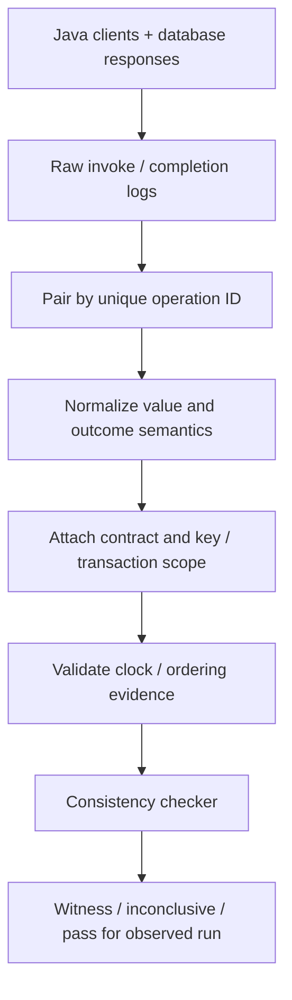

# Ghi lại lịch sử đọc/ghi và đối chiếu mô hình nhất quán đã công bố

Một API NoSQL trả `200 OK` sau khi ghi, nhưng client ở một vùng khác đọc lại giá trị cũ. Đây có phải lỗi? Câu trả lời không thể dựa riêng vào hai dòng log. Nó phụ thuộc vào **mô hình nhất quán được công bố**, **tùy chọn nhất quán thực sự dùng cho từng thao tác**, **thứ tự bắt đầu/kết thúc của các lệnh**, và liệu thao tác ghi có được hệ thống **xác nhận thành công** hay chỉ bị timeout với kết quả chưa rõ.

Ví dụ, đọc bản sao trễ có thể được cho phép trong eventual consistency, nhưng sẽ là phản ví dụ cho một cam kết linearizability trên cùng key nếu write đã hoàn tất trước khi read bắt đầu và không có write khác có thể giải thích giá trị cũ. Một lần đọc thấy phiên bản giảm từ 8 xuống 6 có thể vi phạm **monotonic reads** trong một session được hứa đảm bảo đó, nhưng một lần đọc như vậy giữa hai client không chung session chưa nhất thiết vi phạm. Hai transaction cùng đọc trạng thái ban đầu rồi ghi hai records khác nhau có thể tạo **write skew** dù từng write riêng lẻ là atomic.

Để kiểm thử tính đúng của hệ NoSQL phân tán, ta cần thu thập một **lịch sử quan sát (operation history)** đủ chi tiết để một **checker** tìm ra thứ tự thực thi hợp lệ hoặc một **phản ví dụ cụ thể**. Đây là phương pháp khác với chỉ chạy stress test và nhìn CPU, p99, hay đếm HTTP 5xx.

Bài học thuộc chương **Kiểm thử tính đúng**, module **Database No SQL**. Mục tiêu là học cách **ghi lại lịch sử đọc/ghi** ở phía client, chuyển lịch sử thành các sự kiện có ngữ nghĩa, rồi **đối chiếu bằng mô hình nhất quán đã công bố** — không tự nâng một API eventual lên linearizable, cũng không bỏ qua lỗi thật bằng cách gọi mọi thứ là “eventual”.

> **Nguyên tắc:** Một phép kiểm thử chỉ có giá trị khi ba thứ khớp nhau: **hợp đồng nhất quán**, **đường truy cập thực tế** và **lịch sử quan sát có đủ thông tin**. Không được kết luận từ một read cũ nếu chưa xác định write có hoàn tất, read có giao với write khác, và cấu hình consistency của chính request.

---

## 1. Mục tiêu học tập

Sau bài này, bạn có thể:

1. Biến truy vấn từ nhiều Java clients thành các sự kiện `invoke`, `ok`, `fail`, `info` có ID và thời gian.
2. Phân biệt **logical request**, **network attempt**, **database operation**, và **business transaction**.
3. Biểu diễn quan hệ **happens-before** từ thời gian thực và thứ tự trong session.
4. Hiểu phản ví dụ của linearizability, sequential consistency, causal consistency, session guarantees và transactional serializability.
5. Thiết kế checker cho một **single-register** đơn giản và nhận biết khi cần checker có khả năng tìm nhiều thứ tự thực thi.
6. Tránh kết luận sai do **clock skew, pending operations, timeout, retry và stale replica**.
7. Tạo workload có key/version duy nhất, concurrency thực và fault injection có kiểm soát.
8. Gắn kết quả với MongoDB, Cassandra, DynamoDB, Redis, Azure Cosmos DB và search/read models theo **phạm vi cam kết**.
9. Viết báo cáo vi phạm với một **lịch sử tối thiểu có thể tái hiện**, thay vì chỉ ghi “đọc bị stale”.
10. Biết giới hạn của kiểm thử hữu hạn, nhất là với eventual consistency và hành vi khi phân vùng mạng.

---

## 2. Tại sao “viết rồi đọc” chưa phải bài kiểm thử đầy đủ?

Một test đơn giản:

```java
database.put("booking-42", "CONFIRMED");
assertEquals(
    "CONFIRMED",
    database.get("booking-42")
);
```

có thể luôn pass vì cả hai lệnh đi qua cùng connection, primary hay cache local.

Trong production:

```text
Client A -> region 1 -> replica/leader A -> write
Client B -> region 2 -> replica B         -> read
Client C -> region 1 -> replica C         -> conditional update
```

Kết quả phụ thuộc:

- Read từ primary hay secondary?
- Write đã được ACK ở mức nào?
- Có background replication delay không?
- Hai thao tác có chồng lấn thời gian không?
- Nếu write timeout, dữ liệu có thể vẫn đã commit?
- Cache/read model có freshness contract khác canonical store?
- Một write mới có thể ghi lại giá trị cũ không?

**History-based testing** đặt các câu hỏi này thành sự kiện đo được, thay vì phỏng đoán dựa trên response cuối cùng.

---

## 3. Mô hình nhất quán là một hợp đồng cần được ghi rõ

Trước khi kiểm thử, hãy điền một **consistency contract** cụ thể cho đường API:

| Trường | Ví dụ minh họa |
| --- | --- |
| Hệ dữ liệu | `bookings` canonical collection |
| Phạm vi | Một document theo `_id` |
| Write operation | Upsert có điều kiện |
| Write ACK | Theo write concern/cấu hình thực |
| Read route | Primary-only hoặc read preference xác định |
| Read option | Read concern/consistency option xác định |
| Thứ tự/version | Server-authoritative `revision` |
| Contract | Linearizable single-document read/write, nếu cấu hình hỗ trợ |
| Lỗi không xác định | Timeout sau send được đánh dấu `info` |
| Fault scope | Failover một replica, packet delay |
| Exclusions | Cache, search projection, cross-service payment |

Đây chỉ là **mẫu mô tả**, không phải lời hứa rằng mọi MongoDB read/write mặc định đều linearizable.

### 3.1. Nói đúng cấp

Một dịch vụ có thể bảo đảm atomicity cho **một document** nhưng không cho **transaction nhiều collections**. Một table có strongly consistent `GetItem` nhưng `GSI Query` chỉ eventual. Một database cho phép session consistency nhưng clients không truyền session token sẽ không nhận cùng hành vi.

### 3.2. Không trộn tính đúng với độ bền

- **Consistency:** Thứ tự/giá trị quan sát được có hợp mô hình?
- **Durability:** Dữ liệu đã được xác nhận có sống qua crash/failure?
- **Availability:** Có nhận và trả operations hay không?
- **Isolation:** Transaction đồng thời có hành vi phù hợp mức cô lập?
- **Application invariants:** Booking/payment/stock có đúng nghiệp vụ?

Một history test cần tuyên bố đang kiểm tra **lớp nào**, không suy rằng “linearizable key-value” tự chứng minh giao dịch thanh toán toàn hệ đúng.

---

## 4. Thành phần cơ bản của một history

Một operation \(o\) có:

\[
o = (\mathrm{id},\mathrm{client},\mathrm{key},
\mathrm{kind},\mathrm{argument},\mathrm{result},
t_{\mathrm{invoke}},t_{\mathrm{complete}},\mathrm{outcome}).
\]

Trong đó:

- `id`: một định danh duy nhất.
- `client`: actor/session/process phát thao tác.
- `key`: đối tượng nhất quán cần kiểm thử.
- `kind`: `READ`, `WRITE`, `CAS`, transaction...
- `argument`: giá trị đầu vào, expected version.
- `result`: giá trị/phiên bản/ACK đã quan sát.
- `t_invoke`, `t_complete`: khoảng thời gian gọi và nhận kết quả.
- `outcome`: thành công, thất bại chắc chắn, hay không rõ.

Nếu dùng phép kiểm transaction, còn cần:

```text
transaction ID
full read set
full write set
commit/abort result
snapshot/commit metadata nếu API công bố
```

### 4.1. Metadata hữu ích

```text
cluster, region, AZ
driver version and configuration
read/write concern or consistency level
routing target / replica if observable
trace ID
logical request ID
attempt ID
session ID
operation retry count
fault injection window
```

Không nhất thiết giữ tất cả như time-series labels; metadata có thể lưu trong một history artifact có retention và phân quyền.

---

## 5. `invoke`, `ok`, `fail` và `info`

Một cách ghi lịch sử phổ biến tách mỗi thao tác thành **lúc gọi** và **lúc nhận kết quả**:

```text
invoke: client bắt đầu operation
ok:     operation thành công theo API contract
fail:   operation chắc chắn thất bại, không có effect liên quan
info:   kết quả cuối cùng không biết chắc
```

### 5.1. `info` cực kỳ quan trọng

Giả sử:

```text
Client sends WRITE value=8
Server commits value=8
Server response is lost
Client receives timeout
```

Client **không thể** gọi đây là `fail` nếu không có bằng chứng write chưa xảy ra. Nó phải được ghi là `info` hoặc trạng thái ambiguous theo checker.

### 5.2. Khi nào `fail` là chắc chắn?

Chỉ khi giao thức/công cụ chứng minh operation bị từ chối trước khi có effect, hoặc trả một lỗi có semantics rõ là không commit, ví dụ conditional write không đáp ứng điều kiện theo API.

Không tự quy mọi HTTP 500, connection reset hoặc timeout thành “không có ghi”.

### 5.3. `ok` cũng cần định nghĩa

`200 OK`, `acknowledged` hoặc response `SUCCESS` có thể có mức durable/visible khác nhau tùy engine và cấu hình. Checker dùng đúng nghĩa **đã được xác nhận theo contract**.

---

## 6. Ví dụ lịch sử JSON Lines

Dưới đây là các sự kiện giả định, mỗi dòng là một JSON object:

```jsonl
{"type":"invoke","opId":"w-01","client":"c1","session":"s1","kind":"write","key":"x","value":1,"nanos":100}
{"type":"ok","opId":"w-01","client":"c1","kind":"write","key":"x","value":1,"nanos":180}
{"type":"invoke","opId":"r-02","client":"c2","session":"s2","kind":"read","key":"x","nanos":230}
{"type":"ok","opId":"r-02","client":"c2","kind":"read","key":"x","value":0,"nanos":290}
```

Giả định:

- Các `nanos` được ghi từ **cùng một đồng hồ monotonic trong một JVM/harness**.
- Giá trị ban đầu của `x` là 0.
- Không có operation khác ngoài history tác động lên `x`.
- Write `w-01` trả thành công với semantics phù hợp contract.

Nếu contract yêu cầu **linearizable register**, `r-02` trả 0 là một **phản ví dụ**, vì write 1 hoàn tất trước khi read bắt đầu.

### 6.1. Không có giả định nào được bỏ qua

Nếu còn writer ngoài harness hoặc historical delete chưa được ghi, checker có thể kết luận sai. Cần chọn keyspace cô lập hoặc thu đầy đủ lịch sử tác động lên key đang kiểm.

---

## 7. Một interval ghi và một interval đọc

```text
Time ---------------------------------------------------->

Write x=1:       [ invoke -------- ok ]
Read x:                                  [ invoke -- ok(0) ]
```

Write kết thúc trước read bắt đầu; trong mô hình single-register linearizability, read không được trả 0 nếu không có write hợp lệ khác giải thích.

Nhưng:

```text
Time ---------------------------------------------------->

Write x=1:      [ invoke ---------------- ok ]
Read x:                 [ invoke -- ok(0) ]
```

Hai operations **chồng lấn**. Nếu read được linearize trước write, trả 0 có thể hoàn toàn hợp lệ.

### 7.1. Một test chỉ lấy timestamp response rất dễ sai

Checker phải có **cả invocation và completion**, không chỉ log thời gian kết thúc.

### 7.2. Thời gian thực khác thứ tự entry trong file

Log có thể được flush bất đồng bộ, append theo threads khác nhau, hoặc nhập từ nhiều machines. Dòng xuất hiện trước trong file không phải bằng chứng operation thực hiện trước.

---

## 8. Quan hệ real-time precedence

Với hai operations đã hoàn tất \(a,b\), định nghĩa:

\[
a \prec_{\mathrm{rt}} b
\quad \Longleftrightarrow \quad
t_{\mathrm{return}}(a) < t_{\mathrm{invoke}}(b).
\]

Nghĩa là \(a\) chắc chắn hoàn tất trước khi \(b\) bắt đầu.

Nếu intervals giao nhau, real-time precedence **không ép** thứ tự giữa chúng.

### 8.1. Đừng so `System.nanoTime()` từ hai JVM khác nhau

`System.nanoTime()` dùng để đo duration/order trong một JVM/runtime; các giá trị tuyệt đối giữa máy/JVM không nhất thiết có cùng gốc. Không ghép chúng thành global timestamp.

### 8.2. Đồng hồ tường và clock skew

Nếu client A có đồng hồ nhanh 400 ms, client B có đồng hồ chậm 200 ms, so `Instant.now()` có thể suy ra thứ tự giả. Có thể:

- Dùng một harness ghi các interval qua cùng monotonic clock cho các clients mà nó điều khiển.
- Đồng bộ clocks và tính sai số bất định với distributed observers.
- Ghi **causal messages/barriers** tạo happens-before chắc chắn.
- Chỉ suy thứ tự khi biết clock uncertainty không cho phép intervals overlap.

### 8.3. Không dùng timestamp server để thay client observation

Thứ tự commit trên server rất hữu ích để giải thích sau đó, nhưng linearizability kiểm tra **observable start/end** ở phía clients. Trace server không thay lịch sử client.

---

## 9. Clock uncertainty và kết luận an toàn

Giả sử client A báo write complete lúc 12:00:00.100, client B báo read invoke 12:00:00.120, nhưng độ lệch clock giữa hai hosts có thể tới ±100 ms.

Khoảng cách hiển thị 20 ms **không đủ** chứng minh write xảy ra trước read.

### 9.1. Cách xử lý

- Gắn bounds cho từng timestamp.
- Chỉ áp precedence khi khoảng bất định tách rời chắc chắn.
- Hoặc thiết kế barrier: A nhận ACK write rồi gửi tín hiệu **qua một giao thức được ghi lại** để B bắt đầu read; thứ tự dựa trên causality.
- Không lờ uncertainty rồi báo linearizability violation.

### 9.2. HLC và vector clocks không biến mọi thứ thành tuyệt đối

Hybrid Logical Clock và vector clock có thể giúp theo dõi ordering, nhưng cần biết chúng do **engine có bảo đảm gì** và có được lưu đầy đủ không. Timestamp có sẵn trong documents không tự là linearization point.

---

## 10. Một operation có thể gồm nhiều attempts

Một logical write:

```text
Request ID = req-100
   |
   +-- attempt 1 -> timeout (server may have committed)
   |
   +-- attempt 2 -> success
```

Nếu recorder chỉ thấy lần cuối thành công, nó mất thông tin về request đầu có thể đã thực hiện side effect.

### 10.1. Nên ghi cả hai cấp

```json
{
  "logicalRequestId": "req-100",
  "attemptId": "req-100-a1",
  "method": "write",
  "outcome": "INFO",
  "idempotencyKey": "req-100"
}
```

### 10.2. Đừng đánh đồng retry với một operation vô hại

Ghi `counter = counter + 1` lặp lại có thể làm tăng hai lần. Ghi `register = uniqueValue` có thể idempotent về final value, nhưng vẫn ảnh hưởng thứ tự/side effects.

### 10.3. Checker phải biết semantics

Có thể mô hình hóa **logical operation** với retry semantics được API bảo đảm, hoặc mô hình từng **network attempt** như thao tác tiềm năng. Không được tự gộp và suy exactly-once.

---

## 11. Status `INFO`: pending và unknown outcomes

Ví dụ:

```text
w1: invoke write(x=1)
w1: timeout -> info
r2: read(x) -> 1
```

History này **không chứng minh lỗi**. Có thể w1 đã commit; timeout chỉ làm client không nhận được kết quả.

Nếu:

```text
w1: invoke write(x=1)
w1: timeout -> info
r2: read(x) -> 0
```

cũng chưa chứng minh w1 fail; write có thể không commit, hoặc được commit sau read trong khoảng semantics cho phép.

### 11.1. Checker linearizability xử lý pending writes thế nào?

Nó cần xét các **completion khả dĩ** của operations không có outcome chắc chắn, theo semantics và thời điểm invocation. Một implementation nghiêm túc có thể cho một pending write được áp hoặc không, thay vì chọn kết quả tùy tiện để buộc fail.

### 11.2. Không có nghĩa INFO được phép che mọi lỗi

Nếu đã có một write `ok` hoàn tất trước read không chồng lấn, một pending write khác có thể hoặc không thể giải thích read tùy key/value/operation và timeline. Checker vẫn có thể tìm phản ví dụ.

---

## 12. Định danh giá trị để tránh mơ hồ

Một register liên tục ghi `1`:

```text
write(1), write(1), read() -> 1
```

khó biết read nhìn lần ghi nào.

Với test dedicated key, có thể ghi:

```json
{
  "value": "writer-A-op-00015",
  "testRunId": "run-20261114-001",
  "sourceRevision": 15
}
```

### 12.1. Giá trị duy nhất giúp đối chiếu

Một read trả `writer-A-op-00015` cho phép liên hệ với write cụ thể. Với counters/sets hoặc multi-field document, cần model phù hợp thay vì ép mọi thứ thành string register.

### 12.2. Revision phải có semantics thật

Một `revision` do Java client tăng trong memory riêng không bảo đảm global order. Nếu cần thứ tự theo key, revision phải được cấp trong authority/conditional update protocol hoặc một nguồn đồng bộ phù hợp.

### 12.3. Tránh dùng production user keys

Tạo namespace/tenant riêng cho test, định danh giả lập, TTL cleanup theo policy, không chạm booking/payment thật.

---

## 13. Chuẩn hóa history trước khi chạy checker

Một pipeline:



### 13.1. Check integrity của history

- Mỗi `invoke` có ID duy nhất.
- Mỗi terminal event khớp đúng ID.
- Không có duplicate terminal states ngoài protocol.
- `start <= end` theo cùng monotonic clock.
- Value/result format nhất quán.
- Client/session IDs đầy đủ.
- Không thiếu write nào từ test namespace.
- Error classification theo API contract.
- Clock provenance được giữ.

### 13.2. Phân biệt lỗi đo và lỗi NoSQL

Recorder bị mất log do buffer đầy không phải chứng cứ database sai. Nên đánh dấu history **incomplete**, không báo test pass hoặc vi phạm dựa trên dữ liệu thiếu.

---

# Phần I — Đối chiếu các mô hình nhất quán

## 14. Linearizability: ý tưởng trực quan

Một object **linearizable** nếu có thể gán cho mỗi operation hoàn tất một **điểm tức thời** nằm giữa invocation và completion sao cho:

1. Mọi operation có vẻ xảy ra theo một thứ tự tuần tự hợp đặc tả object.
2. Nếu A hoàn tất trước khi B bắt đầu, A phải đứng trước B.
3. Các operations chồng lấn có thể được sắp theo một thứ tự nào đó, miễn đáp ứng kết quả và constraints.

Với một register đơn giản:

```text
initial x = 0
write(x,1) -> ok
read(x)    -> 1
```

là hợp lệ.

```text
initial x = 0
write(x,1) -> ok
read(x)    -> 0
```

có thể vi phạm nếu write hoàn tất trước read và không có write khác giải thích.

### 14.1. Linearizability không có nghĩa “mọi replica trả cùng giá trị tức khắc” trong mọi hành vi ngoài scope

Phải nhìn đúng `read`/`write` operations và phạm vi object được cam kết. Nếu một API được công bố là eventual, ta **không** dùng linearizability checker để kết luận nó vi phạm hợp đồng sản phẩm.

---

## 15. Phản ví dụ linearizability cho một register

Giả định giá trị khởi đầu `balanceView=0`:

| Operation | Start | End | Outcome |
| --- | ---: | ---: | --- |
| W1: write(1) | 10 | 20 | `ok` |
| R1: read() | 30 | 40 | `ok(0)` |

Vì `20 < 30`, W1 phải đứng trước R1. Nếu history đầy đủ trên key và không có write khác, R1 lẽ ra phải trả 1.

**Kết luận:** Vi phạm linearizability của register theo các giả định đã nêu.

### 15.1. Cần phân biệt trạng thái replica

Nếu R1 cố ý đọc secondary eventual và hợp đồng cho phép stale, history này chỉ cho thấy **không linearizable**, không phải engine làm sai hợp đồng.

### 15.2. Read path là phần của contract

Một sản phẩm có nhiều tùy chọn read concern/consistency. Test phải ghi cụ thể option đang chạy, không dùng tên database làm bằng chứng.

---

## 16. Trường hợp overlap có thể hợp lệ

| Operation | Start | End | Outcome |
| --- | ---: | ---: | --- |
| W1: write(1) | 10 | 40 | `ok` |
| R1: read() | 20 | 30 | `ok(0)` |

Có thể linearize R1 tại 25 và W1 tại 35. Đặc tả register vẫn hợp lệ.

### 16.1. Vì sao checker “read cũ là fail” sai?

Nó bỏ qua giao thời giữa operations. Linearizability **cho phép** read đang chồng lấn với write nhìn trạng thái trước write.

### 16.2. Có thể còn writes khác

Nếu W2 ghi 0 và chồng lấn với read, R1 trả 0 có thể hợp lệ ngay cả khi W1 đã hoàn tất; phải xét **toàn bộ history** và thứ tự khả dĩ.

---

## 17. Checker linearizability làm gì?

Về mặt khái niệm, checker nhận:

- Một tập operations với intervals và outcomes.
- Một **sequential specification** của object.
- Các quan hệ precedence bắt buộc.
- Các operations pending/unknown có thể có effect.

Nó tìm một thứ tự tuần tự phù hợp mọi constraints.

### 17.1. Tìm kiếm bằng backtracking

Pseudo-code ý tưởng:

```text
search(state, remainingOperations, chosenOrder):
  if remainingOperations is empty:
    return SUCCESS with chosenOrder

  for op in operations eligible under precedence:
    if op is allowed by sequentialSpecification(state):
      nextState = apply(state, op)
      if search(nextState, remainingWithout(op), chosenOrder + op):
        return SUCCESS

  return FAILURE with conflicting constraints
```

`eligible` không đơn giản là sort theo `end`. Checker phải xét intervals, real-time order, session dependencies và choices của pending ops.

### 17.2. Độ phức tạp

Với nhiều operations đồng thời, số thứ tự khả dĩ rất lớn. Một checker thực tế cần tối ưu hóa, chia theo object key khi mô hình cho phép, pruning và time budget.

### 17.3. “Checker không tìm được history hợp lệ” có nghĩa gì?

Nếu checker kết thúc đầy đủ với proof/witness rõ và input đầy đủ, đây là phản ví dụ theo model. Nếu checker bị timeout/hết memory hoặc history thiếu, phải báo **inconclusive**, không tự báo fail/pass.

---

## 18. Chia history theo key có luôn an toàn?

Linearizability có tính chất compositional cho những object độc lập theo đặc tả: có thể kiểm tra từng key/register riêng trong một số trường hợp.

Nhưng nếu kiểm transaction nhiều keys:

```text
T1: transfer 100 from A to B
```

thì tách A/B thành hai checker hoàn toàn riêng có thể bỏ qua invariant/cross-key atomicity.

### 18.1. Đúng object boundary

- Single-key register: thường có thể chia theo key.
- Atomic counter: dùng đặc tả counter, không dùng register.
- Set membership: dùng đặc tả set.
- Compare-and-set: cần lưu expected value, result và state transition.
- Multi-key transaction: dùng transaction model/serialization graph.
- CRDT: dùng merge/conflict resolution specification.

### 18.2. Không suy “từng key linearizable” nghĩa transaction toàn hệ serializable

Một lịch sử giao dịch phức tạp có thể sai dù mọi write đơn-key atomic.

---

## 19. CAS và optimistic concurrency

Một API compare-and-set (CAS) có semantics:

```text
CAS(expected=4, new=5):
  if current value == 4:
      set to 5; return success
  else:
      return conflict / failure
```

### 19.1. Điều cần ghi

- Expected value/version.
- New value/version.
- Success/failure với semantics rõ.
- Actual observed value/version nếu API trả.
- Invocation/completion.
- Key và consistency settings.

### 19.2. Bài test

Hai clients đồng thời CAS cùng expected version 4:

```text
C1 CAS(4->5)
C2 CAS(4->6)
```

Với một atomic CAS trên cùng object, **không được cả hai thành công** nếu không có operations khác đưa value trở lại 4 trong history.

### 19.3. Version ABA

Nếu register đi từ A → B → A, một CAS chỉ so value có thể không biết history giữa hai trạng thái. Khi cần chống ABA, dùng revision/etag/token đúng authority thay vì chỉ so payload.

---

## 20. Sequential consistency không giống linearizability

**Sequential consistency** yêu cầu có một thứ tự tuần tự hợp với **thứ tự operations trong mỗi process/session** nhưng **không nhất thiết bảo toàn toàn bộ real-time order giữa các clients**.

### 20.1. Ví dụ

Client A:

```text
write(x=1) -> ok
```

Sau đó client B (độc lập) thực hiện:

```text
read(x) -> 0
```

Nếu không có quan hệ thứ tự theo process giữa A và B và đặc tả chỉ hứa sequential consistency, có thể tìm một thứ tự tuần tự đặt read B trước write A, dù thời gian thực quan sát thấy B bắt đầu sau A hoàn tất.

Linearizability không cho phép sắp như vậy.

### 20.2. Cẩn thận session handoff

Nếu client A gửi message cho B sau write và B bắt đầu read sau khi nhận, quan hệ nhân quả này có thể có ý nghĩa theo mô hình causal consistency dù hai clients khác nhau. Đừng bỏ thông tin causal messages.

### 20.3. Hợp đồng phải dùng thuật ngữ chuẩn

Một số tài liệu dùng “strong consistency” mà không định nghĩa precise model; không tự đồng nhất nó với linearizability của mọi operation/transaction.

---

## 21. Read-your-writes (RYW) trong một session

**Read-your-writes** nói rằng trong phạm vi session được cam kết, sau khi session thực hiện một write được xác nhận, các reads sau đó phải thấy tác động của write đó hoặc một trạng thái hợp lệ mới hơn theo mô hình.

Ví dụ:

```text
Session S:
  W(x=version 8) -> ok
  R(x)           -> version 6
```

Nếu không có transition hợp lệ giải thích việc đọc version 6 và contract bảo đảm RYW, đây là phản ví dụ.

### 21.1. Điều kiện quan trọng

- Session identity phải được giữ qua connections/retries.
- Version phải so sánh được theo cùng object epoch.
- Read có thật thuộc đúng consistency scope?
- Có một write khác ghi giá trị cũ nhưng version **mới hơn** không?

### 21.2. Không kiểm RYW bằng so payload đơn giản

Nếu session write `"A"`, client khác write `"B"` hợp lệ, session read `"B"` có thể đáp ứng RYW theo interpretation visibility/order. Không phải lúc nào read phải trả đúng `"A"` mãi mãi.

### 21.3. Session token

Một số hệ yêu cầu truyền/giữ session token hoặc logical clock. Test phải giữ token qua các lệnh nếu muốn kiểm tra hợp đồng đó.

---

## 22. Monotonic reads

**Monotonic reads** thường yêu cầu các reads trong cùng session không quay lại một trạng thái cũ hơn trạng thái đã quan sát, theo thứ tự/phiên bản hợp lệ của object.

```text
S reads x@rev=10
S reads x@rev=8    -> suspicious / violation if model guarantees monotonic reads
```

### 22.1. Phiên bản phải thật sự cùng lineage

Nếu restore database từ snapshot cũ và tạo **epoch mới**, so `rev=10` với `rev=8` có thể không mang ý nghĩa tuyến tính. Test cần xác định restore/failover semantics.

### 22.2. Cache và replicas

Nếu client đầu tiên đọc từ primary rồi đọc từ một replica lag trong cùng session, monotonic-read guarantee có thể không giữ trừ khi driver/token/routing bảo đảm.

### 22.3. Không áp sang khác session

Hai clients độc lập đọc 10 và 8 không tự vi phạm monotonic reads nếu model chỉ hứa theo từng session.

---

## 23. Monotonic writes

**Monotonic writes** bảo đảm những writes trong cùng một session được hệ xử lý theo đúng thứ tự của session, trong phạm vi hợp đồng.

Ví dụ:

```text
Session S:
  write status=PENDING -> ok
  write status=CONFIRMED -> ok
```

Không được để replica cuối cùng nhìn `PENDING` như mutation mới nhất của session khi contract yêu cầu thứ tự này, trừ khi tồn tại một write hợp lệ mới hơn đưa trạng thái về PENDING.

### 23.1. Kiểm thử

Ghi per-operation sequence, completion status và observed revisions trên replicas; tạo lag/retry/reconnect để xác minh không reorder writes.

### 23.2. ACK và applied order

Một ACK từ coordinator không đồng nghĩa tất cả replicas đã apply theo thứ tự. Đo semantics được hứa, không suy từ internals.

---

## 24. Writes-follow-reads

Một session đọc trạng thái rồi ghi dựa trên trạng thái đó:

```text
Session A:
  read x@rev=10
  write y that depends on x@rev=10
```

**Writes-follow-reads** trong họ session guarantees nhằm bảo toàn quan hệ dependency giữa read đã thấy và write theo sau, tùy formal definition.

### 24.1. Vì sao đáng quan tâm?

Một user đọc rằng booking đã được thanh toán, rồi xác nhận phát hành hóa đơn. Nếu write hóa đơn được lan truyền trước thông tin thanh toán mà session dựa vào, downstream có thể thấy quan hệ nhân quả không nhất quán.

### 24.2. Không tự biến dependency thành transaction atomic

Writes-follow-reads hay causal ordering không nhất thiết bảo đảm hai records được cập nhật atomic trong cùng một transaction.

---

## 25. Causal consistency

Một operation \(b\) phụ thuộc nhân quả vào \(a\) nếu, ví dụ:

- Chúng theo thứ tự chương trình trong cùng session.
- Một session đọc được tác động của \(a\) rồi ghi \(b\).
- Dependency được truyền qua message/event.
- Quan hệ được suy ra bắc cầu.

Causal consistency yêu cầu những observers thấy trạng thái phù hợp với causal ordering trong phạm vi mô hình.

### 25.1. Ví dụ

```text
A: create comment C
B: reads C
B: create reply R referring to C
```

Nếu client khác thấy reply R trước khi thấy comment C trong một bối cảnh mà causal visibility được bảo đảm, đó có thể là phản ví dụ.

### 25.2. Đồng thời không có causal order

Hai users độc lập tạo hai bình luận mà không quan sát nhau có thể được thấy theo thứ tự khác nhau, tùy model. Đừng biến causal consistency thành total order toàn hệ.

### 25.3. Cần record dependency edges

Nếu history chỉ ghi timestamps mà không ghi B đã đọc C trước khi tạo R, checker có thể thiếu mối quan hệ nhân quả thực sự.

---

## 26. Consistent prefix

Một **consistent-prefix** guarantee thường nói observer không thấy một prefix bị đảo thứ tự: nếu hệ có một thứ tự updates được áp dụng, client không được thấy update sau mà thiếu update trước trong phạm vi prefix/order được hứa.

Ví dụ có thứ tự được bảo đảm:

```text
e1: Order created
e2: Payment confirmed
e3: Shipment scheduled
```

Observer thấy e3 trước e2 có thể vi phạm nếu consumer/query được hứa consistent prefix cho chuỗi đó.

### 26.1. Prefix order phải được định nghĩa

Nếu các events nằm ở nhiều partitions không có global order, không thể đòi consistent prefix theo timestamp client. Hãy nêu đúng stream/partition/causal/order scope.

### 26.2. CDC và log consumers

Một consumer có thứ tự per-partition không nhất thiết có thứ tự toàn Kafka topic hoặc toàn NoSQL cluster. History checker cần dùng đúng phạm vi.

---

## 27. Eventual consistency là thuộc tính hội tụ

Một cách hiểu phổ biến: khi **không còn writes mới** và hệ đủ điều kiện tiếp tục đồng bộ, các replicas cuối cùng sẽ hội tụ về trạng thái phù hợp.

### 27.1. Không thể chứng minh eventual bằng một test hữu hạn

Chạy 5 phút rồi thấy dữ liệu đồng bộ chỉ cho thấy **đã hội tụ trong lần đo**. Nó không chứng minh với mọi lịch thực thi và mọi lỗi trong tương lai hệ sẽ hội tụ.

### 27.2. Có thể phát hiện lỗi ở những cam kết mạnh hơn

Nếu sản phẩm hứa “tối đa 5 giây stale khi network khỏe”, test đọc stale sau 30 giây là bằng chứng đối với **bounded staleness** nếu xác định đúng timestamps, preconditions và scope.

### 27.3. Kịch bản quiescence

```text
Stop all writers
Record known final revision
Wait while system is healthy
Repeatedly read every supported replica/region
```

Đo **time to convergence** và tỷ lệ reads stale qua thời gian. Nếu quá deadline vận hành đã cam kết, báo vi phạm deadline; không tự tuyên bố “eventual consistency sai toán học” chỉ vì chưa hết một số giây tùy ý.

---

## 28. Bounded staleness

Một mô hình bounded staleness có thể giới hạn độ trễ theo:

- **Thời gian** \(T\): read không được cũ hơn một bound thời gian đã định nghĩa.
- **Số phiên bản/operations** \(K\): read không được tụt quá một số lượng updates.
- Hoặc cả hai theo semantics sản phẩm.

### 28.1. Kiểm bằng cách nào?

Cần có:

1. Nguồn commit timestamps hoặc version sequence đáng tin.
2. Bound chính xác của service và resource scope.
3. Thời gian/phiên bản tại thời điểm read theo policy.
4. Clock uncertainty nếu tính time bound từ nhiều hosts.
5. Mốc apply/visibility hợp lệ khi có async replication.
6. Điều kiện loại trừ lúc outage hoặc disconnection nếu contract ghi rõ.

### 28.2. Không suy bound từ p99 replication lag

Một metric replica lag p99 là thống kê vận hành, không tự chứng minh mọi read nằm trong bound. Cần đối chiếu từng operation/hay sampling có methodology tương ứng.

### 28.3. `lagSeconds=0` không phải bằng chứng linearizable

Metric có độ phân giải, cập nhật trễ và race. Một read có thể still stale dù dashboard hiển thị 0 tại thời điểm khác.

---

## 29. Transactional serializability

**Serializability** yêu cầu một lịch sử transactions có kết quả tương đương một lịch chạy tuần tự các transactions, theo đặc tả transaction.

Nó không nhất thiết bảo toàn real-time order giữa transactions như **strict serializability**.

### 29.1. Atomicity khác serializability

Một transaction có thể ghi hai records một cách atomic nhưng đồng thời với transaction khác tạo anomaly nếu isolation yếu hơn serializable.

### 29.2. Kiểm bằng transaction history

Mỗi transaction cần:

```text
TID
read set (key, observed version/value)
write set (key, new value)
begin / commit / abort outcome
session / timestamps
```

Checker có thể xây **dependency/serialization graph** và tìm cycles/anomalies theo model. Chỉ thấy single-key reads/writes không đủ để chứng minh serializability.

### 29.3. Strict serializability

Nó kết hợp serializability và ràng buộc thời gian thực giữa transactions. Một hệ hứa “serializable transactions” không tự hứa “strict serializable” nếu không có tài liệu về real-time order.

---

## 30. Write skew: phản ví dụ transaction

Giả định invariants: phải có ít nhất một bác sĩ trực.

```text
A_oncall = true
B_oncall = true
```

Hai transactions:

```text
T1:
  read A=true, B=true
  write A=false
  commit

T2:
  read A=true, B=true
  write B=false
  commit
```

Cả hai cùng đọc trạng thái ban đầu và ghi hai keys khác nhau, nên kết quả cuối có thể:

```text
A_oncall=false
B_oncall=false
```

Nếu cả hai commit với các reads đó, đây là **write skew** điển hình không tương đương một thứ tự serial thực hiện đúng logic kiểm tra invariant. Hệ có snapshot isolation có thể cho phép kiểu anomaly này, tùy triển khai.

### 30.1. Vì sao kiểm per-key bị bỏ sót?

Từng write A và B có thể atomic; tính sai xuất hiện ở **quan hệ giữa reads và writes của hai transactions**.

### 30.2. Test phải có concurrent barrier

Nếu T1 commit rồi T2 mới đọc, T2 sẽ thấy A=false và có thể không thực hiện write B=false. Phải tạo concurrency thực để lộ anomaly.

---

## 31. Dirty read, non-repeatable read và phantom

Ba dạng thường được nói đến trong transaction isolation:

| Anomaly | Mô tả | Yêu cầu history |
| --- | --- | --- |
| Dirty read | Đọc giá trị ghi bởi transaction chưa commit mà sau đó rollback | Biết transaction commit/abort |
| Non-repeatable read | Cùng transaction đọc cùng row hai lần thấy giá trị khác do concurrent commit | Read set và transaction boundary |
| Phantom | Cùng predicate query trong transaction trả tập records khác theo concurrent writes | Predicate, result IDs, transaction boundary |

### 31.1. Không đánh giá theo tên level một cách cơ học

Tên isolation như “read committed”, “snapshot”, “serializable” có những đặc tính chi tiết tùy engine, đặc biệt đối với operations nhiều partitions. Phải lấy **đặc tả chính thức của phiên bản và cấu hình** làm model.

### 31.2. Không dùng full scan vào production

Kiểm phantom/predicate reads trên dataset riêng có kích thước kiểm soát, nếu không query tạo ra workload nguy hiểm.

---

## 32. Lost update và compare-and-set

Giả sử:

```text
x=0

C1 reads x=0
C2 reads x=0
C1 writes x=1
C2 writes x=1
```

Nếu nghiệp vụ muốn hai lần tăng, kết quả đúng phải là 2; read-modify-write client-side không có điều kiện có thể chỉ ra 1.

### 32.1. Phân biệt storage contract và application bug

Hai `PUT(x,1)` có thể hoàn toàn **linearizable** và kết quả 1 là hợp lệ theo đặc tả register. Lỗi là cách ứng dụng mô hình hóa increment. Nếu muốn atomic counter, dùng `INCR`/conditional update/transaction phù hợp và check theo **counter specification**.

### 32.2. Test cần mô hình đúng operation

Đừng gọi mọi mất cập nhật ở read-modify-write là vi phạm linearizability của API key-value. Hãy đặt contract của operation cấp nghiệp vụ và giao thức CAS/transaction nếu cần.

---

## 33. CRDT và các mô hình hội tụ khác

Một số NoSQL phân tán có data types/merge rules để các bản sao hội tụ dù updates đồng thời, ví dụ G-Counter, PN-Counter, OR-Set theo kiến trúc cụ thể.

### 33.1. Checker theo trạng thái merge, không register last-write-wins

Hai clients cùng thêm phần tử khác nhau vào set có thể được phép thấy các subset tạm thời nhưng cuối cùng phải hội tụ về union theo CRDT semantics.

### 33.2. Không gán linearizable semantics cho CRDT eventual

Nếu API chỉ hứa eventual convergence và conflict-free merge, linearizability checker sẽ tìm stale reads mà hợp đồng cho phép. Cần kiểm:

- Eventual convergence under quiescence.
- Merge associativity/commutativity/idempotence theo data type.
- Không mất updates đã được giao thức chấp nhận.
- Không vi phạm authorization hoặc business invariants.

### 33.3. CRDT không giải quyết mọi nghiệp vụ

“Chỉ bán một chiếc xe tại một thời điểm” không thể suy an toàn chỉ từ eventual merging. Phải có authority/reservation protocol phù hợp.

---

## 34. Read model, cache, search và canonical store

Một ứng dụng có thể có:

```text
Booking service -> canonical NoSQL
       |
       v
CDC / outbox
       |
       +--> Redis cache
       +--> DynamoDB customer view
       +--> OpenSearch search index
```

### 34.1. Mỗi đường đọc có contract riêng

- Canonical write/read có thể yêu cầu strong consistency.
- Redis read cache có TTL/invalidations.
- DynamoDB projection có lag.
- OpenSearch query có refresh delay.

Không kiểm ba đường bằng cùng một linearizability assumption nếu product contract khác nhau.

### 34.2. Đối chiếu end-to-end

Nếu API hứa `"Sau khi cập nhật booking, chi tiết booking phản ánh thay đổi ngay"` thì API có thể route đọc tới canonical path hoặc dùng version token. Khi search listing cập nhật chậm, cần freshness SLO riêng.

### 34.3. Lịch sử phải gắn source

Một record:

```json
{
  "operation": "GET /bookings/1001",
  "route": "canonical-primary",
  "consistencyContract": "ryw-session",
  "observedRevision": 32
}
```

khác một request đọc:

```json
{
  "operation": "GET /search/bookings",
  "route": "opensearch-index",
  "consistencyContract": "eventual-with-monitoring",
  "observedRevision": 29
}
```

Nếu API response che route, test harness cần biết request mode/feature flag hoặc instrument upstream trace để quy đúng consistency path.

---

## 35. Lập hợp đồng mô hình trước khi thu thập

Một tài liệu test có thể viết:

```yaml
testName: booking-single-key-consistency
resource: dedicated-test-collection
operationModel: atomic-register
initialValue: "init-0"
scope: one-key
clients: 8
writeAcknowledgment: documented-per-request
readConsistency: documented-per-request
readRoute: explicit
historyClock: single-JVM-monotonic
unknownWriteHandling: may-or-may-not-have-taken-effect
faults:
  - replica-lag
  - leader-failover
expectedModel: linearizability
```

**Đây là config mẫu của test harness**, không phải tùy chọn native của một NoSQL engine.

### 35.1. Contract có thể thay đổi theo test

Nếu thêm `readPreference=secondary`, phải chọn lại expected model. Không dùng một file `expectedModel: linearizable` cho mọi deployment và mọi queries.

### 35.2. Đừng dùng “strong” nếu không định nghĩa

Viết rõ `single-object linearizability`, `per-session RYW`, `bounded-staleness 5s`, `transaction serializability`, hoặc `eventual convergence after quiescence` theo thứ thực sự được công bố.

---

# Phần II — Thiết kế workload có lịch sử đáng tin

## 36. Chọn object và tập thao tác thử nghiệm

Một bài kiểm thử tốt bắt đầu từ object đơn giản:

```text
Key: test-run-123/register-x
Initial value: "init"
Operations:
  read()
  write(uniqueValue)
  compareAndSet(expected, newValue)
```

Sau khi kiểm được single-register, mới mở rộng:

- Atomic counter.
- Unique reservation.
- Set/map.
- Multi-document transaction.
- Materialized view.
- Cross-region session.
- CDC/search projection.

### 36.1. Tách các loại model

Không gom một history vừa `INCR` vừa `PUT` vừa `DELETE` mà checker chỉ hiểu writes/replaces. Nếu cần, xây sequential specification bao quát tất cả operations.

### 36.2. Tạo writes phân biệt được

Dùng `runId + clientId + localSequence` và một server revision nếu có. Unique values giúp phát hiện read trả phiên bản nào.

---

## 37. Tạo concurrency thực, không chỉ nhiều thread

Một workload Java có 20 threads nhưng tất cả dùng một global lock sẽ thực hiện tuần tự và ít phát hiện lỗi concurrency.

### 37.1. Đồng bộ bắt đầu

Dùng `CountDownLatch`/`CyclicBarrier` để thả đồng thời các requests trong một đợt.

### 37.2. Đa dạng khoảng chồng lấn

- Write-write overlap.
- Write-read overlap.
- Read-read overlap.
- CAS-CAS overlap.
- Multi-key transactions với cyclic dependencies.
- Client reconnect và failover giữa các operations.

### 37.3. Không khiến load test che lỗi

Một hệ quá tải có thể timeout phần lớn requests, làm checker chỉ còn `info` và không đủ bằng chứng. Nên chạy nhiều chế độ tải, từ thấp đến gần ngưỡng, không chỉ maximum QPS.

---

## 38. Clients, sessions và causal messages

Một thiết kế harness có thể có:

```text
Controller
  |
  +-- Client A, Session S-A
  +-- Client B, Session S-B
  +-- Client C, Session S-C
  |
  +-- Fault controller (separate)
  |
  +-- History collector
```

### 38.1. Session identity

Nếu driver pool tạo connection mới nhưng product định nghĩa session bằng token, phải giữ đúng token. Nếu session của client bị reset, history checker không được mặc định guarantee tiếp tục.

### 38.2. Cross-client barrier

Ví dụ:

```text
Client A: write x=1 -> ACK
Client A: send token "write-done"
Client B: receives token
Client B: read x
```

Thông điệp tạo quan hệ nhân quả rõ ngay cả khi clocks trên hai hosts không đồng bộ.

### 38.3. Không dùng barrier can thiệp vào system under test

Barrier nên đi qua control channel tách biệt và được ghi log để checker biết dependency; tránh sử dụng một database write khác vô tình làm thay đổi object đang test.

---

## 39. Ghi cả load và fault timeline

History test cần biết những điều kiện:

```text
00:00 Start workload
00:30 Delay network to replica B
01:00 Disconnect replica B
01:15 Leader failover
02:00 Reconnect replica B
02:15 Quiesce writes
03:00 Stop workload
```

Đây là timeline minh họa.

### 39.1. Fault event không nhất thiết là read/write operation

Có thể ghi thêm:

```json
{"type":"nemesis","action":"partition","target":"replica-B"}
```

Cần biết khi nào fault **thực sự có hiệu lực**, không chỉ lúc controller ra lệnh.

### 39.2. Đặt workload dưới multiple failure modes

Một consistency bug có thể chỉ xuất hiện khi retry trong lúc election, hoặc khi replica reconnect sau log gap. Test phải tái hiện lặp lại các pha.

### 39.3. Safety không phụ thuộc vào throughput

Một history ít operations nhưng có phản ví dụ có thể giá trị hơn 10 triệu successful queries không có contention. Tuy nhiên phải xác minh không phải lỗi recorder.

---

## 40. Lưu history chống mất dữ liệu

Chọn cơ chế ghi:

- Append-only JSON Lines.
- Local files hoặc collector được bảo vệ.
- Mỗi record có run ID và op ID.
- Flush/batching có giới hạn.
- Checkpoint và checksum cho artifacts.
- Không chặn hot path quá mức hoặc drop entries âm thầm.
- File rotation/retention theo chính sách.

### 40.1. Logging asynchronous cần cẩn thận

Nếu ghi invoke và ok vào queue mất dữ liệu khi JVM crash, history bị thiếu đúng lúc lỗi quan trọng nhất. Có thể ưu tiên event durability cho test nhỏ hoặc đánh dấu `historyIncomplete=true` khi collector thiếu entries.

### 40.2. Performance trade-off

`fsync` cho từng operation có thể làm thay đổi workload; dùng recorder có backpressure và mode đo lường kiểm soát, không tự hứa instrumentation overhead bằng 0.

### 40.3. Không ghi credential/PII

History chứa values và route có thể là dữ liệu nhạy cảm. Tạo dữ liệu giả, redact connection strings, kiểm soát access và retention.

---

## 41. Định dạng một history artifact thực tế

Ví dụ một operation record đã pair:

```json
{
  "runId": "correctness-20261114-001",
  "opId": "a-00012",
  "logicalRequestId": "req-12",
  "attemptId": "req-12-1",
  "clientId": "client-a",
  "sessionId": "session-a",
  "threadId": 42,
  "kind": "CAS",
  "object": "register-x",
  "argument": {
    "expectedVersion": 5,
    "newValue": "op-a-12"
  },
  "result": {
    "casApplied": true,
    "version": 6
  },
  "startNanos": 510000,
  "endNanos": 590000,
  "outcome": "OK",
  "consistency": {
    "readMode": "configured",
    "writeAck": "configured",
    "route": "configured"
  },
  "clockDomain": "single-jvm-harness"
}
```

### 41.1. Phân biệt giá trị test và định danh

Một `opId` có thể được giữ lâu cho debug, nhưng nếu dùng transaction ID từ production thì cần chính sách riêng. Tốt nhất là test namespace với dữ liệu tổng hợp.

### 41.2. `startNanos` và `endNanos` không phải wall time

Chúng dùng để suy thứ tự trong **một clock domain**, còn `Instant`/ISO time hữu ích để ghép timeline ở mức vận hành với uncertainty thích hợp.

---

## 42. Thiết kế lỗi network và node có kiểm soát

Các loại fault thường hữu ích:

- Delay, jitter, packet loss tới một replica.
- Cut connectivity giữa hai nhóm nodes.
- Restart một node.
- Force election/failover qua cơ chế được hỗ trợ.
- Throttle disk/network.
- Stop/restart CDC consumer.
- Delay replication.
- Timeout client sau khi gửi request.
- Rebalance/shard movement.
- Region failover theo môi trường test.

### 42.1. Không coi fault injection là bằng chứng ngay

Cần ghi xem fault có tác động thật: routes nào bị chặn, replica nào bị mất, client có đổi route không và cluster có hồi phục không.

### 42.2. Không chạy disruptive faults vào production tùy tiện

Thực hiện trên lab/staging/chaos environment được phê duyệt, có blast radius và rollback. Nếu muốn canary production phải có change/incident controls.

### 42.3. Chú ý workload vận hành nền

Compaction, repair, index build, TTL deletion và resharding có thể ảnh hưởng latency/replica visibility. Ghi chúng vào fault/context timeline để giải thích anomalies.

---

## 43. Cấu trúc một chiến dịch kiểm thử

Một chiến dịch có thể lặp:

1. Initialize dedicated keys/collections.
2. Verify initial value/version.
3. Start history recorder.
4. Start concurrent workers.
5. Inject a predefined fault.
6. Observe retries/timeouts/session behavior.
7. Heal fault.
8. Continue reads/writes briefly.
9. Quiesce writes for convergence tests.
10. Stop workers and flush history.
11. Validate history integrity.
12. Run checker with declared model.
13. Save minimized witness or `inconclusive`.
14. Collect relevant server metrics/traces.
15. Cleanup test resources through authorized mechanism.

### 43.1. Chạy nhiều seeds

Concurrency bugs phụ thuộc timing; lặp cùng một random seed có lợi cho reproducibility, nhưng cần nhiều seeds để tìm interleavings khác.

### 43.2. Không gọi mọi iteration pass là proof

Đúng trên các lịch sử đã quan sát là một mức bằng chứng; không chứng minh logic cho mọi lịch phân tán có thể xảy ra.

---

## 44. Tiêu chí chọn keyspace dành cho kiểm thử

Dữ liệu test nên:

- Có initial state xác nhận.
- Không được production writers chạm tới.
- Có ACL/tenant scope riêng.
- Dọn được an toàn sau test.
- Phân phối được nhiều shards/replicas khi cần.
- Có các keys để test single-object và multi-key.
- Có khả năng tra path/route nếu cần.
- Có unique value để phân biệt từng write.

### 44.1. Kiểm tra false sharing

Nếu nhiều logical keys nằm trên cùng physical shard, workload contention có thể tác động timing; điều này không làm bài test sai nhưng cần ghi topology để biết điều kiện đã được tạo.

### 44.2. Không dùng keys có TTL ngắn cho linearizability register trừ khi TTL là operation của model

Nếu key tự hết hạn giữa reads, checker có thể tưởng xuất hiện write ngầm về null. Hoặc disable TTL, hoặc mô hình hóa expiry như một sự kiện với semantics được khai báo.

---

## 45. Phân loại kết quả kiểm thử

Không chỉ có `PASS`/`FAIL`.

| Kết quả | Ý nghĩa |
| --- | --- |
| **Model-compatible for observed history** | Checker tìm được một thứ tự hợp lệ cho dữ liệu đã thấy |
| **Counterexample found** | Có lịch sử không thể phù hợp model theo giả định |
| **Inconclusive: incomplete history** | Mất invokes/responses, ngoài harness có writers |
| **Inconclusive: ambiguous outcomes** | Unknown writes khiến kết quả chưa xác định |
| **Inconclusive: checker timeout** | Tìm kiếm chưa hoàn tất |
| **Invalid test contract** | Chọn sai mô hình/consistency settings |
| **Operational failure** | Không tạo được workload/fault/connection |
| **Business invariant failure** | App sai dù database contract có thể vẫn đúng |

### 45.1. Một phản ví dụ cần witness

Lưu subset operations đủ giải thích mâu thuẫn, config, route, failure timeline và giả định. Nếu chỉ lưu một dòng `LinearizabilityViolationException`, rất khó triage.

### 45.2. Test không quyết định lỗi thuộc vendor hay application

Có thể do middleware/cache, driver default, retry, session-token loss, clock error, incorrect checker hoặc database engine. Phải điều tra trước khi quy trách nhiệm.

---
# Phần III — Java 17: thu thập và phân tích lịch sử

## 46. Java 17: bộ ghi `invoke` và response từ cùng một JVM

Một **test harness** có thể gọi driver NoSQL thông qua một interface, ghi thời điểm trước khi gọi và ngay khi nhận phản hồi. Ví dụ sau chỉ dùng Java chuẩn, không giả định bất kỳ driver cụ thể nào.

```java
import java.util.List;
import java.util.UUID;
import java.util.concurrent.Callable;
import java.util.concurrent.ConcurrentLinkedQueue;
import java.util.concurrent.atomic.AtomicLong;

public final class HistoryRecorder {
    enum Outcome { INVOKE, OK, FAIL, INFO }

    record Reply(String value, Long revision) {}

    record Event(
        String opId,
        String clientId,
        String sessionId,
        Outcome outcome,
        String operation,
        String key,
        String argument,
        String result,
        Long revision,
        long monotonicNanos,
        String errorClass
    ) {}

    private final String runId = UUID.randomUUID().toString();
    private final AtomicLong sequence = new AtomicLong();
    private final ConcurrentLinkedQueue<Event> events =
        new ConcurrentLinkedQueue<>();

    public Reply record(
            String clientId,
            String sessionId,
            String operation,
            String key,
            String argument,
            Callable<Reply> call
    ) throws Exception {
        String opId = runId + "-" + sequence.incrementAndGet();

        events.add(new Event(
            opId, clientId, sessionId,
            Outcome.INVOKE, operation, key,
            argument, null, null,
            System.nanoTime(), null
        ));

        try {
            Reply reply = call.call();

            events.add(new Event(
                opId, clientId, sessionId,
                Outcome.OK, operation, key,
                argument, reply.value(), reply.revision(),
                System.nanoTime(), null
            ));

            return reply;

        } catch (Exception error) {
            // Conservative: a remote write may already have committed.
            events.add(new Event(
                opId, clientId, sessionId,
                Outcome.INFO, operation, key,
                argument, null, null,
                System.nanoTime(),
                error.getClass().getSimpleName()
            ));
            throw error;
        }
    }

    public List<Event> snapshot() {
        return List.copyOf(events);
    }
}
```

### 46.1. Ví dụ sử dụng

Giả định `adapter.write()` do test triển khai bằng driver thật:

```java
var recorder = new HistoryRecorder();

recorder.record(
    "client-A", "session-A",
    "WRITE", "test/register-x", "value-A-1",
    () -> adapter.write("test/register-x", "value-A-1")
);
```

`adapter` là **đối tượng minh họa**; phương thức `write` phải trả một `HistoryRecorder.Reply`. Trong implementation thực, cần phân biệt ACK, revision và những errors có semantics đặc biệt.

### 46.2. Vì sao exception được ghi bảo thủ là `INFO`?

Một exception xuất hiện sau khi request đã gửi có thể không cho biết server đã commit hay chưa. Adapter có thể phân loại một lỗi **chắc chắn không có effect** thành `FAIL` khi có bằng chứng từ API. Nếu không, `INFO` giúp checker không bỏ sót một write tiềm năng.

### 46.3. Giới hạn của mã minh họa

- Queue trong RAM có thể mất events nếu JVM crash.
- Chưa có storage bền/flush/checksum.
- Chưa ghi `attemptId`, retry sequence hoặc request consistency options.
- `System.nanoTime()` chỉ so được trong **một clock domain**, không giữa các JVM độc lập.
- Không kiểm soát memory nếu chạy hàng triệu operations.
- Chưa bảo vệ business data/privacy và route metadata.

Để dùng trong kiểm thử dài, cần append-only artifact collector có khả năng phát hiện mất dữ liệu và cơ chế backpressure.

---

## 47. Java: tạo concurrent operations có chủ đích

Nhiều Java threads chưa đủ nếu mọi thao tác đều diễn ra tuần tự. Dùng barrier để tăng xác suất interleaving:

```java
import java.util.ArrayList;
import java.util.List;
import java.util.concurrent.CountDownLatch;
import java.util.concurrent.ExecutorService;
import java.util.concurrent.Executors;
import java.util.concurrent.Future;

public final class ConcurrentWriteBatch {

    interface Register {
        HistoryRecorder.Reply write(
            String key, String value) throws Exception;
    }

    static void run(
            HistoryRecorder recorder,
            Register register) throws Exception {

        int count = 8;
        ExecutorService pool = Executors.newFixedThreadPool(count);
        CountDownLatch ready = new CountDownLatch(count);
        CountDownLatch start = new CountDownLatch(1);

        try {
            List<Future<?>> futures = new ArrayList<>();

            for (int i = 0; i < count; i++) {
                final int client = i;

                futures.add(pool.submit(() -> {
                    ready.countDown();
                    start.await();

                    recorder.record(
                        "client-" + client,
                        "session-" + client,
                        "WRITE",
                        "test/register-x",
                        "value-" + client,
                        () -> register.write(
                            "test/register-x",
                            "value-" + client
                        )
                    );

                    return null;
                }));
            }

            ready.await();
            start.countDown();

            for (Future<?> task : futures) {
                task.get();
            }
        } finally {
            pool.shutdownNow();
        }
    }
}
```

### 47.1. Những lưu ý

- Mỗi client/session cần phù hợp khả năng concurrent sessions của driver.
- Có thể đan xen readers và CAS operations thay vì chỉ writes.
- Không dùng một global lock quanh `register.write`, nếu mục tiêu là stress concurrency.
- Đừng chỉ chạy một lần; lặp nhiều seeds, durations và failure windows.
- Giá trị ghi nên duy nhất để phân biệt từng write.
- Dùng test keyspace riêng, tránh dữ liệu production.

---

## 48. Java 17: checker linearizability nhỏ cho một register

Một checker đúng hơn quy tắc “read thấy giá trị cũ là fail” phải xét những thứ tự mà các operations chồng lấn có thể xảy ra.

Ví dụ dưới đây thực hiện **bounded backtracking** cho một register chỉ có `READ` và `WRITE`. Các điều kiện **bắt buộc**:

- Một key, giá trị ban đầu xác định.
- Mọi operation trong input **đã hoàn tất thành công**; không có `INFO`/pending.
- Không có writes/TTL ngoài history.
- Timestamps cùng một đồng hồ monotonic.
- `READ` trả đúng giá trị register tại linearization point.
- Không quá 16 operations để giảm chi phí tìm kiếm.

```java
import java.util.HashSet;
import java.util.List;
import java.util.Objects;
import java.util.Set;

public final class TinyRegisterChecker {
    enum Kind { READ, WRITE }

    record Op(
        String id,
        Kind kind,
        String writeValue,
        String readValue,
        long startNanos,
        long endNanos
    ) {
        Op {
            if (endNanos < startNanos) {
                throw new IllegalArgumentException("Invalid interval");
            }
        }
    }

    record SearchState(long usedMask, String value) {}

    static boolean compatible(
            List<Op> operations,
            String initialValue) {

        if (operations.size() > 16) {
            throw new IllegalArgumentException(
                "Maximum 16 operations in teaching example"
            );
        }

        long fullMask = (1L << operations.size()) - 1;
        Set<SearchState> knownImpossible = new HashSet<>();

        return dfs(
            operations, 0L, fullMask,
            initialValue, knownImpossible
        );
    }

    private static boolean dfs(
            List<Op> ops,
            long used,
            long full,
            String value,
            Set<SearchState> impossible) {

        if (used == full) {
            return true;
        }

        SearchState state = new SearchState(used, value);
        if (impossible.contains(state)) {
            return false;
        }

        for (int i = 0; i < ops.size(); i++) {
            long bit = 1L << i;
            if ((used & bit) != 0L) {
                continue;
            }

            Op candidate = ops.get(i);
            if (!predecessorsDone(ops, used, i)) {
                continue;
            }

            String nextValue = value;

            if (candidate.kind() == Kind.READ) {
                if (!Objects.equals(
                        candidate.readValue(), value)) {
                    continue;
                }
            } else {
                nextValue = candidate.writeValue();
            }

            if (dfs(
                    ops, used | bit, full,
                    nextValue, impossible)) {
                return true;
            }
        }

        impossible.add(state);
        return false;
    }

    private static boolean predecessorsDone(
            List<Op> ops, long used, int chosen) {

        Op current = ops.get(chosen);

        for (int j = 0; j < ops.size(); j++) {
            if (j == chosen || (used & (1L << j)) != 0L) {
                continue;
            }

            Op other = ops.get(j);

            // A fully completed operation before this starts
            // must be placed earlier in the linearization.
            if (other.endNanos() < current.startNanos()) {
                return false;
            }
        }

        return true;
    }

    public static void main(String[] args) {
        var invalid = List.of(
            new Op("w1", Kind.WRITE, "1", null, 10, 20),
            new Op("r1", Kind.READ, null, "0", 30, 40)
        );

        var validOverlap = List.of(
            new Op("w1", Kind.WRITE, "1", null, 10, 40),
            new Op("r1", Kind.READ, null, "0", 20, 30)
        );

        System.out.println(compatible(invalid, "0"));
        System.out.println(compatible(validOverlap, "0"));
    }
}
```

### 48.1. Tại sao không sort theo end time?

Một read hoàn tất sớm hơn write vẫn có thể **bắt đầu trong lúc write đang chạy**. Vì intervals overlap, read có thể đứng trước write trong linearization.

### 48.2. Tại sao backtracking?

Một sắp xếp khả dĩ có thể fail, nhưng một sắp xếp khác của operations overlap có thể pass. Checker phải tìm tồn tại một thứ tự hợp lệ, không chọn ngẫu nhiên một thứ tự rồi kết luận.

### 48.3. Không dùng checker này cho `INFO`

Một write timeout có thể đã áp dụng. Nếu loại nó khỏi history, checker có thể báo vi phạm giả. Checker production phải xét các **completion khả dĩ** theo protocol.

### 48.4. Không dùng checker này cho transactions

Một bộ `READ`/`WRITE` riêng lẻ không chứng minh serializability của multi-key transactions; phải đổi sequential specification và cách biểu diễn history.

### 48.5. Giới hạn của kết quả

`true` nghĩa **lịch sử cụ thể có thể được tuyến tính hóa** theo model. `false` chỉ là phản ví dụ nếu toàn bộ dữ liệu đo/giả định đúng. Đây không phải proof cho mọi execution.

---

## 49. Java: kiểm monotonic reads bằng revision của một session

Khi một datastore có revision **đơn điệu, so được, cùng key và cùng epoch**, ta có thể kiểm một dấu hiệu mạnh của monotonic reads:

```java
import java.util.List;

public final class MonotonicReadHistoryCheck {

    record Read(String key, long revision) {}

    static void verify(List<Read> sessionReads) {
        long latest = Long.MIN_VALUE;
        String key = null;

        for (Read observation : sessionReads) {
            if (key == null) {
                key = observation.key();
            }
            if (!key.equals(observation.key())) {
                throw new IllegalArgumentException(
                    "This example checks one key"
                );
            }

            if (observation.revision() < latest) {
                throw new AssertionError(
                    "Revision regressed from " +
                    latest + " to " + observation.revision()
                );
            }
            latest = observation.revision();
        }
    }
}
```

### 49.1. Không phải checker tổng quát

Nó chỉ phù hợp nếu revision do **authority** cấp, có semantics thích hợp và không reset qua restore/failover. Giá trị version lớn hơn cũng không tự chứng minh mọi causal dependency đã hiển thị.

### 49.2. Session order

List được cung cấp phải theo thứ tự **reads tuần tự trong session**, không sort tùy tiện theo timestamp từ nhiều clocks.

### 49.3. Chỉ phát hiện regression quan sát được

Không phát hiện tất cả dạng RYW/causal consistency violation; cần checker khác cho model khác.

---

# Phần IV — Đối chiếu với đường đọc cụ thể ở các NoSQL

## 50. MongoDB: `readConcern`, `writeConcern` và route

Khi ghi history cho MongoDB:

```text
topology: standalone/replica set/sharded
readConcern: local/majority/linearizable/snapshot nếu khả dụng
writeConcern: w:1/majority và ACK/durability settings
readPreference: primary/secondary/nearest...
session/transaction configuration
target shard/replica if observable
```

### 50.1. Không suy `majority` luôn linearizable

Các mức read/write concern có phạm vi khác nhau. Single-document linearizable reads có những yêu cầu cấu hình và đường primary phù hợp; không áp linearizability checker lên một secondary read chỉ được hứa stale/majority semantics khác.

### 50.2. Test session consistency

Giữ đúng MongoDB session khi sản phẩm hứa causal session guarantees. Nếu application tạo session mới cho từng lệnh, đừng giả RYW theo session vẫn áp dụng.

### 50.3. Test failover

Ghi những writes ACK/timeout trong lúc election, sau đó đọc trên primary mới. Đặc biệt tránh quy `timeout=fail` khi outcome chưa chắc.

### 50.4. Multi-document transactions

Thu read set, write set, start/commit/abort; per-document register checker không đánh giá được full transaction correctness.

---

## 51. Cassandra: consistency level và trường hợp LWT

Để diễn giải Cassandra history:

- Replication factor và DC topology.
- Read/write CL của **từng request**.
- Partition key và coordinator.
- Client timestamps nếu có.
- `LWT`/serial consistency nếu dùng conditional updates.
- Replicas được liên hệ theo tracing khi có.
- Repair/tombstone/failover timeline.

### 51.1. `R + W > N` không là chứng minh đủ

Quorum overlap giúp một số suy luận nhưng không tự làm mọi last-write-wins/timestamp conflict và concurrent write có linearizable behavior. Cần đặc tả engine, config và loại thao tác.

### 51.2. LWT và unconditional writes

CAS/LWT có semantics khác regular writes. Nếu kiểm atomic CAS, phải dùng đúng API/protocol và không trộn các paths có mức bảo đảm khác mà không mô hình hóa.

### 51.3. Tombstones và TTL

Một key biến mất do TTL/delete hay stale replica có thể tạo lịch sử khác nhau. Nếu TTL chạy trong lúc test, nó là một transition cần được biểu diễn hoặc loại khỏi workload.

---

## 52. DynamoDB: đọc bảng cơ sở và GSI khác nhau

History cần ghi:

```text
GetItem / Query / Scan / TransactGetItems / TransactWriteItems
base table / local secondary index / global secondary index
ConsistentRead where API permits
region and global tables configuration
conditional/transaction success semantics
request retries and throttling
```

### 52.1. Không gán strong read cho GSI

Đọc strongly consistent theo các APIs/resources được hỗ trợ khác với đọc Global Secondary Index (thường eventual). Một GSI trả stale sau table write có thể đúng hợp đồng GSI.

### 52.2. Conditional writes

Dùng model CAS/conditional update có return result xác định. Nếu hai requests cùng expected version cùng báo applied mà không có intervening change, cần điều tra atomicity và client/driver logic.

### 52.3. Multi-region

Nếu dùng global tables, ghi rõ type/region/replication mode/guarantees hiện có. Không mở rộng mặc định single-region strong guarantees ra mọi region.

### 52.4. Streams là một đường async riêng

CDC consumers nhận item changes có ordering/lag khác table GetItem; hãy kiểm theo hợp đồng stream.

---

## 53. Redis: command atomicity, replication và cache freshness

Một command Redis trên một server có thể có atomic execution semantics trong phạm vi server, nhưng:

- Replicas có thể lag.
- Failover/durability của ACK phụ thuộc persistence/replication mode.
- Redis Cluster phân phối keys thành slots.
- TTL/eviction có thể thay đổi state ngoài writes của harness.
- Cache thường có stale/freshness contract riêng.

### 53.1. Ba bài test khác nhau

1. Atomicity của `INCR` khi nhiều clients cùng cập nhật một key.
2. Session consistency khi đọc primary vs replica.
3. Dữ liệu đã ACK có còn được quan sát sau failover/crash theo durability contract?

### 53.2. Không suy `WAIT` tạo consensus tuyệt đối

Replication acknowledgments và durable linearizable commit theo failure assumptions là những thuộc tính khác nhau. Đọc tài liệu của version/deployment.

### 53.3. Tắt TTL/eviction cho register test nếu có thể

Nếu một key tự biến mất, checker chỉ biết `READ/WRITE` có thể báo lỗi giả. Hoặc thiết kế model riêng cho expiration.

---

## 54. Azure Cosmos DB: cần ghi consistency mode và session tokens

Một số mức nhất quán được hỗ trợ trong Cosmos DB:

- Strong.
- Bounded staleness.
- Session.
- Consistent prefix.
- Eventual.

Khả năng chọn mức, region/config và sự thay đổi khi failover phụ thuộc dịch vụ, account và API.

### 54.1. Session token

Muốn kiểm read-your-writes theo session, cần giữ/chuyển token đúng khi dùng nhiều requests hoặc client instances. Nếu mất session token, test có thể tạo một yêu cầu mạnh hơn hợp đồng thực.

### 54.2. Bounded staleness

Chọn \(K,T\) đúng contract, dùng server versions/timestamps đáng tin và xem clock uncertainty. Không kiểm bằng cách so hai local `Instant.now()` tùy ý.

### 54.3. Multi-region

Ghi read/write regions, account settings và failover events. Một kết quả “stale” có thể có semantics khác tùy request mode và region.

---

## 55. OpenSearch/Elasticsearch: GET khác search visibility

Search engine có thể chấp nhận document write trước khi document hiển thị trong search results do refresh/indexing pipeline.

### 55.1. Phân biệt các đường

- Document GET.
- Search query.
- Query qua alias.
- Search trên replica/index shard.
- Read model cập nhật từ CDC/outbox.

### 55.2. Freshness contract

Nếu API hứa search-visible dưới 3 giây, kiểm `source commit -> target applied -> index refreshed -> query observed`. Một query trả stale sau 1 giây có thể đúng SLO; stale sau 20 giây có thể là vi phạm SLO khi các preconditions thỏa.

### 55.3. Không lấy "GET thấy ngay" làm bằng chứng "search thấy ngay"

Hai APIs có thể có visibility semantics khác, gồm các tùy chọn refresh/consistency theo phiên bản sản phẩm.

### 55.4. Alias cutover

Khi đổi index generation, ghi alias version/source revision để không so các bản ghi thuộc timelines khác như một register chung.

---

## 56. Đa vùng và read models

Một Java API có thể đọc:

```text
Region A -> canonical write/read
Region B -> async replica
Redis L1/L2 -> cache
OpenSearch -> search result
```

### 56.1. Mỗi đường cần hợp đồng riêng

Dù cùng endpoint `/bookings/{id}`, request flags/tenant/region có thể route tới nguồn khác. History phải gắn route/consistency settings ở test harness hoặc traces.

### 56.2. Strong canonical, eventual projection

Read stale ở search projection chưa chứng minh canonical DB inconsistent. Nhưng nếu API quảng bá RYW mà lại route một số requests sang cache không có version guarantee, đây có thể là **lỗi hợp đồng ứng dụng**, dù engine hoạt động đúng như thiết kế.

### 56.3. Quiescence và convergence

Khi stop writes, đo thời gian tất cả authorized read paths đạt một revision được công bố. Nếu sản phẩm chỉ hứa eventual không bound, ghi kết quả đo thay vì tùy tiện gọi timeout 5 giây là model violation.

---

# Phần V — Phân tích phản ví dụ và báo cáo

## 57. Trước khi báo “đọc cũ” là lỗi

Kiểm:

1. Write có `OK` hay `INFO`?
2. Read có bắt đầu sau write hoàn tất không?
3. Có read/write khác overlap?
4. Đã thu mọi writes tác động key này?
5. Có timeout/retry đã commit mà recorder đánh mất?
6. Có TTL, eviction hoặc delete ngầm?
7. Client có dùng đúng session token?
8. Revision có do server authority cấp?
9. Đã chọn đúng read route/consistency mode?
10. Clocks có cùng domain, không bị skew?
11. Có database restore/new epoch?
12. Cache/search/read model có freshness khác canonical?
13. Có một write hợp lệ mới hơn đưa lại payload cũ?
14. Checker có bị timeout hay mất log?

Một phản ví dụ phải còn **không thể giải thích bằng thứ tự hợp lệ nào** trong đúng model.

---

## 58. Tối giản lịch sử lỗi

Một history có thể gồm 100.000 operations. Khi checker báo lỗi:

1. Lấy key/transaction scope liên quan.
2. Giữ tất cả candidate writes có thể ảnh hưởng.
3. Giữ `INFO` operations cần xét.
4. Giữ `start/end`, ACK, options và session.
5. Giữ fault timeline, topology và clock provenance.
6. Tìm subset nhỏ hơn vẫn bị checker kết luận sai model.
7. Kiểm lại subset để tránh bỏ operation từng giải thích value.
8. Lưu original history kèm checksum và seed.

### 58.1. Witness tối thiểu

```text
Initial x = 0
W1 write(x=1): invoke=10, ok=20
R1 read(x):    invoke=30, ok(value=0)=40
No other writes, no pending attempts
Time source: one JVM monotonic clock
Contract: linearizable one-key register
```

Nếu dữ liệu và contract đúng, đây là phản ví dụ rõ ràng.

### 58.2. Phản ví dụ không tự quy lỗi cho vendor

Nó có thể do driver route, API cache, mất session token, logging lỗi hoặc engine. Kết luận từ history trước, tìm root cause sau.

---

## 59. Quy trình điều tra khi nghi vi phạm nhất quán

### Bước 1 — Bảo toàn bằng chứng

- Lưu immutable history artifact và checksum.
- Lưu client driver, DB version, topology.
- Lưu consistency settings và read routes.
- Lưu test seed và random schedule.
- Lưu fault commands và actual effect windows.
- Đánh dấu operations không rõ kết quả.

### Bước 2 — Kiểm chất lượng phép đo

- Ghép invoke/terminal bằng op ID.
- Xem dropped events.
- Kiểm thời gian trong một clock domain.
- Xem có writes ngoài harness không.
- Kiểm test key không TTL/eviction ngoài model.
- Xác minh expected model với docs/config.

### Bước 3 — Phân tích history

- Chạy checker phù hợp.
- Ghi kết quả `compatible`, `counterexample` hoặc `inconclusive`.
- Tối giản witness.
- Xem unknown writes và overlapping intervals.
- Không ép output `PASS` khi checker timeout.

### Bước 4 — Điều tra tuyến dữ liệu

- Client retries/connection pooling/read preference.
- Replica lag/failover/elections.
- Timestamp/conflict resolution.
- Cache invalidation/CDC/search refresh.
- DB auth/tenant routing.
- Index/transaction isolation.
- TTL/delete/restore epochs.

### Bước 5 — Khắc phục

- Chọn đúng route và consistency options.
- Truyền session token khi cần.
- Dùng CAS/transaction/reservation authority cho invariants.
- Sửa idempotency/unknown-outcome handling.
- Sửa freshness contract hoặc pipeline lag nếu được công bố.
- Bổ sung regression test với cùng witness/seed.
- Theo dõi tác động user-visible và SLO.

---

## 60. Mẫu báo cáo kiểm thử

```markdown
# NoSQL consistency history report

Run ID: correctness-run-001
Engine: <name and exact version>
Driver: <version and configuration>
Topology: <nodes, shards, regions, failure domains>
Resource: <test collection/table>
Expected model: <linearizable/session/causal/etc.>
Scope: <single key/multi-key transaction>
Read options: <exact setting>
Write ACK: <exact setting>
Clock provenance: <single JVM or uncertainty bounds>
Workload: <clients, keys, operations, rate>
Faults: <actual injection/recovery timeline>
History completeness: <dropped/missing events>

Result: COUNTEREXAMPLE / COMPATIBLE / INCONCLUSIVE

Evidence:
- minimal witness operations
- invoke/completion intervals
- values and versions
- unknown outcomes and retries
- causal/session dependencies
- checker name/version/config
- related server traces

Impact:
- which advertised guarantee is challenged
- which production API path, if any, matches test
- possible user impact and scope

Next:
- reproduction and root cause
- code/config remediation
- retest and canary rollout
```

### 60.1. `COMPATIBLE` không phải proof toàn cục

Một history có thứ tự hợp lệ chỉ cho thấy **không tìm thấy mâu thuẫn trong run đó**, không chứng minh mọi tương lai.

### 60.2. `INCONCLUSIVE` là kết quả hợp lệ

Nếu không có đủ bằng chứng do timeout, missing operations hoặc checker budget, phải nói rõ giới hạn để tránh false confidence.

---

# Phần VI — Những ngộ nhận thường gặp

## 61. Ba mươi lăm lỗi tư duy khi kiểm nhất quán

1. **“Đọc cũ là database sai.”** Không nếu read path chỉ hứa eventual hoặc operation overlap.
2. **“ACK nào cũng như nhau.”** Write concern/durability/commit semantics khác nhau.
3. **“Timeout nghĩa là write không xảy ra.”** Server có thể commit trước response loss.
4. **“Retries không cần attempt IDs.”** Có thể tạo duplicate side effects.
5. **“Response end time đủ để xác định thứ tự.”** Cần invocation và completion.
6. **“Thứ tự log file là thứ tự commit.”** Asynchronous logging có thể reorder.
7. **“Clock của hai máy hoàn toàn đồng bộ.”** Phải có uncertainty bound.
8. **“`System.nanoTime()` từ hai JVM so trực tiếp được.”** Không bảo đảm cùng gốc.
9. **“Một overlapping read cũ là vi phạm.”** Có thể linearize trước concurrent write.
10. **“Sort theo end timestamp là checker linearizability.”** Cần tìm thứ tự hợp lệ.
11. **“Checker timeout là database fail.”** Không, đó là inconclusive.
12. **“Bỏ hết `INFO` writes để test đơn giản.”** Có thể dẫn đến false positive.
13. **“History có 100% successes là không cần check.”** Results có thể sai model.
14. **“Pass của một run chứng minh mọi schedule đúng.”** Không phải formal proof.
15. **“Monotonic reads áp cho mọi client trên thế giới.”** Thường theo session.
16. **“RYW nghĩa luôn đọc đúng payload vừa ghi.”** Có thể có write mới hợp lệ hơn.
17. **“Causal consistency là global total order.”** Causal independent operations có thể concurrent.
18. **“Sequential consistency bằng linearizability.”** Không cùng real-time requirement.
19. **“Serializability luôn bảo toàn real-time.”** Strict serializability có yêu cầu mạnh hơn.
20. **“Snapshot isolation không thể write skew.”** Có thể gặp write skew.
21. **“Từng key atomic nghĩa đặt xe cuối không oversell.”** Cần invariant authority trên operation cấp nghiệp vụ.
22. **“READ rồi PUT tăng counter là atomic increment.”** Có thể lost update ở ứng dụng.
23. **“Quorum overlap tự bảo đảm mọi Cassandra update linearizable.”** Còn timestamp/conflict/LWT semantics.
24. **“MongoDB `majority` tự bảo đảm mọi secondary read linearizable.”** Không suy như vậy.
25. **“DynamoDB GSI read mạnh như strongly consistent base table read.”** GSI thường eventual.
26. **“Redis command atomic nghĩa guaranteed write survival qua mọi failover.”** Durability/replication khác.
27. **“GET OpenSearch thấy document thì Search cũng phải thấy ngay.”** Search refresh khác.
28. **“Eventual consistency có fixed 5-second bound.”** Chỉ khi có contract về bounded staleness/freshness.
29. **“Test hội tụ trong 5 phút chứng minh eventual consistency mãi mãi.”** Test hữu hạn không proof tổng quát.
30. **“Replication lag dashboard 0 nghĩa linearizable.”** Metrics không là commit-order guarantee.
31. **“Revision do client cấp có thể dùng như server total order.”** Có thể trùng/clock skew.
32. **“TTL/eviction không cần ghi vào history.”** Có thể là transition ẩn.
33. **“Ghi mọi raw key/tenant vào metrics labels là tốt.”** Tăng cardinality và rủi ro PII.
34. **“Chỉ stress tối đa QPS mới tìm correctness bugs.”** Overload toàn timeout khiến kết quả mơ hồ.
35. **“Không cần test khi failover.”** Nhiều lỗi chỉ xuất hiện khi election, retry, region partition và catch-up.

---

# Phần VII — Bài tập thực hành

## 62. Bài tập 1 — Phản ví dụ linearizability

`x` ban đầu 0, W1 `write(1)` từ 10–20 thành công, R1 `read()` từ 30–40 trả 0. Không có writes khác.

**Hỏi:** Có vi phạm linearizability không?

**Gợi ý:** Có, do W1 hoàn tất trước R1 bắt đầu.

---

## 63. Bài tập 2 — Read overlap

W1 `write(1)` từ 10–40, R1 `read()` từ 20–30 trả 0.

**Hỏi:** Vì sao không kết luận lỗi?

**Gợi ý:** Có thể tuyến tính hóa R1 trước W1.

---

## 64. Bài tập 3 — Unknown write

W1 timeout sau khi gửi `write(1)`, R1 sau đó trả 1.

**Hỏi:** Có thể coi đây là dữ liệu xuất hiện vô căn cứ không?

**Gợi ý:** W1 có thể đã commit.

---

## 65. Bài tập 4 — Retry attempts

Logical request có ba network attempts, attempt đầu timeout.

**Hỏi:** Cần ghi gì?

**Gợi ý:** Logical ID, attempt IDs, idempotency key, times và outcome từng attempt.

---

## 66. Bài tập 5 — Đồng hồ

Client A hoàn tất lúc wall time 12:00:00.100, B bắt đầu lúc 12:00:00.120; possible clock error ±100 ms.

**Hỏi:** Có thể chứng minh A precedes B không?

**Gợi ý:** Không; dùng clock bound chặt hơn hoặc causal barrier.

---

## 67. Bài tập 6 — Session monotonicity

Session S đọc revision 11 rồi revision 8. Server hứa monotonic reads và không có epoch reset.

**Hỏi:** Dấu hiệu nào cần điều tra?

**Gợi ý:** Revision regression trong cùng session.

---

## 68. Bài tập 7 — RYW

Client ghi revision 9 OK, ngay sau đó đọc revision 7 trên cùng session.

**Hỏi:** Các dữ liệu nào cần xác minh?

**Gợi ý:** Session identity, ACK, route/replica, version semantics, write concurrency.

---

## 69. Bài tập 8 — Hai clients độc lập

Client A đọc rev10, client B đọc rev8.

**Hỏi:** Có tự vi phạm monotonic reads không?

**Gợi ý:** Không vì không chung session.

---

## 70. Bài tập 9 — CAS

Hai clients cùng CAS expected version 4, cả hai trả thành công và không có intermediate write về 4.

**Hỏi:** Có hợp atomic CAS không?

**Gợi ý:** Không.

---

## 71. Bài tập 10 — Counter

Hai clients cùng đọc counter 0 rồi `PUT(1)`, kết quả cuối là 1.

**Hỏi:** Database key-value có chắc sai linearizability không?

**Gợi ý:** Không; mô hình hai `PUT(1)` có thể hợp, nhưng business increment protocol bị lost update.

---

## 72. Bài tập 11 — Sequential consistency

A viết 1 hoàn tất, B độc lập sau đó đọc 0.

**Hỏi:** Vì sao có thể hợp sequential nhưng không linearizable?

**Gợi ý:** Sequential consistency không bắt buộc giữ real-time order giữa các processes.

---

## 73. Bài tập 12 — Causal order

A tạo comment C; B đọc C rồi tạo reply R. Một client khác thấy R trước C.

**Hỏi:** Cần log dependency edges nào?

**Gợi ý:** Create C → Read C → Create R → Observe R.

---

## 74. Bài tập 13 — Write skew

Hai doctors A/B đều đọc người kia đang trực, rồi cùng hủy ca trực và commit.

**Hỏi:** Vì sao cần transaction checker thay vì single-key checker?

**Gợi ý:** Invariant bị phá do quan hệ giữa reads/writes của hai transactions.

---

## 75. Bài tập 14 — Eventual consistency

Ngừng writes, mọi replica đọc đúng sau 10 giây.

**Hỏi:** Có chứng minh đúng eventual forever không?

**Gợi ý:** Không; chỉ quan sát convergence trong run.

---

## 76. Bài tập 15 — Bounded staleness

SLO hứa stale tối đa 3 giây; read sau 12 giây còn giá trị cũ.

**Hỏi:** Cần kiểm gì trước báo violation?

**Gợi ý:** Commit time, clocks, conditions, route, scope và intervening writes.

---

## 77. Bài tập 16 — Cassandra quorum

RF=3, reads/writes CL QUORUM.

**Hỏi:** Từ \(R+W>N\) có suy mọi concurrent writes linearizable không?

**Gợi ý:** Không; timestamps/LWT/conflicts cần xem.

---

## 78. Bài tập 17 — DynamoDB index

Write vào base table OK, query GSI không thấy ngay.

**Hỏi:** Có tự vi phạm strongly consistent base table read không?

**Gợi ý:** Không; GSI khác model.

---

## 79. Bài tập 18 — MongoDB read preference

Write ACK từ primary, sau đó client đọc secondary.

**Hỏi:** Vì sao cần ghi `readConcern`, `writeConcern`, `readPreference`?

**Gợi ý:** Chúng xác định consistency thực của request.

---

## 80. Bài tập 19 — Redis failover

Primary đã ACK một write nhưng replica không kịp nhận trước khi failover.

**Hỏi:** Đây là vấn đề consistency hay durability nào?

**Gợi ý:** Phải xem replication/failover durability contract, không chỉ single-command atomicity.

---

## 81. Bài tập 20 — Search refresh

GET document thấy v2, search query vẫn trả v1 trong một khoảng.

**Hỏi:** Có thể coi hai APIs có cùng visibility semantics không?

**Gợi ý:** Không; cần đo search refresh và contract.

---

## 82. Bài tập 21 — TTL ẩn

Một key tự hết hạn trong khi checker chỉ biết READ/WRITE.

**Hỏi:** Có thể phát sinh false positive nào?

**Gợi ý:** Giá trị biến mất không có recorded write; cần model TTL hoặc disable.

---

## 83. Bài tập 22 — History incomplete

10% operations bị mất khỏi log, checker không báo vi phạm.

**Hỏi:** Kết luận là gì?

**Gợi ý:** Inconclusive.

---

## 84. Bài tập 23 — Checker timeout

Checker exhaustive hết memory hoặc time budget.

**Hỏi:** Có thể báo database lỗi không?

**Gợi ý:** Không; checker chưa kết luận.

---

## 85. Bài tập 24 — Session token

Application có session consistency nhưng load balancer đổi region và không chuyển token.

**Hỏi:** Test phải ghi/kiểm gì?

**Gợi ý:** Token/session scope, region routing và contract.

---

## 86. Bài tập 25 — Minimization

History 100.000 events chứa 2 operations mâu thuẫn và 5 `INFO` writes có thể liên quan.

**Hỏi:** Có thể bỏ hết `INFO` để tạo witness 2 operations không?

**Gợi ý:** Không; cần giữ những operations có thể làm lịch sử hợp lệ.

---

## 87. Bài tập 26 — Nhiều keys

Checker chứng minh mọi document operation là atomic register.

**Hỏi:** Có thể suy hai-record transfer serializable không?

**Gợi ý:** Không; cần lịch sử transaction.

---

## 88. Bài tập 27 — Booking cuối cùng

Hai requests đặt cùng một xe và khung giờ đều `SUCCESS`.

**Hỏi:** Cần kiểm contract ở cấp nào?

**Gợi ý:** Reservation authority và uniqueness/invariant của business operation, không chỉ single-key `PUT`.

---

## 89. Bài tập 28 — Version source

Client Java tự tính revision bằng `System.currentTimeMillis()` từ hai machines.

**Hỏi:** Có thể coi revision là global total order không?

**Gợi ý:** Không do skew và concurrency.

---

## 90. Bài tập 29 — Báo cáo

Viết report cho:

```text
Initial x=0
W1 write(1): start=10,end=20,OK
R1 read():  start=30,end=40,OK(value=0)
```

**Yêu cầu:** Nêu model, clock, missing writers, unknown writes, route, settings, witness, seed, config và kết luận có điều kiện.

---

## 91. Bài tập 30 — Kiểm thử hệ thuê xe

Hệ Java dùng MongoDB canonical bookings, Redis cache, DynamoDB customer read model, Cassandra events, OpenSearch search, CDC và deployment nhiều regions.

Thiết kế kế hoạch gồm:

1. Consistency contract theo mỗi API.
2. Chọn object specification: register, CAS, transaction, booking reservation.
3. Test data độc lập và unique write values.
4. Client/session/attempt IDs.
5. History invokes, outcomes, replies.
6. Monotonic clock provenance và causal barriers.
7. Concurrent workload có barriers.
8. Unknown-write handling.
9. Retry/idempotency tracking.
10. MongoDB read/write concerns và route.
11. Cassandra CL/LWT.
12. DynamoDB base/GSI/global-table behavior.
13. Redis TTL/replicas/failover.
14. OpenSearch refresh/CDC lag.
15. Multi-region token propagation.
16. Sessions RYW/monotonic tests.
17. CAS và transaction write-skew tests.
18. Business double-booking invariant.
19. Fault injection với blast-radius controls.
20. Latency/availability/correctness metrics tách biệt.
21. Checker phù hợp từng model.
22. Inconclusive state rõ ràng.
23. Minimized witness.
24. Reproduction seeds/artifacts.
25. Regression criteria trước khi release.

**Gợi ý:** Không cố chứng minh toàn bộ hệ “strong”. Hãy chứng minh từng đường người dùng phụ thuộc có **đúng mô hình nhất quán đã được hứa**.

---

## 92. Checklist cho một chiến dịch kiểm thử

### A. Trước khi chạy

1. Ghi model, resource và topology.
2. Ghi đúng read/write consistency options.
3. Ghi operation semantics và ACK policy.
4. Chọn keyspace riêng có initial state.
5. Tách canonical data khỏi cache/read models.
6. Kiểm driver/session/token.
7. Có fault plan, seed và rollback.
8. Có data privacy và permission plan.

### B. Khi chạy

9. Ghi `invoke/ok/fail/info`.
10. Ghi value/revision/keys/arguments.
11. Ghi logical request và network attempt.
12. Ghi start/end có clock provenance.
13. Ghi causal edges/session order nếu cần.
14. Ghi fault effect timeline.
15. Dùng concurrent workload thực.
16. Theo dõi dropped history events.
17. Không có external writers ngoài model.
18. Không coi timeout là write fail.

### C. Khi đánh giá

19. Ghép đầy đủ operation intervals.
20. Kiểm invalid/missing records.
21. Chọn sequential specification đúng.
22. Tôn trọng real-time precedence và overlap.
23. Xử lý pending/unknown writes.
24. Dùng transaction checker cho multi-key invariants.
25. Kiểm RYW/monotonic/causal theo scope.
26. Đánh giá eventual dưới quiescence hợp lệ.
27. Báo inconclusive khi thiếu bằng chứng/checker timeout.
28. Lưu witness/config/checksum.

### D. Sau khi chạy

29. Đối chiếu driver route/cache/replicas.
30. Reproduce với seeds và load patterns.
31. Dùng server traces giải thích, không thay client history.
32. Ghi root cause hoặc kết luận chưa đủ.
33. Tạo regression tests.
34. Xác minh business invariant/tenant permissions.
35. Không chuyển lỗi hợp đồng thành “expected eventual” mà không có phê duyệt.
36. Dọn test resources an toàn.

---

## 93. Bảng đối chiếu nhanh

| Lịch sử quan sát | Câu hỏi đầu tiên | Mô hình cần kiểm |
| --- | --- | --- |
| Write OK rồi read cũ, không overlap | Strong route hay eventual replica? | Linearizability nếu được hứa |
| Write timeout, read thấy value | Unknown outcome đã được mô hình hóa? | Pending-aware history checker |
| Cùng session revision giảm | Session token/epoch đúng không? | Monotonic reads |
| Cùng session không thấy write | ACK, version và session scope? | Read-your-writes |
| Reply xuất hiện trước comment gốc | Causal edge/stream order? | Causal/consistent prefix |
| Hai CAS cùng expected đều success | CAS semantics và writes khác? | Atomic CAS |
| Hai transactions commit phá invariant | Read/write set đầy đủ? | Serializability/write-skew |
| DynamoDB GSI trả stale | GSI consistency có được hứa strong? | Eventual/bounded nếu có |
| Redis read replica trả stale | Replica policy? | Session/eventual |
| Search index v2 trễ | Refresh/CDC visible watermark? | Freshness SLO |
| Cassandra CL ONE stale | RF/CL và query scope? | Contract theo CL |
| Read stale cross-region | Routing/token/global mode? | Model theo region |
| Key biến mất không có write | TTL/eviction? | Expiry-aware model |
| Checker không xong | Tối giản/pruning cần? | Inconclusive |
| History mất log | Recorder integrity? | Inconclusive |
| Hai booking cuối cùng đều success | Uniqueness authority? | Business invariant |
| Sau ngừng writes các replicas hội tụ | Đã đo hết scope và thời gian? | Convergence observation |

**Kết luận:** **Ghi lại lịch sử đọc/ghi** là cách biến một triệu chứng mơ hồ như “đôi khi đọc dữ liệu cũ” thành **những quan hệ thời gian và trạng thái có thể đối chiếu với mô hình nhất quán cụ thể**. Một history có giá trị cần giữ **invocation/completion, giá trị và phiên bản, client/session, ACK và unknown outcomes, retry attempts, read/write consistency settings và clock provenance**. Checker linearizability phải tìm một thứ tự hợp lệ có điểm nằm trong các intervals; session/causal guarantees cần thêm session/dependency edges; transaction serializability cần read/write sets; còn eventual consistency được quan sát thông qua hội tụ, không thể được chứng minh hoàn toàn bởi một test hữu hạn. Với MongoDB, Cassandra, DynamoDB, Redis, Cosmos DB và search projections, hãy kiểm đúng **đường đọc và cấu hình thực tế**, tránh quy một đường eventual là lỗi linearizable. Chất lượng của một chiến dịch kiểm thử nằm ở khả năng **phân biệt phản ví dụ thật với dữ liệu đo thiếu, pending writes và clock skew; ghi đủ bằng chứng để tái hiện; rồi sửa đúng lớp từ driver, ứng dụng đến engine**.
