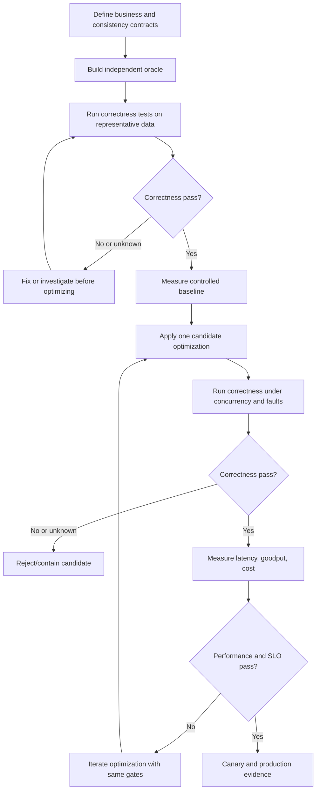

# Tách kết quả đúng về dữ liệu khỏi kết quả nhanh về hiệu năng

Một endpoint Java đọc đơn hàng từ NoSQL chỉ mất **5 ms** chưa chắc là endpoint tốt. Nó có thể đang đọc từ cache chưa được vô hiệu hóa hoặc replica chưa theo kịp lần ghi vừa hoàn tất. Ngược lại, một lệnh ghi trả kết quả trong **200 ms** có thể là lựa chọn đúng nếu nó bảo đảm kiểm tra phiên bản, giữ bất biến tồn kho và xác nhận đủ điều kiện bền vững theo hợp đồng. **Nhanh** và **đúng** là hai tính chất khác nhau; chúng cần phép đo, nguồn chứng cứ và cổng nghiệm thu riêng.

Tưởng tượng phép thử:

```text
10:00:00.000  API ghi order O1: status=PAID, revision=7.
10:00:00.050  API trả HTTP 200.
10:00:00.060  User đọc O1 qua read endpoint.
10:00:00.065  Read endpoint trả status=PENDING, revision=6.
```

Kết quả đọc có p99 rất đẹp, không lỗi HTTP và có throughput cao. Nhưng nếu contract hứa người vừa ghi phải nhìn thấy lần ghi đó, phép thử **sai dữ liệu**. Nếu hệ chỉ hứa eventual consistency với một cửa sổ tươi mới đã công bố, phép đọc có thể hợp lệ **trong thời gian cho phép**, miễn là bài test kiểm đúng contract chứ không tự gán tiêu chuẩn mạnh hơn hay yếu hơn.

Chương **Database No SQL → Kiểm thử tính đúng**, bài **Tách kết quả đúng về dữ liệu khỏi kết quả nhanh về hiệu năng**, hướng dẫn thiết kế một quy trình đánh giá mà ở đó:

1. **Correctness** kiểm tra trạng thái, lịch sử thao tác, bất biến, tính nhất quán, quyền truy cập và hiệu ứng nghiệp vụ.
2. **Performance** đo throughput, latency, resource costs và khả năng đáp ứng SLO dưới một workload xác định.
3. **Decision** chỉ chấp nhận một bản thay đổi khi cả hai nhóm điều kiện bắt buộc cùng đạt — hoặc các ngoại lệ được phê duyệt rõ ràng, không bị giấu trong một điểm số chung.

Điều quan trọng là cả hai phải được đo trên **cùng semantics và phạm vi**. Tăng tốc bằng cách bỏ transaction, hạ write concern, xóa predicate phân quyền hoặc trả stale cache không phải là tối ưu hiệu năng hợp lệ nếu nó phá contract.

> **Nguyên tắc:** Một benchmark nhanh không được dùng làm bằng chứng dữ liệu đúng. Một bài test dữ liệu đúng cũng không chứng minh hệ chịu được traffic production. Hãy đo độc lập, giữ ngưỡng minh bạch và ghi đầy đủ điều kiện tải, tính nhất quán, retry, môi trường và nguồn chuẩn.

---

## 1. Kết quả đúng và kết quả nhanh là hai chiều

**Tính đúng dữ liệu (correctness)** trả lời:

- Truy vấn có trả đúng tập bản ghi và giá trị theo mốc dữ liệu được phép đọc không?
- Thao tác ghi có bảo vệ business invariant không?
- Một yêu cầu timeout có thật sự chưa được commit không?
- Retry hoặc CDC redelivery có tạo side effect trùng không?
- Delete có được quan sát và không bị dữ liệu cũ ghi đè không?
- Người dùng có thể đọc dữ liệu tenant khác không?
- Những lời hứa consistency đã được giữ không?

**Hiệu năng (performance)** trả lời:

- Mỗi loại thao tác mất bao lâu, p50/p95/p99 bao nhiêu?
- Hệ hoàn tất được bao nhiêu *logical operations* mỗi giây?
- Phải dùng bao nhiêu CPU, memory, IOPS, network, RCU/WCU hoặc storage?
- Những loại retry, hàng đợi, hot partition, lock/CAS contention làm latency tăng thế nào?
- Khi traffic tăng hoặc một node bị lỗi, hệ vẫn giữ SLO được không?

Có thể:

```text
CORRECT but SLOW
FAST but INCORRECT
CORRECT and FAST
INCORRECT and SLOW
```

Không có lý do để xếp hạng `FAST but INCORRECT` tốt hơn `CORRECT but SLOW` trong một hệ có yêu cầu dữ liệu nghiêm ngặt.

## 2. Bảng hai trục nghiệm thu

| Tính đúng dữ liệu | Hiệu năng | Kết luận kỹ thuật |
| --- | --- | --- |
| PASS | PASS | Có thể xét phát hành nếu các điều kiện an toàn khác đạt |
| PASS | FAIL | Giữ correctness; tối ưu access path, resource hoặc workload trước khi phát hành |
| FAIL | PASS | **Không đạt** dù latency rất tốt |
| FAIL | FAIL | Không đạt; ưu tiên khôi phục safety trước |
| INCONCLUSIVE | PASS | Chưa đủ bằng chứng; không tự coi là đúng |
| PASS | INCONCLUSIVE | Chưa có bằng chứng về capacity/SLO |
| RECOVERING | PASS trên một mẫu | Chưa được phép coi toàn hệ đã sẵn sàng |

**Không cộng hai điểm thành một trung bình**. Ví dụ `Correctness 0/1` và `Latency 100/100` không thể biến thành `overall=99%` rồi cho phát hành.

## 3. Định nghĩa một contract kiểm thử trước khi viết test

Mỗi operation phải có một **behavior contract** và một **performance contract**.

Ví dụ `GET /orders/{orderId}`:

```yaml
operation: "orders.get"
dataContract:
  identity: "tenantId + orderId"
  authority: "orders source or approved revisioned view"
  authorization: "user must belong to tenant"
  readConsistency: "read-your-writes for owner session"
  fields: ["status", "amountMinor", "revision"]
  missingRecord: "404 only when absence is authoritative"
performanceContract:
  workloadClass: "single-order lookup"
  targetP99: "<product-approved-threshold>"
  minCompletedLogicalRps: "<capacity-target>"
  maxErrorRate: "<approved-budget>"
  measurementWindow: "<declared>"
```

Đây là manifest minh họa, không phải cấu hình chính thức của một framework. Ngưỡng phải do sản phẩm/SLO quyết định; không lấy các con số giả làm tiêu chuẩn chung cho mọi NoSQL.

Một phép đo thiếu contract sẽ dễ bị “tối ưu” bằng cách làm ít việc hơn.

## 4. Contract đúng có thể cho phép dữ liệu cũ

**Eventual consistency** không đồng nghĩa lỗi; cũng không đồng nghĩa “mọi dữ liệu cũ bao lâu cũng được”.

Ví dụ contract:

```text
After an acknowledged write:
    authoritative GET by operation ID reflects it.

Materialized search view:
    may lag source, but freshness age must stay below
    product-approved bound under declared conditions.
```

Khi đó:

- `GET` authority thấy revision cũ sau ACK có thể sai.
- `SEARCH` projection thấy revision cũ 200 ms sau ACK có thể hợp lệ.
- `SEARCH` giữ revision cũ 20 phút có thể vi phạm freshness SLO.
- Một cache làm lộ record đã xóa có thể vi phạm quy tắc privacy ngay cả khi consistency nhìn chung eventual.

Kiểm thử phải **tách consistency class** theo endpoint thay vì áp một mức chung.

## 5. Điều gì tạo thành nguồn chuẩn — oracle?

Một **test oracle** là cách xác định kết quả kỳ vọng độc lập với implementation đang thử.

Các nguồn:

- Một mô hình nghiệp vụ tuần tự được kiểm chứng.
- Invariant/unique operation ledger.
- Authoritative receipts và commit positions.
- Snapshot consistent ở một mốc cố định.
- Một reference implementation đơn giản, không dùng cùng thuật toán tối ưu.
- Independent payment/inventory provider receipts.
- Property-based invariants.
- Linearizability/serializability history checker phù hợp contract.

Không nên dùng:

```text
expected = result of the same NoSQL query under test
```

Vì nếu truy vấn bỏ sót filter, cả expected và actual đều có thể sai giống nhau.

Một bản backup hoặc secondary replica cũng không mặc nhiên là oracle: cần biết nó đại diện cho mốc nào, có đầy đủ dữ liệu không và được tạo bằng cơ chế gì.

## 6. Ví dụ sai: SQL/NoSQL query nhanh nhưng thiếu tenant filter

Một API:

```java
findOrdersByStatus("PAID")
```

được optimize bằng cách xóa điều kiện `tenantId` khỏi index query.

Hậu quả:

```text
Before:
    p99 = 40ms
    returned only T1 orders

After:
    p99 = 8ms
    returned some T2 orders
```

Đây là **security correctness failure**. Mặc dù p99 giảm 80%, thay đổi phải bị từ chối.

Các kiểm bắt buộc:

- Positive: user T1 xem được đúng orders của T1.
- Negative: user T1 không truy cập được T2 bằng point lookup.
- Negative: list/search/export/pagination không leak T2.
- Bài kiểm quyền dùng verified server-side tenant context.
- Không tin tenantId do client gửi nếu chưa xác thực membership.

Đo hiệu năng **chỉ trên những responses đúng và được phép**, không đo tốc độ trả dữ liệu sai như một thành công.

## 7. Ví dụ sai: bỏ CAS để tăng throughput

Ban đầu:

```text
UPDATE inventory
WHERE sku=S1 AND version=7
IF available >= 1
```

sau “tối ưu”:

```text
available = available - 1
```

không kiểm version/available. Under concurrency:

```text
Two writers:
    both see available=1
    both reserve 1
```

Có thể tạo oversell hoặc lost update, tùy mô hình thao tác.

Performance benchmark kiểu:

```text
100k successful update requests/second
```

không chứng minh mỗi update bảo vệ invariant. Phải hỏi:

```text
How many unique reservations committed?
What is ledger balance?
Did any stock become negative?
Were conflicts rejected correctly?
Were any commits duplicated?
```

Tối ưu đúng có thể là partitioning tốt hơn, batching theo contract, reducing hot-key contention hoặc thiết kế ledger, không tự xóa điều kiện an toàn.

## 8. Ví dụ sai: ACK sớm trước durability contract

Một API trả:

```text
HTTP 200 at T1
```

ngay khi request được đưa vào local queue, nhưng business đã hứa `200` nghĩa write bền vững theo mức replication đã định. Khi node crash ở T2:

```text
request acknowledged
write disappears
```

Latency rất đẹp nhưng semantics thay đổi.

Có thể thiết kế `202 Accepted` cho asynchronous workflow **nếu hợp đồng được công bố đúng**:

```text
202 = command accepted durably into queue under stated contract.
200/201 = business operation committed under stated contract.
```

Tên status code không tự bảo đảm durability; phải xác định ACK boundary thật.

## 9. Thế nào là “successful operation”?

Trong benchmark, không nên chỉ tính `HTTP 2xx`.

Phân loại:

```text
CORRECT_SUCCESS
CORRECT_REJECTION
BUSINESS_CONFLICT
UNAUTHORIZED_EXPECTED
SERVER_ERROR
TIMEOUT_UNKNOWN
STALE_RESULT
WRONG_RESULT
DUPLICATE_EFFECT
MISSING_EFFECT
INVARIANT_VIOLATION
```

Ví dụ `409 version conflict` có thể là **kết quả đúng** của optimistic concurrency, nhưng không phải completed purchase. Một `200` chứa trạng thái sai là correctness failure. Một `timeout` của write không tự nghĩa failed effect vì commit có thể xảy ra trước khi ACK bị mất.

**Không đổi định nghĩa “success” chỉ để throughput trông lớn hơn.**

## 10. Logical operations khác physical attempts

Một request nghiệp vụ:

```text
POST /orders with operationId O-123
```

có thể gây:

```text
1 logical business operation
3 client attempts
3 database commands
1 actual durable business effect
```

Đo riêng:

- `logicalRequests`
- `physicalAttempts`
- `acksReceived`
- `confirmedApplied`
- `confirmedRejected`
- `unknown`
- `duplicatesSuppressed`
- `correctResponses`
- `wrongResponses`

Nếu báo `DB ops/s` tăng do retry storm, đó **không nhất thiết là business throughput tăng**.

## 11. Tách tốc độ trả lời và tốc độ hoàn tất có xác nhận

Giả sử:

```text
Request rate:                1000 logical ops/s
HTTP 200 responses:           980 ops/s
Timeouts:                      20 ops/s
Business receipts committed:  970 ops/s
```

Không thể kết luận:

```text
Throughput = 980 correct ops/s
```

trước khi phân loại 20 timeouts và chênh lệch receipts. Có thể có:

- Một số 200 chưa commit theo contract.
- Một số timeout đã commit.
- Một số double effects.
- Receipts chưa được ghi vào read model.
- Window đo không cùng commit boundary.

Báo cáo nên dùng `verifiedBusinessCompletionsPerSecond` khi có nguồn chuẩn, đồng thời ghi cách xác minh và lag của nguồn đó.

## 12. Những tính chất correctness thường gặp

| Thuộc tính | Câu hỏi | Ví dụ failure |
| --- | --- | --- |
| Uniqueness | Một business ID có một effect? | Trùng payment capture |
| Atomicity | Một nhóm writes có cùng commit? | Đơn PAID nhưng thiếu receipt |
| Durability | ACK rồi mất node có mất write? | Confirmed write biến mất |
| Isolation | Concurrent transactions quan sát trạng thái nào? | Write skew |
| Lost-update safety | Hai writers có ghi đè mù? | Version cũ overwrite mới |
| Idempotency | Retry/redelivery có nhân đôi effect? | Trừ tồn kho hai lần |
| Read-your-writes | Người ghi có thấy update của mình? | Đọc revision cũ |
| Monotonic reads | Session có thấy dữ liệu lùi revision? | Lần đọc sau cũ hơn |
| Consistent prefix/ordering | Có thấy update theo thứ tự yêu cầu? | PAID rồi quay PENDING |
| Eventual convergence | Replica/projection có theo kịp? | Lag không giảm |
| Delete semantics | Xóa có bị resurrect? | Old event khôi phục record |
| Tenant authorization | Đúng quyền và phạm vi? | T1 thấy T2 |
| Schema/codec | Values có giữ nguyên nghĩa? | Decimal sai scale |
| Referential/business invariant | Quan hệ xuyên records có đúng? | Refund > captured |

Không phải hệ nào cũng hứa tất cả các tính chất ở cùng mức. **Chọn đúng contract**, rồi kiểm nó.

## 13. Linearizability và serializability không phải metric tốc độ

**Linearizability** yêu cầu mỗi operation có thể được xem như xảy ra tức thời tại một điểm giữa invocation và response, đồng thời tôn trọng thứ tự thời gian thực của các operations không chồng lấn.

Một history:

```text
W(7) invoked -------- returns SUCCESS
                              R invoked ---- returns 6
```

Nếu R là read cùng key, không chồng lấn với W, và contract linearizable, `R=6` có thể vi phạm.

**Serializability** yêu cầu kết quả tương đương một thứ tự tuần tự hợp lệ của các transactions, nhưng không tự bắt buộc thứ tự đó tôn trọng mọi thứ tự thực của các transactions không chồng lấn. **Strict serializability** kết hợp serializability với ràng buộc thời gian thực.

Không đo linearizability bằng việc “p99 dưới 10ms”. Cần một history checker có invocations/responses và oracle/state model.

## 14. Eventual consistency cần test convergence, không chỉ đọc một lần

Một phép thử:

```text
Write revision 10 committed at W.
Poll projection until revision >=10.
```

Có thể đo:

- `visibilityDelayMs` cho revision 10.
- Tỷ lệ updates đạt freshness bound.
- Tỷ lệ không hội tụ trước deadline.
- Phân bố lag theo tenant/partition.
- Delete visibility latency.
- Read model gap/poison event.
- Behavior under failover/replay.

Nếu contract cho phép eventual visibility, một read cũ ngay sau ACK có thể không là correctness failure. Nhưng **không hội tụ** hoặc trả phiên bản cũ vô thời hạn có thể là fail.

Không sửa bài kiểm bằng cách `Thread.sleep(5000)` rồi chỉ assert cuối cùng: nó bỏ mất thông tin về phân bố freshness.

## 15. Cần ghi rõ nơi dữ liệu được đọc

Một kết quả có thể đến từ:

```text
Primary
Replica
Multi-Region replica
Materialized view
Secondary index
Search engine
Redis cache
Application in-memory cache
```

Mỗi đường có khả năng consistency khác nhau.

Ví dụ:

```text
Write source at revision 20.
Read API uses cache revision 18.
```

Nếu API có token `minRevision=20`, cache phải:

- Trả record revision >=20; hoặc
- Fallback tới authority có thể bảo đảm; hoặc
- Trả phản hồi rõ là chưa sẵn sàng theo contract.

Không được coi `cache hit = success` nếu entry không đáp ứng revision/freshness requirement.

## 16. Read-your-writes và session tokens

Một thiết kế:

```text
POST /orders/O1
-> committed revision 12
-> returns minRevision=12

GET /orders/O1 with minRevision=12
-> must return revision >=12 or explicit incomplete status
```

Cần:

- Token/sequence đáng tin từ authority.
- Không cho client giả tăng version dẫn đến access trái phép.
- Scope token theo tenant/key/session.
- Định nghĩa timeout/fallback khi replica chưa bắt kịp.
- Test network failover và cache.
- Không lẫn revision local từng collection với global comparable timestamp.

Nếu engine cung cấp causal session token, dùng theo API đúng thay vì tự dựng một token chuỗi mà không có enforcement.

## 17. Monotonic reads dưới load balancing

Một session:

```text
Read 1 via replica A: revision 9.
Read 2 via replica B: revision 7.
```

Nếu contract hứa monotonic reads, đây là lỗi dù cả hai requests chỉ 4 ms.

Các cách kiểm:

- Gắn session ID/minObservedRevision.
- Sắp chuỗi reads cùng session.
- Ghi replica/Region/route.
- Kiểm sau failover và reconnect.
- Kiểm cache invalidation.
- Tách stale allowed cho user khác khỏi monotonic guarantee của cùng session.

Không chỉ tổng hợp p99 across replicas; phải theo dõi **lịch sử từng session**.

## 18. Transaction correctness khác throughput của từng lệnh

Một transaction có:

```text
Debit account A.
Credit account B.
Record transferId.
```

Nếu benchmark chỉ tính từng update:

```text
2 updates completed in 1ms each
```

không chứng minh:

```text
A+B balance conserved.
transferId exactly once.
Either both effects committed or neither.
```

Một hệ không hỗ trợ transaction xuyên hai partitions cần workflow khác (ledger/saga/outbox/compensation) và oracle phù hợp. **Không benchmark thành công của transaction bằng tổng throughput các primitive writes**.

## 19. Unknown commit outcome là trạng thái hợp lệ của hệ phân tán

Timeline:

```text
Client sends PUT operationId=O-9.
DB commits.
Connection drops before ACK.
Client sees timeout.
```

Tại client, kết quả là **UNKNOWN**, không phải chắc chắn failed.

Bài test đúng phải:

1. Giữ operationId ổn định.
2. Ghi tất cả attempts và timeout.
3. Tra authoritative receipt/ledger.
4. Phân loại `APPLIED`, `NOT_APPLIED_CONFIRMED`, `UNKNOWN`.
5. Tránh retry không lũy đẳng với operationId mới.
6. Kiểm có đúng một business effect.
7. Ghi thời gian đối soát, không giấu vào latency thành công.

Báo cáo chỉ đo nhanh những requests nhận ACK sẽ tạo **survivorship bias**.

## 20. Lỗi nhanh vẫn là lỗi

Một API cache có thể:

```text
404 NOT_FOUND in 1ms
```

nhưng authority đã có dữ liệu. Một service khác có thể:

```text
429 THROTTLED in 2ms
```

trong khi throughput hoàn tất gần 0.

Vì vậy phải báo:

```text
latency by outcome class
logical completion rate
error/reject/timeout ratios
correctness violations
```

Không sử dụng p99 của chỉ những `HTTP 200` rồi gọi đó là `API p99` nếu một lượng lớn request bị từ chối/timeout. Bên cạnh latency thành công nên có **latency toàn logical request và time-to-resolve UNKNOWN**.

## 21. Tỷ lệ thành công nhanh không thay freshness

Một pipeline:

```text
Write source -> outbox -> CDC -> read model.
```

Có thể đạt:

```text
Source write p99 = 10ms.
Read model query p99 = 5ms.
CDC lag = 45min.
```

Hai p99 đều đẹp, nhưng UI có thể hiển thị trạng thái rất cũ. Cần ít nhất ba nhóm metric:

1. Source write latency/correctness.
2. Projection visibility/freshness latency.
3. Query latency/correctness của read model.

**Latency của từng service không tự suy ra latency end-to-end từ commit đến user-visible state**.

## 22. Một bảng mục tiêu theo operation

| Operation | Correctness gate | Performance gate |
| --- | --- | --- |
| Get order by ID | Đúng tenant, đúng revision/freshness | p99 theo request cohort |
| List orders | Không thiếu/trùng sai, sort/page stable | p99 và read amplification |
| Create order | Unique business ID, durable receipt | Confirmed completions/s |
| Reserve inventory | No oversell, no duplicate reservation | p99 và conflict rate |
| Capture payment | Provider/ledger ID unique | Completion time + reconciliation |
| Delete user data | Delete/tombstone không resurrect | Time-to-invisible + propagation |
| Consume CDC event | Idempotent effect, no gap | Lag/drain rate |
| Update projection | Source revision order | Visibility delay distribution |
| Restore backup | Exact data + business invariants | RTO và verification completion |
| Failover | Không mất acknowledged writes | Recovery latency/availability |

Mỗi hàng có ít nhất **hai cột nghiệm thu tách biệt**. Không thay một cột bằng cột còn lại.

## 23. Một benchmark “nhanh” có thể kiểm sai tập dữ liệu

Ví dụ:

```text
Before: 10M records, 10 tenants, realistic skew.
After: 100k records, one tenant, all fits in cache.
```

Latency giảm không chứng minh cải thiện trên production workload.

Cần giữ:

- Dataset size/cardinality.
- Key distribution và hot partitions.
- Tenant mix.
- Record sizes.
- Index selectivity.
- Read/write ratio.
- Think time/concurrency/arrival pattern.
- Cache warm/cold state.
- Background compaction/CDC/backup.
- Replica topology/Region/network.
- Consistency/durability settings.

Đối chiếu hai builds chỉ có ý nghĩa khi các biến được kiểm soát hoặc được ghi rõ.

## 24. Bằng chứng correctness không nhất thiết lấy từ response body

Một API `POST` có thể trả:

```json
{"status":"SUCCESS"}
```

nhưng DB chưa commit outbox hoặc PSP đã xử lý hai lần.

Nên kết hợp:

```text
HTTP response
authoritative DB receipt
unique business operation ID
source record state/revision
outbox event
external provider receipt
consumer applied marker
```

Trong hệ eventually consistent, cần đặt **cùng logical cut/checkpoint** khi so, nếu không có thể báo false mismatch vì propagation lag hợp lệ.

## 25. Không để test oracle dùng chung lỗi với system under test

Một rủi ro:

```text
App writes amountMinor using a buggy decimal converter.
Test oracle uses the same converter library.
Expected and actual both wrong.
```

Giảm nguy cơ:

- Reference model đơn giản và độc lập.
- Test vectors được duyệt từ business rules.
- Round-trip kiểm qua representation khác.
- Independent ledger/provider receipts.
- Property-based generators với ràng buộc rõ.
- Golden fixtures/versioned schema.
- Cross-check sum/IDs với công cụ khác khi thích hợp.
- Review cách canonicalize dữ liệu.

Một oracle phải đủ độc lập để có thể phát hiện lỗi của implementation, không chỉ lặp lại chính nó.

## 26. Kiểm hai lớp: value equality và invariant equality

**Value equality:** source và target cùng logical record:

```text
O1 amount=10000, status=PAID, revision=8
```

**Invariant equality:** nhiều records cùng thỏa:

```text
captureIds unique.
refundSum <= capturedSum.
inventory available is derived consistently from ledger.
```

Hai datasets có thể có cùng hash cho một phần fields nhưng thiếu records trong ledger. Ngược lại, cùng count/tổng cộng tiền có thể che việc hai bản ghi sai bù nhau.

Một bài test cần:

```text
identity set
canonical content
uniqueness
cross-record business rules
```

với phạm vi dữ liệu và mốc nhất quán rõ.

## 27. Data correctness khi có deletes và TTL

Một `DELETE` nhanh:

```text
DELETE accepted in 3ms
```

nhưng cache/search/replicas vẫn hiển thị record đã xóa.

Tùy contract, cần:

- Tạo tombstone/deletion generation.
- Kiểm authoritative delete commit.
- Kiểm data không bị old CDC event resurrect.
- Đo time-to-invisible trên các read paths.
- Chỉ cho eventual lag trong phạm vi được phê duyệt.
- Kiểm TTL/retention phù hợp policy.
- Kiểm erasure requests đặc biệt.
- Không benchmark tốc độ xóa bằng số command được enqueue.

Một physical tombstone có thể vẫn tồn tại hợp lệ; oracle phải phân biệt **logical visibility** và **physical cleanup**.

## 28. Công thức throughput cần đúng mẫu số

Nếu trong cửa sổ \(\Delta t\) có \(N\) logical operations được **xác nhận đúng**:

\[
\mathrm{Goodput} = \frac{N_{\mathrm{correct,confirmed}}}{\Delta t}
\]

Không nên dùng:

\[
\frac{\text{all DB attempts}}{\Delta t}
\]

làm “business throughput” khi có retries, conflicts và duplicate attempts.

Có thể báo song song:

```text
offered logical requests/s
completed logical requests/s
correct verified business effects/s
database physical attempts/s
incorrect/duplicate/unknown outcomes/s
```

**Goodput** ở đây có nghĩa throughput hữu ích theo contract cụ thể, không phải mọi DB operation thành công.

## 29. Latency phải nói rõ ranh giới

Một request có thể trải qua:

```text
T0 client dispatch
T1 load balancer accepted
T2 app dequeued
T3 driver pool acquired
T4 DB executed
T5 DB ACK received
T6 app response written
T7 client response received
T8 authoritative/projection state verified
```

Các latency khác nhau:

- `client end-to-end latency = T7-T0`
- `app processing latency = T6-T2`
- `driver pool wait = T3-T2` (nếu đoạn giữa đúng thực tế)
- `DB command latency = T5-T3` (còn network)
- `time to business-confirmed effect` có thể gồm reconciliation.
- `time to visible projection` có thể tới T8.

Không so “DB command 5ms” với “user-visible 120ms” như cùng một phép đo. Bản benchmark phải ghi timestamp endpoints và event definitions.

## 30. p99 không thể thay max/timeout/failure counts

Một histogram:

```text
99% read operations: 10ms.
1% operations: timeout after 30s.
```

Nếu chỉ thống kê responses hoàn tất, p99 có thể bỏ qua những requests timeout và báo 10ms. Nhưng một phần user chờ 30 giây.

Cần:

- Count attempted/completed/timed-out logical requests.
- Latency của timeouts như censored results hoặc theo deadline.
- Histogram cho success/failure separately.
- Tail percentiles với số mẫu đủ.
- Maximum/long-tail và SLO burn.
- Resolution của operation UNKNOWN.
- Time windows, tags và sample coverage.

Đừng dùng một số `p99=10ms` làm chứng cứ cả hệ tốt khi error budget đã cháy.

## 31. Coordinated omission trong load testing

Một load generator **closed-loop** thường gửi request kế tiếp chỉ sau khi request trước hoàn tất:

```text
send request
wait response
send next
```

Khi server chậm 5 giây, generator tự giảm traffic; nhiều requests “đáng lẽ đến” không được gửi. Latency histogram có thể **đánh giá thấp** trải nghiệm khi có offered demand thật.

Một **open-loop** generator với arrival schedule kiểm soát có thể giúp nhìn backlog và tail latency, nhưng cũng cần giới hạn an toàn và đo dropped requests.

Cần báo:

- Offered load schedule.
- Actual dispatched/completed requests.
- Queue delay.
- Client saturation.
- Rate limiter behavior.
- Coordinated-omission mitigation.
- Timeouts và cancellations.

Không viết “hệ chịu 10k RPS” chỉ vì generator cấu hình 10k khi thực tế chỉ gửi hoặc hoàn thành 4k.

## 32. Warm cache và cold cache là hai workload khác nhau

Một benchmark:

```text
Run A: cold cache -> p99 300ms.
Run B: warm cache -> p99 20ms.
```

Nếu hai lần chạy được dùng để kết luận index B tốt hơn A mà không so cache state, kết luận không vững.

Nên chạy có kế hoạch:

- Warm-up đầy đủ.
- Cold-cache case nếu có ý nghĩa.
- Distribution của hot/cold keys.
- Cache hit ratio.
- Object/OS page cache.
- JIT/JVM warmup.
- Background compaction.
- GC/memory pressure.
- Search index refresh/read model lag.

Mọi optimization phải giữ **data freshness và security semantics**; hit cache nhanh nhưng sai revision không được tính correctness pass.

## 33. Correctness gate phải độc lập với tải

Có những lỗi chỉ xuất hiện dưới concurrency/pressure, nhưng logic kiểm đúng không nên đổi theo tải.

Ví dụ:

```text
At 100 RPS:
    all reservations unique.
At 10,000 RPS:
    one reservation applied twice.
```

Lỗi dưới tải vẫn là correctness failure. Không được chuyển nó thành “p99 degradation” chỉ vì chỉ xảy ra khi hệ bận.

Cần chạy cùng invariants ở:

1. Single-thread unit tests.
2. Integration với database thật.
3. Concurrent controlled histories.
4. Load/stress/soak.
5. Fault injection/failover.
6. Recovery/replay.

**Một test đúng lúc idle không bảo đảm đúng khi có races; một stress test nhanh không chứng minh các races không tồn tại.**

## 34. Đo trước/sau thay đổi bằng cặp cổng riêng

Mẫu:

```text
Change: add cache for orders.get.

Baseline:
    correctness: PASS
    p99: 120ms

Candidate:
    correctness: FAIL (3.1% reads violate minRevision)
    p99: 8ms
```

Kết luận:

```text
REJECT candidate.
```

Bước kế tiếp:

- Implement minRevision-aware cache key/fallback.
- Test stale reads under replication lag.
- Rerun correctness.
- Khi correctness PASS, mới dùng kết quả performance để chọn candidate.

Không tự giảm yêu cầu `minRevision` để vừa giải pháp cache nếu product contract không được thay đổi.

## 35. Một nguyên tắc lựa chọn cấu hình

Cho hai cấu hình:

```text
Config A: writeConcern stronger, p99 35ms, no acknowledged-loss observed.
Config B: writeConcern weaker, p99 8ms, acknowledged-loss under failover.
```

Nếu product contract yêu cầu durability tương ứng với A, thì B **không nằm trong tập cấu hình được phép tối ưu**.

Khái niệm:

\[
\min_{\theta \in \Theta_{\mathrm{valid}}} \mathrm{Latency}(\theta)
\]

trong đó \(\Theta_{\mathrm{valid}}\) là tập cấu hình **đã qua correctness/security/durability gates**, không phải mọi cấu hình có thể chạy.

Nói cách khác, **đúng là ràng buộc**, còn hiệu năng là mục tiêu tối ưu trong phạm vi hợp lệ.
## 36. Các cấp độ kiểm thử có vai trò khác nhau

| Cấp độ | Hỏi điều gì? | Loại bằng chứng |
| --- | --- | --- |
| Unit test | State transition/rule đúng ở phạm vi hẹp? | Assertions và model |
| Property-based test | Rule có đúng trên nhiều input sinh tự động? | Seed, counterexample |
| Integration test | Driver/schema/index/auth chạy đúng? | Database instance thật |
| Concurrency test | Race/atomicity có giữ invariant? | Histories, operation receipts |
| Consistency test | Session/read guarantees đúng? | Invocation/response histories |
| Migration/restore test | Dữ liệu trước/sau có tương đương? | Counts, hashes, business ledger |
| Load test | SLO tại workload cụ thể? | Histograms, goodput, resource metrics |
| Stress test | Khi quá tải, hệ từ chối/giảm cấp thế nào? | Errors, safety violations, recovery |
| Soak test | Lâu dài có leak/compaction/lag? | Time series, invariants |
| Chaos/fault test | Node/network crash có phá safety? | Durable receipts, recovery evidence |

Không dùng đơn độc một load test có p99 đẹp để thay thế concurrency/consistency tests. Cũng không dùng đơn độc unit tests làm bằng chứng về failover dưới production topology.

## 37. Test data phải đại diện cho invariants

Một bộ dữ liệu chỉ gồm:

```text
tenant=T1
status=ACTIVE
amount=100
```

khó phát hiện nhiều lỗi.

Nên có cohorts:

- Nhiều tenants, kể cả tenant có key trùng trong scope khác.
- Small/large documents.
- Null/missing/unknown fields.
- Multiple schema versions.
- Hóa đơn decimal/currency edge cases.
- Hot partitions và long-tail keys.
- Tombstones/soft-deletes/TTL.
- Multi-record transactions.
- Records có revision cao và replay cũ.
- Canceled/refunded/partially fulfilled workflows.
- Unicode, binary IDs, timestamps nhiều precision.
- Những trường hợp auth denied hợp lệ.

Có thể sinh data có seed để tái lập. Dữ liệu kiểm đúng cần chứa **trường hợp biên khó** ngay cả khi tỉ lệ thấp trong traffic bình thường; benchmark performance có thể dùng phân bố khác nhưng phải ghi rõ.

## 38. Chọn bộ oracle không phụ thuộc topology

Giả sử cùng một service được triển khai:

```text
Single node in dev.
Three replicas in staging.
Sharded multi-Region in production.
```

Quy tắc business:

```text
one operationId -> at most one payment capture
```

vẫn không đổi. Test oracle nên kiểm invariant ấy độc lập với số replicas.

Nhưng consistency contracts có thể phụ thuộc topology:

- Session RYW chỉ có thể giữ khi token đi cùng request và path hỗ trợ.
- Cross-region reads có thể eventual.
- Transaction boundaries có thể giới hạn collection/partition.

Vì vậy kết quả test cần ghi **topology và contract thực đang áp**, không suy rằng kiểm tại một node chứng minh multi-node safety.

## 39. Model-based testing

Tạo một reference model đơn giản:

```text
Order state:
    CREATED -> CONFIRMED -> PAID -> FULFILLED
    CREATED/CONFIRMED -> CANCELED under allowed conditions
```

Cho một chuỗi commands:

```text
create(O1)
confirm(O1)
pay(O1, opPay1)
retryPay(O1, opPay1)
ship(O1)
```

Model tính expected outcome và receipts. Hệ NoSQL chạy cùng commands. So:

- State cuối.
- Accepted/rejected transitions.
- Unique operation receipts.
- External effects.
- Per-entity revision.
- Business balances.
- Error classification.

Model phải định nghĩa rules được business phê duyệt, không copy từng query của code đang test.

## 40. Property-based testing

Thay vì hardcode mười sequences, sinh nhiều sequences hợp lệ/không hợp lệ:

```text
create
reserve
confirm
cancel
retry
timeout
replay
delete
read
```

Assertions bất biến:

```text
same operationId never contributes twice
available inventory never negative under no-oversell policy
revision never decreases
deleted generation rejects stale upserts
one tenant cannot mutate another tenant's key
```

Giữ:

- Random seed.
- Generator version.
- Minimal failing sequence qua shrinking nếu framework hỗ trợ.
- Database/driver version.
- Concurrency schedule hoặc event ordering.
- Start state/expected oracle.
- Error/timeout messages đã redacted.

Một test thất bại ngẫu nhiên mà không lưu seed/trace rất khó tái hiện, nhất là lỗi phân tán.

## 41. Metamorphic testing khi oracle chính xác khó xây

Đôi lúc không biết ngay toàn bộ expected result, nhưng biết quan hệ phải giữ khi biến đổi input.

Ví dụ:

```text
Reordering requests for disjoint keys
    should not change final state of each key
```

hoặc:

```text
Replay the same idempotent event twice
    should have same business effect as once
```

hoặc:

```text
Query pages concatenated
    should match the full ordered result at same snapshot cut
```

Cần điều kiện rõ:

- Chỉ reorder operations **độc lập**, không phải mọi operations.
- Cùng dataset/logical cut.
- Paging sort order deterministic.
- Không có TTL/writes đang làm dữ liệu thay đổi.
- Business invariants cho phép transformation.

Metamorphic test hữu ích để phát hiện lỗi khi reference dataset quá lớn, nhưng không tự chứng minh mọi correctness property.

## 42. Differential testing giữa hai phương án

So:

```text
Implementation A = existing trusted path.
Implementation B = candidate optimized path.
```

Có thể là:

- Old query vs new index-based query.
- Source authority vs materialized read model.
- Old driver vs new driver.
- Single-key update vs batched command.
- MongoDB vs DynamoDB migration adapter.
- Old cache strategy vs revision-aware cache.

So **logical outputs** sau canonicalization:

```text
keys, values, versions, ordering, authorization, semantics
```

và đo performance độc lập.

Nhưng A không phải lúc nào cũng đúng. Nếu cả A và B cùng sai do business model thiếu một invariant, differential equality không phát hiện. Kết hợp oracle/invariant tests.

## 43. Query equivalence phải gồm thứ tự và phân trang

Một “tối ưu”:

```text
Before: sort createdAt DESC, orderId DESC
After:  sort createdAt DESC
```

Trên data ít ties, kết quả có vẻ giống nhau. Under pagination và nhiều records có cùng `createdAt`, có thể:

- Trùng records giữa pages.
- Bỏ records.
- Cursor không ổn định.
- Leak tenant data qua scan/fallback.
- Wrong total counts.

Phải kiểm:

- Cùng filter và tenant scope.
- Sort tie-breaker ổn định.
- Same snapshot/cursor semantics.
- Page tokens hợp lệ sau index change.
- Không duplicate/missing across pages.
- Empty/last page behavior.
- Expected consistency khi concurrent inserts/deletes.

Một query “faster” trả ít records hơn do thiếu trang không phải tối ưu.

## 44. Aggregate correctness không chỉ đúng tổng toàn bộ

Một count query:

```text
SELECT count by tenant, status
```

có thể có tổng đúng mà phân nhóm sai.

Ví dụ:

```text
Source: T1 PAID=100, T2 PAID=100
Target: T1 PAID=150, T2 PAID=50
```

Global total bằng 200, nhưng tenant isolation/reporting sai.

Kiểm:

- Per-tenant/per-status/per-time buckets.
- Dedup/unique business IDs.
- Grouping key encoding.
- Null/missing semantics.
- Late events/window boundaries.
- Currency/decimal conversions.
- Delete/retraction effects.
- Aggregation source cut.

Nếu một aggregate chỉ dùng sample/approximation, test contract phải công bố sai số và confidence thay vì kỳ vọng exact equality.

## 45. Approximate queries: đúng theo độ chính xác đã hứa

Một approximate count hoặc vector search có thể không trả kết quả exact.

Ví dụ ANN search:

```text
Contract: recall@10 >= approved threshold
          under representative labeled evaluation set.
```

Correctness ở đây có thể là:

- Không trả record trái phép.
- Không bỏ qua filter bắt buộc.
- Không trả stale version quá cửa sổ.
- Metric recall/precision đạt ngưỡng trên ground-truth set.
- Deterministic safety constraints luôn giữ.
- Ranking tie-breakers phù hợp phạm vi.

Performance đo riêng:

```text
query p99, QPS, CPU/IO/compute cost
```

Đừng gọi approximate results “sai” chỉ vì không giống exact 100% nếu hợp đồng cho phép xấp xỉ, nhưng **không dùng approximation để bỏ qua quyền truy cập hoặc invariant tuyệt đối**.

## 46. Correctness test có thể dùng history

Một history record:

```json
{
  "operationId": "op-321",
  "client": "worker-2",
  "key": "T1:O1",
  "invokeNs": 1000000,
  "completeNs": 1200000,
  "operation": "write",
  "input": {"revision": 12},
  "outcome": "ACKED",
  "observedRevision": 12
}
```

Cần:

- Invocation và completion times theo clock đáng tin.
- Client/session ID.
- Operation type, input và returned result.
- Stable logical key.
- Server/client attempt correlation.
- Unknown/timeout events không tự đánh failed.
- Read consistency class.
- Source/replica route nếu cần.

Không phải mọi hệ có đồng hồ toàn cục đủ chính xác để so nanoseconds giữa hosts. Có thể dùng per-client monotonic clocks và correlation markers; khi clock uncertainty quá lớn, checker phải biết giới hạn đó.

## 47. Linearizability checker xử lý UNKNOWN như thế nào?

Một write timeout:

```text
invoke write(7)
no confirmed response
```

có thể đã commit hoặc chưa. Một checker không được tự ghi `failed` để lịch sử dễ linearize.

Các cách hợp lý theo checker/model:

- Coi pending operation có thể đã effect, với ràng buộc thích hợp.
- Dùng authoritative receipt để phân loại.
- Gắn uncertainty trong history.
- Giới hạn phạm vi kết luận theo những operations được quan sát.

Nếu bỏ toàn bộ timeouts khỏi history, có thể tạo **false PASS** vì những writes có khả năng commit đã biến mất khỏi phân tích.

## 48. Không nhầm linearizability với serializability

Một serializable transaction history có thể vẫn không giữ thứ tự thời gian thực giữa các giao dịch không chồng lấn theo cách strict serializability yêu cầu.

Ngược lại, một single-key linearizable register test không chứng minh multi-key transaction serializability.

Chọn checker theo scope:

```text
Single-key register -> linearizability model.
Multi-key transfer -> serializability / strict serializability model.
Event-sourced projection -> ordering/convergence/invariant model.
Eventually consistent cache -> bounded staleness / monotonic session model.
```

Không đưa tên một mức consistency rất mạnh vào báo cáo nếu chỉ kiểm vài reads sau sleep.

## 49. Histories under faults có giá trị hơn idle-only tests

Một số lỗi chỉ xuất hiện khi:

- Primary election giữa write và ACK.
- Network partition cắt một replica.
- Driver reconnect chọn secondary.
- Clock skew ảnh hưởng TTL/LWW.
- Consumer crash sau target commit trước offset ACK.
- Timeout kéo dài khiến idempotency marker hết hạn.
- Cache generation đổi.
- GC pause làm lease stale.
- Schema migration đang backfill.
- Node bị disk full.
- Reads chuyển Region.

Một test có fault injection cần ghi **fault timeline**, các request histories và verification result, không chỉ số lượng 500s.

## 50. Fault injection phải có phạm vi an toàn

Không thử:

```text
Delete production database.
Kill all quorum nodes.
Disable encryption.
Break IAM policy globally.
```

để có metric đẹp.

Chạy ở:

- Isolated test cluster.
- Staging topology representative.
- Controlled production game day khi policy cho phép và có stop/rollback.
- Traffic cohort/risk-limited experiments.
- Synthetic identities/keys riêng.

Trước fault:

```text
owner, approval, scope
expected safety property
starting health
backup/recovery
fault duration
blast radius
abort condition
verification method
```

Một fault test “thành công” phải giữ cả **correctness** và **recovery behavior**, không chỉ tạo ra lỗi như dự kiến.

## 51. Failover test: hai đồng hồ đo khác nhau

Khi node/leader failover:

**Availability:**

```text
time to reconnect
error-rate duration
recovered throughput
p99 during and after election
```

**Safety:**

```text
acknowledged writes preserved
UNKNOWN outcomes reconciled
no duplicate effects
no stale authority/leader writes
no tenant or authorization regressions
```

Một failover phục hồi sau 2 giây nhưng mất một payment đã ACK có **performance/recovery tốt ở bề ngoài và correctness FAIL**.

## 52. Throttling test: không đánh đồng từ chối đúng với mất dữ liệu

Một hệ quá tải có thể trả `429` nhanh.

Nếu contract cho phép throttling:

- `429` có thể là hành vi đúng khi quota vượt.
- Client phải biết khi nào retry.
- Write chưa commit không được báo `200`.
- Write có thể commit rồi timeout vẫn cần receipt.
- Idempotency/queue semantics phải rõ.
- Không làm lost data hoặc unbounded queue.
- Cần tính goodput và rejection rate riêng.

Một benchmark có throughput `100k requests/s` nhưng 90% trả 429 không chứng minh DB phục vụ được 100k business transactions/s.

## 53. Load test trên trạng thái dừng khác tải sản xuất liên tục

Đo benchmark `read-only` có thể bỏ qua:

- Write-induced cache invalidation.
- Index maintenance cost.
- Compaction.
- Replication lag.
- CDC/outbox.
- Hot-key contention.
- TTL expiration.
- Background index builds.
- Backup/repair.
- Concurrent schema changes.

Khi ứng dụng thật có 30% writes, kết quả read-only p99 không đủ đại diện. Nên có workload classes rõ: read-heavy, write-heavy, mixed, burst, hot-key, restore/replay.

## 54. So với baseline phải giữ tính tương đương semantics

Một thí nghiệm:

```text
Baseline: readConcern/consistency strong, 5 replicas.
Candidate: eventual read, 1 replica.
```

Khác nhau ở cả consistency và topology, nên không thể nói “index mới giúp p99 giảm”. Nếu muốn đo trade-off consistency, hãy **ghi rõ đổi contract** và đưa nó qua duyệt nghiệp vụ; đó là nghiên cứu đánh đổi, không phải chứng minh optimization không thay hành vi.

Một bảng benchmark nên ghi:

```text
engine/build/edition
driver/JDK
cluster topology/Region
read/write concerns or consistency levels
retry policy
schema/indexes
dataset and skew
cache state
load generator mode
duration, warmup, sample size
background tasks
correctness oracle/result
```

## 55. Đo p95/p99 đúng cần histogram và mẫu số

Giả sử chỉ có 20 requests, một phép p99 ít ổn định để dự đoán tail của sản xuất.

Cần:

- Mức mẫu đủ cho từng cohort.
- Stable measurement window.
- Histograms với resolution phù hợp.
- Separate stages/warmup.
- Error/timeout classification.
- Confidence intervals hoặc variability giữa runs khi cần.
- Không trộn tenants có skew rất khác mà chỉ báo một p99.
- Không lấy trung bình của các p99 từ nhiều nodes như p99 toàn hệ.

Percentile của tập hợp phải tính từ **phân bố hợp nhất đúng**, không cộng hoặc trung bình các percentiles tùy tiện.

## 56. Những thiên lệch thường gặp trong benchmark

| Thiên lệch | Hiện tượng | Cách tránh |
| --- | --- | --- |
| Cache bias | Candidate warm, baseline cold | Cùng warmup/traffic distribution |
| Coordinated omission | Generator giảm arrival khi server chậm | Đo offered vs completed + queue delay |
| Survivorship bias | Chỉ thống kê responses hoàn tất | Gồm errors/timeouts/unknown |
| Sampling bias | Chỉ lấy hot keys hoặc tenant nhỏ | Representative cohorts |
| Load-generator bottleneck | Client CPU/network đạt trần | Monitor generator headroom |
| Retry inflation | Physical ops tăng, business effects không | Đếm logical operations |
| Background task difference | Một run có compaction/backup | Ghi và kiểm workloads nền |
| Schema/index drift | Hai run dùng index khác | Versioned manifests |
| Hidden consistency downgrade | Candidate đọc stale replica | Same contract + correctness gate |
| Missing verification | Chỉ xem status 2xx | Oracle/receipt |
| Metric aggregation bias | Average/p99 sai do merge | Histogram đúng |
| Resource cost omitted | p99 giảm nhưng 10x RCU/IO | Cost per correct operation |

Một báo cáo khoa học phải nói được đã kiểm soát những yếu tố nào và còn yếu tố nào chưa kiểm.

## 57. Tài nguyên trên mỗi **correct** operation

Một tính toán hữu ích:

\[
\mathrm{CPUCostPerCorrectOp} =
\frac{\mathrm{CPUSecondsConsumed}}{\mathrm{CorrectConfirmedOps}}
\]

Tương tự:

- Read capacity units per correct query.
- Write capacity units per confirmed business mutation.
- Network bytes per correct response.
- Storage/write amplification.
- JVM allocation bytes per operation.
- Database documents examined/returned.
- Energy/infrastructure costs nếu liên quan.

Nếu một query nhanh hơn nhưng quét 10 lần dữ liệu và trả kết quả sai, không thể gọi đó là hiệu quả. Nếu query đúng nhưng có read amplification lớn, tối ưu access path trong phạm vi đúng là mục tiêu hợp lý.

## 58. SLO latency phải gắn trạng thái đúng

Ví dụ:

```text
Objective:
    99% of authorized logical reads
    return correct data within 150ms
    under declared traffic/load/consistency assumptions.
```

SLO này đồng thời đòi:

- Authorized.
- Logical request denominator.
- Correct data under contract.
- Latency threshold.
- Workload scope.

Có thể định nghĩa **các SLI riêng** cho simplicity:

```text
correctnessViolationRate
successfulCorrectReadLatency
logicalRequestAvailability
projectionFreshnessDelay
```

Nhưng lúc quyết định phải kiểm **cả nhóm**, không xem một latency p99 độc lập như bằng chứng toàn hệ đạt SLO.

## 59. Số lượng violations bằng 0 trong một mẫu không chứng minh xác suất bằng 0

Ví dụ chạy 10.000 operations không thấy sai, vẫn không chứng minh lỗi hoàn toàn không thể xảy ra.

Một quy tắc thống kê thường dùng khi các phép thử Bernoulli độc lập, đồng nhất và có 0 lỗi là **rule of three**:

\[
p_{\mathrm{upper,approx}} \approx \frac{3}{N}
\]

với \(N=10000\), giới hạn trên ước lượng khoảng 0,0003 (0,03%) ở mức tin cậy xấp xỉ 95%, **theo các giả định thống kê đó**.

Trong distributed systems, lỗi concurrency/failover có thể tương quan và không độc lập; công thức này **không phải bằng chứng bảo đảm safety**. Dùng thêm model checking, invariant analysis, targeted fault tests và production observability.

## 60. Tại sao độ hiếm không giảm mức nghiêm trọng của correctness violation

Giả sử:

```text
Duplicate payment effect in 1 / 1,000,000 operations.
```

Một tỉ lệ thấp có thể vẫn không chấp nhận nếu:

- Có giá trị tiền lớn.
- Có nghĩa vụ pháp lý.
- Người dùng bị trừ hai lần.
- Data mutation không thể tự phục hồi.
- Vi phạm tenant privacy.
- Hệ có tần suất giao dịch rất cao.

Mục tiêu severity cần dựa trên **hậu quả và business policy**, không tự chọn threshold “0,01% sai cũng ổn” để đổi lấy p99.

## 61. Một phép benchmark kết hợp vẫn phải có report hai phần

Cùng một lần load test có thể thu hai loại chứng cứ:

```text
Correctness evidence:
    generated operation IDs
    authoritative receipts
    final ledger state
    mismatch counts
    consistency histories
    violating traces

Performance evidence:
    offered/completed logical RPS
    latencies by outcome
    retry and timeout counts
    p50/p95/p99
    CPU/disk/network
    cost per correct effect
```

Chạy cùng thí nghiệm giúp thấy tương quan dưới tải. Nhưng **trong report và quyết định**, tính đúng vẫn là gate độc lập.

## 62. Java 17: data model để báo cáo cả hai chiều

Một record cho phép phân loại logical operation:

```java
public record LogicalOperationObservation(
    String operationId,
    String tenantId,
    String resourceTenantId,
    long expectedMinRevision,
    long observedRevision,
    int httpStatus,
    boolean expectedAuthorized,
    boolean timedOut,
    long latencyMillis
) {}
```

Các field này là ví dụ rút gọn. Một hệ thật cần:

- Operation type (read/write/delete/transaction).
- Business-specific expected state.
- Consistency class.
- Attempt count và target route.
- Receipt/commit outcome.
- Request/response correlation.
- Schema version và data source.
- External-effect reference.
- Cờ whether verification completed.

**Không nên đưa raw PII/credential/query literals vào observation logs.** Dùng IDs hoặc hashes/correlation với kiểm soát truy cập.
## 63. Java 17 runnable demo: nhanh nhưng sai vẫn bị từ chối

Chương trình sau biên dịch độc lập với Java 17 và không cần dependency ngoài. Nó mô hình hóa các requests đọc với contract **tenant authorization** và **minimum revision**. Báo cáo tính đúng tách khỏi latency:

```java
import java.util.ArrayList;
import java.util.Comparator;
import java.util.List;

public final class CorrectnessVsPerformanceDemo {

    enum Verdict {
        CORRECT,
        INCORRECT,
        UNKNOWN
    }

    record ReadObservation(
            String requestId,
            String requestTenant,
            String documentTenant,
            boolean authorized,
            long minimumRevision,
            long returnedRevision,
            int statusCode,
            boolean timeout,
            long latencyMillis) {
    }

    static Verdict check(ReadObservation o) {
        if (o.timeout()) {
            return Verdict.UNKNOWN;
        }

        if (!o.authorized()) {
            // This demo assumes the endpoint denies unauthorized
            // access using HTTP 403 or 404 without exposing data.
            return o.statusCode() == 403 || o.statusCode() == 404
                    ? Verdict.CORRECT
                    : Verdict.INCORRECT;
        }

        boolean tenantMatches =
                o.requestTenant().equals(o.documentTenant());

        boolean revisionSatisfied =
                o.returnedRevision() >= o.minimumRevision();

        return o.statusCode() == 200
                && tenantMatches
                && revisionSatisfied
                ? Verdict.CORRECT
                : Verdict.INCORRECT;
    }

    static long nearestRankPercentile(
            List<Long> latencies, double percentile) {

        if (latencies.isEmpty()) {
            throw new IllegalArgumentException("No samples");
        }

        List<Long> sorted = new ArrayList<>(latencies);
        sorted.sort(Comparator.naturalOrder());

        int rank = (int) Math.ceil(
                (percentile / 100.0) * sorted.size());
        int index = Math.max(0,
                Math.min(sorted.size() - 1, rank - 1));

        return sorted.get(index);
    }

    public static void main(String[] args) {
        List<ReadObservation> samples = List.of(
            new ReadObservation(
                "fast-stale", "T1", "T1", true,
                5, 4, 200, false, 2),
            new ReadObservation(
                "slow-correct", "T1", "T1", true,
                5, 5, 200, false, 45),
            new ReadObservation(
                "fast-tenant-leak", "T1", "T2", false,
                0, 8, 200, false, 3),
            new ReadObservation(
                "correct-denial", "T1", "T2", false,
                0, 0, 403, false, 5),
            new ReadObservation(
                "correct-cache", "T1", "T1", true,
                7, 7, 200, false, 4),
            new ReadObservation(
                "timeout", "T1", "T1", true,
                7, 0, 0, true, 1000)
        );

        long correct = 0;
        long incorrect = 0;
        long unknown = 0;

        List<Long> completedResponseLatencies =
                new ArrayList<>();

        for (ReadObservation o : samples) {
            Verdict verdict = check(o);

            switch (verdict) {
                case CORRECT -> correct++;
                case INCORRECT -> incorrect++;
                case UNKNOWN -> unknown++;
            }

            if (!o.timeout()) {
                completedResponseLatencies.add(
                        o.latencyMillis());
            }

            System.out.printf(
                "%-18s latency=%4dms verdict=%s%n",
                o.requestId(),
                o.latencyMillis(),
                verdict);
        }

        long p95 = nearestRankPercentile(
                completedResponseLatencies, 95);

        System.out.println("correct=" + correct);
        System.out.println("incorrect=" + incorrect);
        System.out.println("unknown=" + unknown);
        System.out.println("completedResponseP95Ms=" + p95);

        if (incorrect > 0 || unknown > 0) {
            System.out.println(
                "CORRECTNESS_GATE=FAIL_OR_UNRESOLVED");
        } else {
            System.out.println("CORRECTNESS_GATE=PASS");
        }
    }
}
```

Output dự kiến theo logic:

```text
fast-stale         latency=   2ms verdict=INCORRECT
slow-correct       latency=  45ms verdict=CORRECT
fast-tenant-leak   latency=   3ms verdict=INCORRECT
correct-denial     latency=   5ms verdict=CORRECT
correct-cache      latency=   4ms verdict=CORRECT
timeout            latency=1000ms verdict=UNKNOWN
correct=3
incorrect=2
unknown=1
completedResponseP95Ms=45
CORRECTNESS_GATE=FAIL_OR_UNRESOLVED
```

Điểm quan trọng: ba response nhanh nhất có thể chứa **sai revision** hoặc **rò dữ liệu tenant**. Một p95 tính trên các responses hoàn tất không được dùng để lấp lỗi đó.

**Giới hạn demo:**

- Các observations là dữ liệu dựng sẵn, không chạy benchmark hay xác minh một database thật.
- `UNKNOWN` trong demo là không đủ bằng chứng về kết quả đọc; timeout của writes còn cần receipt/commit reconciliation khác.
- Không có clock, causal token, permission oracle thực, hoặc lịch sử giữa nhiều operations.
- Một denial đúng không nên được tính như successful business read; report thực tách categories.
- `nearestRankPercentile` thích hợp minh họa mẫu nhỏ, không thay HDR histogram/measurement infrastructure.
- Product contract có thể trả status khác theo API; oracle phải được xác định trước.
- Nếu payload sai field nhưng revision đúng, demo chưa phát hiện; integration cần canonical content và business checks.

## 64. Java 17: chứng minh tốc độ CAS không được mua bằng lost update

Chương trình sau làm rõ một race mà latency benchmark dễ bỏ sót. Hai threads cùng muốn đặt một đơn vị tồn kho ban đầu bằng 1.

Phiên bản không an toàn đọc trước rồi đặt lại **không dùng CAS**, và một barrier được dùng để tạo interleaving có thể tái hiện:

```java
import java.util.concurrent.CyclicBarrier;
import java.util.concurrent.CountDownLatch;
import java.util.concurrent.atomic.AtomicInteger;

public final class InventoryRaceDemo {

    static final class UnsafeStore {
        final AtomicInteger available = new AtomicInteger(1);
        final AtomicInteger accepted = new AtomicInteger();
        final CyclicBarrier afterRead = new CyclicBarrier(2);

        void reserve() throws Exception {
            int seen = available.get();

            // Both workers read stock=1 before either writes.
            afterRead.await();

            if (seen > 0) {
                available.set(seen - 1); // Lost update.
                accepted.incrementAndGet();
            }
        }
    }

    static final class SafeStore {
        final AtomicInteger available = new AtomicInteger(1);
        final AtomicInteger accepted = new AtomicInteger();

        void reserve() {
            for (;;) {
                int before = available.get();

                if (before <= 0) {
                    return;
                }

                if (available.compareAndSet(
                        before, before - 1)) {
                    accepted.incrementAndGet();
                    return;
                }
            }
        }
    }

    static void runPair(ThrowingAction action)
            throws InterruptedException {

        CountDownLatch done = new CountDownLatch(2);

        for (int i = 0; i < 2; i++) {
            Thread thread = new Thread(() -> {
                try {
                    action.run();
                } catch (Exception e) {
                    throw new RuntimeException(e);
                } finally {
                    done.countDown();
                }
            });
            thread.start();
        }

        done.await();
    }

    interface ThrowingAction {
        void run() throws Exception;
    }

    public static void main(String[] args)
            throws InterruptedException {

        UnsafeStore broken = new UnsafeStore();
        runPair(broken::reserve);

        SafeStore guarded = new SafeStore();
        runPair(guarded::reserve);

        System.out.println(
            "unsafe accepted=" + broken.accepted.get()
            + ", available=" + broken.available.get());

        System.out.println(
            "safe accepted=" + guarded.accepted.get()
            + ", available=" + guarded.available.get());

        boolean brokenInvariant =
            broken.accepted.get()
            + broken.available.get() != 1;

        System.out.println(
            "unsafe invariant violated=" + brokenInvariant);
    }
}
```

Kết quả cần thấy:

```text
unsafe accepted=2, available=0
safe accepted=1, available=0
unsafe invariant violated=true
```

Điểm đáng chú ý: `available` ở phiên bản sai **không âm**, nhưng **hai reservations đã được nhận cho đúng một đơn vị tồn kho**. Chỉ kiểm `available >= 0` sẽ bỏ sót lỗi; phải kiểm số reservations/các ledger contributions.

**Giới hạn:** đây là concurrency trong một JVM. `AtomicInteger` không làm CAS của nhiều instances hoặc nhiều database records. Trên NoSQL thực, cần conditional update/LWT/version, idempotent receipt và transaction boundary phù hợp. Demo không benchmark thời gian nên không chứng minh CAS nhanh/chậm bao nhiêu — đúng theo mục đích **tách đúng khỏi nhanh**.

## 65. Java: một test contract có hai kết luận

Có thể lưu kết quả:

```java
public record TrialGate(
    String trialId,
    String workloadName,
    boolean allRequiredCorrectnessChecksPassed,
    boolean allRequiredPerformanceChecksPassed,
    boolean coverageComplete,
    String correctnessEvidenceUri,
    String performanceEvidenceUri
) {
    public boolean releasable() {
        return allRequiredCorrectnessChecksPassed
            && allRequiredPerformanceChecksPassed
            && coverageComplete;
    }
}
```

Trong report thực:

- URI phải trỏ artifact có quyền truy cập và provenance thích hợp.
- Không lấy booleans từ developer tự gõ mà không có test evidence.
- Unknown/invalid correctness coverage **không thể pass**.
- Security/operational gates có thể là những điều kiện bắt buộc bổ sung.
- Business owner phải phê duyệt mọi exception theo policy.

Một công thức `both true` không thay quy trình QA, nhưng nó ngăn **score averaging** làm che một correctness fail.

## 66. Unit, integration và performance pipeline nên tách reports

Ví dụ pipeline:

```text
Build
  |
  +--> Unit/property/business model checks
  |
  +--> Integration with NoSQL engine and auth
  |
  +--> Concurrent consistency/history checks
  |
  +--> Fault injection and recovery checks
  |
  +--> Load/stress/soak with ongoing invariant checks
  |
  v
Evidence aggregation
  |
  +--> CORRECTNESS_GATE
  +--> PERFORMANCE_GATE
  +--> SECURITY_GATE
  +--> COVERAGE_GATE
  |
  v
Release decision
```

Có thể chạy song song để tiết kiệm thời gian, nhưng **không phát hành trước khi các gates bắt buộc hoàn thành**. Nếu thử nghiệm không chạy được do môi trường, ghi `INCONCLUSIVE/BLOCKED`, không biến thành PASS.

## 67. MongoDB: soát correctness trên read/write concern

MongoDB cung cấp các cơ chế read concern/write concern, sessions và transactions tùy deployment/phiên bản. Khi benchmark, ghi rõ những tùy chọn được dùng.

Một bảng test:

| Phạm vi | Kiểm correctness | Kiểm performance |
| --- | --- | --- |
| Point find | Đúng key/tenant/revision | p99 và index docs examined |
| Retryable write | Không nhân đôi business effect | Retry attempts và completion time |
| CAS/versioned update | Lost update bị chặn | Conflict rate, p99 |
| Transaction multi-document | Atomicity/invariants | Commit latency, abort/retry |
| Replica reads | RYW/causal contract | Replica lag và read p99 |
| Change stream | No gaps/duplicates effects | Source-to-projection lag |
| Sharded query | Không bỏ/đọc trùng shard scope | Scatter-gather cost |
| TTL/index | Delete visibility/constraints | Maintenance IOPS, index size |

**Không mặc định một `find()` nhanh trên secondary đáp ứng cùng contract với read trên authority**, hoặc một kết quả `matchedCount` đúng chứng minh tất cả giá trị sau update đúng.

## 68. MongoDB: `explain` là bằng chứng đường truy cập, không là oracle

Ví dụ minh họa:

```javascript
db.orders.find(
  { tenantId: "T1", status: "PAID" }
).sort({ createdAt: -1, orderId: -1 })
 .limit(25)
 .explain("executionStats");
```

Có thể xem các trường theo version:

```text
index selection
keys examined
documents examined
returned rows
sort/fetch stages
shard targeting
```

Từ đây biết query có thể nhanh/chậm vì sao. Nhưng `explain` không tự chứng minh:

- User T1 có quyền truy cập những records đó.
- Query trả đầy đủ đúng tập records.
- Pagination qua nhiều pages không missing/duplicate.
- Replica trả revision đúng.
- Index không stale khi có write/change stream.
- Dữ liệu thỏa business invariants.

Cần differential/golden expected sets và security tests riêng. Một query quét ít documents hơn vì **bỏ filter** có thể rất nhanh nhưng sai.

## 69. MongoDB: benchmark phải ghi context của driver

Những yếu tố có thể ảnh hưởng latency và semantics:

- Java driver version.
- Retryable read/write settings.
- Pool max size và acquire wait.
- Connection timeout/server selection timeout.
- Read concern/read preference.
- Write concern.
- Transactions/sessions.
- TLS/authentication.
- Index and collation.
- BSON serializer/date/decimal codecs.
- Replica elections và retry labels.

Đo:

```text
request logical latency
driver pool wait
server operation latency
errors/retries
query plan
correctness receipts
```

Không so một bản run với `writeConcern` yếu hơn và gọi đó là cải thiện performance thuần túy nếu durability contract thay đổi.

## 70. DynamoDB: strongly consistent và eventually consistent reads

Trong DynamoDB, khả năng strongly consistent read có phạm vi theo API/resource/Region. Ví dụ base table `GetItem` có thể dùng option `ConsistentRead` phù hợp, trong khi **Global Secondary Index (GSI) reads không hỗ trợ strongly consistent reads** theo semantics dịch vụ.

Một luồng:

```text
Write table item revision 10.
Query GSI immediately.
GSI may still show revision 9 or no item.
```

Nếu API hứa immediate RYW nhưng đọc GSI không có freshness guard/fallback, đây là thiết kế chưa đáp ứng contract.

Test:

- Compare base table point lookup với GSI projection.
- Gắn source item revision/expected key.
- Đo visibility delay distribution.
- Kiểm pagination/filter/tenant attributes.
- Kiểm `Query` vs `Scan` và `Count`/`ScannedCount`.
- Kiểm throttling/retry/capacity cost.
- Không lấy `ConsumedCapacity` làm bằng chứng dữ liệu đúng.

## 71. DynamoDB: conditional writes và transactions

DynamoDB có các API điều kiện trên writes và transaction APIs trong phạm vi hỗ trợ. Một workflow:

```text
Update inventory item
    only if version=7 and available>=1
```

Correctness:

- Có đúng một operation được accept khi available=1?
- Conflict/condition failure được phản ánh đúng?
- Retry có idempotency key?
- `TransactWriteItems` đã commit/abort theo contract?
- Timeout UNKNOWN được reconcile?
- GSI/read-model visibility phù hợp?

Performance:

- Write latency.
- Conflict/conditional failure rate.
- Consumed WCUs/RCUs.
- Partition throttling.
- Retry attempts.
- Hot-key skew.
- Transaction overhead.

Không “tối ưu” bằng cách thay `ConditionExpression` thành `PutItem` vô điều kiện nếu điều kiện đang bảo vệ invariant.

## 72. DynamoDB: GSI/capacity benchmark dễ tạo kết luận sai

Một lần benchmark:

```text
Query one hot partition key -> 15ms.
```

không chứng minh table có thể phục vụ mọi tenants. Cần:

- Key distribution representative.
- GSI write amplification.
- Hot partition throttling.
- On-demand/provisioned capacity mode.
- Request concurrency.
- FilterExpression/Scan costs.
- GSI staleness.
- Streams consumer lag.
- PITR/backup when relevant.
- IAM identity/tenant scope.

Một lỗi authorization có thể bị che nếu test dùng admin role; hãy chạy với workload principal thật và test deny cases.

## 73. DynamoDB Streams và derived projections

Một `PutItem` thành công trên source không chứng minh downstream projection đã cập nhật.

Correctness:

```text
event observed
event applied idempotently
target revision >= committed source revision
delete propagated
no cross-tenant mapping
```

Performance:

```text
stream lag
consumer throughput
DLQ backlog
projection update latency
query p99
```

Có thể source writes nhanh nhưng consumer backlog quá lớn. Hai gates phải phản ánh **end-to-end product contract**, không chỉ từng thành phần.

## 74. Cassandra/ScyllaDB: consistency level là một phần của bài test

Trong wide-column stores như Cassandra và ScyllaDB, behavior phụ thuộc replication, consistency level, topology, query pattern và engine/version.

Một benchmark phải ghi:

```text
replication factor/topology
read consistency level
write consistency level
driver protocol/retry policy
LWT/CAS usage
data model and partition keys
repair/anti-entropy state
```

Không so query ở `ONE` với query ở `QUORUM` như thể cả hai cùng consistency contract. Quorum semantics và fault tolerance còn phụ thuộc replica placement; không kết luận “an toàn tuyệt đối” chỉ từ tên consistency level.

## 75. Cassandra/ScyllaDB: LWT và contention

LWT/CAS có thể bảo vệ một invariant theo phạm vi engine cho phép, nhưng tăng latency dưới contention.

Correctness:

```text
Only one writer wins conditional insert.
Old version cannot overwrite newer revision.
Timeout LWT classified UNKNOWN when necessary.
No duplicate business effect.
```

Performance:

```text
p99 conditional write
successful vs rejected CAS
contention per partition
coordinator/replica load
timeouts and retries
```

Nếu loại LWT để tăng throughput và làm uniqueness/lost-update sai, candidate không qua correctness gate.

Một `IF NOT EXISTS` có thể chỉ enforce uniqueness theo khóa/bản ghi phù hợp; không tự chứng minh mọi business uniqueness xuyên partitions.

## 76. Cassandra/ScyllaDB: tombstones và compaction

Một truy vấn nhanh trong test data sạch có thể chậm khi production có:

- TTL waves.
- Many tombstones.
- Large partitions.
- SSTable overlap/compaction backlog.
- Repair lag.
- Read amplification.
- Cross-DC access.
- Secondary index/materialized view semantics.

Correctness phải bao gồm:

- Deleted data không resurrect.
- TTL visibility/retention đúng.
- `SELECT` theo paging không thiếu rows.
- Concurrent updates không ghi đè state.
- Partition/clustering key identity đúng.

Performance phải bao gồm các workloads “bẩn” có tombstones/compaction, không chỉ bảng mới nạp dữ liệu.

## 77. Cassandra/ScyllaDB: không dùng full table COUNT làm benchmark chung

Một query:

```sql
SELECT COUNT(*) FROM orders_by_customer;
```

có thể rất tốn tài nguyên và không đại diện cho request path production. Nếu bảng có nhiều partitions, nó không phải phép đếm metadata O(1) để dùng thoải mái.

Một verification job nên:

- Phân vùng theo known token/key ranges.
- Có read budget và checkpoints.
- Dùng consistent cut phù hợp nếu cần equality.
- So exact keys/content hoặc ledger.
- Tránh gây overload cho cluster.
- Không dùng `COUNT(*)` mới chạy xong nhanh trên sample nhỏ làm bằng chứng bảng production có performance tốt.

## 78. Redis: GET trong 1ms không chứng minh dữ liệu mới

Redis có thể là cache, source of truth, session store hoặc stream. Với cache:

```text
Source order rev 20.
Redis entry rev 18.
GET latency = 1ms.
```

Nếu API hứa RYW/minRevision=20, đây là wrong-fast read.

Giải pháp tùy contract:

- Versioned cache entries.
- Epoch/generation invalidation.
- Fallback authority khi revision quá cũ.
- Bounded negative-cache TTL.
- Single-flight/coalescing khi cache miss.
- Rate limit fallback.
- Không để cache keys thiếu tenant scope.

Đo cả:

```text
cache hit ratio
stale hit ratio
fallback rate
source overload
end-to-end latency
freshness delay
```

Cache hit ratio cao không được đánh đồng correctness.

## 79. Redis: nguyên tử lệnh và Lua/functions

Redis hỗ trợ atomicity của nhiều thao tác trong những phạm vi/cơ chế nhất định, nhưng không phải mọi workflow nhiều systems được atomic.

Một Lua script có thể làm conditional counter update, giúp giảm network round trips. Test:

- Script thực hiện invariant hay chỉ giảm latency?
- Multi-key/cluster slot assumptions đúng?
- Script có xử lý duplicate operationId không?
- Đường error/timeout có UNKNOWN effect không?
- CPU/blocking time làm server p99 tăng không?
- Version ACL/module quyền có đúng?
- Script replay/idempotency có đủ?

Không chỉ đo command latency. Một script ngắn nhưng update sai 100k counters vẫn là correctness FAIL.

## 80. Redis Streams: giao nhanh không đồng nghĩa xử lý đúng

Một stream consumer:

```text
XREADGROUP returns message.
Consumer updates business projection.
Consumer XACKs message.
```

Cần xét crash giữa effect và ACK.

Correctness:

- Stable event IDs.
- Applied-event dedup receipt.
- No lost messages beyond policy.
- Pending entries/reclaim behavior.
- Idempotent target effects.
- Stream trimming không loại events chưa xử lý quan trọng.
- Ordering theo scope cần thiết.

Performance:

- Delivery/processing rate.
- Consumer lag.
- Pending entries age.
- Per-message apply latency.
- Retry/redelivery rate.
- Memory/persistence costs.

Một consumer có thể `XACK` rất nhanh **trước khi business effect durable**, làm dashboard backlog đẹp nhưng mất dữ liệu. Đây là wrong-fast optimization.

## 81. Search/graph NoSQL: khác biệt giữa correctness và tốc độ

Một search system có thể:

- Trả kết quả relevance/ANN không tuyệt đối.
- Dùng index refresh eventual.
- Có filter tenant/ACL bắt buộc.
- Có ranking/pagination.
- Traversal graph qua nhiều hops.

Correctness phải được định nghĩa theo feature:

```text
all results authorized
data version/freshness within bound
required filters honored
recall/ranking quality thresholds where approximate allowed
no duplicate/missing due to pagination
bounded traversal semantics
```

Performance:

```text
p99 query time
QPS
visited nodes/edges
fan-out
index/cache cost
resource budgets
```

Không bỏ `tenantId` filter hoặc giới hạn traversal tùy tiện để giảm p99 mà vẫn gọi output tương đương.

## 82. Đo result quality riêng cho approximate/vector search

Với tìm kiếm tương tự, có thể có các chỉ số:

```text
recall@k
precision@k
nDCG@k
authorized-result fraction
freshness bound
p95/p99 query latency
cost per correct query
```

Nếu business chấp nhận ANN recall nhỏ hơn 100%, phải ghi ngưỡng và labeled ground truth. Một index nhanh nhưng trả kết quả của tenant khác vẫn **FAIL an toàn** dù recall cao.

Giữ bộ đánh giá độc lập với data dùng để tune model/index để tránh overfitting.

## 83. Khi hai NoSQL engines cho kết quả khác nhau

Trong migration A→B, cần phân biệt:

- Data model semantic change hợp lệ.
- Serialization/default/null differences.
- Sort/collation differences.
- TTL/tombstone representation.
- Numeric precision.
- Transaction guarantees khác.
- Read consistency differences.
- Query filter semantics.
- Index/partition coverage.

Không so raw JSON/BSON/CQL object strings rồi coi mọi khác biệt là lỗi; chuẩn hóa theo **business contract có phiên bản**. Nhưng cũng không bỏ hết các fields khác nhau để làm hash trùng.

Performance comparison chỉ công bằng sau khi business semantics và coverage tương đương.

## 84. Tình huống migration: B nhanh hơn nhưng trả thiếu records

Ví dụ:

```text
Source A:
    GET orders for T1 returns 1000 unique authorized orders.

Target B:
    GET orders for T1 returns 980 orders.
    Query latency falls 120ms -> 25ms.
```

Nguyên nhân có thể:

- GSI/secondary index chưa catch-up.
- Different filter mapping.
- Pagination token bị xử lý sai.
- Schema migration bỏ records.
- Hardcoded limit.
- Replica stale.
- Business delete semantics khác.

Không kết luận B nhanh hơn 4,8 lần trên **cùng tác vụ**, vì nó đang làm ít việc hơn.

Cần:

1. Fix correctness/coverage.
2. Freeze data cut và rerun differential test.
3. Verify no tenant leaks.
4. Sau đó mới so latency/access paths.

## 85. Tình huống consistency setting: mạnh hơn có thể chậm hơn

Một hệ có:

```text
Read weak/replica:
    p99 = 10ms
    may return older revision.

Read stronger/authority:
    p99 = 35ms
    honors minRevision on same session.
```

Nếu UI cho phép eventual, lựa chọn 10ms có thể đúng trong **ngữ cảnh đó**. Nếu API thanh toán cần RYW, 35ms có thể là lựa chọn hợp lệ duy nhất.

Mục tiêu không phải “luôn dùng consistency mạnh nhất”, mà **đo hiệu năng trên tập phương án đáp ứng contract đã thống nhất**.

## 86. Tình huống failover: bảo vệ durability

Kịch bản:

```text
Acknowledge write W1.
Crash primary.
Elect new primary.
Read W1 through authorized path.
```

Correctness gate:

- W1 tồn tại với đúng value/revision nếu contract bảo đảm.
- No duplicate external effect.
- UNKNOWN writes được phân loại.
- No split-brain/old-leader commits.
- Security credentials vẫn đúng.

Performance gate:

- Unavailability duration.
- p99 during recovery.
- Retry volume.
- Recovery throughput.
- Replica catch-up time.

Một lần failover nhanh nhưng làm mất W1 phải bị phân loại **DATA_CORRECTNESS_FAIL**, không chỉ “minor availability issue”.

## 87. Tình huống hot partition: throughput vs invariant

Một partition chứa một inventory item phổ biến:

```text
10,000 concurrent reservation attempts.
Available stock = 100.
```

Mục tiêu correctness:

```text
At most 100 reservations accepted.
No accepted reservation missing its receipt.
No duplicate reservations by operationId.
Available derived from ledger consistent.
```

Mục tiêu performance:

```text
Confirmed reservations/s
p99 accepted and rejected attempts
contention/lock wait
retry amplification
partition CPU/IO
```

Có thể có 9.900 expected rejections. Đếm tất cả 10.000 responses là “successful sales throughput” sẽ tạo dashboard sai.

## 88. Tình huống CDC backlog: nhanh trước mắt, sai lâu dài

Một consumer bỏ những event chậm:

```text
skip poison event and commit offset
```

làm backlog về 0 và latency thấp. Nhưng projection thiếu thay đổi.

Đúng hơn:

- DLQ/quarantine theo policy nhưng **không im lặng đánh applied**.
- Giữ checkpoint/coverage để biết gap.
- Có recovery/replay.
- Phân loại event schema failures.
- So source-target revisions.
- Đo time-to-recovery và freshness.
- Chặn API cần projection mới nếu chưa đúng.

**Lag thấp do drop dữ liệu không phải cải thiện hiệu năng hợp lệ**.

## 89. Tình huống restore: read throughput đẹp nhưng dữ liệu thiếu

Sau restore:

```text
Cluster UP.
Read p99 = 4ms.
Count mismatch 2%.
Payment ledger has missing committed receipts.
```

Không được mở traffic chỉ vì query nhanh. Cần:

- Target restore cut/RPO.
- Exact count/unique keys by tenant/partition.
- Canonical checksums.
- Tombstone/delete.
- Business ledger/reconciliation.
- Schema/index/ACL.
- CDC/projection freshness.
- Approvals/incident evidence.

Một cổng vận hành riêng có thể cho read-only/quarantine, nhưng không được báo `CORRECTNESS_PASS` khi ledger thiếu.

## 90. Khi cải thiện performance làm thay đổi tính đúng một cách âm thầm

Những thay đổi cần cảnh giác:

```text
Enable aggressive cache.
Switch reads from primary to replicas.
Lower read/write consistency.
Remove conditional update or transaction.
Batch independent operations without preserving order.
Enable async ACK before durable commit.
Increase retry count.
Change idempotency marker TTL.
Skip CDC events under lag.
Change index/filter/projection.
Use approximate query instead of exact.
Remove tenant filters to improve selectivity.
```

Mỗi thay đổi phải có **correctness impact assessment** ngay trong performance PR. Không chờ tới production mới phát hiện “benchmark nhanh vì làm thiếu việc”.
## 91. Tách các SLI để tránh “đẹp trung bình”

Một bộ SLI nên có nhóm riêng:

**Correctness/safety:**

```text
incorrect_authorized_read_total
wrong_revision_read_total
duplicate_business_effect_total
acknowledged_write_missing_total
invariant_violation_total
unauthorized_data_exposure_total
cdc_gap_or_skipped_effect_total
unresolved_write_outcome_total
delete_resurrection_total
```

**Performance/availability:**

```text
logical_request_latency_ms
correct_business_completion_latency_ms
physical_db_attempts_total
logical_requests_total
confirmed_correct_business_ops_total
retry_amplification_ratio
read_amplification_ratio
api_timeouts_total
query_p95_p99_ms
cpu_io_network_capacity
```

**Freshness/replication:**

```text
source_to_projection_visibility_ms
replica_lag_by_partition
read_model_checkpoint_distance
cache_stale_hit_total
oldest_unapplied_event_age
```

Tên là ví dụ, không mặc định có sẵn ở mọi driver/engine. Một alert `p99 high` phải không thay alert `invariant violation`; chúng có severity và playbook khác nhau.

## 92. Goodput và tỷ lệ hiệu ứng đúng

Với một cửa sổ ổn định:

\[
\mathrm{VerifiedGoodput} =
\frac{N_{\mathrm{confirmedCorrectBusinessEffects}}}{\Delta t}
\]

\[
\mathrm{RetryAmplification} =
\frac{N_{\mathrm{physicalAttempts}}}{N_{\mathrm{logicalOperations}}}
\]

\[
\mathrm{CorrectnessViolationRate} =
\frac{N_{\mathrm{confirmedViolations}}}{N_{\mathrm{verifiedOpportunities}}}
\]

Điều kiện quan trọng:

- Denominator của violations phải được định nghĩa rõ.
- `UNKNOWN` không tự được đưa vào confirmed correct.
- Không lấy average correctness rate để “bù” một lỗi critical.
- Rejection hợp lệ được đo riêng.
- Goodput có thể bằng 0 dù database command throughput rất cao.
- Tính tương ứng theo logical operation ID, không theo TCP attempts.
- Nếu verification lag, report **coverage và age**.

Một dashboard không có denominator/coverage có thể tạo kết luận sai ngay cả khi metric name nghe chính xác.

## 93. Phân biệt latency phân phối và latency của từng thành phần

Một latency 500 ms có thể gồm:

```text
Client queue            100ms
App processing           40ms
Driver pool wait        180ms
DB command              100ms
Network/retry            80ms
```

Nếu DB query nhanh 100 ms nhưng client chờ connection 180 ms, tuning index có thể không cải thiện nhiều.

Ngược lại, nếu query response ở 5 ms nhưng dữ liệu sai do cache, nhìn vào 5 ms để tối ưu tiếp là sai ưu tiên.

Khi điều tra cần:

- Context propagation của trace IDs.
- Queue/deadline timestamps.
- Attempts/retry count.
- DB server execution metrics.
- Branch selection primary/replica/cache.
- Query shape/plan fingerprint.
- Correctness verdict/expected revision.
- Số lượng requests chưa hoàn tất.

Không log PII hoặc access tokens để nối traces; dùng correlation keys được bảo vệ.

## 94. Correlation khác causation trong A/B tests

Một candidate có:

```text
Latency decreases after deploying a new index.
```

Có thể đồng thời:

- Cache warmed.
- Traffic giảm.
- Tenant hot shard đổi.
- Backup kết thúc.
- Driver pool tăng.
- Replication lag tăng.
- Read consistency bị hạ.

Để gắn cải thiện cho index:

1. Giữ workload/dataset/context tương đương.
2. Xác minh query plan trước/sau.
3. Đo index maintenance và write cost.
4. Đo correctness cùng source cut.
5. Dùng repeated runs/canary cohorts phù hợp.
6. Ghi các confounders còn lại.
7. Không coi một ảnh p99 đơn lẻ là kết luận tuyệt đối.

## 95. Bảng so sánh thực nghiệm

Ví dụ số liệu **giả định**:

| Chỉ số | Baseline A | Candidate B |
| --- | ---: | ---: |
| Offered logical RPS | 5.000 | 5.000 |
| Returned HTTP 2xx RPS | 4.950 | 4.975 |
| p99 returned responses | 80 ms | 20 ms |
| Confirmed correct business completions/s | 4.945 | 4.920 |
| Wrong-revision reads | 0 | 30 |
| Cross-tenant leaks | 0 | 1 |
| Unresolved outcomes | 5 | 25 |
| Retry amplification | 1,05 | 1,80 |
| CDC visibility p99 | 120 ms | 1.800 ms |
| Resource cost per correct op | 1,0x | 1,2x |

Không nhất thiết A đã đạt mọi gate do còn 5 unresolved outcomes; theo contract cần phân loại chúng. Nhưng B **chắc chắn không thể được chấp nhận** khi có wrong-revision reads và cross-tenant leak, dù 2xx RPS cao và latency p99 thấp.

Bảng cho thấy **cùng một thay đổi có thể cải thiện một chỉ số nhưng làm các chỉ số khác tệ hơn**. Nên dùng decision gates rõ thay vì điểm số tổng hợp.

## 96. Các kết quả nên được gắn phiên bản và scope

Một evidence record:

```yaml
experimentId: "EXP-NOSQL-CORRECTNESS-PERF-001"
application:
  build: "<immutable-image-digest>"
  jdk: "<approved-version>"
database:
  engine: "<product>"
  serverVersion: "<build>"
  topology: "<replica-shard-region-layout>"
  driverVersion: "<build>"
data:
  fixtureVersion: "<fixture-id>"
  keyDistribution: "<defined>"
  schemaVersion: "<version>"
  snapshotCut: "<checkpoint>"
contracts:
  consistency: "<per-operation>"
  durability: "<per-operation>"
  authorization: "<verified-tenant-policy>"
load:
  generatorMode: "<open-or-closed-loop>"
  offeredRate: "<RPS>"
  duration: "<measurement-window>"
  warmup: "<duration>"
results:
  correctness: "INCONCLUSIVE"
  performance: "PASS"
  security: "PASS"
  coverage: "<evidence>"
decision: "DO_NOT_RELEASE"
```

Đây là schema minh họa. Một report thực cần link tới artifacts, histograms, test histories, mismatch samples đã redacted và người phê duyệt.

## 97. Định nghĩa ngưỡng theo business criticality

Không có ngưỡng p99, freshness hay correctness duy nhất phù hợp mọi hệ.

Ví dụ:

- Catalog search có thể chịu eventual freshness trong một cửa sổ.
- Trạng thái thanh toán có thể cần receipt từ authority trước khi cho thao tác tiếp.
- Inventory reservations có thể yêu cầu không oversell.
- Analytics aggregate có thể chấp nhận approximate counts với sai số định lượng.
- User deletion/tenant access có thể yêu cầu security/privacy constraint mạnh.

Phải ghi:

```text
Operation class
Data criticality
Consistency/durability promise
Allowed staleness or approximation
Latency/availability SLO
Cost budget
Fault behavior
Escalation/approval
```

Nếu product muốn thay đổi lời hứa dữ liệu để giảm latency, đó là **thay đổi contract** cần review nghiệp vụ và bảo mật, không được ngụy trang thành tối ưu nội bộ.

## 98. Có nên cho chạy candidate khi correctness chưa kết luận?

Tùy risk policy, nhưng không nên mặc định mở toàn bộ production.

Những trạng thái khác nhau:

```text
PASS:
    required oracle/invariants/coverage verified.

FAIL:
    confirmed behavior violates contract.

INCONCLUSIVE:
    missing oracle or incomplete test coverage.

RECOVERING:
    replicas/projections catching up under stated limit.
```

Nếu `INCONCLUSIVE`, có thể:

- Giữ shadow mode.
- Chạy trên synthetic data.
- Giới hạn read-only không nhạy cảm.
- Tăng test coverage.
- Hoãn feature rollout.
- Có một exception có thời hạn do owner phê duyệt khi policy cho phép.

Không coi “không quan sát thấy lỗi” là tương đương PASS nếu một phần lớn writes không có receipts.

## 99. Những thay đổi chỉ tác động performance cũng cần test correctness

Ví dụ:

```text
Increase pool size.
Change retry/backoff.
Add index.
Change partition key.
Enable query cache.
Compress payload.
Move reads to another Region.
Batch writes.
Change TTL.
Change concurrency level.
```

Mỗi thay đổi có thể tác động semantics qua:

- Ordering.
- Reconnect and in-flight writes.
- Stale reads.
- ACK handling.
- Duplicate retries.
- Pagination.
- Schema/codec.
- Security context propagation.
- Tombstones.
- Resource contention làm CDC quá lag.

Vì vậy, mỗi performance change cần một **correctness regression suite tối thiểu** phù hợp bề mặt thay đổi, không chỉ chạy load test.

## 100. Trình tự thử nghiệm được khuyến nghị



Có thể chạy correctness và performance song song trong thực hành; thứ tự logic của **quyết định** vẫn là không chấp nhận phương án không đạt contract.

## 101. Runbook trước khi tối ưu query hoặc cache

### Bước A — Chốt contract

1. Ghi endpoint/query shape và business purpose.
2. Ghi tenant/authorization scope.
3. Ghi source of truth, index, cache, projection.
4. Xác định consistency/freshness/durability promise.
5. Xác định results/pagination/sort/fields.
6. Đặt correctness oracle độc lập.
7. Đặt performance budget và benchmark scope.

### Bước B — Tạo baseline

8. Chụp version driver/server/schema/index.
9. Tạo fixed dataset/seed và logical cut.
10. Chạy positive/negative correctness tests.
11. Thu histories dưới concurrency.
12. Đo p50/p95/p99 và throughput.
13. Ghi retry/errors/unknown outcomes.
14. Ghi resources/cost/CDC lag.
15. Đo cache warmth và generator headroom.

### Bước C — Thử candidate

16. Thay một yếu tố có chủ đích.
17. Chạy lại correctness ở load thấp và cao.
18. Thử failover/ACK loss/replica lag nếu path liên quan.
19. Test cross-tenant và deleted-record visibility.
20. So result sets/hash/invariants theo cùng cut.
21. Nếu FAIL, dừng và loại candidate.
22. Nếu PASS, chạy load/stress/soak.
23. So latency/goodput/cost với baseline.
24. Ghi confidence/limitations và decision.

## 102. Runbook khi p99 giảm nhưng phát hiện dữ liệu sai

**Triệu chứng:**

```text
Candidate p99 improved.
Correctness oracle finds wrong revision or wrong business effect.
```

**Phản ứng:**

1. Đánh dấu `CORRECTNESS_FAIL` riêng, không gộp vào latency.
2. Ngăn tiếp tục rollout candidate theo policy.
3. Bảo toàn experiment ID, commits, queries/histories.
4. Xác định phạm vi tenant/key/time và loại sai.
5. Tắt candidate feature/canary nếu rollback an toàn.
6. Kiểm dữ liệu đã ghi có cần repair không.
7. Phân biệt stale read hợp lệ với violation contract.
8. Tra authority/receipts cho UNKNOWN writes.
9. Kiểm cache invalidation/index/CDC/driver retry.
10. Đảm bảo security isolation không bị phá.
11. Sửa nguyên nhân, xây regression test từ failure.
12. Chạy lại correctness rồi mới đánh giá p99.
13. Nếu dữ liệu production đã bị ảnh hưởng, kích hoạt data incident/reconciliation.
14. Ghi postmortem khi nghiêm trọng.

**Không làm:** chấp nhận sai dữ liệu vì “chỉ 0,01%”, xóa cases khỏi generator, tăng sleep tùy tiện để test qua, hoặc tự chỉnh baseline cho dễ PASS.

## 103. Runbook khi correct nhưng chậm

**Triệu chứng:**

```text
Business oracle/invariants PASS.
p99 exceeds latency SLO.
```

**Chẩn đoán:**

- Isolate query shape/call path.
- Xem driver pool wait/network/TLS.
- Kiểm index, examined/returned, filter/sort.
- Kiểm hot partition and write contention.
- Xem compaction/repair/GC.
- Đo retry amplification.
- Kiểm cache misses/fallback.
- Kiểm CDC backpressure.
- Kiểm resource/capacity quotas.
- Kiểm offered load và generator saturation.

**Cải thiện có thể xét:**

- Index/query rewrite vẫn giữ filter semantics.
- Partition key/bucket design cho hot keys.
- Bounded caching có version guard.
- Pool/concurrency/backoff tuning.
- Projection theo access pattern với freshness contract.
- Background job scheduling.
- Capacity scaling.
- Batching với invariants.
- Revisit business SLO/architecture nếu yêu cầu vượt giới hạn công nghệ.

Sau mỗi thay đổi **rerun correctness gates**; không chấp nhận một giải pháp nhanh nếu nó bỏ safety properties.

## 104. Runbook khi load test trông đẹp nhưng production bị lỗi

1. So workload distribution có giống production không.
2. Kiểm data size, skew, tenants, hot partitions.
3. Kiểm cache warm/cold và index versions.
4. Kiểm consistency/driver settings.
5. Kiểm p99 tính có bỏ timeouts/errors không.
6. Kiểm generator open/closed loop/coordinated omission.
7. Kiểm production có backup/CDC/compaction concurrently không.
8. Kiểm credential/IAM khác staging không.
9. Thu failing operation IDs/trace/history.
10. Chạy lại trong isolated representative environment.
11. Đưa đúng failure mode vào regression suite.
12. Không dùng benchmark cũ làm bằng chứng release tiếp nếu contract/workload đã đổi.

## 105. Runbook khi có write timeout và retry storm

Một request:

```text
operationId = reserve-123
```

có thể đã commit dù caller timeout.

Cần:

1. Giữ operationId ổn định xuyên retries.
2. Đo physical attempts/logical operation.
3. Tạm giảm concurrency/retry amplification nếu safety policy cho phép.
4. Tra authoritative receipts.
5. Phân loại APPLIED/NOT_APPLIED_CONFIRMED/UNKNOWN.
6. Không phát sinh reservation ID mới vô ý.
7. Kiểm ledger and idempotency marker retention.
8. Đối soát accepted reservations và remaining stock.
9. Ghi latency time-to-confirm, không chỉ timeout value.
10. Chỉ sửa retry/backoff sau khi chắc chắn không tạo duplicate effects.

Không lẫn timeout với CAS/business rejection. Một CAS failure có thể là outcome đúng và thường không nên retry như một transport failure vô hạn.

## 106. Runbook khi read model vừa nhanh vừa stale

```text
Source revision = 100
Projection revision = 92
Read p99 = 3ms
```

Cần:

- Đo source-to-projection lag theo key/partition.
- Kiểm CDC/outbox checkpoint/gaps.
- Kiểm poison messages/DLQ.
- Kiểm worker target write errors.
- Xác định query đang đọc index/cache nào.
- So version/freshness với contract.
- Nếu `minRevision=100`, fallback hoặc trả trạng thái chưa sẵn sàng theo hợp đồng.
- Không đánh dấu `200 correct` khi client yêu cầu revision mới.
- Không xóa checkpoint tới latest để làm lag giảm giả.
- Theo dõi thời gian catch-up và verifier coverage.
- Test late delete không resurrect.
- Thêm alert cho stale-but-fast response.

Một read model vẫn có thể phục vụ những truy vấn eventual được chấp nhận trong khi các endpoint mạnh dùng source; hãy tách route theo contract rõ.

## 107. Bộ negative tests về security và dữ liệu

Không chỉ kiểm thao tác hợp lệ:

```text
T1 can read O1 of T1.
```

Cần kiểm **không được phép**:

```text
T1 cannot read O2 of T2.
T1 cannot guess a valid T2 pagination cursor.
T1 cannot scan unrelated collection via debug endpoint.
Read-only workload cannot DELETE.
Old revision cannot overwrite new revision.
Duplicate operationId cannot capture twice.
Deleted record cannot reappear from stale replay.
Expired/unauthorized session cannot access cache.
```

Một optimization làm fail các negative tests là correctness/security regression, bất kể latency thay đổi thế nào.

Các kiểm thử destructive phải dùng môi trường cô lập hoặc policy simulation được phê duyệt, không chạy lệnh xóa dữ liệu thật để “chứng minh deny”.

## 108. Ma trận thử nghiệm 48 tình huống

| Mã | Kịch bản | Correctness oracle | Performance evidence |
| --- | --- | --- | --- |
| T01 | Point lookup đúng key | Exact expected value | p99/key |
| T02 | Query bỏ tenant filter | Negative authorization | Query p99 không được cứu lỗi |
| T03 | Cache trả revision cũ | minRevision/RYW | Cache hit/p99 |
| T04 | Replica đọc lùi session | Monotonic history | Route latency |
| T05 | Eventual projection lag | Freshness bound/convergence | Visibility p95/p99 |
| T06 | GSI read ngay sau write | Resource consistency contract | GSI latency/lag |
| T07 | Pagination tie timestamp | No missing/duplicate keys | Page p99 |
| T08 | Query aggregate trùng tổng sai nhóm | Per-tenant/group oracle | Aggregate latency |
| T09 | ANN query approximate | Recall@k + tenant filter | Query p99/cost |
| T10 | Full scan thay index | Exact result set | Examined/returned |
| T11 | Transaction debit/credit | Balance conserved | Commit p99 |
| T12 | Two writers same inventory | No oversell/unique receipt | CAS contention |
| T13 | Optimistic lock retries | No lost update | Attempts/p99 |
| T14 | Redis Lua conditional counter | Invariant under concurrency | Script CPU/latency |
| T15 | ACK-loss after durable commit | Receipt reconciled | Time-to-confirm |
| T16 | Duplicate HTTP retry | One business effect | Retry overhead |
| T17 | CDC redelivery | Idempotent target effect | Consumer throughput |
| T18 | Consumer crash after effect before ACK | Dedup marker correct | Catch-up time |
| T19 | CDC skips poison event | No gap/coverage proof | Lag/throughput |
| T20 | Old event after delete | No resurrection | Delete visibility |
| T21 | TTL marker expires early | No duplicate replay | Storage/retention |
| T22 | Quorum loss | Acknowledged writes retained | Outage duration |
| T23 | Primary election mid-write | UNKNOWN correctly classified | Retry/recovery time |
| T24 | Network partition | No unsafe double authority | Availability |
| T25 | Cross-Region read | Contracted staleness | Cross-Region p99 |
| T26 | Cache stampede | No stale/wrong data | Source load/fallback |
| T27 | Redis outage | Correct fallback/degradation | p99/error |
| T28 | Hot partition load | No duplicate/lost writes | Throttle/queue |
| T29 | Compaction backlog | Reads correct/tombstones | Read amplification |
| T30 | Cassandra LWT timeout | Outcome not auto failed | LWT p99 |
| T31 | Cassandra paging under writes | Snapshot/paging contract | Page/scan latency |
| T32 | Mongo retryWrites change | Business operation idempotent | Attempt latency |
| T33 | Mongo change stream resume | No event loss | Lag/catch-up |
| T34 | DynamoDB conditional write | Conflict/reject correct | WCU/p99 |
| T35 | DynamoDB Scan with filter | Count vs ScannedCount correct | RCU/read amplification |
| T36 | Schema decimal conversion | Exact currency minor units | Serialization cost |
| T37 | Null/missing/default change | Schema semantics preserved | Query p99 |
| T38 | Serializer binary/Unicode | Canonical value equal | Codec latency |
| T39 | Read-only cache optimization | Authorization intact | Hit rate/p99 |
| T40 | Wrong read path after failover | RYW/session guarantee | Failover latency |
| T41 | Restore has same count wrong key | Digest/identity mismatch | Restore time |
| T42 | Restore missing ledger receipt | Business invariant violation | RTO separate |
| T43 | Backfill source/target diff | Same logical cut | Migration throughput |
| T44 | Zero errors but high UNKNOWN outcomes | Receipt/coverage incomplete | Request latency |
| T45 | 90% fast throttles | Correct rejection semantics | Goodput vs offered |
| T46 | 1% timeouts omitted from histogram | No false PASS | Tail measurement |
| T47 | Load generator saturated | Correctness independent | Offered vs actual |
| T48 | Short benchmark passes, soak leaks | Invariants stay valid over time | Resource trend |

Không phải mọi test phù hợp mọi công nghệ. Chọn những hàng áp dụng dựa trên data model, consistency/durability contract và bề mặt thay đổi, đồng thời giữ một bộ smoke/invariant tối thiểu.

## 109. Tiêu chí nghiệm thu cho một báo cáo correctness + performance

| Mã | Tiêu chí | Bằng chứng |
| --- | --- | --- |
| AC-01 | Correctness và performance có trạng thái riêng | Gate report |
| AC-02 | Query/business contract xác định trước | Contract spec |
| AC-03 | Oracle độc lập với implementation | Model/golden fixtures |
| AC-04 | Có schema/version/logical cut đúng | Evidence manifest |
| AC-05 | Authorization/tenant scope được kiểm | Positive/negative tests |
| AC-06 | Correctness test bao gồm concurrency | Histories |
| AC-07 | ACK-loss/UNKNOWN được phân loại | Receipt reconciliation |
| AC-08 | Idempotency under retry/redelivery đạt | Operation ledger |
| AC-09 | Duplicate business effects không được che | Invariant checks |
| AC-10 | Read consistency được kiểm theo endpoint | Session/RYW tests |
| AC-11 | Eventual freshness có bound/measure | Lag distribution |
| AC-12 | Stale cache không tự tính correct | Versioned cache tests |
| AC-13 | Deletes/tombstones không resurrect | Replay tests |
| AC-14 | Business transactions/ledger đúng | Domain oracle |
| AC-15 | Pagination/filter/sort đúng | Complete result-set diff |
| AC-16 | Approximate features có quality threshold | Labeled evaluation |
| AC-17 | Fault tests có safety evidence | Chaos history |
| AC-18 | Performance load/dataset representative | Fixture/traffic manifest |
| AC-19 | Benchmark ghi engine/driver/config/topology | Runtime inventory |
| AC-20 | Read/write consistency/durability tương đương | Config diff |
| AC-21 | Logical RPS khác physical attempts | Metrics |
| AC-22 | Goodput dựa trên confirmed correct effects | Business receipts |
| AC-23 | Error/timeout/UNKNOWN không bị bỏ khỏi mẫu | Outcome report |
| AC-24 | Histograms/p99 có sample/time window rõ | Raw histogram metadata |
| AC-25 | Không lấy trung bình p99 từ nhiều cohorts | Aggregation method |
| AC-26 | Coordinated omission/generator limits được xem | Load tool telemetry |
| AC-27 | Retry amplification và throttling được ghi | Per-operation counters |
| AC-28 | Cost per correct operation được báo | CPU/IO/RCU/WCU |
| AC-29 | Hot partition/tenant skew được phản ánh | Cohort metrics |
| AC-30 | CDC/cache/replica lag đo cùng workload | Freshness metrics |
| AC-31 | Phát hiện sai dữ liệu chặn release | Policy-as-code decision |
| AC-32 | Chưa có oracle/coverage không coi PASS | Inconclusive policy |
| AC-33 | Test seeds và failing histories tái lập được | Test artifacts |
| AC-34 | Bằng chứng redacted và có quyền truy cập | Evidence RBAC |
| AC-35 | A/B comparison kiểm confounders | Experiment record |
| AC-36 | Tối ưu mới được chạy lại correctness suite | Regression evidence |
| AC-37 | Canary có stop conditions cho data/security | Rollout plan |
| AC-38 | Business/data owner xác nhận invariant scope | Approval |
| AC-39 | SLO/correctness thresholds không đổi ngầm | Contract revision history |
| AC-40 | Report nêu giới hạn và residual risks | Signed decision |

**Không đặt mọi threshold bằng zero một cách thiếu định nghĩa**: có thể có kết quả xấp xỉ/stale hợp lệ theo product contract, nhưng các rủi ro critical (mất write đã ACK, duplicate payment, tenant leak) thường phải được xử lý như vi phạm nghiêm trọng. Owner cần quy định rõ.

## 110. Bài tập 1: API đọc nhanh nhưng stale

Hệ có:

```text
POST order -> acknowledged revision 10.
GET immediately returns revision 9 in 4ms.
GET after 800ms returns revision 10.
```

Yêu cầu:

1. Viết hai contract: RYW và eventual within 2 seconds.
2. Với mỗi contract, đánh giá correctness.
3. Đo p99 của reads và visibility delay riêng.
4. Thiết kế token minRevision/fallback.
5. Phân biệt cache hit và correct response.
6. Viết test khi leader failover giữa hai requests.

## 111. Bài tập 2: benchmark bỏ điều kiện tenant

Trước:

```text
Query tenant=T1/status=PAID
    returns 100 correct rows, p99 100ms.
```

Sau:

```text
Query status=PAID
    returns 200 rows (includes T2), p99 10ms.
```

Hãy:

- Giải thích vì sao đây không phải optimization hợp lệ.
- Viết result-set oracle và negative access tests.
- Đề xuất index/query rewrite giữ tenant predicate.
- Ghi rõ metric nào vẫn đáng phân tích để chẩn đoán hiệu năng.
- Chọn quyết định phát hành.

## 112. Bài tập 3: retries làm throughput giả tăng

Có:

```text
1,000 logical requests/s
1,900 DB attempts/s
900 confirmed unique business effects/s
50 correct rejections/s
50 unresolved outcomes/s
```

Yêu cầu:

1. Tính retry amplification.
2. Tính verified goodput theo định nghĩa của bài.
3. Vì sao không được báo 1,900 operations/s business throughput?
4. Cần xử lý 50 UNKNOWN thế nào?
5. Đề xuất retry budget/backoff/idempotency.
6. Đo các loại latency nào cho user và data owner?

## 113. Bài tập 4: benchmark với CAS vs không CAS

Một item có stock 100. Có 1.000 requests reserve đồng thời.

Kết quả thử:

```text
Variant A (CAS):
    100 accepted
    900 rejected
    no oversell
    p99 60ms

Variant B (no CAS):
    300 accepted
    700 rejected
    ledger indicates only 100 stock
    p99 8ms
```

Hãy:

- Phân loại correctness/performance.
- Giải thích vì sao B fail dù “completed orders” nhiều hơn.
- Chọn một cách tối ưu contention giữ invariant.
- Xây fault test cho retry/ACK-loss.
- Xác định metric `accepted` phải được cross-check với ledger nào.

## 114. Bài tập 5: eventual index

DynamoDB table ghi đúng, GSI hoặc một search projection cập nhật sau 5 giây. Product hứa search freshness trong 10 giây, nhưng API order details hứa RYW.

Cần:

- Thiết kế đường đọc cho từng endpoint.
- Chỉ rõ GSI có dùng strong reads được không theo service semantics.
- Đo visibility delay.
- Kiểm dữ liệu source bằng authoritative read.
- Thiết kế fallback/explicit pending response.
- Viết test cho late delete và tenant isolation.

## 115. Bài tập 6: MongoDB replica và transaction

Ứng dụng:

```text
Order source + outbox in a transaction.
Read API routes to secondary.
```

Hãy:

1. Định nghĩa durability/visibility contract.
2. Test transaction commit và outbox atomicity.
3. Test secondary lag under failover.
4. Chọn oracle cho RYW.
5. Đo p99 theo primary/secondary.
6. Đánh giá có được hạ read concern để nhanh hơn không.
7. Xử lý write timeout với receipt/operationId.

## 116. Bài tập 7: Cassandra/ScyllaDB LWT và hot partition

Có 100 clients cùng ghi một khóa với LWT/CAS.

Cần:

- Xác định expected accepted/rejected outcomes.
- Kiểm uniqueness/lost-update.
- Đo CAS contention và latency.
- Phân biệt timeouts và confirmed conflicts.
- Nếu hạ consistency level, phải đánh giá điều gì?
- Thiết kế phân vùng hoặc serialization theo business key.
- Chọn fault-injection experiment.

## 117. Bài tập 8: Redis Streams xử lý nhanh nhưng mất dữ liệu

Một consumer:

```text
Read event E.
XACK E immediately.
Update target database later.
```

Nếu consumer crash trước khi update:

- Hệ có thể mất effect nào?
- Backlog dashboard có phát hiện không?
- Thiết kế event receipt/idempotency.
- Nên commit checkpoint/ACK khi nào theo contract?
- Khi target không có transaction chung với Redis, chọn recovery thế nào?
- Đo processing rate và time-to-business-effect riêng.
- Viết testcase crash giữa effect và ACK.

## 118. Bài tập 9: load generator thiên lệch

Một benchmark mô phỏng 10k offered RPS bằng closed-loop, nhưng khi server chậm chỉ phát 4k RPS và đo 30ms p99 trong các responses hoàn tất.

Yêu cầu:

- Chỉ ra các sai lệch.
- Đề xuất cách đo offered/actual/completed load.
- Ghi timeout/drop/queue latency.
- Kiểm generator CPU/network headroom.
- Chọn histogram/aggregation method.
- Có thể kết luận hệ đáp ứng 10k RPS không?
- Kết hợp correctness receipts vào report thế nào?

## 119. Bài tập 10: go/no-go decision

Hai candidate:

```text
A:
    all critical invariants pass
    500 RPS goodput
    p99 100ms
    product target p99 <=150ms

B:
    one duplicate payment effect observed
    800 RPS observed HTTP successes
    p99 20ms
```

Hỏi:

- Candidate nào có thể xét release?
- Lỗi một payment có thể làm tròn theo tỉ lệ không?
- Nếu A có unknown outcomes chưa reconcile, trạng thái phải là gì?
- Evidence/approval bổ sung nào cần?
- Cách viết report không dùng composite score?
- Có thể chọn cải thiện A bằng kỹ thuật nào mà vẫn giữ invariant?

## 120. Mẫu báo cáo độc lập hai cổng

```markdown
# NoSQL Correctness and Performance Experiment

## Identity and scope
- Experiment ID:
- Application / driver / server / topology:
- Workload class and traffic shape:
- Dataset schema and fixture version:
- Consistency / durability / auth contracts:
- Test environment and timestamp:
- Owner / reviewer:

## Correctness methods
- Independent oracle / reference model:
- Invariants and negative tests:
- Histories collected:
- Faults injected:
- Snapshot/commit cut:
- Operations verified:
- Unresolved / unknown:
- Missing, duplicate, changed business effects:
- Tenant and deletion checks:
- Coverage and limitations:

## Correctness result
- PASS / FAIL / INCONCLUSIVE:
- Violating trace IDs:
- Business impact:
- Corrective actions:

## Performance methods
- Offered workload and generator mode:
- Warmup / duration / sample size:
- Logical vs physical attempts:
- Success/reject/error/timeout denominators:
- Histogram and aggregation:
- Resource metrics and background load:

## Performance result
- Latency p50 / p95 / p99 by outcome:
- Correct confirmed goodput:
- Rejection / timeout / retry amplification:
- Cost per correct business operation:
- Freshness/CDC/cache delays:
- PASS / FAIL / INCONCLUSIVE:

## Decision
- Are both required gates PASS?
- Security / data / SLO sign-off:
- Canary and stop conditions:
- Evidence artifact links and hashes:
- Residual risks and next actions:
```

Mẫu cần điền bằng nguồn dữ liệu thật. Không xuất raw user records, credentials hoặc tenant identifiers nhạy cảm vào một report public.

## 121. Mẫu decision log ngắn

```yaml
changeId: "PERF-OPT-EXAMPLE"
operation: "orders.get"
candidate: "revision-aware-cache"
correctness:
  status: "PASS"
  oracleEvidence: "<restricted-link>"
  securityEvidence: "<restricted-link>"
  sampleAndCoverage: "<declared>"
performance:
  status: "PASS"
  benchmarkEvidence: "<link>"
  goodput: "<confirmed>"
  p99Ms: "<measured>"
  resourceCost: "<measured>"
limitations:
  - "<remaining-uncertainty>"
decision:
  release: false
  reason: "Pending production canary gate"
  approver: "<owner>"
```

`release: false` ở ví dụ là một trạng thái trước canary, không mâu thuẫn với hai gate đã PASS. Một bản phát hành có thể cần operational/security approvals và deployment window nữa.

## 122. Những hiểu nhầm cần loại bỏ

**“p99 thấp đồng nghĩa query đúng.”** Không; dữ liệu có thể stale, thiếu hoặc không được phép.

**“HTTP 200 nghĩa transaction đã commit.”** Chỉ đúng nếu API/driver/DB contract xác nhận điều đó.

**“Timeout nghĩa write rollback.”** Có thể commit rồi mất ACK.

**“Một query trả đúng một lần là đủ.”** Concurrency/failover có thể lộ lỗi khác.

**“Unit tests tất cả xanh chứng minh cluster đúng.”** Phân tán cần integration, history và fault tests.

**“Correctness test PASS chứng minh hệ nhanh.”** Không; cần benchmark tải thật.

**“Benchmark nhanh chứng minh concurrency safe.”** Không; cần invariants/receipts.

**“Mọi read stale là lỗi.”** Không nếu contract eventual và trong bound, trừ các bất biến tuyệt đối.

**“Eventual nghĩa chờ bao lâu cũng được.”** Phải có liveness/freshness contract hữu ích.

**“Hạ consistency là tối ưu vô hại.”** Có thể đổi lời hứa dữ liệu.

**“GSI vừa ghi xong phải đọc thấy ngay.”** Không mặc nhiên với eventual index.

**“Cache hit cao là dữ liệu đúng.”** Cache có thể giữ revision cũ.

**“Một CAS failure là DB error nghiêm trọng.”** Có thể là conflict đúng, cần phân loại.

**“Thêm retries luôn tốt hơn.”** Có thể tạo storm hoặc duplicate effects.

**“Tất cả DB attempts là throughput nghiệp vụ.”** Logical operation khác physical attempt.

**“Một status 429 trong 1ms là successful completion.”** Nó có thể là correct rejection nhưng không phải business success.

**“Chỉ đo latencies của 200 responses là đủ.”** Bỏ lỗi/timeouts/UNKNOWN là thiên lệch.

**“Trung bình p99 của các pods là p99 toàn hệ.”** Không đúng về thống kê.

**“Closed-loop load test tự bảo đảm offered load.”** Có thể coordinated omission.

**“Run B sau cùng luôn nhanh hơn vì tối ưu.”** Có thể do cache/JIT warm.

**“Count match nghĩa result sets match.”** Có thể missing và extra bù nhau.

**“Hash match nghĩa business invariant đúng.”** Chỉ kiểm fields và cut đã hash.

**“Snapshot hiện tại có thể so với snapshot cũ để kết luận data mất.”** Phải cùng logical cut.

**“Một outbox event được giao một lần nghĩa effect một lần.”** Delivery và effect khác nhau.

**“Event backlog 0 nghĩa pipeline không thiếu dữ liệu.”** Có thể đã skip events.

**“Delete được ACK nhanh là dữ liệu đã biến mất khỏi mọi view.”** Cần visibility/privacy contract.

**“Sửa lỗi p99 bằng bỏ tenant filter không sao vì frontend vẫn lọc.”** DB/app boundary phải được enforce đúng, không dựa UI.

**“Approximate search là sai vì không exact.”** Có thể đúng nếu quality contract cho phép và security constraints đạt.

**“Không thấy lỗi trong 10.000 trials nghĩa không thể lỗi.”** Thống kê và fault coverage có giới hạn.

**“Một tỷ lệ duplicate payment rất nhỏ có thể bù bằng throughput cao.”** Không thể tự dùng điểm số bù invariant.

**“Một experiment report nên có một điểm tổng hợp.”** Cần separate pass/fail gates.

**“Correctness chỉ là trách nhiệm QA, performance chỉ là DevOps.”** Cả hai liên quan data model, driver, API và product contract.

## 123. Checklist trước khi phê duyệt optimization

```text
[ ] Operation/access pattern và business purpose rõ.
[ ] Data consistency, durability, freshness contract được ghi.
[ ] Tenant/authorization scope rõ và có negative tests.
[ ] Có nguồn chuẩn/oracle độc lập.
[ ] Có fixed fixture/schema/canonical version khi cần.
[ ] Có test key/value, filter/sort/pagination đầy đủ.
[ ] Có test CAS/atomicity/uniqueness/idempotency phù hợp.
[ ] Timeout/UNKNOWN write được reconcile.
[ ] Read-your-writes/monotonic/freshness đúng theo endpoint.
[ ] Delete/tombstone/TTL không sai hoặc resurrect.
[ ] CDC/outbox/projection consistency được kiểm.
[ ] External business effects/ledger được đối soát nếu liên quan.
[ ] Faults/replication/failover được thử ở phạm vi phù hợp.
[ ] Đã phân biệt accepted conflict/denial với lỗi hệ thống.
[ ] Performance benchmark giữ workload/dataset/skew đại diện.
[ ] Driver/server/index/consistency settings được ghi.
[ ] Cache warm/cold và background work được ghi.
[ ] Offered/completed requests và generator saturation được đo.
[ ] Timeouts/errors/unknowns có trong denominator phù hợp.
[ ] p95/p99 được tính từ histograms, không trung bình tùy ý.
[ ] Logical requests tách physical attempts và confirmed effects.
[ ] Goodput chỉ tính effects xác nhận đúng.
[ ] CPU/IO/network/RCU/WCU/cost per correct operation được xem.
[ ] Không có correctness/security violation được che bằng p99.
[ ] Không thay business SLO/consistency ngầm để pass.
[ ] Candidate được canary với stop conditions riêng cho safety.
[ ] Evidence có timestamp, scope, seed và tool versions.
[ ] Correctness và performance báo PASS/FAIL/INCONCLUSIVE riêng.
[ ] Data/product owner đã duyệt mọi ngoại lệ.
```

## Kết luận

**Tách kết quả đúng về dữ liệu khỏi kết quả nhanh về hiệu năng** là một nguyên tắc nền tảng trong kiểm thử NoSQL. Một kết quả chỉ được gọi là **đúng** khi nó thỏa hợp đồng về dữ liệu, quyền truy cập, tính nhất quán, commit/ACK, idempotency và bất biến nghiệp vụ. Một kết quả chỉ được gọi là **nhanh** khi latency, goodput và chi phí tài nguyên được đo đúng theo workload, mẫu số và phương pháp có thể tái lập. Hai kết luận **không suy ra nhau**.

Trên MongoDB, DynamoDB, Cassandra/ScyllaDB, Redis và các read models, thay đổi index, cache, consistency level, retry, transaction, CDC hoặc routing đều có thể làm số đo latency thay đổi **đồng thời** thay đổi khả năng nhìn thấy và bảo toàn dữ liệu. Vì vậy cần **oracle độc lập, test histories under concurrency/faults, authoritative receipts, exact result-set/domain checks**, rồi mới đánh giá **p95/p99, logical goodput, retry amplification, resource cost và freshness**. Một HTTP 200 nhanh không phải bằng chứng commit đúng; một query trả stale trong 2 ms không đạt nếu đã hứa read-your-writes; và một hệ có throughput cao nhưng duplicate payment không thể được chấp nhận.

Phương pháp nghiệm thu đáng tin cậy là đặt **correctness/security/safety làm các ràng buộc bắt buộc** và tối ưu performance trong tập phương án đáp ứng các ràng buộc ấy. Khi lỗi dữ liệu được xác nhận, kết luận là **FAIL** dù latency đẹp; khi thiếu oracle hoặc coverage, kết luận là **INCONCLUSIVE**; chỉ khi kết quả dữ liệu đã đúng và phép đo hiệu năng đã đạt dưới điều kiện xác định thì mới có cơ sở để xem xét phát hành. Mục tiêu cuối cùng không phải **trả lời nhanh nhất có thể**, mà là **trả lời đúng cho đúng người, bảo toàn hiệu ứng đã cam kết, rồi làm điều đó đủ nhanh và hiệu quả cho sản phẩm**.
