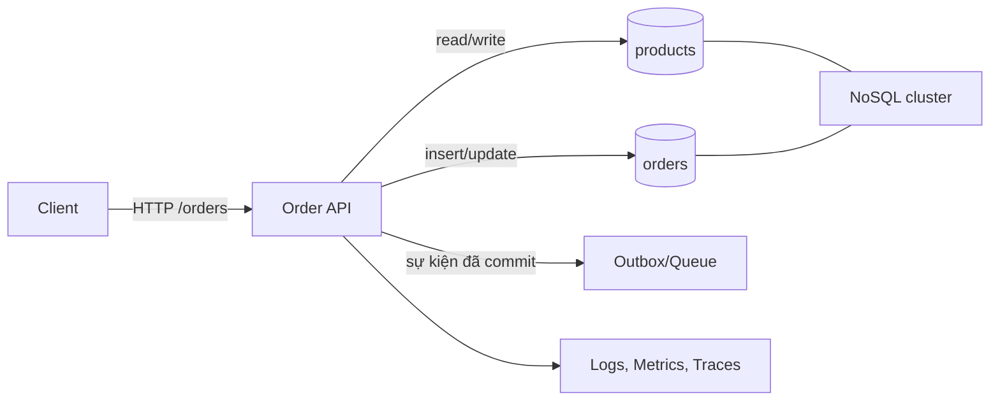
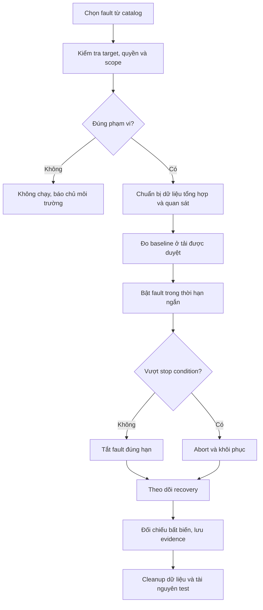

# Lập danh mục lỗi và phạm vi môi trường được phép thử nghiệm

Kiểm thử lỗi và tải cho cơ sở dữ liệu NoSQL không bắt đầu bằng việc ngắt mạng, dừng node hay đẩy thật nhiều yêu cầu vào hệ thống. Trước hết, nhóm phát triển phải biết **lỗi nào cần kiểm chứng**, **tác động kỳ vọng là gì**, **được phép thực hiện thao tác nào**, **trên môi trường và dữ liệu nào**, và **khi nào phải dừng**.

Ví dụ, một bài thử làm chậm đường truyền đến MongoDB có thể là thí nghiệm hợp lý trên replica set riêng trong staging. Cũng thao tác đó, nếu trỏ nhầm sang cluster dùng chung, có thể làm ảnh hưởng những dịch vụ ngoài phạm vi bài thử. Một bài thử tăng lưu lượng đọc DynamoDB cần giới hạn request và ngân sách tiêu thụ; một bài thử failover Redis cần xác định rõ dữ liệu và topology có thể bị ảnh hưởng.

Bài học này hướng dẫn lập **danh mục lỗi có thể kiểm thử** (*fault catalog*) và **phạm vi thử nghiệm được cho phép** (*test scope*). Kết quả mong muốn là một kế hoạch đủ cụ thể để người triển khai biết phải tạo lỗi ở đâu, đo những gì, chứng minh điều kiện phục hồi nào và có được quyền chạy trong môi trường đã chọn hay chưa.

## 1. Phân biệt lỗi, sự cố, tải và phạm vi thử nghiệm

Một số khái niệm cần tách bạch:

| Khái niệm | Ý nghĩa | Ví dụ trong NoSQL |
|---|---|---|
| **Fault (lỗi được đưa vào hoặc điều kiện hỏng)** | Nguyên nhân hoặc điều kiện bất thường có thể kích hoạt vấn đề | Mất kết nối tới một node, tăng độ trễ, giới hạn throughput |
| **Failure (hành vi thất bại quan sát được)** | Hệ thống không đáp ứng cam kết | Yêu cầu tạo đơn timeout, đọc sai phiên bản dữ liệu |
| **Load (tải)** | Mức và mẫu lưu lượng/khối lượng công việc | 300 lượt đọc/giây, burst ghi, truy vấn tập trung vào một partition |
| **Fault injection** | Chủ động mô phỏng một fault để quan sát hệ thống | Chặn kết nối trong proxy của môi trường thử nghiệm |
| **Recovery (phục hồi)** | Trở về trạng thái vận hành đúng sau fault | Tái kết nối, bắt kịp replication, hàng đợi được xử lý |
| **Blast radius (phạm vi ảnh hưởng)** | Số thành phần/người dùng/tài nguyên có thể bị tác động | Một pod, một collection thử nghiệm, toàn cluster |
| **Test scope** | Tập hợp ranh giới đã được duyệt cho một lần thử | Cluster X, namespace Y, trong 10 phút, tối đa N request/giây |

Một lỗi có thể gây nhiều biểu hiện. Ví dụ, tăng latency mạng giữa ứng dụng và database có thể gây timeout ở client, retry tăng đột biến, pool kết nối cạn và cuối cùng kéo dài thời gian phản hồi API. Ngược lại, cùng một biểu hiện HTTP 503 có thể xuất phát từ throttling, failover, pool exhaustion hoặc lỗi trong ứng dụng. Vì vậy, danh mục phải ghi cả **nguyên nhân dự định mô phỏng** lẫn **tín hiệu quan sát và bất biến cần bảo vệ**.

Kiểm thử lỗi và kiểm thử tải cũng khác nhau về mục tiêu:

- **Kiểm thử lỗi:** kiểm tra phát hiện, cô lập, xử lý, retry và phục hồi khi một thành phần bất thường.
- **Kiểm thử tải:** kiểm tra latency, throughput, mức sử dụng tài nguyên và ngưỡng suy giảm dưới những mẫu công việc đã định nghĩa.
- **Kiểm thử kết hợp lỗi và tải:** kiểm tra hệ thống còn giữ được đặc tính cần thiết khi fault xảy ra trong lúc đang phục vụ lưu lượng.

Không gộp cả ba vào một đợt chạy khó truy nguyên. Thường cần thu baseline khi không có fault, thử fault đơn lẻ, rồi mới kết hợp với mức tải được cấp phép.

## 2. Xác định hệ thống và những đường đi dữ liệu cần bảo vệ

Trước khi liệt kê lỗi, vẽ luồng đọc/ghi thực tế của một chức năng. Ví dụ dịch vụ đặt hàng:



Trong một dịch vụ khác, các thành phần có thể là API Gateway, cache Redis, document store MongoDB, bảng DynamoDB, stream CDC hoặc dịch vụ tìm kiếm. Phải xác định **thành phần nào là nguồn dữ liệu chính**, **bản sao nào có thể trễ** và **đường đi nào tạo tác dụng phụ**.

Ghi lại ít nhất:

1. **Các thao tác quan trọng:** đọc theo khóa, ghi có điều kiện, tạo mới, cập nhật nhiều tài liệu, quét dữ liệu, xóa theo TTL, xử lý event.
2. **Cam kết đúng đắn:** unique key, không trừ tồn kho quá số lượng, không mất bản ghi đã xác nhận, không xử lý event hai lần, không trả dữ liệu vượt ranh giới tenant.
3. **Cam kết hiệu năng:** latency p95/p99, throughput mục tiêu, tỷ lệ lỗi được phép, giới hạn hàng đợi và khoảng thời gian phục hồi.
4. **Bảo đảm của datastore:** atomicity trong một tài liệu/item, transaction nhiều tài liệu nếu hỗ trợ, consistency của read, durability/write concern, replication, failover.
5. **Phụ thuộc hạ tầng:** client pool, DNS, network, storage, region/zone, quota và tài nguyên chung.
6. **Môi trường đang tồn tại:** local, CI, sandbox, staging, performance test, production; ai sở hữu, có dữ liệu gì và có được cấp quyền gây fault không.

Không thể đánh giá đúng một lỗi replica failover nếu không biết phiên bản, topology và cơ chế kết nối của cụm đang thử. Không thể diễn giải một stale read nếu chưa biết consistency level được cấu hình.

## 3. Phân nhóm lỗi NoSQL theo nguồn gốc

Danh mục nên phủ các lớp kỹ thuật khác nhau để tránh chỉ thử những lỗi dễ tạo như HTTP timeout.

### 3.1. Lỗi ở đầu vào và tầng ứng dụng

| Nhóm | Tình huống đại diện | Điều cần quan sát |
|---|---|---|
| Dữ liệu không hợp lệ | Thiếu trường bắt buộc, sai kiểu, kích thước tài liệu vượt giới hạn | Validate, phản hồi nhất quán, không ghi dữ liệu hỏng |
| Khóa/điều kiện xung đột | Duplicate key, CAS/version mismatch, conditional write thất bại | Phân biệt conflict nghiệp vụ với lỗi tạm thời |
| Retry lặp | Client gửi lại cùng idempotency key sau timeout | Không tạo trùng, không áp dụng tác dụng phụ hai lần |
| Hủy yêu cầu | Client disconnect giữa thao tác dài | Trạng thái commit được xác định hoặc có cơ chế truy hồi |
| Pool cạn | Nhiều request cùng chờ kết nối DB | Giới hạn chờ, điều phối concurrency, không gây retry storm |
| Serialization/schema drift | Phiên bản dịch vụ cũ và mới dùng cấu trúc trường khác nhau | Tương thích đọc/ghi, lỗi có thông tin và không làm mất dữ liệu |

Những tình huống này thường kiểm thử được ở unit test và integration test trước khi cần mô phỏng lỗi hạ tầng.

### 3.2. Lỗi của database và hành vi nhất quán

| Nhóm | Tình huống đại diện | Rủi ro |
|---|---|---|
| Query/Index | Thiếu index, truy vấn chuyển sang scan, index build đang chạy | Latency cao, CPU tăng, ảnh hưởng tải ghi |
| Throttling/Quota | Vượt giới hạn read/write capacity hoặc rate limit | Lỗi có thể retry; backlog tăng; chi phí tăng |
| Hot key/Hot partition | Phần lớn request truy cập cùng một khóa/partition | Một phần cluster quá tải dù tổng tải chưa cao |
| Replication lag | Bản sao chưa bắt kịp primary | Đọc thấy dữ liệu cũ; test đọc từ replica phải đúng consistency contract |
| Election/Failover | Primary thay đổi hoặc node mất kết nối | Gián đoạn ngắn, retry, kết quả commit có thể chưa rõ |
| Transaction conflict | Nhiều transaction ghi dữ liệu chung | Abort/retry, tăng latency, cần giữ bất biến |
| TTL/Compaction | Tập bản ghi hết hạn hoặc compaction tạo áp lực tài nguyên | Dữ liệu biến mất theo chính sách, disk/CPU tăng |
| Capacity/Storage | Gần quota dung lượng hoặc hạn chế IOPS | Ghi chậm/thất bại, tăng độ trễ nền |
| Backup/Restore | Khôi phục thiếu dữ liệu mới hoặc sai thời điểm | RPO/RTO và tính nhất quán sau phục hồi |

Một fault có thể không mang cùng ý nghĩa giữa các hệ quản trị. MongoDB multi-document transaction, DynamoDB conditional write và Redis atomic script có các giới hạn và bảo đảm khác nhau; danh mục cần ghi chính xác cơ chế đang được thử thay vì gán nhãn “NoSQL transaction” chung.

### 3.3. Lỗi mạng, hạ tầng và vận hành

- **Kết nối:** timeout, reset, DNS thất bại, connection refused, packet loss hoặc tăng latency.
- **Node/process:** một instance khởi động lại, mất health check hoặc không thể tham gia cluster.
- **Phân vùng mạng:** node mất kết nối với peer, client chỉ tới được một phần topology.
- **AZ/region:** một vùng khả dụng gặp sự cố; chỉ thử khi kiến trúc có cơ chế dự phòng và môi trường được phép.
- **Tài nguyên:** CPU, memory, file descriptor, số kết nối hoặc disk I/O chạm ngưỡng.
- **Cấu hình/bảo mật:** hết hạn credential, thiếu quyền, chứng chỉ TLS sai; cần phân biệt từ chối truy cập với database không sẵn sàng.
- **Phụ thuộc bên ngoài:** queue, cache, search index, dịch vụ cấp khóa hoặc mạng tới hệ thống khác gặp lỗi.

Đây là **danh mục các kịch bản để cân nhắc**, không phải danh sách thao tác được phép mặc nhiên thực hiện. Mỗi kịch bản phải gắn quyền, mức rủi ro và môi trường cụ thể.

## 4. Thiết kế mẫu danh mục lỗi (*fault catalog*)

Một danh mục hữu ích cần nhiều hơn tên lỗi. Mỗi mục đủ thông tin để một người khác đọc và hiểu được thử nghiệm mà không đoán cách gây lỗi hoặc kỳ vọng.

| Trường | Nội dung cần ghi |
|---|---|
| `id`, `name` | Mã ổn định và tên dễ nhận biết |
| `system / dependency` | Dịch vụ, DB, collection/table/cache và luồng dữ liệu |
| `fault_model` | Lỗi được mô phỏng; phân biệt nguyên nhân với triệu chứng |
| `preconditions` | Dữ liệu, topology, index, workload và trạng thái ban đầu |
| `injection_point` | Tầng client, proxy, service, node hay cơ chế điều khiển của nhà cung cấp |
| `method` | Cách mô phỏng bằng fixture, stub, proxy, failpoint hoặc kịch bản tải |
| `expected_behavior` | Retry, rollback, fallback, error response và trạng thái sau cùng |
| `invariants` | Điều luôn phải đúng, dù lỗi xảy ra |
| `observability` | Log, trace, metric, query/audit và bằng chứng |
| `allowed_environment` | Môi trường và tài nguyên được cấp quyền |
| `risk / blast_radius` | Mức ảnh hưởng và phạm vi có thể lan tới |
| `duration / limits` | Thời gian, số request, concurrency, dữ liệu, chi phí |
| `stop_conditions` | Ngưỡng dừng ngay nếu phát hiện tác động ngoài dự kiến |
| `recovery / cleanup` | Cách hoàn nguyên, kiểm tra phục hồi, chủ sở hữu |
| `owner / approval` | Người chịu trách nhiệm và chấp thuận nếu cần |
| `evidence` | Run ID, timestamp, cấu hình, ảnh/biểu đồ và kết quả |

Có thể dùng một bảng tổng quan để ưu tiên, còn mỗi kịch bản có một record YAML chi tiết. Việc tách này giữ danh mục dễ đọc và dễ truy vết.

### 4.1. Ví dụ danh mục cho dịch vụ đặt hàng

Giả sử hệ thống sử dụng MongoDB lưu `orders` và `products`, kèm Redis cache. Những mã dưới đây chỉ minh họa phạm vi; quyền thực tế do nhóm quản lý môi trường xác nhận.

| ID | Fault/kịch bản | Bất biến hoặc kỳ vọng | Môi trường đề xuất | Rủi ro |
|---|---|---|---|---|
| F-001 | Cập nhật với `version` cũ | Không ghi đè cập nhật mới | Local/CI | Thấp |
| F-002 | Hai request cùng tạo `orderId` | Chỉ có một đơn bền vững | Local/CI | Thấp |
| F-003 | Timeout ở client sau khi commit | Retry cùng khóa không tạo trùng | Local/CI/Sandbox | Thấp–vừa |
| F-004 | Transaction bị write conflict | Không commit một phần, retry đúng | CI/Sandbox | Vừa |
| F-005 | Replica read bị trễ | Ứng dụng giữ đúng cam kết consistency | Staging riêng | Vừa |
| F-006 | Một node replica mất kết nối | Tính sẵn sàng và khả năng phục hồi phù hợp topology | Staging riêng được duyệt | Cao |
| F-007 | Hot key dưới tải | Phát hiện saturation, latency và throttle | Performance test | Vừa–cao |
| F-008 | Cache Redis không phản hồi | Fallback đúng và không gây quá tải DB chính | Sandbox/Staging | Vừa |
| F-009 | Credential DB hết hiệu lực | Trả lỗi có kiểm soát, không rò bí mật | CI/Sandbox | Vừa |
| F-010 | Thử vượt giới hạn kết nối | Backpressure, pool không treo vô hạn | Performance test | Cao |
| F-011 | Mất dữ liệu rồi khôi phục bản sao thử nghiệm | Đạt RPO/RTO đã định nghĩa | Môi trường phục hồi biệt lập | Cao |
| F-012 | Quét dữ liệu lớn hoặc index thiếu | Đo latency và giới hạn tác động query | Dataset tổng hợp, staging/perf riêng | Vừa–cao |

Ở F-011, “mất dữ liệu” chỉ được tạo trên bản sao hoặc tài nguyên thử nghiệm có thể xóa bỏ; đây không phải quyền xóa dữ liệu của hệ thống đang phục vụ người dùng.

### 4.2. Ví dụ một record chi tiết

```yaml
id: F-003
name: "Client timeout sau khi đơn hàng đã commit"
system: order-service
dependency: mongodb-orders
category: client_network_ambiguity
objective: "Retry cùng requestId không tạo đơn hoặc trừ kho lần hai"
preconditions:
  - "Cluster test riêng, có transaction support"
  - "orders chứa dữ liệu tổng hợp, products.available = 2"
  - "Chưa tồn tại requestId = test-req-003"
injection_point: "Adapter giữa API và DB, chỉ trong test harness"
method: "Cho transaction commit, sau đó mô phỏng mất response"
workload:
  request_id: test-req-003
  quantity: 1
  attempts: 2
expected_behavior:
  - "Request thứ hai truy hồi kết quả đã tạo"
  - "Chỉ một order được xác nhận"
invariants:
  - "orders.count(requestId) == 1"
  - "available_final == available_initial - 1"
allowed_environment: [local, ci, sandbox]
blast_radius: "Một bộ dữ liệu test, một service instance"
limits:
  duration_seconds: 60
  concurrent_clients: 2
stop_conditions:
  - "Phát hiện kết nối ngoài danh sách tài nguyên test"
  - "Thay đổi bất kỳ dữ liệu không có tiền tố test-"
recovery:
  - "Ngừng injector"
  - "Xóa dữ liệu tổng hợp của run sau khi đã lưu bằng chứng"
owner: "order-service-team"
evidence:
  - "run_id, logs, traces"
  - "Trạng thái orders/products trước và sau"
```

Record trên là **đặc tả thử nghiệm**, không phải cú pháp để MongoDB hay một công cụ chaos tự thực thi. Cần ánh xạ nó thành fixture/harness cụ thể và thực hiện bước xác nhận quyền trước khi chạy.

## 5. Xác lập phạm vi môi trường được phép thử

Không có một quyền “được thử staging” chung cho mọi loại fault. Cùng một staging có thể phục vụ tích hợp của nhiều đội; dừng database ở đó có thể phá hỏng công việc của đội khác. Một quyết định phải gắn với **hành động cụ thể, target cụ thể và khoảng thời gian cụ thể**.

### 5.1. Các lớp môi trường

| Môi trường | Đặc điểm điển hình | Loại thử thường phù hợp | Giới hạn quan trọng |
|---|---|---|---|
| **Local** | DB/container do một người hoặc test job sở hữu | Dữ liệu sai, CAS conflict, tạo trùng, disconnect ở proxy | Không được dùng endpoint production được lấy từ biến môi trường |
| **CI/Testcontainers** | Tài nguyên cách ly, tái tạo từ đầu | Regression, fault deterministic, transaction rollback | Thời gian và quota runner; topology phải mô phỏng đúng tính năng được kiểm |
| **Sandbox** | Tài nguyên riêng cho thí nghiệm | Throttle, lỗi mạng tới proxy test, retry, dữ liệu tổng hợp | Không đi qua service/shared DB của nhóm khác |
| **Staging** | Gần cấu hình vận hành thật | Failover có kiểm soát, replication, integration toàn tuyến | Cần biết các nhóm sử dụng, lịch thử, khả năng hoàn nguyên |
| **Performance test** | Tài nguyên và tập dữ liệu được chuẩn bị cho tải | Load, stress, soak, hot partition | Giới hạn tài nguyên, chi phí và lưu lượng tới dependency khác |
| **Production** | Phục vụ người dùng thật | Quan sát thụ động, synthetic nhỏ hoặc thử nghiệm có phê duyệt rõ | Mặc định không gây fault hoặc stress; mọi thay đổi phải qua quy trình vận hành tương ứng |

Đây là **gợi ý phân loại**, không phải giấy phép tự động. Ví dụ, “staging riêng” có thể vẫn nối chung queue hoặc dịch vụ thanh toán; phải kiểm tra đường đi dữ liệu trước khi phê duyệt fault.

### 5.2. Ma trận quyền theo hành động

Quy định nên mô tả **được phép**, **cần duyệt bổ sung**, hoặc **không được phép trong phạm vi hiện tại**. Ví dụ với dự án học tập:

| Hành động | Local/CI riêng | Sandbox riêng | Staging dùng chung | Production |
|---|---|---|---|---|
| Inject lỗi ở mock/client adapter | Được | Được nếu chỉ tác động service test | Cần duyệt | Không mặc định |
| Tạo request trùng trên dữ liệu tổng hợp | Được | Được trong quota | Cần xác nhận tenant/dataset | Không mặc định |
| Tăng tải đến giới hạn đã duyệt | Trong quota máy | Trong quota sandbox | Cần duyệt và phối hợp | Không mặc định |
| Thêm network latency tới endpoint DB | Được trong topology riêng | Được khi toàn bộ đường mạng riêng | Cần duyệt và giới hạn blast radius | Không mặc định |
| Kill/restart node database | Được với node disposable | Chỉ khi cluster riêng và có quyền | Thường cần kế hoạch vận hành riêng | Không mặc định |
| Thay đổi index, TTL hoặc cấu hình cluster | Được trên dữ liệu test | Cần kế hoạch hoàn nguyên | Cần duyệt | Không mặc định |
| Xóa dữ liệu hoặc mô phỏng hỏng storage | Chỉ dữ liệu disposable | Chỉ bản sao phục hồi biệt lập | Không mặc định | Không mặc định |

“Được” ở bảng ví dụ chỉ mang nghĩa *có thể cấp quyền trong phạm vi tài nguyên thử nghiệm riêng*. Nó không thay thế quyền truy cập thực tế, chính sách vận hành hay xác nhận của chủ môi trường.

### 5.3. Mô tả phạm vi thành một hợp đồng chạy

Mỗi lần chạy cần chốt đủ sáu chiều sau:

1. **Target:** project/account, cluster ID, endpoint, namespace, collection/table, cache và service instance được phép.
2. **Dữ liệu:** tenant/test prefix, số lượng bản ghi, dữ liệu tổng hợp hoặc bản sao đã ẩn thông tin; có được ghi/xóa hay không.
3. **Thao tác:** loại fault, công cụ injector, quyền restart, quyền sửa cấu hình, có được tăng tải hay không.
4. **Ngân sách:** concurrency, QPS/RPS, thời lượng, CPU/memory, quota dịch vụ, cost cap nếu dùng cloud.
5. **Thời điểm/người chịu trách nhiệm:** cửa sổ thực hiện, chủ môi trường, người giám sát và kênh cảnh báo.
6. **Điểm dừng/khôi phục:** abort trigger, cách tắt injector, rollback, thời hạn cleanup, tiêu chí nghiệm thu sau phục hồi.

Một chuỗi kết nối như `mongodb://localhost` hoặc biến `APP_ENV=staging` **không đủ** để chứng minh target an toàn: port forwarding và DNS alias có thể khiến nó trỏ tới cụm khác. Khi hệ thống hỗ trợ, kiểm tra cả danh tính cụm/account thực tế, database và namespace trước khi thực hiện.

## 6. Đặt giới hạn tác động và điều kiện dừng

Phạm vi thử nghiệm cần được thực thi bằng cơ chế kỹ thuật, không chỉ nằm trong văn bản.

### 6.1. Những giới hạn nên có

- **Allowlist tài nguyên:** chỉ kết nối đến cluster/account/database đã xác nhận; chặn mọi target ngoài danh sách.
- **Định danh dữ liệu thử:** dùng tiền tố `test-<runId>`, tenant test hoặc database/collection biệt lập; không dùng dữ liệu người dùng thật.
- **Tài khoản ít quyền:** credential dành riêng cho test; không cấp quyền quản trị toàn cluster nếu chỉ cần ghi một collection.
- **Rate limiter:** giới hạn RPS và concurrency của generator; ngăn retry nhân lưu lượng vượt hạn.
- **Thời hạn tự kết thúc:** injector có timeout, test có deadline; fault được tháo khi run hoàn tất hoặc abort.
- **Kiểm soát phụ thuộc:** chặn hoặc thay thế external email/payment/event consumer nếu chúng không thuộc phạm vi.
- **Một biến tại một thời điểm:** đo baseline trước, chỉ bật đúng fault được đăng ký rồi đo recovery.
- **Khả năng truy vết:** gắn `runId` vào logs, traces, tên dataset và nhãn workload.

Không đủ để tắt một máy phát tải nếu một hàng đợi đã tích lũy hàng nghìn tác vụ retry. Điểm dừng phải tính đến cả *hậu quả sau khi injector tắt*, ví dụ backlog còn tăng hoặc hệ thống vẫn tiếp tục retry.

### 6.2. Ngưỡng dừng minh họa

Ngưỡng thực tế phải xuất phát từ SLO, ngân sách và mức ổn định của môi trường. Một hợp đồng thử nghiệm có thể quy định:

| Tín hiệu | Quy tắc dừng ví dụ |
|---|---|
| Mục tiêu | Cluster/namespace quan sát được khác allowlist |
| Dữ liệu | Có thay đổi ngoài dataset được gắn `runId` |
| Sức khỏe | Error rate vượt ngưỡng duyệt trong một cửa sổ đủ dài |
| Hiệu năng | p99 latency vượt ngưỡng bảo vệ liên tiếp nhiều cửa sổ |
| Dung lượng | Disk free, memory, CPU hoặc connection count vượt ngưỡng rủi ro |
| Hàng đợi/retry | Backlog hoặc retries tiếp tục tăng dù tải đầu vào đã dừng |
| Nhân sự | Mất người chịu trách nhiệm giám sát trong đợt thử |
| Thời gian | Hết thời lượng hoặc cửa sổ được phép |

Tránh đặt quy tắc “error rate > 0 thì dừng” cho bài thử cố tình gây timeout; cần phân biệt **lỗi dự kiến trong cohort test** với **lỗi lan sang lưu lượng ngoài test**. Một lỗi chỉ được xem là “dự kiến” nếu đã định nghĩa trước, có giới hạn và có chỉ số phục hồi rõ ràng.

## 7. Chọn cách tạo lỗi theo mức độ an toàn

Ưu tiên mô phỏng gần nhất với giả thuyết, trong phạm vi nhỏ nhất đủ để cung cấp bằng chứng:

| Cách tạo lỗi | Phù hợp | Hạn chế |
|---|---|---|
| **Stub/mock có kiểm soát** | Response lỗi, retry policy, timeout phía ứng dụng | Không chứng minh hành vi của driver/cluster thật |
| **Integration test trên DB riêng** | Unique index, CAS, transaction, schema/index behavior | Cần topology tương ứng với production |
| **Proxy mạng chỉ cho test process** | Latency, packet loss, reset, disconnect | Cần xác nhận không ảnh hưởng tiến trình khác |
| **Throttling giả lập tại adapter** | Backoff, circuit breaker, admission control | Không mô phỏng mọi nguyên nhân từ DB provider |
| **Quota/capacity test trên môi trường riêng** | Hot partition, pool exhaustion, giới hạn tải | Có nguy cơ chi phí và saturation |
| **Failover của replica set riêng** | Cơ chế phát hiện primary mới và xử lý kết nối | Rủi ro cao hơn; cần điều kiện rollback/cleanup |
| **Restore diễn tập từ bản sao** | RPO/RTO, tính dùng được của backup | Phải tách biệt đường ghi và namespace thật |

Với MongoDB, muốn thử giao dịch nhiều tài liệu cần topology có hỗ trợ transaction. Với DynamoDB, các lỗi throughput và throttling phụ thuộc capacity mode, quota và đặc điểm partition; cần xác nhận thông số của bảng test. Với Redis, lỗi mất cache khác lỗi mất nguồn dữ liệu chính: cache có thể tái tạo, còn Redis đóng vai trò dữ liệu chính thì kiểm thử phải tính đến persistence và replication.

Đừng đánh đồng giả lập lỗi tại adapter với bằng chứng cluster đã chịu được failover. Đặt mỗi phương pháp đúng tên trong danh mục để người đọc biết mức độ bằng chứng.

## 8. Cấu hình phạm vi có thể đọc được bằng máy

Một cấu hình ví dụ cho runner thử nghiệm:

```yaml
scope_version: 1
run_id: "nosql-fault-2026-001"
environment: "sandbox"
target:
  provider: "self-managed"
  cluster_id: "mongodb-sandbox-orders-01"
  database: "orders_fault_test"
  collections: ["orders_test", "products_test"]
  required_resource_tags:
    purpose: "fault-test"
    owner: "order-service-team"
data:
  kind: "synthetic"
  namespace_prefix: "test-nosql-fault-2026-001-"
  max_documents: 10000
permissions:
  allowed_scenarios: ["F-001", "F-002", "F-003", "F-004"]
  allowed_actions: ["insert", "find", "update", "transaction"]
  destructive_cluster_operations: false
limits:
  max_duration_seconds: 600
  max_clients: 8
  max_requests_per_second: 20
  retry_max_attempts: 3
  retry_backoff_ms: 100
observability:
  run_id_label: "nosql-fault-2026-001"
  metrics: ["request_latency", "error_rate", "db_connections",
            "db_retries", "db_conflicts"]
abort:
  on_target_mismatch: true
  on_out_of_scope_write: true
  on_unexpected_dependency_error: true
recovery:
  stop_injector: true
  verify_invariants: true
  cleanup_test_namespace: true
```

**Các con số chỉ minh họa**, không phải mức tải an toàn cho mọi cluster. Cấu hình này là đầu vào cho test harness, không tự cấp quyền truy cập. Việc xác thực người duyệt, account, resource tag và target thực tế cần do cơ chế vận hành của nhóm thực hiện.

Một lớp bảo vệ đơn giản cho Java có thể từ chối chạy nếu scope thiếu hoặc sai. Ví dụ:

```java
import java.util.Set;

public final class FaultRunGuard {
    private static final Set<String> NON_PROD = Set.of("local", "ci", "sandbox");

    private FaultRunGuard() {}

    public static void assertAllowed(
            String environment,
            String actualClusterId,
            String approvedClusterId,
            String database,
            String runId,
            boolean syntheticData) {

        if (!NON_PROD.contains(environment)) {
            throw new IllegalStateException("Môi trường chưa được phép");
        }
        if (actualClusterId == null || approvedClusterId == null
                || !actualClusterId.equals(approvedClusterId)) {
            throw new IllegalStateException("Cluster ngoài phạm vi cho phép");
        }
        if (database == null || !database.endsWith("_fault_test")) {
            throw new IllegalStateException("Database không phải namespace test");
        }
        if (runId == null || !runId.startsWith("nosql-fault-")) {
            throw new IllegalStateException("Thiếu runId test");
        }
        if (!syntheticData) {
            throw new IllegalStateException("Chỉ được dùng dữ liệu tổng hợp");
        }
    }
}
```

`actualClusterId` phải được xác định từ nguồn đáng tin cậy do môi trường cung cấp, không đơn thuần sao chép giá trị `approvedClusterId` từ cùng một cấu hình. Đây là **lớp bảo vệ bổ sung**: nó không thay thế kiểm tra quyền trên tài nguyên thật, network policy, giới hạn IAM hay phê duyệt vận hành.

Một test runner phù hợp sẽ kiểm tra scope **trước khi tạo connection đến target và trước khi phát bất kỳ lưu lượng nào**, sau đó tiếp tục kiểm tra target/namespace trong thời gian chạy nếu có thể.

## 9. Chuẩn bị số đo và điều kiện nghiệm thu cho mỗi fault

Danh mục sẽ không mang lại giá trị nếu thử xong chỉ ghi “service vẫn chạy”.

### 9.1. Chỉ số nền (*steady state*)

Trước khi tạo fault, quan sát trong một khoảng đủ đại diện:

- **Phía client/API:** request rate, tỷ lệ `2xx/4xx/5xx`, timeout, latency p50/p95/p99, in-flight request.
- **Driver:** connection pool in use/waiting, timeout tạo connection, retry count, lỗi định tuyến/selection.
- **Database:** read/write throughput, CPU, memory, I/O, disk free, số connection, lock/conflict, cache hit, replication lag, throttle.
- **Hàng đợi/phụ thuộc:** queue depth, thời gian xử lý, retry queue, số message trùng nếu có.
- **Dữ liệu:** số order, số request ID duy nhất, tồn kho và các bất biến nghiệp vụ.

Latency và error rate phải được xem trên **cửa sổ có mốc thời gian**; trung bình toàn bộ lần chạy có thể che mất đỉnh lỗi trong vài chục giây failover.

### 9.2. Định nghĩa expected behavior có thể kiểm chứng

Ví dụ cho F-003:

```text
Trước lỗi:
  products.available = 2
  orders không có requestId "test-req-003"

Tác động:
  transaction tạo order + trừ kho commit thành công
  nhưng client giả lập không nhận được response

Sau đó:
  client retry với đúng requestId, cùng payload

Assert:
  số đơn của requestId == 1
  products.available == 1
  lần retry trả kết quả từ đơn cũ
  không có event thanh toán/gửi hàng bị phát hai lần
```

Ví dụ cho một lỗi tăng độ trễ kết nối ở sandbox:

```text
Trước lỗi:
  p95 latency, error rate và connection count ổn định

Tác động:
  proxy của riêng service test thêm latency trong 60 giây

Trong lỗi:
  các yêu cầu vượt deadline được timeout có kiểm soát
  retry có giới hạn, không tạo lượng kết nối không giới hạn

Sau khi tắt injector:
  latency và error rate quay lại ngưỡng baseline đã chấp thuận
  không còn backlog phát sinh tăng mãi
  trạng thái dữ liệu vẫn đáp ứng invariants
```

Đặt ngưỡng đo được trước khi chạy, chẳng hạn “p95 quay về dưới ngưỡng SLO trong 2 phút sau khi hết lỗi”, nếu đó là mục tiêu đã được nhóm chấp thuận. Không bổ sung ngưỡng sau khi thấy kết quả để biến một thất bại thành “đạt”.

## 10. Mẫu kế hoạch chạy lỗi và tải

Một run nên có nhịp rõ ràng:



### 10.1. Ví dụ một buổi thử trong sandbox riêng

| Pha | Hoạt động | Dữ liệu cần lưu |
|---|---|---|
| Preflight | Xác minh cluster ID, tag môi trường, quyền, namespace, bảng danh mục và stop switch | Scope đã duyệt; snapshot cấu hình |
| Warm-up | Chạy tải nhỏ để ổn định client pool và cache | Mốc thời gian warm-up |
| Baseline | Giữ mức tải đã duyệt, không gây lỗi | p95/p99, error rate, DB metrics |
| Injection | Bật duy nhất fault F-xxx có thời hạn | Injection start/end, nhật ký injector |
| Recovery | Tắt injector, tiếp tục quan sát tới thời hạn đã định | Thời điểm phục hồi, backlog, replication lag |
| Validation | Đối chiếu bất biến và kết quả request | So sánh dữ liệu trước/sau, log/traces |
| Cleanup | Gỡ cấu hình test, xóa dữ liệu tổng hợp, xác nhận tài nguyên lành mạnh | Biên bản cleanup và trạng thái cuối |

Đối với load test, mô tả thêm tỷ lệ đọc/ghi, phân bố key, payload size, concurrency, rate, mô hình tăng tải, thời lượng và phân bố trạng thái dữ liệu. Ví dụ “100 RPS” là quá thiếu nếu 99% request dồn vào một partition, trong khi cấu hình chuẩn phân tán đều trên 1 triệu key.

### 10.2. Ba cấp độ thử nghiệm theo thứ tự hợp lý

**Cấp 1 — Correctness trên dữ liệu nhỏ:** lỗi validation, duplicate key, CAS conflict, transaction abort, retry và timeout giả lập. Ưu tiên deterministic test trong local/CI.

**Cấp 2 — Resilience trên thành phần riêng:** network latency, throttle, replica lag, proxy restart, connection pool cạn có giới hạn. Cần sandbox/staging riêng và baseline quan sát.

**Cấp 3 — Capacity và khôi phục hạ tầng:** hot partition, soak, failover, backup/restore và kết hợp lỗi với tải cao. Chỉ dùng môi trường, dataset, hạn mức và người chịu trách nhiệm phù hợp; phải có thời gian khôi phục và ngân sách chi phí rõ ràng.

Không có yêu cầu mọi hệ thống phải thực hiện đủ cả ba cấp ngay lập tức. Thứ tự ưu tiên xuất phát từ mức độ rủi ro nghiệp vụ, lịch sử incident và mức độ trưởng thành của môi trường thử.

## 11. Ghi nhận kết quả và khả năng tái hiện

Sau mỗi run, lưu một bản ghi:

```yaml
run_id: "nosql-fault-2026-001"
catalog_id: "F-003"
scope_revision: "scope-v1"
environment: "sandbox"
target_cluster_id: "mongodb-sandbox-orders-01"
started_at: "2026-11-14T10:00:00Z"
ended_at: "2026-11-14T10:02:00Z"
workload:
  requests: 2
  concurrent_clients: 1
injection:
  type: "drop_response_after_commit"
  duration_seconds: 1
observed:
  request_retries: 1
  committed_orders: 1
  stock_delta: -1
assertions:
  unique_request_id: "PASS"
  no_duplicate_stock_decrement: "PASS"
  recovery_within_scope: "PASS"
cleanup: "DONE"
evidence:
  logs: "artifact://example/logs"
  metrics: "artifact://example/metrics"
notes: "Dữ liệu minh họa; thay bằng đường dẫn artifact thực tế"
```

Khi có lỗi, ghi rõ **thử nghiệm thất bại theo tiêu chí nào**: vượt SLO, vi phạm bất biến, dừng vì blast radius, hay runner không đủ bằng chứng. Một lần thử bị abort do target mismatch là thành công của cơ chế bảo vệ, nhưng không chứng minh tính chịu lỗi của database.

Kết quả cần lưu phiên bản ứng dụng, driver, DB, topology, dataset seed và cấu hình retry/timeout. Một bug chỉ xảy ra khi có hot partition và write conflict có thể biến mất nếu chỉ chạy lại với một key phân bố khác.

## 12. Những nhầm lẫn cần tránh

| Nhầm lẫn | Vì sao nguy hiểm | Cách làm đúng |
|---|---|---|
| Có credential nghĩa là được phép chaos test | Quyền kỹ thuật không đồng nghĩa với chấp thuận gây gián đoạn | Xác nhận scope cho từng hành động và target |
| Có tên `staging` nên hoàn toàn an toàn | Staging có thể dùng chung dependency thật | Xác minh endpoint, account, queue, tenant và blast radius |
| Đã bật chaos tool thì mọi failure mode đều được kiểm | Injector chỉ chứng minh fault đã tạo theo cách nào đó | Gắn từng case với giả thuyết, expected behavior và evidence |
| Chỉ test lỗi HTTP 500 | Bỏ qua write conflict, stale read, duplicate key, ambiguous commit | Liệt kê lỗi ở driver, DB, network, replication, nghiệp vụ |
| Load test chỉ có một con số RPS | Không thấy hot partition và khác biệt read/write ratio | Ghi workload mix, key distribution, payload, duration |
| Response timeout nghĩa là DB chưa ghi | Commit có thể đã thành công, phản hồi bị mất | Dùng idempotency key và xác nhận trạng thái đã lưu |
| Tắt injector là đã phục hồi | Retry queue, cache, replication còn chưa bắt kịp | Đo đến khi hệ thống ổn định và kiểm bất biến |
| Dùng dữ liệu thật để “giống production” | Rủi ro riêng tư và tác động ngoài phạm vi | Dùng dữ liệu tổng hợp hoặc bản sao đã xử lý theo quy định |
| Cho phép test vô thời hạn | Lỗi hoặc generator có thể tiếp tục gây tải | Đặt deadline, giới hạn concurrency và stop trigger |
| Chỉ lưu PASS/FAIL | Không truy lại được nguyên nhân và lịch chạy | Lưu config, timestamps, metrics, traces và trạng thái DB |

## 13. Bài thực hành: lập catalog và scope cho dịch vụ NoSQL

**Bối cảnh:** một API quản lý giỏ hàng dùng Redis làm cache và MongoDB làm nguồn dữ liệu chính. API có `GET /carts/{id}`, `POST /carts/{id}/items` và `DELETE /carts/{id}/items/{itemId}`. Service cần chống mất cập nhật giỏ hàng, xử lý retry và duy trì khả năng trả dữ liệu khi cache lỗi.

**Yêu cầu thực hành:**

1. Vẽ luồng request từ API qua cache và datastore; chỉ ra thao tác nào phải đọc nguồn chính và thao tác nào có thể chấp nhận cache stale.
2. Nêu ít nhất **tám fault** ở tối thiểu bốn lớp: đầu vào/ứng dụng, driver/database, mạng/hạ tầng và tải.
3. Với mỗi fault, lập record có `id`, nguyên nhân, điều kiện ban đầu, phương pháp tạo, bất biến, chỉ số quan sát, phạm vi ảnh hưởng, môi trường, giới hạn và cleanup.
4. Chọn hai fault kiểm thử được trong local/CI; một fault thử trên sandbox. Viết ma trận quyền minh họa cho từng thao tác và giải thích vì sao fault có blast radius cao bị loại khỏi phạm vi hiện tại.
5. Chọn một lỗi timeout sau ghi và một lỗi cache không phản hồi. Mô tả trạng thái kỳ vọng của giỏ hàng, retry, fallback và dấu hiệu hệ thống đã phục hồi.
6. Viết `scope.yml` tương tự mẫu trên, trong đó có đúng target test, dataset tổng hợp, thời hạn và điều kiện dừng.
7. Chuẩn bị mẫu báo cáo run: baseline, thời điểm injection, kết quả request, trạng thái MongoDB sau cùng và trạng thái cleanup.

**Ví dụ tiêu chí nghiệm thu:** nếu hai request cùng cập nhật giỏ hàng với một phiên bản cũ, hệ thống phải giữ được chính sách kiểm soát xung đột đã thiết kế; nếu Redis bị ngắt trong phạm vi sandbox, MongoDB vẫn là nguồn dữ liệu chuẩn, hệ thống chỉ fallback trong giới hạn tải đã cho phép; khi kết thúc thử, không còn injector và không còn dữ liệu test ngoài namespace.

Điều quan trọng nhất của bài thực hành là người chạy có thể trả lời bốn câu hỏi bằng chứng cứ cụ thể: *ta định tạo lỗi gì, trên tài nguyên nào, hệ thống phải giữ điều gì, và bằng cách nào biết mọi tác động đã kết thúc?* Một fault catalog và test scope trả lời rõ bốn câu hỏi này chính là nền tảng để kiểm thử lỗi và tải NoSQL có thể lặp lại, phân tích được và vận hành an toàn.
