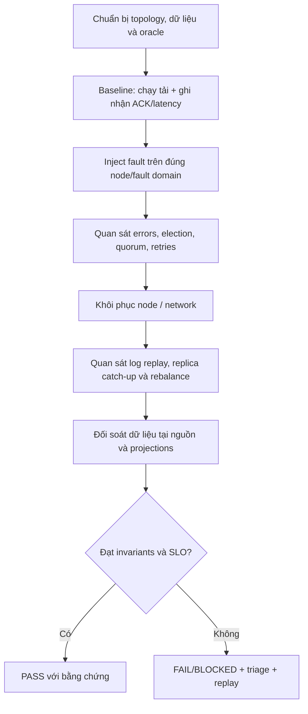
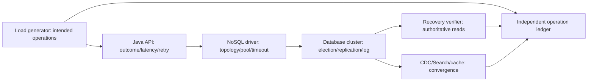

# Dừng nút, khởi động lại và theo dõi phục hồi dữ liệu

## 1. Tình huống mở đầu: dịch vụ đã xanh nhưng dữ liệu đã trở lại đúng chưa?

Một ứng dụng Java ghi đơn hàng vào cụm NoSQL ba nút, có sao chép giữa các nút. Trong bài kiểm thử, ứng dụng liên tục tạo đơn hàng và ghi nhật ký từng thao tác. Nhóm vận hành dừng một nút đang giữ vai trò primary/leader, đợi cụm tự bầu leader mới, sau đó khởi động lại nút vừa dừng.

Dashboard báo:

```text
10:00:00  Tải nền: 500 requests/s
10:00:10  Node N1 dừng
10:00:12  Ứng dụng xuất hiện timeout
10:00:18  Leader mới nhận writes
10:00:35  Node N1 khởi động
10:00:43  Node N1 báo process healthy
10:01:10  Replica catch-up hoàn tất
```

Nếu chỉ thấy `N1 healthy` và tổng số documents gần như không đổi rồi kết luận **PASS**, có thể bỏ sót:

- Một lệnh ghi trả ACK đã biến mất sau failover do thiết lập durability không đúng kỳ vọng.
- Một lệnh bị timeout thực tế đã commit nhưng client retry bằng ID khác, tạo đơn trùng.
- Nút trở lại ở trạng thái `RUNNING` nhưng còn replication lag nên đọc qua nó thấy dữ liệu cũ.
- Một bản ghi đã xóa bị phục hồi sai do log/tombstone/repair.
- CDC, cache hoặc Search read model vẫn lệch nhiều phút sau khi database ổn định.
- Cụm đã có leader nhưng ứng dụng Java vẫn giữ địa chỉ cũ và tiếp tục timeout.
- Dữ liệu đúng nhưng thời gian không phục vụ vượt SLO/RTO.

**Dừng nút và khởi động lại không chỉ kiểm tra xem database có chạy lại hay không.** Đây là bài kiểm thử phối hợp giữa fault tolerance, tính bền vững của writes, mô hình nhất quán, phục hồi replica, driver retry và khả năng quan sát end-to-end.

Bài học thuộc **Database No SQL → Kiểm thử lỗi và tải**, hướng dẫn thiết kế và triển khai thử nghiệm có kiểm soát, đo đạc được, có điều kiện PASS/FAIL rõ ràng và không làm tổn hại dữ liệu production.

---

## 2. Mục tiêu học tập

Sau bài này, bạn có thể:

1. Phân biệt dừng tiến trình có trật tự, kill cưỡng bức, restart máy, mất mạng và mất ổ đĩa.
2. Xác định fault domain: process, container, VM, node, zone, rack, region.
3. Nêu đúng bảo đảm về acknowledged writes, durability, quorum và nhất quán đọc.
4. Thiết kế baseline, workload, fault injection, recovery observation và verification.
5. Ghi lại những thao tác chắc chắn thành công, chắc chắn thất bại và **chưa biết kết quả**.
6. Tách **thời gian phục hồi khả năng ghi/đọc** khỏi **thời gian đồng bộ dữ liệu hoàn chỉnh**.
7. Đọc đúng các dấu hiệu election, leader promotion, replica lag, repair, replay log và shard allocation.
8. Kiểm thử MongoDB replica set/sharded cluster, Cassandra, Redis Sentinel/Cluster, Elasticsearch/OpenSearch; biết giới hạn với DynamoDB managed.
9. Xây Java workload/test harness có stable operation IDs, deadline và ghi nhận kết quả.
10. Đối soát record-level, version, delete/tombstone, business invariants và CDC projections.
11. Phân biệt lỗi thực với stale read được phép theo consistency contract.
12. Đánh giá tải N−1, retry storm, split-brain, crash loop và khả năng phục hồi sau nhiều sự cố.
13. Xây báo cáo kỹ thuật, runbook, checklist an toàn và release gate.

## 3. Từ điển cơ bản trước khi thử nghiệm

| Thuật ngữ | Ý nghĩa |
| --- | --- |
| **Node** | Một tiến trình/máy/container tham gia lưu trữ hoặc điều phối dữ liệu |
| **Replica** | Bản sao dữ liệu của một partition/shard |
| **Primary/leader** | Nút được giao vai trò điều phối writes hoặc consensus trong một số kiến trúc |
| **Follower/secondary** | Nút nhận sao chép từ primary/leader theo giao thức sản phẩm |
| **Quorum** | Tập phiếu/replicas đủ số lượng theo protocol |
| **Failover** | Chuyển vai trò phục vụ sang nút khác khi nút cũ mất |
| **Recovery** | Khôi phục tiến trình, dữ liệu và vai trò hoạt động hợp lệ |
| **Catch-up** | Replica bắt kịp state/log của cluster |
| **Repair/anti-entropy** | Đồng bộ và sửa khác biệt bản sao theo cơ chế phân tán |
| **RPO** | Mức mất dữ liệu có thể chấp nhận so với điểm phục hồi |
| **RTO** | Mục tiêu thời gian khôi phục dịch vụ sau sự cố |
| **Unknown write outcome** | Client không biết write đã commit hay chưa |
| **Fault injection** | Cố ý tạo lỗi trong môi trường/điều kiện được phê duyệt |

Lưu ý: **Cassandra không dùng một primary chung cho mọi thao tác** theo mô hình replica set MongoDB; DynamoDB là dịch vụ managed nên khách hàng không được tắt data node vật lý. Test phải phù hợp kiến trúc thật, không ép mọi sản phẩm vào mô hình “leader chết → leader mới”.

## 4. Thử nghiệm phải trả lời câu hỏi nào?

Một thử nghiệm hữu ích cần đưa ra những kết luận cụ thể:

```text
Q1. Mất một node có khiến writes bị gián đoạn không? Trong bao lâu?
Q2. Writes đã ACK trước lỗi có còn sau recovery không?
Q3. Writes bị timeout có được xử lý không trùng nghiệp vụ không?
Q4. Hệ có đọc stale hoặc dữ liệu sai quyền không?
Q5. Nút trở lại có bắt kịp/repair đến trạng thái đúng không?
Q6. Traffic có tự chuyển hướng và trở về ổn định không?
Q7. Data projections và background tasks có hội tụ không?
Q8. Cụm còn chịu được tải đang chạy khi mất một node không?
Q9. Có cần can thiệp thủ công hoặc rebuild node không?
Q10. Đã đạt RPO/RTO/SLO và bất biến nghiệp vụ nào?
```

**Không nên định nghĩa PASS chỉ bằng `process running` hoặc `HTTP 200`**.

## 5. Thiết kế mô hình lỗi: không phải mọi kiểu “dừng nút” đều giống nhau

| Lỗi | Đặc điểm | Có thể kích hoạt |
| --- | --- | --- |
| Graceful stop | Tiến trình có cơ hội flush, đóng connections và nhường vai trò | Đường shutdown có hỗ trợ |
| Force kill/crash | Tiến trình mất đột ngột, không chạy cleanup bình thường | Kill process trong môi trường thử |
| Host reboot | OS/network/storage cùng bị gián đoạn | Reboot một VM thử nghiệm |
| Network isolation | Node vẫn chạy nhưng không nói chuyện với peers | Fault injection ở network layer |
| Storage unavailable | Process có thể còn chạy, reads/writes lỗi | Volume fault trên sandbox |
| Slow disk / high latency | Node hoạt động nhưng rất chậm | I/O latency injection |
| Long GC pause | Node không phản hồi đủ lâu nhưng có thể phục hồi | Stress/fault injection thích hợp |
| Node flapping | Liên tục mất và quay lại | Repeated controlled restarts |
| Zone failure | Nhiều nodes chung failure domain mất | Staging topology có nhiều zones |

### 5.1. `docker stop` khác force kill

Container stop có thể gửi tín hiệu cho ứng dụng shutdown, sau một khoảng có thể cưỡng bức dừng. Force kill mô phỏng crash gần hơn, nhưng dữ liệu trong filesystem/volume có thể vẫn được giữ. **Mất disk** là loại lỗi khác: restart không tự phục hồi những bytes đã mất.

### 5.2. Mất mạng khác mất process

Node bị tách mạng vẫn có thể tin rằng mình đang phục vụ. Giao thức consensus/fencing phải tránh hai leaders cùng nhận writes trái hợp đồng. Một phép thử network partition không thể được suy ra chỉ từ `kill -9`.

### 5.3. Không dùng thử nghiệm phá hoại khi chưa có blast-radius guard

Mọi lệnh dừng/khởi động trong bài là để minh họa. Chỉ thực hiện trên **môi trường staging, test cluster hoặc chaos environment được phê duyệt**, không tự chạy trên production.

## 6. Bắt đầu từ fault model, không bắt đầu từ lệnh

Ví dụ hợp đồng thử nghiệm:

```yaml
experimentId: nosql-node-stop-restart-01
environment: isolated-staging
fault:
  targetRole: replica-set-primary
  action: force-process-stop
  durationSeconds: 30
  maxAffectedNodes: 1
workload:
  readRps: 300
  writeRps: 100
  writeIdempotency: stable-operation-id
expected:
  noLossOfAckedDurableWrites: true
  noDuplicateBusinessOrders: true
  maxWriteUnavailabilitySeconds: 25
  maxReplicaCatchUpSeconds: 180
  crossTenantExposure: 0
abort:
  backupSourceUnavailable: true
  unexpectedSecondNodeUnhealthy: true
  dataIntegrityAlarm: true
```

Đây là manifest **minh họa**, không phải cấu hình có sẵn của chaos tool. Giá trị thời gian và tải chỉ dùng làm ví dụ; tiêu chí thật phải dựa vào SLO, replication/durability settings và capacity test của hệ.

## 7. Điều kiện an toàn trước khi inject lỗi

1. Xác định rõ cluster ID, môi trường và owner đồng ý chạy.
2. Khẳng định test không trỏ tới production data/credentials.
3. Xác định node thật đang giữ vai trò mục tiêu.
4. Đo replication health, quorum, disk headroom và cluster membership.
5. Kiểm snapshot/backup/restore plan nếu có rủi ro mất dữ liệu.
6. Tạo test tenant/namespace có thể xóa riêng sau thử nghiệm.
7. Chuẩn bị workload sinh stable operation IDs.
8. Đồng bộ mốc thời gian log/metrics và trace IDs.
9. Chặn các tác vụ background có thể làm nhiễu nếu mục tiêu yêu cầu.
10. Xác lập abort conditions, quyền dừng experiment và escalation.
11. Đảm bảo có người theo dõi khi chạy fault injection nguy hiểm.
12. Tránh phá fault domain thứ hai nếu cấu hình không chịu được.

### 7.1. Không lấy sức khỏe node từ một tín hiệu

`READY`, process PID hoặc TCP port mở là tín hiệu yếu. Cần thêm replication/topology, read/write probes, log position và data verification.

### 7.2. Không bỏ qua capacity N−1

Nếu cụm đã ở 90–95% khả năng phục vụ, mất một node có thể gây quá tải kéo dài dù protocol vẫn đúng. Phép thử phải phân biệt **thiếu năng lực chịu tải** với **sai thuật toán replication**.

## 8. Sơ đồ vòng đời thử nghiệm



Gồm ít nhất năm mốc thời gian:

```text
T0: baseline bắt đầu
T1: fault injected
T2: service đủ điều kiện nhận lại writes
T3: node được restart
T4: replica/dataset đạt recovery criteria
T5: ứng dụng/projections đạt business-ready
```

Đừng nhập nhằng `T2`, `T4` và `T5`.

## 9. Tạo baseline có thể tái lập

Trước khi dừng node, cần biết dữ liệu và tải bình thường:

- Số nodes/replicas/shards và roles.
- Replication factor, write/read concern hoặc consistency level.
- Node-to-node latency, disk IOPS, CPU, memory, GC.
- Client connection pool, retry policy và request timeout.
- Throughput offered, sent, acknowledged và completed.
- p50/p95/p99 latency và error rate.
- Replica lag, log position, backlog và index/shard health.
- Số lượng và checksum logic của test records theo tenant.
- Dữ liệu đang được xóa/TTL và background jobs.
- Mức tải cao nhất hệ còn duy trì SLO.

### 9.1. Ghi lại topology thay vì chỉ ghi hostname

`node-1` có thể từng là primary rồi thành secondary. Báo cáo cần ghi role theo thời gian:

```text
Before T1: N1 primary, N2 secondary, N3 secondary
After T1: N1 down, N2 primary, N3 secondary
After T3: N1 secondary, N2 primary, N3 secondary
```

Vai trò thực tế tùy engine/election. Không giả định node vừa restart trở lại làm primary.

## 10. Tạo test records và sentinel data

Một record minh họa:

```json
{
  "_id": "test-run-554|T-A|op-001001",
  "tenantId": "T-A",
  "runId": "test-run-554",
  "operationId": "op-001001",
  "payloadDigest": "digest-of-canonical-payload",
  "sourceVersion": 1,
  "createdAt": "2026-11-14T10:00:00Z"
}
```

Nên có:

- Records đã tồn tại **trước** fault.
- Records tạo **ngay trước**, **trong** và **sau** fault.
- Một số records được cập nhật liên tiếp theo version.
- Records bị delete/tombstone.
- Records có TTL nếu hệ sử dụng.
- Records nằm trên nhiều shards/partitions, tránh chỉ kiểm một range.
- Ít nhất hai tenant để kiểm isolation.
- Một vài business operations đụng nhiều records khi domain yêu cầu.

### 10.1. Ghi định danh ổn định

Nếu retry một create mà sinh `_id` mới, sẽ không thể phân biệt dữ liệu bị trùng do backend hay vì client tạo hai intents. Dùng **stable operation ID** cho mỗi ý định nghiệp vụ.

## 11. Ledger phía client: bằng chứng độc lập về kết quả

Không nên chỉ dựa vào database cuối cùng để xác định điều gì “đáng lẽ đã xảy ra”. Test harness cần ghi nhật ký độc lập:

```json
{
  "runId": "test-run-554",
  "operationId": "op-001001",
  "tenantId": "T-A",
  "action": "CREATE_ORDER",
  "targetKey": "T-A|O-001001",
  "attempt": 1,
  "requestSentAt": "2026-11-14T10:00:09.200Z",
  "responseAt": "2026-11-14T10:00:09.245Z",
  "outcome": "ACKNOWLEDGED",
  "durabilityClass": "configured-majority-journaled",
  "expectedPayloadDigest": "..."
}
```

### 11.1. Ba loại outcome tối thiểu

- **ACKNOWLEDGED:** driver/API xác nhận hoàn thành theo write concern/durability contract đã cấu hình.
- **DEFINITIVELY_REJECTED:** biết chắc operation không được áp theo một lỗi có semantics rõ, ví dụ validation fail trước khi gửi hoặc conditional failure có bằng chứng.
- **UNKNOWN:** timeout, mất kết nối hoặc lỗi không chứng minh có/không commit.

### 11.2. Không phân loại mọi exception thành FAILED

```text
Server commits write
    -> response bị mất
Client receives timeout
```

Kết quả là **UNKNOWN**, không phải chắc chắn thất bại. Test harness cần đối soát operation ID từ nguồn authoritative, tránh retry tạo side effect mới.

### 11.3. Đảm bảo ledger sống sót fault

Nếu ledger chỉ nằm trong RAM của cùng container bị kill, mất luôn oracle. Lưu ở ổ/namespace riêng hoặc external observer durable; lưu dấu thời gian cùng loại một cách nhất quán.

## 12. Những gì được phép yêu cầu với acknowledged writes

Không có một bảo đảm “ACK là mãi mãi không mất” đúng cho tất cả NoSQL.

| Thành phần | Cần xác định trước test |
| --- | --- |
| Write concern | Bao nhiêu replicas/commit participants cần xác nhận? |
| Journal/WAL | ACK được trả trước hay sau dữ liệu durable theo cấu hình? |
| Quorum | Tập nào phải tham gia? Local hay nhiều vùng? |
| Replica failover | Có rollback/uncommitted tail được không? |
| Commit protocol | Giao dịch có multi-record atomicity không? |
| Client retry | Driver có tự retry và dưới điều kiện nào? |
| Replication lag | Một read follower có thể thấy dữ liệu cũ bao lâu? |

**Chỉ đánh dấu `NO_LOSS_REQUIRED` cho lớp writes thực sự được engine cấu hình bảo vệ theo fault model thử nghiệm.** Với cấu hình yếu hơn, kiểm thử nên xác minh hệ tuân đúng mức mất dữ liệu/RPO được phép, không áp một giả định bất khả thi.

## 13. Quorum và khả năng chịu mất node

Một nhóm consensus có \(N=3\) voting members thường cần majority:

\[
majority = \lfloor N/2\rfloor + 1 = 2
\]

Nếu một voter chết còn hai voter liên lạc được, có thể tiếp tục election/commit theo protocol.

Nhưng:

- Hai members không liên lạc được có thể làm mất quorum.
- Data-bearing và voting members không phải lúc nào cũng giống nhau.
- Một arbiter có phiếu election nhưng không giữ bản sao dữ liệu.
- Từng sản phẩm có cấu hình election/read/write khác nhau.
- Quorum khỏe không có nghĩa query luôn nhanh hoặc không mất tạm thời khả năng phục vụ.

### 13.1. Không tự áp công thức chung cho mọi engine

Cassandra RF=3, CL=QUORUM nghĩa sự tham gia replicas cho operation cụ thể, khác majority election của một replica set. Redis Sentinel voting để chọn master khác cơ chế ghi bền dữ liệu. Cần bám vào semantics riêng của sản phẩm.

## 14. Thời gian failover không bằng thời gian dữ liệu hội tụ

Một ví dụ:

```text
T1  N1 mất
T2  N2 được bầu primary
T3  Java clients gửi write thành công qua N2
T4  N1 khởi động
T5  N1 áp hết replication log
T6  Secondary reads được xác nhận cùng trạng thái
T7  CDC/Search/cache đạt convergence criteria
```

Các phép đo khác nhau:

\[
T_{\text{write-recovery}} = T3 - T1
\]

\[
T_{\text{replica-catchup}} = T5 - T4
\]

\[
T_{\text{business-ready}} = T7 - T1
\]

Không ghi “RTO=3 giây” chỉ vì một health endpoint trả lại ở T2 nếu ứng dụng vẫn chưa ghi hoặc đọc đúng.

### 14.1. RTO đo theo định nghĩa dịch vụ

Nếu yêu cầu chỉ là API ghi được, `T3` có thể đủ. Nếu yêu cầu cả Search và reports, phải tính đến `T7`. Hợp đồng SLO cần chỉ rõ điểm kết thúc.

## 15. Kiểm thử theo ma trận node và vai trò

| Tình huống | Điều cần quan sát | Điểm kiểm dữ liệu |
| --- | --- | --- |
| Graceful stop follower | Quorum có tiếp tục? Lag của followers còn lại? | Không mất acknowledged writes theo contract |
| Force kill follower | Reads route tới đâu? | Replica bị dừng catch-up chính xác sau restart |
| Stop primary/leader | Election/failover; write gap | Không double-write hoặc rollback trái contract |
| Stop một node giữ shard replica | Allocation/routing/read availability | Range coverage, shard recovery |
| Restart node cũ sau promotion | Old leader có bị fencing? | Không chấp nhận stale writes |
| Mất hai nodes ở nhóm 3 | Quorum có mất? | Hệ từ chối writes nguy hiểm, không split-brain |
| Network partition thiểu số | Hành vi phía minority | Không commit trái consistency policy |
| Node flapping | Election storm và client reconnect | Không thiếu/nhân đôi effects |
| Full cluster restart | Durability và replay WAL | State hợp lệ, không mất ACK ngoài policy |
| Disk degraded rồi restart | Error/failover/repair | Phân biệt lỗi file với lỗi network |

### 15.1. Không thử quá sức chịu đựng khi chưa có bảo vệ

Một số tình huống như đồng thời dừng hai voters, restart cả cụm hoặc mất disk có thể gây mất khả năng khôi phục nếu cấu hình không chịu được. Chỉ tiến hành khi có quyền, môi trường riêng, backup và runbook.

## 16. Chuẩn hóa các pha trong một test case

Mỗi test case nên ghi:

```text
GIVEN
  Cluster healthy, dữ liệu baseline được đối soát
  Config CL/write concern/replication xác định

WHEN
  Inject fault tới đúng node và thời điểm xác định

THEN DURING FAULT
  Availability/error/latency trong giới hạn contract
  Không vi phạm các invariants cấm tuyệt đối

WHEN RESTORED
  Restart node, chờ membership và data catch-up

THEN AFTER
  Kiểm acknowledged writes, deletes, dedup, consistency
  Kiểm business effects và RPO/RTO
```

Thêm precondition, abort condition và expected resource impact cho từng loại workload.

## 17. Tải kiểm thử phải phù hợp: không chỉ một GET mỗi giây

Một bộ workload thực tế có thể chứa:

```text
60% point reads
20% conditional updates
10% insert-only
 5% delete/soft delete
 5% bounded range queries
```

Tỷ lệ tùy sản phẩm. Cần một luồng nền **độc lập liên tục** qua T1/T4, không phải dừng tải trước khi kill node rồi test lại sau.

### 17.1. Open-loop và closed-loop

Một closed-loop load generator thường đợi response mới gửi request kế tiếp, làm offered load giảm đúng lúc hệ chậm. Nếu production nhận arrivals độc lập, cần test có scheduled arrivals để tránh **coordinated omission**.

### 17.2. Theo dõi cả offered và achieved load

```text
planned_attempts
sent_attempts
acknowledged_success
definitive_errors
unknown_outcomes
retries
timeouts
in_flight
queue_wait
```

Không chỉ dùng completed QPS vì khi node mất, QPS có thể giảm do client bị treo.

## 18. Dùng tải thấp và tải N−1

Chạy hai nhóm test:

1. **Correctness với tải thấp:** dễ phân biệt lỗi ordering/durability với overload.
2. **Correctness + performance ở tải mục tiêu N−1:** chứng minh khi một node vắng mặt, các nodes còn lại vẫn đủ năng lực giữ SLO.

Ví dụ baseline:

```text
3 nodes, healthy: 1.500 successful RPS
1 node down: test target 1.000 offered RPS
```

Không suy capacity N−1 bằng \(2/3\) capacity healthy một cách máy móc. Hot partitions, leader responsibilities, replication I/O, shard placement, compaction và latency có thể thay đổi không tuyến tính.

## 19. Khả năng quan sát: nguồn đo phải ở nhiều tầng



Nếu chỉ nhìn DB node metrics có thể bỏ qua lỗi ở application. Nếu chỉ nhìn HTTP, không biết database thật đã commit hay chưa.

## 20. Metric gợi ý cho thời gian sự cố

| Nhóm | Quan sát |
| --- | --- |
| Availability | Good requests per second, error rate, failed/unknown outcomes |
| Tail latency | p50/p95/p99, counts vượt SLO |
| Topology | Primary/leader, member state, quorum, elections |
| Replication | Lag, applied/durable positions, pending bytes/entries |
| Recovery | Log replay progress, replica catch-up, repair/streaming |
| Storage | Disk read/write latency, free space, WAL/commitlog age |
| Client | Connection pool active/pending, server selection, reconnects |
| Workload | Offered/sent/achieved load, queue age, retries |
| Correctness | Missing ACKed IDs, duplicates, version regressions |
| Data lifecycle | Delete/tombstone/TTL mismatches |
| Derived | CDC backlog age, search version lag, cache staleness |
| Resources | CPU, heap/GC, I/O, throttling, network |
| Control | Inject time, restore time, config/experiment ID |

Metric names trong tài liệu là khái niệm; product/SDK thực tế có exporter khác nhau.

### 20.1. Lag về 0 chưa phải mọi dữ liệu đều đúng

Có thể đo lag sai hoặc metadata chưa refresh; cần kiểm record-level/version và domain invariants để chứng minh đúng.

## 21. Đồng hồ và ghi mốc sự kiện

Một thử nghiệm thường thu timestamp từ:

- Client Java host.
- Database nodes.
- Orchestrator.
- Monitoring stack.
- Broker/consumer.

Các đồng hồ có thể lệch. Vì vậy:

- Dùng UTC time để liên kết logs.
- Ghi clock offset/uncertainty khi phân tích lệch vài mili giây.
- Dùng monotonic clock cho elapsed duration trên cùng host.
- Ghi event IDs/log sequence positions để suy ordering.
- Không dùng `createdAt` của một document làm bằng chứng hai shards commit theo cùng thứ tự.

Một lỗi “write trước khi kill” chỉ đáng tin nếu biết thời điểm ACK thật, không chỉ thời điểm request được gửi.

## 22. Java: ghi thời gian với monotonic clock

```java
import java.time.Instant;

public final class TimingExample {
    static void observe(Operation action) throws Exception {
        Instant startedUtc = Instant.now();
        long startedNanos = System.nanoTime();

        try {
            action.run();
        } finally {
            long elapsedNanos =
                System.nanoTime() - startedNanos;

            System.out.println(
                "start=" + startedUtc
                + ", elapsedNanos=" + elapsedNanos);
        }
    }

    @FunctionalInterface
    interface Operation {
        void run() throws Exception;
    }
}
```

`System.nanoTime()` dành cho elapsed time **trong một JVM**, không dùng để so absolute timestamps của hai machines. `Instant.now()` giúp ghi mốc UTC nhưng có thể bị điều chỉnh theo wall clock.

## 23. Java: mẫu operation ledger đúng ba trạng thái

```java
import java.time.Instant;

enum WriteOutcome {
    ACKNOWLEDGED,
    DEFINITIVELY_REJECTED,
    UNKNOWN
}

record WriteObservation(
    String runId,
    String operationId,
    String tenantId,
    String targetKey,
    int attempt,
    Instant startedAt,
    Instant finishedAt,
    WriteOutcome outcome,
    String evidenceClass
) {}
```

Một adapter có thể phân loại:

```java
try {
    repository.createIfAbsent(stableKey, payload);
    ledger.append(acknowledged(...));
} catch (KnownDuplicateIntentException e) {
    ledger.append(definitivelyRejected(...));
} catch (Exception ambiguous) {
    ledger.append(unknown(...));
}
```

**Đây là pseudocode:** `repository`, `ledger`, helpers và exception cần được hiện thực theo backend. Không bắt *mọi* exception là UNKNOWN trong code thật: validation trước khi gửi, authz denial và conditional conflicts có classification riêng. Điều quan trọng là **không ép một lỗi sau khi gửi write thành chắc chắn failed** nếu protocol chưa chứng minh điều đó.

## 24. Java: retry phải bảo toàn ý định nghiệp vụ

Một create với stable operation ID:

```text
operationId = tenant-A:create-order:req-9001
targetKey   = tenant-A|O9001
```

Trong retries:

```text
Attempt 1 -> timeout (UNKNOWN)
Attempt 2 -> duplicate key / existing record
```

Không tự kết luận attempt 2 là thất bại nghiệp vụ. Cần authoritative lookup:

- Record có đúng operationId?
- Payload fingerprint có khớp?
- Tenant có đúng?
- Nếu operation đã commit, effect chỉ xuất hiện một lần?
- Có side effects downstream được dedup?

### 24.1. Retry storm làm lỗi nặng hơn

Sau election, nhiều clients có thể đồng loạt retry. Dùng bounded retries, exponential backoff, jitter và tổng deadline; không tạo hàng nghìn attempts mới trên backend còn đang catch-up.

### 24.2. Không giảm consistency để tăng tỷ lệ HTTP 200

Nếu business yêu cầu majority commit, không tự đổi thành w:1/CL:ONE chỉ để pass availability test. Tách business correctness và performance SLO, báo FAIL khi hệ không đáp ứng cùng cấu hình đã cam kết.

## 25. Mốc tính availability và recovery

Định nghĩa ví dụ:

```text
faultAt             = 10:00:10.000
firstBadWindow      = 10:00:10.250
newPrimaryElected   = 10:00:15.000
firstWriteSuccess   = 10:00:16.500
steadyWritesAt      = 10:00:18.000
nodeRestarted       = 10:00:40.000
replicaCaughtUp     = 10:01:00.000
projectionsCaughtUp = 10:01:15.000
```

Có thể báo:

```text
First-write recovery from fault = 6.5 s
Steady write recovery           = 8.0 s
Replica catch-up after restart  = 20 s
End-to-end convergence          = 65 s
```

### 25.1. Một successful write không chứng minh steady recovery

Ngay sau election, một request thành công nhưng 95% request còn timeout. Cần điều kiện **cửa sổ ổn định**: ví dụ đủ throughput và error rate dưới ngưỡng liên tục 30 giây.

### 25.2. Khi service không có writes

Nếu workload chỉ read, không thể đo write recovery. Khi báo SLA read/write, test phải có cả hai loại operations.

## 26. MongoDB: cấu trúc replica set liên quan đến stop/restart

Trong MongoDB replica set, một primary nhận writes, các secondary sao chép operations và election có thể chuyển primary khi đủ điều kiện.

Các phép kiểm nên xem:

- Membership/voting configuration.
- Primary và secondary roles.
- Write concern (`w`, `majority`, journaling) và read concern.
- Read preference (primary/secondary).
- Server selection timeout ở driver.
- Oplog window/replication lag.
- Election timeout/priority/term.
- Multi-document transactions, nếu test có dùng.
- Indexes, unique constraints và shard routing nếu là sharded cluster.

Không mặc định một MongoDB standalone có failover. Nó có thể restart từ data/journal nhưng không có secondary để phục vụ thay.

## 27. MongoDB: baseline và quan sát topology

Trên **môi trường thử có quyền**, các lệnh chẩn đoán ví dụ:

```javascript
rs.status()
db.hello()
```

Các thông tin hữu ích:

```text
members[].stateStr
term / election-related state
optime and optimeDate
health
replication lag
```

Tên fields và khả năng truy cập phụ thuộc version/role. Trong sharded deployment còn cần kiểm từng shard replica set và config server replica set, không chỉ một mongos router.

### 27.1. Server selection ở Java

MongoDB Java driver có logic discovery/selection. Khi primary mất, errors có thể là server selection timeout, network exception hoặc transient transaction errors. Test cần ghi **exception class, selected server, duration** trong chẩn đoán có kiểm soát.

### 27.2. Không thử `rs.stepDown()` rồi gọi đó là crash

Một bước step-down có kiểm soát là **planned leadership transfer**, không giống kill process hay mất điện. Có thể test riêng cả hai, không dùng thay thế nhau.

## 28. MongoDB: test acknowledged writes đúng write concern

Ví dụ Java Sync Driver:

```java
import com.mongodb.WriteConcern;
import com.mongodb.client.MongoCollection;
import org.bson.Document;

MongoCollection<Document> safeWrites =
    collection.withWriteConcern(
        WriteConcern.MAJORITY.withJournal(true)
    );

safeWrites.insertOne(
    new Document("_id", stableOperationId)
        .append("runId", runId)
        .append("tenantId", trustedTenant)
        .append("payloadDigest", expectedDigest)
);
```

Ví dụ thể hiện ý định đòi majority acknowledgement và journaling option; **bảo đảm bền vững cụ thể còn phụ thuộc MongoDB version, storage engine, replica configuration và journal/replication semantics**. Đặt `WriteConcern` không thay thế kiểm cấu hình thật hoặc validation của failure model.

### 28.1. Một kịch bản test

1. Seed 1.000 stable IDs, ghi kết quả ACK.
2. Chạy thêm writes liên tục.
3. Force stop primary trên replica set staging.
4. Ghi thời gian election và errors.
5. Đợi driver tìm primary mới.
6. Restart node cũ.
7. Chờ node đạt SECONDARY và catch-up theo tiêu chí.
8. Đọc authoritative từng operation ID đã ACK trước fault.
9. Đối soát số operation IDs duy nhất, payload và version.
10. Phân loại UNKNOWN bằng lookup; không coi retry duplicate là lost write.

### 28.2. Tránh khẳng định quá mức

Nếu test dùng `w:1`, một write ACK bởi primary cũ có thể chưa đến majority trước failover, tùy kịch bản. Không áp oracle `no-loss` của majority cho tập writes `w:1` rồi gọi backend sai.

## 29. MongoDB: rollback, oplog và trạng thái node cũ

Một primary cũ có thể đã chấp nhận operations chưa nằm trong lịch sử được majority bảo vệ. Sau election, node cũ trở lại có thể phải rollback/reconcile những operations không nằm trong common history theo protocol.

Cần ghi:

```text
Write concern của từng attempt
Election term / operation log position
Operations acknowledged before fault
Operations with unknown outcome
Rollback indicators/logs
Replica applied/durable positions
```

### 29.1. Không tự chép data directory của primary cũ lên primary mới

Đó có thể đưa lại divergent history. Dùng replication/recovery protocol chính thức, không dùng tên file mới nhất làm authoritative.

### 29.2. Oplog window và catch-up

Nếu node mất quá lâu và không còn oplog cần để catch up, nó có thể cần initial sync/rebuild. Test phân biệt **normal catch-up** với **full resynchronization** và đo thời gian/storage/network.

## 30. MongoDB multi-shard: failover một shard không chứng minh toàn cluster đúng

Một sharded MongoDB deployment có thể có:

```text
Shard S1 replica set
Shard S2 replica set
Config server replica set
Mongos routers
```

Dừng primary S1 có thể ảnh hưởng operations target S1; writes tới S2 vẫn hoạt động. Nhưng một transaction xuyên shards có thể bị transient error/commit outcome ambiguous.

### 30.1. Test riêng các đường

- Single-document write trên shard S1.
- Single-document write trên S2.
- Cross-shard aggregation.
- Multi-shard transaction nếu ứng dụng sử dụng.
- Change stream resume/replay sau failover.
- Balancer/migration, nếu hệ cho phép chạy đồng thời.

### 30.2. Transaction commit timeout

Một `commitTransaction` timeout không nhất thiết chứng minh đã abort. Test phải dùng retry/lookup theo transaction protocol; không tạo giao dịch mới hoàn toàn rồi gây double business effect.

## 31. Cassandra: node mất trong mô hình không primary cố định

Cassandra phân phối partitions theo token ring và replication factor; mỗi coordinator có thể định tuyến tới replicas. Không luôn có leader cho từng partition theo cách replica set primary/secondary.

Tình huống RF=3:

```text
Token range R replicated on N1, N2, N3
N1 becomes unavailable
Client writes with consistency LOCAL_QUORUM
```

Nếu đủ replicas phù hợp còn reachable, operation có thể thành công; nếu không đủ, có thể gặp unavailable/write timeout. **Kết quả phụ thuộc consistency level, datacenter và loại operation**.

### 31.1. Đừng gọi “node down nhưng cluster up” là bảo đảm mọi read/write

Một số partitions có replica placement khác nhau, một số CL yêu cầu nhiều replicas hơn hoặc nhiều DCs. Cần test theo ranges/CL cụ thể.

## 32. Cassandra: công cụ quan sát và recovery

Các lệnh quản trị/diagnostic phổ biến trong môi trường thử:

```text
nodetool status
nodetool netstats
nodetool tpstats
nodetool compactionstats
```

Có thể xem:

- Node `UN`/`DN` theo góc nhìn cluster.
- Pending streaming/repair.
- Thread pool backlog và dropped messages.
- Compaction pressure.
- Hints/commitlog/GC theo metrics/logs.
- Read/write latency và timeout rates.

### 32.1. `UN` chưa chứng minh data convergence

Node trở lại `UP/NORMAL` là một dấu hiệu membership, không chứng minh mọi replica data đã đồng nhất. Hints, anti-entropy repair, tombstones và missed writes cần được kiểm theo retention/repair protocol.

### 32.2. Không tự chạy `nodetool repair` tùy tiện

Repair có thể tiêu CPU, disk và network đáng kể; cách chạy đúng tùy version/topology. Trong test, việc bắt buộc repair phải được nêu thành pha riêng, có budgets và metrics.

## 33. Cassandra: test CL và dữ liệu sau node restart

Tạo các nhóm thao tác:

```text
Group A: Writes at LOCAL_QUORUM
Group B: Writes at ONE
Group C: Conditional writes/LWT nếu có
```

Thử stop một replica trong lúc có writes và đọc lại theo CL phù hợp.

### 33.1. Không so group A và B như cùng durability class

`ONE` và `LOCAL_QUORUM` có guarantee khác nhau. Chỉ xét missing write là vi phạm nếu nó đã được bảo vệ theo fault model và contract của group ấy.

### 33.2. Hints và anti-entropy

Hinted handoff có thể hỗ trợ replica bắt kịp nhưng không phải thay thế toàn bộ repair, nhất là khi node vắng lâu, hints hết TTL hoặc tombstones/GC grace liên quan. Phải kiểm version và product documentation.

### 33.3. Timestamp conflict

Cassandra uses write timestamps để resolve cell values. Một write tới sau nhưng timestamp cũ hơn có thể không thắng. Nếu test chỉ kiểm “write cuối trong Java loop phải là dữ liệu cuối” mà bỏ timestamps, có thể kết luận sai.

## 34. Cassandra: deletes và tombstone resurrection

Một kịch bản nhạy cảm:

```text
T0: N1, N2, N3 đều có record K
T1: N3 bị dừng
T2: N1,N2 nhận delete/tombstone K
T3: Thời gian trôi qua, compaction/GC xảy ra
T4: N3 trở lại với dữ liệu cũ
```

Nếu hệ vận hành vi phạm retention/repair requirements và tombstone không còn đủ để loại bản sao cũ, dữ liệu có thể tái xuất hiện trong những tình huống nhất định.

### 34.1. Test phải có delete cases

Không chỉ tạo dữ liệu và assert tồn tại. Phải thử:

- Delete trước node down.
- Delete khi node down.
- Restart sớm và restart muộn theo retention window.
- TTL expiration.
- Repair/hints behavior đúng product policy.
- Đọc từ các replicas/consistency levels phù hợp.

### 34.2. Không thao tác kéo dài vượt GC grace tùy tiện

Đây là failure mode cần lab có thiết kế, không phải khuyến nghị cố tình để node production down lâu hơn an toàn.

## 35. Redis: một node chết có thể có hậu quả khác hẳn

Cần phân biệt:

- **Redis standalone:** một process chết, restart từ RDB/AOF tùy persistence.
- **Redis Sentinel:** failover có thể promote replica theo cơ chế Sentinel.
- **Redis Cluster:** nhiều masters giữ hash slots, replicas và slot routing.
- **Managed Redis:** node failure và promotion do provider điều khiển; fault APIs tùy dịch vụ.

### 35.1. Replication async có rủi ro dữ liệu mới

Redis replication thường có tính bất đồng bộ. Một write được master cũ trả OK có thể chưa đến replica được promote. **Không suy rằng replication + Sentinel = zero loss**.

### 35.2. RDB và AOF khác nhau

RDB là snapshot theo lịch/chính sách; AOF ghi operations và có flush/sync policy. RPO sau crash phụ thuộc mode/durability. Test phải ghi rõ config và kỳ vọng mất dữ liệu cho từng loại.

## 36. Redis: quan sát khi master failover và restart

Các lệnh chẩn đoán thường gặp:

```text
INFO replication
INFO persistence
ROLE
INFO stats
LATENCY LATEST
```

Với Redis Cluster:

```text
CLUSTER INFO
CLUSTER NODES
```

Cần theo dõi:

- Master/replica roles.
- Replication offsets/lag.
- Failover events/Sentinel decisions.
- Reconnection/redirect behavior (`MOVED`, `ASK` nếu cluster).
- AOF rewrite/persistence state.
- Key counts, TTL/eviction.
- Client error/timeout và pool reconnect.

### 36.1. `WAIT` không phải zero-loss promise

Redis có lệnh để chờ replication acknowledgement ở mức nhất định; điều đó **không tự biến Redis replication thành consensus durability guarantee trong mọi failover**. Cần xem persistence/ack semantics và failure model cụ thể.

### 36.2. Test TTL

Nếu key còn TTL 30 giây trước fault, sau restart test phải xét thời gian thực đã trôi. Không assert key còn mãi; cũng không dùng việc key hết hạn đúng policy làm bằng chứng mất dữ liệu.

## 37. Elasticsearch/OpenSearch: failover shard, recovery index

Trong Elasticsearch/OpenSearch, index có primary/replica shards. Khi một node mất, hệ có thể promote replica và relocate shards theo cluster allocation logic.

Hãy quan sát:

```text
cluster health: green/yellow/red
shard assignments
unassigned/initializing/relocating shards
recovery progress
primary shard changes
translog/segment recovery
indexing/search errors and latency
```

Lệnh chẩn đoán thường gặp (trên test cluster có quyền):

```http
GET /_cluster/health
GET /_cat/shards?v
GET /_cat/recovery?v
GET /_cluster/allocation/explain
```

### 37.1. `green` không đồng nghĩa business correct

Cluster green thường nói về allocation health theo semantics của engine, không bảo đảm:

- CDC projection không lag.
- Không có duplicate business events.
- Tất cả source documents đúng version.
- Search trả đúng tenant.
- External source và index đồng bộ.

### 37.2. Search visibility khác write acknowledgement

Document write được ACK có thể chưa xuất hiện ngay trong `_search` trước refresh, dù GET by ID có semantics khác. Test phải định nghĩa freshness deadline, refresh policy và recovery requirements.

## 38. Search: test primary promotion và stale projection

Kịch bản:

```text
MongoDB authoritative Orders
  -> Outbox/CDC
  -> OpenSearch order_index
```

Khi một OpenSearch data node mất:

1. API Order source vẫn có thể ghi bình thường.
2. Search index có thể temporarily unavailable/yellow.
3. Consumer có thể retry writes và backlog tăng.
4. Shard recovery hoàn tất.
5. Search projection phải bắt kịp source event version.

**Không dùng số documents Search sau failover làm oracle duy nhất.** Đối chiếu `sourceVersion`, keys, deletes và query semantics với nguồn.

### 38.1. Quá tải trong recovery

Shard recovery/relocation tiêu network, disk, CPU. Đo p99 và throttling ngay cả sau khi node lên. Không test chỉ lúc cluster idle.

## 39. DynamoDB: managed service nên test ở ranh giới ứng dụng

Khách hàng DynamoDB không có API cho phép `kill` một storage node của dịch vụ. Vì vậy mục tiêu “dừng nút” phải được thay bằng **mô phỏng lỗi mà ứng dụng có thể gặp**, ví dụ:

- AWS SDK client network timeout.
- Throttling hoặc transient service failure trong môi trường được phép.
- Region endpoint không truy cập được do fault proxy tại phía client.
- Failover/chuyển hướng luồng application giữa regions theo kiến trúc đã thiết kế.
- PITR/restore drill hoặc availability tests theo dịch vụ.
- Global tables convergence và conflict policy nếu triển khai nhiều vùng.

### 39.1. Không tuyên bố đã test hỏng data node của AWS

Việc chặn network ở phía Java chỉ chứng minh client behavior khi endpoint unavailable, không chứng minh internal storage failover của DynamoDB.

### 39.2. Kiểm business outcomes

Thử stable idempotency keys, conditional writes, transactions trong phạm vi API, `ConsumedCapacity`/throttling, retry budgets và authoritative lookup sau timeout. Global tables có consistency/conflict rules riêng, không tự hứa multi-region linearizability.

## 40. Couchbase và Neo4j: test theo cơ chế cluster thực

**Couchbase:** KV data có replicas, services và các cơ chế failover/rebalance/durability phù hợp phiên bản. Một node data chết khác node query/search chết; test phải biết services phân bố trên nodes, collection/bucket replication và cách clients tự refresh topology.

**Neo4j clustered deployment:** một số topology dùng consensus leadership cho database writes. Cần xem election/quorum, commit log recovery, catch-up, routing driver và vai trò primary/secondary theo phiên bản. Không dùng một `bolt` socket connect được để kết luận mọi database writes đã phục hồi.

Với cả hai, dùng documented backup/failover/repair procedure; không tự copy raw data files từ node cũ vào cluster đang chạy.

## 41. Kiểm thử cả source of truth lẫn dữ liệu dẫn xuất

Một ứng dụng NoSQL có thể có:

```text
Source Orders
  + DynamoDB idempotency
  + Kafka outbox
  + Redis cache
  + OpenSearch search index
  + Analytics warehouse
```

Nếu source đã phục hồi, điều đó chưa bảo đảm toàn bộ hệ đã hội tụ.

### 41.1. Đặt data lineage

Mỗi derived record nên có:

```text
tenantId
sourceRecordId
sourceVersion / event sequence
schemaVersion
eventId
projectionUpdatedAt
```

Các fields thực tế tùy engine.

### 41.2. Kiểm convergence sau recovery

- Không có projection thiếu source event theo target watermark.
- Không để event cũ đè version mới.
- Cache không trả state cũ ngoài TTL/freshness contract.
- Delete/tombstone được propagate.
- Duplicate event deliveries không tạo duplicate side effects.
- Replication recovery không chạy lại payment/email operation một lần nữa.

## 42. Read consistency: đừng nhầm stale read với mất dữ liệu

Một read qua secondary/replica yếu có thể trả version trước khi follower catch-up.

Ví dụ:

```text
Primary committed Order v11
Secondary N3 applied through v10
Application reads N3 -> v10
```

Đây có thể đúng theo **eventual consistency** được cấu hình, nhưng có thể không đạt yêu cầu read-your-writes.

### 42.1. Hai loại phép đọc trong test

- **User-path read:** dùng đúng consistency/read preference của production API, đo trải nghiệm và stale window.
- **Authoritative verification read:** dùng đường đọc và guarantee phù hợp để phân xử dữ liệu đã commit theo contract.

### 42.2. Không chỉ ngủ 1 giây rồi kiểm

Polling có deadline dựa vào mốc/source version, cùng metrics lag. Nếu deadline vượt, ghi FAIL/convergence violation thay vì sleep tùy ý đến khi xanh.

### 42.3. Không dùng eventual consistency để bỏ qua sai quyền

Dữ liệu tenant B xuất hiện trong response tenant A là lỗi cô lập, không phải “stale read được phép”.

## 43. Version order: cập nhật cũ không được ghi đè mới

Một test:

```text
T0: N3 down
T1: Order K updated to version 11
T2: Order K updated to version 12
T3: N3 back
T4: N3 and projections converge
```

Hậu điều kiện:

```text
authoritative(K).sourceVersion >= 12
N3, khi bắt kịp, không quay lại version 11
derived(K) eventually reflects version 12
```

Nếu engine sử dụng timestamp-based LWW, phải mô tả version/timestamp authority phù hợp; `sourceVersion` chỉ là app field nếu không có enforcement.

### 43.1. Cập nhật đồng thời

Hai writers có thể ghi version từ cùng base. Nếu yêu cầu chống lost update, dùng CAS/conditional update/LWT/transaction theo backend. Node recovery không sửa những bugs race vốn đã có trong ứng dụng.

## 44. Xóa trong lúc node down: bài kiểm khó hơn tạo mới

Timeline:

```text
Before failure: record X exists on 3 replicas
During failure: X deleted while N3 unavailable
After failure: N3 rejoins with stale X
```

Bài test phải xem:

- Deleted record không phục hồi trái policy.
- Tombstone/replication state còn đủ để đồng bộ.
- TTL behavior đúng thời gian.
- Search/cache đã bỏ X.
- Consumer replay không ghi lại X từ event cũ.
- Quyền/PII deletion requirements được giữ.

Không chỉ assert `count(records)` bằng nhau; một record cũ hồi sinh và một record mới mất có thể bù số lượng.

## 45. Kiểm đếm là bước đầu, không phải phép chứng minh cuối

Một tình huống:

```text
Before fault: 10.000 records
After recovery: 10.000 records
```

Vẫn có thể:

- 10 records đúng bị mất.
- 10 records khác bị nhân đôi.
- 5 records gán nhầm tenant.
- Một số tiền thay đổi.
- Một Order đã xóa xuất hiện lại.
- Version bị lùi nhưng count không đổi.

### 45.1. Đối soát theo identity

Với tập operations đã được xác minh phải có:

\[
ExpectedIds_{\text{committed}} \subseteq ActualIds
\]

theo recovery window và retention policy.

Đồng thời:

```text
No unexpected duplicates
No unauthorized extra records
No cross-tenant ownership
Correct payload per operation
Correct version/transition
```

### 45.2. Count theo nhóm

Đối soát theo tenant, shard/partition, data type, time bucket, status và schemaVersion. Global count có thể che sai lệch giữa các groups.

## 46. Canonical hashes và đối soát nội dung

Để so data trước–sau khi biểu diễn khác nhau, tạo **canonical domain representation**:

```text
OrderCanonical = {
  tenantId,
  orderId,
  amountMinor,
  currency,
  status,
  version,
  orderedLineItems
}
```

Tạo digest bằng thuật toán ổn định như SHA-256 sau khi chốt:

- Field order.
- UTF-8 encoding.
- Decimal/number representation.
- `null` vs missing.
- Timestamp precision.
- Array ordering có/không ý nghĩa.
- Projection fields theo authorization.

### 46.1. Không so raw JSON để tuyên bố corruption

Thứ tự fields hoặc serialization khác có thể tạo hashes khác dù domain state tương đương. Phải ghi **canonicalization version**.

### 46.2. Không đưa per-record hashes nhạy cảm ra public

Hashes của dữ liệu có entropy thấp có thể bị đoán; giữ report trong vùng có quyền, hoặc dùng HMAC keyed theo threat model.

## 47. Kiểm invariant nghiệp vụ qua stop/restart

| Domain | Bất biến |
| --- | --- |
| Đơn hàng | Một operation ID tạo tối đa một Order |
| Tồn kho | Không oversell; reserved amount đúng |
| Thanh toán | Không double charge sau retry/replay |
| Ledger | Debit/credit bảo toàn tiền theo giao thức |
| Booking | Không hai reservations active cho cùng slot |
| Người dùng | Membership revoked không tái xuất hiện trái policy |
| Tenant | Không truy cập/ghi chéo tenant |
| Event-driven | Committed state có event/projection đúng theo contract |
| Xóa | Deleted data không hồi sinh |
| Đếm/tổng | Group aggregates khớp expected snapshot và timeline |

### 47.1. Bất biến phải theo recovery point

Nếu chấp nhận RPO > 0 cho writes chưa được bảo vệ, không so máy móc target với state mới nhất client từng thử gửi. Phải dùng set ACKed/durable và mốc recovery phù hợp.

### 47.2. External systems cần reconciliation

Một payment đã được provider charge nhưng database vừa restore trạng thái cũ không thể được giải quyết chỉ bằng restart node. Test business replay phải dùng idempotency key/provider ledger và compensation protocol.

## 48. Một bộ kiểm định dữ liệu theo ba tập thao tác

Phân loại:

```text
A = ACKNOWLEDGED under tested durability contract
U = UNKNOWN outcome
R = DEFINITIVELY_REJECTED
```

Sau recovery:

- Với A: bắt buộc xác minh tác động đúng, theo RPO/consistency contract được kiểm.
- Với U: truy vấn authoritative state/operation ledger, phân loại đã commit hoặc chưa, không đoán.
- Với R: không được có side effect trái với rejection semantics.
- Với mọi group: không có duplicate business effects hoặc cross-tenant writes.

### 48.1. Không ghi nhãn “lost acknowledged write” thiếu bằng chứng

Phải lưu chính xác write concern, ACK boundary, key, payload, version, topology và recovery point. Một client đã bắt đầu request không đồng nghĩa backend đã ACK.

### 48.2. Unknown không được âm thầm bỏ qua khỏi báo cáo

Báo riêng số lượng unresolved UNKNOWN và thời gian xử lý. Một bài test không thể tuyên PASS correctness khi nhiều outcome không được đối soát theo policy.

## 49. Java: bộ verifier dựa trên expected operation IDs

Skeleton minh họa:

```java
import java.util.List;
import java.util.Map;

record ExpectedWrite(
    String operationId,
    String tenantId,
    String expectedDigest
) {}

interface AuthoritativeReader {
    Map<String, Object> findByOperationId(
        String tenantId, String operationId);
}

public final class RecoveryVerifier {
    public static void verifyAcked(
            List<ExpectedWrite> expected,
            AuthoritativeReader reader) {
        for (ExpectedWrite write : expected) {
            Map<String, Object> actual = reader.findByOperationId(
                write.tenantId(),
                write.operationId());

            if (actual == null) {
                throw new AssertionError(
                    "Missing ACKed operation: "
                        + write.operationId());
            }

            if (!write.tenantId().equals(
                    actual.get("tenantId"))) {
                throw new AssertionError(
                    "Tenant mismatch");
            }

            if (!write.expectedDigest().equals(
                    actual.get("payloadDigest"))) {
                throw new AssertionError(
                    "Payload mismatch");
            }
        }
    }
}
```

Code giả định `AuthoritativeReader` sử dụng đường đọc và semantics đã xác minh, source ledger có tính toàn vẹn, và danh sách expected được lọc **đúng lớp writes**. Nó chưa kiểm duplicate, tombstone, TTL hoặc transactions nhiều records — cần bổ sung cho domain thật.

## 50. Client reconnection và connection pool sau failover

Khi node cũ mất, driver có thể giữ:

- Connections tới node đã chết.
- DNS entries cũ.
- Cached topology.
- Sessions/transactions đang mở.
- Requests đang chờ queue/pool.

Cần kiểm:

```text
New requests có tìm node khỏe không?
Pool có giải phóng connections lỗi không?
Server selection mất bao lâu?
Có retry storm hoặc queue vô hạn không?
Khi node trở lại, traffic có phân phối đúng không?
Driver có dùng lại stale session không?
```

### 50.1. Health của DB và health của app khác nhau

DB mới đã sẵn sàng nhưng Java pod có thể vẫn trả lỗi vì circuit breaker mở quá lâu hoặc DNS cache chưa refresh. Đo **client-observed availability**, không chỉ cluster state.

### 50.2. Không cấu hình retry vô hạn

Giới hạn attempts, deadline và in-flight; bảo vệ idempotency khi cần. Một chiến lược retries “cho tới khi thành công” có thể gây amplification và che unknown outcomes.

## 51. Circuit breaker, bulkhead và load shedding

Khi primary election đang diễn ra, service có thể nhận hàng nghìn requests. Thay vì xếp hàng vô hạn:

- Giới hạn số in-flight requests.
- Bounded queue và max wait.
- Circuit breaker với recovery probes.
- Exponential backoff + jitter.
- Giảm background report/export traffic.
- Tách critical writes khỏi report jobs.
- Quan sát counts bị reject rõ ràng.

### 51.1. Rate limiting không chứng minh durability

Bảo vệ backend khi overload giúp hệ có cơ hội phục hồi, nhưng vẫn cần test correctness của acknowledged operations.

### 51.2. Không dừng tất cả thứ cấp nếu gây vi phạm nghiệp vụ

Nếu job quan trọng cần chạy để hoàn tất ledger, maintenance throttling phải tôn trọng dependencies. Lên kế hoạch workload classes thay vì ưu tiên mù.

## 52. Node flapping: kiểm thử hồi phục lặp lại

Một node khởi động lại ba lần liên tiếp:

```text
N1 down -> up -> down -> up -> down -> up
```

Các rủi ro:

- Election storm.
- Replica liên tục đổi source.
- Readiness probe quá sớm.
- Connection pools tạo nhiều connections.
- CDC consumers replay duplicate.
- Log retention/backlog tăng.
- Autoscaler/orchestrator tạo vòng lặp restart.
- Nút cũ liên tục tham gia rồi rời quorum.

### 52.1. Kỳ vọng

- Không vi phạm split-brain/durability invariants.
- Liveness/availability phục hồi theo contract.
- Không tích lũy resource leak sau mỗi chu kỳ.
- Replication backlog cuối cùng được xử lý.
- Side effects không nhân lên theo số lần restart.

## 53. Split-brain và network partition

Một lỗi mạng có thể chia cluster thành:

```text
Partition A: N1
Partition B: N2, N3
```

Với hệ majority consensus 3 voters, phía B có thể duy trì quorum, phía A phải từ chối/không commit writes trái hợp đồng.

### 53.1. Điều test phải chứng minh

- Chỉ phía có quyền theo protocol được thực hiện committed writes.
- Old leader bị fencing khi tách khỏi quorum.
- Sau reconnect, divergent uncommitted writes được xử lý theo protocol, không tự merge bừa.
- Client nhận timeout/denial hợp lý ở phía minority.
- Không có hai nguồn dữ liệu authoritative cùng được public ghi sau partition.

### 53.2. Không áp kết luận cho Cassandra/Redis/managed service như nhau

Những hệ có eventual consistency và conflict resolution có thể cho writes ở nhiều phía theo các ràng buộc riêng. Test phải dựa trên consistency level/conflict policy, không dùng tiêu chí của Raft cho mọi NoSQL.

## 54. Full cluster restart và thứ tự khởi động

Dừng toàn bộ cluster không phải cùng loại với dừng một node. Sau restart:

- Cần quorum/election hoặc membership bootstrap.
- Có thể replay WAL/commitlogs/translogs.
- Metadata/config services có dependencies.
- Network identity/hostnames có thể thay.
- Storage volumes phải gắn đúng node/identity.
- Một số nodes phải nhận dữ liệu catch-up.
- Mọi applications phải chờ **logical readiness**, không chỉ TCP open.

### 54.1. Data dir không phải đồ chơi

Không copy/sửa data directories một cách thủ công để “sửa” lỗi khởi động. Dùng restore/repair/recovery tool được hỗ trợ, giữ evidence khi phát hiện corruption.

### 54.2. Test có backup và rollback

Full-cluster restart chỉ trong lab hoặc maintenance workflow có phê duyệt; phải có dữ liệu có thể tái tạo và restore plan.

## 55. Thêm lỗi đĩa: khác với crash tiến trình

Nếu node restart nhưng volume corrupt hoặc unavailable:

```text
process cannot read WAL
checkpoint corrupted
SSTable/segment file missing
disk full
permission denied
encryption key unavailable
```

Đây không còn là “stop/restart đơn thuần”. Cần kiểm:

- Engine khởi động được từ local durable state không?
- Có phát hiện corruption rõ ràng không?
- Replica có thể resync/rebuild từ peers không?
- Có đủ quorum/copy để phục hồi partition không?
- Có bảo toàn integrity/checksum không?
- Có cần snapshot/backup và restore procedure không?

**Không che database corruption bằng cách xóa file lỗi ngẫu nhiên.**

## 56. Phục hồi không làm biến mất side effects

Một API có thể:

```text
1. Reserve inventory ở DB
2. Gửi email / gọi payment provider
3. Node chết
4. API retry
```

Nếu không có idempotency hoặc outbox, email/payment có thể bị thực hiện hai lần mặc dù dữ liệu DB cuối cùng trông đúng.

### 56.1. Kiểm operation hoàn chỉnh

Một test cần đối soát:

- Đúng một reservation cho intent.
- Đúng một payment charge theo provider ledger.
- Event có ID ổn định.
- Consumer dedup được repeated deliveries.
- Compensation/saga logic đúng khi một bước không hoàn tất.
- Không tạo Order mới chỉ vì timeout.

## 57. Mẫu bảng kiểm thử theo fault và độ bền

| Test ID | Fault | Workload | Bất biến phải giữ |
| --- | --- | --- | --- |
| F01 | Stop follower gracefully | Read + write | Writes ACK hợp lệ không mất |
| F02 | Kill follower | Writes, deletes | Catch-up và tombstones đúng |
| F03 | Kill primary | Conditional creates | Không duplicate/lost protected writes |
| F04 | Primary step-down | Transactions | Driver retry và commit outcomes đúng |
| F05 | Kill node đang giữ hot shard | Read-heavy | Bounded latency/error, recovery |
| F06 | Node restart sau lag dài | Writes/TTL | Catch-up/rebuild policy đúng |
| F07 | Network minority partition | Concurrent writes | Không commit trái protocol |
| F08 | Node flapping | Mixed writes + retries | Không side effects trùng |
| F09 | Stop during bulk export | Long read | Cursor cleanup, resume/restart |
| F10 | Stop during CDC streaming | Source + Search | No lost projection events |
| F11 | Node loss với N−1 load | Mixed workload | Tải còn trong SLO |
| F12 | Full cluster restart | Durable baseline | Restore dữ liệu theo RPO |
| F13 | Disk corruption simulation | Reads/writes | Detect/rebuild không silently corrupt |
| F14 | Region endpoint unavailable | Managed/client fault | Application fallback policy đúng |
| F15 | Delete khi replica offline | Tombstones/TTL | Không resurrect deleted data |

Mỗi hàng phải bổ sung specific product configuration, node placement, startup criteria và expected recovery window.

## 58. Viết PASS/FAIL bằng điều kiện đo được

Một release gate minh họa:

```yaml
releaseGate:
  operationLedgerComplete: true
  acknowledgedDurableWriteLoss: 0
  unexplainedDuplicateBusinessEffects: 0
  crossTenantDataExposure: 0
  unauthorizedVersionRegression: 0
  forbiddenDeleteResurrection: 0
  unresolvedUnknownOutcomes: 0
  writeRecoverySecondsMax: 30
  replicaCatchUpSecondsMax: 180
  searchConvergenceSecondsMax: 240
  errorBudgetWithinSLO: true
  noManualUnsafeRepairRequired: true
```

Các ngưỡng là **ví dụ**, không phải giới hạn chuẩn của MongoDB/Cassandra/Redis. Một workload chỉ có eventual guarantees cần điều chỉnh những criteria theo contract chính thức, không mượn mức bền của hệ khác.

### 58.1. Correctness phải là điều kiện chặn

Đạt p99 nhưng làm mất acknowledged majority-committed writes là FAIL theo contract đó. Trái lại, dữ liệu đúng nhưng recovery quá chậm cũng có thể FAIL availability/SLO.

### 58.2. Đừng tuyên PASS khi quan sát chưa đủ

Nếu failover xong nhưng verifier chưa quét hết protected IDs, trạng thái nên là `INCOMPLETE/BLOCKED`, không tự coi số chưa kiểm là zero lỗi.

## 59. Report minh họa sau một lần thử

```markdown
# Fault experiment: kill primary and restart

## Scope
- Run ID:
- Product/version/deployment:
- Cluster/region/namespace:
- Node and role:
- Replication/write concern/CL:
- Load profile:
- Approval and rollback owner:

## Timeline
- Baseline started:
- Fault injected:
- Election/quorum restored:
- First successful write:
- Steady write service:
- Node restarted:
- Replica catch-up:
- Derived stores caught up:

## Workload outcomes
| Class | Count |
| --- | ---: |
| Planned requests | |
| Sent attempts | |
| ACKed successful writes | |
| Definitively rejected | |
| Unknown outcomes | |
| Retried attempts | |

## Correctness
- Expected protected IDs:
- Missing IDs:
- Duplicated business effects:
- Unexpected extra IDs:
- Payload/version mismatches:
- Delete resurrection:
- Cross-tenant violations:
- Unresolved outcomes:

## Reliability
- p50/p95/p99:
- Max error-window:
- Write unavailability:
- Replica recovery:
- Business-ready time:
- CPU/IO/GC/replication backlog:

## Decision
- PASS / FAIL / BLOCKED:
- Evidence references:
- Deviations:
- Required remediation:
- Rerun conditions:
```

Không copy raw PII/credentials vào report. Dùng controlled references, aggregates và quyền thích hợp.

## 60. Runbook: primary dừng, application không ghi lại được

1. Xác minh fault scope và có node thứ hai bất thường không.
2. Kiểm cluster membership, quorum và election state.
3. Kiểm node roles/leader term và health.
4. Kiểm driver topology discovery và server selection errors.
5. Kiểm DNS/network/TLS/connection pool.
6. Xem write concern/CL và retry classification.
7. Kiểm request queues và circuit breakers.
8. Tránh mở blind retries để tăng tải lên cluster đang yếu.
9. Xác định đã có write ACK hoặc UNKNOWN nào cần đối soát.
10. Khôi phục node theo supported procedure, không ép stale leader.
11. Chờ steady write success, không chỉ một thành công.
12. Kiểm data invariants và RPO/RTO rồi mới kết luận.

## 61. Runbook: node đã restart nhưng replication không bắt kịp

1. Xác nhận node có role/membership đúng.
2. Xem source replica/log position, gap và backlog.
3. Kiểm log/oplog/commitlog retention đủ không.
4. Kiểm network throughput/latency, disk IOPS, CPU và GC.
5. Xem shard/token ownership, streaming/rebalance/repair.
6. Kiểm storage capacity, checksums và version compatibility.
7. Không chỉ đổi `UP` rồi coi caught-up.
8. Nếu cần full resync, làm theo tài liệu sản phẩm và capacity budget.
9. Đo thời gian catch-up/rebuild, impact tới foreground p99.
10. Đối soát records, deletes và versions khi hoàn tất.
11. Điều tra vì sao failover/catch-up vượt recovery window.

## 62. Runbook: một write ACK bị báo thiếu

1. Giữ evidence và tạm dừng thử nghiệm hoặc các writes rủi ro.
2. Xác minh operation ID, tenant, payload digest và target key.
3. Kiểm ACK thật hay chỉ request sent; đọc ledger.
4. Kiểm write concern/CL/journal config của operation đó.
5. Xem primary election, rollback logs, commit/replica positions.
6. Dùng authoritative read đúng consistency contract, không chỉ stale follower.
7. Xem record đã bị delete/TTL/compaction hợp lệ không.
8. Kiểm client đã retry tạo key khác không.
9. Kiểm dữ liệu trên các shards/ranges liên quan.
10. Nếu thiếu thật trái durability guarantee, phân loại incident và escalation.
11. Đối soát nghiệp vụ và side effects, tránh tạo bù tùy tiện.
12. Sửa code/config/protocol, bổ sung regression test có fault injection.

## 63. Runbook: node trở lại nhưng dữ liệu cũ xuất hiện

1. Xác định source of truth và recovery watermark.
2. Kiểm replica lag/read preference/consistency level.
3. Kiểm TTL/tombstone/delete propagation.
4. Xem stale event replay hoặc old-version writes.
5. Kiểm cache namespace và invalidation.
6. Kiểm Search/analytics index sourceVersion.
7. Không sửa bằng cách xóa cache toàn cụm khi chưa khoanh phạm vi.
8. Nếu có resurrection, xác định nguyên nhân retention/repair/restore.
9. Dùng version/tombstone guards và supported repair/rebuild.
10. Kiểm tenant isolation và dữ liệu cá nhân bị ảnh hưởng.
11. Chạy lại test với delete trong lúc node offline.
12. Ghi incident, SLO/convergence impact và prevention.

## 64. Những sai lầm thường gặp

| Anti-pattern | Vì sao sai | Hướng tốt hơn |
| --- | --- | --- |
| `process running` = recovered | Replica có thể lag | Kiểm log position và data |
| `cluster green` = dữ liệu đúng | Chỉ phản ánh health theo engine | Business invariants |
| Dừng node trước khi có baseline | Không có so sánh | Seed và measurement |
| Không ghi acknowledged operation IDs | Không biết mất gì | Durable ledger |
| Mọi timeout = write failed | Commit có thể đã xảy ra | UNKNOWN + lookup |
| Blind retry increment/payment | Tạo side effect trùng | Stable operation ID |
| Dừng follower rồi tuyên đã thử primary failover | Fault khác | Test đúng vai trò |
| Step-down = crash | Graceful role change khác kill | Tách test cases |
| Dừng host = mất disk | Storage có thể còn | Mô phỏng đúng fault |
| Chỉ đo CPU | Bỏ qua election, lag, error | Multi-layer observability |
| Chỉ đo successful QPS | Che dropped/rejected attempts | Offered vs achieved |
| Chỉ nhìn p99 thành công | Timeout bị bỏ khỏi phân phối | Good-event SLO |
| Dùng `sleep(1s)` để chờ consistency | Flaky | Version-based polling |
| Đọc replica stale làm authoritative | False data loss | Correct read concern |
| Giảm write concern để pass | Đổi correctness contract | Giữ setting và báo fail |
| Bỏ delete tests | Tombstone resurrection | Include deletes/TTL |
| Count bằng nhau là đủ | Mất/thừa bù nhau | Key/version/digest |
| Không test tenant khác | Có thể rò dữ liệu | Per-tenant invariants |
| Test một shard rồi suy toàn cluster | Phạm vi chưa đủ | Partition coverage |
| Redis Sentinel = zero loss | Async replication | Kiểm persistence/failover |
| Cassandra `UN` = repaired | Hints/repair có thể chưa xong | Convergence checks |
| Search green = CDC caught up | Projection khác source | Event/sourceVersion |
| DynamoDB client proxy fault = storage node fail | Không test internal node | Mô tả đúng phạm vi |
| Retry không giới hạn | Storm khi failover | Budget + jitter |
| Load test healthy only | N−1 có thể không chịu nổi | Node-loss under load |
| Không có abort guard | Có thể lan lỗi | Approved blast radius |
| Copy data dir cũ đè cluster | Divergent/corrupt history | Vendor recovery protocol |
| Đo RTO bằng lúc node boot | App chưa phục vụ | User-visible readiness |
| Quên log retention khi node offline | Không catch-up được | Retention headroom |
| Chạy chaos production tùy tiện | Rủi ro thật | Isolated/approved environment |

## 65. Checklist trước khi chạy

- [ ] Có văn bản phê duyệt cho môi trường, fault và thời lượng.
- [ ] Không chạm production ngoài scope được duyệt.
- [ ] Topology, replication factor, roles và quorum được ghi.
- [ ] Có backup/recovery plan và abort owner.
- [ ] Node mục tiêu được xác minh đúng identity/role.
- [ ] Có baseline read/write/replication metrics.
- [ ] Test data có stable runId/tenantId/operationId.
- [ ] Ledger độc lập ghi ACK/UNKNOWN/REJECTED và payload digest.
- [ ] Consistency/write concern/journaling được document.
- [ ] Có source authoritative read path cho verifier.
- [ ] Có negative tests delete/TTL/concurrent mutations.
- [ ] Có alert và quan sát election/replication/recovery.
- [ ] Có đo offered, sent, achieved load.
- [ ] Có rate/concurrency limits và retry budgets.
- [ ] Có kiểm RPO/RTO và recovery gates.
- [ ] Có thời hạn chờ replica catch-up và projection convergence.
- [ ] Không ghi secrets/PII trong test logs.
- [ ] Workload generator không thành bottleneck.
- [ ] Điều kiện PASS/FAIL/BLOCKED đã định nghĩa.
- [ ] Có cleanup chỉ trong namespace thử nghiệm.
- [ ] Có runbook escalation nếu data integrity fail.

## 66. Bài tập thực hành

### Bài 1 — Process healthy nhưng replica lag

Node N3 restart thành công, TCP port mở nhưng replication lag còn 30 giây.

**Hỏi:** Có nên đánh dấu data recovery hoàn tất?

**Gợi ý:** Chưa; cần kiểm log position và data convergence.

### Bài 2 — ACK và request sent

Client gửi 100 writes, 90 nhận ACK, 10 timeout.

**Hỏi:** Có thể báo 10 writes failed chắc chắn không?

**Gợi ý:** Không; 10 UNKNOWN cần lookup.

### Bài 3 — Quorum ba voters

Một nhóm có 3 voters, mất 1 voter.

**Hỏi:** Majority còn đạt được không nếu 2 nodes liên lạc?

**Gợi ý:** Có, với majority=2; còn phụ thuộc cấu hình và availability.

### Bài 4 — Mất hai voters

Cùng nhóm 3 voters, mất 2 voters.

**Hỏi:** Có nên tiếp tục nhận consensus writes như bình thường?

**Gợi ý:** Không thể commit theo majority protocol nếu chỉ còn một voter.

### Bài 5 — Step-down vs crash

Bạn chỉ gọi graceful leader step-down.

**Hỏi:** Đã kiểm crash recovery của primary chưa?

**Gợi ý:** Chưa; đó là failure scenario khác.

### Bài 6 — N−1 capacity

Cụm 3 nodes chạy ở 95% CPU trước lỗi.

**Hỏi:** Vì sao node loss dễ gây cascade?

**Gợi ý:** Headroom thiếu, retries/recovery tăng tải.

### Bài 7 — Count bằng nhau

Source và recovered cluster đều có 1 triệu records.

**Hỏi:** Có đủ bằng chứng no data loss không?

**Gợi ý:** Không; cần key/version/hash và business invariants.

### Bài 8 — Unknown after commit

Server commit Order nhưng ACK bị mất; client retry với Order ID mới.

**Hỏi:** Rủi ro?

**Gợi ý:** Duplicate intent; stable operation ID và idempotency.

### Bài 9 — MongoDB `w:1`

Primary ACK write theo `w:1`, write chưa replicate; primary chết.

**Hỏi:** Có thể rollback/mất write trong một số kịch bản?

**Gợi ý:** Có; không nhầm với majority durability.

### Bài 10 — MongoDB secondary

Node cũ quay lại ở trạng thái SECONDARY.

**Hỏi:** Có nên đợi nó thành PRIMARY mới đánh dấu phục hồi?

**Gợi ý:** Không nhất thiết; điều cần là vai trò hợp lệ và catch-up.

### Bài 11 — MongoDB oplog gap

Replica offline quá lâu, oplog cũ không còn.

**Hỏi:** Có thể tự catch-up incremental không?

**Gợi ý:** Có thể cần initial sync/rebuild theo engine.

### Bài 12 — MongoDB multi-shard

Shard S1 failover, S2 khỏe; transaction trải hai shards bị timeout.

**Hỏi:** Có thể kết luận transaction đã abort?

**Gợi ý:** Không; cần commit outcome handling.

### Bài 13 — Cassandra CL

RF=3, `LOCAL_QUORUM`, một replica down trong cùng DC.

**Hỏi:** Có thể còn ghi được không?

**Gợi ý:** Nếu đủ hai replicas hợp lệ/reachable và các điều kiện operation khác thỏa.

### Bài 14 — Cassandra hints

Node offline ngắn, sau restart status `UN`.

**Hỏi:** Đã chứng minh repair hoàn tất?

**Gợi ý:** Chưa; kiểm hinted handoff/repair/data convergence.

### Bài 15 — Cassandra tombstone

Node N3 vắng khi một record bị xóa.

**Hỏi:** Test cần xác nhận gì sau N3 trở lại?

**Gợi ý:** Delete/tombstone không bị stale copy làm record tái xuất hiện.

### Bài 16 — Redis Sentinel

Master cũ đã trả OK, replica mới chưa nhận write.

**Hỏi:** Có chắc không mất dữ liệu khi Sentinel promote?

**Gợi ý:** Không; async replication và persistence policy.

### Bài 17 — Redis TTL

Key có TTL 20 giây, node down 30 giây.

**Hỏi:** Key biến mất sau restart có chắc là data loss?

**Gợi ý:** Không; có thể đúng expiration contract.

### Bài 18 — Redis Cluster routing

Sau failover, SDK liên tục nhận MOVED nhưng không refresh topology.

**Hỏi:** Điều cần kiểm?

**Gợi ý:** Driver cluster awareness, redirects và reconnect.

### Bài 19 — OpenSearch health

Cluster đã green nhưng Search vẫn thiếu 2 phút CDC updates.

**Hỏi:** Business-ready chưa?

**Gợi ý:** Chưa nếu freshness SLO đòi projection hội tụ.

### Bài 20 — Search refresh

Write ACK thành công, `_search` không thấy ngay.

**Hỏi:** Có chắc write mất?

**Gợi ý:** Không; refresh/visibility semantics.

### Bài 21 — DynamoDB managed

Bạn dùng proxy để chặn Java client kết nối DynamoDB.

**Hỏi:** Đã mô phỏng data node vật lý chết chưa?

**Gợi ý:** Chưa; chỉ kiểm network/service dependency từ client.

### Bài 22 — Retry storm

Một nghìn clients retry ngay lập tức sau 503.

**Hỏi:** Rủi ro?

**Gợi ý:** Amplification; backoff+jitter, bounded attempts và admission.

### Bài 23 — Node flapping

Node restart 5 lần, mỗi lần có election.

**Hỏi:** Ngoài final health còn cần đo gì?

**Gợi ý:** Election count, latency, resource leaks, backlog, duplicate effects.

### Bài 24 — Read from stale follower

Write đã commit v12, follower còn v11.

**Hỏi:** Là data loss hay lag?

**Gợi ý:** Phụ thuộc authoritative read; thường là stale replica theo contract.

### Bài 25 — Deletes

Record X bị xóa khi N3 offline. Sau recovery, Redis cache vẫn trả X.

**Hỏi:** Cần kiểm tầng nào?

**Gợi ý:** Source, tombstone, invalidation, version và cache TTL.

### Bài 26 — RTO khác nhau

Fault lúc 10:00; writes phục hồi 10:00:10; replica caught up 10:01; Search ready 10:02.

**Hỏi:** RTO ứng dụng bao nhiêu nếu business yêu cầu Search?

**Gợi ý:** 2 phút theo các mốc ví dụ.

### Bài 27 — Tải mở và đóng

Closed-loop generator giảm RPS phát khi backend stall.

**Hỏi:** Hậu quả khi phân tích p99?

**Gợi ý:** Có thể tạo coordinated omission; đo offered load độc lập.

### Bài 28 — Quota và correctness

Để pass availability test, nhóm hạ write concern từ majority xuống single replica.

**Hỏi:** Có hợp lệ không?

**Gợi ý:** Đã đổi durability contract; không được dùng như kết quả cùng bài test.

### Bài 29 — Restore node cũ

Sau failover, operator copy raw files primary cũ lên node mới.

**Hỏi:** Rủi ro?

**Gợi ý:** Divergent history/corruption; phải dùng supported sync/recovery.

### Bài 30 — Thiết kế fault injection end-to-end

Ứng dụng Java dùng MongoDB replica set làm nguồn Order, Cassandra lưu event history, Redis cache và OpenSearch projection. Cụm chịu 600 writes/s. Mỗi Order có `tenantId`, `operationId`, version; một số thao tác đổi trạng thái hoặc xóa.

**Yêu cầu:**

1. Chọn fault model: graceful follower stop, force primary kill, restart và node flapping.
2. Xác định write concern/CL, expected loss policy và verifier.
3. Tạo dataset nhiều tenants và stable operation IDs.
4. Thiết kế ledger ACK/UNKNOWN/REJECTED và idempotency.
5. Đo election/failover, client reconnect, pool wait và retry storm.
6. Chạy workloads ở tải thấp và N−1, ghi offered vs achieved throughput.
7. Chờ secondary catch-up, Cassandra hints/repair và Search projection convergence.
8. Xác minh no unauthorized loss, duplicate, stale version, delete resurrection và cross-tenant exposure.
9. Đo RTO theo API và theo business-ready, RPO theo committed recovery point.
10. Định nghĩa abort criteria, report và rollback/repair plan.

**Gợi ý:** Hợp đồng durability phải được cố định trước test. Không kết luận thành công bằng số node đang UP; phải đối soát **operation ledger + authoritative state + business invariants + recovery timeline**.

## 67. Tài liệu tham khảo và hướng đào sâu

Khi triển khai thật, tra cứu tài liệu **đúng phiên bản engine, driver, topology và managed offering**:

- MongoDB replica set elections: https://www.mongodb.com/docs/manual/core/replica-set-elections/
- MongoDB replication and rollback: https://www.mongodb.com/docs/manual/replication/
- MongoDB write concern: https://www.mongodb.com/docs/manual/reference/write-concern/
- MongoDB Java Sync Driver: https://www.mongodb.com/docs/drivers/java/sync/current/
- MongoDB transactions: https://www.mongodb.com/docs/manual/core/transactions/
- Apache Cassandra architecture and operations: https://cassandra.apache.org/doc/latest/
- Cassandra nodetool: https://cassandra.apache.org/doc/latest/cassandra/managing/tools/nodetool/nodetool.html
- Redis replication: https://redis.io/docs/latest/operate/oss_and_stack/management/replication/
- Redis persistence: https://redis.io/docs/latest/operate/oss_and_stack/management/persistence/
- Redis Sentinel: https://redis.io/docs/latest/operate/oss_and_stack/management/sentinel/
- Redis Cluster: https://redis.io/docs/latest/operate/oss_and_stack/management/scaling/
- Elasticsearch shard recovery: https://www.elastic.co/docs/reference/elasticsearch/rest-apis/index-recovery
- OpenSearch cluster operations: https://docs.opensearch.org/
- DynamoDB availability and data protection: https://docs.aws.amazon.com/amazondynamodb/latest/developerguide/Introduction.html
- Couchbase high availability: https://docs.couchbase.com/server/current/learn/clusters-and-availability/high-availability.html
- Neo4j clustered deployment: https://neo4j.com/docs/operations-manual/current/clustering/
- AWS Fault Injection Service concepts: https://docs.aws.amazon.com/fis/latest/userguide/what-is.html
- OpenTelemetry Java: https://opentelemetry.io/docs/languages/java/
- Prometheus histogram and SLO practices: https://prometheus.io/docs/practices/histograms/

Các link nhằm định hướng tra cứu. Không dùng chung cấu hình failover, write durability, CLI syntax hoặc transaction guarantees giữa những sản phẩm khác nhau nếu chưa xác minh đúng phiên bản.

## 68. Kết luận

**Dừng nút, khởi động lại và theo dõi phục hồi dữ liệu là bài kiểm thử tính đúng đắn dưới lỗi, không đơn thuần là kiểm tra tiến trình đã sống lại.** Muốn đo được, cần một fault model rõ ràng, topology và consistency settings đã chốt, workload liên tục, test ledger độc lập ghi chính xác ACK/UNKNOWN/REJECTED, cùng các mốc thời gian election, client recovery, replica catch-up và business convergence.

Mỗi hệ NoSQL có failure semantics riêng. MongoDB replica set phải xem majority/rollback/election; Cassandra xem RF/consistency level/hints/repair/tombstones; Redis xem async replication, Sentinel/Cluster và AOF/RDB; Elasticsearch/OpenSearch xem shard promotion, allocation và search visibility; DynamoDB managed nên kiểm bằng lỗi client/service dependency và API guarantees thay vì tuyên bố đã kill storage node.

Một bài test chỉ PASS khi **những thao tác được bảo vệ theo durability contract thực sự còn đúng, không có duplicate business effects, không có data resurrection hoặc cross-tenant exposure, mọi outcome chưa biết được đối soát và hệ trở lại phục vụ trong recovery/SLO window yêu cầu**. Hãy dùng những kết quả ấy để sửa driver retry, replication configuration, capacity N−1, repair runbooks và observability; đừng đánh đổi consistency để tạo tỷ lệ thành công đẹp. **Độ tin cậy có giá trị khi cả dịch vụ lẫn dữ liệu đều phục hồi đúng theo cam kết đã xác minh.**
