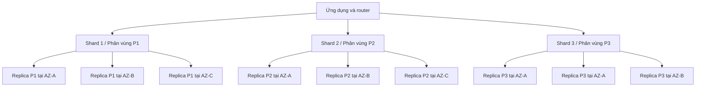
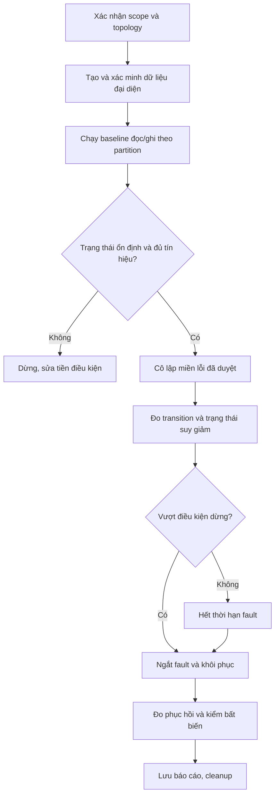

# Thử mất một miền lỗi và quan sát phạm vi dữ liệu còn phục vụ

Một hệ thống NoSQL phân tán có thể tiếp tục hoạt động khi một máy chủ hỏng nhưng vẫn ngừng phục vụ một phần dữ liệu nếu các bản sao của phần dữ liệu đó nằm cùng miền lỗi. Câu hỏi cần trả lời trong bài thử không chỉ là “cluster còn sống hay không?”, mà là: **sau khi một miền lỗi biến mất, những khóa hoặc phân vùng dữ liệu nào vẫn đọc và ghi được theo mức nhất quán đã cam kết, trong bao lâu và với chất lượng phục vụ ra sao?**

Ví dụ, một cluster phân mảnh có ba nhóm dữ liệu. Hai nhóm giữ đủ bản sao để tiếp tục bầu primary, nhóm thứ ba mất phần lớn bản sao khi một vùng khả dụng gặp sự cố. API vẫn có thể trả thành công cho các khóa thuộc hai nhóm đầu, nhưng liên tục timeout với khóa của nhóm thứ ba. Nếu chỉ nhìn tỷ lệ request thành công tổng thể, nhóm vận hành có thể bỏ qua việc **một vùng khóa không còn được phục vụ**.

Bài học thuộc phần **Kiểm thử lỗi và tải** của Database No SQL, hướng dẫn cách định nghĩa miền lỗi, lập bản đồ vị trí dữ liệu, cô lập một miền trong môi trường được phép, đo khả năng phục vụ theo từng vùng dữ liệu, rồi xác nhận phục hồi và tính đúng sau thử nghiệm.

## 1. Miền lỗi (*failure domain*) là gì?

**Miền lỗi** là tập thành phần có khả năng cùng hỏng vì một nguyên nhân chung. Ranh giới miền lỗi có thể là:

| Cấp miền lỗi | Ví dụ | Tác động điển hình |
|---|---|---|
| Tiến trình | Một tiến trình database bị dừng | Mất một replica, client phải kết nối lại |
| Máy/VM/container host | Một host mất nguồn hoặc lỗi kernel | Mọi tiến trình/volume phụ thuộc host có thể mất kết nối |
| Rack | Một rack hoặc thiết bị mạng dùng chung gặp sự cố | Nhiều node bị cô lập đồng thời |
| Availability zone (AZ) | Một zone không còn phục vụ | Nhiều host, replica và endpoint trong zone bị ảnh hưởng |
| Trung tâm dữ liệu | Điện, mạng hoặc hệ thống lưu trữ DC gặp sự cố | Phần lớn tài nguyên của DC không truy cập được |
| Region | Mất một vùng địa lý hoặc đường phụ thuộc chính | Dịch vụ cần chuyển vùng hoặc chấp nhận gián đoạn theo thiết kế |
| Phụ thuộc dùng chung | DNS, control plane, identity service, KMS, load balancer | Các node thuộc nhiều zone vẫn có thể cùng mất chức năng |

Một failure domain là **ranh giới phụ thuộc thực tế**, không đơn thuần là nhãn trong cấu hình. Ba container gắn nhãn ba AZ nhưng cùng chạy trên một máy vật lý vẫn chia sẻ một miền lỗi host. Ngược lại, một deployment có ba máy khác nhau nhưng dùng cùng thiết bị lưu trữ cũng có điểm hỏng chung.

Khi thiết kế bài thử, phải xác định cả **miền lỗi dự kiến mất** và **những thành phần phụ thuộc có thể bị ảnh hưởng gián tiếp**. Ví dụ, ngắt một AZ có thể đồng thời làm mất application pod, DNS resolver cục bộ, database replica và đường mạng đến message broker.

## 2. Bảo đảm sống sót phụ thuộc vào cách đặt dữ liệu

Khả năng chịu lỗi của NoSQL không chỉ dựa vào số node đang chạy. Nó phụ thuộc vào bản sao của **từng phần dữ liệu**, cơ chế chọn leader, mức nhất quán, vị trí client và cấu hình vận hành.

### 2.1. Replication và sharding giải quyết những vấn đề khác nhau

- **Replication** tạo nhiều bản sao cho cùng một tập dữ liệu nhằm tăng khả năng chịu lỗi và, tùy cấu hình, hỗ trợ đọc.
- **Sharding/partitioning** chia dữ liệu thành các phần khác nhau để phân phối dung lượng và lưu lượng.
- Một cluster thường kết hợp cả hai: *mỗi shard* là một nhóm replica và mỗi nhóm có thể có leader/quorum riêng.



Trong hình, P1 và P2 có ba bản sao nằm ở ba AZ. P3 cũng có ba bản sao nhưng **hai bản ở AZ-A**, khiến P3 kém chịu lỗi khi AZ-A biến mất. Việc có tổng cộng chín replica không nói lên P3 có đủ quorum sau sự cố hay không.

### 2.2. Quorum và mức nhất quán

Giả sử một replica set có **ba thành viên bỏ phiếu** và cần đa số để duy trì khả năng bầu primary. Đa số là:

\[
\operatorname{majority}(N)=\left\lfloor\frac{N}{2}\right\rfloor+1
\]

Với \(N=3\), đa số bằng 2. Khi mất AZ-A:

| Nhóm | Phân bố ba thành viên | Thành viên còn liên lạc | Kết quả về đa số |
|---|---|---|---|
| P1 | A, B, C | B và C | Còn 2/3 |
| P2 | A, B, C | B và C | Còn 2/3 |
| P3 | A, A, B | B | Chỉ còn 1/3 |

P1 và P2 **có khả năng** tiếp tục ghi qua primary hợp lệ sau giai đoạn bầu chọn; P3 **không đủ đa số** để bầu primary mới trong cấu hình minh họa. Một số bản sao còn sống có thể chứa dữ liệu để đọc ở chế độ yếu hơn, nhưng điều đó không đồng nghĩa API vẫn ghi thành công hay đáp ứng cam kết đọc nhất quán.

Không suy diễn quy tắc đa số của một sản phẩm sang mọi NoSQL:

- **MongoDB replica set:** cơ chế election, voting member, write concern, read preference và read concern quyết định hành vi cụ thể. Sharded cluster còn phụ thuộc config servers và `mongos`.
- **Apache Cassandra/ScyllaDB:** replication factor và consistency level như `LOCAL_QUORUM` xác định số replica cần phản hồi trong phạm vi datacenter tương ứng; không áp dụng máy móc khái niệm primary của MongoDB.
- **Redis Cluster:** khả năng phục vụ mỗi hash slot phụ thuộc primary/replica của shard đó và cơ chế failover; replication bất đồng bộ có thể ảnh hưởng dữ liệu được ghi nhận trước sự cố.
- **DynamoDB và dịch vụ NoSQL managed khác:** nhà cung cấp quản lý placement và phục hồi hạ tầng. Cần đánh giá những hành vi được công bố và thử các điểm lỗi mà khách hàng có quyền điều khiển, không giả định có thể chủ động “tắt AZ” của dịch vụ.

Một cluster có thể **sẵn sàng về mặt control plane** nhưng không phục vụ được một số partition. Ngược lại, cluster đang tái bầu primary có thể mất một khoảng chuyển tiếp ngắn rồi phục vụ đầy đủ. Bài thử phải phân biệt hai trạng thái.

## 3. Định nghĩa “dữ liệu còn phục vụ” trước khi thử

Không nên coi “có TCP connection” hay “trả HTTP 200” là bằng chứng rằng một khóa còn được phục vụ đúng.

Với một tập khóa hoặc phân vùng \(K\), phân loại riêng:

1. **Đọc còn phục vụ:** yêu cầu đọc một khóa cho kết quả đúng với chính sách nhất quán đã chọn, trong deadline.
2. **Ghi còn phục vụ:** yêu cầu ghi hợp lệ được xác nhận theo mức bền vững được yêu cầu, trong deadline.
3. **Suy giảm nhưng còn phục vụ:** thao tác vẫn thành công nhưng latency tăng, retry nhiều hoặc phải dùng đường dự phòng đã cam kết.
4. **Không còn phục vụ:** lỗi có hệ thống, timeout, không đủ quorum hoặc dữ liệu không thể truy cập qua API được thử.
5. **Chưa xác định:** client không biết kết quả ghi đã commit hay chưa; không được gộp thành “ghi không thành công”.

Hai câu hỏi riêng biệt rất quan trọng:

**Khả dụng (*availability*):** client còn truy cập được dữ liệu qua giao diện đã cam kết không?

**Tính bền vững (*durability*):** dữ liệu từng được xác nhận thành công có còn tồn tại sau sự cố và phục hồi không?

Một shard tạm thời không thể đọc không nhất thiết đã mất dữ liệu. Nhưng một read thành công từ replica trễ cũng chưa chắc phản ánh bản ghi mới nhất. Các phép đo phải ghi rõ **mức nhất quán, đường đọc, deadline và tiêu chí chấp nhận**.

### 3.1. Số đo phạm vi phục vụ theo khóa

Giả sử có tập khóa kiểm thử \(K=\{k_1,\ldots,k_n\}\). Định nghĩa:

\[
A_{\mathrm{read}}(t)=
\frac{\left|\{k\in K:\operatorname{read}(k,t)\ \text{đạt hợp đồng}\}\right|}{|K|}
\]

\[
A_{\mathrm{write}}(t)=
\frac{\left|\{k\in K:\operatorname{write}(k,t)\ \text{đạt hợp đồng}\}\right|}{|K|}
\]

Hai tỷ lệ này đo **coverage của tập khóa lấy mẫu** tại thời điểm/cửa sổ \(t\), không phải SLO availability của toàn hệ thống. Nếu kích thước partition hoặc traffic lệch nhau, có thể tính thêm tỷ lệ theo trọng số \(w_k\):

\[
A_{\mathrm{weighted}}(t)=
\frac{\sum_{k\in K}w_k\,\mathbb{1}[\text{thao tác với }k\text{ đạt hợp đồng}]}
{\sum_{k\in K}w_k}
\]

Trong báo cáo, ghi rõ trọng số phản ánh **số khóa, số bản ghi, dung lượng hay lưu lượng**. Không được công bố “70% dữ liệu còn phục vụ” chỉ vì 7/10 probe thành công nếu mẫu không đại diện cho phân bố dữ liệu thực.

### 3.2. Thành công theo thời gian hay theo vùng dữ liệu?

Một bài kiểm thử cần hai góc nhìn:

| Góc nhìn | Câu hỏi | Ví dụ |
|---|---|---|
| Theo thời gian | Hệ thống bị gián đoạn bao lâu? | Primary election khiến ghi gián đoạn trong một cửa sổ |
| Theo không gian khóa | Phần nào của dữ liệu bị ảnh hưởng? | Mọi khóa thuộc shard P3 không thể ghi |
| Theo client/địa điểm | Client ở đâu còn gọi được? | Client ở AZ-B được, client ở AZ-A không |
| Theo thao tác | Đọc và ghi bị ảnh hưởng giống nhau không? | Đọc replica còn được nhưng ghi majority thất bại |
| Theo mức nhất quán | Có đáp ứng hợp đồng dữ liệu không? | Đọc eventual thành công, đọc đòi thông tin mới nhất thì không |

Tỷ lệ thành công toàn bộ có thể tăng nếu workload tình cờ ít truy cập shard lỗi. Vì vậy cần đo **mỗi partition và mỗi loại thao tác**, không chỉ biểu đồ trung bình toàn hệ thống.

## 4. Chuẩn bị bản đồ placement và tập khóa đại diện

Trước khi đưa lỗi vào, lập bản đồ những gì sẽ còn lại nếu mất đúng một miền.

### 4.1. Ghi topology thực tế

Thu thập từ cluster thử nghiệm:

- Danh sách node, role, IP hoặc endpoint dùng trong test, region/AZ/rack và tình trạng health.
- Mỗi shard/partition nằm trên node nào; replica nào có quyền bầu leader, replica nào là non-voting hoặc chỉ phục vụ đọc.
- Với từng partition: replication factor, quorum/election rule, chính sách read/write và trạng thái đồng bộ trước khi thử.
- Thành phần định tuyến: load balancer, routing service, `mongos`, config servers, service discovery, DNS, proxy.
- Client chạy ở đâu; có client ở miền còn sống để phát probe hay không.
- Phụ thuộc dùng chung có thể khiến fault lan rộng: KMS, auth, mạng, queue, lưu trữ hoặc control plane.

Không suy ra phân bố replica từ một sơ đồ triển khai cũ. Phải đối chiếu placement hiện tại vì autoscaling, rebalance, decommission hoặc failover trước đó có thể đã thay đổi hệ thống.

### 4.2. Đánh dấu dữ liệu thử nghiệm

Tạo dữ liệu tổng hợp nằm ở **từng shard/partition cần khảo sát**, ví dụ:

```json
{
  "_id": "fault-run-17-p1-key-001",
  "partitionId": "P1",
  "runId": "fault-run-17",
  "anchor": "seed-p1-001",
  "writeProbe": null,
  "version": 1
}
```

Không chỉ tạo khóa có tiền tố khác nhau rồi **giả định** chúng được phân phối tới các shard khác nhau. Với hashed shard key hoặc phân vùng tự động, phải quan sát mapping thực tế hoặc dùng fixture có khả năng chọn đúng partition. Một số NoSQL không cho phép client ấn định replica placement: khi đó dùng metadata/routing đã xác thực để gắn nhãn kết quả.

Nên có:

- **Khóa neo chỉ đọc:** giá trị đã ghi và được xác nhận trước fault, dùng để phát hiện thiếu dữ liệu hoặc stale read.
- **Khóa dành cho ghi thăm dò:** tài liệu riêng có thể sửa lặp lại, tách khỏi nghiệp vụ thật.
- **Khóa nghiệp vụ mẫu:** một ít tình huống cập nhật có điều kiện, unique/idempotency hoặc transaction nếu đó là đường sử dụng quan trọng.
- **Đủ mẫu mỗi partition:** không chỉ một khóa trong toàn cluster; lựa chọn có đại diện cho phân bố dữ liệu và hotspot thực tế.

Lưu danh sách `key → partition → replica placement` cùng mã `runId` để so sánh với kết quả sau sự cố.

### 4.3. Mô hình kỳ vọng khi AZ-A biến mất

Giả sử có 100 khóa đại diện cho ba nhóm:

| Nhóm | Số khóa mẫu | Replica đặt ở | Dự đoán ghi với đa số sau mất AZ-A |
|---|---:|---|---|
| P1 | 40 | AZ-A, AZ-B, AZ-C | Có thể tiếp tục khi còn B, C |
| P2 | 30 | AZ-A, AZ-B, AZ-C | Có thể tiếp tục khi còn B, C |
| P3 | 30 | AZ-A, AZ-A, AZ-B | Không đủ đa số, dự kiến không ghi được |
| **Tổng** | **100** | | **70 khóa có khả năng còn ghi được** |

Con số 70/100 là **dự đoán theo bộ mẫu**, không phải kết luận trước thử nghiệm. Nếu config servers, router hoặc xác thực cùng phụ thuộc AZ-A, P1 và P2 có thể cũng không còn được phục vụ dù replica còn đủ. Nếu chỉ thử đọc từ secondary với consistency yếu, P3 có thể cho kết quả khác dự đoán ghi.

## 5. Quyền thực hiện và ranh giới của thí nghiệm

Thử mất cả một miền lỗi có thể ảnh hưởng nhiều tiến trình và người dùng. Chỉ thực hiện trên topology mà nhóm kiểm thử **được quyền tác động**, chẳng hạn cluster sandbox/staging riêng có dữ liệu tổng hợp và các phụ thuộc nằm trong phạm vi đã phê duyệt.

Một hợp đồng chạy nên có các thông tin sau:

```yaml
runId: "fault-run-17"
objective: "Mất AZ-A, đo read/write coverage theo partition"
environment: "staging-isolated"
target:
  clusterId: "nosql-fault-cluster-01"
  namespace: "fault-run-17"
  providerAccount: "account-test"
failureDomain:
  type: "availability-zone"
  id: "az-a"
  allowedTargets:
    - "replica-p1-a"
    - "replica-p2-a"
    - "replica-p3-a1"
    - "replica-p3-a2"
data:
  type: "synthetic"
  runIdField: "fault-run-17"
  partitions: ["P1", "P2", "P3"]
workload:
  readRps: 15
  writeRps: 5
  maxConcurrentClients: 8
  requestDeadlineMs: 2000
fault:
  injectionMethod: "approved-sandbox-failure-controller"
  maxDurationSeconds: 90
  automaticRevert: true
stopWhen:
  - "Target không khớp danh sách được duyệt"
  - "Fault ảnh hưởng namespace ngoài phạm vi"
  - "Không quan sát được các thành phần còn sống"
  - "Vượt ngưỡng lỗi/tài nguyên đã duyệt"
cleanup:
  - "Phục hồi miền lỗi"
  - "Xác nhận cluster trở lại trạng thái mong đợi"
  - "Xóa dữ liệu tổng hợp sau khi lưu bằng chứng"
```

Các tên, thông số và hạn mức chỉ là **ví dụ**. Mô tả này không tự cấp quyền gây lỗi; runner phải kiểm tra tài nguyên đích thực và quyền của chủ môi trường.

### 5.1. Các kỹ thuật tạo lỗi

| Kỹ thuật | Có thể chứng minh điều gì? | Giới hạn |
|---|---|---|
| Dừng một process DB trong cluster riêng | Phản ứng khi mất một replica | Chưa mô phỏng mất cả AZ nếu các node khác trong zone còn hoạt động |
| Cô lập mạng của các node thuộc một zone bằng công cụ thử nghiệm | Các node ở zone còn lại có tự phục vụ được không | Phải giới hạn chính xác CIDR/pod/namespaces; còn khác lỗi mất điện hoặc storage |
| Tắt nhóm VM hoặc node test được cấp riêng | Khả năng chịu mất nhiều thành phần cùng miền | Cần automation phục hồi và tránh thành phần ngoài test |
| Tắt service endpoint test qua proxy | Ứng dụng xử lý failover endpoint như thế nào | Không chứng minh failure của replica placement bên dưới |
| Mô phỏng lỗi ở client adapter | Retry, timeout, circuit breaker, phản hồi fallback | Không chứng minh cluster còn quorum |

Nếu mục tiêu là **mất một AZ**, một thử nghiệm chỉ kill một replica rồi đặt tên “zone outage” sẽ không phản ánh failure mode. Đồng thời, không cần phá hỏng vật lý tài nguyên: một fault controller mô phỏng mất khả năng liên lạc đến mọi replica trong AZ-test có thể đủ kiểm tra giả thuyết về khả năng phục vụ, miễn là chỉ rõ các khác biệt còn lại.

Ở dịch vụ managed không cho can thiệp nội bộ, có thể thử **mất đường truy cập của client trong một zone**, mất application zone hoặc chuyển region theo chức năng được hỗ trợ; phải gọi đúng tên fault, tránh kết luận rằng đã kiểm thử hỏng AZ nội bộ của nhà cung cấp.

## 6. Quy trình thử mất một miền lỗi



### Pha 0 — Preflight

Xác minh danh tính cluster, vùng cần cô lập, các thành phần nằm trong vùng đó, namespace và dữ liệu test. Ghi lại topology và trạng thái replica/quorum trước thử. Đảm bảo người chạy có thể **tắt fault từ ngoài miền sẽ bị cô lập**; một nút “restore” nằm hoàn toàn trong AZ bị mất không đáng tin cậy.

Cần có người chịu trách nhiệm, kênh quan sát từ vùng còn sống và giới hạn thời gian. Kiểm tra các phụ thuộc ngoài phạm vi không dùng chung mạng/cluster mục tiêu theo cách có thể bị ảnh hưởng.

### Pha 1 — Baseline

Chạy tải vừa phải và đã được duyệt trên mọi partition. Lấy số đo ít nhất:

- Tỷ lệ đọc/ghi đạt hợp đồng của từng partition, không chỉ trung bình.
- p50/p95/p99 latency, timeout và tỷ lệ lỗi từng loại.
- Trạng thái primary/leader, replica sync/lag, write concern hoặc consistency level.
- Connection pool, route/slot ownership, request đang chờ, số lần retry.
- Bất biến của dữ liệu tổng hợp và những bản ghi đã được xác nhận bền vững.

Nếu baseline đã lỗi, dừng lại để tránh quy kết lỗi vốn có cho sự cố sắp mô phỏng.

### Pha 2 — Mất một miền

Từ một hệ thống điều khiển nằm ngoài miền cần cô lập, kích hoạt fault đã đăng ký, ghi chính xác timestamp. Không thay đổi đồng thời shard key, replication factor, client retry policy hay mức tải; việc thay nhiều biến làm mất khả năng phân tích nguyên nhân.

Tiếp tục probe từ **client ở miền còn sống**. Nếu toàn bộ client test cũng nằm ở miền bị cô lập, kết quả “không kết nối được” chỉ chứng minh client mất đường chạy, không cho biết dữ liệu ở những miền khác có còn phục vụ hay không.

Ghi riêng hai cửa sổ:

1. **Chuyển tiếp:** thời gian phát hiện mất node, election, chuyển route, kết nối lại.
2. **Ổn định trong lỗi:** sau chuyển tiếp, những partition nào tiếp tục đạt hợp đồng trong suốt thời gian fault còn bật.

Nếu không có giai đoạn ổn định vì fault kéo dài ngắn hơn thời gian hội tụ, báo điều đó thay vì tự suy đoán.

### Pha 3 — Khôi phục

Tắt injector hoặc khôi phục node/đường mạng theo quy trình đã duyệt. Theo dõi:

- Replica/quorum có trở lại trạng thái kỳ vọng hay không.
- Read/write coverage có trở về mức baseline và trong thời gian cam kết hay không.
- Replication lag, backlog, cache/route có bắt kịp không.
- Tài liệu được ack trước lỗi có còn nguyên không; những lần write có kết quả chưa rõ đã được giải quyết chưa.
- Có dữ liệu trùng, ghi đè sai, mất thứ tự hoặc retry storm sau khi kết nối lại không.

Chỉ coi recovery hoàn thành khi **dữ liệu và ứng dụng** cùng ổn định. Việc node “healthy” trên dashboard chưa đủ nếu một phần key vẫn không được phục vụ qua API.

## 7. Đo khả năng đọc và ghi theo từng vùng dữ liệu

### 7.1. Cấu trúc kết quả một lần probe

Mỗi lần probe nên ghi các trường:

| Trường | Ý nghĩa |
|---|---|
| `runId` | Mã thí nghiệm để tách khỏi traffic khác |
| `timestamp`, `phase` | Trước lỗi, chuyển tiếp, khi lỗi ổn định, sau phục hồi |
| `clientZone` | Client xuất phát từ miền nào |
| `key`, `partitionId` | Khóa/partition được thử |
| `operation` | `READ` / `WRITE` / `CAS` / `TXN` |
| `consistency` | Read concern, write concern, consistency level hoặc hợp đồng API |
| `result` | `PASS`, `DEGRADED`, `FAIL`, `UNKNOWN` |
| `errorType` | Timeout, no leader, unavailable, throttled, conflict, stale data... |
| `latencyMs` | Thời gian tính từ client, bao gồm retry nếu có |
| `attempts` | Số lần thử của driver/service |
| `observedVersion` | Giá trị/version quan sát được khi đọc |

`UNKNOWN` đặc biệt cần thiết cho ghi: timeout có thể xảy ra **sau khi server đã commit**, vì vậy không được kết luận một write chắc chắn thất bại chỉ dựa vào exception phía client.

### 7.2. Mẫu logic probe

Ví dụ dưới đây minh họa Java MongoDB driver trên collection chứa dữ liệu tổng hợp đã được tạo sẵn. Nó không tạo lỗi hạ tầng và chỉ nên được chạy khi target đã được xác nhận đúng môi trường test.

```java
import com.mongodb.MongoException;
import com.mongodb.ReadConcern;
import com.mongodb.ReadPreference;
import com.mongodb.WriteConcern;
import com.mongodb.client.MongoCollection;
import com.mongodb.client.MongoDatabase;
import com.mongodb.client.result.UpdateResult;
import org.bson.Document;

import java.util.List;
import java.util.concurrent.TimeUnit;

import static com.mongodb.client.model.Filters.eq;
import static com.mongodb.client.model.Updates.set;

record ProbeKey(String partitionId, String id, String anchor) {}

public final class PartitionCoverageProbe {
    private final MongoCollection<Document> probes;

    public PartitionCoverageProbe(MongoDatabase database) {
        this.probes = database.getCollection("fault_probes")
                .withReadPreference(ReadPreference.primary())
                .withReadConcern(ReadConcern.MAJORITY)
                .withWriteConcern(WriteConcern.MAJORITY);
    }

    public void sample(List<ProbeKey> keys, String runId) {
        for (ProbeKey key : keys) {
            try {
                Document item = probes.find(eq("_id", key.id()))
                        .maxTime(2, TimeUnit.SECONDS)
                        .first();

                boolean readOk = item != null
                        && key.anchor().equals(item.getString("anchor"));

                // Mỗi khóa thuộc bộ dữ liệu test; lệnh $set lặp lại có
                // cùng giá trị, tránh tự nhân đôi tác dụng sau timeout.
                UpdateResult write = probes.updateOne(
                        eq("_id", key.id()),
                        set("lastProbeRun", runId));

                boolean writeOk = write.getMatchedCount() == 1;
                System.out.printf(
                        "partition=%s key=%s read=%s write=%s%n",
                        key.partitionId(), key.id(), readOk, writeOk);
            } catch (MongoException e) {
                System.out.printf(
                        "partition=%s key=%s result=UNKNOWN_OR_FAILED cause=%s%n",
                        key.partitionId(), key.id(),
                        e.getClass().getSimpleName());
            }
        }
    }
}
```

Đây là **mẫu ý tưởng**, chưa bao gồm scope guard, metric exporter, timeout toàn request, lịch lấy mẫu, đối chiếu commit sau timeout hoặc cấu hình kết nối. Trong một bài thử đầy đủ, cần:

- Chỉ sử dụng key đã seed và xác nhận thuộc namespace test.
- Ghi độ trễ và thời gian của từng thao tác riêng biệt; tránh một phép đọc treo khiến cả vòng probe nối tiếp bị dừng.
- Phân loại kết quả đọc và ghi **riêng**, thay vì một exception chung cho cả hai.
- Đặt deadline ở tầng client/application tương ứng với hợp đồng phục vụ; `maxTime` của một câu truy vấn không tự giới hạn mọi giai đoạn network/server selection.
- Lưu mọi lỗi không xác định và đọc đối chiếu sau recovery; `$set` giúp retry an toàn cho trường test nhưng không thay thế idempotency của thao tác nghiệp vụ thật.

Với DynamoDB có thể dùng `GetItem`/`UpdateItem` hoặc `PutItem` có điều kiện trong table test; với Cassandra dùng truy vấn theo partition key và consistency level đã định nghĩa; với Redis Cluster tạo khóa đại diện cho từng hash-slot group rồi thử các lệnh được phép. Quan trọng là **probe được gắn với partition và ràng buộc nhất quán thực tế**.

### 7.3. Bảng kết quả mẫu

Giả sử probe 100 khóa trong bảng placement ở mục 4.3, sau một khoảng chuyển tiếp:

| Partition | Số khóa | Đọc đạt hợp đồng | Ghi đạt hợp đồng | Nhận xét |
|---|---:|---:|---:|---|
| P1 | 40 | 40 | 40 | Đã bầu primary mới, phục vụ lại |
| P2 | 30 | 30 | 30 | Đủ quorum ở B/C |
| P3 | 30 | 0 | 0 | Không còn primary hợp lệ qua API được thử |
| **Tổng** | **100** | **70/100 = 70%** | **70/100 = 70%** | Chỉ xét tập khóa mẫu và hợp đồng đã định |

Trong **giai đoạn chuyển tiếp**, P1 hoặc P2 có thể tạm thời có một số probe lỗi, nên coverage từng cửa sổ có thể thấp hơn 70%. Nếu đọc từ secondary được cho phép, P3 có thể trả giá trị cũ; báo riêng `eventual/stale read success`, không tự coi bằng chứng đó tương đương với đọc mạnh.

Một cách trình bày khác là “bản đồ nhiệt”:

```text
              Baseline   Mất AZ-A (transition)   Mất AZ-A (steady)   Recovery
P1 / READ       OK            FAIL/RETRY              OK              OK
P1 / WRITE      OK            FAIL/RETRY              OK              OK
P2 / READ       OK            OK/RETRY                OK              OK
P2 / WRITE      OK            OK/RETRY                OK              OK
P3 / READ       OK            FAIL                    FAIL            OK
P3 / WRITE      OK            FAIL                    FAIL            OK
```

Đây là minh họa; kết quả thực tế phải lấy từ run. Đặc biệt, nếu P3 vẫn đọc được ở cấu hình yếu, bảng cần thêm cột freshness và ghi rõ đường đọc.

## 8. Các chỉ số cần thu thập khi mất miền lỗi

### 8.1. Chỉ số từ góc nhìn client

- Tỷ lệ request thành công theo partition/key range và theo vùng client.
- Tỷ lệ `READ` và `WRITE` đạt hợp đồng, latency p50/p95/p99, retry count.
- Mã lỗi cụ thể: timeout, không có leader, không chọn được server, throttling, connection reset, conflict.
- Số request đang chờ, queue depth, connection pool wait.
- Thời gian từ **bắt đầu fault đến lỗi đầu tiên**, từ lỗi đầu tiên đến phục vụ ổn định, và từ khi restore đến baseline.
- Những lần ghi có kết quả không xác định cần xác minh sau này.

### 8.2. Chỉ số từ góc nhìn cluster

- Thành viên/replica còn sống và trạng thái bầu leader.
- Quorum hiện tại của từng replica group.
- Replication lag, oplog/commit log/apply backlog tùy hệ quản trị.
- Shard/partition ownership, metadata routing, số partition chưa có leader.
- CPU, memory, disk I/O, mạng và số kết nối ở **các node còn sống**; failover có thể dồn tải lên chúng.
- Lỗi và tốc độ client retry tác động lên cluster; retry không kiểm soát có thể gây sập tiếp miền còn sống.

### 8.3. Các chỉ số phục hồi

Hai khái niệm cần nêu rõ:

- **RTO (Recovery Time Objective):** thời gian phục hồi mục tiêu sau gián đoạn. Trong test, phải định nghĩa mốc bắt đầu và điều kiện “đã phục hồi”, chẳng hạn tất cả partition đạt SLO liên tục trong một cửa sổ.
- **RPO (Recovery Point Objective):** mức mất dữ liệu cho phép khi khôi phục; cần đối chiếu với những ghi từng được xác nhận bền vững.

Không tính “đã phục hồi” chỉ từ một response thành công. Ví dụ, P1 phục vụ lại sau 8 giây nhưng P3 mất 4 phút để trở về, thời gian phục hồi toàn tập dữ liệu là khi **P3** đạt điều kiện phục hồi, trừ khi hợp đồng nghiệp vụ đã chia SLO theo phân vùng.

## 9. Kết hợp tải để tìm giới hạn chịu lỗi

Một hệ có thể tồn tại qua lỗi AZ ở lưu lượng thấp nhưng thất bại khi tải của AZ bị mất dồn lên các node còn lại. Đó là lý do nên có hai giai đoạn riêng:

**Thử khả năng tồn tại:** giữ tải nhỏ, ổn định nhằm xác định replication/quorum/routing hoạt động như thiết kế.

**Thử năng lực sau sự cố:** tăng tải tới các mức **đã được duyệt**, theo dõi xem các thành phần còn sống có đủ CPU, mạng, I/O, connection và read/write capacity không.

Giả sử trước lỗi, hệ phục vụ tổng 300 request/giây chia đều trên ba AZ, mỗi AZ gánh khoảng 100. Khi một AZ mất, nếu hệ thống điều phối lại mọi request thành công sang hai AZ còn lại, mỗi AZ có thể cần gánh khoảng 150 request/giây. Đây là tính toán tải trung bình minh họa, không bảo đảm việc định tuyến thực tế sẽ cân bằng hoặc mọi shard đều có khả năng phục vụ.

Kịch bản cần mô tả:

| Khía cạnh | Câu hỏi cần cố định |
|---|---|
| Workload | Đọc/ghi tỷ lệ bao nhiêu? Payload lớn thế nào? |
| Phân bố khóa | Đều, Zipf/hot key, hay tập trung vào vài partition? |
| Client location | Chạy ở vùng còn sống; có endpoint dự phòng? |
| Mức tải | Baseline, load sau failover và giới hạn tối đa được phép |
| Retry | Max attempts, backoff, jitter, idempotency, deadline |
| Thời lượng | Bao lâu ở chuyển tiếp và ổn định trong lỗi? |
| Điều kiện dừng | Ngưỡng resource, lỗi lan ra ngoài test, mất quan sát |

Khi kết hợp lỗi và tải, đừng vội kết luận quorum hoạt động sai nếu request thất bại do client pool cạn. Phân tích cả **lỗi tại datastore** và **saturation tại service**. Chúng có thể cùng xuất hiện, nhưng phương án khắc phục rất khác nhau.

## 10. Những tình huống cần kiểm thử bổ sung

### 10.1. Mất miền chứa primary so với chỉ chứa secondary

Mất AZ chứa primary có thể cần bầu primary mới và định tuyến lại, gây gián đoạn ghi. Mất AZ chỉ chứa secondary có thể ít ảnh hưởng trực tiếp nhưng giảm khả năng chịu lỗi tiếp theo và tăng replication lag. So sánh hai tình huống với cùng tải giúp xác định thời gian chuyển tiếp và chính sách retry.

Không coi “mất secondary không có request lỗi” là không có tác động. Sau lỗi thứ nhất, hệ có thể chỉ còn **một lỗi nữa là mất quorum**; đây là trạng thái giảm dự phòng cần hiển thị trong báo cáo.

### 10.2. Mất miền đặt router hoặc control plane

Nếu mọi API/router kết nối qua một endpoint chỉ sống ở AZ-A, mất AZ-A khiến client không tới được P1/P2 dù dữ liệu còn đủ replica. Phải kiểm tra:

- Router/load balancer có instance ở miền còn sống không?
- DNS/service discovery có trả endpoint hợp lệ không?
- Metadata shard ownership và auth/KMS có còn truy cập được không?
- Client library có tự refresh topology và retry trong deadline không?

Đây là lỗi của **đường phục vụ dữ liệu**, cần ghi riêng với mất quorum của shard.

### 10.3. Mất miền khi đang rebalance/repair

Trong một số hệ, dữ liệu đang di chuyển replica hoặc repair khi fault xảy ra. Tập bản sao có thể chưa hoàn tất, khiến phân bố bản sao thực tế khác giả định. Bài thử cần chụp topology ngay trước fault; nếu có hoạt động nền, ghi rõ điều kiện này hoặc chạy thành case độc lập.

Không dùng điều kiện “mọi node đã healthy” để thay thế việc kiểm tra **mọi partition đã có bản sao đủ điều kiện và hoàn tất đồng bộ**.

### 10.4. Ghi được ack trước lỗi và kết quả không rõ

Tạo hai nhóm bản ghi:

- **Đã được xác nhận bền vững trước fault:** phải tồn tại sau recovery theo hợp đồng durability.
- **Client timeout quanh thời điểm fault:** có thể đã commit hoặc chưa; cần truy hồi bằng khóa yêu cầu/idempotency key, tuyệt đối không tự gộp thành mất dữ liệu.

Với nghiệp vụ tạo đơn, kiểm cả bất biến “không có đơn trùng” và “không trừ kho hai lần”. Một shard còn phục vụ đọc không đủ chứng minh transaction đa shard vẫn hoạt động nếu một shard tham gia transaction mất quorum.

### 10.5. Split-brain và chế độ đọc yếu

Một hệ thống chọn dừng ghi khi mất quorum nhằm tránh hai nhóm cùng nhận ghi mâu thuẫn. Vì vậy, **write failure trong vùng mất quorum có thể là hành vi đúng**. Test cần chứng minh fail-closed và không có hai primary/leader hợp lệ cùng chấp nhận ghi xung đột.

Trong hệ cho phép ghi đa vùng hoặc eventual consistency, test lại cần xem conflict resolution, tombstone và phiên bản dữ liệu sau hòa mạng. Không lấy thước đo “không một request nào lỗi” làm tiêu chuẩn cho mọi mô hình nhất quán.

## 11. Kịch bản thực hành: mất AZ-A trong cluster ba shard

**Bối cảnh:** một ứng dụng quản lý sản phẩm có ba partition P1, P2, P3 trên cluster test. P1/P2 có replica ở A/B/C; P3 có hai replica ở A và một ở B. Ứng dụng đọc/ghi qua router trong B và C. Dữ liệu tổng hợp gồm 100 khóa phân bố P1: 40, P2: 30, P3: 30.

**Hợp đồng:** đọc từ primary với read concern thích hợp, ghi được xác nhận ở mức majority; mọi thao tác có deadline ở client. Thử nghiệm chỉ tác động tài nguyên đã đăng ký trong AZ-A của môi trường riêng.

### Yêu cầu thực hiện

1. Ghi cấu hình, vai trò replica và vị trí của từng shard; xác nhận quorum, router và config servers còn hoạt động khi AZ-A bị cô lập.
2. Seed tập khóa có `runId`, kiểm tra mapping đến P1/P2/P3 và lưu giá trị neo của mỗi khóa.
3. Chạy baseline vài cửa sổ liên tiếp; ghi read/write coverage và p95/p99 theo partition.
4. Bật fault tại AZ-A bằng công cụ được phê duyệt và có thời hạn tự khôi phục; tiếp tục probe từ B/C.
5. Trong lúc lỗi, thu riêng transition, steady-state coverage và loại lỗi; xác định request nào là fail rõ ràng và request nào có kết quả chưa xác định.
6. Tắt fault, đợi replica đồng bộ, đo thời gian hồi phục của từng shard và của toàn bộ tập dữ liệu.
7. Đối chiếu dữ liệu đã được ack trước fault, xác minh các lần ghi không rõ kết quả và kiểm tra không có bản ghi test trùng/lost update.
8. Lập báo cáo có bảng coverage, biểu đồ latency theo thời gian, fault timeline, lý do không đạt và bước cleanup.

### Ví dụ bảng kết quả điền sau khi chạy

| Pha | P1 đọc/ghi | P2 đọc/ghi | P3 đọc/ghi | Nhận xét |
|---|---|---|---|---|
| Baseline | 100% / 100% | 100% / 100% | 100% / 100% | Toàn bộ key mẫu đạt hợp đồng |
| 0–10 giây sau fault | Lấy từ số đo | Lấy từ số đo | Lấy từ số đo | Có thể đang election |
| 10–90 giây | Lấy từ số đo | Lấy từ số đo | Lấy từ số đo | Đo trạng thái suy giảm ổn định |
| Sau restore | Lấy từ số đo | Lấy từ số đo | Lấy từ số đo | Theo dõi tới khi ổn định |

Các khoảng thời gian trên mang tính minh họa; không tự đặt thời gian bầu chọn hay phục hồi cho hệ quản trị trước khi có bằng chứng. Có thể thay đổi kích thước cửa sổ để đủ số lượng mẫu cho p95/p99 có ý nghĩa.

### Câu hỏi phân tích

1. Tại sao hai replica sống ở B/C có thể bảo vệ P1 nhưng một replica sống ở B không đủ bảo vệ P3?
2. Nếu P1 vẫn ghi được nhưng p99 latency tăng gấp nhiều lần, nên báo “available” hay “degraded”? Hợp đồng SLO quyết định thế nào?
3. Nếu 70% khóa mẫu còn đọc/ghi được, có thể kết luận “70% dữ liệu production còn khả dụng” không? Cần thêm những trọng số và thông tin nào?
4. Một request ghi timeout trước khi AZ-A mất hoàn toàn, sau recovery phát hiện bản ghi tồn tại. Khi đánh giá dữ liệu mất, phải xử lý trường hợp này thế nào?
5. Nếu router duy nhất nằm ở AZ-A, vì sao các replica ở B/C vẫn không đủ bảo đảm khả năng phục vụ từ API?
6. Làm thế nào để biết bài thử đã thực sự cô lập toàn miền AZ-A thay vì chỉ dừng một process?

## 12. Mẫu báo cáo kết luận một lần chạy

Một báo cáo hữu ích nên giữ đủ ngữ cảnh để người khác tái hiện và phân biệt lỗi thiết kế với lỗi môi trường:

```yaml
runId: "fault-run-17"
environment: "staging-isolated"
topologySnapshot: "artifact://run-17/topology"
fault:
  domain: "az-a"
  type: "isolated-zone-network"
  start: "2026-11-14T10:00:00Z"
  end: "2026-11-14T10:01:30Z"
workload:
  requestDeadlineMs: 2000
  readRps: 15
  writeRps: 5
  partitions: ["P1", "P2", "P3"]
coverage:
  baseline: "artifact://run-17/baseline.csv"
  transition: "artifact://run-17/transition.csv"
  duringFault: "artifact://run-17/during-fault.csv"
  afterRecovery: "artifact://run-17/recovered.csv"
observed:
  quorumByPartition: "artifact://run-17/quorum.json"
  latencyAndErrors: "artifact://run-17/metrics"
  ambiguousWrites: "artifact://run-17/ambiguous-writes.csv"
assertions:
  acknowledgedDataRetained: "PENDING_EVIDENCE"
  requiredCoverage: "PENDING_EVIDENCE"
  recoveryWithinObjective: "PENDING_EVIDENCE"
cleanup:
  injectorDisabled: "PENDING_EVIDENCE"
  clusterRestored: "PENDING_EVIDENCE"
  syntheticDataRemoved: "PENDING_EVIDENCE"
```

Giá trị `PENDING_EVIDENCE` nhắc rằng một kết luận PASS chỉ được ghi sau khi quan sát và đối chiếu dữ liệu thực tế. Các đường `artifact://` là ví dụ về nơi lưu bằng chứng, không phải liên kết tồn tại sẵn.

### Các lỗi diễn giải thường gặp

| Diễn giải thiếu chính xác | Điều cần xem xét thêm |
|---|---|
| “Cluster còn xanh, vậy tất cả dữ liệu vẫn phục vụ” | Kiểm coverage theo shard/partition và đường API |
| “Hai trong ba node còn sống nên không sao” | Hai node nào thuộc **cùng replica group** và có quyền vote? |
| “Đọc được một bản cũ tức là dữ liệu còn sẵn sàng đầy đủ” | Mức consistency, freshness và quyền ghi |
| “30% probe lỗi nghĩa là mất 30% dữ liệu” | Unavailable không đồng nghĩa lost; probe có đại diện dữ liệu thật không? |
| “Tắt một pod đã chứng minh chịu lỗi một AZ” | Pod là process; AZ có thể chứa nhiều thành phần phụ thuộc |
| “Fault đã tắt nên hệ thống đã hồi phục” | Quorum, backlog, latency và bất biến có về chuẩn chưa? |
| “Không có request lỗi nhưng không có primary” | Có đang chỉ đọc cache/stale replica hoặc bỏ qua nhóm khóa khác không? |
| “Mọi timeout là ghi thất bại” | Kiểm tra các ghi có kết quả commit không rõ |
| “Tổng RPS ổn định là đủ” | Một hot shard có thể mất toàn bộ khả năng phục vụ trong khi shard khác vẫn khỏe |

**Kết quả cốt lõi của bài thử** là một bản đồ theo thời gian: *miền lỗi nào đã mất, partition nào còn replica/quorum, khóa nào còn đáp ứng hợp đồng đọc/ghi, vì sao có vùng suy giảm và mất bao lâu để phục hồi*. Khi kết hợp bản đồ này với các bất biến dữ liệu và giới hạn tải, nhóm phát triển mới có đủ chứng cứ để kết luận hệ thống NoSQL chịu được mất một miền lỗi ở mức đã cam kết.
