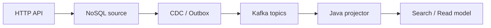
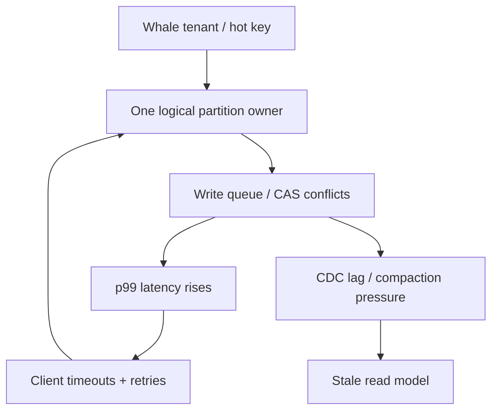

# Kiểm thử dữ liệu lệch, điểm nóng và phân vùng tăng trưởng lớn

## 1. Khi tổng công suất còn dư nhưng một phần dữ liệu vẫn quá tải

Giả sử hệ thống Java dùng một cụm NoSQL gồm tám node. Màn hình giám sát báo CPU trung bình toàn cụm chỉ 35%, dung lượng đĩa còn trống và tổng số yêu cầu trên giây vẫn dưới ngưỡng đã đo ở môi trường thử nghiệm. Tuy nhiên, một nhóm khách hàng liên tục gặp timeout khi xem đơn hàng.

Điều tra sâu hơn cho thấy:

- Một tenant lớn chiếm 65% toàn bộ lưu lượng ghi.
- Những yêu cầu ấy đều đi vào cùng một partition key.
- Node sở hữu partition đó đã dùng gần hết CPU/IO, trong khi các node còn lại nhàn rỗi.
- Partition chứa lịch sử nhiều năm; các truy vấn `SELECT latest 20` phải đọc/đánh giá rất nhiều dữ liệu cũ hoặc tombstone.
- Retry từ client sau timeout càng làm tăng tải lên chính vùng nóng.
- Trong khi đó, bài benchmark trước đây tạo khóa ngẫu nhiên đều và không phát hiện vấn đề.

Vấn đề không nằm ở **tổng số node**, mà ở **phân phối dữ liệu, phân phối truy cập và các giới hạn xử lý tại đơn vị nhỏ nhất có thể phân tán**.

Bài học thuộc module **Database No SQL**, chương **Kiểm thử lỗi và tải**, với chủ đề **“Kiểm thử dữ liệu lệch, điểm nóng và phân vùng tăng trưởng lớn”**.

> **Nguyên tắc:** Đừng chỉ đo tổng QPS, CPU trung bình và dung lượng toàn cụm. Hãy cố ý tạo **skew**, **hot keys**, **hot ranges** và **large partitions**, rồi đo tail latency, lỗi, sức chịu lỗi, tính đúng dữ liệu và chi phí vận hành theo **khóa, phân vùng, node và tenant**.

### Mục tiêu học tập

Sau bài này, bạn có thể:

1. Phân biệt dữ liệu lệch (*data skew*) với truy cập lệch (*workload/access skew*).
2. Nhận diện hot key, hot tenant, hot shard, hot range, hot partition và hot physical node.
3. Hiểu vì sao partition tăng trưởng lớn gây vấn đề ngay cả khi QPS trung bình thấp.
4. Chọn dữ liệu kiểm thử đại diện cho phân phối thực tế thay vì chỉ phân phối đều.
5. Sinh workload Zipf-like, Pareto/80–20, time-series, monotonically increasing keys và bursty load.
6. Đo skew bằng max/mean, phân vị kích thước partition, tỷ lệ top-K, Herfindahl concentration và nhiệt độ tải theo node.
7. Phân biệt giới hạn một partition với giới hạn toàn cluster, coordinator, index, compaction và downstream consumer.
8. Kiểm thử scale-out, resharding, salting, time bucketing và split partition bằng tiêu chí trước/sau.
9. Đánh giá các cơ chế riêng của Cassandra, DynamoDB, MongoDB, Redis Cluster, Bigtable và search/document engines.
10. Kết hợp kiểm tải với kiểm tính đúng: không mất sự kiện, không nhân đôi side effect, CAS không vi phạm và không hồi sinh bản ghi đã xóa.
11. Thiết kế benchmark mở tải (*open-loop*), tránh coordinated omission và đo độ trễ p99/p99.9 dưới overload.
12. Tổ chức thử nghiệm lỗi node, rebalance và hot-partition migration có stop conditions an toàn.
13. Viết báo cáo thử nghiệm có baseline, workload fingerprint, reproducibility và quyết định cải thiện dữ liệu.

## 2. Định nghĩa: “lệch” có nhiều lớp

| Hiện tượng | Mô tả | Dấu hiệu thường thấy |
|---|---|---|
| **Data skew** | Một số partitions chứa nhiều bytes/records hơn phần còn lại | Partition size max gấp nhiều lần median |
| **Access skew** | Một số keys/partitions nhận phần lớn requests | Top 1% keys chiếm phần lớn QPS |
| **Write skew** | Các writes dồn vào một owner/leader/partition | Write latency/queue của một node tăng |
| **Read skew** | Một số dữ liệu được đọc liên tục | Hot cache key, read fan-out, contention |
| **Tenant skew** | Một số tenants lớn áp đảo số còn lại | Một tenant chiếm 50–90% traffic |
| **Temporal skew** | Traffic tập trung theo thời điểm | Bão tải đúng đầu phút/giờ/ngày |
| **Range hotspot** | Keys tăng dần làm writes dồn vào dải mới nhất | Last range/chunk/tablet nóng |
| **Hot logical key** | Một khóa đơn nhận nhiều cập nhật | CAS conflicts, serial bottleneck |
| **Hot shard/slot** | Nhiều khóa dồn vào cùng đơn vị phân phối | Shard/slot QPS cao bất thường |
| **Hot coordinator** | Điểm điều phối bị nghẽn dù data partitions phân bố tốt | Queue/coordinator CPU cao |
| **Large partition** | Một partition gồm quá nhiều rows/bytes/cells | Đọc chậm, compaction/streaming nặng |
| **Large item/document** | Một bản ghi riêng lẻ quá lớn | Giới hạn item/document, network/read amplification |

### 2.1. Dữ liệu lệch không nhất thiết là tải lệch

Một partition có 500 GB lịch sử có thể ít được truy cập, trong khi một partition chỉ có 10 KB nhưng nhận 100.000 updates/s. Hai trường hợp cần bài test và cách xử lý khác nhau.

### 2.2. Nhiều key nóng không có nghĩa chỉ một partition nóng

Một tenant có một triệu order keys khác nhau nhưng dùng partition key chỉ là `tenantId`. Với một số schema/engine, toàn bộ workload vẫn tập trung vào một logical partition. Ngược lại, cùng tenant có thể được chia thành nhiều partitions bằng composite key, bucket hoặc hashing.

### 2.3. Cluster mean che giấu node maximum

Ví dụ CPU của tám nodes: `[95, 25, 25, 25, 25, 25, 25, 25]%`. Trung bình xấp xỉ 34%, nhưng node đầu gần bão hòa. Test phải ghi `max(node_cpu)`, phân bố và vị trí hot owner.

### 2.4. Không đồng nhất “partition” giữa các hệ

- DynamoDB physical partition được service quản lý; partition key logical grouping khác physical storage partition.
- Cassandra partition được xác định bởi CQL partition key.
- MongoDB shard key/ranges và replica set members có semantics riêng.
- Redis Cluster chia key space thành 16.384 hash slots; một key vẫn thuộc một slot.
- Bigtable tablet/range được chia theo row-key ranges.
- Elasticsearch/OpenSearch index shard là đơn vị phân phối lớn, còn routing key có thể dồn tài liệu vào một shard.

Khi nói “hot partition”, phải chỉ rõ **đơn vị logic nào, owner nào và giới hạn nào** đang được kiểm.

## 3. Vì sao benchmark dữ liệu đều dễ tạo kết luận sai?

Giả sử kiểm tải tạo:

```text
1.000.000 IDs ngẫu nhiên phân phối đều
8 nodes
100.000 requests/s
QPS/node gần như bằng nhau
p99 latency = 15 ms
```

Production có thể như sau:

```text
Tenant A: 70% writes
Tenant B: 12%
Tenant C:  6%
Các tenant còn lại: 12%
```

Cùng tổng 100.000 requests/s nhưng nếu `tenantId` là partition key và tenant A không được chia nhỏ, một owner có thể nhận 70.000 requests/s, vượt capacity riêng của nó.

### 3.1. Phép so tổng tải

Một cân bằng lý tưởng với \(N\) owners độc lập:

\[
\lambda_{\text{ideal}} \approx \frac{\lambda_{\text{total}}}{N}
\]

Nhưng nếu partition nóng nhất chiếm tỷ lệ \(p_{\max}\) request và chỉ có một owner phục vụ writes:

\[
\lambda_{\text{hottest}} \approx p_{\max}\lambda_{\text{total}}
\]

Nếu \(p_{\max}=0{,}7\), thêm hai node mà không split được partition nóng vẫn giữ khoảng 70% writes trên đường nóng.

### 3.2. Lower bound về nghẽn

Giả sử throughput an toàn của một logical partition là \(C_p\) và tỷ lệ request tới nó là \(p_{\max}\). Khi tải không đổi hình dạng:

\[
\lambda_{\text{total}} \lesssim \frac{C_p}{p_{\max}}
\]

Đây là **ước lượng điều kiện giới hạn**, không phải quota của bất kỳ database cụ thể nào. Replica topology, batching, retries, indexes và server scheduling có thể làm capacity khác.

### 3.3. Read replication có thể cải thiện phần đọc, không giải bài toán write authority

Thêm read replicas có thể tách read workload trong hệ phù hợp. Nhưng nếu mọi update một item phải serialize qua một key/leader/conditional-write bottleneck thì replicas không tự biến một khóa thành nhiều nguồn ghi độc lập.

### 3.4. Lệch có thể theo thời gian

Tổng requests mỗi ngày phân bố khá đều nhưng 30 phút trước giờ mở bán, 95% writes tới một campaign. Test dùng traffic average 24h sẽ không tìm thấy burst đó.

## 4. Mô hình kích thước partition

Một partition có thể có \(R\) records, kích thước trung bình \(s\) bytes/record, overhead của indexes/tombstones/metadata là \(h\):

\[
S_{\text{logical}} \approx R \cdot s + h
\]

Dung lượng vật lý còn chịu compression, compaction, replica factor, fragmentation, indexes và engine layout.

### 4.1. Tốc độ tăng trưởng

Nếu mỗi ngày partition nhận \(g\) records, mỗi record cỡ \(s\) bytes:

\[
S(t) \approx S_0 + g\cdot s\cdot t
\]

Ví dụ tenant A ghi 200.000 events/ngày, mỗi event 1 KB logic:

- Một ngày: khoảng 200 MB dữ liệu logic.
- 30 ngày: khoảng 6 GB.
- 365 ngày: khoảng 73 GB.

Đây là ước lượng theo đơn vị thập phân trước compression/index/replication và retention. Nếu không time bucket hoặc archive, một partition tăng không giới hạn có thể trở thành khó stream/repair/query.

### 4.2. Không phải cứ partition lớn là chậm như nhau

Một hệ có thể tối ưu truy vấn lấy vài dòng mới nhất theo clustering/sort key; một hệ khác phải scan nhiều dữ liệu. Đánh giá **query path, tombstone count, row width, index strategy, compaction và data growth**, không chỉ bytes.

### 4.3. Large partition khác large document

Trong MongoDB, một document có giới hạn BSON document size riêng. Cùng một tenant có hàng triệu documents trên một shard là vấn đề placement/throughput khác một document chứa mảng ồ ạt tăng kích thước.

### 4.4. Retention không tương đương xóa ngay khỏi đĩa

TTL, tombstones, cleanup/compaction và backup retention có thể giữ physical bytes sau khi logic coi dữ liệu expired. Test storage headroom và compaction sau giai đoạn churn, không chỉ số rows visible.

## 5. Định nghĩa tình huống kiểm thử bằng giả thuyết

Một benchmark tốt bắt đầu từ giả thuyết có thể bác bỏ:

> “Với tổng 30.000 writes/s, khi một tenant nhận 60% requests và partition đó có 10 triệu records, hệ vẫn giữ write p99 dưới ngưỡng đã phê duyệt, không vượt giới hạn retry và không vi phạm invariant.”

Cần khai báo:

- **What:** key distribution, record shapes, partition sizes, read/write mix.
- **Where:** số nodes/regions/shards, replica factor, client topology.
- **When:** warm-up, steady state, bursts, rebalance, failure.
- **How:** open-loop arrival rate, concurrency, payload, read consistency.
- **Observe:** per-key/partition/node metrics, p99, errors, correctness.
- **Pass:** ngưỡng SLO, no data-loss, safety gates.
- **Stop:** disk/quorum/latency/lag/hardware budgets.
- **Repeat:** seeds, config snapshot, driver versions, baseline.

### 5.1. Không để benchmark thay đổi production ngoài ý muốn

Dùng staging/test cluster có dữ liệu synthetic, identity hạn quyền, endpoint allowlist, rate caps, cost limit và delete/cleanup plan. Nếu cần shadow production traffic, dùng **read-only replay hoặc sanitized traces**, không nhân đôi payment/notifications.

### 5.2. Test baseline trước skew

Chạy uniform workload với cùng total offered load, payload và key cardinality để biết baseline. Sau đó thay đúng một chiều skew khi có thể, giữ các biến khác ổn định.

### 5.3. Phân biệt test capacity và test resilience

Capacity test tìm mức thông lượng ổn định; resilience test thêm node loss, hot-owner failure hoặc streaming khi đang lệch. Kết hợp được nhưng phải tách pha và outcome.

## 6. Các kiểu phân phối dữ liệu cần mô phỏng

### 6.1. Phân phối đều (uniform)

Mỗi key gần như có xác suất như nhau:

\[
P(k_i) = \frac{1}{K}
\]

Hữu ích làm baseline, nhưng ít đại diện cho hệ người dùng/tenant có một số đối tượng cực phổ biến.

### 6.2. Một hot key

Ví dụ 50% writes tới một key `inventory:campaign-42`, 50% còn lại rải đều cho 999.999 keys. Mô hình này thử conditional update conflict, serialization, max hot-item throughput và retry storms.

### 6.3. Pareto/80–20

Ví dụ top 20% keys chiếm 80% traffic. Tỷ lệ 80–20 là **một tham số kiểm thử**, không phải quy luật cố định. Có thể thử top 1% chiếm 30%, 50% hoặc 90% tùy ứng dụng.

### 6.4. Zipf-like

Một mô hình phân phối thứ hạng:

\[
P(i) = \frac{i^{-\alpha}}{\sum_{j=1}^{K}j^{-\alpha}}
\]

với \(i=1\) là key phổ biến nhất và \(\alpha \ge 0\). \(\alpha=0\) cho phân phối đều; \(\alpha\) tăng tạo skew mạnh hơn. Zipf không phải mô hình duy nhất; cần đối chiếu với workload thực.

### 6.5. Monotonic/increasing key

Keys như:

```text
event:2026-11-14T10:00:00.001
event:2026-11-14T10:00:00.002
event:2026-11-14T10:00:00.003
...
```

có thể dồn writes vào **range mới nhất** ở hệ phân vùng theo thứ tự key. Đây là hot range ngay cả khi mọi key là unique. Hash distribution/range splits của từng engine quyết định tác động cụ thể.

### 6.6. Time-bucket rollover

Một hệ chuyển từ `tenantA#2026-11-14` sang `tenantA#2026-11-15` đúng nửa đêm. Nhiều clients cùng chuyển bucket có thể gây spike trên partition mới; test thời điểm rollover, TTL, late-arriving events và reads across buckets.

### 6.7. “Whale” tenant

Một tenant có 1 TB data và 10.000 writes/s, 1.000 tenants nhỏ chỉ 10 MB và 1 write/s mỗi tenant. Kiểm fairness, noisy neighbor, capacity reservation và rate limit theo tenant.

### 6.8. Bursty/diurnal/seasonal

Traffic có giờ cao điểm, campaign launch hoặc batch ingestion. Test cả burst duration, ramp rate, recovery sau burst và backlog drain; peak 1 giây khác sustained overload 1 giờ.

### 6.9. Truy vấn không phân vùng (scatter-gather)

Một API query không có partition/shard key có thể fan-out qua nhiều shards. Khi một shard chậm, tổng latency phụ thuộc shard chậm nhất. Test tỉ lệ targeted vs scatter-gather queries.

## 7. Phân biệt kích thước dữ liệu và tần suất truy cập

Thiết kế một ma trận 2×2:

| | Ít truy cập | Truy cập cao |
|---|---|---|
| **Partition nhỏ** | Baseline cold key | Hot key/contention |
| **Partition lớn** | Storage/compaction/repair/cold scan | Trường hợp kết hợp nguy hiểm nhất |

### 7.1. Partition lớn, ít request

Thử compaction, backup/restore, node rebalance, snapshot size, TTL/tombstone accumulation và occasional full-range queries.

### 7.2. Partition nhỏ, quá nhiều writes

Thử CAS conflict, per-partition write ceiling, queue depth, client retries và fairness giữa tenants.

### 7.3. Partition lớn, nhiều reads

Thử pagination, index selectivity, cache churn, read amplification, p99 và memory pressure. Chú ý scan rộng vs point lookup.

### 7.4. Partition lớn, nhiều writes

Thử cả growth rate, mutation rates, compaction, index maintenance, read tail latency, drain/migration và eventual deletion.

## 8. Thiết kế bộ dữ liệu kiểm thử

Không chỉ khai báo “tạo 10 triệu records”; cần mô hình kích thước và phân bố.

```yaml
dataset:
  seed: 5602026
  tenants: 10000
  totalRecords: 50000000
  partitionClasses:
    - name: tiny
      fractionOfPartitions: 0.80
      targetRecordsPerPartition: [1, 200]
    - name: medium
      fractionOfPartitions: 0.18
      targetRecordsPerPartition: [201, 30000]
    - name: large
      fractionOfPartitions: 0.019
      targetRecordsPerPartition: [30001, 1000000]
    - name: whale
      fractionOfPartitions: 0.001
      targetRecordsPerPartition: [1000001, 10000000]
  payload:
    minBytes: 128
    p50Bytes: 1024
    p99Bytes: 32768
    maxBytes: 131072
  retention:
    ttlFraction: 0.20
    deletedFraction: 0.08
  patterns:
    - "append-only events"
    - "updates to hot aggregate"
    - "out-of-order events"
    - "variable-size documents"
```

Đây là dữ liệu cấu hình **minh họa**, không phải định dạng file được một công cụ benchmark chung hỗ trợ. Các ranges phải được hiện thực bằng generator tạo đúng tỷ lệ và giới hạn tổng records; không tự suy từ chúng đã bảo đảm 50 triệu rows.

### 8.1. Kiểm kích thước của “whale”

Một whale partition 10 triệu records × 2 KB có thể lớn hàng chục GB logic. Benchmark cần disk/heap/streaming headroom, không tạo hết trong RAM của Java test runner.

### 8.2. Data age và tombstones

Phân biệt dữ liệu mới liên tục cập nhật với dữ liệu lịch sử đã expired/deleted. Một partition chứa 99% tombstone có query behavior rất khác partition chứa cùng số row active.

### 8.3. Cấu trúc secondary index

Test dữ liệu có fields index tốt/xấu, cùng một giá trị phổ biến, nhiều NULL/empty/missing và large arrays nếu hệ hỗ trợ; những index đó có thể trở thành hotspot riêng.

### 8.4. Đầu vào có thể tái lập

Dùng seed, version generator, mapping key→tenant→partition, payload sizes, schema version và fixture manifest. Không dùng `Math.random()` vô seed trong nhiều tiến trình rồi kỳ vọng lặp đúng skew.

## 9. Phải nhìn vào dữ liệu thật trước khi chọn skew

Các nguồn quan sát có thể gồm:

- Per-tenant request counts, bytes read/written.
- Top-K partition keys (khi có sampling an toàn).
- Partition/range/slot owner metrics.
- Query logs đã che PII.
- Request heatmaps theo thời gian.
- Storage-size distributions.
- Index/selectivity estimates.
- CDC/outbox throughput theo partition.
- Broker partition offsets/consumer lag.
- Compaction/tombstone/repair statistics.

### 9.1. Không thu nguyên PII để dựng benchmark

Hash/syntheticize tenant IDs, chọn bucket classes, giữ distribution shape và payload size. Một benchmark cần mô phỏng hot tenant, không cần sao chép danh tính thật.

### 9.2. Sampling có bias

Query logs có thể chỉ ghi slow requests; từ chúng suy traffic distribution sẽ thiên lệch. Kết hợp access counters/traces có sampling strategy rõ. Nếu driver load balancer cache che một phần requests, cần hiểu observability scope.

### 9.3. Một ngày chưa đủ

Skew có thể thay đổi theo mùa, giờ, campaign hoặc sự kiện cực đoan. Giữ nhiều profiles: average day, peak hour, flash sale, month-end batch, compaction window và recovery after outage.

## 10. Metrics xác định “lệch bao nhiêu”

### 10.1. Max/mean và max/median

Với per-node QPS \(q_i\):

\[
SkewRatio_{\text{mean}}=\frac{\max_i(q_i)}{\frac{1}{N}\sum_i q_i}
\]

Nếu node lớn nhất nhận 60% requests trong cụm 10 nodes, max/mean ≈ 6.

Max/median có thể rất nhạy khi nhiều nodes nhận gần 0; ghi cả median, percentile và min để tránh một ratio vô hạn/không xác định.

### 10.2. Top-K share

\[
TopKShare=\frac{\sum_{i=1}^{K}q_{(i)}}{\sum_i q_i}
\]

với \(q_{(i)}\) sắp xếp giảm dần. Ví dụ top 1% keys chiếm 72% QPS là tín hiệu skew mạnh, nhưng còn phụ thuộc key cardinality và business intent.

### 10.3. Herfindahl–Hirschman Index (HHI)

Với \(p_i\) là tỷ lệ tải tới key/partition i:

\[
HHI=\sum_i p_i^2
\]

Nếu phân đều cho 100 keys, HHI=0,01. Nếu một key nhận 100% tải, HHI=1. HHI cao nghĩa tải tập trung hơn; không là SLO trực tiếp.

Có thể định nghĩa *effective number of equally loaded keys*:

\[
N_{\text{effective}}=\frac{1}{HHI}
\]

Đây là số lượng hiệu dụng theo metric concentration, **không** phải số physical partitions hay throughput capacity thực.

### 10.4. Phân vị kích thước partition

Đo `size_p50`, `size_p90`, `size_p99`, `size_max`, top-K sizes và growth rate của largest partitions. Một median 100 KB với maximum 50 GB có thể ẩn rủi ro vận hành lớn.

### 10.5. Heat theo nhiều trục

Ví dụ table:

| Node | Logical partitions | Bytes | Read QPS | Write QPS | p99 write | CPU |
|---|---:|---:|---:|---:|---:|---:|
| A | 2000 | 2.1 TB | 1,200 | 1,100 | 15 ms | 40% |
| B | 2100 | 2.2 TB | 1,100 | 1,200 | 16 ms | 43% |
| C | 1900 | 2.0 TB | 1,000 | 11,000 | 420 ms | 96% |
| D | 2050 | 2.1 TB | 1,100 | 1,100 | 16 ms | 41% |

Tổng bytes gần đều, nhưng node C nhận writes tập trung. Không đo chỉ dung lượng để kết luận balance.

## 11. Tải đưa vào và tải hoàn thành là hai biến khác nhau

Benchmark phải phân biệt:

- **Offered load**: requests/s mà generator dự định gửi.
- **Arrival rate**: requests/s thực sự bắt đầu.
- **Completed throughput**: thành công hợp lệ/s.
- **Errors/rejects**: timeout, 429/503, conditional conflicts, validation failures.
- **Retries**: số attempt và retry amplification.
- **Latency**: end-to-end theo contract, không chỉ DB server time.

### 11.1. Closed-loop có thể che overload

Nếu mỗi client đợi response rồi mới gửi request tiếp, khi DB chậm thì request rate giảm, làm benchmark vô tình ít gây áp lực hơn. Đây là một dạng **coordinated omission** nếu latency histogram không tính waiting/scheduled arrivals phù hợp.

### 11.2. Open-loop

Sinh request theo lịch/arrival distribution độc lập với thời gian response, có giới hạn an toàn. Khi DB chậm, queue/lag tăng; đo cả thời gian từ **scheduled arrival** đến completion nếu muốn phản ánh trải nghiệm dưới offered load.

### 11.3. Không tạo DDoS trên staging dùng chung

Open-loop cần maximum inflight requests, abort thresholds, bounded backlog, per-tenant quotas và sự chấp thuận của người vận hành. Không để generator tạo vô hạn futures khiến nó OOM rồi báo nhầm database quá chậm.

### 11.4. Retry amplification

Nếu mỗi request thất bại được retry ba lần:

\[
A_{\text{retry}}=\frac{\text{total attempts}}{\text{original logical operations}}
\]

Mức 2× attempts trên một hot key có thể làm nghẽn tệ hơn. Test backoff+jitter, retry budgets, idempotency keys và circuit breakers; báo *logical success rate* riêng khỏi *attempt success rate*.

## 12. Cần đo tail latency theo nhóm

Một p99 toàn cluster có thể che nhóm tenant nhỏ bị ảnh hưởng hoặc chỉ một hot partition.

### 12.1. Các dimensions hữu ích

- Operation type: point read, range read, conditional update, insert, delete, scan.
- Key class: hottest 1, hot 10, warm, cold.
- Partition size class: tiny/medium/large/whale.
- Tenant class: whale/medium/small.
- Owner/zone/shard/range/slot.
- Workload phase: baseline, hot, burst, failover, recovery.
- Result: success, throttled, conflict, timeout, canceled.
- Query plan/index path.

### 12.2. Không gắn raw partition key vào metrics labels

Prometheus-like metrics có cardinality limits. Dùng low-cardinality classes/buckets, gửi top-K có sampling/anonymization vào log/trace bảo vệ. Không biến mỗi user ID thành một label.

### 12.3. Một ví dụ SLO theo phân lớp

```text
Targeted GET p99     < 30 ms (at accepted load)
Conditional UPDATE p99 < 80 ms
Hot-tenant UPDATE p99 < 120 ms
Read error rate      < 0.1%
Write error rate     < 0.05%
No violated inventory invariants
No unbounded retry queue
```

Các ngưỡng chỉ minh họa; trong bài test thật phải xuất phát từ mục tiêu sản phẩm và xác định cách tính p99 (thời gian đo, sample count, lỗi có được tính như latency hay tách riêng).

## 13. Một kế hoạch thử nghiệm gồm nhiều pha

Thay vì chạy một lần “100k QPS trong 10 phút”, thiết kế một chuỗi:

| Pha | Phân phối | Tải | Thời gian minh họa | Câu hỏi |
|---|---|---|---|---|
| 0. Baseline | Uniform | 40% target | 10 phút | Cụm bình thường? |
| 1. Warm-up | Uniform | 70% | 15 phút | Cache/JIT/compaction ổn? |
| 2. Pareto | Top 20%=80% | 70% | 20 phút | Skew ảnh hưởng ra sao? |
| 3. Hot key | Key 1 nhận 50% writes | 70% | 15 phút | Serial bottleneck? |
| 4. Whale | Top partition lớn | 70% | 30 phút | Read amplification/tombstones? |
| 5. Monotonic | Keys tăng dần | 70% | 20 phút | Range hotspot/split? |
| 6. Burst | Zipf + burst 2× | 140% | 5 phút | Backpressure và recovery? |
| 7. Scale-out | Giữ hot profile | 70% | Theo data movement | Thêm node giúp gì? |
| 8. Failure | Một owner lỗi | 70% | Có kiểm soát | Quorum/routing/retry? |
| 9. Cooldown | Uniform | 40% | 20 phút | Queue, compaction, lag giảm? |

Đây là **mẫu cấu trúc**, không phải yêu cầu chạy tất cả pha trên một cluster bất kỳ. Failure phase cần riêng staging và stop conditions; load 140% chỉ được dùng nếu test plan/infra an toàn cho overload.

### 13.1. So trước/sau tại cùng profile

Nếu trước split dùng 80% total load nhưng sau split dùng 20%, p99 giảm không chứng minh split hiệu quả. Giữ offered load, read/write mix, dataset snapshot, replication semantics và client configurations tương đương.

### 13.2. Chạy đủ lâu để thấy background effects

Một pha hai phút có thể chỉ đo cache warm; large-partition problems đôi khi xuất hiện sau compaction, TTL expiry, repair hoặc stream rebalance. Ghi warm-up và steady-state riêng, không trộn tất cả.

### 13.3. Dừng khi invariant sai

Nếu test tồn kho thấy negative available hay duplicate payment effect, đó là **safety failure**, không tiếp tục tăng throughput để kiếm điểm benchmark. Giữ operation IDs/logs/metrics để điều tra.
## 14. Sinh workload Zipf có seed bằng Java 17

Để benchmark tái lập, cần generator xác định bằng seed, tách rõ *logical operation* khỏi *attempt/retry*, và có khả năng chọn khóa theo xác suất lệch.

### 14.1. Một sampler theo thứ hạng

Ví dụ Java 17 sau precompute phân phối Zipf cho tối đa một số key được cấu hình. Mỗi `rank` tương ứng một key. Mục tiêu là **mô phỏng phân phối**, không trực tiếp gọi database.

```java
import java.util.Arrays;
import java.util.SplittableRandom;

public final class ZipfSampler {
    private final double[] cdf;
    private final SplittableRandom random;

    public ZipfSampler(int numberOfKeys,
                       double alpha,
                       long seed) {
        if (numberOfKeys < 1) {
            throw new IllegalArgumentException("numberOfKeys");
        }
        if (!Double.isFinite(alpha) || alpha < 0) {
            throw new IllegalArgumentException("alpha");
        }

        this.random = new SplittableRandom(seed);
        this.cdf = new double[numberOfKeys];

        double total = 0.0;
        for (int i = 1; i <= numberOfKeys; i++) {
            total += Math.pow(i, -alpha);
        }

        double cumulative = 0.0;
        for (int i = 1; i <= numberOfKeys; i++) {
            cumulative += Math.pow(i, -alpha) / total;
            cdf[i - 1] = cumulative;
        }
        cdf[numberOfKeys - 1] = 1.0;
    }

    // Returns rank in [0, numberOfKeys).
    public int nextRank() {
        double u = random.nextDouble(); // [0, 1)
        int pos = Arrays.binarySearch(cdf, u);
        if (pos >= 0) {
            // When a random value equals a boundary,
            // choose that bucket.
            return pos;
        }
        return -pos - 1;
    }
}
```

Đoạn trên dùng O(K) memory, O(K) precompute và O(log K) cho mỗi lần chọn rank; không phù hợp tạo CDF cho hàng tỷ keys. Với cardinality cực lớn, có thể dùng alias tables, inverse-CDF approximations, phân tầng tenant/rank hoặc sampling theo trace đã ẩn danh.

### 14.2. Tạo key từ rank

```java
ZipfSampler sampler = new ZipfSampler(
    100_000,
    1.15,
    5602026L
);

for (int i = 0; i < 10; i++) {
    int rank = sampler.nextRank();
    String key = "order-" + rank;
    System.out.println(key);
}
```

Khi triển khai production-like testing, rank→key mapping phải phản ánh partitioning schema. Nếu rank là entity ID nhưng partition key lại là tenant ID, generator phải map các entities về tenants đúng phân phối.

### 14.3. Thread safety

`SplittableRandom` không dành cho concurrent use trên cùng instance. Tạo một sampler **riêng cho từng worker** với seed được derive deterministic, hoặc cấp một stream seeds riêng; nếu share một instance có thể hỏng giả định random và reproducibility.

### 14.4. Seed không đồng nghĩa cùng request order khi chạy song song

Dù random sequence xác định, scheduling giữa threads có thể đổi global interleaving. Để tái hiện chặt, giữ một file request schedule có operationId, intendedArrival, tenant/key, operation type hoặc dùng deterministic partitioning of work.

### 14.5. Metrics kiểm distribution của generator

Trước benchmark, log:

```text
requested key count: 100000
alpha: 1.15
seed: 5602026
observed top1 share: ...
observed top10 share: ...
observed HHI: ...
observed effective cardinality: ...
requests generated: ...
```

Nếu không đo phân phối *thực sự được phát*, một bug trong generator có thể làm test báo “Zipf” nhưng thực tế mọi request là uniform.

## 15. Generator hai tầng: hot tenant và hot entity

Một workload realistic thường cần hai tầng:

```text
Chọn tenant theo traffic share
  -> Chọn operation type
     -> Chọn entity/key trong tenant
        -> Sinh payload tương ứng
```

### 15.1. Vì sao chỉ Zipf theo orderId có thể sai?

Giả sử mỗi `orderId` được phân bố độc lập vào shards, nhưng production partition key lại là `tenantId`. Một Zipf trên order IDs sẽ tạo nhiều hot entities, còn thực tế tất cả chúng chung một hot tenant partition.

### 15.2. Ví dụ profile

```yaml
trafficProfile:
  name: "whale-tenant-checkout"
  totalOfferedQps: 20000
  tenantWeights:
    whaleA: 0.60
    whaleB: 0.15
    others: 0.25
  operations:
    pointRead: 0.35
    rangeReadLatest50: 0.20
    conditionalUpdate: 0.35
    insertEvent: 0.10
  withinTenant:
    keyPopularity: "zipf-like"
    alpha: 1.1
  burst:
    multiplier: 1.8
    durationSeconds: 120
```

Cấu hình minh họa cần implementation cụ thể. Phần `others` còn phải được chia thành nhiều tenant IDs, không coi cả nhóm là một tenant.

### 15.3. Tách read nóng và write nóng

Có thể một item nhận 70% reads nhưng các writes rải đều, hoặc ngược lại. Trộn chúng sẽ che giới hạn. Ít nhất chạy ba profiles: read-heavy, write-heavy, mixed.

### 15.4. Với transactions và batches

Chọn tập keys tham gia multi-item batch/transaction có tương quan như production. Một batch 20 keys cùng shard khác batch rải qua 20 shards; latency/coordination costs khác.

## 16. Tạo partition tăng trưởng lớn theo thời gian

Một bài test chỉ seed sẵn 1 triệu records không mô phỏng hết tác động của **quá trình tăng trưởng**.

### 16.1. Append-only history

```text
T0: tenant A có 100.000 events
T1: thêm 100.000 events
T2: thêm 1.000.000 events
T3: thêm 5.000.000 events
T4: query latest, query historical range, delete old
```

Tại mỗi mốc, đo partition bytes, read latency, write latency, compaction/index overhead, backup/repair time và RTO.

### 16.2. Growth + churn

Một hệ có thể xóa 80% dữ liệu cũ nhưng phần physical storage vẫn tăng vì tombstone/compaction lùi. Test xen kẽ inserts, updates, TTL expiry và deletes; đo **logical rows** lẫn **physical bytes**.

### 16.3. Large payload tail

Kích thước documents thường lệch: p50=1 KB, p99=128 KB. Nếu generator chỉ tạo 1 KB cho mọi record, kết quả disk/network/serialization/GC có thể quá lạc quan. Đưa payload size distribution vào test.

### 16.4. Records quá lớn

Thử trường hợp vượt engine document/item limits trong môi trường test và xác nhận application reject/split đúng contract. Không mong NoSQL tự chia một document khổng lồ thành hàng nghìn partitions.

### 16.5. Càng nhiều dữ liệu càng phải kiểm query pattern

- Latest-N với clustering/sort key.
- Pagination từ đầu tới cuối.
- Range scan theo ngày.
- Aggregation và count.
- Lookup secondary index.
- Update một row/field.
- Delete/TTL theo batch.
- Backup/restore/repair/rebalance.

Không chỉ đo một GET point query rồi kết luận large partition không gây vấn đề.

## 17. Truy vấn large partition: các cạm bẫy thực tế

### 17.1. Partition scan không có limit

Một query trả toàn bộ history của tenant có thể gây:

- Server memory/CPU pressure.
- Tải network rất lớn.
- Client heap/GC pressure.
- Timeouts/retries.
- Cross-tenant noisy-neighbor effects.

Test phải có max rows/bytes, streaming pagination và cancellation/deadline.

### 17.2. Offset pagination

Nếu client query trang thứ 100.000 bằng offset, một số engine có thể phải skip nhiều rows hoặc có performance kém. Keyset/continuation-token pagination thường phù hợp hơn theo query pattern, nhưng phải kiểm consistency khi dữ liệu đang được thêm/sửa.

### 17.3. Hot historical range

Một số event data được query theo “30 ngày gần nhất” nhưng partition key là toàn bộ tenant. Những rows cũ có thể vẫn làm tăng scan/index/compaction costs dù mỗi API chỉ cần một khoảng ngắn.

### 17.4. Tombstone-heavy reads

Ở LSM-based storage, một read có thể phải xét nhiều tombstones/versions trước khi trả record hợp lệ. Test **same visible row count** với tombstone ratio khác nhau, không chỉ số rows đang tồn tại.

### 17.5. Read amplification sau compaction/rebalancing

Trong lúc disk compaction hoặc shard movement, p99 có thể tăng. Test under background load thay vì chỉ lúc cluster idle, nhưng có stop conditions để không gây data loss.

## 18. Kiểm hot partition trong Cassandra

Trong Cassandra, partition key quyết định token, và một logical partition có thể có số rows/cells rất lớn với clustering columns. Khái niệm “wide partition” cần xét bytes, rows, tombstones và access path, không có một ngưỡng magic phù hợp mọi version/hardware.

### 18.1. Một schema dễ tạo partition khổng lồ

```sql
CREATE TABLE events_by_tenant (
    tenant_id text,
    event_time timestamp,
    event_id uuid,
    payload text,
    PRIMARY KEY ((tenant_id), event_time, event_id)
) WITH CLUSTERING ORDER BY (event_time DESC);
```

Nếu tenant A gửi hàng trăm triệu events và partition key chỉ là `tenant_id`, tất cả events của tenant A nằm trong một logical partition. Clustering order có thể hỗ trợ latest-N, nhưng không loại các rủi ro liên quan đến partition growth, compaction, streaming và data movement.

### 18.2. Mẫu time bucketing

```sql
CREATE TABLE events_by_tenant_day (
    tenant_id text,
    day_bucket date,
    event_time timestamp,
    event_id uuid,
    payload text,
    PRIMARY KEY ((tenant_id, day_bucket), event_time, event_id)
) WITH CLUSTERING ORDER BY (event_time DESC);
```

Partition key gồm `(tenant_id, day_bucket)` giúp giới hạn growth trong từng ngày. **Nhưng nếu một tenant vẫn tạo 20 triệu events/ngày**, bucket ngày còn quá lớn; có thể cần bucket giờ hoặc striping shard số.

### 18.3. Test tối thiểu trước/sau

- Kích thước partition p50/p99/max theo tenant/bucket.
- Read latest-N, range theo date, pagination.
- Write p99 và tombstone warnings.
- Compaction, pending tasks, SSTable count.
- Streaming/rebuild/decommission under realistic load.
- Per-DC RF, CL consistency, client retry rate.
- Query fan-out khi đọc nhiều day buckets.
- Data completeness sau split/migration.

### 18.4. Cassandra token skew và key cardinality

Nếu partition key có cardinality thấp, thêm nodes không chia được một logical partition sang nhiều chủ độc lập theo cùng semantics. RF làm nhiều replica copies nhưng không phải horizontal partitioning của một tenant key.

### 18.5. Tombstones và TTL

TTL-heavy event history có thể làm phát sinh tombstones và compaction burden. Giới hạn retention theo time-window compaction strategy có thể phù hợp workload time-series nhất định; phải kiểm version/config/query consistency, không bật TWCS như giải pháp phổ quát cho dữ liệu có updates ngoài window.

### 18.6. Test anti-entropy repair

Một partition lớn có thể ảnh hưởng repair/streaming. Đo thời gian repair, disk/network I/O, snapshot size và node replacement khi dữ liệu skewed; đừng chỉ kiểm query latency trong trạng thái khỏe.

### 18.7. Không dùng `COUNT(*)` toàn partition làm test chính

COUNT rất lớn có thể tốn tài nguyên. Dùng partition metadata/metrics, manifests/ingest ledger hoặc sampling theo approved strategy; full scans chỉ trong môi trường test có quota.

## 19. Kiểm hot key và hot logical partition trong DynamoDB

DynamoDB partition key và physical partitioning do service quản lý. Adaptive capacity/split-for-heat và on-demand behavior có thể giúp một số access patterns, nhưng một **hot item** hoặc workload tập trung vẫn có giới hạn theo operation semantics, size, indexes và service constraints.

### 19.1. Schema gây tập trung

```text
PK = TENANT#A
SK = ORDER#<id>
```

Toàn bộ orders tenant A chia một logical partition-key value; physical placement/capacity khác tùy table/indexing và service behavior. Không giả định mọi request tới cùng partition key luôn có một giới hạn cố định độc lập với sort key; cần đo theo chính workload và dịch vụ đang dùng.

### 19.2. Hot item

```text
PK=INVENTORY#FLASHSALE
SK=STATE
```

Tất cả clients cùng conditional update một item. Dù adaptive partition mechanisms hoạt động, thao tác trên **cùng logical item** có conflict/serialized update throughput limits. Test conditional failures, retries, logical success rate và stock invariant.

### 19.3. Write sharding/striping

Một mẫu key cho event append-only:

```text
PK = TENANT#A#BUCKET#2026-11-14#STRIPE#03
SK = EVENT#<time>#<eventId>
```

Mỗi event được route sang stripe xác định theo eventId/hash hoặc policy. Cách này tăng khả năng phân phối writes nhưng làm query theo tenant/day phải fan-out qua stripes, merge/sort, dedup và paginate.

### 19.4. Test GSI hotspots

Một table primary key phân bố tốt vẫn có thể có GSI partition key như `status="NEW"` hoặc `campaignId="HOT"` quá ít cardinality. GSI writes/index maintenance có thể gây throttling và backpressure. Đo table và index capacity/latency riêng.

### 19.5. Test capacity modes

On-demand và provisioned modes có scaling/capacity policies khác. Benchmark phải ghi mode, history của load, warm-up và throttling; không khẳng định số request đơn giản là quota chung cho mọi table/region.

### 19.6. Test DynamoDB bằng API thật

DynamoDB Local hữu ích cho logic conditions, nhưng không mô phỏng đáng tin physical partition throughput, adaptive capacity, production throttling hay managed scaling. Hot-partition load test cần môi trường AWS sandbox được phê duyệt với cost/rate guards.

### 19.7. Acceptance

- No data loss/duplicate effects.
- No invalid inventory state.
- Per-tenant throttle budgets.
- GSI projection freshness.
- Consistent/read policy đúng.
- Response p99 theo SLO.
- Throughput scaling được đo theo shard count và workload fingerprint.

## 20. MongoDB: shard-key skew và jumbo ranges

Trong MongoDB sharded cluster, data balance phụ thuộc shard key, cardinality, range/chunk distribution và balancer. Replica set secondary scale reads/fault tolerance nhưng không tự chia primary writes của một shard.

### 20.1. Range shard key tăng dần

Một key `createdAt` luôn tăng có thể làm inserts tập trung ở range mới nhất. Test sequential inserts, chunk splitting/migrations, balancer progress và write p99 tại shard sở hữu hottest range.

### 20.2. Hashed shard key

Hashing có thể rải khác values ra shards và tránh monotonic range skew trong nhiều workloads. Nhưng **cùng một shard-key value** vẫn map tới một hash value/routing unit; một hot tenant/key đơn lẻ không tự được chia bằng cách thêm nodes.

### 20.3. Low cardinality

Shard key `status` với chỉ 4 giá trị khó tạo phân bố tốt; giá trị `NEW` phổ biến có thể gây hot shard/index. Kiểm cardinality và query targeting trước khi chọn shard key.

### 20.4. Large/jumbo ranges

Document distribution và index/shard key constraints có thể khiến những chunks/ranges khó split/move. Theo dõi balancer logs, chunk migration errors, data size/range và shard disk pressure. Không chỉ kiểm cluster có 4 shards.

### 20.5. Query targeting

Một shard key rất phân tán có thể làm writes tốt hơn nhưng queries thiếu shard key phải scatter-gather. Test cả targeted point reads và query fan-out; không chọn shard key chỉ theo write throughput.

### 20.6. Resharding là migration nghiệp vụ

Đổi shard key trong cụm đang nhận writes cần protocol, capacity, consistency, index constraints và rollback/forward recovery. Benchmark test resharding ở workload skewed, CDC/change streams và các queries trước/sau.

### 20.7. Đo theo shard, không chỉ `mongod` process

Một shard là replica set, và primary/followers có vai trò khác nhau. CPU của từng node không phản ánh trực tiếp shard primary write pressure khi driver read preferences phân phối reads khác. Ghi sharded metadata, per-shard operations và read/write concern.

## 21. Redis Cluster: slot và hot key

Redis Cluster gán key tới 16.384 hash slots; các masters sở hữu một tập slots. Một hot key map vào **một slot** và owner tương ứng. Thêm master mà không reshard có thể không thay đổi gì với tải.

### 21.1. Hot key bất biến theo reshard

```text
GET campaign:FLASHSALE
INCR campaign:FLASHSALE:views
```

Nếu cùng một key có 100.000 operations/s, di chuyển slot sang master khác chỉ chuyển điểm nóng, **không chia bản thân key**. Cần cache local, sharded counters, aggregation hoặc read fan-out thiết kế phù hợp domain.

### 21.2. Hot slot dù nhiều keys

Một slot có thể chứa nhiều hot keys. Đếm slots/master bằng nhau không chứng minh bytes/QPS đều. Test distribution theo slot, master CPU/latency, keyspace/command mix.

### 21.3. Hash tags

Keys có `{tenantA}` trong tên sẽ hash cùng slot theo Redis Cluster semantics. Điều đó hỗ trợ multi-key operations đúng slot, nhưng nếu gắn hash tag tenant cho mọi entity, tenant lớn có thể trở thành hot slot.

### 21.4. Large key khác large partition

Một Redis hash/list/set rất lớn có thể gây memory/reply payload/command latency/replication overhead. Test incremental vs full scan/`HGETALL`, bounded `HSCAN` và memory/network, tránh dùng blocking full-key commands trong production.

### 21.5. Expiration/eviction

Hot keys có thể bị evict do memory policy hoặc expire; test cache miss storm đổ về source DB. Theo dõi hit ratio, backend amplification, warm-up và TTL distribution.

### 21.6. Failover của owner nóng

Khi master nóng failover, replica promotion và client redirect/reconnect có thể gây retry storm. Redis Cluster asynchronous replication có data-loss semantics cần xét; không gọi mọi counter increment đã ACK là durable exactly-once nếu kiến trúc không bảo đảm.

## 22. Bigtable/HBase và dữ liệu sắp theo range

Các hệ wide-column sorted-key có thể chia ranges/tablets/regions. Nếu row keys tăng tuần tự hoặc dùng timestamp ở đầu khóa, writes mới có thể dồn về range “cuối cùng”.

### 22.1. Ví dụ anti-pattern

```text
20261114T100000Z#tenantA#event1
20261114T100001Z#tenantA#event2
20261114T100002Z#tenantA#event3
```

Điểm nóng không nhất thiết do một key bị lặp, mà do tất cả keys mới liên tiếp nằm trong một vùng vật lý.

### 22.2. Kỹ thuật phân tán

- Hash prefix theo entity/event ID.
- Salt hoặc striping có kiểm soát.
- Reversing phần khóa phù hợp access pattern (không phải mọi truy vấn).
- Split/range placement khi engine hỗ trợ.
- Time bucket kết hợp một thành phần có cardinality đủ.

### 22.3. Tradeoff

Nếu thêm hash prefix, truy vấn toàn tenant theo khoảng thời gian có thể phải đọc nhiều buckets rồi merge. Test **tổng chi phí fan-out và p99**, không chỉ write p99.

### 22.4. Tablet split không phải phép màu

Một hệ có auto-split nhưng workload luôn dồn vào range mới nhất có thể tiếp tục hotspot sau mỗi split. Kiểm **sustained distribution** và latencies sau mỗi lần split.

## 23. Elasticsearch/OpenSearch: routing skew và shard imbalance

Một index có nhiều primary shards nhưng routing key sử dụng `tenantId` có thể khiến toàn bộ documents của whale tenant rơi vào một shard.

### 23.1. Large routed shard

- Indexing lag/merge backlog.
- Search p99 kéo dài ở một shard.
- Disk watermarks/relocations.
- High heap/segment counts.
- Rebalance khó khi shard quá lớn.
- Queries tới một tenant chỉ cần một shard nhưng shard ấy quá nóng.

### 23.2. Shard count không tương đương throughput tuyến tính

Tăng số shards có thể cải thiện parallelism cho một số workloads nhưng tăng metadata, heap và search coordination costs. Nếu routing đưa tenant lớn tới một shard, thêm shards không làm query của tenant ấy tách ra.

### 23.3. Search read amplification

Một search query fan-out tới mọi shards có p99 phụ thuộc slowest shard. Thử hot routed queries, wildcard aggregations, background indexing và refresh/merge cùng lúc.

### 23.4. Derived data correctness

Search indexes thường là projections. Khi reindex/rebalance dưới tải, phải kiểm `sourceVersion`, deletion events, missing/duplicate document IDs và source-target watermark; “cluster green” chỉ nói về shard allocation, không chứng minh business correctness.

## 24. Khi cache làm dữ liệu lệch theo cách khó nhìn

Cache có thể tạo hai hình thái:

- **Hot cache hit:** một key được đọc nhiều nhưng source DB ít bị ảnh hưởng.
- **Hot cache miss:** hot key expire/evict, hàng nghìn requests đồng thời đi xuống source DB.

### 24.1. Cache stampede

Khi một giá trị rất nóng hết TTL, nhiều clients cùng tính lại từ database. Test:

- TTL expiry đúng lúc burst.
- Cold start của toàn cụm cache.
- Cache invalidation khi source update.
- Backend QPS amplification.
- Single-flight/request coalescing behavior.
- Stale-while-revalidate policy nếu domain cho phép.
- Negative caching/no-cache của missing values.

### 24.2. NULL và negative caching

Nếu một key không có dữ liệu, cache có thể lưu sentinel. Test sentinel không nhầm missing/null với value thật, và TTL của negative cache không kéo dài sai trạng thái sau khi entity được tạo.

### 24.3. Cẩn thận cache consistency

Giải pháp “cache mọi reads” có thể làm p99 đẹp nhưng dữ liệu stale ngoài contract. Kiểm phiên bản/TTL/invalidation, đặc biệt với inventory, pricing và authorization.

## 25. Khi một index, coordinator hoặc queue mới là hotspot

Không phải mọi bottleneck có thể giải bằng shard key.

### 25.1. Coordinator tập trung

Một router/ingress node, leader hoặc API pod bị dồn requests bởi load balancer kém. Phân phối DB partitions tốt nhưng request queues vẫn nghẽn.

### 25.2. Global secondary index

Table partitioning tốt nhưng index key chỉ có `status`, khiến index writes/read operations tập trung.

### 25.3. Quota chung

Per-account/region quotas hoặc pool limits có thể chặn toàn workload. Test phân biệt `throttled due to table/index/account` với per-partition hotspot theo metrics chính thức.

### 25.4. External dependency

Mọi request tới một payment provider, lock manager hoặc single Kafka partition có thể nghẽn ở đó. Benchmark ghi trace/span để tránh đổ lỗi cho NoSQL khi DB latency thấp nhưng API p99 cao.

### 25.5. Java thread pool

Client connection pool và executor với hàng đợi không giới hạn có thể tạo tail latency nội bộ. Cần đo pool wait, inflight, GC, retry amplification và serialization CPU.
## 26. Tính đúng dưới tải: QPS cao mà dữ liệu sai vẫn là thất bại

Một workload có thể đạt 20.000 requests/s nhưng mất updates, tạo bản ghi trùng hoặc đọc tồn kho âm. Test tải phải đi kèm **business correctness oracle**, không chỉ đếm HTTP 2xx.

### 26.1. Invariant tồn kho

Nếu ban đầu có 100 đơn vị, không phát sinh restock/release:

\[
available + confirmedReservations = 100,\quad available \ge 0
\]

Những bất biến này cần được bảo vệ bằng conditional writes/transactions/escrow theo kiến trúc, không chỉ kiểm sau benchmark.

### 26.2. Operation ledger và kết quả không rõ

Mỗi logical command nên có `operationId` ổn định, ví dụ:

```json
{
  "operationId": "load-560-000001",
  "tenantId": "synthetic-whale",
  "entityId": "inventory:campaign42",
  "command": "reserve",
  "quantity": 1,
  "expectedVersion": 187
}
```

Sau load, phân loại:

- Số logical operations được gửi.
- Số đã xác nhận committed và conditional rejected.
- Số timeout/unknown outcomes cần reconciliation.
- Số effects xuất hiện trong authoritative ledger.
- Duplicate operation IDs/effects.
- Source version monotonicity.
- Derived projection completeness tới watermark.

Không xếp timeout vào “chưa ghi”: write có thể đã commit nhưng ACK bị mất.

### 26.3. CAS conflicts không nhất thiết là infrastructure error

Với hot item, nhiều clients cùng cập nhật trên version cũ và nhận conditional failure là **hành vi bảo vệ invariant**. Report tách condition conflicts, throttling, infrastructure timeout và business rejection.

### 26.4. Retry amplification

Retry sau timeout phải dùng cùng operation ID và dedup/transaction guard. Nếu mỗi lần retry sinh operation ID mới, benchmark có thể tạo business effect gấp đôi dù số request “thành công” đẹp.

### 26.5. CDC correctness

Hot partition có thể làm outbox/Kafka consumers lag. Đối soát source ledger với target bằng event IDs, sourceVersion và per-partition checkpoints. Lag=0 không tự chứng minh chưa từng có gap.

## 27. Kiểm tính nhất quán khi dữ liệu nóng

Thử nghiệm overload phải dùng **read/write semantics như production**:

- Cassandra: consistency level và LWT cho operation tương ứng.
- MongoDB: read concern, write concern, read preference.
- DynamoDB: eventual/strong read theo table/API/index support.
- Redis Cluster: asynchronous replica/failover semantics.
- Search/read model: eventual indexing/refresh và CDC freshness.

### 27.1. Không giảm consistency để có throughput đẹp

Nếu production yêu cầu majority-ack writes, benchmark local single-replica writes không cùng safety/latency contract.

### 27.2. Stale read khác lost write

Một replica lag trả bản v11 thay vì v12 có thể đúng với eventual read. Để kết luận data loss, cần authoritative read path và biết guarantee đã ACK.

### 27.3. Read-your-writes

Sau ghi version v12, đọc lại bằng client/session. Nếu API yêu cầu read-your-writes, test phải dùng read/session policy phù hợp thay vì mặc định secondary eventual read trả bản mới.

### 27.4. Monotonic reads khi rebalance

Một client đọc v12 rồi v11 do bị route qua replicas khác nhau là vấn đề nếu hợp đồng session đòi monotonic view. Kiểm session watermark, routing và fallback.

### 27.5. Fairness giữa tenants

Tenant lớn không được chiếm connection pool tới mức tenants nhỏ không thể phục vụ. Đo p99, throttle/error rate và completed operations cho từng tenant class.

## 28. Freshness và backlog ở toàn pipeline



Một database scale-out có thể ổn, nhưng broker partition chứa events của tenant lớn hoặc một projector worker bị nghẽn.

### 28.1. Ba mốc

```text
T_commit  : source commit
T_publish : event có thể tiêu thụ
T_apply   : target đã áp event
```

Nếu clocks có semantics đáng tin:

\[
L_{\text{freshness}} = T_{\text{visible}}-T_{\text{commit}}
\]

Với nhiều partitions hoặc clocks lệch, dùng source offsets/watermarks và canary event IDs; không suy completeness từ timestamps không rõ nguồn.

### 28.2. Kafka partition nóng

Nếu broker key=tenantId, mọi events whale tenant thường đi vào một Kafka partition. Tăng consumer workers không tạo parallel ownership cho một Kafka partition trong cùng consumer group.

### 28.3. Split key mà vẫn bảo toàn ordering

Nếu chia event của một aggregate sang nhiều stripes, cần version guards, sequence/merge policy hoặc giữ ordering ở partition của aggregate. Không đổi partition key chỉ để tăng QPS rồi phá thứ tự business events.

### 28.4. Sau burst phải đo backlog drain

Báo:

- Maximum backlog.
- Oldest unprocessed event age.
- Thời gian trở về freshness SLO.
- Duplicate/dead-letter counts.
- Missing source positions.
- Projection revision matches.

## 29. Kiểm scale-out sau khi thêm node

Một thí nghiệm:

1. Đo uniform/skew baseline tại \(N\) nodes.
2. Giữ workload skew, tăng lên \(N+\Delta N\).
3. Chờ data movement/replica catch-up hoàn thành theo protocol.
4. Verify RF/CL/quorum và owner placement.
5. Chạy lại cùng offered load và dataset profile.
6. So completed QPS, p99, errors, hot-owner resource và retries.
7. Đo migration impact/cost/throughput.
8. Chạy fault drill riêng sau khi redundancy được khôi phục.

### 29.1. Scaling efficiency

\[
S=\frac{\text{Committed throughput sau}}{\text{Committed throughput trước}}
\]

So ở cùng SLO/error/correctness constraints. Một hot key không chia được có thể khiến \(S\) gần 1 dù node count tăng 2×.

### 29.2. Không coi balanced bytes là cân bằng tải

Disk usage theo shard đều nhưng hot tenant vẫn ở một owner; phải đo read/write QPS và latency theo owner/key class.

### 29.3. Khi replication configuration thay đổi

Nếu thêm nodes đồng thời tăng RF/quorum, benchmark đã thay nhiều biến. Ghi lại chính xác semantics mỗi lượt hoặc tách thành thí nghiệm riêng.

## 30. Kiểm khi rebalance hoặc thay node

```text
steady skew
 -> start shard/token/slot movement
 -> streaming/source-target catch-up
 -> ownership/routing handoff
 -> replica stabilization
 -> post-change steady skew
```

### 30.1. Metrics của data movement

- Network bytes/s, total bytes transferred.
- Disk IO, compaction/merge backlog.
- Destination headroom.
- Ownership/routing metadata state.
- Client redirects, retries, pool wait.
- Under-replicated ranges/replica lag.
- CDC connector positions.
- Cache warm-up sau cutover.

### 30.2. Partition quá lớn khó di chuyển

Một partition khổng lồ có thể stream chậm, vượt time budget hoặc làm đầy disk đích. Benchmark phải kiểm data movement với skewed sizes chứ không chỉ synthetic partitions bằng nhau.

### 30.3. Quá trình thêm node không giúp ngay

Một số engine giữ source owner phục vụ cho tới khi handoff. Đo thời điểm thực tế p99 cải thiện, không xem “node mới UP” là throughput gain.

### 30.4. Không force-remove vì muốn hoàn thành benchmark

Nếu decommission còn stream dữ liệu, force-removal có thể làm mất copies. Chỉ dùng documented recovery mechanisms trong staging và có risk approval.

## 31. Failure test khi hot owner gặp sự cố

Một cụm uniform chịu mất một node nhưng cluster skewed có thể không: node giữ 60% traffic chết sẽ làm client retry sang replica/owner mới tạo bão tải.

### 31.1. Test hot-owner failure

- Node/slot/shard/token nào giữ hot partition?
- Required replicas/quorum còn đủ?
- Client backoff/jitter/rate limits có hiệu quả?
- Còn acknowledged writes bị unknown outcome không?
- Cache rewarming cần bao lâu?
- Small tenants có còn được phục vụ?
- Target CDC/read model mất bao lâu bắt kịp?
- p99/error rate lúc outage và recovery?

### 31.2. Test network partition

Thiếu quorum có thể làm hệ từ chối write để bảo vệ safety. Report availability và correctness riêng, không ép 200 bằng cách giảm guarantee.

### 31.3. Fault-domain placement

Nếu mọi copies cùng AZ, mất AZ có thể làm mất toàn bộ replica set cho hot partition. Kiểm rack/AZ awareness, không chỉ RF.

### 31.4. Không thử phá production tùy tiện

Fault injection dành cho staging có RF/topology tương ứng, synthetic data, approved kill-switch và independent observability.

## 32. Salting, striping và time bucketing: cần test cả mặt trái

### 32.1. Định tuyến stripe

\[
stripe=hash(entityId)\bmod S
\]

Với \(S\) stripes, partition key có thể:

```text
tenantId#dayBucket#stripe
```

Nếu hash ổn định và entities đủ phân tán, writes được chia đều hơn. Nhưng mỗi query phải biết cách tìm records qua stripes.

### 32.2. Hot counter không được split mù

Một counter nhận 100.000 increments/s có thể được chia thành 32 subcounters, rồi đọc tổng. Nhưng nếu cần invariant “tổng không vượt 1000” thì phân phối độc lập có thể gây oversell; phải dùng escrow/preallocated budgets, coordinator hoặc transaction protocol phù hợp.

### 32.3. Time bucketing

```text
tenantA#2026-11-14
tenantA#2026-11-15
```

Giới hạn historical partition growth nhưng một ngày flash sale có thể vẫn quá lớn. Test daily/hourly buckets theo extreme tenant profile.

### 32.4. Read fan-out

Query 90 ngày ×16 stripes có thể cần đọc 1.440 logical partitions. Cần bounded parallelism, merged keyset pagination, dedup và timeouts; đo read p99/cost sau khi writes cải thiện.

### 32.5. Routing version và migration

Nếu stripe count tăng 8→32, `hash(id)%S` đổi vị trí nhiều records. Cần layout version, backfill + CDC catch-up, dual-read hoặc cutover theo protocol; không đổi S đột ngột rồi tạo missing records.

### 32.6. Acceptance

- Max-owner p99 và CPU giảm?
- Top-K share/HHI theo partitions giảm?
- Dung lượng partition lớn nhất bị giới hạn?
- Fan-out read SLO vẫn đạt?
- No duplicate/missing events?
- Consistency/atomic invariants giữ?
- Cost per committed operation hợp lý?
## 33. Khi không nên chia một hot key

Không phải mọi điểm nóng đều có thể tách thành nhiều keys mà giữ nguyên business semantics.

### 33.1. Invariant nguyên tử toàn cục

Một kho hàng duy nhất phải bảo đảm không oversell. Tách writes sang 32 independent counters không tự bảo đảm tổng vẫn không âm. Các lựa chọn cần đánh giá gồm serial authoritative update, preallocated quotas/escrow, partitioned reservations có giới hạn hoặc một allocator được kiểm soát.

### 33.2. Transaction boundary

Một aggregate được giữ trên một item vì cần atomic update. Chia nó ra nhiều items có thể tạo cross-partition transaction với chi phí/availability phức tạp hơn. Benchmark phải tính toàn bộ đường commit, không chỉ writes đến từng shard.

### 33.3. Ordering

`CREATED → PAID → REFUNDED` phải có thứ tự và version guard. Stripe event stream có thể làm áp `REFUNDED` trước `PAID` nếu consumers xử lý song song không có sequence semantics.

### 33.4. Hướng khác khi không split

- Rate limiting và fairness theo tenant/key.
- Batching/coalescing.
- Queue để giữ stable throughput.
- Read caching/read replicas theo contract.
- Giảm write amplification và unnecessary indexes.
- Preallocated escrow quotas.
- Lập SLA khác cho operation serialization bắt buộc.
- Bảo vệ service bằng bounded backpressure và load shedding.

### 33.5. Safety trước QPS

Giải pháp tăng throughput 5× nhưng tạo double charge hoặc oversell là **FAIL**, không phải tối ưu hợp lệ.

## 34. Bảng quyết định xử lý skew

| Dấu hiệu | Nguyên nhân khả dĩ | Biện pháp cần thử và đánh đổi |
|---|---|---|
| Một tenant chiếm phần lớn writes | Partition key theo tenant | Bucket/stripe, tenant quota; tăng fan-out |
| Một item update liên tục | CAS/serial hot key | Batch/escrow/queue; thay invariant boundaries |
| Range mới nhất quá tải | Keys tăng dần | Hash prefix/salt/split; mất range locality |
| Cassandra partition hàng chục GB | History không bounded | Time bucket/archive/TTL; read across buckets |
| GSI `status` nóng | Low-cardinality index key | Composite index/query redesign; backfill |
| Redis key có hàng triệu members | Unbounded collection | Chunked keys/bounded scan; update complexity |
| Redis slot nóng | Hash tag co-location | Re-evaluate hash tags; multi-key constraints |
| Search shard rất lớn | Routed tenant imbalance | Index/routing/reindex strategy; migration cost |
| Cache expire đồng loạt | Stampede | Single-flight/jitter/stale policy; staleness risk |
| CDC Kafka partition quá tải | Tenant/event key | Repartition event flow; ordering risk |
| Scaling nodes không tăng QPS | Single-key/owner/coordinator limit | Trace critical path; redesign |
| Node replacement rất lâu | Large partition streaming | Bounded size/headroom; migration plan |
| Tail latency tăng khi delete | Tombstones/compaction | TTL/retention/compaction strategy |
| Thêm stripe làm query chậm | Excess fan-out | Read model/aggregate/cursor; higher cost |
| Retry storm kéo chết service | Timeout retry không giới hạn | Budgets/jitter/circuit breaker/idempotency |

## 35. Mẫu k6 kiểm HTTP API dưới tải lệch

Có thể dùng k6 để phát traffic theo arrival rate lên **môi trường load test được cho phép**. Đây là ví dụ hướng dẫn, không phải script an toàn để tùy ý chạy vào production.

```javascript
import http from 'k6/http';
import { check } from 'k6';

const base = __ENV.BASE_URL;
if (!base || !base.includes('loadtest.internal')) {
  throw new Error('Explicit load-test BASE_URL required');
}

export const options = {
  scenarios: {
    skewed_reads: {
      executor: 'constant-arrival-rate',
      rate: 300,
      timeUnit: '1s',
      duration: '3m',
      preAllocatedVUs: 40,
      maxVUs: 100,
    },
  },
  thresholds: {
    http_req_failed: ['rate<0.01'],
    http_req_duration: ['p(99)<500'],
  },
};

function chooseSyntheticKey() {
  if (Math.random() < 0.50) return 'hot-1';
  return 'cold-' + Math.floor(Math.random() * 9999);
}

export default function () {
  const id = chooseSyntheticKey();
  const res = http.get(base + '/synthetic/orders/' + id, {
    tags: { key_class: id === 'hot-1' ? 'hot' : 'cold' },
  });
  check(res, {
    'response code valid': r => r.status === 200,
  });
}
```

### 35.1. Giới hạn của ví dụ

- `Math.random()` không bảo đảm deterministic replay. Muốn tái lập chặt, chuẩn bị scheduled trace/seeded keys.
- Kiểm substring của `BASE_URL` chỉ là *minh họa*: target thật cần endpoint identity allowlist, network/IAM deny production, rate/cost caps.
- Arrival-rate executor cũng cần kiểm `dropped_iterations` và achieved rate. Nếu k6 không đủ VUs, DB chưa chắc đã nhận requested offered load.
- Độ trễ từ scheduled arrival đến completion có thể khác latency HTTP đo khi request thực bắt đầu; tránh coordinated omission.
- Script chỉ thử reads; không chứng minh correctness của concurrent writes hay replica failover.

### 35.2. Kịch bản mở rộng

Tạo synthetic write scenarios với stable operation IDs và authoritative verifier. Chạy riêng theo phases skew, burst, cooldown; không tạo external side effects như email/payment thật.

## 36. So trước/sau bằng bảng có đủ sự thật

Một báo cáo **minh họa**:

| Profile | Offered writes/s | Completed writes/s | Hot-owner p99 | Error/throttle | Integrity |
|---|---:|---:|---:|---:|---|
| Uniform | 20.000 | 19.980 | 20 ms | 0,1% | Pass |
| Zipf α=1,1 | 20.000 | 17.000 | 280 ms | 15% | Pass |
| Single key 60% | 20.000 | 9.000 | 1.200 ms | 55% | Pass |
| 16 stripes | 20.000 | 19.500 | 75 ms | 2,5% | Pass |
| 16 stripes + owner failure | 20.000 | 14.000 | 450 ms | 30% | Pass |

Các số liệu chỉ mô phỏng cách trình bày, **không phải số đo thực nghiệm của một engine**. Trường integrity Pass phải có manifest/test evidence và cutoff.

### 36.1. Áp ngưỡng SLO đã chốt

Nếu business yêu cầu p99≤100 ms và error≤1%, chỉ uniform đạt trong bảng. Stripe profile còn 2,5% errors nên không được tự tuyên bố thành công.

### 36.2. Đừng lấy mean che p99

Một partition chậm có thể chỉ ảnh hưởng 1% requests; mean latency vẫn thấp. Dùng p95/p99/p99.9 theo classes, count samples và error distribution.

### 36.3. Thống kê run-to-run

Một lần nhanh không chứng minh cải thiện nếu variance lớn. Lặp các seeds/profiles, ghi test versions/cluster state và so median/tails của từng run cùng confidence/measurement limitations.

### 36.4. Cost và fan-out

Tăng write throughput nhờ stripes có thể làm reads fan-out nhiều hơn, CPU router cao hơn và chi phí index/CDC tăng. Báo cost per logical **committed** operation, không chỉ raw attempts/s.

## 37. Runbook kiểm thử skew trên staging

### 37.1. Preflight

1. Xác minh đúng test account/cluster/network.
2. Kiểm role của generator không có quyền DDL/admin.
3. Tạo synthetic dataset/fixtures, ghi seed và schema version.
4. Chụp topology: node/shard/RF/CL/zone, indexes, TTL.
5. Xác minh backup/cleanup và cost limit nếu test dài.
6. Chọn total offered load, ramp-up và stop conditions.
7. Ghi acceptance SLO và correctness invariants.
8. Bật server/client/CDC observability.
9. Chạy baseline smoke ở tải thấp.
10. Có người chịu trách nhiệm dừng test nếu ảnh hưởng tài nguyên chia sẻ.

### 37.2. Trong từng pha

- Phát load theo schedule đã ghi.
- Đo offered, started, completed, retries, conflicts.
- Lưu hot/medium/cold key classes và owner mapping.
- Ghi p99/throughput/errors ở các stages.
- Quan sát queue/compaction/replication/CDC lag.
- Kiểm canary operations và application invariants.
- Không tự reset counters giữa phase mà không ghi lại.
- Kết thúc pha khi đã đạt steady-state hoặc chứng minh overload.

### 37.3. Sau pha

- Ngừng phát operations mới.
- Đợi inflight được xử lý tới deadline.
- Phân loại timeout/unknown outcomes qua ledger.
- Chạy data verifier same-cutoff.
- Kiểm source-target projection completeness.
- Theo dõi cooldown/backlog drain.
- Lưu report/evidence/manifest.
- Cleanup synthetic data và revoke temporary credentials.

### 37.4. Stop conditions

Ví dụ có thể đặt:

```yaml
stopIf:
  - "committed operation invariant violation"
  - "unexpected cross-tenant read/write"
  - "under-replicated ranges beyond risk budget"
  - "disk headroom below approved threshold"
  - "unbounded request queue/retry amplification"
  - "p99/error rate exceeds agreed safety gate"
  - "CDC missing source position cannot be reconciled"
  - "load generator tries to access non-test environment"
```

Không dùng ngưỡng số trong một bài học làm cấu hình production mặc định.

## 38. Phân tích bottleneck theo biểu đồ nhân quả

Một lỗi hotspot điển hình:



Mục tiêu test là nối đủ bằng chứng:

- `TopKShare`/HHI tăng.
- Per-owner operations và queue tăng.
- CPU/disk/lock/CAS metrics ở owner bất thường.
- Thời điểm latency tăng khớp tải hot.
- Retry attempts/logical operation tăng.
- Khi chuyển từ uniform sang skew và trở lại, các triệu chứng thay đổi tương ứng.

### 38.1. Không kết luận từ correlation đơn lẻ

CPU 90% cùng lúc p99 cao không chứng minh CPU là bottleneck. Có thể index/lock/disk wait hoặc GC tạo ra cả hai. Dùng flame graph/profile/queue metrics và controlled experiments theo được phép.

### 38.2. Phân biệt root cause và amplification

Hot key là nguyên nhân gốc, retry storm là hệ số khuếch đại. Giảm retry có thể cứu availability ngay nhưng không làm partition tự chia. Báo cả short-term mitigation và long-term data modeling.

## 39. Kiểm phân vùng lớn bằng truy vấn “hiếm nhưng nguy hiểm”

Ngoài tải thường ngày, thử những operation ít gặp:

- Full tenant export.
- GDPR/privacy delete theo tenant.
- Rebuild secondary index.
- Backfill schema mới.
- Scan tombstone-heavy range.
- Backup/restore một whale tenant.
- Stream/move ranges khi rút node.
- Query lịch sử 5 năm.
- Phân trang tới trang rất xa.
- Count/aggregate nhiều ngày/tenants.
- Data verification/reconciliation full-scan.

### 39.1. Những operation này có thể không xuất hiện trong traces ngày thường

Một benchmark 30 phút chỉ dùng hot GET không chứng minh cluster có thể decommission một node giữ large partitions vào hôm sau.

### 39.2. Dùng giới hạn tài nguyên

Export/full scan phải có bounded batch size/parallelism, throttling, cancellation, memory bound và checkpoint/resume. Không kéo toàn bộ một partition 100 GB vào heap Java.

### 39.3. Đo thời gian hoàn thành

Với rare jobs, p99 request latency chưa đủ. Đo job completion, bytes scanned, records/s, error recovery, checkpoint durability và impact lên foreground SLO.

## 40. Test migration từ partition key cũ sang key mới

Ví dụ từ:

```text
Old: PK = tenantId
New: PK = tenantId#dayBucket#stripe
```

### 40.1. Một lộ trình có kiểm soát

1. Freeze contract/routing version và source authority.
2. Create target collections/tables/indexes.
3. Snapshot hoặc scan source tại watermark \(W\).
4. Backfill keys với deterministic mapping.
5. Replay CDC từ \(W\) để không mất writes đồng thời.
6. Query/compare stable IDs, revisions và delete markers.
7. Test dual-read/projection logic và pagination.
8. Canary traffic ở một nhóm tenants.
9. Controlled cutover với rollback/forward recovery plan.
10. Decommission old path chỉ khi retention/gap checks pass.

### 40.2. Những lỗi nên cố ý tạo trong test

- Backfill bị ngắt ở 70%.
- Một event bị replay hai lần.
- Event v11 đến sau v12.
- Delete xảy ra giữa snapshot và CDC.
- Một tenant chuyển bucket đúng nửa đêm.
- Stripe count đổi khi rolling deployment.
- Old reader và new writer chạy đồng thời.
- Client cursor giữ routing version cũ.
- Source/target query order khác nhau.
- Node mới owner hotspot mất kết nối.

### 40.3. Data manifest sau migration

Kiểm `(tenantId, entityId, sourceVersion, deletedFlag)` tại cùng cutoff; data count bằng nhau không chứng minh không mất một entity và nhân đôi một entity khác.

### 40.4. Không vội xóa source

Đích trông đã đầy đủ trong một lần quét nhưng CDC còn log gap hoặc tombstone chưa replay. Source cleanup là một operation riêng có approval/evidence, không là bước tự động sau mỗi bulk copy.

## 41. Test nhiều tenant và noisy neighbor

Một cụm NoSQL thường phục vụ hàng nghìn tenants với độ lớn rất khác nhau. Mục tiêu không phải luôn cho mọi tenant QPS bằng nhau, mà giữ đúng service policy.

### 41.1. Một profile minh họa

- Tenant A: 65% QPS.
- Tenant B: 15%.
- 10 tenants trung bình: 15%.
- 5.000 tenants nhỏ: 5%.

### 41.2. Các câu hỏi

- Khi A bùng tải, p99 của B và nhóm nhỏ tăng bao nhiêu?
- Rate limiting per-tenant có chặn A trước khi DB queue bão hòa?
- Tenant A có thể nhận toàn bộ connections hoặc partition quotas?
- Có data/model isolation khi A split sang nhiều stripes?
- Fair scheduling có tạo starvation cho batch jobs?
- Kịch bản read-only/retry có giảm blast radius không?

### 41.3. Throttling không tự đồng nghĩa thất bại

Nếu hợp đồng tenant A có quota và API trả 429 theo policy, đó có thể là hành vi đúng để bảo vệ B. Nhưng phải kiểm retry-after/backoff, idempotency và tổng committed throughput hợp lệ.

### 41.4. Security invariant vẫn áp dụng dưới tải

Thử concurrent access giữa tenants khi routing/indices được phân lại. Một yêu cầu của B không bao giờ được đọc/sửa record A, kể cả khi driver retry, cache miss hoặc cursor resumed sau rebalancing.

## 42. Observability và alert khi skew tiến triển dần

Một partition không trở thành “quá lớn” chỉ trong một đêm nếu có thể đo growth.

### 42.1. Dashboard nên có

- Top-K tenant QPS/bytes classes.
- Top-K logical partition sizes/growth rates.
- Max/median/p99 per-shard requests.
- Hot owner CPU/disk IO/queue.
- Replication lag và under-replicated ranges.
- Compaction/tombstone/repair backlogs.
- Cache hit ratio, stampede/miss amplification.
- CDC lag theo partitions và oldest event age.
- Query/read amplification, scan bytes/returned rows.
- p99 latency theo hot/cold/tenant classes.
- Connection pool wait, retry attempts và circuit breaker trips.
- Retention/archive/deletion backlog.
- Scale-out efficiency sau change.
- Cost per committed operation.

### 42.2. Growth forecast

Nếu largest partition tăng \(g\) GB/ngày và ngưỡng vận hành an toàn là \(S_{\max}\):

\[
T_{\text{remaining}}\approx
\frac{S_{\max}-S_{\text{current}}}{g}
\]

Đây là ước lượng chỉ khi growth rate ổn định và ngưỡng \(S_{\max}\) dựa trên benchmark của engine/hardware. Đừng biến một quota tự đặt thành giới hạn vendor.

### 42.3. Alert dựa trên xu hướng và ngân sách

Một large partition có thể chấp nhận nếu ít truy vấn và stream/recovery vẫn nằm trong SLO. Thiết kế threshold kết hợp size, read latency, repair time, disk headroom, daily growth và business criticality.

### 42.4. Cardinality của metrics

Không gắn raw tenant IDs hoặc user IDs vào mọi label nếu số lượng lớn; dùng bucketing, exemplars hoặc high-cardinality logs có kiểm soát và tuân privacy/security policy.

## 43. Những sai lầm thường gặp khi benchmark skew

| Phản mẫu | Hệ quả | Cách sửa |
|---|---|---|
| Chỉ tạo uniform keys | Không thấy hot tenant | Zipf/Pareto/whale profiles |
| Chỉ nhìn CPU trung bình | Che node bão hòa | Max/per-owner telemetry |
| Chỉ đo QPS thành công | Không thấy offered load/retries | Attempts vs logical completions |
| Chỉ test 1 key/1 record | Không kiểm large partitions | Growth/size distribution |
| Chỉ test large data không traffic | Không thấy access skew | Cross matrix size×QPS |
| Dùng client closed-loop và bỏ omissions | Tải giảm khi DB chậm | Open-loop + schedule evidence |
| Không đo generator saturation | DB bị đổ lỗi nhầm | Dropped iterations/inflight |
| Tăng node và tuyên bố scale tốt | Hot key vẫn một owner | Same-skew before/after |
| Chỉ kiểm bytes/shard | QPS vẫn lệch | Operations/shard/slot |
| Thêm stripes không kiểm reads | Fan-out quá lớn | Query p99 và cost |
| Stripe inventory counter mù | Oversell | Invariant-aware escrow/coordination |
| TTL toàn key cùng lúc | Cache stampede | Jitter/single-flight |
| Hạ CL/quorum cho benchmark | Không cùng guarantee | Keep production semantics |
| Retry với operationId mới | Duplicate effects | Stable ID/idempotent replay |
| Bỏ qua node failover | Recovery storm chưa được đo | Sandbox fault scenarios |
| Không kiểm CDC | Source pass nhưng projection stale | Per-partition watermarks |
| Không kiểm deletion/tombstones | Record hồi sinh | Versioned deletion ledger |
| Dùng count một mình | Missing/duplicate vẫn pass | Stable ID manifest |
| Full-scan verifier đồng thời không throttle | Verifier tạo hotspot mới | Bounded verification |
| Một seed duy nhất | Overfit distribution | Multiple reproducible runs |
| Không giữ config/versions | Không tái hiện được | Test manifest/artifacts |
| Không gắn acceptance SLO | Báo cáo cảm tính | Explicit pass/fail gates |
| Sinh load trên prod | Rủi ro dịch vụ thật | Isolated authorized target |
## 44. Một bài lab xuyên suốt: từ workload đều đến hot tenant

Giả sử hệ quản lý đặt hàng có:

- Java API với create/update order.
- Cassandra lưu `events_by_tenant`.
- DynamoDB quản lý `inventory` bằng conditional updates.
- Redis Cluster làm cache.
- Kafka chứa outbox events.
- Search index làm read model.

Mục tiêu lab: **đo tác động khi 1 tenant trở nên cực lớn**, sửa data model để giữ khả năng phục vụ, và chứng minh không vi phạm tính đúng.

### 44.1. Bản thiết kế ban đầu

```text
Cassandra:
  partition key = tenant_id
  clustering key = event_time, event_id

DynamoDB:
  inventory key = campaign_id

Redis:
  cache key = tenant:{tenantId}:summary

Kafka:
  event partition key = tenant_id
```

Phân phối ban đầu:

```text
10.000 tenants
50 million historical events
200 concurrent clients
80% point read, 20% writes
uniform traffic
```

Sau đó tạo whale tenant:

```text
tenant=WHALE:
  60% events/writes
  30% reads
  history +10 million events over load fixture
  high delete/TTL churn
```

Các con số minh họa để người học xây lab; không phải yêu cầu chạy tải ấy trên laptop hoặc môi trường dùng chung.

### 44.2. Dự đoán trước khi thử

- Cassandra tenant partition tăng rất lớn.
- Conditional update inventory campaign trở thành hot item.
- Redis cache summary có hot key; khi expire dễ stampede.
- Kafka tenant partition bị backlog.
- Source DB write p99 và target freshness có thể tăng không tương ứng với cluster CPU trung bình.

Ghi các giả thuyết và expected failure modes **trước** chạy.

### 44.3. Tiêu chí nghiệm thu minh họa

- Committed throughput ở offered load mục tiêu.
- Write p99 và read p99 dưới agreed budgets.
- Không có inventory oversell.
- Duplicate logical effect count = 0.
- No missing source events tới watermark W.
- Tenant khác giữ fairness SLO.
- Largest partition không vượt size/growth budget.
- Node replacement/repair hoàn tất trong agreed recovery window.
- Sandbox và external side effects được cô lập.

### 44.4. Chạy theo bước

1. Tạo uniform dataset và checkpoint snapshot.
2. Chạy baseline warm-up/steady state.
3. Sinh skewed requests theo seed.
4. Tăng kích thước whale partition từng pha.
5. Ghi metrics và operation ledger.
6. Giả lập Redis cache expiry đúng burst.
7. Dừng tải, verify source, event, projection.
8. Thiết kế Cassandra day/hour buckets + stripes.
9. Tách read model/summary cache khỏi hot mutation path.
10. Với inventory, chỉ đổi concurrency strategy nếu invariant vẫn được bảo vệ.
11. Backfill từ old keys, replay CDC và validate.
12. Chạy lại cùng workload/seed, so full metrics/cost.
13. Diễn tập hot-owner failure trong staging.
14. Ghi residual bottlenecks và remediation.

### 44.5. Vì sao không chỉ đổi partition key ở Cassandra?

Ngay cả khi Cassandra history đã được chia buckets, inventory hot item và Kafka tenant partition vẫn có thể là bottleneck. Cần tối ưu **end-to-end critical path**, không chỉ một database.

### 44.6. Cách báo cáo lab

```yaml
exercise: "skew-and-large-partition"
dataset:
  seed: 5602026
  totalRows: 50000000
  whaleTenantFraction: 0.60
  payloadProfile: "representative-mixed-sizes"
cluster:
  engineVersions: "record-exact-versions"
  nodesAndZones: "record-topology"
  consistency: "record-per-operation"
load:
  arrivalModel: "open-loop"
  expectedQps: 20000
  actualStartedQps: "measured"
  completedCommittedQps: "measured"
skew:
  topOneKeyShare: "measured"
  topOneTenantShare: "measured"
  partitionSizeP99Bytes: "measured"
  largestPartitionBytes: "measured"
outcomes:
  hotWriteP99Ms: "measured"
  coldReadP99Ms: "measured"
  retryAmplification: "measured"
  maxQueueDepth: "measured"
  cdcLagAtPeak: "measured"
  backlogDrainSeconds: "measured"
  correctness: "PASSED/FAILED/UNVERIFIED"
evidence:
  requestSchedule: "artifact-reference"
  operationLedger: "artifact-reference"
  sourceTargetManifest: "artifact-reference"
  tracesAndMetrics: "artifact-reference"
decision:
  rollout: "go/no-go"
  knownRisks: "documented"
```

## 45. Bài tập thực hành

### Bài 1 — Phân biệt hai kiểu skew

Một partition có 50 GB lịch sử nhưng ít được truy cập; partition khác có 10 KB và nhận 50.000 writes/s.

**Yêu cầu:** phân loại data skew và access skew, đề xuất metrics/test khác nhau.

### Bài 2 — CPU trung bình che điểm nóng

Tám nodes có CPU `[95,25,25,25,25,25,25,25]%`.

**Yêu cầu:** tính mean, vì sao cluster metric tổng thể chưa đủ, và node nào cần điều tra.

### Bài 3 — Hot partition capacity

Một partition phục vụ tối đa 3.000 writes/s tại SLO, chiếm 60% traffic.

**Yêu cầu:** ước lượng upper bound tổng writes/s nếu distribution giữ nguyên và các giới hạn khác chưa xuất hiện.

### Bài 4 — Top-K share

Trong 1 triệu requests, top 10 keys nhận 700.000 requests.

**Yêu cầu:** tính top-10 share và mô tả tại sao số physical shards không đủ giải thích throughput.

### Bài 5 — HHI

Có bốn keys với traffic shares `0.4,0.3,0.2,0.1`.

**Yêu cầu:** tính HHI và effective key count; so với uniform 4 keys.

### Bài 6 — Zipf alpha

Sinh 100.000 requests trên 1.000 keys, lần lượt với `α=0`, `0.8`, `1.2`.

**Yêu cầu:** đo top-1 share, top-10 share và p99 khi query thực trên test cluster.

### Bài 7 — Generator có seed

Dùng `ZipfSampler` Java 17 của bài.

**Yêu cầu:** xác minh repeatability khi cùng seed một worker; giải thích vì sao interleaving nhiều threads có thể không deterministically identical.

### Bài 8 — Lỗi coordinated omission

Một client chỉ gửi request tiếp sau khi response trước hoàn thành.

**Yêu cầu:** giải thích tại sao request rate tự giảm khi server chậm; thiết kế open-loop test có bounded inflight.

### Bài 9 — Phân biệt offered/actual

Generator dự kiến 20.000 QPS nhưng chỉ start 12.000, complete 10.000.

**Yêu cầu:** báo đúng ba số, tìm bottleneck ở client/server và thống kê dropped requests.

### Bài 10 — Retry amplification

1 triệu logical commands tạo 2,4 triệu attempts.

**Yêu cầu:** tính retry amplification; nêu rủi ro nếu mỗi retry dùng operationId mới.

### Bài 11 — Whale tenant

Một tenant chiếm 70% writes, còn 9.999 tenants chia 30%.

**Yêu cầu:** lập profile hai tầng tenant→entity và test fairness với 10 tenants nhỏ.

### Bài 12 — Large partition growth

Một tenant tạo 200.000 events/ngày, payload trung bình 1 KB.

**Yêu cầu:** ước lượng growth 30 và 365 ngày; bổ sung index/compaction/RF headroom.

### Bài 13 — Churn và tombstone

Một partition có 10 triệu historical rows, 80% TTL expired.

**Yêu cầu:** đo logical vs physical size, tombstone-related reads, compaction/repair impact.

### Bài 14 — Cassandra schema

Có `PRIMARY KEY((tenant_id), event_time)`, tenant A có 50 triệu events.

**Yêu cầu:** thiết kế `(tenant_id,day_bucket)` rồi đề xuất khi nào cần stripe; kiểm read fan-out.

### Bài 15 — Cassandra CL

RF=3, application dùng `LOCAL_QUORUM`. Khi hot replica/node mất, một replica còn lag.

**Yêu cầu:** thiết kế test availability/safety cùng consistency contract, không hạ CL mù.

### Bài 16 — DynamoDB hot item

Một campaign stock item nhận 10.000 conditional updates/s.

**Yêu cầu:** phân biệt adaptive capacity/partitioning với single-item update conflicts; đề xuất batching/escrow nếu invariant tồn kho cho phép.

### Bài 17 — DynamoDB GSI

Primary keys phân bố đều nhưng GSI partition key là `status` với 95% items có `NEW`.

**Yêu cầu:** giải thích GSI hotspot và thử composite index key với query implications.

### Bài 18 — MongoDB range hotspot

Shard key `createdAt` tăng liên tục.

**Yêu cầu:** tạo monotonic-load benchmark, xem chunk/range distribution và balancer latency.

### Bài 19 — MongoDB hashed key

Thêm hashed shard key cho `tenantId`.

**Yêu cầu:** tại sao vẫn có thể tồn tại hot tenant duy nhất? Thiết kế partitioning khác và test query targeting.

### Bài 20 — Redis hash tag

Mọi keys của tenant A dùng `{tenantA}`.

**Yêu cầu:** phân tích lý do multi-key convenience đổi lấy slot hotspot; chọn một alternative phù hợp operations.

### Bài 21 — Redis large key

Một Redis hash có 2 triệu fields, API dùng `HGETALL`.

**Yêu cầu:** đánh giá response/memory/network risk; thử bounded scanning và schema splitting.

### Bài 22 — Bigtable monotonic row keys

Mọi row keys bắt đầu bằng timestamp tăng dần.

**Yêu cầu:** vì sao tablet cuối liên tục nóng, và hash prefix làm thay đổi range scans thế nào?

### Bài 23 — OpenSearch routed tenant

Một large tenant có 40% documents nhưng custom routing đưa tất cả vào một primary shard.

**Yêu cầu:** đo shard size/indexing/search p99, thử routing strategy khác và kiểm sourceVersion.

### Bài 24 — Cache stampede

Một hot cache key TTL hết hạn khi có 5.000 readers.

**Yêu cầu:** so backend QPS trước/sau single-flight, TTL jitter và bounded fallback.

### Bài 25 — Read fan-out

Một query cần 90 ngày × 16 stripes.

**Yêu cầu:** tính số partitions tối đa; đề xuất merge pagination và limit bounded concurrency.

### Bài 26 — Chia counter tồn kho

Đề nghị chia kho 1.000 items thành 32 subcounters để tăng QPS.

**Yêu cầu:** chứng minh vì sao nonnegative global invariant có thể sai; thiết kế escrow quotas hoặc authoritative reservation.

### Bài 27 — CDC partition hotspot

Kafka key=tenantId, whale tenant có 70% events.

**Yêu cầu:** vì sao thêm consumers không chia một partition; thiết kế event partitioning và ordering/version guards.

### Bài 28 — Overload rồi recovery

Một burst 3× trong 5 phút tạo backlog 2 triệu events.

**Yêu cầu:** đo backlog drain time, freshness SLO và đối soát missing source positions.

### Bài 29 — Scale-out không giải quyết được

Cụm tăng từ 4 lên 8 nodes, QPS chỉ tăng 3%.

**Yêu cầu:** khoanh vùng hot key, coordinator, GSI, cache/CDC, rồi đề xuất experiment kiểm giả thuyết.

### Bài 30 — Rebalance khi partition lớn

Một partition 150 GB phải stream khi rút node.

**Yêu cầu:** mô hình băng thông/disk headroom, stop conditions và post-change data manifests.

### Bài 31 — Failover của hot owner

Owner chứa 60% writes chết giữa peak.

**Yêu cầu:** đo quorum/availability, retries, unknown commit, idempotency, small-tenant p99 và recovery.

### Bài 32 — Khác biệt count sau migration

Sau đổi shard key, global row count bằng nhau nhưng 1.000 IDs biến mất và 1.000 IDs bị trùng.

**Yêu cầu:** thiết kế cùng-watermark ID manifest, revision/checksum và reconciliation workflow.

### Bài 33 — Mixed-size workload

Dữ liệu có p50=1 KB, p99=128 KB nhưng benchmark chỉ dùng payload 1 KB.

**Yêu cầu:** xác định những kết luận sai về network, disk, GC, streaming và read amplification.

### Bài 34 — Test nhiều pha

**Yêu cầu:** thiết kế 9 pha uniform, Pareto, Zipf, hot key, whale, monotonic, burst, scale-out và fault-injection; ghi seeds, metrics, expected result, stop gates.

### Bài 35 — Full-stack project

Một Java API dùng Cassandra source, DynamoDB inventory, Redis cache, Kafka CDC và OpenSearch read model.

**Yêu cầu:** viết test charter, generator, data growth profiles, business invariants, per-system metrics, end-to-end watermark verifier, report và kiến trúc cải thiện partition design.

## 46. Checklist thiết kế và thực hiện

### Xác định workload

- [ ] Có phân biệt data skew và access skew?
- [ ] Có xác định hot key/tenant/partition/range/shard/node?
- [ ] Đơn vị partition/shard theo **engine thật** đã rõ?
- [ ] Có số tenants/keys/partitions và kích thước records?
- [ ] Có top-K share/Zipf/Pareto/monotonic profile?
- [ ] Có read/write/scan/query mix?
- [ ] Có traffic peak/burst và growth theo thời gian?
- [ ] Có TTL/delete/updates và historical churn?
- [ ] Có indexes và CDC downstream workload?
- [ ] Có large partition/large item boundary cases?

### Tạo dữ liệu

- [ ] Generator có seed và version?
- [ ] Có mapping entity→tenant→partition đúng?
- [ ] Có dataset manifest và kích thước đại diện?
- [ ] Payload size distribution đúng p50/p99/max?
- [ ] Không dùng raw PII hoặc production credentials?
- [ ] Có tạo cả tiny/medium/large/whale partitions?
- [ ] Có mô phỏng tăng trưởng thay vì chỉ bulk seed?
- [ ] Có test TTL/tombstones/compaction?
- [ ] Có kiểm phân phối **thực sự đã sinh**?

### Kiểm tải

- [ ] Offered/arrived/completed QPS được ghi riêng?
- [ ] Generator không bị CPU/VU/connections bottleneck?
- [ ] Có kiểm coordinated omission?
- [ ] Có bounded inflight/backlog/timeouts?
- [ ] Có p95/p99/p99.9 theo key/tenant/operation classes?
- [ ] Có per-node/shard/slot/partition telemetry?
- [ ] Có max CPU/IO/queue, không chỉ cluster mean?
- [ ] Có retry amplification và condition conflicts?
- [ ] Có kiểm small-tenant fairness?
- [ ] Có cooldown/backlog drain phase?
- [ ] Test có stop conditions và owner dừng?

### Large partition và migration

- [ ] Có size p50/p99/max và growth forecast?
- [ ] Read latest-N, historical range, pagination và full scan được thử?
- [ ] Có tombstone-heavy và large payload tests?
- [ ] Có đo repair/streaming/rebalance/backup impact?
- [ ] Có kiểm RF/CL/quorum/failure domains?
- [ ] Có thử time bucket/stripe/hash prefix nếu phù hợp?
- [ ] Có đo read fan-out và merge cursor complexity?
- [ ] Có routing version và dual-read/backfill/CDC plan?
- [ ] Không phá atomic/ordering/global invariants khi chia key?
- [ ] Có source-target manifest sau migration?
- [ ] Không force-remove/cleanup source trước readiness?

### Engine-specific

- [ ] Cassandra partition/keyspace/CL/repair/tombstone đúng?
- [ ] DynamoDB hot item/adaptive/GSI/capacity modes được test bằng service thực khi cần?
- [ ] MongoDB shard key/range/chunk balancer/query targeting được đo?
- [ ] Redis 16.384 slots/hash tags/hot key/large key/failover được kiểm?
- [ ] Bigtable/HBase row-key range hotspots được kiểm?
- [ ] Search shard routing/index allocation/sourceVersion được kiểm?
- [ ] Cache stampede và backend load amplification được đo?
- [ ] Kafka source offsets/consumer lag/ordering có test?

### Tính đúng và nghiệm thu

- [ ] Có stable operation IDs và commit outcome ledger?
- [ ] Có CAS/transaction/escrow invariants?
- [ ] Timeout/unknown commit được reconcile?
- [ ] Retry không tạo duplicate business effect?
- [ ] Không có lost events/CDC gap tới watermark?
- [ ] Deletes/tombstones không bị hồi sinh?
- [ ] Same-cutoff IDs/revisions/checksum sau migration?
- [ ] Tenant authorization/cross-tenant tests pass?
- [ ] Business p99/error SLO và recovery budget đạt?
- [ ] Report có seeds/config/topology/versions/evidence?
- [ ] Có so before/after ở cùng workload fingerprint?
- [ ] Những giới hạn chưa kiểm được được ghi rõ?

## 47. Tài liệu tham khảo

Khi triển khai benchmark cho một sản phẩm cụ thể, cần xác minh tài liệu của **đúng server/driver version**, vì shard placement, adaptive capacity, quotas, công cụ quản trị và giới hạn partition có thể thay đổi.

- [Apache Cassandra Documentation](https://cassandra.apache.org/doc/latest/) — partition keys, clustering, compaction, repair và metrics.
- [Apache Cassandra Data Modeling](https://cassandra.apache.org/doc/latest/cassandra/developing/data-modeling/) — partition design theo queries.
- [AWS DynamoDB Developer Guide](https://docs.aws.amazon.com/amazondynamodb/latest/developerguide/Introduction.html) — partition keys, adaptive capacity, capacity modes.
- [DynamoDB Best Practices for Partition Keys](https://docs.aws.amazon.com/amazondynamodb/latest/developerguide/bp-partition-key-design.html) — partition key distribution.
- [DynamoDB Global Secondary Indexes](https://docs.aws.amazon.com/amazondynamodb/latest/developerguide/GSI.html) — index key và consistency.
- [MongoDB Sharding](https://www.mongodb.com/docs/manual/sharding/) — shard keys, balancer, routing.
- [MongoDB Shard Key Considerations](https://www.mongodb.com/docs/manual/core/sharding-choose-a-shard-key/) — cardinality/frequency/monotonic patterns.
- [Redis Cluster Specification](https://redis.io/docs/latest/operate/oss_and_stack/reference/cluster-spec/) — slots và hash tags.
- [Redis Latency Monitoring](https://redis.io/docs/latest/operate/oss_and_stack/management/optimization/latency-monitor/) — latency observation.
- [Cloud Bigtable Schema Design](https://cloud.google.com/bigtable/docs/schema-design) — row keys, hotspots và scan patterns.
- [Apache HBase Reference Guide](https://hbase.apache.org/book.html) — regions, row-key design, compaction.
- [Elasticsearch Shards and Replicas](https://www.elastic.co/guide/en/elasticsearch/reference/current/scalability.html) — shard distribution và scaling.
- [OpenSearch Documentation](https://docs.opensearch.org/latest/) — shard allocation/routing/index performance.
- [Apache Kafka Documentation](https://kafka.apache.org/documentation/) — broker partitions, consumer groups và offset handling.
- [Grafana k6 Documentation](https://grafana.com/docs/k6/latest/) — arrival-rate executors, metrics, thresholds.
- [Java 17 SplittableRandom](https://docs.oracle.com/en/java/javase/17/docs/api/java.base/java/util/SplittableRandom.html) — pseudo-random generators.
- [OpenTelemetry](https://opentelemetry.io/docs/) — traces/metrics của client, service và database spans.
- [Google SRE Books](https://sre.google/books/) — SLO/error budgets, overload, capacity và incident response.
- [Designing Data-Intensive Applications](https://dataintensive.net/) — replication, partitioning, load skew và correctness.

Tài liệu này dùng mô hình và lệnh minh họa. Không lấy số liệu, cấu hình hoặc thresholds ví dụ làm quota chính thức của Cassandra, DynamoDB, MongoDB hay Redis. Test capacity và failure cần triển khai trong môi trường được phê duyệt với giới hạn tài nguyên rõ.

## 48. Kết luận

Trong NoSQL, **dữ liệu lệch và điểm nóng không thể được nhận biết chắc chắn chỉ bằng CPU trung bình hay tổng QPS**. Một khóa đơn, một tenant lớn, một dải key mới nhất hoặc một partition tăng trưởng qua nhiều năm có thể quyết định p99 latency, khả năng phục vụ, compaction, replica repair và thời gian khôi phục của cả cụm.

Một phương pháp kiểm thử đáng tin gồm:

1. **Mô hình hóa đúng workload:** phân biệt data skew, access skew, tenant skew, time skew và hot ranges; dùng uniform làm baseline rồi tạo Pareto/Zipf/monotonic/burst profiles.
2. **Đo theo đơn vị phân phối thực:** key, logical partition, token, shard, slot, physical owner, tenant và downstream event partition.
3. **Kiểm cả large-partition growth:** dữ liệu mới, lịch sử, TTL/tombstones, query scans, repair, rebalance, backups và migration.
4. **Đo tải thành thật:** offered vs started vs completed operations, open-loop/coordinated omission, retry amplification, p99/p99.9 và workload-generator saturation.
5. **Không đánh đổi correctness:** operation IDs, CAS/transaction/escrow, sourceVersion, tombstones, source-target CDC watermarks và tenant isolation phải được xác minh.
6. **So before/after cùng điều kiện:** thêm node hoặc thêm stripes chỉ là thành công nếu giảm hotspot mà không phá SLO đọc, invariants, chi phí hoặc recovery behavior.
7. **Thử lỗi có kiểm soát:** owner của hot partition có thể chết đúng giờ cao điểm; cần biết quorum, retries, failover và backlog drain mà không gây thảm họa cho production.
8. **Ra quyết định từ bằng chứng:** size distribution, hot-owner resource metrics, latency từng class, query fan-out và report có thể tái lập quan trọng hơn câu “benchmark chạy được”.

Trước khi chấp nhận một thiết kế partition key mới, hãy đặt câu hỏi:

> **Nếu một tenant đột ngột nhận phần lớn traffic, một partition tiếp tục tăng gấp mười lần, cache của khóa nóng đồng loạt hết hạn và node đang giữ dữ liệu đó bị lỗi, liệu hệ vẫn giữ được tính đúng của dữ liệu, phục vụ các tenant khác theo SLO và phục hồi được bằng một runbook đã diễn tập không?**

Nếu có thể trả lời bằng **dữ liệu workload thực tế, benchmark tái lập, bài kiểm invariants, quan sát theo partition và thử nghiệm lỗi được kiểm soát**, đội phát triển đã biến “hệ NoSQL có thể mở rộng” từ lời kỳ vọng thành một thuộc tính được đo kiểm.


