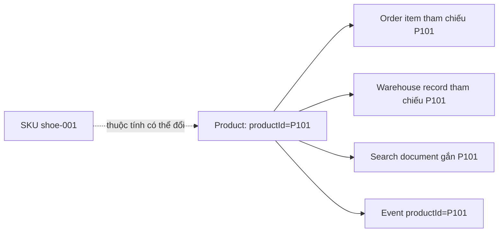
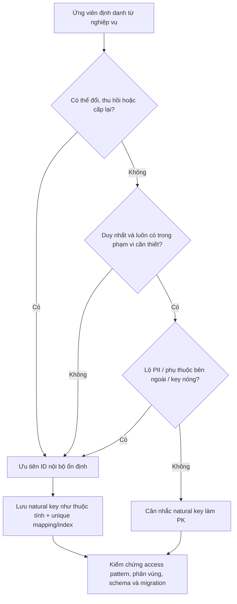

# Định danh tự nhiên, định danh sinh tự động và đánh đổi khi thay đổi dữ liệu

Một hệ thống NoSQL có thể truy xuất dữ liệu cực nhanh bằng khóa nhưng vẫn gặp lỗi nghiêm trọng nếu **khóa dùng để tìm bản ghi bị nhầm với danh tính lâu dài của thực thể**. Ví dụ, nếu dùng email làm `_id` của tài khoản, việc đổi email có thể kéo theo thay đổi đường dẫn API, bản ghi giỏ hàng, cache, thông điệp sự kiện và tài liệu được nhúng trong nhiều collection. Trong khi đó, người dùng vẫn là **cùng một người** trước và sau lần đổi email.

Quyết định dùng **định danh tự nhiên** (*natural identifier*) hay **định danh sinh tự động** (*generated/surrogate identifier*) vì vậy không đơn thuần là chọn kiểu chuỗi cho khóa. Nó quyết định cách ứng dụng bảo vệ tính duy nhất, tổ chức truy vấn, phân vùng dữ liệu, xử lý thay đổi thông tin nghiệp vụ và di chuyển dữ liệu khi hệ thống phát triển.

Bài này đặt lựa chọn định danh vào bối cảnh NoSQL: document, key-value, wide-column, dữ liệu phân tán và các hệ tạo chỉ mục tìm kiếm. Trọng tâm là tách rõ **danh tính**, **giá trị nghiệp vụ** và **đường truy cập**, rồi đánh giá chi phí khi từng loại có thể thay đổi.

## 1. Bốn thứ rất dễ bị gọi chung là “ID”

Xem một sản phẩm có mã SKU là `VN-SHOE-001`. Hệ thống có thể tồn tại các giá trị sau:

```json
{
  "productId": "018d962e-8918-745d-b5db-4c825d9b8861",
  "tenantId": "shop-42",
  "sku": "VN-SHOE-001",
  "externalCatalogId": "supplier-A:98721",
  "category": "shoes"
}
```

| Giá trị | Vai trò | Ai quản lý và khi nào thay đổi? |
| --- | --- | --- |
| `productId` | Danh tính nội bộ ổn định của một sản phẩm | Hệ thống cấp, thông thường giữ nguyên suốt vòng đời thực thể |
| `sku` | Mã nghiệp vụ để bán hàng, quản lý kho | Người bán có thể đổi theo quy tắc đặt mã, sáp nhập hoặc chuyển nhà cung cấp |
| `externalCatalogId` | Mã ánh xạ với hệ thống đối tác | Đối tác quản lý; có thể đổi khi tích hợp hoặc chuyển hệ |
| `tenantId` | Phạm vi sở hữu, phân quyền, có thể tham gia khóa phân vùng | Có thể ổn định trong một tenant; cần chính sách khi chuyển quyền sở hữu |
| `category` | Thuộc tính dùng để lọc và tổ chức truy vấn | Có thể thay đổi tùy danh mục |

Một thực thể còn có thể mang **khóa lưu trữ** (*storage primary key*), **khóa phân vùng** (*partition/shard key*), **khóa sắp xếp** (*sort/clustering key*) và **khóa tra cứu thứ cấp** (*index key*). Các khóa này có thể dùng chung một giá trị nhưng không bắt buộc phải trùng nhau.

```text
Danh tính lâu dài của thực thể ─── productId
Giá trị nghiệp vụ con người dùng ─ sku
Định tuyến đến vị trí lưu trữ ──── partition key
Tìm theo nhu cầu sử dụng ──────── index: (tenantId, normalizedSku)
Phát hiện một request gửi lại ─── idempotencyKey
```

Không nên mặc định rằng mọi trường có hậu tố `Id` đều là khóa bất biến hoặc có tính duy nhất toàn cục. Tính duy nhất phải xác định **phạm vi**, ví dụ một SKU chỉ duy nhất **trong một cửa hàng**, chứ không nhất thiết duy nhất trên toàn bộ nền tảng.

## 2. Định danh tự nhiên là gì?

**Natural identifier** là giá trị được tạo ra hoặc công nhận từ bản thân miền nghiệp vụ, tồn tại để gọi tên/nhận biết đối tượng ngay cả khi chưa bàn tới cơ sở dữ liệu. Ví dụ:

- Mã số thuế trong một hệ thống quản lý doanh nghiệp, kèm quốc gia hoặc cơ quan cấp phù hợp.
- Mã đơn hàng do một hệ thống bên ngoài cấp, trong phạm vi đối tác phát hành.
- Mã SKU trong phạm vi cửa hàng hoặc catalog.
- ISBN cho một phiên bản ấn phẩm trong phạm vi quy tắc ISBN.
- Email hoặc tên đăng nhập nếu nghiệp vụ cho phép dùng để nhận biết tài khoản.

Một giá trị có vẻ “tự nhiên” **không tự động là khóa tốt**. Mỗi ứng viên cần được kiểm tra:

1. **Tính duy nhất:** có hai thực thể hợp lệ nào có cùng giá trị không? Duy nhất theo tenant, tổ chức, quốc gia hay toàn hệ thống?
2. **Tính bắt buộc:** giá trị có luôn tồn tại từ lúc tạo bản ghi không, hay phải chờ bên ngoài cấp?
3. **Tính ổn định:** giá trị có thể bị đổi, sửa lỗi, thu hồi hoặc cấp lại cho một đối tượng khác không?
4. **Tính chuẩn hóa:** `ABC-1`, `abc-1` và `ABC 1` là cùng hay khác? Quy tắc phân biệt hoa thường, khoảng trắng, Unicode do ai định nghĩa?
5. **Khả năng tiết lộ:** khóa có chứa dữ liệu cá nhân, thông tin mật hoặc thông tin có thể suy đoán quy mô kinh doanh không?
6. **Kích thước và phân bố:** khóa dài hay tăng tuần tự, có làm tăng index/storage hoặc tạo phân vùng nóng không?
7. **Quyền quản lý:** ai được sửa hoặc tái cấp mã, và nếu bên ngoài thay đổi quy tắc thì hệ thống làm gì?

### Ví dụ: vì sao email thường không phải khóa chính lâu dài?

Email có thể duy nhất trong số tài khoản **đang hoạt động** theo quy tắc ứng dụng, nhưng vẫn có thể thay đổi khi người dùng đổi địa chỉ, sửa lỗi nhập, đổi tên miền hoặc phải khôi phục tài khoản. Email cũng là thông tin cá nhân và có thể xuất hiện ở nhiều nơi nếu đem làm khóa lưu trữ.

Ngoài ra, “chuẩn hóa email” không chỉ đơn giản là chuyển toàn bộ thành chữ thường. Các hệ thống email khác nhau có quy tắc đối với local-part, alias, dấu chấm hoặc dấu cộng không hoàn toàn giống nhau. Ứng dụng phải công bố và áp dụng một chính sách so sánh cụ thể; không tùy tiện loại bỏ dấu chấm hay phần sau dấu cộng của mọi địa chỉ.

Thiết kế thường dễ duy trì hơn:

```json
{
  "_id": "usr_8b2c6b15",
  "email": "new-address@example.org",
  "normalizedEmail": "new-address@example.org",
  "emailVerified": true
}
```

`_id` là định danh thực thể, còn `normalizedEmail` được kiểm tra duy nhất trong phạm vi nghiệp vụ bằng cơ chế thực tế của database. Đổi email không làm thay đổi `_id`. Việc xác minh địa chỉ mới và ngăn chiếm đoạt tài khoản là **quy trình bảo mật riêng**, không được suy ra từ việc ghi được một giá trị email mới.

## 3. Định danh sinh tự động là gì?

**Generated/surrogate identifier** là khóa được cấp bởi ứng dụng, thư viện hoặc cơ sở dữ liệu nhằm nhận biết thực thể, thường không chứa ý nghĩa nghiệp vụ. Có thể sinh khi tạo request, trong service xử lý, hoặc tại database, tùy yêu cầu đồng bộ và công nghệ.

| Cách sinh | Đặc điểm | Tình huống phù hợp | Điều phải cân nhắc |
| --- | --- | --- | --- |
| UUID phiên bản 4 | Giá trị gần như ngẫu nhiên từ nguồn ngẫu nhiên phù hợp; không cần bộ cấp phát tập trung | Nhiều service có thể tạo ID độc lập | Kích thước lớn hơn số nguyên; không có thứ tự thời gian; cần quản lý dạng lưu trữ |
| UUID phiên bản 7 | Có thành phần thời gian và phần bổ sung để bảo đảm độ phân biệt theo quy tắc tạo UUID | Muốn ID có xu hướng tăng theo thời gian và cấp phân tán | Thứ tự không bảo đảm tuyệt đối giữa mọi máy; lộ thông tin thời gian gần đúng; cần generator đúng chuẩn |
| ULID | Mã 128-bit, biểu diễn chuỗi có thành phần thời gian và ngẫu nhiên | API cần chuỗi ngắn gọn, dễ sắp xếp theo từ vựng | Phải thống nhất cách sinh/chuẩn hóa; thứ tự trong cùng mili giây tùy cách tạo |
| MongoDB ObjectId | Giá trị 12 byte, thường do driver tạo, chứa thành phần timestamp và thông tin phân biệt | Document MongoDB khi không cần ID riêng | Có thể suy ra thời điểm tạo gần đúng; không dùng tính tăng để thay cho bảo đảm đồng hồ/transaction |
| Snowflake-like ID | Số nguyên thường kết hợp timestamp, node/worker và sequence | Muốn số gọn, cấp phân tán với hạ tầng điều phối node | Cần quản lý worker ID, clock rollback, giới hạn bit và throughput mỗi worker |
| Sequence/counter | Số tăng dần dễ đọc, dễ đối chiếu | Phạm vi nhỏ, công cụ quản trị, số chứng từ theo yêu cầu | Bộ cấp phát có thể nghẽn; dễ đoán số lượng, không thích hợp làm rào bảo mật |
| Opaque random string | Token ngẫu nhiên không mang ý nghĩa nghiệp vụ | Mã tham chiếu công khai, ID không cần thứ tự | Độ dài/entropy và va chạm; tuyệt đối không thay thế phân quyền |

Các UUID, ULID, ObjectId hoặc Snowflake là **cách tạo giá trị**; bản thân chúng không bảo đảm uniqueness được kiểm soát trong cơ sở dữ liệu. Xác suất va chạm của một thuật toán tốt có thể cực nhỏ nhưng vẫn cần chính sách rõ ràng khi một lần ghi gặp khóa trùng, thường là **thất bại có kiểm soát hoặc tạo ID mới khi an toàn**.

### Tạo ID ở ứng dụng hay để database cấp?

**Sinh trước khi ghi** phù hợp khi một request cần biết trước ID để ghi event, xây document liên quan, gọi API khác hoặc thực hiện idempotent retry. UUIDv4/UUIDv7 là lựa chọn thường gặp khi nhiều service hoạt động độc lập. Tuy vậy, sinh ID sớm không đồng nghĩa bản ghi đã tồn tại: trạng thái vẫn có thể là *chưa commit*.

**Database cấp ID** giảm trách nhiệm cho ứng dụng và phù hợp với loại kho dữ liệu có cơ chế cấp phát tích hợp. Đổi lại, ứng dụng phải nhận ID sau thao tác tạo; nếu tạo nhiều bản ghi liên quan thì có thể cần thêm bước phối hợp. Một số database/driver tự sinh ID phía client dù nhìn bề ngoài giống “database cấp”; cần xác nhận cơ chế thực tế trước khi dựa vào thứ tự hoặc tính duy nhất của nó.

### Không nhầm ID có thứ tự thời gian với lịch sử sự kiện chính xác

ID có thành phần thời gian hữu ích cho truy vấn và tính cục bộ của cấu trúc lưu trữ, nhưng:

- Đồng hồ của nhiều máy có thể lệch hoặc quay lùi.
- Nhiều ID được tạo trong cùng một mili giây có thể không phản ánh thứ tự xử lý thực.
- Một request có thể được tạo trước nhưng commit sau request khác.
- Việc sắp xếp theo ID không xác lập **thứ tự commit**, **thứ tự nhân quả** hay **thứ tự sự kiện nghiệp vụ**.

Nếu cần xử lý event đúng thứ tự, hãy có `version`, `sequence` theo aggregate hoặc cơ chế ordering cụ thể; không phụ thuộc duy nhất vào timestamp trong ID.

## 4. So sánh hai chiến lược theo vòng đời dữ liệu

| Tiêu chí | Dùng định danh tự nhiên làm khóa chính | Dùng định danh sinh tự động làm khóa chính |
| --- | --- | --- |
| Dễ hiểu khi vận hành | Có thể tra cứu theo mã nghiệp vụ trực tiếp | Cần ánh xạ ID sang mã nghiệp vụ |
| Ổn định khi nghiệp vụ đổi tên/mã | Rủi ro cao nếu mã có thể đổi | Thường chỉ cập nhật thuộc tính hoặc index |
| Quy tắc duy nhất | Gắn với miền nghiệp vụ và phạm vi duy nhất | Duy nhất kỹ thuật của ID; vẫn phải kiểm tra mã nghiệp vụ riêng |
| Kích thước khóa | Tùy mã, có thể dài hoặc thay đổi | Có thể chọn định dạng cố định và thống nhất |
| Tính phân bố | Có thể tốt hoặc rất xấu tùy quy luật mã | Có thể chọn generator phân bố phù hợp; vẫn phải kiểm tra partition key |
| Phụ thuộc bên ngoài | Có thể phụ thuộc nhà cung cấp hoặc hệ cấp mã | Kiểm soát được trong nội bộ, trừ khi dùng dịch vụ cấp ID tập trung |
| Tích hợp với bên ngoài | Dễ nếu đối tác sử dụng cùng mã và cùng phạm vi | Cần trường `externalId` hoặc bảng ánh xạ |
| Thông tin bị lộ khi công khai | Mã có thể tiết lộ email, số điện thoại, thứ tự đơn hàng | ID opaque giảm ý nghĩa lộ ra, nhưng vẫn cần authorization |
| Chi phí đổi mã | Có thể phải chuyển khóa, reference, cache và đường dẫn | Thường chỉ đổi giá trị thuộc tính; cập nhật index/alias |
| Mô hình truy vấn | Một đường lookup tự nhiên nếu khóa khớp truy vấn | Có thể cần secondary index hoặc mapping để lookup theo mã |

Điểm mấu chốt là **mã nghiệp vụ có thật sự không đổi trong suốt vòng đời thực thể hay không**. Một mã hiện chưa từng đổi vẫn có thể đổi sau khi tích hợp hệ thống mới, áp dụng chuẩn mới, sáp nhập doanh nghiệp hoặc phát hiện dữ liệu nhập sai.

## 5. Trong NoSQL, khóa chính và khóa phân vùng quyết định nhiều hơn việc tìm bản ghi

Ở nhiều cơ sở dữ liệu NoSQL, khóa liên quan trực tiếp đến **đường đi của truy vấn**:

```text
Request theo key
    -> tính hash / xác định token / tra shard route
    -> tìm partition
    -> đọc item/document/row

Request theo trường ngoài key
    -> secondary index hoặc scan hoặc fan-out
    -> có thể cần nhiều bước truy vấn / đồng bộ index
```

Nếu dùng email làm partition key, đổi email không chỉ là cập nhật một field: có thể đồng nghĩa phải **chuyển bản ghi đến partition khác**. Nếu dùng ID tăng liên tục và phân vùng dữ liệu dựa trên dải khóa, các bản ghi mới có thể tập trung ở một shard. Nếu dùng ID ngẫu nhiên, tải có thể phân tán đều hơn theo hash, nhưng truy vấn thời gian cần index hoặc khóa sắp xếp phù hợp.

**Không có quy luật “UUID luôn phân tán đều” hoặc “ID tăng luôn tạo hot partition” cho mọi database.** Điều này phụ thuộc thuật toán phân vùng (hash, range, token), composite key, truy vấn, shard split và cách dịch vụ quản lý capacity. Một ID ngẫu nhiên cũng không cứu được thiết kế khi tất cả request đều đổ vào cùng một giá trị partition key như `TENANT#BIG_CUSTOMER`.

### Khóa tổng hợp để đặt đúng phạm vi

Ví dụ một mã SKU chỉ duy nhất theo tenant:

```text
Logical uniqueness: (tenantId, normalizedSku)

tenantId=shop-42, normalizedSku=shoe-001   -> productId=P101
tenantId=shop-43, normalizedSku=shoe-001   -> productId=P876
```

Trong bảng DynamoDB có thể biểu diễn bằng khóa:

```text
PK = TENANT#shop-42
SK = PRODUCT#P101

Thuộc tính thêm:
productId = P101
normalizedSku = shoe-001
```

Thiết kế này dễ lấy sản phẩm theo ID trong một tenant nhưng **không tự bảo đảm** mã SKU duy nhất trong tenant; cùng `normalizedSku` vẫn có thể xuất hiện ở hai item nếu không có cơ chế kiểm tra/giữ chỗ nguyên tử. Ngoài ra, đưa mọi sản phẩm của một tenant vào một partition key cố định cần đánh giá hot key và giới hạn truy cập; key schema nên xuất phát từ các access pattern và profile tải thực tế.

### Đừng lấy đường dẫn lưu trữ làm định danh công khai bất biến nếu chưa chốt hợp đồng

Một item có thể được lưu theo `PK=TENANT#42` và `SK=PRODUCT#101` nhưng API công khai chỉ dùng `productId=P101`. Khi chuyển tenant hoặc tái phân vùng, application có thể đổi vị trí lưu trữ và cập nhật mapping; API khách hàng vẫn nhận diện sản phẩm bằng ID cũ.

Khả năng tách này đặc biệt quan trọng khi tái tổ chức dữ liệu, chuyển giữa NoSQL engine, đổi partition strategy hoặc phục vụ nhiều Region.

## 6. Chuyện gì xảy ra khi định danh tự nhiên thay đổi?

Giả sử tài khoản dùng email làm khóa:

```json
{
  "_id": "old@example.org",
  "displayName": "An",
  "status": "ACTIVE"
}
```

Khi người dùng chuyển email sang `new@example.org`, cần xét tối thiểu:

1. **Khóa chính có đổi được không?** Nhiều database cấm cập nhật primary key trực tiếp, phải tạo bản ghi mới và xóa bản ghi cũ.
2. **Reference đang trỏ về đâu?** Giỏ hàng, đơn hàng, audit log, bình luận, event và bản ghi ở service khác có thể giữ email cũ.
3. **Đường dẫn công khai có bị gãy?** URL, bookmark, liên kết email, khóa cache và các webhook payload cũ có thể chứa ID cũ.
4. **Tính duy nhất được giải quyết thế nào?** Email mới có thể đã thuộc người khác, đang được đặt trước hoặc chờ xác minh.
5. **Thời điểm nào client thấy giá trị mới?** Thay đổi trong primary, replica, index và search có thể không xuất hiện đồng thời.
6. **Có cần giữ tên cũ làm alias?** Nếu giữ, trong bao lâu, có nguy cơ người khác tái sử dụng hoặc truy cập sai tài khoản không?
7. **Các request tới đồng thời thì sao?** Trong lúc chuyển khóa, bản ghi tạo mới hoặc update có thể đi vào key cũ nếu không có version/redirect/ràng buộc thích hợp.
8. **Khôi phục sự cố bằng cách nào?** Nếu tạo bản ghi mới thành công nhưng xóa bản cũ hoặc cập nhật reference thất bại, trạng thái trung gian phải có cách phát hiện và hoàn tất.

Trường hợp này là **thay đổi khóa định danh** (*rekeying*), không còn là một câu lệnh `UPDATE email` đơn giản.

Ngược lại, nếu dùng ID nội bộ ổn định:

```json
{
  "_id": "usr_8b2c6b15",
  "email": "new@example.org",
  "normalizedEmail": "new@example.org",
  "displayName": "An",
  "status": "ACTIVE"
}
```

Các document khác vẫn tham chiếu `usr_8b2c6b15`. Việc đổi email chủ yếu liên quan đến kiểm tra duy nhất, xác minh quyền sở hữu, cập nhật index/cache và phát sự kiện. Độ phức tạp **không biến mất hoàn toàn**, nhưng phạm vi dữ liệu cần thay đổi ít hơn và danh tính không bị gắn với một giá trị nghiệp vụ có thể biến động.

## 7. Ví dụ mô hình sản phẩm: ID ổn định, SKU được phép đổi

Một mô hình document trong MongoDB có thể là:

```json
{
  "_id": "prd_01J8H7YTGK4E8S95T9KP5Y5P9D",
  "tenantId": "shop-42",
  "sku": "VN-SHOE-001",
  "normalizedSku": "vn-shoe-001",
  "name": "Giày chạy bộ",
  "version": 4,
  "status": "ACTIVE"
}
```

Đơn hàng tham chiếu bằng `productId`, đồng thời giữ **ảnh chụp thông tin cần thiết tại lúc giao dịch**, ví dụ SKU, tên và giá thời điểm mua:

```json
{
  "_id": "ord_01J8H84C3AJK3DNE6D0RK40G7G",
  "items": [
    {
      "productId": "prd_01J8H7YTGK4E8S95T9KP5Y5P9D",
      "skuAtPurchase": "VN-SHOE-001",
      "nameAtPurchase": "Giày chạy bộ",
      "quantity": 1,
      "unitPrice": 350000
    }
  ]
}
```

Khi SKU đổi thành `RUN-2026-001`, order cũ vẫn chỉ về cùng sản phẩm, đồng thời giữ đúng thông tin được dùng tại thời điểm mua. Đây là hai nhu cầu khác nhau:

- **Tham chiếu đến thực thể hiện tại:** dùng ID ổn định để mở sản phẩm hoặc liên kết giữa các aggregate.
- **Bằng chứng lịch sử giao dịch:** lưu snapshot của những thuộc tính có ý nghĩa tại thời điểm giao dịch. Không lấy tên/SKU/giá hiện tại để sửa ngược hóa đơn cũ.

### Index duy nhất trên mã nghiệp vụ

Ví dụ với MongoDB:

```javascript
db.products.createIndex(
  { tenantId: 1, normalizedSku: 1 },
  { unique: true }
);
```

Ý nghĩa: với collection/index và phạm vi triển khai phù hợp, hai document không thể có cùng cặp `(tenantId, normalizedSku)`. Ứng dụng cần áp dụng một hàm chuẩn hóa nhất quán và xử lý duplicate-key error khi hai request cùng cố lấy một SKU.

**Điều kiện cần kiểm tra trước khi áp dụng:** dữ liệu đã tồn tại có trùng không; field có thể thiếu/null không; index chỉ áp dụng cho sản phẩm `ACTIVE` hay tất cả; và trong sharded collection, quy tắc unique index có bị ràng buộc bởi shard key không. Không được khẳng định một secondary index bất kỳ tự động có bảo đảm unique trên mọi hệ NoSQL.

### Đổi SKU mà không đổi ID

Ví dụ cập nhật có kiểm soát phiên bản:

```javascript
const result = await db.collection("products").updateOne(
  { _id: productId, tenantId, version: expectedVersion },
  {
    $set: {
      sku: newSku,
      normalizedSku: normalizeSku(newSku)
    },
    $inc: { version: 1 }
  }
);

if (result.matchedCount === 0) {
  throw new Error("Sản phẩm không tồn tại hoặc đã bị chỉnh sửa");
}
```

`normalizeSku` là hàm nghiệp vụ giả định; phải được định nghĩa đồng nhất ở mọi luồng ghi. Unique index xử lý tranh chấp hai sản phẩm lấy cùng SKU; điều kiện `version` xử lý ghi đè cạnh tranh trên **cùng sản phẩm**. Hai cơ chế phục vụ hai bất biến khác nhau.

Nếu cho phép SKU cũ trở thành **alias** để tìm lại sản phẩm, hãy kiểm tra tính duy nhất xuyên qua cả mã chính và alias; unique index riêng cho `normalizedSku` chưa tự động ngăn alias của A trùng SKU chính của B.

## 8. Uniqueness không tự đến từ việc “kiểm tra rồi insert”

Cách viết sau có race condition:

```text
Request A: tìm email=x -> chưa tồn tại
Request B: tìm email=x -> chưa tồn tại
Request A: tạo user A có email=x -> thành công
Request B: tạo user B có email=x -> thành công (nếu thiếu ràng buộc)
```

Kiểm tra ở ứng dụng giúp báo lỗi sớm cho người dùng, nhưng **không thay thế cơ chế uniqueness nguyên tử** tại nơi dữ liệu được lưu.

Các hướng bảo vệ tùy hệ:

| Hệ | Công cụ có thể dùng | Giới hạn cần hiểu |
| --- | --- | --- |
| MongoDB | Unique index; transaction khi cần cập nhật nhiều document | Unique index trong sharded collection có các quy tắc về shard key; transaction cần deployment và cấu hình phù hợp |
| DynamoDB | `PutItem` với `ConditionExpression`; dùng item “giữ chỗ” và `TransactWriteItems` khi cần ràng buộc xuyên các item | GSI không tự tạo ràng buộc unique; condition trên một item không tự kiểm tra mọi item khác |
| Cassandra | Primary-key uniqueness; `INSERT ... IF NOT EXISTS` bằng lightweight transaction (LWT) khi cần kiểm tra điều kiện | Cần thiết kế key/partition đúng phạm vi; secondary index không phải unique constraint toàn cục |
| Redis | `SET key value NX` để tạo key nếu chưa tồn tại; giao dịch/script để phối hợp trong phạm vi được hỗ trợ | Persistence/failover, TTL và cluster semantics phải phù hợp; khóa có TTL không bảo đảm độc quyền lâu dài nếu hết hạn |
| Elasticsearch | Ghi document theo ID, `op_type=create` để từ chối tạo trùng chính ID đó | Hai document mang hai `_id` khác nhau vẫn có thể có cùng email/SKU; không có unique constraint tổng quát trên field |

### Ví dụ DynamoDB: giữ chỗ mã nghiệp vụ

Giả sử sản phẩm có ID ổn định `P101`, còn SKU `shoe-001` phải duy nhất trong tenant `T42`. Một single-table design có thể dùng:

```text
Item 1 (sản phẩm):
  PK = PRODUCT#P101
  productId = P101
  tenantId = T42
  normalizedSku = shoe-001

Item 2 (giữ chỗ SKU):
  PK = SKU#T42#shoe-001
  productId = P101
```

Để tạo sản phẩm mới, dùng một `TransactWriteItems` trong đó cả item sản phẩm lẫn item giữ chỗ đều được tạo với điều kiện key chưa tồn tại. Nếu một request khác đã giữ `SKU#T42#shoe-001`, transaction bị từ chối, ngăn hai sản phẩm chiếm cùng SKU.

```text
TransactWriteItems:
  Put PRODUCT#P101       IF attribute_not_exists(PK)
  Put SKU#T42#shoe-001  IF attribute_not_exists(PK)
```

Khi đổi SKU, transaction phải xác minh và tạo chỗ giữ cho SKU mới, cập nhật item sản phẩm và xử lý chỗ giữ cũ theo chính sách alias/tái sử dụng. Nếu giao dịch nằm ngoài giới hạn API hoặc trải qua các database/dịch vụ khác nhau, phải chọn quy trình nhiều bước có trạng thái và phục hồi rõ ràng; không gọi hai lần `PutItem` rời rạc rồi mặc nhiên coi cả hai atomic.

## 9. Thay đổi khóa theo từng loại NoSQL

Các hệ có cơ chế lưu trữ khác nhau nên thao tác “đổi ID” cũng khác:

| Loại/hệ | Thay đổi khóa chính | Hàm ý với thiết kế |
| --- | --- | --- |
| MongoDB | `_id` của một document là bất biến khi cập nhật; đổi nghĩa là tạo document mang `_id` mới và xử lý document cũ | Không dùng email/SKU có thể đổi làm `_id` nếu muốn cập nhật nhẹ |
| DynamoDB | Không thay được các thuộc tính tạo primary key bằng `UpdateItem`; thường phải `Put` item mới và `Delete` item cũ (có transaction nếu phạm vi hỗ trợ) | Một mã nghiệp vụ thay đổi trong `PK` hoặc `SK` là thay đổi vị trí lưu trữ |
| Cassandra | Primary key gồm partition/clustering component định danh row; không cập nhật giá trị khóa tại chỗ, cần ghi row mới và xóa row cũ | Thay key có thể tạo tombstone; phải tính propagation và vòng đời dữ liệu |
| Redis | Có lệnh đổi tên key trong phạm vi lệnh được hỗ trợ; cluster ràng buộc xử lý key và slot | Các nơi lưu tên key cũ, cache và consumer vẫn cần được cập nhật; không coi `RENAME` là migration đa hệ |
| Elasticsearch/OpenSearch | `_id` là định danh document trong index, không cập nhật `_id` bằng update; thường tạo document ID mới rồi xóa document cũ | Search index thường là projection, có thể tái lập từ hệ dữ liệu gốc; alias/mapping cần do ứng dụng sở hữu |

Trong Cassandra, MongoDB hoặc DynamoDB, việc ghi/xóa có những quy tắc sao chép, điều kiện và độ nhất quán khác nhau. Không suy diễn từ “một transaction đã hoàn tất” rằng mọi replica, secondary index, cache và search projection đều phản ánh kết quả cùng một thời điểm.

## 10. Thiết kế đường tham chiếu và liên kết giữa dữ liệu

NoSQL thường cho phép document được nhúng, tách collection, denormalize hoặc lưu bản sao phục vụ truy vấn. Vì vậy định danh ổn định càng có giá trị khi một thực thể xuất hiện ở nhiều projection.



Khi dùng generated ID để tham chiếu:

- Thay đổi SKU/email/tên không cần cập nhật mọi reference chỉ để giữ danh tính.
- Projection vẫn có thể chứa bản sao SKU, tên và trạng thái để đọc nhanh; cần cơ chế cập nhật và xử lý dữ liệu cũ.
- Một thao tác xóa thực thể vẫn cần quy tắc tham chiếu mồ côi, cascade, soft delete hoặc retention; generated ID **không tự có foreign key**.
- Trong event, phát cả `entityId` ổn định và `version` hoặc `eventId` riêng để consumer biết bản cập nhật nào đến trước/sau và xử lý gửi lại.

Không nhất thiết mọi collection phải join để lấy ID. Trong NoSQL, có thể **denormalize có chủ đích** nhưng nên duy trì một khóa chung ổn định để đối soát và tái tạo projection.

## 11. Ba loại ID phải tách riêng trong hệ phân tán

Một request tạo đơn hàng có thể mang:

```json
{
  "orderId": "ord_01J8H84C3AJK3DNE6D0RK40G7G",
  "idempotencyKey": "client-req-6fd8e9",
  "eventId": "evt_01J8H86JJ4EQ6W5DB6M5SAJ47Z"
}
```

| Khóa | Đại diện cho | Vòng đời |
| --- | --- | --- |
| `orderId` | Đơn hàng nghiệp vụ | Thường ổn định suốt vòng đời đơn |
| `idempotencyKey` | Ý định xử lý một yêu cầu có thể gửi lại | Có phạm vi người gọi/operation và thời gian lưu chính sách |
| `eventId` | Một sự kiện cụ thể trong luồng phát/nhận | Dùng cho de-duplication, truy vết và xử lý retry |

Không nên giả định một ID duy nhất thay thế được cả ba. Ví dụ một đơn hàng có nhiều sự kiện hợp lệ (`CREATED`, `PAID`, `CANCELLED`), mỗi sự kiện có `eventId` riêng. Một `idempotencyKey` có thể được client gửi lại khi timeout để lấy đúng **kết quả của lần thực hiện đầu**, thay vì tạo đơn thứ hai.

Khi thiết kế idempotency cần xác định:

1. Phạm vi duy nhất của key: theo user, tenant, endpoint, loại thao tác hay toàn hệ?
2. Nếu cùng key nhưng payload khác, phải từ chối hay xử lý thế nào?
3. Kết quả lưu để trả lại cho retry gồm gì? Nếu request đầu đang chạy, client nhận trạng thái nào?
4. Key được giữ trong bao lâu? Hết hạn rồi key có thể dùng lại không?
5. Có atomic guard giữa việc giữ idempotency key và việc tạo hiệu ứng nghiệp vụ không?

Generated ID giúp đơn giản hóa tham chiếu nhưng không thay thế các quyết định này.

## 12. Đổi mã tự nhiên khi chưa thể thay đổi hệ thống cũ

Đôi khi hệ thống đã dùng mã khách hàng, username hoặc email làm khóa chính từ lâu. Thay hoàn toàn khóa lưu trữ trong một lần triển khai có thể làm hỏng tương thích với API và các dịch vụ liên kết. Có thể triển khai **lớp định danh ổn định và bảng ánh xạ** trước khi di chuyển khóa vật lý.

### Mô hình chuyển tiếp

```text
API nhận legacyKey = "old@example.org"
            |
            v
Alias / Identity mapping
  old@example.org -> usr_8b2c6b15
  new@example.org -> usr_8b2c6b15
            |
            v
Canonical user record
  userId = usr_8b2c6b15
  currentEmail = new@example.org
```

Trong kiến trúc này, **một canonical ID** là nguồn danh tính; các mã cũ chỉ là đường tra cứu có chính sách thời hạn. Cần tránh tình trạng nhiều alias cùng trỏ vào các user khác nhau sau một chuỗi chuyển đổi, hoặc mã cũ được cấp lại cho người mới khi client cũ vẫn đang dùng mã đó.

### Quy trình migration có kiểm soát

1. **Kiểm kê nơi dùng khóa cũ:** database chính, secondary index, collection tham chiếu, message schema, API path, cache, log, backup, dashboard và đối tác.
2. **Định nghĩa danh tính mới:** phạm vi duy nhất, generator, định dạng, cách phân quyền và chính sách mã cũ. Chốt bất biến “một thực thể canonical chỉ có một ID”.
3. **Bổ sung generated ID và mapping:** gán ID một cách ổn định cho dữ liệu hiện hữu. Backfill phải idempotent, có thể tiếp tục khi bị ngắt, không sinh ID mới mỗi lần chạy lại.
4. **Đưa ID mới vào đường ghi:** bản ghi mới luôn có canonical ID; ghi các alias/mã tự nhiên bằng conditional operation hoặc transaction nếu có. Đồng bộ dữ liệu cũ/mới qua cơ chế được thiết kế rõ.
5. **Cho phép đọc hai dạng trong giai đoạn chuyển đổi:** ưu tiên lookup theo ID mới; khi nhận key cũ, tra bảng alias rồi dẫn tới canonical ID. Đo lượng truy cập còn dùng legacy key.
6. **Chuyển dần reference:** consumer, dữ liệu đơn hàng và các aggregate mới lưu canonical ID; với dữ liệu lịch sử, dùng backfill và đối soát theo từng lô.
7. **Kiểm soát cutover:** chặn tạo mới reference chỉ dùng mã cũ khi đủ client đã nâng cấp, xử lý sự kiện trễ và rollback plan, kiểm tra lặp/thiếu mapping.
8. **Loại bỏ đường cũ theo hợp đồng:** chỉ dọn alias sau thời hạn tương thích và khi đã đánh giá liên kết, audit, yêu cầu pháp lý và khả năng mã được tái sử dụng.

Không nên xóa toàn bộ bản ghi cũ ngay sau khi thấy dữ liệu mới đã có. Phải xác minh **tính đầy đủ của reference**, retry và luồng bất đồng bộ. Hệ có eventual consistency có thể còn event đang bay hoặc index chưa đồng bộ.

### Nếu buộc phải đổi primary key vật lý

Một quy trình trừu tượng là:

```text
1. Giữ quyền sở hữu mã mới, ngăn tranh chấp.
2. Tạo item/document với khóa mới và dữ liệu/phiên bản nhất quán.
3. Chuyển hoặc ánh xạ các reference đang dùng khóa cũ.
4. Thiết lập redirect/alias trong thời hạn tương thích.
5. Ngăn phát sinh ghi mới vào khóa cũ.
6. Đối soát và chỉ sau đó xóa/tombstone khóa cũ theo chính sách.
```

Nếu database hỗ trợ transaction bao trùm các bước nằm trong **cùng phạm vi**, có thể dùng transaction cho phần thực hiện cục bộ. Với các dịch vụ/Region độc lập, cần quy trình nhiều bước có trạng thái, retry idempotent, checkpoint và hành động khôi phục. Không có một transaction chung tự nhiên giữa cache, search, message broker và mọi database.

## 13. Aliases, lịch sử đổi tên và chính sách tái sử dụng

Một câu hỏi dễ bị bỏ qua: sau khi người dùng đổi `alice` thành `alice2026`, tài khoản khác có được đăng ký `alice` ngay không?

Ba phương án có đánh đổi khác nhau:

| Chính sách | Lợi ích | Rủi ro/chi phí |
| --- | --- | --- |
| Không giữ alias, cho dùng lại ngay | Giải phóng tên nhanh, đơn giản nếu không có client cũ | Link cũ có thể trỏ nhầm người mới; tăng rủi ro nhầm định danh |
| Giữ alias vĩnh viễn | Link cũ ổn định | Không thể tái dùng mã; tăng dữ liệu mapping và vấn đề quyền riêng tư |
| Giữ alias có thời hạn và chính sách tái sử dụng | Cân bằng tương thích và tài nguyên tên | Phải quản lý thời hạn, tombstone, cache và cạnh tranh khi thu hồi |

Với **email hoặc tên đăng nhập**, alias có thể ảnh hưởng an ninh tài khoản: không tự động biến email cũ thành kênh khôi phục tài khoản nếu chủ tài khoản đã mất quyền kiểm soát địa chỉ đó. Với **mã doanh nghiệp/SKU**, policy thường gắn với audit và hệ thống tích hợp.

Nếu API trả `301/308 redirect` hoặc object alias, cần cân nhắc cache của client/proxy: redirect dài hạn có thể tồn tại sau khi alias bị thu hồi. Đối với dữ liệu nhạy cảm, không được cho phép truy cập chỉ vì client nắm ID hay alias; mọi đường lookup cuối cùng phải đi qua xác thực/phân quyền phù hợp.

## 14. Những đánh đổi về bảo mật và quyền riêng tư

Định danh “ngẫu nhiên và khó đoán” **không phải kiểm soát truy cập**. Nếu API `GET /users/{id}` trả thông tin bất kỳ khi biết ID, việc đổi từ số nguyên tuần tự sang UUID chỉ làm tấn công dò ID khó hơn, không khắc phục lỗi phân quyền.

Các nguyên tắc:

- **Không dùng PII làm đường dẫn lưu trữ/công khai nếu không cần thiết.** Email, số điện thoại và mã giấy tờ có thể lọt vào URL, log, cache, trace, analytics hoặc thông báo lỗi.
- **Không dùng số thứ tự để suy ra authorization.** Người dùng phải được kiểm tra quyền với thực thể được truy cập, dù ID là UUID, ULID hay số thứ tự.
- **Xác định khả năng suy đoán metadata.** Snowflake, UUIDv7, ULID hoặc ObjectId có thể mang thông tin thời gian; số tăng liên tục tiết lộ tương đối về thứ tự tạo.
- **Tránh nhúng bí mật vào khóa.** API token, mật khẩu, mã xác minh hay credential không nên kiêm vai trò primary key dễ in ra log.
- **Lưu quy tắc retention riêng.** Khi xóa dữ liệu cá nhân, cần kiểm kê alias, index, snapshot, event và backup theo yêu cầu áp dụng; generated ID không tự biến dữ liệu thành vô danh.

Nếu đối tác cần mã công khai ngắn và ổn định, có thể tạo **publicId** tách khỏi `internalId`, với mapping và chính sách phân quyền. Public ID nên được coi là địa chỉ truy cập, không phải chứng cứ quyền sở hữu.

## 15. Một ma trận chọn định danh cho các loại thực thể

| Thực thể / nhu cầu | Ứng viên khóa định danh | Trường nghiệp vụ tra cứu | Lý do chọn |
| --- | --- | --- | --- |
| Tài khoản người dùng | Generated `userId` | Email, username, phone | Người dùng có thể đổi thông tin liên hệ; cần giữ lịch sử và reference |
| Sản phẩm bán hàng | Generated `productId` | `(tenantId, sku)`, barcode | SKU/catalog có thể đổi; đơn hàng giữ snapshot |
| Đơn hàng | Generated `orderId`; mã hiển thị riêng nếu cần | `orderNumber`, externalOrderId | Giao dịch có danh tính bền vững, mã giao tiếp có thể chịu quy tắc khác |
| Quan hệ giữa hai thực thể | Composite key theo hai ID ổn định hoặc generated relation ID | Hai đầu quan hệ và loại quan hệ | Nếu cặp đầu liên kết ổn định, composite key có thể rõ ràng; nếu quan hệ có vòng đời riêng, ID riêng có thể hữu ích |
| Bản ghi mapping với đối tác | `(partnerId, externalId)` hoặc ID riêng kèm unique mapping | Mã đối tác cấp | Phải nhận diện đúng phạm vi và đối phó đối tác đổi mã |
| Đối tượng định danh theo tiêu chuẩn bất biến thực sự | Natural ID sau khi xác minh quy tắc | Các thuộc tính mô tả khác | Giảm tầng ánh xạ nếu ID được bảo đảm không đổi và có phạm vi rõ |
| Event/log | `eventId` sinh độc lập | aggregateId, version, occurredAt | Event phải phân biệt với thực thể và hỗ trợ de-duplication |

Đây là hướng thiết kế thường gặp, không phải quy tắc bắt buộc. **Natural key có thể là lựa chọn tốt** khi nó ngắn, ổn định thật sự, có phạm vi rõ ràng, không nhạy cảm và phù hợp các truy vấn. Ví dụ một bảng tra cứu có tập mã chuẩn cố định theo phiên bản có thể dùng mã chuẩn làm key, miễn là quy định xử lý cập nhật phiên bản của bộ mã.

### Cây quyết định thực hành



## 16. Kiểm tra thiết kế định danh bằng các tình huống thay đổi

Để đánh giá đúng chi phí đổi khóa, hãy mô phỏng những tình huống sau trong môi trường thử:

1. **Đổi email/username:** sau đổi, các đơn và event cũ vẫn tra được cùng `userId`; email cũ không tự động cho quyền truy cập.
2. **Hai người cùng lấy một SKU:** chỉ một thao tác thắng theo quy tắc unique đã đặt; thao tác kia nhận lỗi nghiệp vụ rõ ràng, không để bản ghi trùng.
3. **Thử lại sau timeout:** cùng idempotency key không tạo thêm sản phẩm, đơn hàng hoặc reservation.
4. **Thay mã đối tác:** ánh xạ từ external ID cũ sang canonical ID được xử lý theo quy tắc; webhook đến trễ không tái tạo một thực thể trùng.
5. **Chuyển tenant hoặc tái phân vùng:** ID công khai còn được phân giải; chính sách sở hữu và quyền truy cập cập nhật nhất quán.
6. **Đổi khóa có nhiều tham chiếu:** sau backfill, không còn reference mồ côi; hệ tìm kiếm và cache được đối soát.
7. **Tạo số lượng lớn ID phân tán:** đo collision, latency tạo ID, phân bố partition và tỷ lệ ghi khi xảy ra hot key; không chỉ đếm số lượng ID tạo được.
8. **Giải phóng alias cũ:** xác minh không còn người dùng hoặc client cũ bị chuyển nhầm sang thực thể mới.

Một bảng nghiệm thu có thể viết:

| Mã | Điều kiện | Bằng chứng |
| --- | --- | --- |
| `ID-01` | Đổi natural key không làm đổi canonical entity ID | So sánh ID trước/sau cập nhật và truy vết reference |
| `ID-02` | Không có hai entity hiệu lực cùng natural key trong phạm vi đã khai báo | Concurrent create/rename, kiểm tra unique guard và dữ liệu sau cùng |
| `ID-03` | Retry cùng request không tạo entity thứ hai | Tiêm timeout, gửi lại cùng idempotency key, đối soát record |
| `ID-04` | Migration giữ được mapping của mọi bản ghi cũ thuộc phạm vi | Kiểm kê nguồn/đích, số mapping hợp lệ, số tham chiếu mồ côi |
| `ID-05` | Mô hình khóa đáp ứng workload mục tiêu kể cả hot key | Load test theo phân bố thực, latency, throughput và số liệu partition |
| `ID-06` | Biết ID/alias của thực thể khác không vượt qua phân quyền | Bài thử truy cập chéo tenant/user và log bảo mật |

Không có bộ sinh ID nào tự bảo đảm cả sáu điều kiện: mỗi tiêu chí cần được bảo vệ bởi schema, transaction/conditional write, ứng dụng, quyền truy cập và quy trình vận hành tương ứng.

## 17. Các nhầm lẫn thường gặp

### “UUID luôn tốt hơn natural key?”

Không. UUID giúp tách danh tính khỏi thuộc tính nghiệp vụ và thuận lợi khi tạo ID phân tán, nhưng cần thêm index để tìm theo mã tự nhiên, tốn thêm không gian lưu trữ so với khóa ngắn và không tự tối ưu mô hình phân vùng. Nếu natural key thật sự bất biến, duy nhất, an toàn và phù hợp truy vấn, dùng trực tiếp có thể đơn giản hơn.

### “Dùng generated ID rồi thì không cần unique index trên email/SKU?”

Sai. Generated ID ngăn hai bản ghi có **cùng ID kỹ thuật**; nó không ngăn hai tài khoản cùng email hoặc hai sản phẩm cùng SKU trong một tenant. Ràng buộc nghiệp vụ cần cơ chế kiểm tra/giữ chỗ riêng.

### “Đổi field natural key có nghĩa là đổi danh tính đối tượng?”

Chỉ đúng khi chính **nghiệp vụ định nghĩa** thay mã là trở thành đối tượng mới. Ví dụ sửa lỗi đánh máy trong SKU thường là đổi một thuộc tính của cùng sản phẩm; nhưng thay đổi mã tiêu chuẩn có thể phản ánh việc sản phẩm được phân loại thành một phiên bản thực thể khác. Quy tắc này phải được chủ miền nghiệp vụ xác nhận, không suy từ thao tác của database.

### “Có secondary index rồi thì đổi key rất rẻ?”

Nếu field là secondary index, đổi field có thể tương đối đơn giản ở mức ứng dụng, nhưng index vẫn cần cập nhật; global secondary index có thể bất đồng bộ và việc kiểm tra uniqueness tùy hệ. Nếu field còn làm partition key/primary key, đổi nó có thể kéo theo rekey, chuyển bản ghi và phục hồi reference.

### “ID có timestamp là thứ tự tạo chính xác và an toàn để công khai?”

Không. Thời điểm tạo ID có thể khác thời điểm commit, đồng hồ có thể lệch, và các định dạng có thời gian có thể tiết lộ thông tin tạo gần đúng. Sự an toàn của API phụ thuộc xác thực, phân quyền, validation và kiểm soát truy cập, không phụ thuộc việc ID khó đoán đến đâu.

### “Đổi khóa bằng delete + insert là xong?”

Chỉ đúng với một trường hợp cực kỳ đơn giản không có liên kết, cạnh tranh hay client đang dùng khóa cũ. Với hệ thống thực tế, cần xét atomicity, reference, index, cache, event, alias, retry, rollback, audit và kế hoạch dọn dữ liệu.

## Kết luận

**Định danh tự nhiên** giúp diễn đạt gần nghiệp vụ và có thể là khóa hiệu quả khi thực sự ổn định, duy nhất trong phạm vi rõ ràng và phù hợp mô hình truy vấn. **Định danh sinh tự động** tách danh tính lâu dài khỏi các giá trị có thể đổi, nhờ đó thường giảm chi phí sửa reference và tái cấu trúc dữ liệu. Dù chọn cách nào, khóa phân vùng, ràng buộc duy nhất và các đường truy cập vẫn phải được thiết kế riêng cho hệ NoSQL cụ thể.

Khi đánh giá một khóa, hãy đặt câu hỏi thực tế: **“Nếu người dùng, đối tác hoặc quy định nghiệp vụ thay đổi giá trị này ngày mai, thực thể có còn là chính nó không, và phải sửa bao nhiêu nơi để hệ thống tiếp tục đúng?”** Câu trả lời sẽ cho biết giá trị nên là danh tính ổn định, thuộc tính nghiệp vụ, alias hay khóa dùng riêng cho lưu trữ.
