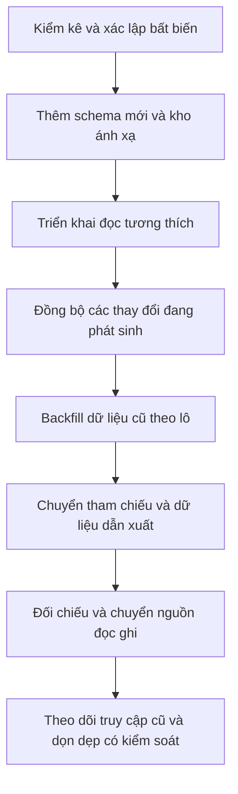

# Thay đổi định danh, ánh xạ khóa cũ/mới và chuyển đổi dữ liệu trong NoSQL

Đổi định danh của một đối tượng trong cơ sở dữ liệu NoSQL thường phức tạp hơn việc đổi tên một trường. Một mã định danh có thể đồng thời xuất hiện trong **khóa lưu trữ**, **khóa phân vùng**, **tài liệu tham chiếu**, **cache**, **đường dẫn API**, **sự kiện** và dữ liệu của những hệ thống khác. Nếu thay khóa ở một nơi mà bỏ sót nơi khác, hệ thống có thể tạo bản ghi trùng, mất liên kết hoặc trả về hai phiên bản của cùng một thực thể.

Bài học này giải thích cách nhận diện phạm vi ảnh hưởng, tạo **ánh xạ khóa cũ → khóa mới**, chuyển dữ liệu theo từng giai đoạn và bảo vệ tính đúng đắn khi ứng dụng vẫn đang phục vụ truy cập. Ví dụ xuyên suốt là chuyển từ việc dùng email làm khóa người dùng sang một mã nội bộ ổn định. Những nguyên tắc này cũng áp dụng khi đổi cấu trúc khóa ghép, chuyển khóa phân vùng hoặc di chuyển dữ liệu giữa các mô hình NoSQL.

## 1. Xác định chính xác thứ gì đang được thay đổi

Không phải mọi giá trị được gọi là “ID” đều giữ cùng một vai trò.

| Loại định danh/khóa | Nhiệm vụ | Ví dụ |
| --- | --- | --- |
| **Định danh nghiệp vụ** (*business/natural identifier*) | Gắn với thông tin có ý nghĩa đối với người dùng hoặc nghiệp vụ | Email, tên đăng nhập, mã sản phẩm do đối tác cấp |
| **Định danh nội bộ** (*surrogate/canonical ID*) | Nhận diện ổn định một thực thể trong hệ thống | `usr_7f42a9`, UUID |
| **Khóa lưu trữ** (*storage/primary key*) | Xác định mục dữ liệu trong cơ sở dữ liệu theo quy tắc của sản phẩm | `_id` trong MongoDB, khóa item của DynamoDB |
| **Khóa phân vùng** (*partition/shard key*) | Định tuyến dữ liệu tới phân vùng hoặc nhóm lưu trữ | `tenantId`, `customerId`, cặp `(deviceId, day)` |
| **Khóa tham chiếu** | Nối một bản ghi tới thực thể khác ở cấp ứng dụng | `orders.customerId` |
| **Khóa cache hoặc event key** | Xác định mục cache hay nhóm sự kiện để xử lý | `user:old-email`, Kafka record key |

Một trường có thể đảm nhiệm nhiều vai trò. Ví dụ, nếu `users._id = email`, email vừa là định danh nghiệp vụ vừa là khóa lưu trữ. Nếu các đơn hàng lưu `customerId = email`, nó còn được dùng làm khóa tham chiếu.

**Thay đổi thuộc tính không nhất thiết phải thay đổi định danh.** Nếu người dùng đổi email nhưng ứng dụng đã dùng `userId` bất biến, chỉ cần cập nhật thuộc tính email và những chỉ mục liên quan. Ngược lại, nếu email chính là `_id`, đổi email có thể đòi hỏi chuyển khóa và cập nhật tất cả tham chiếu.

### Ví dụ vấn đề ban đầu

Giả sử một tài liệu người dùng cũ được lưu theo khóa email:

```json
{
  "_id": "user:mai@example.invalid",
  "email": "mai@example.invalid",
  "name": "Mai",
  "status": "ACTIVE",
  "version": 12
}
```

Một tài liệu đơn hàng tham chiếu trực tiếp tới định danh cũ:

```json
{
  "_id": "order:2501",
  "customerId": "user:mai@example.invalid",
  "amount": 420000
}
```

Hệ thống muốn chuyển sang định danh `usr_7f42a9` để email có thể thay đổi mà không làm thay đổi quan hệ giữa người dùng và đơn hàng. Để làm được điều đó, cần quản lý **thực thể logic**, **khóa cũ**, **khóa mới** và **các tham chiếu** như những thành phần riêng.

## 2. Vì sao không thể chỉ sửa trực tiếp khóa?

Đối với nhiều cơ sở dữ liệu NoSQL, khóa chính hoặc một phần của khóa chính là **bất biến** sau khi bản ghi được tạo. Một số ví dụ cần biết:

- **MongoDB:** trường `_id` của một tài liệu không thể sửa bằng thao tác update thông thường. Thay `_id` về bản chất đòi hỏi tạo tài liệu với `_id` mới và xử lý tài liệu cũ.
- **DynamoDB:** không thể cập nhật giá trị thuộc tính tạo thành primary key của item tại chỗ; thường phải ghi item có khóa mới rồi xóa item cũ theo quy trình được kiểm soát.
- **Cassandra:** các giá trị thuộc `PRIMARY KEY` xác định hàng/phân vùng và không được thay như một cột thông thường; thay khóa thường đồng nghĩa ghi dữ liệu ở khóa mới và xử lý dữ liệu ở khóa cũ.
- **Redis:** một khóa có thể được đổi tên bằng cơ chế của Redis, nhưng điều đó không tự động sửa các tham chiếu nằm bên trong giá trị của các khóa khác, ứng dụng, cache hoặc dịch vụ bên ngoài. Cần xem hành vi khi khóa đích đã tồn tại và khi dùng Redis Cluster.

Ngay cả khi cơ sở dữ liệu hỗ trợ đổi tên khóa, **tính đúng đắn của toàn hệ thống** vẫn không được bảo đảm chỉ bởi thao tác đổi tên.

Ví dụ, đổi tài liệu người dùng từ `user:mai@example.invalid` sang `usr_7f42a9` mà không sửa `orders.customerId` khiến đơn hàng vẫn trỏ đến khóa cũ. Nếu xóa khóa cũ ngay, màn hình lịch sử mua hàng có thể không tìm được người dùng.

Một thay đổi khóa có thể dẫn tới **thay đổi phân vùng vật lý**. Nếu khóa mới cũng là khóa dùng để sharding, dữ liệu có thể phải được ghi sang một shard khác, làm phát sinh chi phí truyền dữ liệu và phối hợp. Vì vậy, cần xác định cơ chế khóa của sản phẩm trước khi chọn thao tác chuyển đổi.

## 3. Định danh chuẩn và bảng ánh xạ khóa cũ/mới

Giải pháp phổ biến là chọn **định danh chuẩn** (*canonical ID*) và duy trì một nơi tra cứu các **bí danh định danh** (*identity aliases*). Trong ví dụ này, `usr_7f42a9` là định danh chuẩn; `user:mai@example.invalid` là bí danh cũ vẫn có thể được tiếp nhận trong giai đoạn chuyển đổi.

```text
Khóa cũ do client/đơn hàng gửi
  user:mai@example.invalid
             |
             v
     Identity mapping
             |
             v
       usr_7f42a9
             |
             v
     Tài liệu người dùng mới
```

Một cấu trúc ánh xạ minh họa:

```json
{
  "_id": "legacy-user:user:mai@example.invalid",
  "entityType": "USER",
  "legacyId": "user:mai@example.invalid",
  "canonicalId": "usr_7f42a9",
  "state": "ACTIVE",
  "mappingVersion": 1,
  "createdAt": "2026-11-14T09:00:00Z"
}
```

Đối với dữ liệu thật, định danh cũ có thể chứa thông tin cá nhân như email. Cần giảm ghi giá trị này vào log, hạn chế quyền đọc bảng ánh xạ và áp dụng chính sách lưu giữ dữ liệu. Các địa chỉ `example.invalid` trong bài chỉ là dữ liệu giả.

### 3.1. Những bất biến quan trọng

Một quy trình chuyển định danh phải duy trì các **bất biến** sau:

1. **Một khóa cũ được ánh xạ nhất quán** tới một thực thể chuẩn trong phạm vi định danh đã xác định. Hai worker chạy lại cùng công việc không được tự cấp hai mã chuẩn khác nhau.
2. **Định danh chuẩn không thay đổi theo thuộc tính nghiệp vụ** như email, số điện thoại hay tên hiển thị.
3. **Không có ánh xạ mơ hồ:** nếu hai khóa cũ thực sự chỉ cùng một người dùng, quy tắc hợp nhất phải được xác định rõ; nếu là hai người khác nhau, không được tự gộp vì có trường dữ liệu giống nhau.
4. **Không tái sử dụng khóa cũ tùy tiện:** nếu email cũ được một người khác đăng ký sau này, ánh xạ lịch sử không được chuyển quyền sở hữu sang người mới.
5. **Tra cứu khóa cũ không bỏ qua kiểm tra quyền:** ánh xạ chỉ có nhiệm vụ xác định đối tượng; xác thực và phân quyền vẫn áp dụng trên thực thể chuẩn.

Trong trường hợp một thực thể có **nhiều bí danh cũ**, có thể tồn tại quan hệ nhiều khóa cũ → một canonical ID. Do đó, điều kiện duy nhất thường đặt trên cặp **`(entityType, legacyId)`**; có nên đặt unique trên `canonicalId` hay không phụ thuộc bài toán hợp nhất và thiết kế ánh xạ.

### 3.2. Tách định danh khỏi thông tin có thể đổi

Tài liệu mới có thể có hình dạng:

```json
{
  "_id": "usr_7f42a9",
  "email": "mai@example.invalid",
  "name": "Mai",
  "status": "ACTIVE",
  "schemaVersion": 2,
  "version": 12
}
```

Khi người dùng đổi email, ứng dụng cập nhật `email` và chỉ mục duy nhất liên quan nếu có. `_id = usr_7f42a9` tiếp tục giữ nguyên, còn đơn hàng tham chiếu tới mã này không cần sửa chỉ vì email đổi.

**Không nên mặc định băm email để làm định danh chuẩn.** Email vẫn có thể thay đổi hoặc được tái sử dụng; băm tất định từ một tập giá trị có thể đoán được cũng không tự bảo đảm ẩn danh. Định danh chuẩn thường nên được cấp độc lập bằng một cơ chế đủ duy nhất, sau đó được lưu bền trong bảng ánh xạ.

## 4. Chọn chiến lược chuyển đổi theo hệ thống

Không có một thao tác “rename ID” áp dụng an toàn cho tất cả NoSQL. Có ba hướng thường gặp:

| Chiến lược | Cách thực hiện | Trường hợp phù hợp | Điểm cần kiểm soát |
| --- | --- | --- | --- |
| **Dừng ghi, chuyển một lần** (*offline migration*) | Tạm ngừng thay đổi dữ liệu; tạo bản ghi mới, sửa tham chiếu, đối chiếu rồi chuyển ứng dụng | Dữ liệu nhỏ hoặc có cửa sổ bảo trì | Thời gian gián đoạn; khôi phục nếu quá trình thất bại |
| **Chuyển từng phần khi vẫn phục vụ** (*online migration*) | Bổ sung ánh xạ, hỗ trợ đọc tương thích, backfill theo lô, đồng bộ thay đổi mới, chuyển dần nguồn đọc/ghi | Hệ thống cần hoạt động liên tục | Race condition, dữ liệu đến muộn, idempotency, hai phiên bản tồn tại đồng thời |
| **Giữ định danh cũ làm alias lâu dài** | Dữ liệu chuẩn dùng khóa mới; các API/đối tác cũ được giải quyết qua bảng ánh xạ | Hợp đồng API cũ khó thay hoặc dữ liệu lịch sử còn tham chiếu ID cũ | Vòng đời alias, bảo mật, quản lý khóa bị tái sử dụng |

Ví dụ tiếp theo chọn **online migration**, vì đây là tình huống dễ lộ các lỗi về tính nhất quán. Với hệ nhỏ có thể dừng ghi hoàn toàn, nhiều bước có thể giản lược; nhưng nguyên tắc về ánh xạ và sửa tham chiếu vẫn giữ nguyên.

## 5. Chuẩn bị trước khi chuyển khóa

### 5.1. Kiểm kê mọi nơi định danh xuất hiện

Trước khi thay một trường, lập bản đồ sử dụng:

| Thành phần | Vị trí chứa ID cũ | Thao tác cần thiết |
| --- | --- | --- |
| Dữ liệu chính | `users._id` | Tạo tài liệu mới với canonical ID |
| Dữ liệu liên quan | `orders.customerId`, `carts.ownerId` | Sửa tham chiếu hoặc có lớp tương thích khi đọc |
| Tài liệu nhúng, danh sách ID | `groups.memberIds[]`, lịch sử hoạt động | Chuyển từng phần tử theo ánh xạ |
| Chỉ mục tìm kiếm, view, aggregate | Bản sao dữ liệu phục vụ đọc | Tái xây dựng hoặc cập nhật |
| Cache | `user:old-id`, cache membership | Đổi namespace khóa, vô hiệu hóa dữ liệu cũ |
| API và client | URL `/users/{id}`, payload, bookmark | Hỗ trợ ID cũ trong thời gian công bố |
| Sự kiện và tích hợp | `userId` trong message, webhook, file xuất | Cập nhật hợp đồng và consumer; hỗ trợ tương thích |
| Phân quyền và phiên làm việc | Chủ thể trong session/claim/ACL | Chuyển mapping an toàn; xác nhận quyền trên ID chuẩn |
| Log, audit, backup | Dấu vết ID cũ | Giữ khả năng truy nguyên theo chính sách lưu giữ |

Đặc biệt lưu ý **ID bên ngoài database**. Nếu một đối tác giữ mã cũ nhiều năm, xóa alias ngay sau khi chuyển dữ liệu nội bộ có thể làm tích hợp bên ngoài ngừng hoạt động.

### 5.2. Quy tắc cấp ID và xử lý xung đột

Xác định rõ:

- Namespace: `USER`, `ORDER`, `DEVICE` phải được phân biệt; cùng một chuỗi không mặc nhiên chỉ cùng loại thực thể.
- Chuẩn hóa khóa cũ: nếu ID lịch sử chứa email hoặc tên tài khoản, cần bảo toàn quy tắc so khớp thực tế. Không tự chuyển mọi chuỗi sang chữ thường nếu hệ cũ phân biệt chúng, vì có thể tạo va chạm.
- Tính duy nhất của ID mới: dùng bộ cấp phát có xác suất va chạm đủ thấp hoặc bộ sinh có đảm bảo theo hệ thống; xác nhận tính duy nhất ở tầng lưu trữ khi có thể.
- Các trường hợp hợp nhất/tách thực thể: quyết định rõ phép ánh xạ **1:1**, **n:1** hoặc **1:n** theo nghiệp vụ. Ánh xạ `1:n` không thể được giải quyết bằng một `canonicalId` duy nhất mà không có thêm quy tắc định tuyến.
- Xử lý dữ liệu thiếu, khóa cũ trùng, bản ghi đã xóa và bản ghi bất hợp lệ: cần trạng thái riêng để rà soát, không âm thầm bỏ qua.

Trong ví dụ cơ bản, chọn quan hệ **1 khóa cũ → 1 ID mới**, nhưng cho phép sau này nhiều alias trỏ tới cùng một ID chuẩn nếu đã có quy trình hợp nhất được phê duyệt.

### 5.3. Chuẩn bị đường khôi phục

Trước khi ghi dữ liệu mới, cần có bản lưu/khả năng khôi phục đã được kiểm tra theo yêu cầu hệ thống, ghi lại thời điểm bắt đầu, phiên bản schema, phiên bản ứng dụng và nguồn chân lý hiện tại. **Replica không thay thế backup**: lệnh xóa sai có thể được sao chép sang mọi replica.

Đặt ra các chỉ số theo dõi như số bản ghi dự kiến, số mapping đã tạo, số chuyển thành công, số lỗi/xung đột, lượng truy cập bằng ID cũ và chênh lệch dữ liệu giữa hai đường đọc. Những chỉ số này giúp xác định khi nào có thể chuyển sang giai đoạn tiếp theo.

## 6. Quy trình online migration theo giai đoạn

Quy trình nên được triển khai theo hướng **mỗi giai đoạn đều có thể lặp lại**, và ứng dụng có thể chạy qua giai đoạn chuyển tiếp mà không làm đổi ý nghĩa thực thể.



### Giai đoạn 1: triển khai cấu trúc mới nhưng giữ ứng dụng cũ hoạt động

Tạo nơi lưu tài liệu phiên bản mới và nơi ánh xạ ID. Mỗi mapping cần một khóa tra cứu ổn định cho **loại thực thể + khóa cũ**; dữ liệu nên có trạng thái chuyển đổi để tránh lộ những tài liệu mới chưa hoàn chỉnh.

Ví dụ các trạng thái có thể dùng:

| Trạng thái | Ý nghĩa |
| --- | --- |
| `ALLOCATED` | Đã giữ chỗ canonical ID nhưng chưa xác nhận nội dung tài liệu mới |
| `COPIED` | Đã sao chép bản ghi chính đến khóa mới |
| `REFERENCES_UPDATED` | Những tham chiếu trong phạm vi đã xác định đã được xử lý |
| `ACTIVE` | Đường đọc/ghi chuẩn đã sẵn sàng dùng ID mới |
| `CONFLICT` | Cần xử lý thủ công hoặc logic nghiệp vụ trước khi tiếp tục |

Trạng thái chỉ phục vụ **quản lý tiến trình**. Không được coi `ALLOCATED` là bằng chứng rằng tài liệu ở khóa mới đã sẵn sàng cho client đọc.

### Giai đoạn 2: triển khai đọc tương thích

Trong thời gian chuyển đổi, lớp truy cập có thể chấp nhận cả ID mới và ID cũ:

```text
GET /users/usr_7f42a9
  -> tìm tài liệu theo canonical ID

GET /users/user:mai@example.invalid
  -> tìm trong mapping USER + legacyId
  -> lấy canonical ID
  -> đọc tài liệu mới khi trạng thái đã sẵn sàng
  -> nếu bản ghi chưa chuyển xong và giai đoạn còn cho phép:
       đọc dữ liệu cũ qua đường tương thích
```

Giả mã:

```pseudo
function loadUser(requestedId, principal):
    if isCanonicalUserId(requestedId):
        user = newStore.get(requestedId)
    else:
        mapping = aliasStore.get("USER", requestedId)
        if mapping != null and mapping.isReadable():
            user = newStore.get(mapping.canonicalId)
        else if migrationWindowAllowsLegacyReads():
            user = legacyStore.get(requestedId)
        else:
            user = null

    if user == null:
        return NOT_FOUND

    authorize(principal, "user:read", user.canonicalIdentity())
    return user
```

Giả mã thể hiện **ý tưởng** chứ không phải API của một sản phẩm. Cần đảm bảo cả hai nhánh đều chịu cùng quy tắc phân quyền và không trả lại dữ liệu sai thực thể. Trong hệ đa tenant, namespace ánh xạ phải bao gồm **tenant ID** nếu ID cũ chỉ duy nhất trong tenant.

### Giai đoạn 3: theo kịp những thay đổi đang phát sinh

Nếu backfill mất nhiều giờ, người dùng vẫn có thể sửa hồ sơ trong lúc dữ liệu được sao chép. Nếu copy một bản ghi ở phiên bản 12 rồi ghi đè lên phiên bản 13 do hệ thống vừa cập nhật, ta đã làm mất thay đổi.

Có một số cách đồng bộ tùy nền tảng:

- **Đóng băng ghi trong một khoảng ngắn:** đơn giản khi có thể bảo trì.
- **Ghi kép có kiểm soát (*dual write*):** ứng dụng ghi cả cấu trúc cũ và mới, có cơ chế retry, idempotency và xử lý trường hợp một phía thành công một phía thất bại.
- **Change Data Capture (CDC) hoặc luồng sự kiện:** ghi vào nguồn chân lý hiện tại, sau đó chuyển mọi thay đổi sang cấu trúc mới theo trình tự phù hợp.

**Dual write không tự động bảo đảm atomicity.** Nếu hệ không hỗ trợ một giao dịch bao phủ mọi đích ghi, có thể xuất hiện trạng thái chỉ một phía thành công. Cần ghi nhận và khắc phục bằng hàng đợi, outbox, CDC hoặc tác vụ đối chiếu theo điều kiện thực tế. Không nên tạo hai nguồn ghi đồng cấp cùng được tùy ý cập nhật trong thời gian dài.

### Giai đoạn 4: backfill các bản ghi cũ theo lô

Backfill là thao tác đọc dữ liệu cũ rồi đưa về cấu trúc mới, trong khi giữ một ánh xạ khóa có thể tái sử dụng.

```pseudo
function migrateOne(legacyId):
    source = legacyStore.readWithVersion(legacyId)
    if source == null:
        return classifyMissingOrDeleted(legacyId)

    # Dùng insert-if-absent/conditional write có ràng buộc duy nhất.
    mapping = aliasStore.getOrReserve(
        entityType = "USER",
        legacyId = legacyId,
        candidateCanonicalId = generateOpaqueId()
    )

    # Khi retry phải dùng lại canonicalId đã được giữ chỗ.
    canonicalId = mapping.canonicalId

    target = transform(source, canonicalId, schemaVersion = 2)

    # Upsert theo khóa chuẩn, có kiểm tra phiên bản nguồn để
    # tránh lần chạy cũ ghi đè kết quả của lần chạy mới hơn.
    newStore.upsertConditionally(canonicalId, target, source.version)

    if legacyStore.currentVersion(legacyId) > source.version:
        scheduleRetry(legacyId)
        return RETRY_NEEDED

    aliasStore.markCopied(legacyId, canonicalId, source.version)
    scheduleReferenceMigration(legacyId, canonicalId)
    return COPIED
```

Đây là **pseudocode**: phương thức `getOrReserve`, `upsertConditionally` và `markCopied` là thao tác khái niệm. Phải hiện thực chúng bằng conditional write, so sánh phiên bản, khóa duy nhất hoặc giao dịch theo khả năng của hệ. Kiểm tra phiên bản nguồn **sau** copy giúp phát hiện thay đổi nhưng không thay thế CDC/đồng bộ cho những thay đổi phát sinh ngay sau đó; cần tiếp tục bắt kịp thay đổi tới thời điểm cutover.

Các nguyên tắc vận hành:

1. **Phân trang ổn định:** duyệt theo cursor/token hoặc cơ chế scan phù hợp, không dựa vào offset dễ bỏ sót hoặc lặp khi dữ liệu đang đổi.
2. **Ghi idempotent:** chạy lại cùng ID cũ không sinh thêm ID chuẩn hoặc thêm một thực thể thứ hai.
3. **Giới hạn tải:** backfill theo batch nhỏ, có throttling và backoff để không làm quá tải truy vấn đang phục vụ người dùng.
4. **Theo dõi tiến độ theo từng bản ghi/batch:** lỗi hoặc timeout phải được ghi nhận và có thể chạy lại.
5. **Không phá dữ liệu ở nguồn:** chưa xóa bản ghi cũ khi bản ghi mới hoặc tham chiếu chưa được kiểm chứng.

Nếu lệnh `getOrReserve` gặp xung đột do hai worker cùng chạy, worker thua cuộc nên đọc lại ánh xạ hiện có rồi tiếp tục với ID đã được cấp, thay vì cấp một ID thứ hai. Nếu tài liệu mới có canonical ID giống một thực thể không liên quan, phải báo xung đột và xử lý, không ghi đè.

### Giai đoạn 5: chuyển tham chiếu sang ID mới

Với đơn hàng cũ:

```json
{
  "_id": "order:2501",
  "customerId": "user:mai@example.invalid",
  "amount": 420000
}
```

Sau khi chuyển:

```json
{
  "_id": "order:2501",
  "customerId": "usr_7f42a9",
  "amount": 420000,
  "schemaVersion": 2
}
```

Các tài liệu tham chiếu cần được cập nhật theo **ánh xạ đã chốt**, không cấp ID mới từ từng tham chiếu. Cùng với `orders.customerId`, cần rà soát danh sách ID trong mảng, đối tượng nhúng, collection phục vụ tìm kiếm, cache, vật hóa dữ liệu và quyền sở hữu tài nguyên.

Thao tác chuyển tham chiếu phải chịu được **đọc và ghi đồng thời**. Ví dụ, cập nhật có điều kiện:

```pseudo
update order
set customerId = "usr_7f42a9"
where orderId = "order:2501"
  and customerId = "user:mai@example.invalid"
```

Nếu lần chạy lại thấy `customerId` đã là mã mới thì có thể coi là đã chuyển xong; nếu trường chứa một mã khác ngoài hai giá trị dự kiến, phải kiểm tra xung đột thay vì ép ghi đè.

Ở các NoSQL không có join hoặc ràng buộc foreign key tự động, **ứng dụng và tác vụ di chuyển tự chịu trách nhiệm bảo toàn liên kết**. Khi một tham chiếu còn dùng ID cũ nhưng bản ghi chính đã chuyển, lớp đọc tương thích qua mapping giúp hệ tiếp tục phục vụ trong thời gian quá độ.

### Giai đoạn 6: xác nhận, chuyển nguồn chân lý và dọn dẹp

Khi backfill và luồng đồng bộ đã bắt kịp các thay đổi:

1. **Đối chiếu dữ liệu chính:** số thực thể logic, checksum/hash trường quan trọng, phiên bản và dữ liệu nghiệp vụ sau phép biến đổi. Nếu có hợp nhất thực thể, không nên áp dụng kiểm tra số lượng cũ = số lượng mới một cách máy móc.
2. **Đối chiếu quan hệ:** tìm tham chiếu không phân giải được, tham chiếu còn trỏ ID cũ, ánh xạ thiếu, ID mới bị trùng hoặc bị gán nhầm.
3. **Quan sát đường đọc:** đo lỗi 404, tỷ lệ fallback về dữ liệu cũ, độ trễ tra cứu mapping và chênh lệch phản hồi.
4. **Chuyển dần đọc và ghi sang ID chuẩn:** dùng feature flag/canary khi cần, xác định rõ thời điểm nguồn mới trở thành nguồn chân lý.
5. **Giữ tương thích có thời hạn hoặc lâu dài theo hợp đồng:** ID cũ có thể tiếp tục được phân giải trong API, nhưng các bản ghi mới nên được tạo trực tiếp bằng ID chuẩn.
6. **Chỉ dọn dữ liệu cũ sau thời gian an toàn:** xác minh không còn writer cũ, consumer cũ và tham chiếu chưa chuyển. Cần chính sách riêng cho tombstone và backup.

Trạng thái `ACTIVE` của mapping là một cam kết về **đường đọc/ghi hiện hành**; không nên đặt trạng thái này chỉ vì đã sao chép xong tài liệu chính.

## 7. Minh họa thao tác ánh xạ bằng MongoDB

Ví dụ này sử dụng cú pháp MongoDB để minh họa **nơi giữ ánh xạ** và **truy vấn tương thích**. Nó không phải một script migration hoàn chỉnh; các phần concurrency, cập nhật tham chiếu, CDC và cutover vẫn cần được triển khai đầy đủ theo quy trình.

### Tạo collection mapping

Giả sử dùng `_id` chứa namespace và khóa cũ để đảm bảo mỗi khóa cũ có một bản ánh xạ:

```javascript
db.user_id_aliases.insertOne({
  _id: "USER|user:mai@example.invalid",
  legacyId: "user:mai@example.invalid",
  canonicalId: "usr_7f42a9",
  state: "ALLOCATED",
  mappingVersion: 1
});
```

Chỉ mục `_id` là duy nhất trong collection. Nếu cần tìm ngược những alias thuộc một canonical ID:

```javascript
db.user_id_aliases.createIndex({ canonicalId: 1 });
```

Chỉ mục này không đặt unique vì một thực thể có thể có nhiều alias lịch sử. Trong ứng dụng thực, nên dùng thao tác giữ chỗ bằng **upsert có điều kiện** hoặc **insert-if-absent** rồi xử lý duplicate-key/race khi hai worker chạy đồng thời. Đảm bảo mapping được cấp một lần, sau đó readback để lấy ID chuẩn mà mọi lượt chạy phải dùng lại.

### Sao chép tài liệu bằng ID mới

```javascript
db.users.updateOne(
  { _id: "usr_7f42a9" },
  {
    $setOnInsert: {
      email: "mai@example.invalid",
      name: "Mai",
      status: "ACTIVE",
      schemaVersion: 2,
      version: 12
    }
  },
  { upsert: true }
);
```

`$setOnInsert` giúp tránh tạo thêm tài liệu khi chạy lại cùng khóa. Tuy nhiên, đoạn này **không cập nhật thay đổi xảy ra sau bản snapshot**; luồng ghi/CDC phải áp dụng các phiên bản mới hơn theo quy tắc phiên bản. Trước khi đánh dấu mapping `COPIED`, cần xác nhận tài liệu thực sự được ghi và trạng thái phản ánh đúng phiên bản nguồn.

### Chuyển tham chiếu có điều kiện

```javascript
db.orders.updateMany(
  { customerId: "user:mai@example.invalid" },
  { $set: { customerId: "usr_7f42a9" } }
);
```

Nếu đang có writer cũ tiếp tục chèn đơn hàng với `customerId` cũ, lần `updateMany` trên không bảo đảm sẽ xử lý cả những đơn mới xuất hiện sau đó. Cần **chuyển đường ghi**, đồng bộ thay đổi và đối chiếu lại trước khi dọn dữ liệu cũ.

**Không thực hiện** `db.users.updateOne({ _id: oldId }, { $set: { _id: newId } })` với kỳ vọng đổi khóa tại chỗ: MongoDB không cho cập nhật `_id` theo cách này. Việc tạo và xử lý tài liệu tại khóa mới phải được quản lý tách biệt.

## 8. Các trường hợp khó cần xử lý minh bạch

### 8.1. Trùng và va chạm định danh

Giả sử hệ cũ phân biệt `UserA` và `usera`, nhưng quy tắc mới chuẩn hóa tên đăng nhập về chữ thường. Nếu chỉ lấy `lowercase(username)` làm khóa mới, hai thực thể sẽ bị gộp sai.

Giải pháp là giữ **khóa gốc với quy tắc so sánh cũ**, phát hiện trường hợp va chạm và xử lý theo chính sách nghiệp vụ. Cấp **canonical ID độc lập** giúp tránh việc chuẩn hóa một thuộc tính làm thay đổi danh tính. Không nên tự hợp nhất hai hồ sơ chỉ vì trùng email, tên hoặc số điện thoại.

### 8.2. Bản ghi đã xóa trong khi chuyển

Một worker đọc bản ghi ở thời điểm T1. Người dùng xóa bản ghi ở T2. Worker hoàn thành copy ở T3. Nếu chỉ xét bản snapshot T1, bản ghi bị xóa có thể “sống lại” ở kho mới.

Cần đồng bộ cả **sự kiện xóa** (hoặc tombstone), có phiên bản/thứ tự phù hợp; không được chỉ đồng bộ insert và update. Đối chiếu trạng thái cuối cùng trước khi cutover và có chính sách giữ tombstone đủ lâu để không bị retry cũ phục hồi dữ liệu đã xóa.

### 8.3. Ghi đồng thời và sự kiện đến sai thứ tự

Hai thay đổi có phiên bản 13 và 14 có thể đến kho mới theo thứ tự 14 rồi 13. Nếu ghi đè vô điều kiện, bản 13 làm mất bản 14.

Một cách xử lý là chỉ áp dụng thay đổi khi `incomingVersion > storedSourceVersion` bằng thao tác có điều kiện. Cách gán phiên bản, thứ tự theo từng thực thể và giải quyết xung đột phụ thuộc nguồn sự kiện. Không nên so sánh timestamp từ nhiều máy một cách ngây thơ khi chúng không có thứ tự đáng tin cậy.

### 8.4. Khóa mới làm đổi vị trí phân vùng

Nếu đổi từ `partitionKey = accountId` sang `partitionKey = tenantId + accountId`, một bản ghi có thể phải được viết sang phân vùng khác. Truy vấn và index cũng cần thay đổi vì cách định tuyến đã khác.

Trong DynamoDB/Cassandra, đổi khóa chính thường là **ghi khóa mới rồi xử lý khóa cũ**, không phải cập nhật khóa tại chỗ. Trong MongoDB, thay shard key có những điều kiện và hỗ trợ phụ thuộc phiên bản/cấu hình, nên không được xem nó giống việc cập nhật một trường thường. Cần tham chiếu hướng dẫn của đúng sản phẩm và phiên bản khi triển khai.

### 8.5. ID lịch sử bị tái sử dụng

Nếu `email` từng là ID và người dùng A đổi email, email cũ có thể được người dùng B đăng ký. Nếu API vẫn phân giải email cũ sang người A, thao tác tìm kiếm bằng email hiện tại của B sẽ mơ hồ.

Phải phân biệt rõ **legacy ID lịch sử** với **thuộc tính email hiện tại**. Khi duy trì alias, có thể cần namespace `LEGACY_USER_ID` riêng, chính sách cấm tái sử dụng ở API cũ hoặc một quy trình hết hạn alias có thông báo tương thích. Không dùng một chuỗi email không có ngữ cảnh như bằng chứng quyền sở hữu tài khoản.

### 8.6. Tham chiếu qua nhiều hệ thống

Một hệ thống đơn hàng có thể dùng MongoDB, cache Redis, luồng Kafka và kho tìm kiếm. Cập nhật thành công MongoDB không chứng minh Redis/Kafka/search đã đồng bộ. Cần xem mỗi hệ là một phần của phạm vi chuyển đổi; dùng outbox, CDC, cơ chế replay hoặc tác vụ đối chiếu tương ứng.

Nếu event key thay đổi từ ID cũ sang ID mới, những sự kiện của cùng thực thể có thể bị chia sang **partition sự kiện khác** và không còn được bảo đảm thứ tự tương đối như trước. Consumer nên có quy tắc chuẩn hóa ID, version và idempotency trong giai đoạn hai khóa cùng tồn tại.

## 9. Kiểm soát lỗi, retry và rollback

### 9.1. Idempotency là yêu cầu trọng tâm

Trong các hệ phân tán, cùng một công việc có thể được chạy lại do timeout, restart hoặc thông điệp được gửi lại. Một tác vụ chuyển ID cần đạt:

```text
migrate(oldId) lần 1 -> canonicalId = usr_7f42a9
migrate(oldId) lần 2 -> canonicalId = usr_7f42a9
migrate(oldId) lần N -> canonicalId = usr_7f42a9
```

Nếu lần hai sinh `usr_b84c10` thay vì dùng mapping cũ, hệ sẽ có hai thực thể cho cùng một người dùng. Vì vậy, thao tác **lưu ánh xạ trước bằng khóa duy nhất**, **đọc lại ánh xạ**, rồi **ghi tài liệu mới có điều kiện** là một pattern quan trọng.

Các bước chuyển tiến trình cũng nên chịu được lặp. Khi retry, kiểm tra dữ liệu đích và trạng thái; **không biến retry thành lệnh ghi đè không kiểm soát**.

### 9.2. Có thể dùng transaction đến đâu?

Một số sản phẩm NoSQL hỗ trợ transaction trong phạm vi nhất định; một số giới hạn theo partition, mục dữ liệu hoặc cấu hình. Transaction có thể giúp bảo đảm **một nhóm thay đổi trong cùng hệ** thành công hoặc thất bại cùng nhau, nhưng thường không bao trùm mọi dịch vụ bên ngoài, cache và consumer.

Vì vậy, nên tách:

- **Tính nguyên tử cục bộ:** khóa mapping, tài liệu mới và các cập nhật có thể giao dịch được trong phạm vi hỗ trợ.
- **Tính nhất quán liên hệ thống:** CDC/outbox, retry, kiểm tra phiên bản, bù trừ và đối chiếu.

Không giả định rằng toàn bộ quá trình đổi định danh có thể chạy trong một transaction duy nhất khi dữ liệu phân tán qua nhiều nền tảng.

### 9.3. Rollback thực tế là gì?

Trước cutover, nếu nguồn cũ vẫn là nguồn chân lý và chưa bị xóa, có thể ngừng backfill và tiếp tục phục vụ từ dữ liệu cũ. Sau cutover, nếu có **ghi mới chỉ xuất hiện trên cấu trúc mới**, quay lại ứng dụng cũ sẽ không tự động nhìn thấy các ghi đó.

Kế hoạch rollback phải xác định:

1. **Mốc chuyển nguồn chân lý** và nguồn nào nhận ghi tại từng thời điểm.
2. **Cách đồng bộ ngược hoặc replay thay đổi** nếu cần quay về.
3. **Cách tránh xóa/ghi đè dữ liệu mới hơn** khi rollback.
4. **Mốc mà rollback đơn giản không còn khả thi**, từ đó chuyển sang kế hoạch khôi phục có kiểm soát.

Đừng hiểu rollback là xóa collection mới và bật lại phiên bản ứng dụng cũ ở bất kỳ thời điểm nào.

## 10. Đối chiếu dữ liệu bằng những đại lượng có ý nghĩa

Một phép kiểm đếm tổng số tài liệu là chưa đủ. Trong migration có thể tồn tại cả tài liệu cũ lẫn tài liệu mới, khiến tổng số tăng trong khi **số thực thể logic** không đổi.

| Câu hỏi cần xác minh | Cách kiểm tra khái niệm |
| --- | --- |
| Mọi thực thể cũ hợp lệ đã có ID chuẩn chưa? | Đếm theo nhóm, đối chiếu tập legacy ID với mapping, liệt kê trường hợp thiếu |
| Có hai ID chuẩn cho cùng một khóa cũ không? | Kiểm tra ràng buộc duy nhất và danh sách xung đột |
| Nội dung được chuyển có đúng không? | So sánh các trường nghiệp vụ sau quy tắc biến đổi; chuẩn hóa dữ liệu trước khi tính checksum |
| Dữ liệu mới có bắt kịp thay đổi gần nhất không? | So sánh phiên bản nguồn, offset CDC hoặc watermark đã xử lý |
| Các tham chiếu có còn trỏ tới thực thể không tồn tại không? | Kiểm tra bằng mapping và tập canonical ID; thống kê dangling references |
| Client còn gửi ID cũ không? | Đo tỷ lệ request theo loại ID, thống kê endpoint và consumer |
| ID cũ có bị dùng như ID hiện tại của người khác không? | Kiểm tra quy tắc tái sử dụng, namespace và sự kiện đổi thuộc tính |

Một báo cáo chuyển đổi minh họa:

```text
source_entities_seen       = 1,000,000
mapping_active             =   999,920
mapping_conflict           =        30
source_missing_or_deleted  =        50
unresolved_references      =         8
cdc_lag_seconds            =        12
legacy_read_rate           =      2.4%
```

Các số là ví dụ giả định để thể hiện **cần đo những gì**, không phải ngưỡng chấp nhận. Nếu còn `unresolved_references = 8`, cần phân loại và xử lý trước khi xóa đường đọc tương thích. Nếu còn CDC lag, cần chứng minh luồng đồng bộ đã bắt kịp tới watermark dùng cho cutover.

## 11. Một bản hướng dẫn triển khai rút từ ví dụ người dùng

Giả sử mục tiêu là thay khóa `user:mai@example.invalid` bằng `usr_7f42a9`.

| Bước | Dữ liệu/trạng thái | Kết quả mong đợi |
| --- | --- | --- |
| 1. Cấp canonical ID | `USER|user:mai@example.invalid → usr_7f42a9` | Một ánh xạ duy nhất, dùng lại được khi retry |
| 2. Tạo tài liệu mới | `users._id = usr_7f42a9` | Tài liệu có dữ liệu nghiệp vụ tương đương sau biến đổi |
| 3. Bắt kịp cập nhật | Version 12 → 13 → 14, kể cả delete nếu có | Kho mới phản ánh thay đổi đúng thứ tự/phiên bản |
| 4. Chuyển tham chiếu | `orders.customerId = usr_7f42a9` | Đơn hàng trỏ về cùng thực thể logic |
| 5. Đổi đường đọc/ghi | Ứng dụng nhận ID chuẩn, ID cũ đi qua alias | Client không bị đứt liên kết trong giai đoạn tương thích |
| 6. Đối chiếu và dọn dẹp | Không còn tham chiếu lỗi, không còn writer cũ | Có thể lưu trữ hoặc loại bỏ dữ liệu cũ theo chính sách |

Lưu ý: các bước sao chép và chuyển tham chiếu **không nhất thiết hoàn tất tức thời** hoặc có thể quan sát như một transaction duy nhất. Việc giữ lớp ánh xạ và xác định giai đoạn phục vụ giúp che đi sự chuyển tiếp khỏi client theo hợp đồng đã thiết kế.

## 12. Bài tập tình huống

**Tình huống 1 — Đổi username.** Hệ thống dùng `username` làm `_id` của tài liệu người dùng và `post.authorId`. Người dùng đổi tên từ `nam01` sang `nam.dev`. Có thể chỉ cập nhật trường `username` trong tài liệu không?

**Gợi ý:** Không nếu `username` chính là khóa lưu trữ và khóa tham chiếu. Cần tạo định danh chuẩn hoặc thay khóa theo quy trình phù hợp, chuyển những tham chiếu và xử lý tương thích. Thiết kế lâu dài nên tách `userId` bất biến khỏi `username` có thể đổi.

**Tình huống 2 — Retry sau timeout.** Worker đã tạo mapping từ `old-A` sang `new-1`, nhưng timeout trước khi nhận được phản hồi. Lần chạy sau sinh ngẫu nhiên `new-2` rồi ghi tài liệu. Lỗi gì xuất hiện?

**Gợi ý:** Hai canonical ID có nguy cơ đại diện cùng một thực thể. Cần thao tác cấp mapping có điều kiện và **đọc lại mapping đã được lưu**; lần chạy sau phải dùng `new-1`.

**Tình huống 3 — Ghi đồng thời.** Backfill sao chép hồ sơ version 6 sang kho mới. Ứng dụng tiếp tục đổi số điện thoại ở version 7 trên kho cũ. Nếu hệ chuyển sang đọc kho mới ngay sau khi bản copy hoàn tất, điều gì xảy ra?

**Gợi ý:** Client có thể thấy số điện thoại cũ. Cần cơ chế đồng bộ thay đổi, kiểm tra phiên bản và xác nhận đã bắt kịp trước cutover.

**Tình huống 4 — Alias tồn tại lâu.** Một email từng là khóa người dùng A; A đổi email rồi email cũ được cấp cho B. API cũ nhận URL chứa email. Làm sao tránh URL cũ truy cập nhầm dữ liệu?

**Gợi ý:** Phân biệt legacy ID bất biến với email hiện tại, giữ namespace và chính sách tái sử dụng rõ ràng, thực hiện phân quyền trên thực thể chuẩn. Không tự động biến email hiện tại thành alias lịch sử có quyền truy cập.

**Tình huống 5 — Báo cáo chuyển đổi.** Sau khi chuyển 500.000 người dùng, hệ có 500.000 tài liệu mới nhưng còn 240 đơn hàng tham chiếu ID cũ. Có nên xóa toàn bộ tài liệu cũ ngay?

**Gợi ý:** Chưa đủ điều kiện. Phải xác định 240 tham chiếu còn dùng alias an toàn hay sẽ bị đứt, hoàn tất cập nhật/đối chiếu và kiểm tra writer/consumer cũ trước khi dọn dữ liệu.

## 13. Điều cần nhớ khi đổi định danh

**Định danh là hợp đồng liên kết dữ liệu, không chỉ là một chuỗi trong tài liệu.** Muốn đổi một ID đang được sử dụng, cần biết nó có đang làm khóa lưu trữ, khóa phân vùng, khóa tham chiếu, khóa cache hay khóa sự kiện hay không.

Giải pháp bền vững thường gồm **canonical ID ổn định**, **ánh xạ khóa cũ sang khóa mới có ràng buộc duy nhất**, **chuyển đổi dữ liệu có thể chạy lại**, **đồng bộ cập nhật phát sinh**, **chuyển tất cả tham chiếu**, và **đối chiếu trước khi bỏ đường tương thích**. Một hệ thống chỉ thực sự hoàn tất chuyển định danh khi cùng một thực thể vẫn được nhận diện đúng qua mọi đường đọc, ghi và tích hợp có liên quan.
