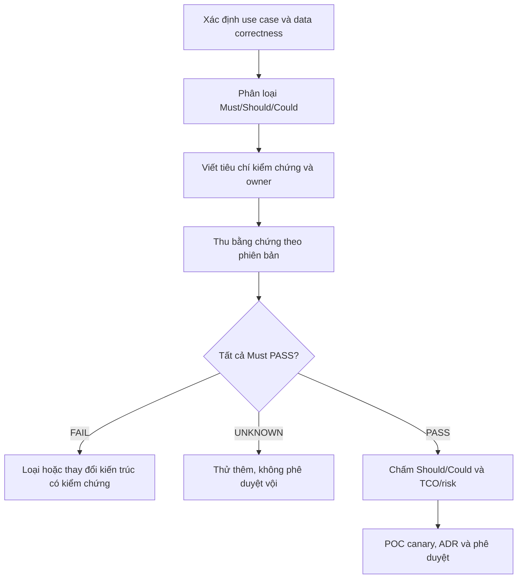

# Phân biệt yêu cầu bắt buộc với tính năng thuận tiện

## 1. Tình huống mở đầu: một cơ sở dữ liệu nhiều tính năng có thể là lựa chọn sai

Một nhóm Java đang chọn cơ sở dữ liệu cho hệ thống đặt hàng. Trong cuộc họp, các ý kiến được đưa ra:

- “Có giao diện quản trị đẹp thì dễ làm việc.”
- “Phải hỗ trợ tìm kiếm toàn văn, vì sau này có thể cần.”
- “Dữ liệu đơn hàng đã xác nhận không được mất trong sự cố một nút theo chính sách độ bền đã cam kết.”
- “Ứng dụng cần đọc đơn hàng theo `(tenantId, orderId)` với p99 dưới 100 ms ở mức tải mục tiêu.”
- “Tốt nhất có client reactive.”
- “Đơn đặt hàng và giữ tồn kho phải tuân thủ quy tắc không bán vượt số lượng sẵn có.”
- “Nhóm chỉ có hai kỹ sư vận hành nên không thể trực 24/7 để tự sửa một cụm phân tán phức tạp.”

Nếu nhóm chấm điểm từng câu như nhau, một sản phẩm có giao diện đẹp, nhiều API mới và tài liệu hấp dẫn có thể thắng một sản phẩm đáp ứng các điều kiện dữ liệu quan trọng hơn. Điểm số trung bình cao **không bù được** việc thiếu khả năng bảo vệ một thao tác thanh toán hoặc thiếu mô hình vận hành đủ an toàn.

Bài học **Database No SQL → Đánh giá và lựa chọn → Phân biệt yêu cầu bắt buộc với tính năng thuận tiện** xây dựng cách đánh giá có thể kiểm chứng: xác định yêu cầu nào phải được đáp ứng để một lựa chọn được xem xét, yêu cầu nào tạo lợi ích nhưng có thể đánh đổi, và cách dùng bằng chứng thay cho ấn tượng về danh sách tính năng.

---

## 2. Mục tiêu học tập

Sau bài học, bạn có thể:

1. Phân biệt **yêu cầu bắt buộc**, **yêu cầu nên có**, **tính năng thuận tiện** và **ý tưởng chưa xác thực**.
2. Chuyển câu nói mơ hồ thành tiêu chí kiểm thử có số liệu, phạm vi và điều kiện cụ thể.
3. Tách yêu cầu nghiệp vụ khỏi giải pháp kỹ thuật được đề xuất.
4. Phân loại tiêu chí theo **data correctness**, bảo mật, độ bền, tính nhất quán, hiệu năng, vận hành, chi phí và phát triển.
5. Xác định tính năng nào phải được hệ lưu trữ hỗ trợ trực tiếp và tính năng nào có thể được xây ở tầng ứng dụng.
6. Dùng **hard gates** để loại phương án không đáp ứng điều kiện thiết yếu trước khi chấm điểm tiện ích.
7. Dùng ma trận trọng số chỉ với những lựa chọn vượt qua các gates.
8. So sánh các nhóm NoSQL theo workload, không chỉ theo quảng cáo sản phẩm.
9. Thiết kế bằng chứng: tài liệu hỗ trợ, proof of concept, fault test, benchmark và restore drill.
10. Ghi các giả định, rủi ro còn lại, chi phí bù đắp và điều kiện xem xét lại quyết định.
11. Viết ADR/decision record minh bạch cho nhóm Java.
12. Thực hiện quyết định chọn, không chọn hoặc trì hoãn lựa chọn một sản phẩm.

## 3. Yêu cầu bắt buộc là gì?

**Yêu cầu bắt buộc** (*must-have*, *non-negotiable requirement*) là điều kiện mà nếu không được đáp ứng trong phạm vi và bằng chứng đã xác định, phương án **không đủ điều kiện** để triển khai cho workload đang xét.

Ví dụ:

> “Với endpoint xác nhận thanh toán, không được tạo hai giao dịch thu tiền cho cùng một idempotency key, kể cả khi client retry sau timeout.”

Điều này là một bất biến nghiệp vụ. Nếu phương án không có cách thực thi và kiểm chứng đáng tin, việc có giao diện đẹp hoặc tốc độ đọc cao không giúp nó vượt qua.

Một yêu cầu chỉ nên được gắn nhãn bắt buộc khi có ít nhất một lý do rõ:

- **Vi phạm là không thể chấp nhận:** gây mất tiền, rò dữ liệu, vi phạm điều khoản hoặc sai bất biến nghiệp vụ.
- **Có cam kết cụ thể:** SLO/SLA, RPO/RTO, giới hạn vận hành, yêu cầu pháp lý đã áp dụng.
- **Không có biện pháp bù đắp khả thi trong ngân sách/rủi ro đã chấp nhận.**
- **Là điều kiện để hệ chạy được:** driver/runtime được hỗ trợ, truy vấn cốt lõi thực thi được ở quy mô mục tiêu.

**Bắt buộc không có nghĩa “tôi rất thích tính năng này”.** Sự ưu tiên cá nhân không tự tạo thành điều kiện loại trừ.

## 4. Tính năng thuận tiện là gì?

**Tính năng thuận tiện** (*nice-to-have*, *convenience feature*) làm giảm công sức, cải thiện trải nghiệm hoặc mở thêm lựa chọn, nhưng thiếu nó **không phá yêu cầu cốt lõi** và có phương án thay thế được chấp nhận.

Ví dụ:

- Giao diện quản trị trực quan thay vì CLI/API đã đủ an toàn.
- SDK reactive khi ứng dụng hiện chỉ cần synchronous driver và vẫn đạt tải.
- Công cụ dựng dashboard tự động khi có thể xuất metrics qua OpenTelemetry/Prometheus.
- Truy vấn vector tích hợp khi nhu cầu tìm theo ngữ nghĩa chưa được xác nhận.
- Khả năng đổi schema ít thao tác hơn khi tần suất migration thấp và quy trình hiện tại chấp nhận được.

Một tính năng có thể chuyển từ **thuận tiện** sang **bắt buộc** khi điều kiện đổi. Nếu hệ chỉ có hai người vận hành và không có dịch vụ managed phù hợp, khả năng tự động backup hoặc hỗ trợ vận hành có thể trở thành tiêu chí chặn.

## 5. Không chỉ có hai nhãn

Một bảng phân loại thực dụng:

| Loại | Ý nghĩa | Cách dùng trong quyết định |
| --- | --- | --- |
| **Must-have** | Thiếu thì không thể chấp nhận phương án | Pass/Fail/Unknown gate |
| **Should-have** | Quan trọng; thiếu phải có cost/risk mitigation rõ | Ưu tiên cao sau gates |
| **Could-have** | Có lợi khi chi phí phù hợp | Chấm điểm có trọng số thấp hơn |
| **Won't-have now** | Không thuộc phạm vi hiện tại | Không dùng làm điểm cộng ảo |
| **Hypothesis** | Chưa có bằng chứng về nhu cầu | Ghi backlog/trigger để xác minh |

MoSCoW là cách trao đổi mức ưu tiên, **không tự thay thế bằng chứng kỹ thuật**. Nhất là `Must` phải có điều kiện kiểm tra cụ thể, không chỉ một nhãn trong bảng.

### 5.1. Không biến tất cả thành Must

Nếu mọi tính năng đều bắt buộc, không phương án nào đạt. Buộc mỗi người yêu cầu trả lời:

> “Nếu thiếu điều này nhưng toàn bộ dữ liệu, quyền truy cập và SLO vẫn đúng, vì sao hệ thống không được triển khai?”

Nếu không có lý do, cân nhắc chuyển xuống `Should` hoặc `Could`.

## 6. Phạm vi của một yêu cầu quyết định mức ưu tiên

Cùng một tính năng có thể là bắt buộc ở workflow này nhưng thuận tiện ở workflow khác:

| Năng lực | Hệ thanh toán | Cache giao diện |
| --- | --- | --- |
| Không mất dữ liệu đã ACK theo contract | Thường là điều kiện thiết yếu | Có thể không cần nếu cache refill |
| Multi-record atomicity | Có thể quan trọng | Thường không cần |
| TTL tự động | Có thể chỉ hỗ trợ housekeeping | Có thể là yêu cầu quan trọng |
| Search full-text | Ít liên quan | Có thể không cần nếu cache chỉ lookup |
| Failover tự động | Theo RTO/SLO | Tùy cache miss fallback |
| Truy vấn theo primary key | Cốt lõi | Cốt lõi |
| Sao lưu có thể restore | Thiết yếu với dữ liệu nguồn | Có thể chọn rebuild |

**Không gắn nhãn một lần cho cả doanh nghiệp rồi áp dụng cho mọi use case.** Đánh giá theo domain và đường dữ liệu.

## 7. Phân biệt nhu cầu và giải pháp được đề xuất

Một câu nghe giống yêu cầu nhưng thực chất là lựa chọn công nghệ:

> “Phải dùng MongoDB vì dữ liệu là JSON.”

Đây là **giải pháp đề xuất**, chưa phải yêu cầu. Nhu cầu thật có thể là:

> “Ứng dụng lưu một document có tối đa 40 trường linh hoạt, đọc bằng `(tenantId, documentId)`, cập nhật một vài trường, schema thay đổi khoảng mỗi quý.”

Sau khi diễn đạt đúng nhu cầu, có thể so sánh document DB, key–value, RDBMS JSON hay giải pháp khác.

### 7.1. Cách đặt câu hỏi

- Người dùng cần làm gì?
- Nếu không có tính năng X, điều gì **thực sự** không thể làm?
- Có phương án thay thế không?
- Nếu có, chi phí bổ sung bao nhiêu và rủi ro nào?
- Điều kiện thành công đo bằng gì?
- Ai chịu trách nhiệm xác nhận?

Đừng loại một hệ vì thiếu tên API mà không kiểm xem mục tiêu nghiệp vụ có thể được đáp ứng qua mô hình khác.

## 8. Tách “sản phẩm phải có sẵn” với “hệ thống phải đạt”

Ví dụ yêu cầu:

> “Hệ thống phải cung cấp read-your-writes cho màn hình xác nhận đặt hàng.”

Điều đó **không bắt buộc** database có một tùy chọn đúng tên `READ_YOUR_WRITES`. Hệ thống có thể đáp ứng thông qua primary routing, session consistency, version token hoặc read path phù hợp.

Ngược lại:

> “Hệ thống phải hỗ trợ multi-record transaction.”

Có thể là một nhu cầu thật, nhưng trước khi loại database thiếu native transaction, hãy hỏi liệu đổi data model để cùng một aggregate có thể cập nhật nguyên tử trong một record có đáp ứng bất biến hay không.

### 8.1. Hai tầng kiểm chứng

```text
System-level MUST:
  Ứng dụng phải bảo toàn bất biến tồn kho.

Candidate-level capability:
  Native transaction? Conditional write? LWT?
  Aggregate design? Application protocol?
  Chi phí, độ phức tạp, recovery semantics?
```

Một workaround chỉ được tính là `PASS` khi **đã có thiết kế, chi phí và bài test** phù hợp. “Chắc viết thêm vài dòng Java là được” không phải bằng chứng.

## 9. Phân loại nguồn gốc yêu cầu

Các nguồn thường gặp:

1. **Bất biến nghiệp vụ:** không double charge, không cross-tenant read, không bán âm tồn kho.
2. **Cam kết khách hàng:** p99, availability, data residency, restore time.
3. **Pháp lý/hợp đồng:** retention, quyền xóa, audit, encryption theo phạm vi áp dụng.
4. **Ràng buộc hệ thống:** Java runtime, network boundary, vùng triển khai, workload hiện hữu.
5. **Năng lực tổ chức:** số kỹ sư vận hành, ngân sách trực sự cố, kinh nghiệm backup.
6. **Ưu tiên UX/dev:** console, SDK ergonomics, local emulator.
7. **Kỳ vọng tương lai:** vector search, đa khu vực, real-time analytics, graph traversal.

Mỗi yêu cầu cần **owner và nguồn bằng chứng**. Không tự viện dẫn “theo luật” khi chưa xác định quy định nào áp dụng cho data, quốc gia, ngành và hợp đồng cụ thể.

## 10. Viết tiêu chí dưới dạng có thể kiểm chứng

Một mẫu:

```text
[ID] <Tên yêu cầu>
Mức: Must / Should / Could
Nguồn/owner: <người hoặc tài liệu có thẩm quyền>
Phạm vi: <API, collection, region, tenant tier, môi trường>
Điều kiện thử: <load profile, failure model, dữ liệu>
Ngưỡng chấp nhận: <giá trị và cách đo>
Cách xác minh: <docs, test, audit, POC>
Biện pháp bù đắp: <nếu có>
Tình trạng bằng chứng: PASS / FAIL / UNKNOWN
```

### 10.1. Từ mơ hồ thành cụ thể

| Mơ hồ | Có thể kiểm chứng hơn |
| --- | --- |
| “Phải nhanh” | p99 của point lookup dưới ngưỡng ở tải và dữ liệu xác định |
| “Phải ổn định” | Trong thử mất một node, thời gian gián đoạn ghi không vượt ngưỡng |
| “Không được mất dữ liệu” | ACK theo durability class X phải còn sau fault model Y |
| “Phải bảo mật” | Không tồn tại cross-tenant reads/writes trong bộ negative tests |
| “Phải scale” | Nâng dữ liệu lên kích thước D, QPS Q mà SLO còn đạt |
| “Dễ vận hành” | Recovery drill do nhóm thực hiện thành công theo RTO |
| “Rẻ” | TCO 3 năm theo traffic/replication/backup dưới ngân sách |
| “Dễ tích hợp Java” | Driver hỗ trợ Java runtime hiện dùng, TLS và topology mode |

**Ngưỡng không phải số trang trí.** Nó phải xuất phát từ SLO/capacity plan/business constraints và được kiểm với tải đại diện.

## 11. Hard gate: điều kiện loại phương án

Với tập yêu cầu bắt buộc \(M=\{m_1,m_2,\ldots,m_n\}\), một phương án \(x\) hợp lệ chỉ khi:

\[
Eligible(x)=\bigwedge_{i=1}^{n}Pass(x,m_i)
\]

Trong thực tế, nên dùng ba trạng thái:

```text
PASS    Có đủ bằng chứng đáp ứng
FAIL    Có bằng chứng không đáp ứng
UNKNOWN Chưa đủ bằng chứng
```

Nếu `FAIL` → loại cho phạm vi đó. Nếu `UNKNOWN` → **chưa đủ điều kiện phê duyệt**; cần thử thêm hoặc xử lý rủi ro qua quy trình có thẩm quyền. Không tự quy `UNKNOWN` thành `PASS` để kịp deadline.

### 11.1. Không cho điểm thưởng bù hard gate

Một sản phẩm đạt 95/100 điểm tiện ích nhưng thất bại tenant isolation không được thắng sản phẩm đạt 70/100 mà đáp ứng mọi Must.

### 11.2. Tránh định nghĩa gate quá thiên vị

Sai:

```text
MUST: MongoDB aggregation pipeline
```

Tốt hơn nếu nghiệp vụ cần:

```text
MUST: Tính được revenue theo tenant/ngày
      với độ trễ và freshness được chỉ định.
```

Trừ trường hợp hệ đã khóa vào một API cụ thể vì ràng buộc tương thích được chứng minh.

## 12. Ví dụ bộ tiêu chí cho Order Service Java

| ID | Loại | Tiêu chí | Cách xác minh |
| --- | --- | --- | --- |
| M01 | Must | Không tạo hai Orders cho cùng operation ID | Race + timeout/retry tests |
| M02 | Must | Tenant A không đọc/ghi dữ liệu B | Authorization negative tests |
| M03 | Must | Cập nhật tồn kho giữ invariant trong concurrency | Conditional transaction/CAS tests |
| M04 | Must | Point lookup đạt p99 theo SLO ở tải N−1 | Load test có đủ data/skew |
| M05 | Must | Khôi phục được dữ liệu nguồn trong RPO/RTO đã cam kết | Restore drill |
| M06 | Must | Driver Java/JDK/auth/TLS/topology được hỗ trợ | Compatibility matrix |
| S01 | Should | Export báo cáo tự phục vụ không quá phức tạp | Workflow/cost test |
| S02 | Should | Giao diện quản trị phân quyền rõ | Operational evaluation |
| C01 | Could | GraphQL integration có sẵn | Prototype |
| C02 | Could | Vector search tích hợp | Future-feature trial |

Các mã và ngưỡng là ví dụ, **không phải yêu cầu có sẵn của mọi ứng dụng đặt hàng**.

## 13. Must-have phải là tiêu chí trên trạng thái cuối, không chỉ API tồn tại

Một database có API `transaction` không chứng minh workflow đặt hàng bảo toàn bất biến với cách dùng hiện tại.

Cần kiểm:

- Transaction scope gồm những records/shards nào?
- Isolation level có ngăn anomaly mà ứng dụng cần không?
- Retry và timeout sau commit được xử lý ra sao?
- Write durability config đã đúng chưa?
- Side effects ngoài database có được bảo vệ bằng outbox/idempotency không?
- Performance và chi phí ở concurrency thật?
- Quá trình recovery có làm mất dữ liệu theo contract không?

**Có tên tính năng ≠ đáp ứng yêu cầu.**

## 14. Trường hợp một workaround có thể đáp ứng Must

Giả sử hệ A không có atomic transaction xuyên hai collections theo mode triển khai, nhưng có conditional atomic write trên một item.

Nếu domain cho phép gộp toàn bộ invariant thành một aggregate item, phương án có thể hợp lệ:

```text
Inventory aggregate:
  productId
  available
  reserved
  version

Reserve(q):
  conditional write if available >= q
```

Nhưng phải kiểm item size, contention, write throughput, partition hotspots, schema, timeout và dedup. Nếu một payment cần cập nhật nhiều authoritative ledgers khác nhau atomically, việc gộp vào một item có thể không thích hợp.

### 14.1. Giá phải trả cho workaround là một tiêu chí

```text
Engineering effort
Operational burden
Additional service
Risk of divergence
Recovery playbook
Testing complexity
Long-term maintenance
```

Đừng ghi “PASS” nếu workaround phụ thuộc một hệ mới mà nhóm không thể vận hành trong ngân sách.

## 15. Non-functional requirements không tự là nice-to-have

Nhiều nhóm chỉ xem “business functions” là bắt buộc, còn latency, security, recovery là tùy chọn. Đây là cách phân loại sai.

Một API tạo Order có thể chạy được trong demo nhưng không thể triển khai nếu:

- Không đáp ứng độ bền dữ liệu đã cam kết.
- Không mã hóa kết nối đến nguồn.
- Không cô lập được tenants.
- Không restore được khi mất vùng.
- P99 vượt thời gian chờ của bên thanh toán.
- Không duy trì dịch vụ khi một node chết theo SLO.

NFR có thể là **hard gate**, tùy hậu quả và cam kết.

## 16. Bảo mật và tenant isolation thường là gate

Trong SaaS multi-tenant:

```text
Trusted identity
  -> Active tenant membership
  -> Tenant-scoped key/query
  -> Authorization at data access boundary
```

Các khả năng cần kiểm chứng:

- Authentication/TLS được hỗ trợ trong deployment.
- DB principal/service account có phạm vi phù hợp.
- Tenant key/query không phụ thuộc raw ID client gửi.
- Row/document-level rules ở nơi chúng thực sự được thực thi.
- Backup/export/log không tiết lộ dữ liệu chéo tenant.
- Quota hoặc “multi-tenancy” theo namespace không tự thay authorization.
- Audit truy cập nhạy cảm có thể lấy bằng chứng.

Một tính năng native row-level security có thể là ưu điểm, nhưng **kết quả bắt buộc** là ranh giới dữ liệu được bảo vệ, kể cả nếu ứng dụng/kiến trúc thực hiện một phần.

## 17. Data residency và pháp lý: không được phỏng đoán

Các câu hỏi:

- Dữ liệu loại nào, của đối tượng nào?
- Quốc gia/khu vực và hợp đồng nào áp dụng?
- Có yêu cầu dữ liệu chính, replica, backup và log ở cùng khu vực không?
- KMS keys và support access có ràng buộc?
- Có xóa/retention/legal hold không?
- Nhà cung cấp đã có chứng từ và DPA phù hợp chưa?

Một sản phẩm hỗ trợ region A nhưng **backup tự động sang region B** có thể vi phạm ràng buộc nếu hợp đồng cấm. Cần kiểm scope của mọi copies, không chỉ primary database.

### 17.1. Đừng gọi “có chứng chỉ” là đủ

Chứng chỉ an ninh là một nguồn bằng chứng, không tự chứng minh workload cấu hình đúng hoặc deployment đáp ứng mọi điều khoản.

## 18. Tính nhất quán: định nghĩa theo bất biến

Câu “chúng ta cần strong consistency” thường chưa đủ để chọn database.

Hãy xác định:

- Read-your-writes cho flow nào?
- Monotonic reads có bắt buộc?
- Cần linearizable read-modify-write trên một item?
- Có cần multi-document transaction/serializability?
- Có chấp nhận stale Search trong vài giây?
- Có cần cross-region atomic writes hay eventual reconciliation?

Ví dụ:

```text
Order creation:
  Must: unique operation ID, không duplicate business effect.

Search index:
  Should: sau source commit, Search hội tụ <= 5s.

Recommendations:
  Could: kết quả cập nhật tức thời.
```

Một hệ thống có thể dùng nhiều consistency policies, không bắt mọi query đạt mức mạnh nhất.

## 19. Durability: câu “không mất dữ liệu” phải nêu fault model

Yêu cầu mơ hồ:

> “Không mất dữ liệu khi máy chủ bị lỗi.”

Phiên bản có thể kiểm:

```text
Với các writes được ACK theo durability class D,
khi một node dữ liệu bị dừng đột ngột,
sau failover/restore không được thiếu bất kỳ operation ID nào
thuộc tập ACKed được bảo vệ.
```

Phải ghi:

- Write concern/consistency level.
- Journal/flush/log semantics.
- Replication placement.
- Fault domain: process, disk, zone, region.
- RPO có cho phép mất một phần dữ liệu không.
- Cách giải quyết UNKNOWN outcomes.

**Một replica hoặc bản backup không tự là bảo đảm zero data loss**. Bằng chứng nằm ở cấu hình, protocol và fault test.

## 20. Availability: không chỉ số “nines”

Một yêu cầu:

```text
99.95% availability
```

chưa nói rõ:

- API nào?
- Region hay toàn cầu?
- Đo theo request thành công, endpoint alive hay successful business transaction?
- Có tính lỗi 429 do quota không?
- Có maintenance windows không?
- Tail latency có được tính là thất bại?
- Khi node mất, ứng dụng phục hồi trong bao lâu?

Nếu hệ cần trả kết quả đặt vé trong 300 ms, việc API trả 200 sau 30 giây không có ích. Viết *good-event SLO*:

```text
An eligible create-order intent completes
correctly within deadline X.
```

## 21. RPO và RTO: phải thử khôi phục thật

**RPO:** mức mất dữ liệu cho phép sau sự cố.

**RTO:** thời gian tới trạng thái phục vụ được định nghĩa.

Một cloud service có nút backup trong console chưa chứng minh ứng dụng có thể restore trong RTO.

Kiểm thử:

1. Chọn backup/PITR recovery point.
2. Dựng môi trường cô lập.
3. Restore dữ liệu, schema, metadata, quyền và khóa giải mã.
4. Kết nối Java service.
5. Đối soát Order/Customer/Payment IDs.
6. Dựng lại Search/cache/CDC theo source.
7. Đo thời gian thực và tuổi recovery point.

Một phương án không restore được theo deadline là **FAIL** nếu đó là Must, dù tạo snapshot rất nhanh.

## 22. Những mẫu truy vấn phải được liệt kê trước chọn sản phẩm

Một ma trận access pattern:

| Query ID | Mẫu | Đầu vào | Kết quả | Tải |
| --- | --- | --- | --- | --- |
| Q1 | Get Order | tenantId, orderId | 1 Order | 3.000 QPS |
| Q2 | Recent Orders | tenantId, status, cursor | 50 Orders | 500 QPS |
| Q3 | Find by Customer | tenantId, customerId | Page | 150 QPS |
| Q4 | Daily Revenue | tenantId, date range | Aggregate | 30 QPS |
| Q5 | Product full-text search | tenantId, text | Ranked results | 80 QPS |
| Q6 | Export year history | tenantId, year | Async file | 10 jobs/day |

Số liệu minh họa. Phải xác nhận dữ liệu thực tế, phân bố tenants và mức độ quan trọng.

### 22.1. Không chọn “đọc nhanh” khi chưa biết đọc cái gì

Một key–value store có thể rất tốt cho Q1 nhưng không phù hợp Q5 nếu không xây một search index khác. Một search engine có Q5 mạnh nhưng không nên mặc định làm nguồn sự thật cho transaction Q1.

## 23. Năng lực query: Must ở cấp use case, Could ở cấp API

Ví dụ:

> “Phải tìm sản phẩm theo text, lọc tenant và availability, sắp theo relevance.”

Đó có thể là Must nếu Search là tính năng chủ lực.

Nhưng **native full-text query trong primary database** có thể chỉ là Could. Có thể dùng database lưu nguồn kết hợp search service riêng nếu:

- Độ trễ đồng bộ được chấp nhận.
- CDC/outbox đáng tin.
- Có quy trình rebuild.
- Chi phí vận hành hai hệ phù hợp.
- Tenant filters được áp ở cả hai bên.

### 23.1. Đừng tính giải pháp hai sản phẩm như chi phí của một

Nếu cần thêm OpenSearch/Elasticsearch, phải cộng index storage, ingest, replica, CDC, backup/rebuild và on-call. Không chỉ chấm điểm database nguồn.

## 24. Data modeling có thể thay đổi khả năng đạt yêu cầu

NoSQL thường tối ưu theo access patterns:

```text
Key-value:        key -> value
Document:         document + indexes/queries
Wide-column:      partition key + clustering/order
Graph:            nodes/edges/traversals
Search engine:    inverted/vector indexing & relevance
```

Một data model **không phù hợp** có thể làm truy vấn cốt lõi không đạt p99 dù sản phẩm về lý thuyết hỗ trợ.

Ví dụ trong Cassandra, query theo partition/clustering keys thường là đường truy vấn dự kiến; arbitrary filtering trên toàn data không tự thành một tính năng hiệu quả. Trong MongoDB, index/shard key quyết định scan và targeting. Trong DynamoDB, key schema và GSI quyết định `Query` khả dụng.

### 24.1. Phải chứng minh model chứ không chỉ API

POC cần load dữ liệu với phân bố thực, tạo indexes thật, chạy đúng queries và quan sát chi phí, hot partitions, pagination, số shards touched.

## 25. Thời gian phát triển có phải Must?

Có thể, nếu có deadline bên ngoài đã được xác định:

```text
Must: phát hành MVP trong 12 tuần
với 2 Java engineers và không có DBA chuyên trách.
```

Trong tình huống này, sản phẩm đòi nhiều tháng vận hành clusters có thể bị loại dù technical ceiling cao.

Tuy nhiên, **“dễ code”** không đủ. Cần đo:

- Thời gian từ bootstrap tới endpoint production-like.
- Thời gian viết 6 query cốt lõi.
- Thời gian làm AuthZ/TLS/observability.
- Thời gian chạy backup/restore.
- Số lượng components phải tự xây.
- Rủi ro phụ thuộc một chuyên gia duy nhất.

Một managed service có thể giảm phần vận hành nhưng tăng lock-in hoặc chi phí; đánh giá cả hai.

## 26. Java SDK là gate khi tương thích không thể thay đổi

Ví dụ stack hiện tại:

```text
Java 21
Spring Boot
Containerized deployment
TLS + identity-based auth
Tracing via OpenTelemetry
```

Cần xem:

- Driver/SDK chính thức có hỗ trợ Java 21 và server/API version?
- Sync/async/reactive APIs phù hợp threading model?
- TLS, certificate validation, credential rotation?
- Topology discovery/failover?
- Timeouts/retries/idempotency?
- Connection pool/in-flight limits?
- Serialization và schema evolution?
- Dependency compatibility, BOM, transitive conflicts?
- Observability hooks?
- Deployment support/maintenance lifecycle?

**Official support** có thể là Must nếu doanh nghiệp không chấp nhận unsupported runtime. SDK có fluent API đẹp là tiện ích nếu mọi điều kiện khác đã đủ.

## 27. Hệ sinh thái framework không được che giới hạn sản phẩm

Một Spring Data repository có thể cho cảm giác gần giống CRUD giữa nhiều cơ sở dữ liệu. Nhưng:

- Transaction scope khác nhau.
- Delete/TTL semantics khác nhau.
- Upsert/conditional write khác nhau.
- Query/index capabilities khác nhau.
- Consistency and retry defaults khác nhau.
- Reactive wrapper không tự tạo non-blocking database engine.
- ORM/ODM không tự ngăn hot partitions hoặc cross-tenant access.

Nếu Must là **atomic conditional update** trên một business aggregate, cần kiểm command thật và concurrency test; không đủ khi chỉ thấy annotation `@Transactional`.

## 28. Vận hành: managed hay self-hosted có thể thay đổi quyết định

So sánh hai phương án:

```text
A. Tự quản trị cluster với replication, upgrades, backups.
B. Managed database có operation-level guarantees và service limits.
```

Nhu cầu phải bao gồm:

- Ai chịu trách nhiệm patch CVEs?
- Ai kiểm backup/PITR và restore?
- Ai trực sự cố?
- Có failover tự động không?
- Có thể giới hạn blast radius của một tenant không?
- Upgrade có downtime không?
- Support escalation có đáp ứng giờ trực không?
- Có metrics và audit đủ dùng không?
- Phần nào nhà cung cấp không chịu trách nhiệm?

### 28.1. “Managed” không đồng nghĩa “không cần vận hành”

Ứng dụng vẫn chịu trách nhiệm schema, indexes, queries, credentials, data correctness, restore drills, budgets và client retry semantics. Không tự đánh dấu `PASS` cho tất cả vận hành vì mua dịch vụ managed.

## 29. Chi phí là hard gate khi vượt ngân sách

Đừng chỉ lấy giá mỗi GB hoặc giá instance.

Một mô hình TCO:

\[
TCO =
C_{\text{compute}} +
C_{\text{storage}} +
C_{\text{I/O}} +
C_{\text{replication}} +
C_{\text{network}} +
C_{\text{backup}} +
C_{\text{operations}} +
C_{\text{support}} +
C_{\text{migration}}
\]

Thêm dự phòng cho peak, growth, recovery, egress, secondary indexes, logs và data transfer.

### 29.1. Một truy vấn “rẻ” có thể trả giá ở nơi khác

- Denormalize để đọc nhanh có thể tăng dung lượng và số writes.
- Quorum mạnh có thể tăng latency/cost.
- Search index ngoài nguồn tăng CDC và rebuild cost.
- Multi-region replication có egress và conflict handling.
- Managed option giảm on-call nhưng có bill theo operations.

### 29.2. Không dùng ước lượng đơn điểm

Báo **base, peak, growth, failure-mode** với assumptions. Một sản phẩm rẻ ở 100 GB chưa chắc rẻ ở 10 TB với 10 GSIs và backup cross-region.

## 30. Khả năng scale: tính năng tiện ích hay điều kiện thiết yếu?

Câu “hỗ trợ scale ngang” có thể chỉ là marketing nếu workload không cần.

Hãy viết:

```text
Trong 24 tháng:
  dữ liệu từ 300 GB lên 8 TB
  peak point reads 12.000 QPS
  writes 2.000 QPS
  top 1% tenants chiếm 45% traffic
  p99 đọc vẫn dưới SLO
  không downtime không được phép khi mở rộng
```

Nếu đây là yêu cầu đã cam kết và xác thực, scale strategy là Must.

### 30.1. Không nhầm throughput tổng với hot-key limit

Tăng thêm node không tự tăng throughput của một partition key nóng. POC phải tạo phân bố lệch, không chỉ load uniform keys.

### 30.2. Không bắt buộc “scale vô hạn”

Không sản phẩm nào có vô hạn tài nguyên. Đặt capacity envelope hợp lý và xác minh mở rộng/thu hẹp trong phạm vi đó.

## 31. Độ phức tạp cũng có ngân sách

Một giải pháp ghép:

```text
Primary NoSQL
  + Search engine
  + Redis cache
  + Kafka outbox
  + Reconciliation service
  + Distributed locks
```

có thể cung cấp nhiều tính năng nhưng tăng số điểm hỏng và yêu cầu chuyên môn.

Cần trả lời:

- Có bao nhiêu đội chịu trách nhiệm?
- Có rollback/restore xuyên hệ?
- Có cách biết dữ liệu lệch?
- On-call có đủ năng lực xử lý?
- SLO có đủ headroom cho thêm network hops?
- Có thể giảm số thành phần mà vẫn đáp ứng Must?

**Một convenience feature không đáng để tạo thêm một cơ sở dữ liệu thứ ba nếu rủi ro vận hành vượt lợi ích của nó.**

## 32. Vendor lock-in: phân biệt rủi ro hiện tại và khả năng tương lai

Một dịch vụ có API độc quyền có thể là lựa chọn hợp lý nếu giảm vận hành và đáp ứng workload. Lock-in chỉ nên là **hard gate** khi có ràng buộc cụ thể:

- Hợp đồng bắt buộc triển khai trên nhiều cloud.
- Ràng buộc pháp lý không cho dùng provider.
- Exit deadline có thể kiểm chứng.
- Dữ liệu quá lớn khiến export/migration không đạt recovery contract.
- License/support policy bị cấm trong môi trường.

Nếu chưa có ràng buộc, lock-in thường là **Should/risk score**; đánh giá chi phí exit bằng POC export/import và dữ liệu thực, không chấm một cảm giác chung.

## 33. Tính năng roadmap không được tính là PASS

Trong demo, vendor nói:

> “Quý sau sẽ hỗ trợ cross-region transactional writes.”

Nếu đây là Must cho kỳ phát hành hiện tại, tính năng **chưa có, chưa được hỗ trợ trong deployment mục tiêu** không thể ghi PASS.

Tình trạng hợp lý:

```text
FAIL for present release
hoặc
UNKNOWN pending verified release/support
```

Chỉ chấp nhận kế hoạch dựa trên tương lai nếu sponsor chính thức dời scope/deadline và ghi rõ rủi ro; không biến lời hứa thành đặc tính đã triển khai.

## 34. Chính sách bằng chứng: docs, POC, production references

Một mức độ bằng chứng tham khảo:

| Bằng chứng | Trả lời tốt câu hỏi nào? | Giới hạn |
| --- | --- | --- |
| Trang sản phẩm | Có chức năng được quảng bá không? | Có thể thiếu điều kiện |
| Tài liệu API/version | Tính năng chính thức hỗ trợ mode nào? | Chưa chứng minh hiệu năng |
| Support statement | Có hỗ trợ runtime/deployment? | Có điều khoản/giới hạn |
| POC với data đại diện | Query và API có hoạt động? | Thời gian test ngắn |
| Load/fault/restore test | SLO/durability/recovery trong lab? | Chưa phản ánh mọi production failure |
| Production telemetry/canary | Hoạt động thực ở quy mô hiện có? | Khó ngoại suy tới quy mô tương lai |

Không nên chấm điểm chỉ dựa vào số lượng logo khách hàng hoặc benchmark từ vendor với workload khác biệt.

### 34.1. Ghi ngày và phiên bản của bằng chứng

```text
Product version
SDK version
Managed tier/region
Date evidence collected
Feature flag/preview status
```

NoSQL và managed offerings thay đổi nhanh; một feature có ở bản self-hosted chưa chắc có trong tier/region bạn mua.

## 35. POC: thử những Must khó nhất trước

Thứ tự thử hiệu quả:

1. Khả năng thực thi access pattern cốt lõi.
2. Tenant isolation và AuthZ path.
3. Conditional writes/transactions và concurrency.
4. Failover/durability với fault model đã chốt.
5. Backup/restore theo RPO/RTO.
6. Độ trễ p99 dưới tải và skew.
7. Compatibility Java + driver + deployment.
8. Chi phí theo resource metering.
9. Sau đó mới thử console, dashboard, SDK convenience.

Một POC chỉ demo happy-path CRUD không đủ để duyệt một source of truth chứa dữ liệu nhạy cảm.

## 36. Một POC có thể thất bại vì phép thử sai

Một số sai lệch:

- Dữ liệu thử 10.000 records trong khi production có 100 triệu.
- Mọi tenants có kích thước giống nhau, trong thực tế rất lệch.
- Dùng warm cache và chỉ đo p50.
- Không tạo indexes giống production.
- Tắt TLS, auth hoặc journaling cho benchmark.
- Dùng single-node thay vì cluster.
- Không tạo retry/timeout và mất một node.
- Đếm successful QPS mà bỏ offered/rejected requests.
- Đo aggregate p99 nhưng bỏ tenants nhỏ bị starving.
- So provisioned capacity của một hệ với on-demand mặc định của hệ khác.
- Đọc eventual replica rồi đòi linearizable read.

POC cần **cùng điều kiện nghiệp vụ và mức bảo đảm** nếu dùng để so phương án.

## 37. Ma trận quyết định hai giai đoạn



Như vậy, tính năng thuận tiện chỉ phân định giữa những phương án **đủ điều kiện**. Không dùng điểm số để làm mờ điều kiện dữ liệu không được đánh đổi.

## 38. Cách chấm điểm sau hard gates

Với các tiêu chí có lợi ích tương đối \(c_1,\ldots,c_k\), gán trọng số \(w_i\) và điểm \(s_i\):

\[
Score(x) = \frac{\sum_{i=1}^{k} w_i\,s_i(x)}{\sum_{i=1}^{k} w_i}
\]

Ví dụ dùng thang 1–5 chỉ cho các phương án **đã vượt gates**:

| Tiêu chí sau gate | Trọng số | Phương án A | Phương án B |
| --- | ---: | ---: | ---: |
| Đơn giản vận hành | 5 | 5 | 3 |
| Tài liệu/SDK Java | 4 | 4 | 5 |
| Chi phí dự báo 3 năm | 5 | 3 | 4 |
| Tích hợp công cụ hiện tại | 3 | 4 | 3 |
| Tiện ích Search bổ sung | 1 | 5 | 2 |

Ví dụ:

\[
Score(A)=\frac{5\times5+4\times4+5\times3+3\times4+1\times5}{18}
=\frac{73}{18}\approx4.06
\]

\[
Score(B)=\frac{5\times3+4\times5+5\times4+3\times3+1\times2}{18}
=\frac{66}{18}\approx3.67
\]

**Không dùng 4,06 điểm để cứu phương án A nếu nó FAIL một Must.**

### 38.1. Trọng số cần có lý do

Đội vận hành ít người → vận hành trọng số lớn. Sản phẩm là Search-first → search relevance trọng số lớn. Phải thảo luận trọng số trước khi xem tên ứng viên để hạn chế thiên kiến.

## 39. Tránh double-count tiêu chí

Một hệ có nhiều điểm số:

```text
Easy scaling
High throughput
Good latency
Handles large dataset
```

Có thể thực ra cùng phản ánh một năng lực performance. Nếu cho bốn trọng số riêng mà không định nghĩa khác biệt, hiệu năng được tính bốn lần và lấn át các tiêu chí khác.

### 39.1. Cách giảm trùng

Nhóm:

```text
Performance at target workload
  - p99
  - throughput headroom
  - growth capacity

Operational fitness
  - maintenance
  - restore drill
  - observability
```

Có thể dùng subcriteria để chấm một nhóm, ghi rõ cách tổng hợp.

## 40. Unknown không nên được chấm trung bình

Một cột chưa có bằng chứng cho khả năng restore không thể điền `3/5` chỉ để bảng đủ.

Trạng thái nên là:

```text
PASS   Evidence meets acceptance threshold
FAIL   Evidence violates threshold
UNKNOWN Insufficient evidence
N/A    Not required for this use case
```

**`N/A` khác `UNKNOWN`.** Tính năng graph traversals có thể `N/A` cho Order KV, nhưng durability khi chưa test là `UNKNOWN`, không phải không cần.

## 41. Khi nào nên chấp nhận một Must bằng mitigation?

Ví dụ:

```text
MUST: Search results reflect committed Orders within 10 s.
```

Primary DB không có full-text search, nhưng kiến trúc với outbox và search index có thể đạt SLO.

Để đánh dấu `PASS with approved mitigation`, cần:

1. Sơ đồ dữ liệu và trách nhiệm.
2. Dedupe/event ordering.
3. Độ trễ đồng bộ dưới tải.
4. Failover/replay test.
5. Rebuild/reconciliation workflow.
6. Cost/security/tenant filter.
7. Owner chịu trách nhiệm.
8. Kết quả đo đạt ngưỡng.

Không được sửa nhãn Must thành Could chỉ vì phương án ưa thích không hỗ trợ native feature.

## 42. Khi một Must không thật sự cần thiết

Yêu cầu ban đầu:

> “Phải có multi-region active–active synchronous writes.”

Nhưng phân tích cho thấy:

- 98% người dùng ở một khu vực.
- RTO chấp nhận 2 giờ.
- RPO chấp nhận 15 phút.
- Không có use case ghi đồng thời từ nhiều regions.
- Chi phí sync multi-region vượt ngân sách.

Có thể **đề nghị** sửa yêu cầu thành một regional source of truth với DR/PITR đáp ứng RPO/RTO, nhưng phải do owner quyết định và ghi trong ADR. Không để kỹ sư tự hạ yêu cầu rồi tuyên phương án đã đạt.

## 43. Ví dụ 1: Order & Inventory là nguồn dữ liệu chính

Yêu cầu cốt lõi:

```text
Create Order chỉ một lần cho mỗi operation ID
Reserve stock không âm
Đọc theo tenant+order ID
Đối soát dữ liệu khi retry sau timeout
Tenant isolation
Backup/restore đã thử
```

**Must:**

- Atomic/conditional write đủ bảo vệ aggregate invariants.
- Durable write semantics phù hợp SLA.
- Tenant-safe keys/AuthZ.
- Mẫu truy vấn đã được chứng minh với tải thật.
- Restore và xử lý unknown outcomes.

**Could:**

- Console cho phép sửa document bằng giao diện.
- Native map-reduce.
- Search autocomplete.
- Reactive query builder.

Một key–value hoặc document store có thể phù hợp nếu model đáp ứng các Must; không có lý do chọn graph database chỉ vì hỗ trợ traversals rất mạnh.

## 44. Ví dụ 2: Session cache cho Java web application

Nhu cầu:

```text
GET session by opaque ID
SET/renew session
TTL/expiration
Có thể rebuild/re-auth khi mất cache
Không rò session giữa users
```

Có thể xem **Must** là:

- Lookup tốc độ đủ theo SLO.
- Expiration semantics phù hợp phiên.
- Access/security/namespace isolation.
- Fallback khi cache mất.
- Bounded memory/eviction và capacity.

**Không nhất thiết Must:**

- Multi-document ACID transactions.
- SQL-style joins.
- Global cross-region serializable writes.
- PITR dài ngày nếu không lưu dữ liệu nguồn.

Redis hoặc một key–value managed service có thể đáng thử; nhưng cần kiểm TTL khi write, persistence/failover expectation và rate/cost limits thực tế.

## 45. Ví dụ 3: Search sản phẩm

Nhu cầu:

```text
Full-text relevance
Filter tenant, category, stock availability
Autocomplete
Language analyzers
Near-real-time updates
```

**Must:**

- Mức relevance theo bộ truy vấn đại diện.
- Tenant filter không bypass được.
- Search p99/throughput dưới tải.
- Tính tươi kết quả trong ngưỡng.
- Cơ chế rebuild từ source authoritative.

**Could:**

- Native OLTP transaction.
- Full replacement cho source database.
- Mọi phép tổng hợp thời gian thực.
- Vector search nếu người dùng chưa có nhu cầu semantic search.

Elasticsearch/OpenSearch có thể là ứng viên cho search index, nhưng không mặc nhiên thay luôn Order source.

## 46. Ví dụ 4: Graph và hành trình người dùng

Một hệ fraud detection cần truy vấn:

```text
User -> Device -> PaymentMethod -> Users
within 2-4 hops
```

Đây có thể là Must nếu fraud score phụ thuộc traversal liên kết nhiều hops với p99 chặt.

Native graph traversals là **một cách** đáp ứng. Một hệ document/relational với precomputed relationships cũng có thể đạt nếu dữ liệu và freshness cho phép; cần POC, không tự loại hoặc chọn bằng tên mô hình.

### 46.1. Không mặc định GraphDB tốt hơn ở mọi query

Một graph engine có thể tốt cho relationship traversals nhưng không tối ưu cho mọi point lookup/time-series aggregation. Đưa workload mix vào quyết định.

## 47. Ví dụ 5: Time-series telemetry

Nhu cầu:

```text
High write ingestion
Query by device/time range
Retention 30 days
Rollup hourly
Late-arriving events
```

Những Must có thể là:

- Sustained ingest và burst headroom.
- Range queries theo device/time.
- TTL/retention đúng policy.
- Không mất dữ liệu quá RPO đã xác định.
- Cost footprint dự báo.
- Xử lý out-of-order event.

Một time-series feature native có thể thuận tiện, nhưng cũng có thể đạt bằng wide-column/table partitioned theo time bucket. Phải xem partition growth, compaction và cardinality.

## 48. Ví dụ 6: Multi-tenant SaaS với tenant lớn

Yêu cầu:

```text
Tenant A không thể đọc tenant B.
Top tenant có 20% tổng QPS.
Dữ liệu mỗi tenant có thể khác nhau 1000 lần.
Một tenant chạy report không làm point lookup tenant khác vượt SLO.
```

**Must:**

- Tenant isolation về AuthZ.
- Query/schema/sharding tránh hotspot không thể khắc phục.
- Rate/concurrency budgets hoặc resource isolation phù hợp.
- Observability và incident control cho noisy neighbors.

**Could:**

- Mỗi tenant có dashboard đẹp riêng.
- Auto-generated admin console.
- Một cú click để tạo namespace mới.

Một sản phẩm hỗ trợ “multi-tenancy” về mặt namespace không tự chứng minh **performance isolation**. Cần load test có tenant skew và giới hạn tài nguyên.

## 49. Bảng nhìn nhanh về các nhóm hệ NoSQL

| Nhóm/sản phẩm minh họa | Năng lực thường đáng thử | Câu hỏi Must cần kiểm |
| --- | --- | --- |
| MongoDB/document | Flexible documents, indexes, aggregation | Transaction scope, shard targeting, write concern |
| Cassandra/wide-column | Partition-oriented access, write scale | Query model, CL, tombstones, repair/ops |
| Redis/key–value | Low-latency key access, TTL, data structures | Durability, memory/eviction, failover/TTL |
| DynamoDB/managed KV | Managed scaling, key/GSI access | Capacity hot keys, conditions, cost/PITR |
| Elasticsearch/OpenSearch | Full-text/search aggregations | Source-of-truth role, search freshness, shard costs |
| Neo4j/graph | Relationship traversals | Graph workload p99, operations/cluster semantics |
| Couchbase/document+KV | KV/document access, query/services | Durability, index consistency, operational mode |

Bảng **không phải bảng xếp hạng** và không có nghĩa mọi tính năng có ở mọi phiên bản, mọi tier hoặc mọi deployment. Đọc tài liệu chính thức và kiểm capabilities trong thực tế.

## 50. Đừng nhầm “có nhiều tính năng” với “hợp workload”

Một hệ có thể hỗ trợ:

```text
SQL-like querying
Full-text search
Vector indexes
Graph-style querying
Transactions
TTL
Cross-region replication
```

Nhưng nếu workload chỉ có `GET key` và `SET key` với TTL, những tính năng đó có thể tạo:

- Cost cao hơn.
- Quản trị nặng hơn.
- Nhiều index và maintenance.
- Quyền truy cập phức tạp hơn.
- Upgrade risk không cần thiết.

**Fit-for-purpose** quan trọng hơn số ô được tick trong feature matrix.

## 51. Những “tính năng miễn phí” thường không miễn phí

Ví dụ:

- **TTL:** có thể tạo áp lực delete/tombstone/compaction, không đồng nghĩa xóa ngay bytes.
- **Global replication:** tốn egress, storage, giải quyết conflict.
- **Search indexes:** tăng write amplification và index storage.
- **Transactions:** có latency/throughput constraints.
- **Backups:** phí retention, copy, restore, KMS, network.
- **Auto-scaling:** có ramp-up behavior, quota/cost controls.
- **Reactive SDK:** yêu cầu quản lý backpressure, resource lifecycle.
- **Integrated analytics:** có thể cạnh tranh CPU/IO với OLTP.

Đánh giá tiện ích theo **lợi ích ròng** sau chi phí, không chỉ sự tồn tại.

## 52. Security/compliance có thể giới hạn một tính năng hấp dẫn

Một sản phẩm có công cụ cloud console xem dữ liệu rất thuận tiện, nhưng tổ chức có yêu cầu:

```text
Không cho operator đọc plaintext PII.
Không cho export dữ liệu ra region khác.
Mọi access phải được audit.
```

Nếu console hoặc managed support path không thể cấu hình đáp ứng điều kiện đó, tính năng tiện ích có thể trở thành **rủi ro**, không phải điểm cộng.

Đánh giá cả failure modes và blast radius của tiện ích được đề xuất.

## 53. Đơn vị so sánh là giải pháp hoàn chỉnh, không phải engine trần

Phương án A:

```text
MongoDB + Redis + Kafka + Search + custom reconciliation
```

Phương án B:

```text
Managed key–value + separate report store
```

Nếu so tính năng, phải tính **toàn bộ kiến trúc** cho mỗi phương án:

- Source/derived roles.
- Backfill/catch-up.
- Security/IAM/KMS.
- Observability.
- Backup/restore.
- Java SDK integration.
- Cost/support.
- Incident ownership.

So “database A có full-text” với “database B không có” mà quên B có thể dùng search service sẵn trong tổ chức sẽ tạo quyết định thiếu công bằng.

## 54. Quản lý giả định và tín hiệu cần đánh giá lại

Một ADR tốt không giả vờ biết chắc tương lai:

```text
Assumption A1:
  Không cần ad-hoc analytics trong 12 tháng.

Trigger:
  Có > 3 use cases analytics được phê duyệt
  hoặc chi phí ETL vượt ngưỡng.

Review:
  Thiết kế read model/analytics store riêng.
```

Các giả định khác:

- Growth dữ liệu.
- Tenant distribution.
- Region compliance.
- Team size/on-call.
- Contract/vendor pricing.
- Java runtime.
- Availability của managed tier.

Nếu giả định đổi, **xem xét lại quyết định**, không coi database đã chọn là chân lý vĩnh viễn.

## 55. Không nên chọn ngay nếu hiện chưa rõ yêu cầu

Một nhóm chỉ biết:

> “Chúng ta có dữ liệu lớn, cần NoSQL cho AI.”

Tại thời điểm này, những điểm chưa rõ có thể gồm:

- Dữ liệu là documents, embeddings, events hay graph?
- Query patterns cụ thể?
- Cập nhật thường xuyên không?
- Số users/tenants và SLO?
- Độ chính xác và durability?
- Quyền truy cập và ràng buộc dữ liệu?
- Budget/scale horizon?

Lựa chọn hợp lý có thể là **hoãn phê duyệt**, dựng prototype nhỏ để làm rõ nhu cầu và giữ compatibility boundary. Việc không chọn sản phẩm ngay là một quyết định kỹ thuật có trách nhiệm nếu hard gates chưa xác định.

## 56. Một trường hợp có thể nên giữ cơ sở dữ liệu quan hệ

Từ “NoSQL” không phải là một yêu cầu nghiệp vụ.

Nếu workload cần:

- Nhiều joins và truy vấn linh hoạt.
- Multi-table constraints phức tạp.
- Transactions rộng.
- Dữ liệu có cấu trúc ổn định.
- Nhóm đã vận hành RDBMS rất tốt.
- Kích thước/tải vẫn đáp ứng SLO.

thì PostgreSQL hoặc hệ quan hệ phù hợp có thể là baseline mạnh hơn thêm một NoSQL.

**Quyết định “không cần NoSQL” vẫn là kết quả đánh giá đúng** nếu đáp ứng Must với chi phí và rủi ro thấp hơn.

## 57. Proof-of-concept theo mức độ rủi ro

Sắp xếp rủi ro, không theo danh sách tiện ích:

| Rủi ro | Mức tác động | Bài thử ưu tiên |
| --- | --- | --- |
| Sai tenant | Nghiêm trọng | Negative AuthZ/record query test |
| Double charge | Nghiêm trọng | Concurrent create + timeout retry |
| Mất ACKed write | Nghiêm trọng | Failure and durability test |
| Không restore được | Nghiêm trọng | Isolated restore drill |
| Hot partition | Cao | Skewed load test |
| p99 tăng khi mất node | Cao | N−1 load test |
| Console thiếu đồ thị | Thấp | Usability evaluation |
| Fluent API không tiện | Thấp | Developer feedback |
| Chưa có vector search | Tùy sản phẩm | Demand validation trước |

Đừng dùng phần lớn ngân sách POC để thử những ưu điểm dễ demo, trong khi tiêu chí nghiêm trọng chưa được xác minh.

## 58. Test thiết kế để phân biệt sản phẩm, không để quảng cáo

Một harness đánh giá query:

```text
Inputs:
  Dataset size and distribution
  Query templates and frequencies
  Read/write consistency and durability
  Tenants, hot keys, skew
  Runtime and network topology

Recorded:
  Offered attempts
  Completed good requests
  p50/p95/p99 and error/timeout rate
  Database CPU/IO/network and throttle
  Cost units and index/replication overhead
  Failover and recovery timeline
  Data invariants
```

Đặt từng ứng viên vào cấu hình phù hợp nhất với workload **nhưng giữ cùng hợp đồng kết quả**. Không buộc một Cassandra table dùng truy vấn trái schema chỉ vì MongoDB có ad-hoc filter; thay vào đó cho mỗi ứng viên cơ hội thiết kế data model tương đương để đạt cùng business outcome.

## 59. Java: biểu diễn yêu cầu và bằng chứng thành dữ liệu

Một nhóm có thể quản lý rubric bằng records:

```java
enum Priority {
    MUST, SHOULD, COULD
}

enum EvidenceStatus {
    PASS, FAIL, UNKNOWN, NOT_APPLICABLE
}

record Requirement(
    String id,
    String description,
    Priority priority,
    int weight
) {}

record Evidence(
    String candidateId,
    String requirementId,
    EvidenceStatus status,
    int convenienceScore,
    String reference
) {}
```

Khi đánh giá, **không dùng `convenienceScore` của Must để quyết định đủ điều kiện**. Must là gate theo trạng thái evidence.

## 60. Java: kiểm hard gates trước khi tính điểm

```java
import java.util.List;
import java.util.Map;
import java.util.Set;
import java.util.stream.Collectors;

public final class CandidateEvaluator {

    public record Decision(
        boolean eligible,
        Set<String> missingOrFailedMusts,
        double weightedScore
    ) {}

    public static Decision evaluate(
            List<Requirement> requirements,
            Map<String, Evidence> byRequirementId) {

        Set<String> unprovenMusts = requirements.stream()
            .filter(r -> r.priority() == Priority.MUST)
            .filter(r -> {
                Evidence e = byRequirementId.get(r.id());
                return e == null
                    || e.status() != EvidenceStatus.PASS;
            })
            .map(Requirement::id)
            .collect(Collectors.toSet());

        if (!unprovenMusts.isEmpty()) {
            return new Decision(false, unprovenMusts, 0.0);
        }

        double weighted = 0.0;
        int totalWeight = 0;

        for (Requirement r : requirements) {
            if (r.priority() == Priority.MUST) continue;

            Evidence e = byRequirementId.get(r.id());
            if (e == null
                    || e.status() == EvidenceStatus.UNKNOWN
                    || e.status() == EvidenceStatus.NOT_APPLICABLE) {
                continue;
            }

            // Chỉ score những evidence có trạng thái xác minh phù hợp;
            // một tiêu chí không đạt có thể nhận 0 theo policy.
            int score = e.status() == EvidenceStatus.PASS
                ? e.convenienceScore()
                : 0;

            weighted += r.weight() * score;
            totalWeight += r.weight();
        }

        return new Decision(
            true,
            Set.of(),
            totalWeight == 0 ? 0.0 : weighted / totalWeight
        );
    }
}
```

Ví dụ này minh họa **gate-before-score**, chưa phải toàn bộ workflow phê duyệt:

- `EvidenceStatus.PASS` của Must phải được xác thực từ bài test/tài liệu, không được user tùy chọn.
- `weight` phải dương, `score` phải trong thang công bố.
- Thiếu evidence ở Should/Could có thể cần penalty hoặc review, không nên luôn loại khỏi mẫu số vì sẽ tạo thiên lệch; code chọn bỏ qua chỉ để minh họa.
- `NOT_APPLICABLE` cho Must thường chỉ hợp lệ nếu requirement scope đã được owner điều chỉnh.
- Mỗi candidate cần đánh giá và ghi provenance/evidence timestamp riêng.

## 61. Java: kiểm thử nguyên tắc không bù hard gate

Ví dụ JUnit 5:

```java
import static org.junit.jupiter.api.Assertions.*;
import org.junit.jupiter.api.Test;

import java.util.List;
import java.util.Map;

class CandidateEvaluatorTest {

    @Test
    void mustFailureCannotBeOffsetByNiceFeatures() {
        var requirements = List.of(
            new Requirement(
                "NO_CROSS_TENANT_LEAK",
                "Tenant isolation",
                Priority.MUST,
                0),
            new Requirement(
                "ADMIN_UI",
                "Convenient console",
                Priority.COULD,
                10)
        );

        var evidence = Map.of(
            "NO_CROSS_TENANT_LEAK",
            new Evidence("A", "NO_CROSS_TENANT_LEAK",
                EvidenceStatus.FAIL, 0, "authz-test"),
            "ADMIN_UI",
            new Evidence("A", "ADMIN_UI",
                EvidenceStatus.PASS, 5, "demo")
        );

        var decision = CandidateEvaluator.evaluate(
            requirements, evidence);

        assertFalse(decision.eligible());
        assertTrue(decision.missingOrFailedMusts()
            .contains("NO_CROSS_TENANT_LEAK"));
    }

    @Test
    void missingMustEvidenceIsNotPass() {
        var requirements = List.of(
            new Requirement("RESTORE", "Restore works",
                Priority.MUST, 0));

        var decision = CandidateEvaluator.evaluate(
            requirements, Map.of());

        assertFalse(decision.eligible());
    }
}
```

Trong project Java thật, các `enum`, `record`, `CandidateEvaluator` nằm trong các source files/packages theo convention dự án. Đây là minh họa logic ra quyết định, không phải test DB driver.

## 62. Chấm điểm phải kèm độ tin cậy của bằng chứng

Hai phương án cùng được 4/5 về operational simplicity có thể khác:

```text
A: 4/5 từ demo của vendor
B: 4/5 từ restore drill của đội vận hành
```

Nên lưu hai trường riêng:

```text
Benefit score: 1..5
Evidence confidence: low / medium / high
```

Hoặc dùng risk register:

```text
Feature
Confidence
Evidence date/version
Owner
Remaining unknowns
Next experiment
```

Không bắt buộc dùng công thức phức tạp; điều quan trọng là **không diễn giải một điểm số chủ quan thành sự chắc chắn kỹ thuật**.

## 63. Dùng phân tích nhạy cảm thay vì một bảng điểm bất biến

Một quyết định tốt nên hỏi:

- Nếu giá cloud tăng 30%, ứng viên nào còn tốt?
- Nếu read QPS tăng 10 lần, kết quả có đổi?
- Nếu top tenant gấp 100 lần median, hotspot ở đâu?
- Nếu đội vận hành giảm một người, self-managed còn khả thi?
- Nếu cần region mới, data residency/latency thế nào?
- Nếu restore drill mất gấp đôi thời gian, RTO có bị phá?

Một phương án thắng sát nút nhưng dễ đảo kết quả trước thay đổi nhỏ là lựa chọn có rủi ro. Ghi **độ nhạy** và điều kiện xem xét lại trong ADR.

## 64. Decision record: mẫu có thể dùng cho nhóm

```markdown
# ADR: Chọn data store cho Order Service

## Context
- Business workflow:
- Data ownership/source of truth:
- Expected growth and tenant distribution:
- Java/runtime/deployment:
- Decision deadline:

## Must-have gates
| ID | Acceptance criteria | Owner | Evidence | Candidate A | Candidate B |
| --- | --- | --- | --- | --- | --- |

## Candidate designs
- A: data model, indexes, consistency, operations, restore
- B: data model, indexes, consistency, operations, restore
- Baseline: RDBMS or existing platform, if relevant

## Results
- Gate outcome:
- POC workload and version:
- p95/p99, errors, throughput:
- Durability and fault results:
- Restore drill:
- Security and compliance:
- TCO base/peak/growth:
- Should/Could scoring:

## Decision
- Chosen architecture and scope:
- Why alternatives were rejected:
- Accepted risks:
- Mitigations and owners:
- Assumptions:
- Review triggers:
- Rollback/exit strategy:
```

ADR không nên chỉ ghi “chọn X vì phổ biến”. Nó phải cho phép người mới đọc lại và hiểu vì sao các Must đã vượt hoặc chưa vượt.

## 65. Một ví dụ quyết định không hiển nhiên

Giả sử hai lựa chọn đều vượt gates:

**Phương án A:** Có dashboard quản trị tốt, tích hợp Search và vector index; nhưng đội phải vận hành thêm một distributed service phức tạp.

**Phương án B:** Ít chức năng hơn, chỉ key lookups và truy vấn giới hạn; nhưng có managed operations, backup/restore workflow phù hợp, chi phí dễ dự báo, Java SDK được hỗ trợ.

Nếu use case là **session store**, B có thể thắng dù A “nhiều tính năng” hơn.

Nếu use case là **search-first product discovery**, A có thể thắng vì search relevance, faceting, freshness là những Must.

**Không tồn tại người thắng chung cho mọi workload.**

## 66. Anti-patterns khi phân loại yêu cầu

| Sai lầm | Vì sao sai | Cách sửa |
| --- | --- | --- |
| Gọi mọi ý kiến là Must | Không ứng viên nào đạt | Gắn business consequence/owner |
| Ưu tiên tính năng mới lạ | Không liên quan workload | Use-case-first scoring |
| Chọn vendor trước, viết gates sau | Thiên lệch xác nhận | Khóa rubric trước shortlist |
| “Có API transaction” = đúng nghiệp vụ | Không biết scope/isolation | Concurrency/invariant test |
| “Có replica” = không mất ACK | Durability phụ thuộc config | Test write concern/fault model |
| “Managed” = không vận hành | Shared responsibility | Restore/ops rehearsal |
| “NoSQL” = bắt buộc vì JSON | Lẫn requirement và solution | So cả RDBMS/JSON |
| “Supports scale” = vô hạn | Hot key, quota, data skew | Capacity envelope test |
| Native full-text luôn là Must | Có thể dùng Search index riêng | Đánh giá whole solution |
| Native feature có là đủ | Có thể không ở region/tier | Version/deployment verification |
| Roadmap promise = PASS | Chưa có support contract | FAIL/UNKNOWN đến khi có evidence |
| Score cao bù fail bảo mật | Sai logic | Hard gates trước scoring |
| Không chấm vì `UNKNOWN` | Che thiếu bằng chứng | POC/conditional hold |
| Đặt điểm cho Must | Làm loãng điều kiện loại | Pass/Fail/Unknown |
| Chỉ đo happy-path p50 | Bỏ tail và failure | p99 + N−1/fault test |
| Test với 100 records | Không thấy skew/hotspots | Representative data |
| Benchmark tắt TLS/journal | Khác contract production | Cùng bảo đảm |
| Cost chỉ tính instance | Thiếu egress/backup/ops | Full TCO |
| Dùng feature count làm điểm | Mọi feature không giá trị như nhau | Weighted outcomes |
| Chấm 5 tiêu chí trùng | Double-count | Grouped criteria |
| Không có owner duyệt giảm Must | Tự hạ cam kết | Explicit change control |
| Gộp mọi system thành một database | Sai ranh giới nguồn/index | Source + derived architecture |
| Thêm hệ mới không tính on-call | Tăng failure surface | Complexity budget |
| Bỏ qua dữ liệu chéo tenant ở POC | Security leak | Negative AuthZ tests |
| Không thử restore | Backup có thể vô dụng | Restore drill |
| Không kiểm SDK Java runtime | Tích hợp thất bại muộn | Compatibility gate |
| Một điểm cho mọi tenant | Che noisy-neighbor | Skew and tier SLO |
| Không ghi assumptions | Quyết định nhanh lỗi thời | ADR with review triggers |
| Ngại kết luận “chưa chọn” | Chọn vội khi thiếu dữ liệu | Evidence backlog |
| Dùng tiện ích làm lý do duy nhất cho migration | Rủi ro dữ liệu lớn | Business value vs migration cost |

## 67. Checklist trước khi duyệt lựa chọn

- [ ] Có mô tả business workflow và dữ liệu nguồn sự thật.
- [ ] Các access patterns đã được thống kê và ưu tiên.
- [ ] Data size, growth, skew và peak load có nguồn rõ.
- [ ] Must/Should/Could có owner và lý do.
- [ ] Mỗi Must có điều kiện PASS/FAIL/UNKNOWN có thể kiểm.
- [ ] Phân biệt kết quả hệ thống và native feature.
- [ ] Có test tenant isolation/authorization.
- [ ] Có test atomicity/conditional writes theo invariants.
- [ ] Durability/read consistency/fault model đã cố định.
- [ ] Có test p99 và good-event SLO với dữ liệu đại diện.
- [ ] Có khả năng chịu tải N−1 hoặc failure mode tương ứng.
- [ ] Backup/restore/PITR đã được thử nếu là nguồn dữ liệu chính.
- [ ] Có data residency/compliance review theo phạm vi áp dụng.
- [ ] Driver/SDK Java/JDK/Spring/TLS/topology tương thích.
- [ ] Có metrics, logs, tracing và incident runbook phù hợp.
- [ ] Đã tính TCO theo base/peak/growth/failure.
- [ ] Có chi phí vận hành, support, migration và exit.
- [ ] Kiểm năng lực query theo data model/index thiết kế thật.
- [ ] Có test hot partitions và noisy tenants.
- [ ] Không tính roadmap/preview feature như supported PASS.
- [ ] Không cho điểm thưởng bù Must thất bại.
- [ ] Should/Could có trọng số, tránh double-count.
- [ ] Unknown evidence được ghi, không tự chuyển PASS.
- [ ] Có POC/benchmark có thể tái lập.
- [ ] Đã so với baseline hệ hiện có/RDBMS nếu phù hợp.
- [ ] Các biện pháp bù đắp được chứng minh và có owner.
- [ ] Có ADR, risk register, assumptions và review triggers.
- [ ] Quyết định có phạm vi use case cụ thể.
- [ ] Có rollout/canary/rollback hoặc migration strategy.
- [ ] Các chủ thể có thẩm quyền đã phê duyệt thay đổi Must nếu có.

## 68. Bài tập thực hành

### Bài 1 — Phân loại câu mơ hồ

Một stakeholder nói: “Database phải hiện đại, phổ biến và có dashboard đẹp.”

**Yêu cầu:** Chuyển ba câu này thành nhu cầu thật hoặc nhận diện là ưu tiên thuận tiện.

**Gợi ý:** “Hiện đại” không kiểm chứng; dashboard là convenience nếu CLI/monitoring vẫn đủ đạt SLO.

### Bài 2 — Must của thanh toán

Một workflow charge có thể bị client retry sau timeout.

**Hỏi:** Nên ưu tiên native vector search hay idempotent payment intent?

**Gợi ý:** Không double charge là invariant cần gate; vector search không liên quan.

### Bài 3 — Từ API tới kết quả

Team yêu cầu “phải có multi-document transaction”.

**Yêu cầu:** Hỏi ba câu để xác định bất biến nào thật sự cần atomic.

**Gợi ý:** Scope dữ liệu, độ chấp nhận eventual consistency, khả năng gộp aggregate.

### Bài 4 — Chuyển yêu cầu hiệu năng

Câu: “Ứng dụng đọc thật nhanh”.

**Yêu cầu:** Viết một tiêu chí có query shape, dataset, QPS và p99.

**Gợi ý:** Đừng chỉ ghi “under 100 ms” mà không chỉ tải/consistency.

### Bài 5 — UNKNOWN

Sản phẩm A có tài liệu backup nhưng nhóm chưa thử restore.

**Hỏi:** Nếu RTO là Must, đánh dấu gì?

**Gợi ý:** UNKNOWN cho tới khi có đủ bằng chứng theo gate.

### Bài 6 — Score cao nhưng gate fail

A đạt 97/100 tính năng tiện ích nhưng để tenant A đọc B.

**Hỏi:** A có được chọn không?

**Gợi ý:** Không, security Must FAIL.

### Bài 7 — Tính năng thuận tiện thành Must

Nhóm chỉ có một người vận hành, không có ca trực đêm.

**Hỏi:** Khả năng managed failover/support có thể tăng mức ưu tiên thế nào?

**Gợi ý:** Tùy RTO/ops obligations; ghi owner và bằng chứng.

### Bài 8 — RPO

RPO 5 phút, backup hoàn tất 10:10 nhưng recovery point 10:00, sự cố 10:20.

**Hỏi:** Có đạt RPO 5 phút nếu không có log/PITR thêm?

**Gợi ý:** Không, khoảng 20 phút cách mốc phục hồi.

### Bài 9 — Java SDK

SDK có API đẹp nhưng không được hỗ trợ trên JDK production.

**Hỏi:** Tiện ích có bù được compatibility không?

**Gợi ý:** Không nếu runtime support là Must.

### Bài 10 — TTL cache

Ứng dụng dùng Redis chỉ để cache và có nguồn authoritative khác.

**Hỏi:** PITR nhiều tuần có bắt buộc không?

**Gợi ý:** Thường không nếu refill đáp ứng SLO/cost, nhưng TTL/security vẫn cần.

### Bài 11 — Document linh hoạt

Một bảng Order có 10 biến thể field và đọc theo key.

**Hỏi:** JSON có tự bắt buộc chọn document DB không?

**Gợi ý:** Không; data model và access patterns mới quyết định.

### Bài 12 — Search native

Primary DB thiếu full-text, nhưng có source→outbox→Search index đáp ứng freshness.

**Hỏi:** Có thể đáp ứng system-level Must không?

**Gợi ý:** Có nếu toàn kiến trúc vượt test và budget.

### Bài 13 — Hot key

Cluster benchmark đạt 50.000 QPS uniform nhưng một tenant có một key cực nóng.

**Hỏi:** Có thể tuyên đã đáp ứng performance gate chưa?

**Gợi ý:** Chưa; test skew distribution.

### Bài 14 — Công bằng scoring

Tiêu chí “scale tốt”, “throughput cao”, “p99 tốt”, “handle big data” được chấm riêng.

**Hỏi:** Rủi ro gì?

**Gợi ý:** Double-count nếu không định nghĩa khác biệt.

### Bài 15 — Roadmap

Vendor hứa triển khai feature quan trọng trong quý tới.

**Hỏi:** Đây là PASS hay UNKNOWN/FAIL?

**Gợi ý:** Không PASS cho release hiện tại nếu chưa được hỗ trợ.

### Bài 16 — Transaction marketing

Một engine tuyên bố “ACID transactions”.

**Yêu cầu:** Nêu bốn kiểm tra bổ sung.

**Gợi ý:** Scope, isolation, retry/commit timeout, performance/durability.

### Bài 17 — Multi-region

Hệ chỉ cần RPO 15 phút, RTO 2 giờ nhưng stakeholder yêu cầu synchronous active–active.

**Hỏi:** Điều gì cần làm trước khi đánh dấu Must?

**Gợi ý:** Xác định business consequence và chủ thể duyệt yêu cầu.

### Bài 18 — Data residency

Database chính ở region cho phép nhưng backup ở region khác.

**Hỏi:** Nếu hợp đồng cấm lưu ngoài region, PASS không?

**Gợi ý:** Không; kiểm cả replicas/backups/logs.

### Bài 19 — Cost

Báo giá chỉ có compute, chưa có backup/egress/index/support.

**Hỏi:** Có đủ TCO gate?

**Gợi ý:** Chưa; bổ sung scenario costs.

### Bài 20 — N−1

Healthy benchmark PASS; khi mất một node p99 vượt SLO gấp 10 lần.

**Hỏi:** Có đạt Must về availability under fault?

**Gợi ý:** Không nếu hợp đồng bao gồm N−1.

### Bài 21 — RDBMS baseline

Ứng dụng có joins nhiều, transactions rộng, dữ liệu 200 GB và PostgreSQL đang ổn.

**Hỏi:** Có bắt buộc migrate sang NoSQL vì “scale” không?

**Gợi ý:** Không; so baseline theo goals/cost.

### Bài 22 — Unknown vs N/A

Graph traversal không dùng trong Order Service; restore chưa test.

**Hỏi:** Hai mục nên ghi gì?

**Gợi ý:** Graph N/A; restore UNKNOWN nếu là Must.

### Bài 23 — Tính năng có điều kiện

Một feature chỉ có ở managed tier đắt gấp 3 lần.

**Hỏi:** Có thể coi “engine hỗ trợ” là PASS vô điều kiện?

**Gợi ý:** Không; xét tier/region/price đã chọn.

### Bài 24 — Convenience cost

Muốn console đẹp phải mở rộng quyền operator xem PII.

**Hỏi:** Có nên cộng điểm console không?

**Gợi ý:** Không trước khi chứng minh giữ đúng security policy.

### Bài 25 — Proof of concept

POC dùng 10k records còn dự án 100m records và top tenant chiếm 30% traffic.

**Hỏi:** Bằng chứng có mạnh không?

**Gợi ý:** Chưa cho production-scale gate.

### Bài 26 — Workaround

Database A không hỗ trợ native join, nhóm đề xuất materialized view.

**Yêu cầu:** Liệt kê năm điều cần xác minh.

**Gợi ý:** Freshness, CDC/replay, consistency, storage/cost, repair/tenant filtering.

### Bài 27 — Java gating code

`MUST M1` có status UNKNOWN, mọi `COULD` đều 5/5.

**Hỏi:** `eligible` phải là gì?

**Gợi ý:** `false` cho tới khi M1 PASS.

### Bài 28 — Review triggers

Team chọn self-managed cluster vì có 5 SREs, sau một năm chỉ còn 1.

**Hỏi:** Có cần đánh giá lại không?

**Gợi ý:** Có; ops capacity assumption đổi.

### Bài 29 — Tính điểm

Có hai Should với weights 3 và 1. Ứng viên A đạt điểm 5 và 2.

**Hỏi:** Weighted score?

**Gợi ý:** \((3\times5+1\times2)/4=4.25\); nhưng chỉ dùng sau Must gates.

### Bài 30 — Thiết kế quyết định đầy đủ

Một SaaS Java phải chọn data store cho ba use cases:

```text
A. Đơn hàng và tồn kho
   - 5.000 peak writes/s
   - conditional reservation
   - tenant isolation
   - recoverable data

B. Session cache
   - 100.000 peak reads/s
   - TTL 30 phút
   - source có thể rebuild/re-auth

C. Tìm kiếm sản phẩm
   - full-text + facets
   - source update visibility trong 5 giây
   - query theo tenant
```

Các lựa chọn sơ bộ: MongoDB, Cassandra, Redis, DynamoDB, Elasticsearch/OpenSearch, kết hợp nhiều hệ, và một RDBMS baseline.

**Yêu cầu:**

1. Xác định source of truth và đặc điểm dữ liệu của A/B/C.
2. Viết ít nhất 6 Must cho A, 4 Must cho B, 5 Must cho C.
3. Phân loại 10 tính năng thuận tiện nhưng không cần cho ngày phát hành.
4. Định nghĩa acceptance criteria có số liệu/test cho mỗi Must.
5. Đề xuất data model/query patterns phù hợp cho từng candidate.
6. Tạo ma trận PASS/FAIL/UNKNOWN, không tự điền PASS khi thiếu dữ liệu.
7. Đề xuất test concurrency, tenant security, durability, N−1 và restore.
8. Tính TCO gồm operations, replicas, egress, backups và migration.
9. Chỉ chấm Should/Could sau gates, kèm trọng số và confidence.
10. Viết ADR có quyết định, alternatives, risk owners và review triggers.

**Gợi ý:** Không nhất thiết chọn một cơ sở dữ liệu cho cả ba use cases. Phân biệt nguồn giao dịch, cache có thể tái tạo và search read model; tối ưu yêu cầu của từng phần và tính chi phí toàn kiến trúc.

## 69. Tài liệu tham khảo và nguồn bằng chứng

Khi đánh giá sản phẩm thực tế, kiểm tài liệu **đúng phiên bản, SDK, region, tier và deployment**:

- MongoDB manual: https://www.mongodb.com/docs/manual/
- MongoDB Java Sync Driver: https://www.mongodb.com/docs/drivers/java/sync/current/
- Apache Cassandra documentation: https://cassandra.apache.org/doc/latest/
- Redis documentation: https://redis.io/docs/latest/
- DynamoDB Developer Guide: https://docs.aws.amazon.com/amazondynamodb/latest/developerguide/Introduction.html
- Elasticsearch documentation: https://www.elastic.co/docs/
- OpenSearch documentation: https://docs.opensearch.org/
- Couchbase Server: https://docs.couchbase.com/server/current/
- Neo4j operations: https://neo4j.com/docs/operations-manual/current/
- PostgreSQL documentation: https://www.postgresql.org/docs/current/
- Oracle Java documentation: https://docs.oracle.com/en/java/
- OpenTelemetry: https://opentelemetry.io/docs/
- OWASP authorization cheat sheet: https://cheatsheetseries.owasp.org/cheatsheets/Authorization_Cheat_Sheet.html
- AWS Well-Architected Framework: https://docs.aws.amazon.com/wellarchitected/latest/framework/welcome.html
- RFC 2119 (requirements keywords): https://www.rfc-editor.org/rfc/rfc2119
- RFC 8174 (requirements keywords clarification): https://www.rfc-editor.org/rfc/rfc8174

Các links giúp kiểm chứng capability và support status, không thay POC/restore drill. Từ `MUST` trong RFC có ngữ cảnh chuẩn hóa riêng; trong tài liệu quyết định kiến trúc, mỗi Must vẫn cần ràng buộc nghiệp vụ và test chấp nhận cụ thể.

## 70. Kết luận

**Yêu cầu bắt buộc là điều kiện để một phương án đủ tư cách được lựa chọn; tính năng thuận tiện chỉ tạo lợi ích giữa những phương án đã đủ điều kiện.** Chọn NoSQL bằng số tính năng hoặc điểm quảng cáo sẽ dễ làm mờ những yếu tố quyết định như tenant isolation, idempotency, durability, correctness, truy vấn cốt lõi, RPO/RTO và năng lực vận hành của đội.

Quy trình đáng tin bắt đầu từ **workload và business invariants**, chuyển mọi câu mơ hồ thành tiêu chí có phạm vi, owner, ngưỡng và bằng chứng. Tiếp theo là **hard gates PASS/FAIL/UNKNOWN**, POC kiểm rủi ro cao, rồi mới so sánh Should/Could bằng trọng số, tổng chi phí và độ tin cậy của evidence. Một tính năng native có thể giúp triển khai nhanh nhưng không chứng minh system-level outcome; một workaround chỉ đạt khi đã được thiết kế, kiểm thử và định giá đúng.

Cuối cùng, quyết định phải có **phạm vi use case, giả định, mức rủi ro chấp nhận, phương án thay thế, điều kiện xem xét lại và đường migration/rollback**. Đôi khi câu trả lời đúng là chọn một NoSQL khác nhau cho nguồn dữ liệu, cache và Search; đôi khi là giữ RDBMS đang đáp ứng yêu cầu; và đôi khi là chưa phê duyệt sản phẩm nào cho đến khi những Must chưa rõ được xác minh. **Chất lượng của lựa chọn đến từ bằng chứng rằng các điều kiện không được đánh đổi đã được đáp ứng, chứ không đến từ độ dài danh sách tính năng.**
