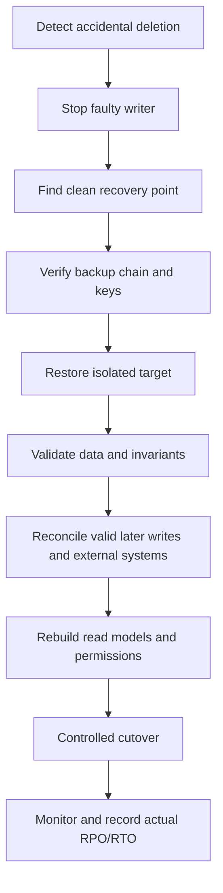

# Kiểm tra topology, khả năng chịu lỗi và cơ chế phục hồi

Khi lựa chọn một hệ NoSQL cho ứng dụng thực tế, câu hỏi “cơ sở dữ liệu có hỗ trợ replication không?” là **chưa đủ**. Một cụm có ba node vẫn có thể ngừng phục vụ khi mất một availability zone (AZ); một dịch vụ managed tuy có sao chép nhiều bản vẫn có thể không đạt **Recovery Time Objective (RTO)** của ứng dụng nếu việc phục hồi cần dựng một table mới và đổi cấu hình kết nối. Một cụm tự động bầu leader có thể tiếp tục nhận reads nhưng tạm từ chối writes, và một bản sao còn sống có thể thiếu write đã được client nhận ACK tùy cấu hình durability.

Đánh giá topology, khả năng chịu lỗi và phục hồi là việc **xác định nơi dữ liệu và quyền điều phối thực sự tồn tại, mô hình hóa những sự cố đáng tin, đối chiếu các bảo đảm mà hệ thống công bố, rồi kiểm thử chúng dưới tải và lỗi có kiểm soát**. Không chọn NoSQL chỉ vì cụm được vẽ thành nhiều ô hoặc tài liệu ghi “highly available”.

Ví dụ một dịch vụ cho thuê xe có yêu cầu:

- Không được tạo hai booking hợp lệ cho cùng xe, cùng thời gian.
- Khách đã thanh toán phải nhìn thấy trạng thái chính xác ở đường đọc có thẩm quyền.
- Tìm kiếm và thống kê có thể cập nhật trễ theo một SLO riêng.
- Mất một node hoặc một AZ không được khiến toàn hệ ngừng nhận booking quá thời gian đã cam kết.
- Có thể khôi phục khi operator xóa nhầm dữ liệu, không chỉ khi server hỏng.
- Khả năng chịu lỗi và chi phí vận hành phải phù hợp ngân sách.

Một giải pháp có thể tốt cho catalogue/search nhưng không phù hợp giữ trạng thái đặt xe có tính độc quyền. Một giải pháp khác có tính nhất quán mạnh nhưng độ trễ giao vùng và chi phí ghi cao. Bài này giúp **đánh giá và lựa chọn** dựa trên các điều kiện cụ thể thay vì khẩu hiệu của sản phẩm.

**Ngữ cảnh:** Module **Database No SQL**, chương **Đánh giá và lựa chọn**, bài **Kiểm tra topology, khả năng chịu lỗi và cơ chế phục hồi**.

## Mục tiêu học tập

Sau bài học, bạn có thể:

1. Đọc và vẽ **topology vật lý, logic và đường request** cho một cụm NoSQL.
2. Xác định **failure domains** của node, process, disk, rack, AZ, region và control plane.
3. Phân biệt **replica, shard/partition, quorum, leader, coordinator và metadata service**.
4. Tính sơ bộ khả năng giữ quorum và capacity khi một hay nhiều thành phần lỗi.
5. Đánh giá **consistency, durability, availability** của read/write paths khi failover.
6. Phân biệt **node replacement, replica repair, backup, PITR và disaster recovery**.
7. Thiết lập và đo **RPO, RTO, failover time, catch-up time, restore time và recovery confidence**.
8. Thiết kế **PoC/chaos tests có tiêu chí pass/fail** theo phiên bản và cấu hình của từng hệ.
9. Lập ma trận quyết định MongoDB, Cassandra, DynamoDB, Redis, OpenSearch, Cosmos DB hoặc phương án khác theo yêu cầu nghiệp vụ.
10. Nhận biết trường hợp một sơ đồ “nhiều node” vẫn chứa **single point of failure**.

> **Nguyên tắc:** **Khả năng chịu lỗi là thuộc tính của toàn bộ đường phục vụ** — bao gồm data nodes, quorum, metadata, DNS/routing, ứng dụng, network, IAM/KMS, backup và operator workflow. Chỉ một thành phần không có đường thay thế cũng có thể khiến một cụm nhiều replicas không phục vụ được đúng cam kết.

---

# Phần I — Hiểu topology trước khi chọn sản phẩm

## 1. Topology là gì?

Trong bối cảnh NoSQL phân tán, **topology** mô tả cách các thành phần hệ thống được tổ chức và kết nối:

- Những node/process nào tham gia phục vụ dữ liệu.
- Dữ liệu được **chia partition/shard** theo quy tắc nào.
- Mỗi partition có bao nhiêu **replica**, đặt ở đâu.
- Ai được nhận write/read, ai điều phối metadata hoặc bầu leader.
- Clients đi đến node nào thông qua driver, router hay gateway.
- Có bao nhiêu rack/AZ/region và các mạng nối chúng.
- Có vị trí nào chứa backups, snapshots, WAL/commit logs.
- Quá trình thay node, chuyển shard, khôi phục hoặc failover đi theo luồng nào.

Một bảng cấu hình chỉ ghi `replicationFactor=3` không đủ để biết cả ba replicas có vô tình nằm chung một failure domain hay không.

### 1.1. Ba lớp topology

| Lớp | Câu hỏi | Ví dụ |
| --- | --- | --- |
| **Logic** | Key nào thuộc partition/shard nào? Replica/leader là ai? | Range A trên shard 1, hai bản sao |
| **Vật lý** | Processes, disks, VMs, racks, AZs, regions nào giữ dữ liệu? | Node 1 ở AZ-a, node 2 ở AZ-b |
| **Đường dịch vụ** | Request đi từ client qua router, network, auth, control plane tới dữ liệu ra sao? | Java API → private endpoint → mongos → shard primary |

### 1.2. Vì sao cần cả ba?

Nếu replica placement logic đúng nhưng network load balancer chỉ có một instance không dự phòng, đường dịch vụ vẫn có điểm chết. Nếu application có hai regions nhưng database chỉ ở region A, region B không tự là DR hoàn chỉnh.

---

## 2. Vẽ sơ đồ topology trước khi điền điểm đánh giá

Một sơ đồ đơn giản cho cụm ba bản sao:

```text
                   Java Booking API
                         |
                 Cluster-aware driver
                         |
               +---------+---------+
               |                   |
            Region X            Region Y
           Production          DR / backup
               |
       +-------+-------+
       |       |       |
      AZ-a    AZ-b    AZ-c
       |       |       |
      DB-1    DB-2    DB-3
       \       |       /
        Replica / quorum
```

Sơ đồ này **chỉ là hình dạng**, chưa chứng minh có quorum, đồng bộ commit hay RTO.

### 2.1. Bổ sung thông tin cần thiết

Với mỗi node/đường nối, ghi:

```text
role: leader / follower / coordinator / router / manager
dataOwnership: which ranges / slots / shards
replicaPlacement: node -> AZ -> region
writeAck: exact policy
readRouting: exact policy
network: RTT and bandwidth
capacity: CPU, memory, disk IOPS, throughput
recovery: rebuild source and estimated time
```

### 2.2. Không vẽ “3 database” như 3 bản độc lập nếu dữ liệu chia shard

Một cluster 3 shards, mỗi shard chỉ có một copy, có **3 node nhưng không có redundancy của từng shard**. Mất một node có thể mất khả năng đọc một phần dữ liệu.

---

## 3. Sharding khác replication

**Sharding/partitioning** chia dữ liệu theo key/range/hash để mở rộng năng lực và dung lượng.

**Replication** tạo những bản sao của cùng một logical partition để tăng availability/durability/read capacity theo giao thức.

```text
Dataset
  |
  +--- Shard A --- Replica A1 (AZ-a)
  |            \-- Replica A2 (AZ-b)
  |            \-- Replica A3 (AZ-c)
  |
  +--- Shard B --- Replica B1 (AZ-b)
               \-- Replica B2 (AZ-c)
               \-- Replica B3 (AZ-a)
```

### 3.1. Câu hỏi phải hỏi

- Số shards logic là bao nhiêu?
- Replica factor tính **trên mỗi shard** hay toàn cụm?
- Mỗi AZ giữ bản sao của từng shard hay chỉ một tập shards?
- Khi replica không sẵn sàng, shard vẫn đọc/ghi được ở mức consistency nào?
- Khi phân vùng tự động, dữ liệu mới được phân bổ ra sao?

### 3.2. Phân vùng không đồng nghĩa chia tải đều

Một shard 10 GiB nhận 30.000 writes/s có thể nóng hơn shard 300 GiB nhận 100 writes/s. Đánh giá topology cần tính cả **data skew và traffic skew**.

---

## 4. Failure domain: ranh giới có thể cùng hỏng

Một **failure domain** là nhóm thành phần có nguy cơ mất cùng lúc khi một nguyên nhân chung xảy ra.

Ví dụ:

1. **Process/container** chết.
2. **VM/physical host** chết.
3. **Disk/storage volume** lỗi.
4. **Rack/power/network switch** mất.
5. **Availability zone** bị cô lập.
6. **Region** mất hoạt động.
7. **Cloud account/control plane/IAM/KMS** gặp sự cố.
8. **Lỗi logic của ứng dụng/operator** nhân bản ra mọi vùng.

### 4.1. Sao chép không giúp khi replicas cùng domain

```text
Poor placement:
Host X / AZ-a:
    Replica 1
    Replica 2
    Replica 3
```

Ba replica processes trên cùng host không chịu được mất host.

### 4.2. Zone spread

```text
Better placement for one-zone outage:
AZ-a: replica 1
AZ-b: replica 2
AZ-c: replica 3
```

Nhưng vẫn phải kiểm **đường đi network, quorum, consistency settings và capacity sau sự cố**. Một sơ đồ đẹp chưa bảo đảm hệ tiếp tục đáp ứng SLO.

### 4.3. Independent backup failure domain

Backup copy đặt trên cùng disk/credentials hoặc cùng quyền xóa với source không chống được nhiều kiểu sự cố. DR cần tính cả hỏng do admin hoặc ransomware.

---

## 5. Một bảng inventory topology tối thiểu

| Thành phần | Vị trí/failure domain | Vai trò | Tác động khi mất |
| --- | --- | --- | --- |
| Java API | AZ-a/b/c | Client requests | Mất một phần API capacity |
| DB replica A | AZ-a | Shard 1 leader hoặc peer | Cần failover/repair |
| DB replica B | AZ-b | Shard 1 follower hoặc peer | Giảm redundancy |
| DB replica C | AZ-c | Shard 1 follower hoặc peer | Giảm redundancy |
| Router/gateway | AZ-a/b/c? | Routing tới shards | Có thể là SPOF |
| Metadata/control nodes | AZ-a/b/c? | Cluster membership | Có thể làm cluster không điều phối |
| DNS/service discovery | Multi-AZ? | Tìm endpoint | Clients không tìm được leader mới |
| Secret/KMS | Region/service | Decrypt/auth | DB có data nhưng không truy cập được |
| Backup storage | Region/account khác? | Historical recovery | Không restore khi region mất |
| Monitoring/incident channel | Failure domain độc lập? | Vận hành | Mất khả năng phát hiện/sửa |

### 5.1. Không quên dependencies ngoài database

Một DB hoạt động nhưng ứng dụng không lấy được credential sau refresh, load balancer chỉ trỏ vào node đã chết, hoặc KMS không decrypt được volume: nhìn từ user vẫn là outage.

---

## 6. Control plane và data plane

**Data plane** thường xử lý reads/writes/replication data.

**Control plane** thường quản lý topology, leadership, shard placement, metadata, scaling và cấu hình.

```text
                        Control plane
                membership / topology / config
                            |
                            v
Client -> router/driver -> data plane -> storage replicas
```

### 6.1. Có thể phục vụ dữ liệu khi control plane lỗi không?

Tùy thiết kế. Một số hệ vẫn đọc/ghi trên topology ổn định nhưng không thể thực hiện membership changes; một số hoạt động cần metadata quorum; một số managed services che hoàn toàn lớp này.

### 6.2. Đừng suy control plane availability từ data replicas

Ba data nodes có thể không giúp nếu metadata manager hoặc router duy nhất chết. Cần đánh giá topology cho **tất cả thành phần cần để xử lý đường API được cam kết**.

---

## 7. Leader–follower và leaderless là hai họ thiết kế

### 7.1. Leader–follower (mô hình phổ biến)

```text
         Client writes
               |
               v
             Leader
           /        \
       Follower 1  Follower 2
```

Leader/coordinator có thể đặt thứ tự writes; followers apply replication. Khi leader chết, hệ có thể cần election, catch-up và định tuyến lại.

### 7.2. Leaderless/multi-coordinator (tùy hệ)

```text
Client -> Coordinator
          /   |   \
        R1    R2   R3
```

Coordinator gửi requests tới một tập replicas theo consistency policy. Không nhất thiết có một leader toàn bộ writes của partition, nhưng phải hiểu conflict resolution, timestamps, quorum và repair.

### 7.3. Không ép mọi NoSQL vào hai hình đơn giản

Một số sản phẩm có leader **theo shard**, một số có consensus cho metadata, một số dùng local leader nhưng cross-region async replication. Phải đọc đúng architecture của version/edition.

---

# Phần II — Quorum, placement và khả năng chịu lỗi

## 8. Majority quorum với nhóm consensus

Trong một nhóm **consensus được thiết kế theo majority**, với \(N\) voting members, một majority quorum có kích thước:

\[
Q = \left\lfloor \frac{N}{2}\right\rfloor + 1.
\]

Theo mô hình lý tưởng và khi mọi thành phần khác đủ điều kiện, tối đa:

\[
f = N-Q
\]

voting members có thể mất mà vẫn còn majority.

| Voters \(N\) | Majority \(Q\) | Số voters có thể mất trong mô hình quorum |
| ---: | ---: | ---: |
| 1 | 1 | 0 |
| 2 | 2 | 0 |
| 3 | 2 | 1 |
| 4 | 3 | 1 |
| 5 | 3 | 2 |
| 7 | 4 | 3 |

### 8.1. Tại sao hai voters không chịu được lỗi một voter?

Nếu \(N=2\), majority cần 2. Mất một voter còn một, không đủ majority.

### 8.2. Majority không đồng nghĩa application luôn phục vụ

Có thể còn quorum nhưng:

- Leader election mất vài giây.
- Clients chưa refresh routing.
- Storage/disk của node còn lại bão hòa.
- Shard mất dữ liệu cần thiết.
- Một service ngoài DB ngừng hoạt động.
- Consistency requirements khiến requests bị từ chối.

Quorum chỉ là **một điều kiện**, không phải SLO toàn hệ.

---

## 9. Placement quan trọng hơn việc tăng voters

Cùng 5 voters, đặt khác nhau:

```text
Bad:
AZ-a: 3 voters
AZ-b: 1 voter
AZ-c: 1 voter

Lose AZ-a -> 2 of 5 remain -> NO majority.
```

```text
More balanced:
AZ-a: 2 voters
AZ-b: 2 voters
AZ-c: 1 voter

Lose AZ-a -> 3 remain -> majority.
Lose AZ-b -> 3 remain -> majority.
Lose AZ-c -> 4 remain -> majority.
```

### 9.1. Vẫn phải xét leader placement và data ownership

Voters có thể bỏ phiếu metadata nhưng không chứa toàn bộ data. Không suy từ majority của control nodes rằng mỗi shard đã có replica hợp lệ.

### 9.2. Distinct hosts, power và network

Một AZ có nhiều hosts có thể chịu lỗi host; nhưng không chịu được sự kiện zone-wide. Đánh giá đúng failure domain theo SLO mong muốn.

### 9.3. Ngữ nghĩa “AZ” không giống cam kết chống mất region

Nhiều AZ trong một region tăng fault isolation trong region, không tự tạo replica ở region thứ hai.

---

## 10. Quorum read/write kiểu replica counting

Trong mô hình quorums cổ điển với replication factor \(RF=N\):

- Write quorum có \(W\) replicas.
- Read quorum có \(R\) replicas.

Điều kiện giao nhau phổ biến:

\[
R + W > N.
\]

Ví dụ \(N=3\), chọn \(R=2, W=2\), ta có \(R+W=4>3\).

### 10.1. Quorum intersection không là bằng chứng linearizability phổ quát

Cần xét:

- Replicas được chọn thực tế.
- Timestamp/version/conflict resolution.
- Concurrent writes và last-write-wins.
- Hinted handoff, sloppy quorum hoặc availability modes nếu có.
- Read repair/anti-entropy.
- Client driver retries và unknown outcomes.
- Định nghĩa ACK và thứ tự thực thi.

Vì vậy không được chỉ thấy \(R+W>N\) rồi kết luận mọi write trong Cassandra hay hệ quorum khác là linearizable.

### 10.2. Quorum ở mỗi DC hay toàn cluster?

Một hệ có thể dùng `LOCAL_QUORUM` trong một datacenter. Điều đó khác với việc đồng bộ ACK qua tất cả regions. Đọc tài liệu và xác nhận routing.

---

## 11. Kết nối quorum với độ trễ và availability

Giả định ba replicas ở ba regions với RTT giữa các regions khá cao.

Nếu write cần ACK từ majority gồm một replica ở region khác, latency tối thiểu có thể phụ thuộc round-trip liên vùng. Nếu chỉ chờ local ACK, latency thấp hơn nhưng durability/visibility khi region mất có thể yếu hơn.

### 11.1. Trade-off

| Quyết định | Lợi ích | Đổi lại |
| --- | --- | --- |
| Quorum trong cùng region | Latency thấp hơn | Không tự bảo vệ khỏi region failure |
| Synchronous cross-region commit | Giảm lost-ACK risk theo protocol | Latency, cost, availability khi partition |
| Async cross-region replication | Latency write thường thấp hơn | RPO vùng có thể lớn hơn 0 |
| Multi-writer regions | Local write availability | Conflict/ordering/invariants phức tạp |
| Read từ local async replica | Low latency | Staleness/freshness cần contract |

### 11.2. Không nhắc “CAP” như một câu trả lời thay thiết kế

Khi có network partition, hệ phải quyết định operations nào còn được xác nhận để bảo toàn consistency, hoặc chấp nhận behavior yếu hơn theo contract. Trong tình trạng bình thường còn có trade-off latency–consistency. Hãy ghi rõ **thao tác, mode, failure case và hậu quả** thay vì gắn nhãn đơn giản “CP/AP database”.

---

## 12. Đánh giá split-brain và quyền ghi

**Split-brain** trong thực tế là nguy cơ hai nhóm thành phần cùng tin mình có quyền phục vụ một thao tác độc quyền, hoặc clients ghi vào các authorities không được phối hợp.

Ví dụ:

```text
Before partition:
  Leader A receives writes.

Network split:
  A isolated, B/C elect B.
  Stale client continues writing to A.
```

### 12.1. Một leader cũ không được tiếp tục ghi độc quyền khi mất authority

Một thiết kế consensus đúng phải có rules/fencing phù hợp để ngăn hai leaders cùng commit writes mâu thuẫn theo cam kết. Tuy nhiên client có thể vẫn nhận timeout, connection reset hoặc một ACK với durability semantics cần phân tích.

### 12.2. Fencing token

Đối với external resources, có thể cần một **epoch/term/generation** tăng đơn điệu được authority kiểm tra ở sink. Một lease TTL đơn thuần không ngăn stale worker tiếp tục gửi request sau khi lease đã chuyển chủ.

### 12.3. Multi-writer không đồng nghĩa split-brain

Nếu hệ chủ ý hỗ trợ writes ở nhiều regions với conflict resolution, đó có thể là thiết kế hợp lệ. Nhưng invariant như “chỉ một booking cho một xe” cần protocol mạnh hơn last-write-wins.

---

## 13. Chịu lỗi node khác chịu lỗi AZ hoặc region

Một hệ có thể có ba replicas ở ba nodes nhưng tất cả nằm trong AZ-a.

| Sự cố | Khả năng sống sót theo placement này |
| --- | --- |
| Một process chết | Có thể còn hai replicas |
| Một host chết nếu mỗi replica ở host riêng | Có thể còn hai |
| AZ-a mất | Mất cả ba |
| Region chứa AZ-a mất | Mất cả ba |
| Delete nhầm được replicate | Có thể xóa trên cả ba |

### 13.1. Phân biệt ba mục tiêu

- **Node HA:** chịu mất một hoặc nhiều nodes.
- **Zone HA:** chịu mất hẳn một AZ.
- **Region DR:** có khả năng phục hồi/tiếp tục ở region khác.

### 13.2. Một region dự phòng có dữ liệu nhưng không đủ dịch vụ

Ứng dụng DR cần DNS, LB, IAM, secrets, database endpoints, service dependencies, network connectivity, payment integrations và observability. Một replica DB ở region khác chưa đủ.

---

## 14. Tính capacity khi mất một AZ

Giả sử workload cao điểm là **5.400 requests/s**. Ba AZ, mỗi AZ có năng lực bền vững **2.000 requests/s**, tổng 6.000 requests/s khi khỏe.

Nếu mất một AZ:

\[
C_{\mathrm{remaining}} = 2\times2000 = 4000\ \mathrm{requests/s}.
\]

Nhưng:

\[
L_{\mathrm{peak}}=5400>4000.
\]

Cụm **còn nodes** nhưng không đủ năng lực để phục vụ traffic.

### 14.1. Muốn chịu mất một AZ

Nếu workload 5.400 requests/s phải được hai AZ còn lại xử lý, capacity mỗi AZ tối thiểu:

\[
C_{\mathrm{perAZ}}\geq \frac{5400}{2}=2700\ \mathrm{requests/s}.
\]

Đây là lý thuyết không headroom. Nếu muốn giữ khoảng **15% capacity trống sau mất AZ**, cần:

\[
2C_{\mathrm{perAZ}}\times0.85 \ge 5400
\quad\Rightarrow\quad
C_{\mathrm{perAZ}}\geq3176.48.
\]

Trong ví dụ, nên lên kế hoạch tối thiểu khoảng **3.200 requests/s mỗi AZ** sau khi xét routing, data placement và bottleneck thực tế.

### 14.2. Không chỉ tính QPS

Capacity bị giới hạn bởi CPU, IOPS, disk throughput, network, connections, memory, compaction và replication catch-up. Một request có thể tốn gấp 100 lần request khác.

---

## 15. N-1 capacity và degraded mode

**N-1 capacity planning** là kiểm tra hệ có đáp ứng workload khi mất một thành phần theo failure model hay không.

Nếu cần chịu **mất cả AZ**, N-1 phải được tính ở **cấp AZ**, không chỉ mất một VM.

### 15.1. Các mức phục vụ sau sự cố

- **Full function:** mọi API đạt SLO.
- **Degraded-but-correct:** tạm dừng analytics/reindex, vẫn nhận booking an toàn.
- **Read-only:** tạm không nhận writes nhưng reads đáp ứng contract.
- **Fail closed:** từ chối một thao tác không thể bảo toàn invariant.
- **Unavailable:** không đạt mục tiêu.

### 15.2. Degraded mode cần được thiết kế trước

Ví dụ:

```text
Search recommendation -> có thể tạm ngừng.
Booking read -> ưu tiên nguồn canonical.
Confirm/capture payment -> không chạy nếu không bảo toàn uniqueness/idempotency.
```

Không được dùng stale cache để xác nhận một chiếc xe còn trống nếu invariant không được bảo vệ.

---

## 16. Failure matrix: một node, một AZ, một region

| Kịch bản | Các câu hỏi quyết định |
| --- | --- |
| Một data node dừng | Shard nào mất replica? Quorum còn không? Có tự rebuild? |
| Một leader dừng | Election time? Old leader fenced? Clients reconnect? |
| Một follower dừng | Writes/reads có degrade? Catch-up history đủ không? |
| Metadata leader dừng | Cluster còn phục vụ được? Bao lâu bầu mới? |
| Một AZ mất | Mỗi shard còn replica/quorum? Capacity đáp ứng? |
| Một AZ bị tách mạng nhưng chưa chết | Phân vùng nào được write? Split-brain prevention? |
| Region mất | DNS/DR route ra sao? RPO/RTO và data residency? |
| Cross-region link gián đoạn | Writes local/remote phản ứng thế nào? |
| Một disk đầy | Có write stalls? Rebalance/cleanup headroom? |
| Control plane không truy cập được | Data plane còn chạy? Có thể scale/failover? |
| KMS/IAM failure | Đọc/ghi, startup/recovery có cần keys/roles? |
| Backup bị xóa hoặc corrupt | Có immutable/offline copy? Restore test gần nhất? |
| Lỗi logic của operator | PITR hay point snapshot sạch ở đâu? |

### 16.1. Chọn đúng failure model trước khi chấm điểm

Một doanh nghiệp chỉ cần chịu mất host có thể chọn topology đơn giản hơn doanh nghiệp yêu cầu active-active liên vùng. Không nên trả tiền cho khả năng không cần, nhưng cũng không lấy “khả năng product hỗ trợ” thay cho cấu hình đang triển khai.

---

## 17. Failure domain chung nhưng ít được thấy

Một số lỗi tương quan thường bị bỏ qua:

- Tất cả replicas cùng OS image có bug.
- Cùng version DB gặp lỗi compaction.
- Cùng DNS/service discovery control plane.
- Cùng IAM credential/KMS key bị khóa.
- Cùng cloud account chịu quota hoặc policy lỗi.
- Một cron job xóa nhầm dữ liệu trên tất cả regions.
- Shared network firewall rule cắt replication.
- Cùng storage class/capacity profile bị throttled.
- Cùng backup repository với source.
- Application rollout đồng loạt vào mọi zones.

### 17.1. Multi-AZ không triệt tiêu common-mode failures

Phân tán AZ bảo vệ một loại lỗi vật lý, không tự bảo vệ khỏi deploy bug hoặc credential compromise.

### 17.2. Đánh giá blast radius của thay đổi

Một thay đổi compaction config, schema hoặc credentials áp toàn cluster có thể gây outage dù topology chịu mất node tốt. Cần canary theo AZ/rack và rollback.

---

# Phần III — Read/write path khi hệ lỗi

## 18. Write ACK và durability phải được định nghĩa

Một client có thể nhận:

```text
WRITE -> ACK
```

Nhưng `ACK` có thể mang nghĩa khác nhau:

- Coordinator đã nhận request.
- Một replica đã ghi vào memory.
- Một node đã lưu bền theo storage semantics.
- Một quorum đã xác nhận.
- Transaction đã commit theo protocol.
- Multi-region replication đã hoàn tất.

### 18.1. Không suy từ HTTP 200

HTTP 200 của API wrapper không chứng minh DB đã đạt durability yêu cầu nếu application trả response trước khi future/commit hoàn tất.

### 18.2. Bài kiểm

Trong test được phê duyệt:

1. Ghi các unique values và nhận ACK.
2. Đánh dấu exact write options.
3. Ngay sau đó inject node/leader failure.
4. Sau failover, đọc từ đường canonical được công bố.
5. Xác định writes đã ACK nào còn hiện diện.
6. So với durability guarantee của cấu hình.

Một bản ghi mất sau ACK có thể hoặc không vi phạm contract, tùy mức ACK và fault assumptions.

---

## 19. Read consistency theo topology

Các nguồn đọc có thể là:

- Leader/primary.
- Follower/secondary.
- Quorum read.
- Local replica ở AZ khác.
- Cross-region async replica.
- Materialized view.
- Cache/read model/search index.

### 19.1. Những điều phải ghi vào đánh giá

```text
read mode / read concern / consistency level
route and preferred region
session or causal token
observed revision/commit position
replication lag and read freshness
```

### 19.2. Đường đọc nhanh nhất chưa chắc phù hợp invariant

Kiểm availability ở cache có thể trả “còn xe” dù database canonical đã reserve. API booking vẫn cần conditional/authoritative protocol để ngăn double-booking.

### 19.3. Đừng đánh đồng physical replica và logical read model

Một secondary chứa bản sao dữ liệu có replication semantics khác một OpenSearch index được cập nhật qua CDC. Cần hai SLO riêng.

---

## 20. Failover không chỉ là quá trình bầu leader

Một timeline tiêu biểu:

```text
T0  Leader becomes unreachable
T1  Cluster detects failure
T2  Election/ownership decision finishes
T3  Data path becomes writable again
T4  Client drivers discover new route
T5  API error/timeout rate returns to SLO
T6  Old replica repaired/replaced
```

### 20.1. Thời gian failover từ góc nhìn người dùng

Không chỉ tính \(T_2-T_1\). Một SLO thực tế có thể đo:

\[
T_{\mathrm{serviceRecovery}}
=
T_5-T_0.
\]

### 20.2. Replica recovery có thể kéo dài sau service recovery

T5 đạt API SLO nhưng cluster chỉ còn 2/3 replicas. T6 có thể mất hàng giờ. Trong khoảng đó, **redundancy chưa trở lại đầy đủ**.

### 20.3. Phân biệt failover và disaster restore

Failover dùng replica còn sống, thường phục vụ mục tiêu availability. Restore dùng backup/history để phục hồi dữ liệu khi replicas không đủ hoặc bị phá hủy logic.

---

## 21. Client discovery và routing sau failover

Một cụm đã bầu leader mới nhưng Java driver có thể:

- Giữ connection pool tới endpoint cũ.
- Cache topology metadata.
- Đang đợi DNS TTL hết hạn.
- Retry không có jitter.
- Thiếu connect timeout hoặc server selection timeout.
- Đóng/mở connections hàng loạt gây stampede.
- Đọc một replica stale nếu fallback sai policy.

### 21.1. Test dùng driver thật

Không chỉ ping node qua shell. Chạy một workload API/driver với đúng phiên bản JVM/driver/configuration như sản phẩm và đo kết quả.

### 21.2. Connection timeout không đồng nghĩa operation deadline

Một request có thể trải qua connect timeout + retry + server selection + read timeout, vượt SLO của API nếu không có **end-to-end deadline**.

### 21.3. Không retry vô hạn

Trong lúc election, retry storms có thể làm cụm mới khôi phục quá tải. Dùng backoff + jitter, bounded retry budget, idempotency.

---

## 22. Timeout sau write: unknown outcome

Một chuỗi:

```text
Client sends WRITE booking-42
    |
    v
DB commits
    |
    x response lost during failover
    |
Client sees TIMEOUT
```

Client **không biết** write có xảy ra hay không.

### 22.1. Điều ứng dụng cần

- Request ID/idempotency key ổn định.
- Conditional write hoặc uniqueness constraints.
- Query trạng thái bằng operation ID khi retry.
- Không thu tiền lần nữa vì timeout.
- Audit trail của accepted/committed requests.

### 22.2. Không coi mọi timeout là failed write

Nếu ứng dụng gọi lại `chargeCard()` hoặc `reserve()` với một ID mới, nó có thể tạo double charge/double booking. Topology failover phải được kiểm thử với semantics nghiệp vụ.

---

## 23. Leader fencing và write safety

Nếu node A mất quyền leader, nó không được tiếp tục commit writes như leader hợp lệ khi quorum đã chuyển sang B.

### 23.1. Những câu hỏi

- Term/epoch/lease authority quản lý ở đâu?
- Khi network partition, phía nào còn nhận writes?
- Old leader có bị từ chối khi quay lại không?
- Clients có thể gửi stale ownership metadata?
- External side effects có cần fencing token không?

### 23.2. Lease không đủ nếu resource bên ngoài không kiểm

Worker A có lease đã hết hạn nhưng vẫn gửi write đến external sink. Nếu sink không enforce fencing/conditional version, double ownership có thể xảy ra ngoài DB dù DB election đúng.

### 23.3. Không khẳng định strong consistency khi failover chỉ từ tài liệu marketing

Phải kiểm exact read/write configuration, leader election behavior và committed-history guarantees bằng docs + PoC.

---

## 24. Khả năng availability khác bảo toàn dữ liệu

| Tình huống | Availability | Durability/correctness |
| --- | --- | --- |
| Read-only trong network partition | Writes không sẵn sàng | Có thể bảo vệ consistency |
| Accept local writes trong mỗi region | Writes có thể sẵn sàng | Cần conflict resolution/invariant model |
| Replica read stale | Read sẵn sàng nhanh | Có thể không đáp ứng RYW |
| ACK trước durable commit | Latency/throughput tốt | Có rủi ro mất write khi crash |
| Majority ACK + strict read path | Có thể chậm/gián đoạn khi mất quorum | Có khả năng bảo đảm mạnh hơn theo protocol |

### 24.1. Chọn theo nghiệp vụ

Booking confirmation thường cần correctness trước; search/recommendation có thể chấp nhận stale hoặc degraded availability. Không chọn một consistency mode cho tất cả use cases chỉ vì đơn giản cấu hình.

---

# Phần IV — RPO, RTO và kịch bản khôi phục

## 25. RPO và RTO phải gắn với loại sự cố

**RPO (Recovery Point Objective)**: lượng dữ liệu theo thời gian tối đa chấp nhận mất.

**RTO (Recovery Time Objective)**: thời gian tối đa chấp nhận để dịch vụ phục hồi theo định nghĩa.

Nhưng cần tách:

```text
RPO after one-node failure
RPO after one-zone failure
RPO after region loss
RPO after logical delete / corruption
```

Một cơ chế majority replication có thể cho RPO rất thấp khi mất node, nhưng không giúp undo một delete được nhân bản.

### 25.1. Ví dụ SLO được định nghĩa đúng

| Sự cố | RPO mục tiêu | RTO mục tiêu | Hướng phục hồi |
| --- | --- | --- | --- |
| Mất một data node | Không mất acknowledged critical writes | 2 phút | Replica failover |
| Mất một AZ | Không mất acknowledged critical writes theo scope | 10 phút | Zone failover |
| Mất region | Tối đa 5 phút | 60 phút | Regional DR |
| Xóa nhầm dữ liệu | Tối đa 10 phút | 4 giờ | PITR + reconciliation |

Các con số **minh họa**, không phải SLO hay khả năng mặc định của sản phẩm.

### 25.2. Không đo RPO chỉ theo replica lag

Nếu log chưa archive bền, `replicationLag=0` vẫn không chứng minh có historical restore point trước thao tác xóa logic.

---

## 26. RTO gồm nhiều khoảng

Một phép tính lập kế hoạch:

\[
RTO_{\mathrm{observed}} \approx
T_{\mathrm{detect}}
+
T_{\mathrm{decide}}
+
T_{\mathrm{provision}}
+
T_{\mathrm{restore}}
+
T_{\mathrm{verify}}
+
T_{\mathrm{cutover}}.
\]

Các bước có thể song song; tổng là ước lượng chứ không phải đồng nhất toán học trong mọi workflow.

### 26.1. Ví dụ restore toàn cụm

```text
Detect:            5 minutes
Select clean point: 10 minutes
Provision:         20 minutes
Restore data:      90 minutes
Verify:            30 minutes
Cutover:           15 minutes
------------------------------
Total sequential: 170 minutes
```

Nếu RTO mục tiêu là 60 phút, topology/backup architecture hiện tại không đạt dù công cụ restore hoạt động đúng.

### 26.2. Bước verification không được bỏ

Một cluster khởi động được chưa có nghĩa dữ liệu, schema, ACL, indexes, TTL, CDC hay payment reconciliation đã đúng.

---

## 27. Recovery path: failover, rebuild và restore khác nhau

| Cơ chế | Mục đích | Dữ liệu từ đâu | Điểm cần cảnh giác |
| --- | --- | --- | --- |
| **Failover** | Đổi node/owner đang phục vụ | Replica/quorum còn sống | Election, client routing, ACK semantics |
| **Replica rebuild** | Thay replica lỗi, khôi phục redundancy | Replica khỏe + log/snapshot | Catch-up window, stream pressure |
| **Repair/anti-entropy** | Sửa dữ liệu lệch replicas | So/stream giữa replicas | Tombstones, I/O, consistency |
| **Rebalance/reshard** | Cân tải hoặc đổi data placement | Range/chunk/slot migration | Copy/cutover/old copy cleanup |
| **Backup restore** | Phục hồi từ historical copy | Snapshot/full/incremental | RPO, integrity, KMS, RTO |
| **PITR** | Chọn một mốc khôi phục trong window | Managed history hoặc snapshot + logs | Retention, consistent cut |
| **Business reconciliation** | Khôi phục invariants xuyên services | Ledger/events/external providers | Không tự đồng bộ theo DB rewind |

### 27.1. Không dùng repair thay backup

Repair giúp replicas hội tụ theo giao thức, có thể lan truyền cả delete/corruption hợp lệ. Nó không tự tìm bản đúng của tuần trước.

### 27.2. Không dùng replica làm time machine

Một secondary tụt hậu có thể tình cờ chứa dữ liệu cũ nhưng sẽ tiếp tục catch up; không là historical recovery plan có RPO được bảo đảm.

---

## 28. Restore từ snapshot cần những gì?

Một manifest khôi phục nên có:

```json
{
  "backupId": "orders-backup-20261114",
  "engine": "product-and-version",
  "sourceCluster": "orders-prod",
  "scope": ["all-bookings"],
  "snapshotPoint": "consistent-checkpoint",
  "logFrom": "position-a",
  "logTo": "position-b",
  "checksumVerified": true,
  "encrypted": true,
  "recoveryKeyRef": "dr-key-alias",
  "targetRegion": "dr-region",
  "lastRestoreDrill": "recorded-test-run-id"
}
```

Đây là **manifest thiết kế minh họa**, không phải schema của một vendor.

### 28.1. Yêu cầu

- Snapshot/dump nhất quán theo engine.
- Log chain đầy đủ nếu muốn PITR.
- Không có archive gaps.
- Đúng schema/index/metadata versions.
- Đủ IAM/KMS/secrets/network.
- Backup độc lập failure domain.
- Capacity/IOPS/temp disk đủ.
- Có runbook tạo môi trường cô lập.

### 28.2. Không restore vào production ngay

Một bản restore ở cluster/table mới giúp kiểm chứng trước khi đổi traffic, và tránh phá dữ liệu hiện tại/bằng chứng sự cố.

---

## 29. Point-in-time recovery không phải tính năng mặc định của mọi NoSQL

Một sản phẩm có WAL/oplog/commitlog/AOF **không tự** cho phép restore tới một arbitrary timestamp.

### 29.1. Điều kiện

1. Base state phù hợp.
2. History liên tục sau base.
3. Replay protocol đúng transaction/commit boundaries.
4. Restorable earliest/latest window được hỗ trợ.
5. Metadata/cross-shard consistency được bảo vệ.
6. Retention và permissions/keys còn hiệu lực.
7. Restore drill cho đúng version/topology.

### 29.2. Managed service có thể có PITR riêng

DynamoDB, Cosmos DB, MongoDB Atlas và các dịch vụ managed khác có các lựa chọn backup theo tier/mode/region/config. Phải xác nhận **đã bật trước sự cố** và current restorable range của resource cụ thể.

### 29.3. PITR phục hồi quá khứ có thể gây mất cập nhật hợp lệ sau mốc

Nếu delete nhầm lúc 13:45, restore về 13:44 cũng có thể làm mất các booking/payment hợp lệ từ 13:44 tới khi cutover. Cần selective merge hoặc business reconciliation.

---

## 30. Rủi ro corruption và deletion được nhân bản

Một cụm có ba replicas khỏe:

```text
Operator runs destructive delete
       |
       v
Leader commits delete
       |
       v
Replicas apply delete
```

Availability có thể vẫn 100%, nhưng dữ liệu nghiệp vụ đã hỏng.

### 30.1. Vì sao cần backup độc lập?

- Lỗi logic của ứng dụng.
- Admin delete nhầm.
- Ransomware.
- Corruption lan truyền.
- Migration schema sai.
- User privacy delete cần kiểm soát lịch sử.

### 30.2. Backup chỉ hữu ích khi restore được

Một backup nằm cùng cloud account có quyền xóa chung, hoặc không còn KMS key, có thể không sử dụng được. Đánh giá phải kiểm **isolation, immutable retention, restore drill và business integrity**.

---

## 31. Cross-service recovery và giao dịch nghiệp vụ

Ứng dụng thuê xe có thể lưu:

```text
Booking canonical DB
    |
    +-- Payment provider
    +-- Email/SMS
    +-- Search index
    +-- Redis cache
    +-- Accounting ledger
```

Khôi phục Booking DB về hôm qua không hoàn tác payment đã capture hoặc email đã gửi hôm nay.

### 31.1. Kế hoạch cần có

- Source of truth theo từng dữ liệu.
- Idempotency keys và transaction IDs.
- Outbox/CDC replay safety.
- Restore epoch/namespace cho consumers.
- Reconcile payment/refund/provider states.
- Rebuild caches/search indexes.
- Không gửi lại external side effects khi replay.
- Privacy deletion và ACL được áp lại trước cutover.

### 31.2. Không hứa RPO 0 cho toàn doanh nghiệp chỉ vì DB có quorum

Một workflow qua nhiều services cần cơ chế reconciliation/saga/ledger riêng nếu muốn invariants được bảo toàn.

---

# Phần V — Khả năng phục hồi node, dữ liệu và redundancy

## 32. Replica catch-up và log window

Một replica quay lại sau outage có thể cần:

```text
Rejoin
  |
  +-- incremental catch-up từ log (nếu còn history)
  |
  +-- initial/full sync từ replica khỏe (nếu log gap)
  |
  v
Apply changes
  |
  v
Validate data and eligibility
  |
  v
Resume role under cluster protocol
```

### 32.1. Catch-up window

Nếu node offline 6 giờ nhưng log phục vụ incremental sync chỉ giữ 2 giờ, cần rebuild/full sync hoặc cơ chế khác do engine cung cấp. Không tự cho phép node chứa state cũ phục vụ strong reads.

### 32.2. ETA phụ thuộc incoming writes

Nếu source tạo 1.200 changes/s nhưng replica apply 1.000/s, backlog tăng 200/s; replica **không bao giờ bắt kịp** khi rates giữ nguyên.

### 32.3. Tài nguyên khôi phục phải được dự phòng

Node mới dùng cả network, disk reads nguồn, disk writes đích và compaction. Nếu vừa mất AZ, những nodes còn lại đang gánh foreground load lớn hơn.

---

## 33. Time to restore redundancy (TTRR)

Không nên đo chỉ **service RTO**. Một chỉ số nữa:

\[
T_{\mathrm{redundancyRestore}}
=
t_{\mathrm{allRequiredReplicasHealthy}}
-
t_{\mathrm{failure}}.
\]

Một cụm có thể phục vụ trở lại sau 30 giây, nhưng mất 5 giờ để trở về số replicas an toàn.

### 33.1. Vì sao quan trọng?

Trong 5 giờ đó, một lỗi bổ sung có thể gây outage hoặc data loss. Cần đánh giá **độ dài cửa sổ chịu rủi ro tăng cao**, không chỉ API uptime.

### 33.2. Test hai lỗi cách nhau ngắn

Trong lab, giả lập một node mất rồi một node khác lỗi khi replica chưa rebuild xong. Đừng mặc định yêu cầu “chịu hai lỗi” có nghĩa hai lỗi xảy ra sau khi cluster đã hoàn toàn phục hồi giữa chúng.

---

## 34. Anti-entropy/repair và dữ liệu không nhất quán

Trong một số NoSQL, replication/repair có thể gồm:

- So hash/digest theo range.
- Streaming các bản ghi thiếu.
- Apply version/timestamp resolution.
- Read repair.
- Background scheduled repair.
- Rebuild indexes/projections.

### 34.1. Repair là một workload nặng

Dùng CPU, disk, network và temporary storage. Một cluster chịu lỗi node nhưng repair quá chậm có thể chạy nhiều ngày ở trạng thái giảm redundancy.

### 34.2. Không đồng nhất repair với compaction

Compaction tổ chức lại cấu trúc lưu trữ; repair sửa lệch giữa replicas theo giao thức. Hai thao tác có thể liên quan nhưng không thay thế nhau.

### 34.3. Tombstone safety

Trong các thiết kế dùng delete markers, dọn tombstone quá sớm khi một replica offline có thể khiến dữ liệu cũ sống lại. Cần kiểm retention, repair interval và điều kiện engine-specific.

---

## 35. Dung lượng trống, compaction và restore overhead

Một migration/rebuild/compaction có thể cần **tạm thời lưu cả bản cũ lẫn bản mới** hoặc các file trung gian.

### 35.1. Đừng đặt mục tiêu chạy 95% disk đều đặn

Ngay cả khi storage bình thường còn 5%, node recovery/reindex/snapshot/compaction có thể không hoàn tất vì không đủ temp space, khiến cluster bị write-block/stall.

### 35.2. Capacity model

Một đánh giá nên nêu:

```text
Dataset logical size
Replica factor / storage overhead
Index sizes
Compaction/write amplification
Temporary migration storage
Free disk after one-AZ loss
Backup/snapshot storage
Restore target capacity
Growth headroom 6/12/24 months
```

### 35.3. Auto scaling không tạo capacity tức thì

Managed service có thể tự mở rộng nhưng bị giới hạn quota, provisioning latency, hot partitions hoặc costs. PoC phải đo thời gian scale dưới tải và outage.

---

## 36. Shard movement và recovery storms

Một node chết có thể làm:

- Thay shard ownership.
- Tạo replica mới.
- Stream data từ surviving nodes.
- Tăng disk IOPS và network.
- Rebalance load.
- Cache cold start.
- Index refresh/merge hoặc compaction.

### 36.1. Thundering herd

Nếu nhiều shards cùng rebuild lên nodes mới, mỗi nguồn phải stream cùng lúc, giảm throughput và tăng latency foreground.

### 36.2. Rate/concurrency budget

Cần:

```text
max concurrent recoveries per node
max stream MiB/s per source/destination
disk IOPS budget
minimum free disk
per-shard priority
pause optional reindex/backup jobs
```

### 36.3. Không tắt recovery vô hạn để “giữ p99 đẹp”

Một cluster kéo dài trạng thái thiếu replicas cũng rủi ro. Phải cân đối foreground SLO và deadline redundancy recovery.

---

## 37. Cross-region replication và conflict resolution

Một topology active-passive:

```text
Region A (active writes)
        |
        | async replication
        v
Region B (DR standby)
```

Một topology active-active:

```text
Region A (writes) <----> Region B (writes)
               conflict resolution
```

### 37.1. Active-passive

Đơn giản hơn về write authority nhưng RPO có thể lớn hơn 0 nếu async. Khi failover sang B, phải biết last safe position và policy khi A quay lại.

### 37.2. Active-active

Ghi ở cả hai vùng có thể tăng local availability nhưng cần xử lý:

- Concurrent edits cùng key.
- Conflict resolution theo version/clock/rule.
- Unique global constraints.
- Idempotency and causal order.
- Network partition và hội tụ.

### 37.3. Không dùng last-write-wins cho quyết định đặt xe độc quyền nếu chưa chứng minh

Hai regions cùng xác nhận một chiếc xe có thể không được sửa chỉ bằng cách chọn “booking ghi sau thắng” khi khách đã trả tiền ở cả hai nơi.

---

## 38. Data residency và lựa chọn topology

Một số nghiệp vụ yêu cầu dữ liệu theo region/quốc gia. Mở thêm replica/backup ở region khác có thể gây vấn đề về:

- Vị trí lưu PII.
- Cross-border transfer policies.
- Provider/subprocessor access.
- Encryption key locality.
- Logs/telemetry có chứa dữ liệu.
- Cross-region read latency và egress costs.

### 38.1. Không chỉ xét primary data

Backup, CDC, snapshots, support/debug exports và search projections đều có thể lưu dữ liệu nhạy cảm.

### 38.2. Chọn topology phải đi cùng compliance

Không chấm điểm một multi-region deployment là “tốt nhất” nếu nó vi phạm data residency requirement.

---

## 39. Security và control-plane recovery

Các câu hỏi thường bị bỏ sót:

- Khi mất một AZ, IAM/STS/DNS/private endpoints còn khả dụng?
- Khi mất region, DR có đủ quyền KMS decrypt?
- Nếu backup chỉ ở account bị compromise, có copy ngoài account?
- Cluster có thể startup khi secrets manager tạm không truy cập?
- Certificate rotation có làm cắt toàn bộ peers?
- Firewall/network policy có cho replica catch-up/rebalance/restore?
- Có JIT/JEA admin access hoặc break-glass procedure được audit?
- Restore môi trường mới có bị mở public network ngoài ý muốn?

### 39.1. Đừng đánh đổi security lấy khả năng restore

Mở tất cả ports hoặc dùng admin root key ở mọi nơi không phải kế hoạch DR tốt. Tạo role chuyên biệt, network path kiểm soát và thử khôi phục trước.

### 39.2. Một KMS key bị xóa có thể làm backup vô dụng

Backup integrity và encryption đầy đủ vẫn không cứu được nếu không có khóa hoặc quyền giải mã tại DR. Kiểm thử với **quyền của nhân sự/quy trình thực sự được phép thao tác DR**.

---

## 40. Phân biệt tiêu chí bắt buộc và tiêu chí có thể đánh đổi

Trong quy trình lựa chọn công nghệ, tiêu chí nên chia hai lớp:

**Hard gates:**

- Chịu được loại sự cố đã cam kết.
- Không làm mất acknowledged writes quan trọng trong failure model đó.
- Data residency và security phù hợp.
- RPO/RTO khả thi và đã có cơ chế restore được hỗ trợ.
- Business invariant có thể được thực thi.
- Có owner và đường vận hành được chấp nhận.

**Trade-off criteria:**

- Chi phí hạ tầng/egress.
- Operational complexity.
- Độ trễ read/write thông thường.
- Khả năng scale và recovery throughput.
- Khả năng quan sát và troubleshooting.
- Công cụ automation/backup.
- Support/licensing/vendor lock-in.

### 40.1. Không dùng weighted score che một hard gate fail

Một sản phẩm đạt 9/10 về tốc độ nhưng không thể bảo toàn booking exclusivity trong topology được chọn **không nên thắng** nhờ điểm trung bình.

### 40.2. Chưa có bằng chứng thì chưa phải pass

Nếu vendor nói “multi-AZ HA” nhưng PoC chưa chứng minh failover trên deployment cụ thể, ghi **UNKNOWN / TEST REQUIRED**, không tự đánh dấu đạt.

**Kết thúc phần nền tảng:** Các bước tiếp theo đưa topology và cơ chế phục hồi vào ma trận đánh giá theo hệ NoSQL, thiết kế PoC, thử nghiệm sự cố và quyết định lựa chọn có bằng chứng.
# Phần VI — Đánh giá topology theo từng họ NoSQL

## 41. MongoDB: replica set và cụm sharded

MongoDB thường được triển khai theo các dạng như:

- **Replica set:** một nhóm members có cơ chế election/replication.
- **Sharded cluster:** nhiều shards, mỗi shard có thể là một replica set, cùng routing/metadata infrastructure.
- **Managed MongoDB Atlas:** có các lựa chọn topology, backup và multi-region tùy tier/địa bàn/cấu hình.
- **Self-managed:** đội vận hành chịu trách nhiệm placement, backups, upgrades và network.

### 41.1. Sơ đồ đánh giá replica set

```text
                  Java MongoDB driver
                           |
              Replica set discovery
                           |
          +----------------+---------------+
          |                |               |
         AZ-a             AZ-b            AZ-c
          |                |               |
       Member A         Member B        Member C
        Primary        Secondary       Secondary
          \________________|______________/
               election / replication
```

Đây là topology minh họa; role `Primary` có thể thay đổi khi failover.

### 41.2. Các câu hỏi quan trọng

1. Voting members phân bố thế nào giữa AZs?
2. Có arbiter hoặc members không chứa data? Chúng ảnh hưởng quorum ra sao?
3. Primary stepdown/election thực tế mất bao lâu?
4. Read preference của Java driver là gì?
5. `writeConcern` (ví dụ majority) và `readConcern` (ví dụ majority/linearizable theo trường hợp) có phù hợp business contract?
6. Lag/commit point/oplog history window còn bao nhiêu?
7. Nếu secondary offline lâu, có cần initial sync?
8. Backup/PITR được bật và kiểm tra như thế nào?
9. Nếu có shards, config servers và `mongos` có HA không?
10. Khi shard move/rebalance, capacity và data placement có đúng failure domains?

### 41.3. Sharded không tự nghĩa chịu lỗi tốt hơn

Nếu một shard chỉ có một data-bearing node, mất node đó vẫn mất data availability cho keys thuộc shard. Mỗi shard cần replica strategy riêng.

### 41.4. Config/metadata service

Một sharded cluster cần đánh giá **config server replica set, mongos/router và quyền cập nhật metadata** chứ không chỉ data shards. Một data plane khỏe chưa chắc có thể mở rộng/rebalance đúng khi metadata/control path lỗi.

---

## 42. PoC MongoDB: mất primary, mất AZ và restore

Một kế hoạch lab:

1. Tạo replica set/sharded topology đại diện qua các failure domains thực có trong môi trường thử nghiệm.
2. Dùng driver Java phiên bản production với đúng `readPreference`, `readConcern`, `writeConcern`.
3. Ghi một chuỗi booking keys duy nhất; ghi rõ những writes `ACK`, timeout, unknown.
4. Tạo primary failure qua công cụ điều khiển được hỗ trợ.
5. Đo detection, election, driver topology refresh, API availability.
6. Đọc lại tất cả writes đã ACK theo durability contract.
7. Kiểm tra client retry không tạo duplicate booking.
8. Theo dõi secondary lag và thời gian trở lại full replica redundancy.
9. Lặp trong lúc index build/backup/resharding nếu đó là workload thực tế.
10. Restore từ backup vào cluster riêng; kiểm data, schema/index, auth và RPO/RTO.

### 42.1. Điểm cần ghi kết quả

```text
election duration
API write unavailability
read error/latency p99
lost acknowledged writes under tested policy
driver reconnect and retry count
oplog window during recovery
time to full replica health
backup latest restorable point
actual restore time
```

### 42.2. Không chạy thử bằng cách xóa dữ liệu production

Chaos/failover phải trên môi trường được phê duyệt, có run ID, giới hạn blast radius và rollback. Không tùy tiện ép resync/reconfigure một cluster đang phục vụ khách hàng.

---

## 43. Cassandra: topology theo token, rack và datacenter

Apache Cassandra thường phân chia partitions theo token và replication strategy; clients có thể làm việc với coordinators, không có một primary toàn cụm cho mọi writes theo cùng nghĩa của leader-based databases.

```text
               Java CQL driver
                     |
          Token-aware / DC-aware routing
                     |
             Datacenter DC-1
           +---------+---------+
           |         |         |
         Rack-a    Rack-b    Rack-c
           |         |         |
         Node A    Node B    Node C
           \         |        /
          Replicas of token range
```

### 43.1. Những thông số cần kiểm

- `NetworkTopologyStrategy` và replication factor **per datacenter**.
- Rack/AZ mapping (snitch) có phản ánh placement thật không?
- Read/write consistency level theo từng API.
- Coordinator/replica routing của Java driver.
- Pending hinted handoff, streaming, compactions, repairs.
- Tombstone retention và lịch repair.
- Node bootstrap/decommission/replace behavior.
- Cross-DC traffic và latency.
- Storage headroom, partition size, hot partitions.
- Snapshot/commitlog archive và restore workflow.

### 43.2. `LOCAL_QUORUM` có tính cục bộ theo DC

Một write có thể được xác nhận bởi quorum của datacenter local theo consistency policy, không mặc nhiên là synchronous commit tới mọi datacenter.

### 43.3. Network partition

Khi thiếu replicas để đáp ứng consistency level yêu cầu, operation có thể thất bại hoặc timeout; đó có thể là hành vi đúng để bảo vệ consistency contract.

---

## 44. PoC Cassandra: quorum, repair và node replacement

Các phép thử:

1. Với RF và CL đã chọn, ngắt một replica rồi đo reads/writes.
2. Với một rack/AZ mất, xem còn đủ replicas cho CL không.
3. Quan sát CQL read/write latency và errors dưới tải.
4. Khởi động lại node cũ, đo hinted handoff/catch-up theo config.
5. Chạy repair theo lịch/thông số version được hỗ trợ.
6. Test một node offline lâu hơn một cửa sổ replication/history liên quan.
7. Rebuild/replace node, đo thời gian khôi phục full RF.
8. Kiểm tombstones/TTL không khiến dữ liệu đã xóa xuất hiện lại.
9. Đo compaction backlog và disk headroom khi streaming.
10. Thử snapshot restore vào cluster được cô lập theo runbook.

### 44.1. Không dùng `nodetool repair` như phép magic

Repair có thể tiêu thụ nhiều I/O và network. Nếu không quản lý concurrency, một thử nghiệm “tăng độ tin cậy” có thể gây sụt API p99.

### 44.2. Kết quả phụ thuộc consistency level

Một CL `ONE` có thể tiếp tục phục vụ trong một số trường hợp mà CL `QUORUM` từ chối. Đánh giá phải ghi rõ **mode nào đáp ứng ứng dụng**, không chỉ “database còn sống”.

### 44.3. Cẩn thận dữ liệu counter và LWT

Nếu workload dùng counters, CAS/LWT hoặc batches, test riêng theo semantics của chúng. Đừng suy từ regular writes sang mọi loại operation.

---

## 45. DynamoDB: managed regional topology và global tables

Amazon DynamoDB là dịch vụ managed NoSQL, nên nhiều chi tiết placement vật lý và replication nội bộ do provider vận hành. Đánh giá thực tế tập trung vào **hợp đồng dịch vụ, cấu hình table/index, các giới hạn tài nguyên và khả năng phục hồi đã kiểm thử**.

### 45.1. Cần phân biệt

- Regional table và độ sẵn sàng nội vùng do dịch vụ cung cấp.
- Global tables/các lựa chọn multi-region nếu có.
- On-demand/provisioned capacity, quotas và hot partition behavior.
- Base table vs GSI/LSI read consistency.
- PITR/backup/export/restore khả dụng và đã bật.
- Encryption KMS/IAM, VPC endpoints/network integration.
- Region failover/routing do ứng dụng quản lý đến đâu.
- Mô hình conflict/concurrency nếu ghi ở nhiều regions.

### 45.2. Không suy service managed nghĩa không có gì để thiết kế

Provider tự quản disk/node không tự bảo vệ ứng dụng khỏi:

- Partition key nóng.
- GSI throttling.
- Capacity quota.
- Query một index eventual khi nghiệp vụ cần strong.
- Delete nhầm table/items.
- Application gửi tất cả traffic tới một regional endpoint duy nhất.
- IAM/KMS/endpoint misconfiguration.
- Cross-region conflict hoặc stale reads.

### 45.3. PITR và nguồn sự thật

Nếu bật PITR theo policy và nằm trong restorable window, có thể restore dữ liệu về một thời điểm theo API được hỗ trợ. Trong nhiều workflow, restore tạo **table mới**; app cần thực hiện verification/cutover. Không đồng nhất PITR với Global Tables replication.

---

## 46. PoC DynamoDB: đo khả năng phục vụ và hồi phục

Một bài thử cần:

1. Dùng key distribution đại diện cho traffic và kích thước item thật.
2. Tạo peak writes/reads, đo throttling, consumed capacity, hot keys.
3. So `GetItem` với strong option (nơi API hỗ trợ) và GSI eventual queries.
4. Tạo conditional writes cạnh tranh và kiểm uniqueness của booking.
5. Với global tables, đo replication lag, conflict behavior và routing.
6. Kiểm app route khi một region không truy cập được theo fault model an toàn.
7. Xác nhận PITR bật trên table thực tế.
8. Restore vào table mới và đo RPO/RTO.
9. Kiểm indexes, alarms, IAM, TTL, Streams, autoscaling và ancillary configs sau restore.
10. Rebuild/read models và thử consumer offsets sau cutover.

### 46.1. Không chấm “mất node trong dịch vụ” bằng lệnh không được hỗ trợ

Với managed services, bạn có thể không kiểm soát hoặc nhìn thấy nodes vật lý. Thay vì tự tạo sự cố ở backend provider, test **client-side network loss, endpoint routing, region-level contingency** và restore workflow trong phạm vi được phép.

### 46.2. Khi không thể inject region outage thực

Ghi rõ rằng test mới chứng minh application có thể chuyển route khi endpoint region A bị chặn, **chưa chứng minh** provider sẽ giữ mọi cam kết trong một sự cố region thực.

---

## 47. Redis: primary–replica, Sentinel và Redis Cluster

Redis có nhiều mô hình triển khai, và chúng có failure semantics khác nhau.

### 47.1. Redis với Sentinel

Có thể dùng primary/replicas cùng Sentinels hỗ trợ monitoring/failover. Cần đánh giá quorum/placement của Sentinel, replica promotion và client discovery.

### 47.2. Redis Cluster

Dữ liệu được chia theo hash slots; nodes/replicas có vai trò riêng. Mất một primary có thể gây slot failover theo cơ chế cluster, nếu có replica và conditions phù hợp.

### 47.3. Replication bất đồng bộ và durability

Không suy một write ACK trên primary **chắc chắn còn trên promoted replica** trong mọi failure scenario. Mức an toàn phụ thuộc persistence, replication, failover policy và giao thức hỗ trợ.

### 47.4. Dùng Redis làm cache hay nguồn chính?

Nếu chỉ là cache có thể tái tạo từ source, mất Redis có thể làm tăng origin load nhưng không nhất thiết mất business data. Nếu Redis là authority, backup/restore/durability requirements nặng hơn.

---

## 48. PoC Redis: các bài test cần tách biệt

| Case | Điều cần chứng minh |
| --- | --- |
| Primary crash | Failover duration và client reconnect |
| Replica crash | Primary vẫn phục vụ, recovery/catch-up |
| Sentinel quorum loss | Có bầu được primary mới không? |
| Redis Cluster primary loss | Slot failover và unavailable slot window |
| Network partition | Không có hai authorities sai contract |
| Write ACK trước failover | Durability theo persistence/replication policy |
| Full replica sync | Network, memory, disk headroom |
| TTL/eviction storm | Cache hit/origin QPS/p99 |
| RDB/AOF restore | Dataset restore, downtime và integrity |
| Large hot key | Dù chuyển slot, hotspot có được xử lý? |

### 48.1. `WAIT` và synchronous durability

Các lệnh chờ replication ACK có semantics riêng và **không tự biến Redis replication thành consensus commit** giống một hệ majority-log có bảo đảm khác. Kiểm đúng product version/config.

### 48.2. Cache fallback có thể gây cascade

Khi Redis mất, nếu toàn bộ 30.000 RPS đột ngột tới database canonical, ứng dụng có thể tự gây outage kép. Topology evaluation cần tính **origin capacity trong cache failure mode**.

---

## 49. OpenSearch/Elasticsearch: primary shards, replicas và cluster managers

Một search cluster thường có:

```text
Client / Search API
        |
        v
Coordinating / data nodes
        |
        +-- Shard A primary / replica
        +-- Shard B primary / replica
        |
        +-- Cluster manager / metadata quorum
```

Vai trò và thuật ngữ tùy sản phẩm/phiên bản.

### 49.1. Câu hỏi topology

- Mỗi index có số primary shards và replica count nào?
- Primary/replica shards có được đặt khác AZ?
- Cluster-manager-eligible nodes có đủ quorum/placement?
- Có shard allocation awareness theo AZ/rack?
- Disk watermarks, disk free và recovery concurrency?
- Một hot shard có gây nghẽn cả node?
- Snapshot repository ở failure domain nào?
- Recovery time của một shard lớn là bao lâu?
- Search refresh/visibility contract có phù hợp business API?
- Khi cluster health `yellow`, data availability có đáp ứng hay đang thiếu replicas?

### 49.2. Search không thay canonical transactions

Một index có thể được restore/reindex từ source NoSQL canonical. Nếu dùng nó cho “search suggestions”, stale reads có thể chấp nhận được. Nếu dùng index search để quyết định xe còn trống, cần authority khác bảo vệ booking.

---

## 50. PoC OpenSearch: allocation và khôi phục

1. Tạo data/mapping/shards đại diện.
2. Test search/indexing throughput và p99 dưới tải.
3. Ngắt một data node, đo shard promotion/reallocation.
4. Theo dõi missing/unassigned shards và allocation reasons.
5. Kiểm cluster-manager elections theo topology.
6. Mất AZ trong lab, xác nhận placement còn hợp lệ.
7. Đo disk watermark/write block behavior.
8. Kiểm snapshot và restore index vào cluster mới.
9. So data coverage, mappings, aliases và security policies.
10. Đo search visibility sau CDC replay/cutover.

### 50.1. `green` chỉ là một tín hiệu

Cluster `green` không chứng minh backup tồn tại, search relevance đúng, không hot shards hay p99 đang đạt SLO.

### 50.2. `yellow` không phải luôn outage

Một cluster thiếu replica nhưng vẫn có primary serving có thể trả kết quả; tuy nhiên **redundancy giảm**. Cần đo thời gian trở lại trạng thái an toàn.

### 50.3. Snapshot chưa phải PITR arbitrary timestamp

Nếu snapshot theo lịch, restore points là những mốc do backup system cung cấp. Translog dùng cho durability/recovery không tự cho phép chọn bất kỳ mốc lịch sử nào.

---

## 51. Azure Cosmos DB: modes nhất quán và vùng địa lý

Cosmos DB cung cấp nhiều consistency modes với cấu hình theo account/API và khả năng region replication phù hợp dịch vụ.

Những mức thường gặp:

- Strong.
- Bounded staleness.
- Session.
- Consistent prefix.
- Eventual.

### 51.1. Topology cần kiểm

- Regions phục vụ reads và writes.
- Failover policy và routing priorities.
- Single-/multi-write region configuration.
- Session token handling trong Java/SDK.
- Consistency mode thực tế của application.
- RPO/RTO mục tiêu trong một region outage.
- Continuous/periodic backup mode và restore scope.
- Partition key, logical/hot partitions.
- Throughput provisioning/limits và cross-region cost.

### 51.2. Độ sẵn sàng phụ thuộc consistency mode

Một mode consistency mạnh hơn có thể ảnh hưởng latency/availability khi liên vùng có vấn đề. Không dùng cùng bài test để suy behavior của tất cả modes.

### 51.3. Multi-region replication không thay historical backup

Nếu xóa nhầm một document được replicate đi nhiều regions, muốn khôi phục bản cũ cần backup/history phù hợp, không chỉ chuyển read region.

---

## 52. PoC Cosmos DB: session, region và continuous backup

Các trường hợp:

1. Kiểm read-your-writes với session token được truyền đúng.
2. Mất session token, ghi rõ behavior thay đổi.
3. Đo bounded staleness theo mức được cấu hình và metrics hợp đồng.
4. Đo region routing/failover trong môi trường phù hợp.
5. Tạo hot partition/throughput pressure và ghi 429/throttling.
6. Kiểm ứng dụng có retries đúng idempotency, deadlines.
7. Kiểm account backup mode và earliest/latest restore points.
8. Restore vào target resource được hỗ trợ.
9. Kiểm IAM/network/KMS-equivalent settings và app routing.
10. Chạy end-to-end data/business reconciliation.

### 52.1. Không chỉ nhìn SLA tài liệu

Một SLA của dịch vụ có điều kiện riêng về deployment/consistency/options. Bài đánh giá phải cho thấy **cấu hình của ứng dụng đáp ứng điều kiện SLA nào**, và fault tests đã quan sát ra sao.

---

## 53. Couchbase, ScyllaDB và hệ khác

Đánh giá theo cùng bộ câu hỏi, nhưng **không sao chép tùy chọn của hệ A sang hệ B**.

Ví dụ:

- Couchbase: phân chia vBuckets/data services và replica placement, rebalance, failover/recovery, backup tooling/DCP, edition/version constraints.
- ScyllaDB: token topology/rack/DC replication, data repair/streaming, CQL consistency và backup theo phiên bản/sản phẩm.
- Graph DB: leader/replica, distributed transactions, graph traversal correctness, index/backup coverage.
- Vector DB: shard/replica, index rebuild, embedding generation, data source recovery, freshness và snapshot.
- Managed key-value: replication/disaster recovery/backup features có thể phụ thuộc gói dịch vụ.

### 53.1. Dừng ở nguyên tắc kiểm chứng

Nếu một feature không có tài liệu/PoC cho version, hãy ghi `UNKNOWN` thay vì đoán dựa trên việc sản phẩm “tương tự Cassandra” hoặc “tương thích API MongoDB”.

---

# Phần VII — Từ topology sang quyết định lựa chọn

## 54. Self-managed và managed: đổi chỗ của trách nhiệm

| Hạng mục | Self-managed | Managed |
| --- | --- | --- |
| Node/placement | Đội vận hành chủ động bố trí | Provider quản lý phần đáng kể; app chọn cấu hình khả dụng |
| Patch/upgrade | Tự lập lịch và kiểm thử | Theo dịch vụ/option, cần phối hợp ứng dụng |
| Backup | Tự thiết kế/kiểm tra | Có feature được quản lý nhưng phải bật/giám sát |
| Fault injection | Có thể kiểm process/node trực tiếp | Thường chỉ test từ bên ngoài, theo giới hạn provider |
| Capacity | Điều chỉnh VM/storage/partition | Quota/throughput/capacity modes |
| HA | Tùy cấu hình thực và runbook | Phụ thuộc SLA và option hiện bật |
| DR | Tự thiết kế toàn bộ | Managed backup/replication hỗ trợ một phần |
| Quan sát internals | Có thể truy cập rộng hơn | Có thể chỉ thấy service APIs/metrics |
| IAM/network | Tự làm nhiều phần | Shared responsibility với provider |
| Chi phí | Hạ tầng + nhân sự + on-call | Service pricing + egress/backup + vận hành ứng dụng |

### 54.1. Managed không có nghĩa không cần SRE

Ứng dụng vẫn phải định nghĩa deadlines, retries, session consistency, restore cutover, idempotency, capacity limits và data correctness.

### 54.2. Self-managed không tự rẻ hơn

Chi phí cần tính on-call, backups, upgrade, hotfix, incident recovery và failure-domain redundancy, không chỉ bill VM.

---

## 55. Đánh giá bằng hard gates trước khi chấm điểm

Một bảng có thể là:

| Hard gate | Mục tiêu | Cần chứng minh |
| --- | --- | --- |
| Booking uniqueness | Không double-booking | Concurrent reservation PoC |
| Single-AZ failure | Booking API phục hồi đúng SLO | Zone-loss drill |
| Write durability | Không mất writes đã ACK theo contract | Failover readback |
| Region DR | RPO ≤ policy | Cross-region/restore drill |
| Logical delete recovery | Có clean restore point | PITR/snapshot restore |
| Backup independence | Không chung destructive privilege | IAM/storage audit |
| Data residency | Đúng vùng được phép | Placement + backup/export audit |
| Security | Least privilege/TLS/KMS | Access/DR role tests |
| Scalability | Chịu peak + N-1 headroom | Load and failure capacity test |
| Team operability | Có runbook và on-call | Tabletop + restore drill |

### 55.1. Quy tắc

Một candidate thiếu hard gate quan trọng phải được loại, hoặc được ghi rõ **mitigation kiến trúc** như source-of-truth mạnh hơn cho booking, cache chỉ phục vụ search, DR phụ trợ.

### 55.2. Không bắt một sản phẩm phải làm tất cả

Một kiến trúc có thể chọn database mạnh cho booking và OpenSearch cho search. Đánh giá toàn **data path** thay vì buộc một datastore tối ưu cho mọi yêu cầu.

---

## 56. Ma trận đánh giá có trọng số

Sau khi vượt hard gates, cân nhắc tiêu chí có thể đánh đổi.

| Tiêu chí | Trọng số minh họa | Bằng chứng phải có |
| --- | ---: | --- |
| Latency khi healthy | 15% | p95/p99 dưới workload đại diện |
| Availability thực tế | 20% | Node/AZ drills |
| Recovery RPO/RTO | 20% | Restore/PITR drills |
| Capacity/growth | 15% | N-1 và scaling tests |
| Consistency fit | 15% | Contract và anomaly tests |
| Cost/operations | 10% | TCO và on-call |
| Observability/tooling | 5% | Dashboard/runbook/automation |
| **Tổng** | **100%** | |

### 56.1. Công thức điểm

Với mỗi tiêu chí chấm \(s_i\) theo thang 0–5, điểm tổng:

\[
S = \sum_i w_i \times s_i
\]

trong đó \(w_i\) là trọng số đã chuẩn hóa (ví dụ 20% = 0,20).

### 56.2. Không biến cảm nhận thành số giả

Nếu chưa chạy restore drill, điểm recovery không nên là “5 vì quảng cáo có PITR”. Ghi `UNKNOWN`, mức độ tin cậy và bài thử còn thiếu.

### 56.3. Tách score và confidence

Một hệ được 4,5/5 từ tài liệu nhưng thiếu PoC quan trọng có thể rủi ro hơn hệ được 4,0/5 đã đo đủ. Báo mức tin cậy riêng.

---

## 57. Evidence ledger: bằng chứng nào cho từng tiêu chí?

Một hồ sơ lựa chọn có thể gồm:

```yaml
candidate: NoSQL-Option-A
deployment: "version/tier/region/topology"
requirement: "survive-one-availability-zone"
evidence:
  source: "PoC-run-2026-11-14-04"
  workload: "booking-peak-1.2x"
  failure: "AZ-b routes blocked"
  observedRecoverySeconds: 73
  acknowledgedWritesLost: 0
  healthAfterDrill: "full-redundancy-restored"
confidence: "lab-only"
decision: "conditional-pass"
openQuestions:
  - "provider backend AZ outage not directly simulated"
```

Các giá trị chỉ minh họa.

### 57.1. Ba cấp bằng chứng

1. **Vendor claim/docs:** hiểu feature có thể hỗ trợ.
2. **Configuration inspection:** xác minh feature thực sự bật và topology đúng.
3. **Measured drill:** chứng minh đường ứng dụng chịu được scenario cụ thể.

### 57.2. Đừng đảo chiều

Một PoC 30 giây không thay thế lâu dài cam kết/hạn chế chính thức của sản phẩm; đồng thời vendor docs không thay end-to-end measurement. Cần cả hai.

---

## 58. Risk register cho topology và recovery

| Rủi ro | Xác suất định tính | Ảnh hưởng | Biện pháp |
| --- | --- | --- | --- |
| Replicas cùng AZ | Tùy placement | Cao | Anti-affinity/failure-domain spread |
| Quorum control service chung host | Tùy topology | Cao | Independent voters/routers |
| Thiếu N-1 capacity | Tăng khi peak | Cao | Headroom/load shedding |
| Oplog/CDC retention quá ngắn | Theo tốc độ writes | Cao | Monitor window, archive/re-snapshot |
| Backup KMS inaccessible | Theo key/IAM | Cao | DR restore drill |
| Old leader stale writes | Theo election/fencing | Cao | Protocol/fencing/idempotency |
| Cross-region replication lag | Theo mạng | Trung bình–cao | RPO monitoring, traffic policy |
| TTL/compaction backlog | Theo workload | Trung bình–cao | Resource budget/storage |
| Hot partition | Theo key distribution | Cao cục bộ | Data modeling/cache strategy |
| Restore runbook chưa tập | Mặc định rủi ro | Cao | Định kỳ disaster drill |
| Delete nhầm được replicate | Theo quyền/quy trình | Cao | PITR/backup independence |

### 58.1. Gắn owner và hành động

Mỗi risk cần người chịu trách nhiệm, deadline, detection signal, mitigation hiện hành và residual risk. Một bảng chỉ ghi “Risk=High” không giúp vận hành.

---

# Phần VIII — Thiết kế PoC đo failover và phục hồi

## 59. Tập workload phải đại diện cho ứng dụng

Đừng chỉ test random `GET/PUT` 1 KiB.

Một workload phù hợp bài toán thuê xe:

- 40% đọc catalogue/availability.
- 20% đọc chi tiết booking.
- 15% ghi booking có conditional uniqueness.
- 10% cập nhật trạng thái với revision/CAS.
- 10% đọc theo tenant/time partition.
- 5% batch/reporting hoặc search.

Tỷ lệ **minh họa**, phải lấy từ telemetry thực.

### 59.1. Ba dạng tải

1. **Normal:** dựa trên traffic thường ngày.
2. **Peak:** dựa trên giờ/sự kiện cao điểm.
3. **Peak under failure:** traffic cao điểm trong khi thiếu một node/AZ.

### 59.2. Thêm dữ liệu dài hạn

Dataset phải đại diện size thật, tombstones, partition skew, TTL, indexes, concurrent writes, compaction và backfill. Một PoC với 1.000 records không chứng minh restore 10 TiB đúng RTO.

---

## 60. Kịch bản lỗi cần tạo theo thứ tự

Một chiến dịch chuẩn:

```text
Stage 0: Baseline healthy topology
Stage 1: Single process/node failure
Stage 2: Leader/coordinator failure
Stage 3: Network partition between replicas
Stage 4: Whole-AZ route loss
Stage 5: Node rejoin and replica catch-up
Stage 6: Disk full / throttling (safe lab only)
Stage 7: Logical deletion + historical restore
Stage 8: Region failover / DR route
Stage 9: Post-recovery verification and cleanup
```

### 60.1. Không chỉ chạy outage một lần

Random interleaving, write concurrency, replica selection và election timing có thể khác. Lặp nhiều runs/seeds và ghi phân phối latency/failover durations.

### 60.2. Fault controller phải tách khỏi DB nếu có thể

Một script fault injection chết cùng AZ với database có thể không biết khi nào lỗi thực sự xảy ra. Ghi control-plane event và metric cho actual fault onset.

---

## 61. Thời gian phục hồi cần đo từ API, không chỉ DB console

Một bài thử nên ghi:

```text
faultRequestedAt
faultEffectiveAt
firstClientErrorAt
lastSuccessfulWriteBeforeFault
newLeader/routeReadyAt
firstCorrectWriteAfterFault
p99BackWithinSloAt
replicationHealthyAt
fullRedundancyRestoredAt
```

### 61.1. Các chỉ số rút ra

- **Failure detection time**.
- **Election/ownership transition time**.
- **Unavailability window**.
- **p99 recovery time**.
- **Lost acknowledged writes** dưới mode được kiểm.
- **Unknown outcomes** và retry attempts.
- **Time to full redundancy**.
- **Throughput sau sự cố** và degraded behavior.

### 61.2. Định nghĩa "sẵn sàng" rõ

Một DB trả kết nối TCP thành công chưa chắc phục vụ được read/write có consistency yêu cầu. Readiness probe cần thực hiện thao tác có ý nghĩa trên test namespace.

---

## 62. Kịch bản được xem là PASS khi nào?

Một phiếu tiêu chí mẫu:

```yaml
scenario: "lose-one-az"
requirements:
  maxBookingApiInterruptionSeconds: 120
  maxP99MillisDuringRecovery: 1000
  acknowledgedCriticalWritesLost: 0
  doubleBookingsAllowed: 0
  recoveryToFullRedundancyMinutes: 180
  minRemainingDiskFreePercent: 20
  restoreOrRepairDataMismatchCount: 0
```

Tất cả threshold trong YAML là **mục tiêu minh họa**; tổ chức phải xác định từ SLO/risk tolerance thực tế.

### 62.1. Failover nhanh nhưng mất dữ liệu là fail nếu invariant bắt buộc

Nếu interruption 30 giây nhưng mất một booking đã ACK theo contract “không mất”, kết quả không thể chấm pass vì uptime tốt.

### 62.2. Không fail một model bằng yêu cầu mạnh hơn nó

Nếu read từ eventual replica được phép stale, đừng đánh dấu sản phẩm vi phạm linearizability. Thay vì vậy đánh giá **ứng dụng có thể chấp nhận stale hay cần chọn đường đọc khác**.

---

## 63. Telemetry phải dùng để giải thích kết quả

Dashboard PoC tối thiểu:

| Metric | Mục đích |
| --- | --- |
| API success/timeout/5xx | User-visible availability |
| API p50/p95/p99 | Latency trong/following fault |
| Database read/write errors by reason | Quorum, throttle, routing, auth |
| Primary/leader/ownership changes | Failover |
| Replica lag / apply positions | Catch-up |
| Replication/quorum health | Redundancy |
| Shard/partition placement | Failure-domain safety |
| Disk IOPS, latency, queue, free bytes | Recovery bottleneck |
| Network bytes/s, RTT, errors | Streaming/partition |
| CPU, heap, GC | Compute pressure |
| Retry attempts and budgets | Retry storms |
| Pending compaction/repair | Background pressure |
| Checkpoint/log retention window | Recovery feasibility |
| Latest restorable point | RPO |
| Backup checksum/restore drill | Historical recovery |
| KMS/auth/network failures | DR access |
| Double-booking/invariant violations | Business correctness |

### 63.1. Có thể dùng log sự kiện theo run

```json
{
  "runId": "topology-poc-01",
  "event": "fault_effective",
  "scope": "az-b",
  "observedBy": "control-probe",
  "timestampUtc": "2026-11-14T09:00:00Z"
}
```

### 63.2. Clock uncertainty

Khi đo end-to-end giữa các hosts, NTP/PTP và offset/error bounds quan trọng. Ghi interval từ **cùng harness clock** khi có thể, hoặc kèm clock uncertainty.

---

## 64. Java 17: probe đọc/ghi qua client adapter

Một probe an toàn có thể ghi những writes được ACK, đọc lại và phân biệt write outcome không rõ. Đây là **mẫu tạo bằng chứng**, không phải script tự ngắt node hay chạy phá hoại.

```java
import java.util.ArrayList;
import java.util.List;
import java.util.Optional;
import java.util.UUID;
import java.util.concurrent.Callable;
import java.util.concurrent.ExecutorService;
import java.util.concurrent.Executors;
import java.util.concurrent.Future;

public final class NoSqlFailoverProbe {

    public interface Store {
        // Implement with one chosen NoSQL driver and exact ACK policy.
        void putIfAbsent(
            String key, String value, String operationId
        ) throws Exception;

        // Implement with the required read consistency setting.
        Optional<String> read(String key) throws Exception;
    }

    public enum Outcome {
        WRITE_ACK,
        WRITE_UNKNOWN,
        READ_OK,
        READ_UNKNOWN,
        MISMATCH
    }

    public record Evidence(
        String opId,
        String key,
        Outcome outcome,
        String expected,
        String observed,
        long startNanos,
        long endNanos,
        String exceptionType
    ) {}

    private final Store store;

    public NoSqlFailoverProbe(Store store) {
        this.store = store;
    }

    public List<Evidence> run(
            String runId,
            int workers) throws Exception {

        if (workers < 1 || workers > 64) {
            throw new IllegalArgumentException("worker range 1..64");
        }

        ExecutorService pool = Executors.newFixedThreadPool(
            Math.min(workers, 8)
        );

        try {
            List<Future<List<Evidence>>> futures =
                new ArrayList<>();

            for (int i = 0; i < workers; i++) {
                final int workerId = i;

                Callable<List<Evidence>> task = () -> {
                    String key = "probe/" + runId + "/" + workerId;
                    String opId = UUID.randomUUID().toString();
                    String value = "unique-" + opId;
                    List<Evidence> evidence = new ArrayList<>();

                    long writeStart = System.nanoTime();
                    boolean acknowledged = false;

                    try {
                        store.putIfAbsent(key, value, opId);
                        acknowledged = true;

                        evidence.add(new Evidence(
                            opId, key, Outcome.WRITE_ACK,
                            value, null,
                            writeStart, System.nanoTime(), null
                        ));

                    } catch (Exception e) {
                        evidence.add(new Evidence(
                            opId, key, Outcome.WRITE_UNKNOWN,
                            value, null,
                            writeStart, System.nanoTime(),
                            e.getClass().getSimpleName()
                        ));
                    }

                    long readStart = System.nanoTime();

                    try {
                        Optional<String> current = store.read(key);
                        String actual = current.orElse(null);

                        boolean equal = value.equals(actual);
                        Outcome readOutcome =
                            acknowledged && !equal
                                ? Outcome.MISMATCH
                                : Outcome.READ_OK;

                        evidence.add(new Evidence(
                            opId, key, readOutcome,
                            value, actual,
                            readStart, System.nanoTime(), null
                        ));

                    } catch (Exception e) {
                        evidence.add(new Evidence(
                            opId, key, Outcome.READ_UNKNOWN,
                            value, null,
                            readStart, System.nanoTime(),
                            e.getClass().getSimpleName()
                        ));
                    }

                    return evidence;
                };

                futures.add(pool.submit(task));
            }

            List<Evidence> result = new ArrayList<>();

            for (Future<List<Evidence>> future : futures) {
                result.addAll(future.get());
            }

            return result;

        } finally {
            pool.shutdownNow();
        }
    }
}
```

### 64.1. Cách dùng

Tạo một `Store` adapter bằng MongoDB/Cassandra/DynamoDB/Redis client, trong đó `putIfAbsent()` và `read()` sử dụng **read/write policy mà thiết kế thật hứa**. Truyền một `runId` riêng cho mỗi lượt; không dùng booking production.

### 64.2. Probe chỉ là một phép đo đơn giản

Một `MISMATCH` **không tự chứng minh vendor sai**, vì:

- Route đọc có thể eventual.
- Khả năng write durability phụ thuộc ACK policy.
- Có application/driver retries.
- Read có thể được phục vụ qua cache/projection.
- Một hệ cho phép TTL/eviction.
- Test adapter có thể xử lý timeout sai.
- Một `putIfAbsent()` bị condition conflict có thể cần outcome khác, không được adapter trả ACK.

### 64.3. Thiếu các phần cho harness hoàn chỉnh

- Durable history `invoke`/completion events.
- Per-attempt IDs khi driver tự retry.
- Per-request consistency settings và route.
- Explicit end-to-end deadlines/timeouts.
- Barrier để tạo overlap một cách có chủ đích.
- Chaotic fault controller, timestamps và scopes.
- Correctness checker xử lý unknown writes.
- Backup/restore operations và service-level probes.
- Đo traffic/latency trong phút/hours sau failover.
- Test data cleanup và privacy controls.

Mã này không tự tạo outage và không thay full failure-drill plan.

---

## 65. Mô hình hóa một lần khôi phục với các mốc đo

Một bảng kết quả minh họa:

| Mốc | Thời gian tương đối |
| --- | ---: |
| Fault thực sự có hiệu lực | 0 s |
| DB nhận ra leader lỗi | 4 s |
| Ownership/election mới hoàn tất | 12 s |
| Java driver gọi write thành công | 19 s |
| API p99 quay về dưới SLO | 45 s |
| Replica bắt đầu catch-up | 60 s |
| Mọi required replicas healthy | 90 phút |

### 65.1. Cách báo cáo

- Service recovery: khoảng **45 giây** theo định nghĩa p99 trở lại SLO.
- Full redundancy recovery: khoảng **90 phút**.
- Có unknown writes hay data mismatches không?
- Trong 90 phút thiếu redundancy, rủi ro lỗi thứ hai là gì?

### 65.2. Không cắt bỏ giai đoạn nguy hiểm

Một bảng marketing chỉ báo “failover 12 giây” che mất 45 giây user-impact và 90 phút để hồi phục full redundancy.

---

## 66. Trước khi làm fault drill: preflight

1. Có người phê duyệt và owner.
2. Môi trường thử nghiệm cô lập hoặc phạm vi được chấp thuận.
3. Cấu hình topology/region/version được snapshot/lưu lại.
4. Dữ liệu test tách khỏi customer data.
5. Có latest healthy backup và restore plan.
6. Có limit của fault controller, để không cắt nhầm toàn mạng.
7. Có runbook rollback/heal và người trực.
8. Có metrics/logs/history collectors.
9. Có clock synchronization/uncertainty plan.
10. Có stop conditions khi đụng SLO thật.
11. Có script dọn test namespace.
12. Có tiêu chí pass/fail trước khi bắt đầu.

### 66.1. Test cần có kịch bản an toàn khi lỗi ngoài ý muốn

Nếu hệ thử nghiệm dùng chung queue/cluster với production, một network block có thể ảnh hưởng khách thật. Phân tích blast radius trước.

### 66.2. Không dùng kiểm thử như thao tác khôi phục khẩn cấp

Trong incident thật, mục tiêu bảo vệ dữ liệu và dịch vụ, không tự thêm destructive chaos. Reproduction thực hiện sau trong môi trường an toàn.

---

## 67. Runbook mô phỏng mất một data node

**Chuẩn bị:**

1. Đánh dấu node, shards và replicas liên quan.
2. Ghi baseline workload/latency/lag.
3. Xác định fault domain thật.
4. Xác minh quorum và capacity dự kiến sau node loss.

**Thực hiện theo phép thử được phê duyệt:**

5. Ngắt một node qua orchestration hỗ trợ.
6. Ghi lúc failure có hiệu lực.
7. Quan sát election/ownership transition.
8. Ghi tỉ lệ success/timeouts/errors.
9. Kiểm writes đã ACK theo contract.
10. Kiểm có double booking/duplicate side effects không.
11. Duy trì workload trong degraded state có thời hạn.

**Khôi phục:**

12. Heal node theo runbook.
13. Kiểm catch-up/repair/rebalance.
14. Đo khi full replication/placement trở lại.
15. Lưu history và report.
16. Cleanup resources.

### 67.1. Không chỉ dùng `ping`

Health check TCP có thể thành công dù quorums không phục vụ reads/writes. Chọn application-level probes có ý nghĩa.

---

## 68. Runbook mô phỏng mất một AZ

1. Xác định mọi node/router/metadata clients trong AZ giả lập.
2. Vẽ trước quorum và replica placement sau sự cố.
3. Tính remaining CPU/IOPS/network capacity.
4. Bảo đảm workload đủ đại diện peak.
5. Ngắt routes/AZ theo chaos tooling được phê duyệt.
6. Đo time tới API availability và correct responses.
7. Kiểm state/role của từng shard.
8. Kiểm DNS/LB/Java driver failover.
9. Giảm optional background jobs nếu cần.
10. Kiểm retry storms, cache miss thundering herd.
11. Kiểm live writes có vi phạm invariants không.
12. Heal theo thứ tự, quan sát stream/recovery load.
13. Đo time tới full redundancy.
14. So số đo với hard gates và SLO.
15. Ghi blockers, mitigation và kết luận **lab vs true zone outage**.

**Lưu ý:** Chặn network từ application tới một AZ **không hoàn toàn giống** provider AZ mất điện. Ghi sự khác biệt vào báo cáo thay vì overclaim.
## 69. Runbook mất region và chuyển sang DR

Mất một region là bài toán khác mất một node hoặc AZ. Một kế hoạch DR phải tính **database + toàn bộ hệ ứng dụng**.

### 69.1. Trước sự cố

- Xác định active/passive hoặc active/active authority.
- Định nghĩa điểm nhận write và điều kiện promotion/cutover.
- Theo dõi cross-region replication/backup lag.
- Có sẵn IAM/KMS, private networks, endpoints, DNS và secrets tại DR.
- Dự phòng capacity cho peak workload, không chỉ vài health checks.
- Có policy chống split-brain nếu old region trở lại.
- Có external payment/provider routing và idempotency plan.
- Có vùng để backup/restore với quyền độc lập.

### 69.2. Khi sự cố xảy ra

1. Xác minh outage scope và data last-restorable/replicated position.
2. Ngừng writers có thể tiếp tục nhận writes ở authority cũ khi cần.
3. Chọn DR promotion procedure được engine hỗ trợ.
4. Kiểm tra consistency/ACK history và possible data loss window.
5. Chuyển application routing một cách có kiểm soát.
6. Đo first correct read/write và API p99.
7. Throttle optional jobs để bảo vệ capacity.
8. Không cho hai regions nhận conflicting exclusive writes ngoài protocol.
9. Ghi RPO/RTO và unknown outcomes.

### 69.3. Khi region gốc trở lại

Không tự chuyển traffic ngược ngay. Có thể đã có writes mới ở DR; old source đã trở thành stale authority. Cần **resynchronization, conflict reconciliation, fencing và planned failback**. Nếu thiếu protocol, việc bật cả hai làm writable có thể tạo split-brain nghiệp vụ.

---

## 70. Runbook restore từ backup sau xóa nhầm

Một lỗi logic có thể làm mọi replicas cùng chứa data sai, nên failover giữa replicas không giải quyết.

### 70.1. Các pha



### 70.2. Phạm vi phục hồi

Phục hồi toàn database về quá khứ có thể làm mất các operations hợp lệ xảy ra sau recovery target. Với lỗi một vài documents, có thể restore vào cluster/table riêng và **merge chọn lọc** theo revision/business rules.

### 70.3. Không để replay gây side effects

Khi chạy lại event stream, phải đảm bảo không gửi email xác nhận, tạo lại payment capture hoặc phát webhook ngoài ý muốn.

### 70.4. Không quên privacy deletion

Một backup cũ có thể chứa PII đã được xóa hợp lệ sau đó; reapply suppression/deletion policy trước khi cho người dùng truy cập hệ phục hồi.

---

## 71. Đánh giá backup/restore bằng một bài drill thật

Một backup drill thành công phải đo:

| Giai đoạn | Câu hỏi |
| --- | --- |
| Locate | Có biết bản backup và clean point thích hợp? |
| Authorize | Người DR có đúng quyền mà không dùng admin root? |
| Decrypt | KMS/secrets/certs có hoạt động ở môi trường DR? |
| Provision | Resource/quota/network có đủ? |
| Restore | Backup chain đọc được và integrity valid? |
| Start | Engine/application version tương thích? |
| Verify | Count, hashes, indexes, constraints, ACL, TTL đúng? |
| Reconcile | Payment/search/cache/events khớp business? |
| Cutover | DNS/routes/clients/health checks đã sẵn sàng? |
| Time | RPO/RTO đạt mục tiêu? |
| Cleanup | Backup artifacts/test resources không lộ dữ liệu? |

### 71.1. Các bài thử với điều kiện xấu

- Backup lớn hơn 10 lần staging dataset.
- Một archive segment bị thiếu.
- KMS key không có quyền tại DR.
- Target region tạm thiếu quota.
- Backup storage throttled.
- Application schema đã nâng version sau snapshot.
- Consumer CDC còn offset thuộc data epoch trước.
- Search index chưa rebuild đủ.

### 71.2. Đừng chấm chỉ dựa nút “Restore succeeded”

Một table có data nhưng IAM/Streams/autoscaling/alarms chưa được cấu hình lại có thể chưa phục vụ production. `Restored` về mặt dịch vụ khác **business-ready**.

---

## 72. Khả năng phục hồi khi shard hoặc partition quá nóng

Ngay cả khi mỗi shard có ba replicas, một **hot partition** có thể làm tất cả replicas liên quan bị áp lực.

### 72.1. Ví dụ

```text
Tenant A: 60% writes của toàn hệ
Shard S: nhận phần lớn writes Tenant A
Other shards: tải thấp
```

Thêm nodes vào cluster có thể không giải quyết nếu partition key giữ mọi writes ở S.

### 72.2. Đánh giá

- Cardinality và skew của partition key.
- Read/write amplification.
- Per-shard p99, CPU, IOPS và throughput.
- Rebalance có chuyển được hotspot hay chỉ chuyển owner?
- Có thể bucket/shard/salt keys mà vẫn giữ query semantics?
- Truy vấn nhiều partitions tăng fan-out ra sao?
- Khi S mất một replica, hai replicas còn lại có chịu tải?

### 72.3. Tính đúng phải được bảo toàn

Sharding một logical booking reservation thành nhiều keys chỉ để chia tải có thể phá uniqueness nếu không có authority/conditional write phù hợp.

---

## 73. Recovery overhead và cost model

Một lựa chọn NoSQL nên có ước tính storage/network/cost ở trạng thái khỏe và khi phục hồi.

Giả sử logical dataset **8 TiB** và mỗi logical byte có **ba bản sao** trong một vùng:

\[
S_{\mathrm{replicated}} \approx 8 \times 3 = 24\ \mathrm{TiB}.
\]

Đây chỉ là **base replica payload size**, chưa tính:

- Indexes, compression/encoding.
- WAL/oplog/commitlog, SSTables/compaction.
- Temporary snapshots/streaming.
- Free space headroom.
- Backup retention và region copies.
- Replication metadata.
- Cloud provisioned IOPS/throughput fees.
- Cross-AZ/cross-region egress.

### 73.1. Đừng chia cost theo node count mù

Một managed service có thể tính theo provisioned/consumed capacity và backup bytes; một cluster search tính shard allocation/instance types; một self-managed store phải tính người trực và thời gian restore.

### 73.2. Chi phí không chỉ khi healthy

Nếu mất một AZ, tự động phục hồi replicas có thể tạo network transfer và disk I/O rất lớn. Phải xem quotas/cost spikes có làm cản trở DR không.

---

## 74. SLO, SLA và error budget

**SLO** là mục tiêu nội bộ có thể đo cho sản phẩm. **SLA** là cam kết dịch vụ có điều kiện, thường kèm phạm vi và exclusions. **Error budget** biểu diễn phần không đạt SLO được phép trong một khoảng thời gian.

### 74.1. Ví dụ

Giả sử API đặt xe cần **99,95%** availability trong 30 ngày. Khoảng thời gian tối đa không sẵn sàng theo phép tính đơn giản:

\[
30 \times 24 \times 60 \times 0.0005
=21.6\ \mathrm{phút}.
\]

Các ngưỡng chỉ minh họa; cách đo availability và khoảng thời gian tính phải được hợp đồng hóa.

### 74.2. Một lần failover 20 phút gần ăn hết error budget

Nếu mỗi lần node maintenance đều gây 20 phút API downtime, một hệ yêu cầu maintenance hàng tháng có thể khó đạt SLO cho dù backup tốt.

### 74.3. Availability không thay data correctness

Một API luôn trả `200` nhưng có double-booking không thể coi là khỏe. Chỉ số đúng cần có cả success **theo business invariant**, không chỉ HTTP status.

---

## 75. Phân biệt “đã phục hồi” với “đã an toàn trở lại”

Có ít nhất bốn trạng thái:

```text
SERVICE_UP
     |
     v
DATA_VERIFIED
     |
     v
FULL_REDUNDANCY_RESTORED
     |
     v
NORMAL_OPERATIONS_RESUMED
```

### 75.1. `SERVICE_UP`

API lại nhận requests, nhưng có thể chỉ còn số replicas tối thiểu.

### 75.2. `DATA_VERIFIED`

Các writes có contract cần được kiểm, invariants xác nhận và unknown outcomes xử lý.

### 75.3. `FULL_REDUNDANCY_RESTORED`

Replicas đầy đủ, placement đúng AZ/rack/region, lag và restore pipelines nằm trong bounds.

### 75.4. `NORMAL_OPERATIONS_RESUMED`

Backups/reindex/maintenance lại chạy, SLO ổn định, rủi ro thứ cấp đã giảm. Không vội chạy mọi background jobs ngay khi server vừa trả traffic.

---

## 76. Mô hình chọn công nghệ theo đường sử dụng

Một giải pháp cho thuê xe có thể dùng:

```text
                   Booking Command API
                           |
                  Strong reservation path
                           |
                   Canonical NoSQL store
                           |
                    Durable outbox/CDC
                           |
            +--------------+-------------+
            |              |             |
        Customer view    Search index    Cache
        (read model)     (eventual)      (TTL)
```

### 76.1. Không tối ưu một store cho tất cả

- Reservation cần authority và uniqueness.
- Customer view cần query theo khách hàng.
- Search cần full-text/index relevance.
- Cache cần low-latency và có thể warm từ source.
- Analytics/reporting cần scan/aggregation.

### 76.2. Recovery phải có thứ tự

1. Phục hồi canonical source với invariants.
2. Xác định recovery epoch/commit position.
3. Tạo lại projections/index/cache qua snapshot + CDC.
4. Reconcile external payment/notification systems.
5. Chỉ bật các đường đọc đã đáp ứng freshness/security SLO.

### 76.3. Giảm blast radius

Nếu search cluster chết, đặt xe không nên ngừng nếu authority và critical read path vẫn khỏe. Đường dịch vụ cần có degraded mode không phụ thuộc search.

---

## 77. Case study lựa chọn: service đặt xe

Giả định yêu cầu sản phẩm:

- Một booking độc quyền cho `(vehicleId, timeWindow)`.
- Tải cao điểm 5.400 booking-related requests/s, có skew theo tenant.
- Mất một AZ: giữ critical write availability theo thời gian SLO.
- Mất region: RPO tối đa 5 phút, RTO tối đa 60 phút.
- Xóa nhầm: phục hồi mốc sạch theo policy.
- Query tìm kiếm có thể stale 10 giây nhưng booking confirmation thì không.
- PII không được rời các vùng được phép.
- Team có hoặc không có kinh nghiệm vận hành cluster.

### 77.1. Bước 1 — Quyền giữ xe

Cần một primitive bảo vệ uniqueness/conditional reservation **theo data model thực tế**. Không chọn cấu hình eventual replicas rồi tự dùng `GET available` + `PUT booking` không có CAS/transaction.

### 77.2. Bước 2 — AZ placement

Vẽ từng data partition, replicas, control nodes, route, gateway. Tính quorum/remaining capacity và kiểm driver failover.

### 77.3. Bước 3 — Region DR

Nếu RPO 5 phút dựa vào cross-region async replication, phải giám sát lag và có historical restore/reconciliation plan. Region DR không chỉ là thay endpoint.

### 77.4. Bước 4 — Recovery

Chạy restore drill với dataset đại diện. Nếu restore toàn bộ mất 4 giờ, phải đổi kiến trúc, pre-provision hoặc điều chỉnh RTO; không ghi PASS dựa trên tài liệu provider.

### 77.5. Bước 5 — Tách đường search

Một search index eventual có thể phù hợp hiển thị catalogue; đừng để nó quyết định nguyên tử việc đặt xe.

### 77.6. Bước 6 — Kết luận có điều kiện

Không tuyên bố “MongoDB/Cassandra/DynamoDB tốt nhất” chung chung. Chọn candidate có **bằng chứng đáp ứng hard gates** và TCO phù hợp; các unknown high-risk phải có test trước production.

---

## 78. Case study: hệ nội dung chịu stale tốt

Một dịch vụ lưu bài viết/likes có thể chấp nhận:

- Reads khác region trễ vài giây.
- Like counters được xử lý eventual/commutative phù hợp thiết kế.
- Failover nhanh, latency thấp và chi phí hợp lý.
- Không cần transaction toàn cầu cho mọi content read.

### 78.1. Đánh giá khác hệ booking

Có thể ưu tiên local reads, multi-region availability và conflict resolution thay vì strict cross-region serialization cho mọi operation.

### 78.2. Tuy vậy vẫn có bất biến

Access control, quyền riêng tư, xóa nội dung theo policy và payment/subscription có thể đòi consistent authority riêng. Không gắn toàn hệ bằng một nhãn “eventual” duy nhất.

---

## 79. Case study: search/analytics dữ liệu lớn

Một search cluster lưu 40 TiB logical index, shards lớn và query nhiều aggregation.

### 79.1. Các câu hỏi quyết định

- Một AZ mất, shards còn được phục vụ đầy đủ?
- Cluster-manager quorum có an toàn?
- Mỗi shard recovery mất bao lâu?
- Disk watermarks có kích hoạt write blocks?
- Query p99 khi replicas còn 1 có đạt?
- Snapshot restore từ object storage mất bao lâu?
- Có canonical source để reindex?
- Có CDC catch-up/visible watermark trước cutover?

### 79.2. Khác biệt với hệ transactional

Lựa chọn có thể tối ưu throughput/search relevance và rebuildability, nhưng không thay hệ nguồn giữ giao dịch và business invariants.

---

## 80. Mẫu tài liệu quyết định lựa chọn NoSQL

```markdown
# NoSQL topology and recovery decision

Workload / business invariant:
Candidate products and exact versions:
Deployment type / cloud / regions:
Data volume now, 12-month growth:
Peak QPS, p99, key skew:
Consistency/read-write options:
Replica/shard placement diagram:
Control-plane dependencies:
Required node/AZ/region failure model:
SLO / RPO / RTO:
Acknowledged-write durability guarantee:
Backup/PITR coverage and retention:
Data residency / IAM / KMS:
Required restore procedures:
Recovery bandwidth and N-1 headroom:
PoC run IDs and measured results:
Hard gate PASS/FAIL/UNKNOWN:
Weighted evaluation and confidence:
Known risks, mitigations and owners:
Decision, approval, review date:
```

### 80.1. Phải gắn phiên bản

Một feature có thể thay đổi theo bản phát hành, tier hay region. Ghi **exact deployment** và liên kết tài liệu có ngày kiểm chứng trong hồ sơ nội bộ.

### 80.2. Không gắn chọn lựa với niềm tin cá nhân

Quyết định phải truy xuất được: requirement → evidence → evaluation → residual risk → approver.

---

# Phần IX — Những ngộ nhận phổ biến

## 81. Ba mươi sáu ngộ nhận về topology và phục hồi

1. **“Có ba nodes nghĩa chịu được mất một AZ.”** Sai nếu ba nodes nằm cùng AZ hoặc placement không đủ quorum.
2. **“Replication factor ba nghĩa có ba shards.”** RF và shard count khác nhau.
3. **“Sharding tự tạo thêm dữ liệu dự phòng.”** Sharding là chia dữ liệu, không tự tạo replicas.
4. **“Mọi replicas trong cùng region là đủ DR.”** Không chịu region loss.
5. **“Multi-AZ nghĩa không có common-mode outage.”** Code bug/IAM/KMS có thể ảnh hưởng toàn cụm.
6. **“Có quorum thì luôn đạt p99.”** Còn latency, routing và remaining capacity.
7. **“Hai voting members chịu được mất một voter.”** Majority hai voters là hai.
8. **“Năm voters luôn chịu được mất một AZ.”** Nếu ba voters cùng một AZ, mất AZ đó mất quorum.
9. **“Quorum overlap tự bảo đảm mọi API linearizable.”** Còn conflict, timestamps, protocol và config.
10. **“Leaderless nghĩa không có vấn đề thứ tự.”** Concurrent writes và conflict resolution vẫn quan trọng.
11. **“Multi-region replication tự bảo đảm không mất acknowledged writes.”** Async history có thể trễ.
12. **“Read replica luôn có dữ liệu mới nhất.”** Replica có thể lag; read mode quyết định contract.
13. **“ACK HTTP 200 nghĩa ghi bền ở mọi vùng.”** Chỉ biết khi định nghĩa ACK/commit.
14. **“Write timeout chắc chắn không commit.”** Có thể commit và mất response.
15. **“Retry không cần idempotency.”** Có thể double booking/payment.
16. **“Election hoàn tất nghĩa ứng dụng đã phục hồi.”** Driver/DNS/connection pools có thể chưa route.
17. **“Service up nghĩa redundancy đã phục hồi.”** Catch-up có thể kéo dài nhiều giờ.
18. **“Có thể dùng secondary lag như bản backup hôm qua.”** Không là historical recovery strategy.
19. **“Repair là backup.”** Repair đồng bộ replicas, không phục hồi bản lịch sử trước delete logic.
20. **“Compaction là repair.”** Storage rewrite và replica reconciliation khác nhau.
21. **“PITR có vì database dùng WAL/commitlog.”** Cần snapshot+history/protocol được hỗ trợ.
22. **“Backup success là restore success.”** Phải thử decrypt, integrity, app config và cutover.
23. **“Restore DB đồng nghĩa restore payment provider.”** External effects không tự rewind.
24. **“Có data ở region B là đã có DR.”** Còn app, IAM, network, KMS, DNS và capacity.
25. **“Auto scaling tức thời.”** Quota, provisioning và hot partitions vẫn giới hạn.
26. **“Cụm chạy ở 95% disk không vấn đề nếu hiện tại còn khỏe.”** Recovery/compaction cần temp space.
27. **“Mất một node chỉ làm mất một phần ba throughput.”** Workload skew có thể lớn hơn.
28. **“Cân bằng dung lượng tự cân bằng QPS.”** Hot keys/partitions có thể chiếm phần lớn tải.
29. **“Thêm node giải quyết mọi hot key.”** Có thể chỉ chuyển hotspot.
30. **“Redis async replication giống consensus majority ACK.”** Không; semantics khác.
31. **“DynamoDB GSI strong reads giống base table.”** GSI thường eventual.
32. **“OpenSearch cluster green bảo đảm search đúng và backup đủ.”** Health màu không chứng minh correctness/restore.
33. **“Managed service nghĩa không cần thiết kế DR.”** App còn trách nhiệm routing, restore và dependencies.
34. **“Chỉ cần tính phí VM để so TCO.”** On-call, backups, egress, downtime và data transfer quan trọng.
35. **“PoC failover trên staging chứng minh mọi outage production.”** Chỉ chứng minh scenario/cấu hình đã đo.
36. **“Một điểm số tổng cao có thể bù mọi hard gate fail.”** Business correctness và compliance không được bù bằng tốc độ.

---

# Phần X — Bài tập thực hành

## 82. Bài tập 1 — Phân biệt shard và replica

Một cụm có ba nodes, mỗi node giữ một shard duy nhất và không có replicas khác.

**Hỏi:** Nó có chịu được mất một node mà vẫn phục vụ toàn dataset không?

**Gợi ý:** Không tự động; shard mất node có thể không có bản sao.

---

## 83. Bài tập 2 — Failure domain chung

Ba replicas được deploy vào ba VMs nhưng cùng AZ.

**Hỏi:** Chịu được loại lỗi nào? Loại nào chưa?

**Gợi ý:** Có thể chịu lỗi một VM, không chịu AZ-wide outage.

---

## 84. Bài tập 3 — Majority quorum

Một nhóm có \(N=5\) voters.

**Hỏi:** Majority là bao nhiêu, và tối đa bao nhiêu voters có thể mất mà vẫn còn quorum theo mô hình đơn giản?

**Gợi ý:** Quorum 3; chịu mất 2.

---

## 85. Bài tập 4 — AZ placement sai

Với 5 voters, AZ-a giữ 3, AZ-b giữ 1, AZ-c giữ 1.

**Hỏi:** Mất AZ-a sẽ ra sao?

**Gợi ý:** Còn 2/5, mất majority.

---

## 86. Bài tập 5 — Quorum read/write

RF=3, R=2, W=2.

**Hỏi:** Có overlap không? Có thể từ công thức này suy mọi Cassandra write linearizable không?

**Gợi ý:** Có overlap theo mô hình; không đủ để kết luận linearizable.

---

## 87. Bài tập 6 — N-1 capacity

Ba AZ, mỗi AZ 2.000 requests/s, peak 5.400 requests/s.

**Hỏi:** Khi mất một AZ, throughput tối đa lý thuyết còn bao nhiêu và có đạt peak không?

**Gợi ý:** 4.000 requests/s, không đạt 5.400.

---

## 88. Bài tập 7 — Capacity với headroom

Cùng peak 5.400 requests/s, muốn giữ 15% free capacity sau khi mất một AZ.

**Hỏi:** Mỗi AZ cần năng lực tối thiểu khoảng bao nhiêu?

**Gợi ý:** Ít nhất khoảng 3.177 requests/s, thực tế làm tròn lên và test bottleneck.

---

## 89. Bài tập 8 — Leader failover timeline

Leader chết T0; election xong T0+12s; Java driver write lại thành công T0+19s; p99 đạt SLO T0+45s.

**Hỏi:** Vì sao báo “failover 12s” chưa đủ?

**Gợi ý:** User-visible recovery 45s, còn redundancy rebuild chưa biết.

---

## 90. Bài tập 9 — ACK durability

Ứng dụng nhận ACK khi mới ghi vào một node, chưa có multi-node durability guarantee.

**Hỏi:** Mất node ngay sau ACK có thể ảnh hưởng gì?

**Gợi ý:** Data loss risk tùy persistence/replication contract.

---

## 91. Bài tập 10 — Timeout unknown outcome

Gửi booking write, response timeout lúc primary bị lỗi.

**Hỏi:** Có thể gửi lại booking với ID mới không?

**Gợi ý:** Nguy cơ duplicate; dùng idempotency key và kiểm trạng thái.

---

## 92. Bài tập 11 — Read stale

Write trả majority ACK, read sau đó từ một secondary eventual trả giá trị cũ.

**Hỏi:** Có tự kết luận database sai linearizability không?

**Gợi ý:** Không khi read path không hứa mức đó.

---

## 93. Bài tập 12 — Quorum vs correctness

Một hệ có three replicas/majority nhưng ứng dụng dùng read-then-write không có CAS để reserve xe.

**Hỏi:** Có thể double-booking không?

**Gợi ý:** Có; cần atomic business reservation protocol.

---

## 94. Bài tập 13 — Cache outage

Redis cache bị mất, toàn bộ 30.000 RPS chuyển sang canonical DB vốn chỉ chịu 8.000 RPS.

**Hỏi:** Có thể cascading outage thế nào?

**Gợi ý:** Cache failure tạo origin overload; cần rate limits/load shedding/cache warming.

---

## 95. Bài tập 14 — Cassandra rack mapping

Cassandra RF=3 nhưng snitch/rack assignment khiến replicas cùng rack.

**Hỏi:** Có thể mất dữ liệu availability khi rack chết không?

**Gợi ý:** Có; logical RF không chứng minh physical isolation.

---

## 96. Bài tập 15 — Redis Cluster slot

Một hot key chiếm 60% GET/s trong slot S; di chuyển slot sang node khác.

**Hỏi:** Việc này có tự chia tải hot key không?

**Gợi ý:** Không, thường chuyển điểm nóng.

---

## 97. Bài tập 16 — MongoDB sharded cluster

Mỗi shard có ba replicas nhưng `mongos` của ứng dụng chỉ chạy một instance trong AZ-a.

**Hỏi:** Mất AZ-a có thể làm hỏng ứng dụng dù data còn đủ replicas không?

**Gợi ý:** Có, vì routing path còn SPOF.

---

## 98. Bài tập 17 — DynamoDB restore

Một table có PITR; restore tạo table mới nhưng Java app vẫn trỏ table cũ.

**Hỏi:** Bài DR đã hoàn tất chưa?

**Gợi ý:** Chưa; cần verification, routing/IAM/config/cutover.

---

## 99. Bài tập 18 — OpenSearch health

Cluster `yellow`, search đang trả results đúng.

**Hỏi:** Có phải full resilience đã được phục hồi không?

**Gợi ý:** Có thể đang thiếu replicas; cần health và placement verification.

---

## 100. Bài tập 19 — Cosmos DB session

Java service chuyển read region nhưng không giữ session token dù API hứa RYW.

**Hỏi:** Cần kiểm điều gì?

**Gợi ý:** Session/token propagation và consistency mode thực của request.

---

## 101. Bài tập 20 — RPO khác replication lag

Cross-region replication gần realtime nhưng không có backup history; operator delete nhầm toàn table.

**Hỏi:** Có thể phục hồi dữ liệu hôm qua nhờ replication không?

**Gợi ý:** Không; replicas có thể cùng nhận delete, cần historical backup/PITR.

---

## 102. Bài tập 21 — RTO

Detect 5m, choose point 10m, provision 20m, restore 90m, verify 30m, cutover 15m; tất cả tuần tự.

**Hỏi:** Tổng thời gian? Có đạt mục tiêu 60m không?

**Gợi ý:** 170 phút, không đạt.

---

## 103. Bài tập 22 — Full redundancy

API phục hồi sau 30s nhưng cluster còn 1/3 replicas trong 6 giờ.

**Hỏi:** Vì sao phải báo thêm TTRR?

**Gợi ý:** Cửa sổ rủi ro lỗi thứ hai kéo dài 6 giờ.

---

## 104. Bài tập 23 — Commit log retention

Replica offline 5 giờ, nguồn chỉ giữ log có thể replay 2 giờ.

**Hỏi:** Có thể incremental catch-up từ checkpoint cũ không?

**Gợi ý:** Không chắc; cần full sync/backup recovery theo engine.

---

## 105. Bài tập 24 — Compaction khi DR

Mất một AZ, surviving nodes đang phục vụ peak load, đồng thời chạy major compaction và full backup.

**Hỏi:** Lập lịch sao cho an toàn?

**Gợi ý:** Ưu tiên recovery, điều tiết optional jobs, headroom, không tắt maintenance thiết yếu vô hạn.

---

## 106. Bài tập 25 — Backup và KMS

Backup file tồn tại nhưng DR role không có quyền decrypt, KMS key đã bị xóa.

**Hỏi:** Có thể báo restore ready không?

**Gợi ý:** Không; dữ liệu không thể đọc dù file nguyên vẹn.

---

## 107. Bài tập 26 — Region trở lại

Region A mất, region B được promote để nhận writes. Region A quay lại với dữ liệu cũ.

**Hỏi:** Có nên bật lại writes ở A ngay không?

**Gợi ý:** Không; cần fencing, resynchronization và planned failback.

---

## 108. Bài tập 27 — Logical delete

Operator xóa nhầm 1.000 bookings; các replicas đều nhận delete.

**Hỏi:** Failover sang replica khác có cứu dữ liệu không?

**Gợi ý:** Không; dùng historical restore/PITR và selective merge nếu phù hợp.

---

## 109. Bài tập 28 — Multi-region privacy

Muốn thêm backup vùng dự phòng ở quốc gia khác, trong khi policy cấm PII lưu ngoài một vùng.

**Hỏi:** Có thể chọn multi-region chỉ vì RTO tốt hơn không?

**Gợi ý:** Không, data residency là hard gate; cần giải pháp tuân thủ.

---

## 110. Bài tập 29 — Scorecard

Candidate A nhanh hơn nhưng chưa thử restore; B chậm hơn một ít nhưng đã pass DR drill và đáp ứng tất cả hard gates.

**Hỏi:** Nên trình bày quyết định ra sao?

**Gợi ý:** Tách điểm số và confidence, không coi unknown recovery là pass; có thể yêu cầu A làm PoC trước khi chốt.

---

## 111. Bài tập 30 — Thiết kế đánh giá tổng hợp

Một ứng dụng Java phục vụ đặt xe cần:

- 5.400 requests/s peak.
- Không double-booking.
- Chịu mất một AZ.
- Region DR RPO ≤ 5 phút, RTO ≤ 60 phút.
- Search có thể stale tối đa 10 giây.
- Source dữ liệu lưu booking, Redis cache, search index, CDC và external payment.
- PII có data residency requirements.

Hãy thiết kế báo cáo lựa chọn với:

1. Business invariant/operation model.
2. Workload peak, dataset size và key skew.
3. Logic/physical/service-path topology diagrams.
4. Replica/shard placement và per-AZ failure domains.
5. Quorum/election/leaderless assumptions.
6. Read/write consistency và ACK policy.
7. N-1/AZ capacity/headroom.
8. Node and AZ failure test plans.
9. Failover and full redundancy recovery measurements.
10. Multi-region authority/replication/conflict policy.
11. RPO/RTO calculation và restore drills.
12. Backup/PITR scope và key/permissions.
13. Repair/compaction/TTL/rebalance budgets.
14. CDC/cache/search freshness và rebuild plan.
15. Cross-service payment reconciliation.
16. Data residency/network/observability requirements.
17. Hard gates của từng candidate.
18. Weighted scorecard sau hard gate.
19. Evidence ledger, version/config và unknowns.
20. Operational runbook và residual risks.

**Gợi ý:** Điểm then chốt là **chứng minh đường phục vụ đặt xe còn đúng và đủ năng lực sau sự cố**, không chỉ là mô tả ba node và một bản backup.

---

# Phần XI — Checklist cuối và bộ câu hỏi đánh giá

## 112. Checklist trước khi đưa một NoSQL vào shortlist

### A. Workload và business contract

1. Xác định operation nào yêu cầu uniqueness/atomicity.
2. Có p95/p99, peak QPS và concurrency estimates.
3. Có kích thước data, index, growth và hot-key distribution.
4. Phân biệt canonical writes và eventual projections.
5. Có RPO/RTO theo loại sự cố.
6. Có regional/security/data-residency constraints.

### B. Topology

7. Vẽ partition/shard và replica placements.
8. Ghi rack/AZ/region và shared failure domains.
9. Có network paths và router/metadata dependencies.
10. Xác nhận quorum/voting placement.
11. Xác nhận roles/leader election và fencing semantics.
12. Có kế hoạch tránh split-brain.
13. Có capacity sau mất node/AZ.
14. Có cross-region authority và conflict policy.
15. Không có SPOF ở endpoints, IAM, KMS, DNS nếu policy yêu cầu.

### C. Recovery

16. Có phương án failover node/leader.
17. Có thời gian recovery API và full redundancy riêng.
18. Có log/catch-up/initial sync policy.
19. Có anti-entropy/repair/tombstone safety.
20. Có compaction/streaming headroom.
21. Có backup lịch sử độc lập replication.
22. Có PITR nếu nghiệp vụ cần chọn thời điểm.
23. Có backup integrity và KMS restore path.
24. Có DR region capacity và application cutover.
25. Có protocol failback tránh stale authority.
26. Có cross-service reconciliation/CDC restore epoch.

### D. PoC

27. Dùng driver Java/config thật và workload đại diện.
28. Ghi successful/unknown writes với IDs.
29. Có fault timeline và clock source rõ.
30. Test single-node, AZ, region route và recoveries phù hợp.
31. Đo p99/errors/quorum/lag/retry storms.
32. Kiểm correctness và durability theo contract.
33. Đo TTRR và N-1 resource pressure.
34. Thử restore vào môi trường cô lập.
35. Có canary/pass/fail/inconclusive criteria.
36. Có nhiều seeds/runs, không overclaim.

### E. Quyết định

37. Hard gates được đánh giá trước weighted scoring.
38. Chỉ dùng docs/metrics đúng version/tier/region.
39. Ghi evidence link/run ID/checksum.
40. Phân biệt `PASS`, `FAIL`, `UNKNOWN`.
41. Có TCO cả hạ tầng, on-call, backups, egress.
42. Có owner cho residual risks và runbooks.
43. Có ngày review lại khi workload/region/version thay đổi.

---

## 113. Bảng chọn hướng xử lý nhanh

| Dấu hiệu hoặc nhu cầu | Kiểm tra trước tiên | Quyết định hoặc hành động |
| --- | --- | --- |
| “Ba replicas” | Cùng AZ/rack không? | Xác minh placement theo failure domain |
| “Có sharding” | Mỗi shard có bao nhiêu replicas? | Không suy sharding = redundancy |
| Mất leader | Election, clients, ACK semantics | Đo failover end-to-end |
| Mất AZ | Quorum và remaining capacity | Tính N-1/AZ headroom |
| Node khởi động lại nhưng còn stale | Log window/catch-up state | Không cho phục vụ reads sai contract |
| Replica rebuild 8 giờ | Rủi ro lỗi thứ hai | Đo TTRR và tăng recovery throughput |
| Region A mất | Authority/DR routing/data lag | RPO/RTO và planned promotion |
| Region A quay lại | Stale writes/split-brain | Fencing và controlled failback |
| DB API timeout khi write | Unknown commit outcome | Idempotency và reconcile |
| Redis cache mất | Origin capacity | Rate-limit, degrade, warm cache |
| Cassandra một rack mất | RF/CL/rack mapping | Verify consistency availability |
| MongoDB sharded cluster mất router | mongos/config topology | Loại service-path SPOF |
| DynamoDB GSI stale | Eventual GSI behavior | Không dùng làm booking authority |
| OpenSearch yellow | Unassigned replica shards | Đo redundancy recovery |
| Search index mất | Canonical source/backup | Restore/reindex và CDC catch-up |
| Xóa nhầm mọi replicas | Clean historical point | PITR/backup restore |
| Backup success nhưng restore fail | IAM/KMS/quota/schema | Làm DR restore drill |
| Compaction + streaming đầy disk | Free space/IOPS | Throttle và capacity planning |
| Hot key dù cluster nhiều node | Partition routing | Đổi access pattern/authority hợp lệ |
| Tính năng “multi-region” | Actual consistency/replication options | Test đúng version/region |
| Score cao nhưng thiếu DR | Hard gate unknown | Yêu cầu PoC trước chọn |
| Cần 99,95% SLO | Error budget và failover frequency | Đánh giá planned maintenance impact |
| Compliance cấm dữ liệu ra nước ngoài | Replica/backup region | Data residency hard gate |

---

## 114. Kết luận: chọn bằng topology và bằng chứng, không chọn bằng khẩu hiệu

**Kiểm tra topology, khả năng chịu lỗi và cơ chế phục hồi** là quá trình biến một tên sản phẩm và một sơ đồ cluster thành **những cam kết đã được đo**.

Một giải pháp NoSQL phù hợp phải trả lời được:

- **Dữ liệu và quyền ghi nằm ở đâu?** Có shards, replicas, control nodes, routing dependencies và placement theo AZ/region nào?
- **Khi mất thành phần nào, còn đủ điều kiện phục vụ không?** Quorum, leader election, read consistency, durability ACK, network và remaining capacity là gì?
- **Khi hệ hoạt động trở lại, dữ liệu còn đúng không?** Unknown write outcomes, idempotency, stale reads, split-brain và business invariants được kiểm soát thế nào?
- **Khi cần phục hồi, phục hồi bằng cách nào?** Failover, replica rebuild, repair, historical backup, PITR và cross-service reconciliation có runbook và bằng chứng không?
- **Có đạt đúng RPO/RTO và SLO đã cam kết không?** Đã thử với workload, fault scenarios và dataset đại diện chưa?
- **Chi phí và rủi ro còn lại có chấp nhận được không?** TCO, on-call, storage/egress, data residency, IAM/KMS, vendor limitations và test confidence ra sao?

Đừng chỉ kiểm tra số node: hãy kiểm **failure domain, quorum, N-1 headroom, authority, read/write policies, log window, backup independence và end-to-end client routing**. Đừng chỉ hỏi “có failover không”: hãy đo **thời gian người dùng bị ảnh hưởng, tính đúng của writes đã ACK, thời gian trở lại full redundancy, và khả năng restore thật từ backup**. Khi so sánh MongoDB, Cassandra, DynamoDB, Redis, OpenSearch, Cosmos DB hay hệ khác, cần chấm **cấu hình cụ thể trong bối cảnh nghiệp vụ**, không phải quảng cáo chung về họ sản phẩm. Chỉ khi những hard gates đã được đáp ứng và có hồ sơ PoC chứng minh, weighted scoring và chi phí mới là cơ sở vững chắc để lựa chọn.
