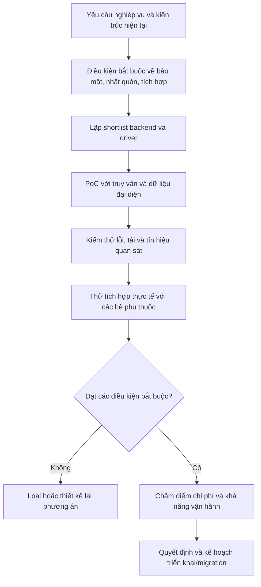
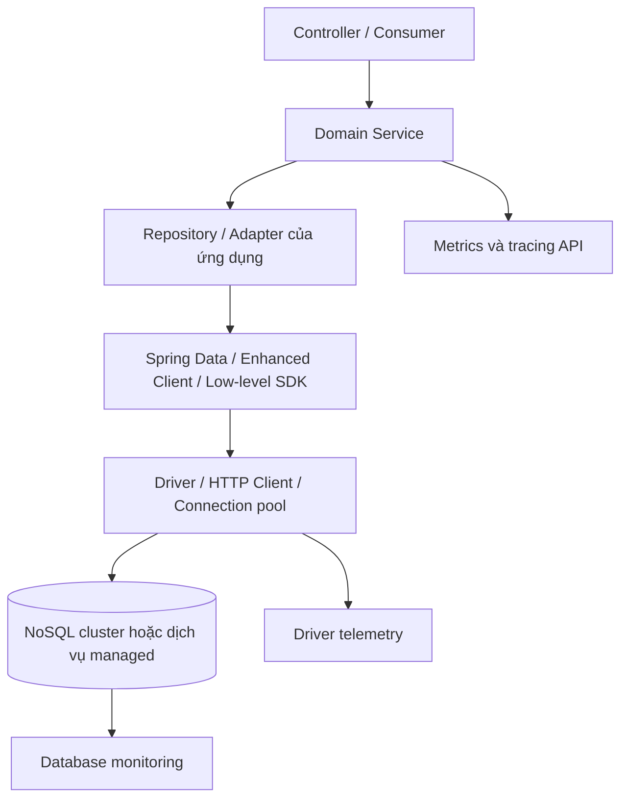
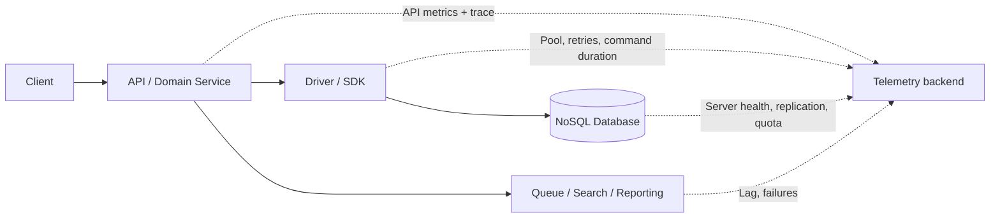
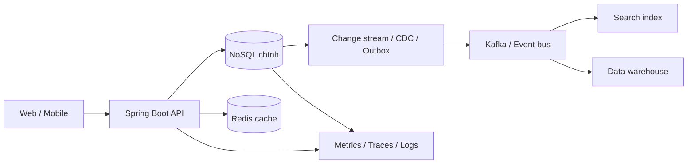
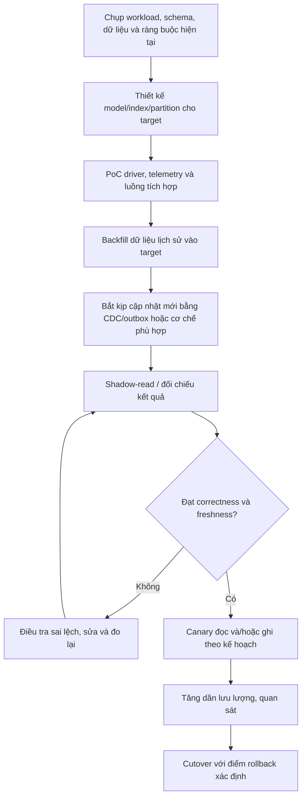

# So sánh driver, công cụ quan sát và khả năng tích hợp hệ hiện có

Chọn một cơ sở dữ liệu NoSQL cho hệ thống đang vận hành không kết thúc ở câu hỏi “MongoDB, Redis, DynamoDB hay Cassandra nhanh hơn?”. Sau khi chọn mô hình dữ liệu và mức nhất quán phù hợp, nhóm kỹ thuật còn phải xác minh ba điều rất thực tế: **ứng dụng kết nối qua driver nào**, **làm sao biết hệ thống đang hoạt động đúng**, và **có thể đưa giải pháp mới vào kiến trúc hiện có với chi phí, rủi ro chấp nhận được hay không**.

Ví dụ, một cơ sở dữ liệu có thể đáp ứng tốt mẫu truy vấn trên giấy nhưng Java driver không hỗ trợ đầy đủ cơ chế xác thực mà doanh nghiệp yêu cầu. Một driver có thể đáp ứng tải cao trong benchmark riêng lẻ nhưng khó cấu hình timeout, retry và quan sát connection pool khi tích hợp Spring Boot. Một phương án lưu trữ khác có thể dễ lập trình nhưng làm phức tạp luồng đồng bộ dữ liệu sang Kafka, tìm kiếm và hệ thống báo cáo.

Bài học này xây dựng cách đánh giá **từ đầu đến cuối**, minh họa bằng hệ sinh thái Java/Spring và một số hệ NoSQL thường gặp. Mục tiêu là tạo ra **ma trận bằng chứng và quyết định kỹ thuật có thể bảo vệ được**, không chỉ một bảng xếp hạng sản phẩm chung chung.

## 1. Ba lớp phải đánh giá cùng nhau

| Lớp | Câu hỏi phải trả lời | Bằng chứng cần thu thập |
|---|---|---|
| **Driver / client SDK** | Ứng dụng kết nối, đọc, ghi, retry, phân trang, xử lý lỗi và quản lý tài nguyên được không? | Integration test, API behavior, phiên bản tương thích, latency dưới tải |
| **Quan sát (observability)** | Khi chậm, lỗi hoặc mất dữ liệu, có xác định được nguyên nhân và phạm vi ảnh hưởng không? | Metrics, logs, traces, dashboard, alert, diễn tập sự cố |
| **Tích hợp hệ hiện có** | Có đưa dữ liệu vào/ra đúng cách, phù hợp bảo mật, vận hành, triển khai và chi phí không? | PoC theo luồng nghiệp vụ, hợp đồng dữ liệu, sơ đồ phụ thuộc, kế hoạch migration |

Ba lớp phụ thuộc lẫn nhau. Driver có retry tự động nhưng không có chỉ số retry thì latency bất thường rất khó lý giải. Công cụ quan sát chỉ thấy số liệu server nhưng không gắn với request của ứng dụng sẽ khó phân biệt lỗi mạng, lỗi pool và truy vấn chậm. Một connector CDC có thể truyền được dữ liệu nhưng vẫn gây trùng event hoặc mất thứ tự nếu thiết kế tiêu thụ không xét đến cơ chế bảo đảm thực tế.

Một quy trình ra quyết định hợp lý:



## 2. Khóa yêu cầu trước khi so sánh công cụ

Trước khi mở tài liệu driver, mô tả những gì ứng dụng thực sự làm với dữ liệu.

### 2.1. Hợp đồng truy cập dữ liệu

Ví dụ một dịch vụ quản lý sản phẩm có các thao tác:

1. `GET /products/{id}`: đọc theo khóa, cần phản hồi nhanh.
2. `GET /products?category=...`: lọc và phân trang với điều kiện có thể thay đổi.
3. `PATCH /products/{id}/stock`: cập nhật có điều kiện để tránh tồn kho âm.
4. `POST /products`: chặn tạo trùng theo khóa nghiệp vụ.
5. `GET /products/changes`: đưa sự kiện cập nhật sang hệ tìm kiếm hoặc phân tích.

Các câu hỏi kiến trúc từ hợp đồng này:

- Dữ liệu là document, key-value, wide-column hay graph? Có cần truy vấn linh hoạt ngoài khóa chính không?
- Đọc có cần thấy ngay ghi vừa commit không? Có chấp nhận stale read đối với một số endpoint không?
- Cập nhật một bản ghi là đủ hay cần transaction nhiều bản ghi?
- Dữ liệu tăng theo số lượng bản ghi, kích thước từng bản ghi hay số truy vấn/giây?
- Tải phân bố đều hay tập trung vào vài khóa nóng?
- Nguồn dữ liệu chuẩn (*system of record*) nằm ở đâu? Các bản sao/cache có được tái tạo không?
- Khi service gặp timeout, làm sao xác minh lệnh đã commit và retry an toàn?

Đừng lấy tiêu chí “hỗ trợ JSON” làm bằng chứng rằng mọi backend lưu document đều phù hợp. Hai sản phẩm có thể hỗ trợ cùng kiểu dữ liệu nhưng khác biệt rất lớn về index, truy vấn, cập nhật điều kiện, transaction và cách phân vùng.

### 2.2. Điều kiện bắt buộc và tiêu chí có thể đánh đổi

Nên phân biệt:

| Loại | Ví dụ |
|---|---|
| **Bắt buộc** | Có client Java tương thích runtime, TLS, cơ chế xác thực được phép, bảo vệ tạo trùng/cập nhật điều kiện, backup và khôi phục được |
| **Cam kết nghiệp vụ** | Không mất bản ghi đã xác nhận ở mức durability đã chọn; đáp ứng freshness của API; không tạo event trùng ngoài hợp đồng |
| **Mục tiêu hiệu năng** | p95 dưới ngưỡng đã duyệt ở tải dự kiến; tỷ lệ lỗi và chi phí vận hành trong giới hạn |
| **Ưu tiên** | API dễ sử dụng, nhóm đã quen công nghệ, tích hợp framework sẵn, ít công sức nâng cấp |

Một phương án không đạt điều kiện bắt buộc không nên “bù điểm” bằng benchmark nhanh hoặc phí lưu trữ thấp.

## 3. Driver khác gì với framework truy cập dữ liệu?

**Driver chính thức** thực thi giao thức kết nối tới datastore, mã hóa request/response, quản lý kết nối, topology, xác thực và xử lý lỗi theo cơ chế sản phẩm. **Client SDK** có thể rộng hơn driver: bao gồm request builders, retry policy, credential providers và API quản lý dịch vụ. **Framework truy cập dữ liệu** đặt thêm lớp mapping object, repository, transaction/exception abstraction hoặc tích hợp với DI/lifecycle của ứng dụng.

Một luồng Java/Spring điển hình:



Không phải hệ NoSQL nào cũng có tất cả các lớp hoặc dùng cùng một giao thức. Redis có command protocol và client library; DynamoDB Java SDK chủ yếu làm việc với API dịch vụ qua HTTPS; MongoDB và Cassandra có driver hiểu topology cụm; Spring Data thêm lập trình theo repository/template cho một số datastore.

Lớp trừu tượng giúp phát triển nhanh, nhưng nếu che mất những khái niệm nền tảng như partition key, consistency level, transaction limit hoặc read preference, ứng dụng có thể dễ viết mà khó đúng.

## 4. So sánh các lựa chọn client Java phổ biến

Bảng sau là **gợi ý điểm xuất phát**, không hàm ý có một driver tốt nhất cho mọi hệ thống. Khi chọn thật cần xác minh tài liệu phiên bản tương ứng với Java, framework và dịch vụ đang chạy.

| Backend / mục đích | Driver, SDK hoặc lớp tích hợp | Kiểu lập trình chính | Điểm cần đánh giá sâu |
|---|---|---|---|
| **MongoDB** — document store | MongoDB Java Sync Driver | Blocking, API trực tiếp | Session, transaction, codec, read/write concern, pool, server selection |
| **MongoDB** — luồng reactive | MongoDB Reactive Streams Driver; Spring Data MongoDB Reactive | Non-blocking publisher/reactive | Nhu cầu reactive thực sự, backpressure, context propagation, callback/error handling |
| **MongoDB** trong Spring | Spring Data MongoDB / `MongoTemplate` / repository | Mapping tài liệu, repository và template | Mapping `_id`, optimistic locking, query/index đặc thù, transaction boundary |
| **DynamoDB** — key-value/document managed | AWS SDK for Java v2 `DynamoDbClient` / `DynamoDbAsyncClient` | Sync hoặc async | Credential chain, region, retry/throttle, conditional writes, pagination |
| **DynamoDB** với đối tượng Java | DynamoDB Enhanced Client | Mapping item và biểu thức | Thiết kế partition/sort key, ánh xạ kiểu dữ liệu, mức kiểm soát API gốc |
| **Redis** — cache/key-value | Lettuce hoặc Jedis; Spring Data Redis trên client phù hợp | Sync/async/reactive tùy thư viện | Pool/multiplexing, Redis Cluster, timeout, script, pipeline, serializer, failover |
| **Apache Cassandra** — wide-column | Apache Cassandra Java Driver; tích hợp Spring Data Cassandra khi phù hợp | Sync/async, statement theo query | Session lifecycle, prepared statement, consistency level, routing key, paging |

Tên và vòng đời thư viện thay đổi theo thời gian; việc nâng cấp cần dựa trên **documentation/release notes của phiên bản cụ thể**, không chỉ tên driver. Thêm tiêu chí “còn được bảo trì và nhận bản vá bảo mật” khi chốt shortlist.

### 4.1. Driver blocking và reactive

| Tiêu chí | Blocking/synchronous | Asynchronous/reactive |
|---|---|---|
| Mô hình thực thi | Luồng gọi chờ I/O hoàn tất | Trả future/publisher, callback khi kết quả sẵn |
| Phù hợp | Service đơn giản, request thread đủ, luồng xử lý tuần tự | Nhiều I/O đồng thời, kiến trúc đã có pipeline async/reactive |
| Quản lý lỗi | `try/catch`, exception rõ theo call stack | Future failure, terminal signal, context và cancellation |
| Nút thắt thường gặp | Cạn request thread hoặc connection pool | Queue không giới hạn, thiếu backpressure, callback bị block |
| Kiểm thử | Dễ viết theo trình tự | Cần kiểm thử timeout, cancellation, subscription và context |

Reactive **không mặc định làm truy vấn database nhanh hơn**. Hiệu quả phụ thuộc mức đồng thời, round trip mạng, cơ chế pooling, cách pipeline được viết và khả năng xử lý của server. Nếu service đang dùng Spring MVC với ít I/O đồng thời, thêm reactive có thể tăng độ phức tạp. Nếu service dùng WebFlux, gọi driver blocking ngay trên event loop có thể gây nghẽn toàn ứng dụng; cần chọn client non-blocking hoặc cô lập công việc blocking trên scheduler phù hợp.

### 4.2. Dùng low-level driver hay framework?

**Low-level driver** có lợi khi cần trực tiếp các tính năng mới, lệnh đặc thù, cấu hình chi tiết hoặc hiệu năng có thể dự đoán. Đổi lại, nhóm tự quản lý nhiều mapping, validation và repository logic.

**Spring Data / Enhanced Client** giúp giảm mã lặp, tích hợp object mapping, dependency injection và các abstraction quen thuộc. Đổi lại, cần hiểu chính xác tầng mapping sinh ra lệnh gì; đặc biệt với query phân trang, optimistic locking, transaction, batch và TTL.

Một quyết định phổ biến là dùng repository abstraction cho CRUD đơn giản và adapter thực thi lệnh trực tiếp cho nghiệp vụ cần conditional update hoặc bulk access. Giữ logic điều kiện ở database, không thay bằng `find()` rồi `save()` vô điều kiện chỉ để phù hợp repository API.

## 5. Ma trận kiểm tra năng lực driver

Thay vì chỉ hỏi “có hỗ trợ MongoDB/DynamoDB hay không”, nên kiểm từng năng lực và chứng minh bằng thao tác thật.

| Năng lực | Câu hỏi kỹ thuật | Bài kiểm chứng |
|---|---|---|
| Tương thích | Hỗ trợ phiên bản Java, Spring Boot và server/API đang dùng? | Build ứng dụng tối thiểu, kết nối test, chạy CRUD |
| Xác thực | TLS, IAM/role, credential rotation, secret manager? | Đổi credential/role trong sandbox, xác nhận reconnect |
| Kết nối | Pool size, idle timeout, topology discovery, server selection? | Giới hạn pool, tạo burst concurrency và đo wait time |
| Serialization | JSON/BSON/item mapping, date, decimal, enum, null, polymorphism? | Round-trip dữ liệu biên và tương thích schema cũ |
| Query | Projection, pagination, batch, index hint và prepared request? | Truy vấn theo workload thực, kiểm số request phát sinh |
| Đồng thời | Conditional update, optimistic locking, atomic operation? | Cho hai request tranh một khóa; không mất cập nhật |
| Transaction | Session, isolation, retry và kết quả commit không xác định? | Fault injection trước/sau commit trong môi trường hỗ trợ |
| Retry | Phân loại retryable error, backoff, jitter, deadline? | Mô phỏng throttle/timeout, đếm attempt và tác dụng phụ |
| Async | Threading, cancellation, backpressure, context? | Tải đồng thời và hủy request giữa chừng |
| Observability | Có callback/listener, metrics, trace instrumentation? | Truy vết một request tới DB và thấy thời gian chờ |
| Packaging | Dependency conflict, kích thước ứng dụng, native/AOT nếu cần? | Build, scan dependency, smoke test môi trường đích |
| Support | Lịch cập nhật, mức ổn định API, hướng dẫn migration? | Ghi release được chọn và quy trình nâng cấp thử |

### 5.1. Lỗi retry là tiêu chí đặc biệt quan trọng

Một retry có thể được thực hiện ở nhiều tầng:

```text
API Gateway retry
   ↓
Service retry
   ↓
Driver/SDK retry
   ↓
Database/storage retry hoặc failover nội bộ
```

Nếu mỗi tầng tự thử tối đa ba lần, một request có thể tạo nhiều nỗ lực hơn số lần người phát triển hình dung. Con số thực tế phụ thuộc điều kiện retry và cách các tầng phối hợp, nhưng **retry chồng tầng** có thể biến một sự cố ngắn thành đỉnh tải.

Cần chọn nơi chịu trách nhiệm retry cho từng loại lỗi, có deadline tổng, backoff, giới hạn concurrency và định danh idempotency. Phân biệt rõ lỗi **điều kiện không đạt/duplicate key** (thường là kết quả nghiệp vụ) với lỗi **throttling/transient network** (có thể retry). Timeout sau khi gửi lệnh có thể là kết quả commit chưa rõ; không tự coi là “chưa ghi”.

### 5.2. Codec và kiểu dữ liệu là vấn đề tích hợp

Không nên chỉ kiểm thử chuỗi và số nguyên nhỏ. Các tình huống dễ sai:

- Số thập phân tiền tệ: `BigDecimal`, Decimal128 hoặc định dạng số tương ứng trong dịch vụ; không âm thầm chuyển sang `double`.
- Timestamp: timezone, UTC, độ chính xác mili/vi/nanosecond và kiểu serialized.
- Khóa ID: `ObjectId`, UUID, string, composite key; tương thích giữa service cũ và mới.
- Enum/trạng thái mới: code cũ có đọc được giá trị enum chưa biết không?
- `null` so với trường không tồn tại: query và update có cùng ngữ nghĩa không?
- Document lớn và batch: giới hạn kích thước request, số item và transaction của backend.
- Thứ tự, phân trang và token: cursor có ổn định khi dữ liệu thay đổi không?

Mỗi nhóm nên có fixture dữ liệu đọc/ghi ở cả hai chiều, đặc biệt khi nhiều phiên bản service cùng chạy trong thời gian rollout.

## 6. Ví dụ Java: adapter lưu trữ và cập nhật có điều kiện

Giả sử ứng dụng Spring Boot cần đổi tồn kho của một sản phẩm nhưng muốn cô lập logic domain khỏi API cụ thể của MongoDB.

```java
public interface ProductInventoryStore {
    boolean reserve(String sku, int quantity, long expectedVersion);
}
```

Một triển khai sử dụng MongoDB Java Sync Driver:

```java
import com.mongodb.client.MongoCollection;
import com.mongodb.client.MongoDatabase;
import com.mongodb.client.result.UpdateResult;
import org.bson.Document;
import org.springframework.stereotype.Repository;

import static com.mongodb.client.model.Filters.*;
import static com.mongodb.client.model.Updates.*;

@Repository
public final class MongoProductInventoryStore implements ProductInventoryStore {

    private final MongoCollection<Document> products;

    public MongoProductInventoryStore(MongoDatabase database) {
        this.products = database.getCollection("products");
    }

    @Override
    public boolean reserve(String sku, int quantity, long expectedVersion) {
        if (quantity <= 0) {
            throw new IllegalArgumentException("quantity phải > 0");
        }

        UpdateResult result = products.updateOne(
                and(eq("_id", sku),
                    eq("version", expectedVersion),
                    gte("available", quantity)),
                combine(inc("available", -quantity),
                        inc("version", 1L)));

        return result.getMatchedCount() == 1;
    }
}
```

Đoạn này giả định đã có một `MongoDatabase` bean được cấu hình trong ứng dụng. Giá trị trả về `false` có nghĩa lệnh ghi **không khớp điều kiện**, bao gồm phiên bản cũ, không đủ tồn hoặc SKU không tồn tại. Ứng dụng có thể đọc lại để diễn giải nguyên nhân, nhưng không được coi `false` là lỗi mạng và retry vô điều kiện.

Adapter là ranh giới tốt để bổ sung telemetry cấp nghiệp vụ, nhưng không nên cố biến mọi backend thành cùng một “CRUD chung” nếu làm mất khái niệm partition, transaction hay consistency. Khi thay backend, yêu cầu kiểm thử lại **hành vi nghiệp vụ và bảo đảm nhất quán**, không chỉ thay implementation của interface.

## 7. Công cụ quan sát: phân biệt tín hiệu ứng dụng và datastore

“Quan sát được” nghĩa là từ dữ liệu đang thu thập, nhóm kỹ thuật có thể suy luận điều gì đang sai mà không phải khởi động lại hệ thống để tái hiện lỗi. Ba nguồn tín hiệu chính:

| Nguồn | Đo được | Chưa thể kết luận nếu đứng riêng |
|---|---|---|
| **Metrics** | Tốc độ, độ trễ phân phối, tỷ lệ lỗi, pool, retry, tài nguyên | Nguyên nhân cụ thể của từng request lỗi |
| **Distributed traces** | Đường đi request qua API, service, DB, queue; thời gian từng bước | Tỷ lệ toàn hệ thống nếu sampling quá ít |
| **Structured logs** | Exception, state transition, request/run ID và ngữ cảnh chẩn đoán | Xu hướng định lượng nếu thiếu chuẩn hóa và aggregation |

Nên kết hợp metrics để phát hiện, traces để khoanh vùng và logs để làm rõ lỗi. Việc dùng cả ba không đồng nghĩa phải ghi mọi query body hoặc mọi giá trị khóa vào log.

### 7.1. Bốn vị trí cần đặt telemetry



Đo ở tầng ứng dụng giúp hiểu request kinh doanh, còn đo ở driver giúp phân biệt:

- API mất 800 ms vì xử lý business logic?
- Chờ 500 ms để lấy connection từ pool?
- Server selection/định tuyến tới node mất nhiều thời gian?
- Một lệnh DB mất 20 ms nhưng bị retry nhiều lần?
- DB server chỉ mất 5 ms, phần lớn thời gian nằm ở network?

Nếu chỉ xem “query execution time” trên server, có thể bỏ sót thời gian connection pool, DNS, serialization, network, retry và xử lý kết quả tại client.

### 7.2. Bộ metrics tối thiểu

| Nhóm | Chỉ số | Mục đích |
|---|---|---|
| API | RPS, error rate, p50/p95/p99, in-flight | Nhìn tác động người dùng |
| Driver | Operation duration, success/error, retry attempts | Biết backend call mất bao lâu và tại sao chậm |
| Pool | Active/idle connections, waiting, acquire timeout | Phát hiện bão request và nghẽn kết nối |
| Query | Slow queries, scanned/returned ratio, index usage | Tìm truy vấn bất hợp lý |
| Database | CPU, memory, disk I/O, storage capacity, connections | Biết tài nguyên có đang bão hòa không |
| Phân tán | Replication lag, election/failover, unavailable partitions | Phân biệt sự cố cục bộ và toàn cụm |
| Managed service | Throttled requests, consumed capacity, quota errors | Phát hiện giới hạn dịch vụ hoặc thiết kế partition |
| Tích hợp | CDC lag, outbox backlog, consumer retries, dead-letter count | Xác định dữ liệu có đang bị kẹt khi đồng bộ không |

Không phải driver nào cũng cung cấp tất cả metrics trên. Đánh giá phải ghi **nguồn thực tế**, API hay exporter nào cung cấp, độ trễ cập nhật, đơn vị và giới hạn quyền truy cập.

### 7.3. Công cụ trong hệ sinh thái Java

- **Micrometer:** API đo metrics trong ứng dụng Java; thường dùng cùng Spring Boot Actuator và registry phù hợp (chẳng hạn Prometheus).
- **OpenTelemetry:** chuẩn instrument/truyền trace và metrics; có thể dùng Java agent hoặc instrumentation thủ công tùy thư viện và phiên bản.
- **Prometheus / Grafana:** thu thập, truy vấn và trực quan hóa time-series; quy tắc alert nên bám SLO.
- **Structured logging:** JSON logs với trace ID, service, operation, error category; phải có cơ chế che dữ liệu nhạy cảm.
- **Database-native monitoring:** công cụ, dashboard và profiler do từng hệ quản trị hoặc nhà cung cấp cloud cung cấp.

Điều cần kiểm tra trong PoC là **instrumentation có thực sự tạo ra tín hiệu cho đúng driver/version** hay không. Không mặc định Java agent sẽ tự động có mọi số đo connection pool hoặc mọi lệnh database; kiểm tra span/metric thực tế và bổ sung instrument tại adapter khi thiếu.

### 7.4. Ví dụ Micrometer ở ranh giới adapter

Đo thời gian một thao tác nghiệp vụ ngay tại lớp truy cập dữ liệu:

```java
import io.micrometer.core.instrument.MeterRegistry;
import io.micrometer.core.instrument.Timer;

public final class MeasuredInventoryStore implements ProductInventoryStore {
    private final ProductInventoryStore delegate;
    private final MeterRegistry registry;

    public MeasuredInventoryStore(
            ProductInventoryStore delegate,
            MeterRegistry registry) {
        this.delegate = delegate;
        this.registry = registry;
    }

    @Override
    public boolean reserve(String sku, int quantity, long version) {
        Timer.Sample sample = Timer.start(registry);
        String outcome = "error";
        try {
            boolean reserved = delegate.reserve(sku, quantity, version);
            outcome = reserved ? "accepted" : "condition_failed";
            return reserved;
        } finally {
            Timer timer = Timer.builder("app.nosql.operation.duration")
                    .description("Thời gian thao tác truy cập tồn kho")
                    .tag("operation", "reserve")
                    .tag("outcome", outcome)
                    .register(registry);
            sample.stop(timer);
        }
    }
}
```

Ví dụ trên đo thời gian *end-to-end* của `reserve`. Nó không phân biệt chờ pool và thực thi query; cần thêm metrics ở driver để điều tra nguyên nhân. Nếu ứng dụng đã có auto-instrumentation ở cùng mức, cân nhắc tránh ghi trùng các metric có cùng mục đích.

**Không đưa `sku`, `customerId`, `requestId` hoặc câu query nguyên văn vào nhãn metric.** Các giá trị đó có thể tạo vô số time-series (*high cardinality*) và làm tăng chi phí, đồng thời có thể chứa dữ liệu riêng tư. Dùng các nhãn có miền giá trị hữu hạn như `operation`, `backend`, `outcome`, `error_class`, `service`.

## 8. So sánh công cụ quan sát theo backend

| Backend | Nguồn tín hiệu gốc / tích hợp phổ biến | Tình huống nên kiểm tra |
|---|---|---|
| MongoDB | Command monitoring của driver, connection pool events, server metrics, database profiler/slow query log, công cụ managed monitoring | Server selection, election, slow query, index, connection pool, replication lag |
| DynamoDB | AWS SDK metrics/instrumentation, CloudWatch metrics/logs và tracing qua thành phần ứng dụng | Throttling, consumed capacity, partition key nóng, retry, conditional check failure |
| Redis | Client events, Redis `INFO`, `SLOWLOG`, `LATENCY` và exporter/managed metrics | Cache hit/miss, reconnect, evictions, memory pressure, command latency |
| Cassandra | Driver metrics, JMX/`nodetool` hoặc cơ chế exporter, monitoring cluster | Coordinator latency, pending compaction, tombstone, read/write timeout, repair và consistency |

Danh sách trên không ngụ ý mọi dịch vụ managed đều mở đầy đủ lệnh quản trị hay profiler. PoC phải xác minh quyền truy cập và chi phí lưu giữ số liệu trong môi trường định triển khai.

### 8.1. Bài thử observability có chủ đích

Thực hiện ít nhất ba sự kiện trong môi trường test:

1. **Truy vấn chậm:** tạo workload nhỏ với truy vấn đã biết tốn nhiều tài nguyên; kiểm tra dashboard thể hiện latency tăng và tìm được operation tương ứng.
2. **Timeout/reconnect:** mô phỏng endpoint test tạm không sẵn sàng; kiểm tra metrics driver thấy lỗi/attempt và trace xác định request nào chịu ảnh hưởng.
3. **Conditional conflict/throttling:** tạo một loại lỗi dự kiến; kiểm tra log và metric phân biệt xung đột nghiệp vụ với lỗi hạ tầng.

Sau mỗi bài thử, người vận hành cần trả lời được: “sự cố xảy ra lúc nào, có bao nhiêu request bị ảnh hưởng, nguyên nhân ở tầng nào, đã phục hồi chưa?”. Nếu không trả lời được, điểm observability của phương án còn thiếu dù database vẫn đạt benchmark.

### 8.2. Tracing và ranh giới dữ liệu nhạy cảm

Trace có thể lưu tên service, loại thao tác, thời lượng và mã lỗi. Đối với statement/query, cần cân nhắc tắt hoặc làm sạch giá trị literal, credential và payload. Không ghi access token, chuỗi kết nối chứa password, nội dung tài liệu người dùng hoặc dữ liệu thanh toán vào span.

Với async/reactive pipeline, kiểm tra trace context có xuyên suốt callback, scheduler, HTTP client và queue không. Một trace đứt thành nhiều mảnh có thể khiến thời gian DB bị quy sai cho service khác. Quy tắc sampling cũng phải bảo toàn đủ trace của lỗi hiếm nhưng tránh đẩy toàn bộ payload/trace vào backend quan sát.

## 9. Tích hợp vào hệ hiện có: đánh giá theo đường đi thật

Một sơ đồ ứng dụng có thể có:



Khi đưa datastore mới vào, không chỉ kiểm CRUD từ API. Kiểm cả **quá trình cập nhật cache, phát event, xử lý event trùng, tìm kiếm và báo cáo**.

### 9.1. Ma trận năng lực tích hợp

| Phần hệ hiện có | Câu hỏi tích hợp | Cách kiểm chứng |
|---|---|---|
| Java/Spring Boot | Driver có tương thích dependency tree, lifecycle, cấu hình và thread model? | Build ứng dụng thật, startup/shutdown, integration test |
| Auth/Secrets | TLS, IAM, certificate rotation, secret manager và policy? | Test đăng nhập, đổi credential, thu hồi quyền |
| Mạng/Deploy | VPC/network policy, DNS, service discovery, failover endpoint? | Deploy vào staging và diễn tập reconnect |
| Schema/Data contract | Định dạng ID, timestamp, enum, decimal và trường optional? | Round-trip payload nhiều phiên bản |
| Message bus | Có nguồn event đáng tin cậy, cơ chế chống trùng và thứ tự? | Kịch bản commit, retry, consumer restart |
| Cache | Invalidate/write-through/cache-aside nhất quán ra sao? | Test cập nhật DB rồi đọc cache, race khi invalidate |
| Search/Analytics | CDC/export, backfill và data freshness? | So số bản ghi và độ trễ đồng bộ |
| Backups/DR | Backup, restore, PITR nếu cần, quyền khôi phục? | Khôi phục bản sao vào môi trường biệt lập |
| CI/CD | Có test fixture, Docker/Testcontainers, seed và migration tự động? | Pipeline chạy được không phụ thuộc môi trường cá nhân |
| Vận hành | Runbook, alert, quyền hỗ trợ sự cố và đường nâng cấp? | Diễn tập tình huống lỗi đã chọn |
| Chi phí | Hạ tầng, request, I/O, egress, telemetry và nhân lực? | Đo trên workload đại diện, lập dự báo |

### 9.2. Phân biệt tích hợp kỹ thuật và bảo đảm dữ liệu

Kết nối được Kafka hoặc có sẵn CDC connector mới chỉ chứng minh **có đường truyền**. Cần làm rõ:

- Event được sinh **trước hay sau commit**? Có trường hợp DB ghi thành công nhưng event không được phát không?
- Producer và consumer có thể gửi/nhận trùng không? Deduplication đặt ở đâu?
- Thứ tự event được bảo đảm theo toàn bộ stream, partition key hay chỉ mỗi aggregate?
- Consumer xử lý lại sau crash có làm thay đổi kết quả nghiệp vụ lần hai không?
- Dữ liệu có được backfill và bắt kịp thay đổi mới mà không tạo khoảng trống không?
- Có replay hoặc khôi phục event khi downstream outage không?

Không hứa “exactly-once cho toàn hệ thống” chỉ vì một thành phần có tính năng tên tương tự. Bảo đảm end-to-end cần được xác định theo từng boundary.

### 9.3. Outbox và CDC trong trường hợp đồng bộ nhiều hệ

Nếu cần ghi entity vào NoSQL và phát event, thực hiện hai thao tác độc lập có thể tạo trạng thái lệch:

```text
1. Ghi order thành công
2. Ứng dụng crash trước khi publish "OrderCreated"
3. DB có order, hệ tìm kiếm/warehouse không nhận được event
```

**Transactional outbox** là một phương án: ghi entity và bản ghi outbox trong cùng transaction *khi datastore hỗ trợ ranh giới atomicity đó*; worker/CDC đọc outbox và publish, consumer xử lý idempotent. Với hệ không có transaction đa thực thể phù hợp, cần chọn cách khác như change stream trên chính entity và kiểm tra rõ hành vi resume/replay.

Mọi lựa chọn đều phải thử khi producer crash, broker lỗi, consumer nhận trùng và khôi phục lại từ checkpoint. Đây là tiêu chí tích hợp quan trọng, thường khó thay đổi hơn một API CRUD.

## 10. Kế hoạch di trú khi thay datastore hoặc driver

**Nâng cấp driver** và **thay datastore** có phạm vi khác nhau:

- Nâng cấp driver thường cần kiểm API tương thích, thay đổi default timeout/retry, serializer, dependency conflict, TLS và protocol.
- Thay datastore có thể phải đổi key model, query/index, consistency, transaction, pipeline dữ liệu, vận hành và cách khôi phục.

### 10.1. Quy trình migration theo giai đoạn



Ghi song song (*dual write*) ở application có rủi ro hai backend không nhận cùng kết quả do timeout/crash và không có distributed transaction. Nếu phải áp dụng, cần cơ chế reconciliation và xác định một nguồn dữ liệu chuẩn. Phương án CDC/outbox cũng không tự bảo đảm thành công: backfill phải có checkpoint rõ để không bỏ sót thay đổi phát sinh trong lúc copy.

### 10.2. Kiểm tra tính tương đương dữ liệu

So sánh bằng các điều kiện có ý nghĩa nghiệp vụ:

- Số lượng entity theo tenant/partition, bao gồm bản ghi đã xóa nếu có tombstone.
- Mẫu hash/checksum trên dữ liệu chuẩn hóa, sau khi xử lý khác biệt kiểu số, timezone và thứ tự field.
- Kết quả truy vấn theo key, filter, sort, pagination và authorization.
- Tính đúng cập nhật có điều kiện/unique key trong cạnh tranh.
- Quan hệ dữ liệu logic giữa những tập collection/table.
- Độ trễ từ nguồn chuẩn đến hệ đích, số event chưa xử lý và số event trùng.

Không chỉ đối chiếu `COUNT(*)`: hai nguồn có cùng số bản ghi vẫn có thể khác nội dung hoặc thiếu/bị trùng bản ghi ở những khóa khác nhau.

### 10.3. Kế hoạch rollback phải khả thi

Trước cutover, cần trả lời:

1. Khi tắt ứng dụng mới, phiên bản cũ có đọc được dữ liệu đã ghi trong thời gian canary không?
2. Trong lúc rollback, nguồn nào là chính và cách tránh ghi song song trái chiều?
3. Những event từ datastore mới đã phát ra có được xử lý trùng khi chuyển về cũ không?
4. Có thể phục hồi index/config/credential và các luồng CDC theo thứ tự đúng không?
5. Những metric nào kích hoạt rollback: correctness, latency, error rate, lag, cost hay tính toàn vẹn dữ liệu?

Rollback chỉ là lựa chọn an toàn khi đường trở về đã được kiểm thử, có phạm vi và giới hạn dữ liệu rõ ràng.

## 11. Phương pháp chấm điểm có điều kiện loại trực tiếp

Đặt **điều kiện bắt buộc** trước, sau đó dùng điểm có trọng số để so sánh các ứng viên còn lại.

Ví dụ trọng số minh họa cho dịch vụ Java/Spring có giao dịch nhiều và phải đồng bộ dữ liệu sang hệ khác:

| Tiêu chí | Trọng số | Mô tả mức 1 | Mô tả mức 5 |
|---|---:|---|---|
| Phù hợp thao tác nghiệp vụ | 25% | Thiếu tính năng bắt buộc hoặc cần nhiều workaround | Hỗ trợ rõ và qua test correctness |
| Driver và trải nghiệm Java | 20% | API khó tích hợp, thiếu kiểm soát lỗi | Tương thích, cấu hình và test đầy đủ |
| Observability và vận hành | 20% | Không xác định được nguyên nhân lỗi | Metrics/traces/logs và runbook đã diễn tập |
| Tích hợp hệ hiện có | 20% | Data pipeline phức tạp, khó đồng bộ đúng | CDC/outbox, security, CI/CD đã chứng minh |
| Tổng chi phí và rủi ro | 15% | Chi phí không dự đoán được, thiếu phương án nâng cấp | Chi phí đo được, có SLA/rollback phù hợp |
| **Tổng** | **100%** | | |

Với điểm mỗi tiêu chí từ 1 đến 5:

\[
\operatorname{Score}=\sum_{i=1}^{n}w_i\,s_i,\qquad \sum_i w_i=1
\]

**Các trọng số không phải chuẩn chung.** Dịch vụ cache có thể coi phục hồi và độ trễ quan trọng hơn transaction. Dịch vụ tài chính với điều kiện nhất quán nghiêm ngặt có thể đặt khả năng chứng minh dữ liệu đúng là *điều kiện loại trực tiếp*.

### 11.1. Ví dụ bảng quyết định giả định

Giả sử nhóm xem xét hai **phương án kiến trúc** cho một dịch vụ sản phẩm:

- **Phương án A:** MongoDB với Java Sync Driver, Spring Data cho CRUD cơ bản, adapter trực tiếp cho conditional update.
- **Phương án B:** DynamoDB với AWS SDK Java v2 và Enhanced Client, thiết kế item theo access pattern và transaction/conditional write phù hợp.

Bảng dưới đây là **điểm PoC giả định để minh họa cách tính**, không phải kết quả benchmark hay nhận định phổ quát về sản phẩm.

| Tiêu chí | Trọng số | A (1–5) | B (1–5) |
|---|---:|---:|---:|
| Phù hợp nghiệp vụ | 25% | 5 | 4 |
| Driver và Java | 20% | 4 | 4 |
| Observability | 20% | 4 | 4 |
| Tích hợp hệ hiện có | 20% | 5 | 3 |
| Chi phí và rủi ro | 15% | 3 | 4 |
| **Điểm có trọng số** | **100%** | **4,30** | **3,80** |

Để tính, phương án A có \(0,25\times5 + 0,20\times4 + 0,20\times4 + 0,20\times5 + 0,15\times3=4,30\). Không kết luận A tốt hơn B trong môi trường thật khi chưa có kết quả workload, chi phí và tiêu chí bắt buộc cụ thể.

Chấm cả **độ tin cậy của bằng chứng**: “có trong tài liệu” khác “đã chứng minh với phiên bản production”, và khác “đã chạy qua fault injection trong staging”.

### 11.2. Mẫu phiếu đánh giá

```yaml
candidate:
  backend: mongodb
  client: java-sync-driver
  framework: spring-data-mongodb
  target_runtime: "Java và Spring Boot theo baseline dự án"
mandatory_gates:
  tls_and_auth: PENDING
  conditional_update: PENDING
  backup_restore: PENDING
  compatibility: PENDING
criteria:
  - name: application_access_patterns
    weight: 0.25
    score: null
    evidence: []
  - name: driver_integration
    weight: 0.20
    score: null
    evidence: []
  - name: observability
    weight: 0.20
    score: null
    evidence: []
  - name: existing_system_integration
    weight: 0.20
    score: null
    evidence: []
  - name: cost_and_risk
    weight: 0.15
    score: null
    evidence: []
decision: PENDING
risks: []
owner: "application-team"
```

Phiếu này chỉ là tài liệu mô tả. Không biến giá trị `PENDING` thành đạt chỉ vì đã chạy một vài bài benchmark.

## 12. Thiết kế PoC để so sánh công bằng

Một PoC tốt dùng **cùng hợp đồng nghiệp vụ**, dữ liệu và môi trường so sánh có kiểm soát. Không ép mọi backend phải dùng một API truy vấn giống hệt nhau: một access pattern có thể cần index ở MongoDB, partition/sort key trong DynamoDB hoặc một thiết kế bảng riêng trong Cassandra.

### 12.1. Workload đại diện

| Nhóm thao tác | Ví dụ | Điều quan sát |
|---|---|---|
| Đọc theo khóa | `findById` | p50/p95/p99, số request/call, read consistency |
| Đọc lọc và phân trang | Theo category, sort theo ngày | Query plan, scanned items, token/scroll behavior |
| Ghi từng item | Tạo/sửa sản phẩm | Latency, write concern/durability |
| Ghi có điều kiện | Trừ tồn nếu đủ số lượng | Race correctness, conflict rate |
| Batch | Đọc/ghi tập item, có retry phần lỗi | Partial success, hiệu quả throughput |
| Dữ liệu kích thước khác nhau | Nhỏ, trung bình, lớn đến giới hạn nghiệp vụ | Serialization, network, memory |
| Hot key / skew | Nhiều client truy cập một nhóm key | Throttling, contention, pool wait |
| Lỗi ngắn | Throttle, reset connection, failover phù hợp môi trường | Retry amplification, phục hồi, trạng thái commit |
| Tích hợp event | Ghi DB rồi đọc tại downstream | Lag, duplicate, missed event, recovery |

Nên có các mức tải: ít request để kiểm tính đúng, mức bình thường, đỉnh dự kiến và một đợt soak giới hạn thời gian. Ghi cả throughput thực tế đạt được **và** latency/chi phí ở cùng một chất lượng dịch vụ; số request/giây tối đa khi hệ bắt đầu lỗi không phải kết quả tốt nếu yêu cầu của hệ là p95 dưới ngưỡng cam kết.

### 12.2. Cách giữ phép so sánh có ý nghĩa

- Cùng kích thước và phân bố dữ liệu, tỷ lệ đọc/ghi, hot key, payload và thời gian chạy.
- Index/partition model phải được tối ưu hợp lý cho từng backend, đồng thời ghi công sức và giới hạn mô hình.
- Xác định mức nhất quán và durability tương đương về **hợp đồng nghiệp vụ**, không đánh đồng cấu hình tên giống nhau.
- Tách warm-up, cold start, steady-state và recovery; không trộn kết quả.
- Cấu hình pool, số thread, retry, timeout và giới hạn concurrency; ghi rõ giá trị.
- Giám sát tài nguyên ứng dụng, database và mạng; không chỉ nhìn latency client.
- Định danh phiên bản driver, SDK, framework, JVM, cluster/topology và cấu hình deployment.
- Với dịch vụ cloud, đo request/capacity, storage, networking, egress, metrics retention và chi phí vận hành tương ứng.

Thực hiện PoC trên tài nguyên và dữ liệu test được cấp quyền; không tạo stress hoặc lỗi trên cluster dùng chung ngoài phạm vi.

### 12.3. Ví dụ biên bản PoC

```text
Candidate: <backend + driver + framework>
Runtime:   <Java / Spring Boot / SDK versions>
Topology:  <cluster, region, AZ, replica hoặc partition layout>
Dataset:   <số item, kích thước trung bình, key distribution>

Operation: conditional stock update
Concurrency: <N>
Offered load: <RPS>
Accepted throughput: <RPS>
p50/p95/p99: <ms>
Conflict rate: <%>
Timeout rate: <%>
Retry attempts/request: <distribution>
Pool wait p95: <ms>
CPU/memory/storage/network: <measurements>
Invariant: stock >= 0; accepted updates match stock delta

Observability:
  Trace từ HTTP tới DB: PASS/FAIL
  Phân biệt conflict và timeout: PASS/FAIL
  Dashboard pool, retries, slow operations: PASS/FAIL
  Giám sát partition/replication: PASS/FAIL

Integration:
  CDC/outbox xử lý duplicate: PASS/FAIL
  Auth/secret rotation: PASS/FAIL
  Backup/restore rehearsal: PASS/FAIL
  Cost estimate: <method and assumptions>

Decision: ACCEPT / REJECT / NEEDS_MORE_EVIDENCE
```

## 13. Kịch bản đánh giá hoàn chỉnh

Giả sử tổ chức đang sử dụng Java/Spring Boot, PostgreSQL cho nghiệp vụ giao dịch, Redis để cache, Kafka cho event và Prometheus/Grafana cho giám sát. Nhóm muốn bổ sung NoSQL để lưu hồ sơ sản phẩm có thuộc tính linh hoạt.

### Bước 1: Xác định vai trò datastore mới

Hỏi trước: NoSQL sẽ là **nguồn dữ liệu chuẩn** cho hồ sơ sản phẩm hay chỉ là read model? Nếu PostgreSQL vẫn là nguồn chuẩn và NoSQL chỉ phục vụ truy vấn đọc, yêu cầu transaction và rollback khác đáng kể. Nếu NoSQL là nguồn chuẩn, cần kiểm backup/restore, tính đúng cập nhật và pipeline sự kiện.

### Bước 2: Chọn các phương án có thể triển khai

Ví dụ shortlist:

- MongoDB + Java Sync Driver/Spring Data cho hồ sơ linh hoạt và truy vấn document.
- DynamoDB + AWS SDK Java v2 nếu access pattern phù hợp thiết kế key và hạ tầng sử dụng các dịch vụ AWS.

Không cần đưa Redis làm ứng viên nguồn chuẩn cho cùng yêu cầu chỉ vì nó có thể lưu JSON/string. Việc chọn shortlist phải xuất phát từ thao tác và tính bền vững, không phải số lượng sản phẩm được biết đến.

### Bước 3: Kiểm API và tính đúng

Viết test chung cho ứng dụng: tạo hồ sơ, đọc theo ID, cập nhật version, chống tạo trùng, phân trang và cập nhật đồng thời. Adapter mỗi backend triển khai theo cơ chế native phù hợp. So sánh kết quả trên cùng bất biến nghiệp vụ.

### Bước 4: Kiểm telemetry

Gây một slow query và một timeout trong môi trường test, quan sát từ API trace đến driver và database. Kiểm xem dashboard có thể phát hiện connection pool wait, retries và partition nóng không. Ghi những tín hiệu phải tự instrument bổ sung.

### Bước 5: Kiểm integration

Phát sự kiện `ProductUpdated` sang Kafka rồi cập nhật search index. Mô phỏng consumer restart và event replay; xác minh search chỉ chứa trạng thái mới nhất theo chính sách version. Kiểm secret rotation, backup/restore, triển khai rolling update và data contract giữa các service.

### Bước 6: Chấm điểm và ra quyết định

Loại mọi phương án không đáp ứng điều kiện bắt buộc, rồi chấm điểm theo bằng chứng PoC, công sức migration, năng lực vận hành và tổng chi phí. Quyết định có thể là chọn một backend, hoặc giữ PostgreSQL rồi bổ sung một read model NoSQL ở phạm vi nhỏ nếu chưa có lợi ích đủ lớn để đổi nguồn dữ liệu chuẩn.

## 14. Những sai lầm thường gặp

| Sai lầm | Hệ quả | Hướng khắc phục |
|---|---|---|
| Chọn theo benchmark đọc/ghi đơn giản | Bỏ qua truy vấn thật, xung đột, network và retry | Dùng workload và SLO đại diện |
| Chỉ hỏi driver có kết nối được không | Không phát hiện lỗi pool, schema, failover, transaction | Kiểm từng năng lực và kịch bản lỗi |
| Mặc định reactive luôn tốt hơn | Tăng phức tạp, có thể block event loop hoặc thiếu backpressure | Chọn theo kiến trúc và số đo concurrency |
| Dùng framework che toàn bộ đặc tính DB | Query kém, cập nhật mất tính nguyên tử | Giữ cơ chế native ở adapter quan trọng |
| Dùng auto-instrumentation mà không xác minh | Thiếu spans/metrics thực tế trong sự cố | Thử lỗi có chủ đích và kiểm tín hiệu thu được |
| Gắn ID người dùng/khóa document vào metric labels | Cardinality rất lớn, chi phí/riêng tư | Dùng nhãn cố định và trace/log có kiểm soát |
| Chỉ giám sát phía DB server | Không thấy pool wait, retry, network và HTTP impact | Kết hợp telemetry ứng dụng, driver, DB |
| Coi có CDC là đồng bộ đúng | Event trùng/mất hoặc sai thứ tự | Định nghĩa checkpoint, idempotency và reconciliation |
| Dual write không có kế hoạch xử lý sai lệch | Hai backend phân kỳ sau lỗi | Chọn nguồn chuẩn và thiết kế đối chiếu/rollback |
| Chấm điểm trước khi đặt điều kiện bắt buộc | Phương án thiếu bảo đảm được “bù” bằng hiệu năng | Gate trước, score sau |
| Quên chi phí telemetry, egress, migration | Ước lượng tổng chi phí quá thấp | Đo TCO từ workload và vận hành thực tế |
| Bỏ qua đường nâng cấp driver | Phát sinh rủi ro bảo mật và dependency lock | Ghi phiên bản, owner và thử upgrade định kỳ |

## 15. Bài thực hành: lập ma trận quyết định cho một dịch vụ Java

**Đề bài:** xây dựng dịch vụ lưu hồ sơ sản phẩm với những thuộc tính khác nhau theo loại hàng. Dịch vụ chạy trên Spring Boot, có Redis cache, Kafka event bus và hệ thống metrics/traces dùng chung. Cần xử lý đọc theo ID, lọc theo category, cập nhật có điều kiện và đồng bộ thông tin sang search index.

Hãy thực hiện:

1. Viết hợp đồng dữ liệu: access patterns, mức nhất quán, số lượng bản ghi, hot key, write/read ratio và SLO.
2. Chọn **hai phương án backend + driver** có thể triển khai; với mỗi phương án, ghi loại client, model blocking/async, cách mapping, timeout, retry và transaction/conditional write.
3. Viết test integration cho CRUD, cập nhật cạnh tranh, tạo trùng, pagination, payload biên và lỗi timeout quanh commit.
4. Vẽ đường telemetry từ HTTP request đến datastore; liệt kê ít nhất năm metrics, một trace mong đợi và ba tình huống cần alert.
5. Thử pipeline `ProductUpdated` tới Kafka/search, bao gồm duplicate event, consumer restart và kiểm tra độ trễ đồng bộ.
6. Lập kế hoạch backfill, shadow-read, canary, cutover và rollback nếu datastore mới thay thế hệ cũ.
7. Tạo bảng điểm có trọng số, điều kiện loại trực tiếp và bằng chứng cho từng điểm; ghi rõ mục nào chưa đủ dữ liệu.

**Tiêu chí nghiệm thu của bài thực hành:** có thể chứng minh một nghiệp vụ đúng dưới cạnh tranh và retry, nhìn thấy nguyên nhân khi DB chậm, đồng bộ dữ liệu tới hệ còn lại mà không bỏ sót điều kiện nhất quán, và tính được chi phí cũng như công sức vận hành của mỗi phương án. Khi ba phần **driver – observability – integration** đều có bằng chứng, quyết định chọn NoSQL mới đủ cơ sở để triển khai vào hệ thống đang tồn tại.
