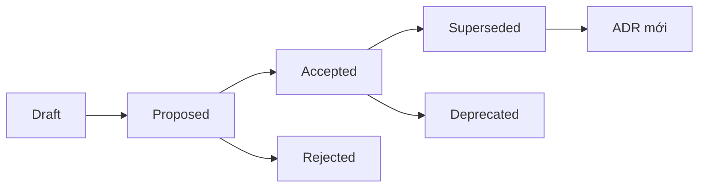
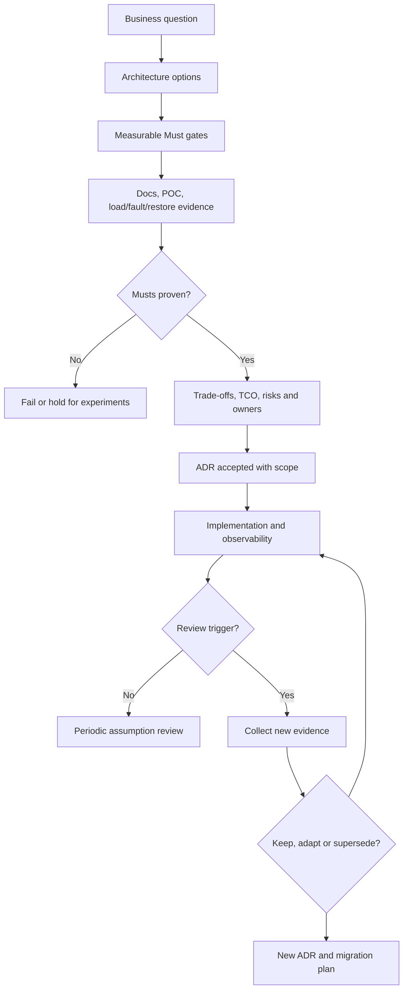

# Viết quyết định kiến trúc cùng bằng chứng, giới hạn và điều kiện xem xét lại

## 1. Tình huống mở đầu: vì sao chọn một NoSQL lại cần hồ sơ quyết định?

Một đội Java xây dịch vụ quản lý đơn hàng cho nhiều tenant. Sau ba buổi thảo luận, cả nhóm đồng ý chọn một document database. Sáu tháng sau, hệ bắt đầu chậm khi một tenant chiếm phần lớn lưu lượng và báo cáo doanh thu yêu cầu truy vấn vượt mô hình ban đầu.

Những câu hỏi xuất hiện:

- Vì sao trước đây chọn document database chứ không dùng PostgreSQL đang có?
- Khi lựa chọn, nhóm đã giả định mỗi tenant có bao nhiêu đơn hàng và kiểu truy vấn nào?
- Đã thử concurrent writes, failover và phục hồi dữ liệu chưa?
- Độ trễ p99 được đo ở tải nào, với bao nhiêu dữ liệu và phân bố khóa ra sao?
- Có biết trước báo cáo đa tenant sẽ gây quét rộng không?
- Điều kiện nào khiến phải thiết kế thêm read model, đổi shard key hoặc xem xét lại công nghệ?
- Ai chấp nhận giới hạn và ai có thẩm quyền thay đổi nó?

Nếu tài liệu chỉ viết “Chọn X vì linh hoạt, nhanh và dễ mở rộng”, người đến sau không có cơ sở kiểm chứng. Quyết định dần trở thành một niềm tin không được phép chất vấn, hoặc ngược lại liên tục bị tranh luận từ đầu.

Một **Architecture Decision Record (ADR)** tốt giữ lại không chỉ kết luận, mà còn **bối cảnh, lựa chọn thay thế, bằng chứng, giới hạn, đánh đổi, điều kiện áp dụng và tín hiệu phải xem xét lại**. Nó giúp người khác tiếp tục ra quyết định khi môi trường thay đổi.

Bài học thuộc **Database No SQL → Đánh giá và lựa chọn → Viết quyết định kiến trúc cùng bằng chứng, giới hạn và điều kiện xem xét lại**. Trọng tâm không phải viết tài liệu cho đẹp, mà là biến một lựa chọn lưu trữ thành một quyết định **có thể bảo vệ bằng dữ liệu, triển khai có trách nhiệm và thay đổi khi giả định không còn đúng**.

---

## 2. Mục tiêu học tập

Sau bài học, bạn có thể:

1. Giải thích mục đích của ADR và phân biệt ADR với RFC, design document, benchmark report, runbook và incident report.
2. Viết tuyên bố quyết định rõ phạm vi, công nghệ, data model và trách nhiệm vận hành.
3. Ghi những ràng buộc nghiệp vụ, phi chức năng và pháp lý thành tiêu chí có thể kiểm chứng.
4. Mô tả workload, nguồn dữ liệu sự thật, truy vấn, phân bố tenant, tải và tăng trưởng.
5. Liệt kê các phương án thực sự được cân nhắc, kể cả giữ hệ hiện tại hay dùng RDBMS.
6. Dùng điều kiện bắt buộc (*hard gates*) trước khi chấm điểm tiện ích.
7. Liên kết mỗi khẳng định quan trọng với bằng chứng có phiên bản, phương pháp, ngày và giới hạn.
8. Phân biệt dữ liệu quan sát được với suy luận, giả định, dự đoán và lời quảng bá.
9. Ghi trade-off về consistency, latency, durability, khả năng mở rộng, bảo mật, vận hành và chi phí.
10. Trình bày những gì quyết định **không** bảo đảm và những trường hợp ngoài phạm vi.
11. Thiết lập cơ chế review trigger với chỉ số, ngưỡng, owner và hành động cụ thể.
12. Thiết kế thử nghiệm, rollout, canary, rollback và phương án thoát để quyết định có thể thực thi.
13. Viết một ADR mẫu hoàn chỉnh cho lựa chọn NoSQL trong dự án Java.
14. Theo dõi trạng thái ADR: proposed, accepted, deprecated và superseded mà không xóa lịch sử.
15. Đánh giá lại ADR khi có bằng chứng mới hoặc workload, pháp lý, tổ chức và chi phí thay đổi.

## 3. ADR là gì, và không phải là gì?

**ADR** là bản ghi một quyết định kiến trúc có ảnh hưởng đáng kể, cùng nguyên nhân và hệ quả của quyết định tại thời điểm đó.

Một ADR trả lời tối thiểu:

```text
Tại sao cần quyết định?
Phạm vi/giả định lúc quyết định là gì?
Những phương án nào đã được xem xét?
Quyết định là gì, với giới hạn nào?
Bằng chứng nào biện minh cho kết luận?
Hệ quả tích cực/tiêu cực?
Cần kiểm tra lại khi nào và dựa trên tín hiệu gì?
```

| Tài liệu | Mục đích chính | Liên hệ với ADR |
| --- | --- | --- |
| ADR | Lưu quyết định và lý do | Tài liệu trung tâm |
| RFC/proposal | Xin ý kiến cho thay đổi đề xuất | Có thể dẫn tới ADR |
| Design document | Giải thích kiến trúc chi tiết, API, dữ liệu | Được ADR tham chiếu |
| Benchmark report | Ghi workload, cấu hình, số liệu | Bằng chứng cho ADR |
| Test/fault report | Ghi kết quả thử nghiệm và sự cố | Bằng chứng hoặc cảnh báo |
| Runbook | Hướng dẫn vận hành/phục hồi | Hệ quả cần triển khai |
| Incident postmortem | Phân tích sự cố đã xảy ra | Có thể kích hoạt review ADR |
| Product roadmap | Những năng lực dự kiến | Không được tự xem là bằng chứng đã hỗ trợ |

**ADR không nên sao chép toàn bộ tài liệu thiết kế**. Nó cần đủ thông tin để hiểu và phản biện quyết định, còn phép đo chi tiết, mã thử và sơ đồ triển khai có thể nằm trong tài liệu được dẫn bằng ID ổn định.

## 4. Vì sao quyết định kiến trúc cần được ghi lại?

Lựa chọn NoSQL thường tạo chi phí thay đổi cao:

- Primary key/shard key ảnh hưởng đường truy vấn và phân bố dữ liệu.
- Semantics giao dịch ảnh hưởng bất biến nghiệp vụ.
- Kiểu dữ liệu và event format ảnh hưởng clients/consumers.
- Replication/failover policy ảnh hưởng RPO/RTO.
- Backup và restore liên quan data residency và compliance.
- SDK Java, driver và serialization trở thành dependency dài hạn.
- Denormalization tạo nhiều điểm cần đồng bộ.
- Migration sang hệ khác có thể mất nhiều tháng.

Nếu quyết định chỉ tồn tại trong trí nhớ, người mới dễ sửa cấu hình mà không biết điều kiện gốc, ví dụ hạ write concern để tăng throughput nhưng vô tình phá cam kết dữ liệu.

### 4.1. Giá trị lớn nhất xuất hiện khi bối cảnh thay đổi

Một ADR tốt không tuyên bố “công nghệ X luôn tốt nhất”. Nó nói:

> “Với workload W, dữ liệu D, SLO S, đội vận hành O và những bằng chứng E tại thời điểm T, phương án X là lựa chọn chấp nhận được; nếu giả định A thay đổi hoặc ngưỡng R bị vượt, cần đánh giá lại.”

## 5. Khi nào nên viết ADR?

Không cần ADR cho mọi lần đổi tên biến hay thêm chỉ mục nhỏ. Nên viết khi quyết định:

- Khó đảo ngược hoặc tốn công migration.
- Ảnh hưởng nhiều services/teams.
- Quy định source of truth hoặc consistency boundary.
- Thay đổi cách lưu trữ, partition, replica, backup.
- Có tác động tới bảo mật, pháp lý hoặc chi phí đáng kể.
- Gắn với rủi ro vận hành nhiều năm.
- Có nhiều lựa chọn hợp lý, không có đáp án hiển nhiên.

Ví dụ đáng viết:

```text
ADR-001: Chọn database nguồn cho Order Service.
ADR-002: Dùng transactional outbox để đồng bộ Search.
ADR-003: Partition key theo tenant và bucket thời gian.
ADR-004: Quy định mức độ bền cho confirmed payments.
ADR-005: Chuyển read model từ nguồn sang search index.
```

Một ADR nên có **một quyết định trung tâm**. Nếu phải ghi cả việc chọn database, chọn queue, chọn UI framework và chọn cơ chế đăng nhập, nên tách thành các ADR liên kết.

## 6. Bộ khung tối thiểu của một ADR

```markdown
# ADR-012: Chọn kho dữ liệu cho Order Service

- Trạng thái: Proposed
- Ngày: 2026-11-14
- Decision owner:
- Người phê duyệt:
- Phạm vi:
- Liên kết: design, test, risk register

## Bối cảnh và bài toán

## Các ràng buộc và yêu cầu bắt buộc

## Phương án đã cân nhắc

## Bằng chứng và giới hạn của bằng chứng

## Quyết định

## Hệ quả tích cực và tiêu cực

## Rủi ro/giả định chưa được chứng minh

## Kế hoạch triển khai, quan sát và rollback

## Điều kiện xem xét lại

## Phê duyệt và lịch sử trạng thái
```

Không có một chuẩn ADR duy nhất bắt buộc mọi tổ chức. Mẫu trên là lựa chọn thực dụng để không mất những điều cần thiết trong quyết định dữ liệu.

## 7. Đặt tên ADR để người khác tìm được

Một tiêu đề tốt nên có **hành động quyết định và phạm vi**:

```text
Tốt:
  Chọn MongoDB làm kho nguồn cho Order Service tại vùng A
  Dùng conditional write cho yêu cầu giữ tồn kho
  Lưu Redis chỉ như cache tái tạo được

Kém:
  Database
  NoSQL
  Đánh giá MongoDB
  Công nghệ mới rất nhanh
```

Tiêu đề không nên dựa vào nickname nội bộ mà người khác không biết. Nếu cần dùng codename, giải thích một lần và giữ business capability trong tiêu đề.

### 7.1. ID và đường dẫn ổn định

Ví dụ:

```text
docs/adr/0012-order-source-database.md
```

ID nên ổn định, không đổi chỉ vì trạng thái chuyển từ Proposed sang Accepted. Dùng link tới tài liệu có định danh bền, tránh đường dẫn tạm của CI job.

## 8. Trạng thái của ADR là một phần của thông tin

Một vòng đời phổ biến:



- **Draft:** còn thiếu thông tin, đang viết.
- **Proposed:** đề nghị quyết định, đang review.
- **Accepted:** đã được chủ thể có thẩm quyền chấp thuận.
- **Rejected:** đề xuất không được chọn, vẫn giữ lịch sử nếu hữu ích.
- **Superseded:** có ADR mới thay thế; phải trỏ tới ADR mới.
- **Deprecated:** không còn là hướng khuyến nghị, nhưng có thể còn hệ thống cũ chưa chuyển.

### 8.1. Accepted không đồng nghĩa đã hoàn tất rollout

Một ADR được chấp nhận có thể còn đang triển khai. Tách rõ:

```text
Decision status: Accepted
Implementation status: Pilot / In progress / Complete
```

Việc database đã được dựng không chứng minh các acceptance gates đã được kiểm.

## 9. Định nghĩa phạm vi thật cụ thể

Sai:

> “Chúng ta chọn NoSQL cho toàn hệ thống.”

Rõ hơn:

> “Chọn document store làm authoritative source cho `Order` và `OrderLine` của dịch vụ đặt hàng Java tại vùng triển khai chính; không bao gồm payment ledger, session cache, full-text search, analytics warehouse và dữ liệu định danh người dùng.”

Phạm vi cần chỉ ra:

- Service và domain aggregates.
- Dữ liệu nào được lưu.
- Source of truth là hệ nào.
- Region/tenants/tier.
- Read/write API.
- Hệ phát sinh sự kiện và read models.
- Những gì **ngoài phạm vi**.

### 9.1. Giới hạn phạm vi chống suy diễn

Nếu ADR chỉ duyệt kho Order, không được dùng nó làm bằng chứng chọn cùng database cho fraud graph, recommendation vectors hay clickstream telemetry.

## 10. Phát biểu quyết định trong một đoạn độc lập

Một câu quyết định nên có cấu trúc:

> “Chúng tôi quyết định sử dụng [kiến trúc/công nghệ] cho [phạm vi] theo [mô hình dữ liệu và nguyên tắc consistency], bởi [lý do chính đã có bằng chứng]. Quyết định áp dụng khi [giả định/giới hạn]; [phạm vi loại trừ] sẽ dùng cơ chế khác.”

Ví dụ minh họa:

> “Dùng MongoDB làm kho nguồn cho Order aggregate, truy cập qua `tenantId + orderId`, bảo vệ ghi quan trọng bằng điều kiện version/unique key theo giao thức ứng dụng; Search được dựng riêng qua outbox. Quyết định không bao gồm payment ledger hay phân tích toàn lịch sử và chỉ có hiệu lực sau khi các gate bảo mật, restore và tải đạt kết quả.”

Một đoạn có thể trích riêng giúp người khác hiểu mà không đọc 40 trang. Nhưng bằng chứng và các giới hạn vẫn phải nằm ngay sau đó.

## 11. Viết bối cảnh: vấn đề trước, công nghệ sau

Bối cảnh cần phản ánh:

1. Người dùng/khách hàng đang cần điều gì.
2. Đường nghiệp vụ và mức quan trọng.
3. Dữ liệu và truy vấn chủ đạo.
4. Đau điểm của kiến trúc hiện có.
5. Các ràng buộc tổ chức và môi trường.
6. Deadline và phạm vi quyết định.

Sai:

> “MongoDB linh hoạt nên thích hợp.”

Tốt hơn:

> “Order có số lượng line items biến thiên, phần lớn truy vấn lấy một aggregate theo khóa. Phiên bản hiện tại cần ghi đồng thời hàng chục thuộc tính liên quan trong cùng vòng đời đơn hàng. Báo cáo tháng được cho phép chạy bất đồng bộ, còn xác nhận thanh toán phải bảo vệ trạng thái đồng thời.”

Bối cảnh tốt giúp kiểm vì sao phương án thắng, không biến sản phẩm thành xuất phát điểm mặc định.

## 12. Định nghĩa nguồn dữ liệu sự thật trước khi chọn NoSQL

Một kiến trúc có thể có:

```text
Order API -> Order source
          -> Outbox events
          -> Kafka consumers
          -> Search index
          -> Redis cache
          -> Analytics store
```

ADR cần phân biệt:

| Thành phần | Vai trò | Khi dữ liệu lệch thì tin vào đâu? |
| --- | --- | --- |
| Order database | Authoritative Order state | Theo business contract |
| Payment provider/ledger | Authoritative payment status | Provider/ledger reconciliation |
| Kafka/outbox | Durable change delivery trong phạm vi protocol | Source transaction/event provenance |
| Search | Derived projection | Rebuild từ source/events |
| Redis | Cache tạm thời | Invalidate/refill |
| Analytics | Derived historical reporting | Backfill/reconcile |

Không thể chấm “khả năng giao dịch” của Search như thể đó là nguồn Order nếu kiến trúc đã quy định Search chỉ làm projection.

## 13. Liệt kê business invariants trước yêu cầu tính năng

Những điều **không được sai**:

```text
Một idempotency key không sinh hai Order.
Không giữ tồn kho vượt số lượng có thể bán.
Tenant A không đọc/sửa Order của tenant B.
Một Order CONFIRMED không quay về DRAFT trái policy.
Không ghi đè version mới bằng event cũ.
Một payment đã charge không được charge lại vì timeout.
Delete/revoke có hậu quả đúng theo retention policy.
```

Mỗi invariant cần chỉ ra **đường ghi cụ thể bảo vệ nó**, thay vì ghi “database hỗ trợ ACID” rồi coi đã xong.

### 13.1. Invariant có thể do hệ thống tổng thể đáp ứng

Một database hỗ trợ atomic update trên một document không tự bảo vệ transaction với external payment API. Có thể cần idempotency ledger, transactional outbox, saga hoặc reconciliation. ADR phải mô tả ranh giới và yếu tố không được engine tự bảo đảm.

## 14. Tách hard constraints với mong muốn

Một bảng:

| ID | Loại | Nội dung | Hệ quả nếu không đạt |
| --- | --- | --- | --- |
| M01 | Must | Tenant isolation trong mọi đường đọc/ghi | Vi phạm bảo mật |
| M02 | Must | Idempotent Order create | Double order/side effect |
| M03 | Must | Restore đúng RPO/RTO | Vi phạm cam kết khôi phục |
| M04 | Must | Java runtime/driver được hỗ trợ | Không thể vận hành theo policy |
| S01 | Should | Tích hợp tracing ít mã tùy chỉnh | Thêm công kỹ thuật |
| S02 | Should | TCO dự báo thấp | Tăng ngân sách |
| C01 | Could | Console trực quan | UX quản trị tiện hơn |
| C02 | Could | Built-in vector search | Tính năng tương lai |

Không dùng điểm giao diện bù một Must fail. Một Must thiếu bằng chứng phải được ghi **UNKNOWN**, không tự coi PASS.

## 15. Mỗi yêu cầu bắt buộc cần một điều kiện kiểm thử

Mẫu:

```yaml
id: M03
requirement: Recover source Orders within policy
scope: production-like cluster, primary region loss
scenario: isolated restore drill from approved backup/PITR
rpoSeconds: 300
rtoSeconds: 2700
measurement:
  recoveryPoint: authoritative durable watermark
  readyTime: application business-ready checks
acceptance:
  missingProtectedOrders: 0
  crossTenantViolations: 0
  actualRPOSeconds: at_most_300
  actualRTOSeconds: at_most_2700
evidence: E-RESTORE-01
```

Tất cả số liệu là **ví dụ dùng để lập tiêu chí**, không phải SLO chuẩn hoặc kết quả đã đạt. Đối với một hệ chấp nhận mất dữ liệu theo RPO, phải định nghĩa tập operations được bảo vệ và recovery point để không assert sai.

## 16. Thu thập workload thực thay cho khẩu hiệu “scale lớn”

ADR nên ghi:

- Kích thước dữ liệu hiện tại và dự báo.
- Số documents/items, kích thước trung vị/p95/p99.
- Read/write QPS, peak/burst và growth.
- Query patterns, phân trang, sắp xếp, aggregations.
- Số tenant và mức lệch phân bố.
- Hot keys/partitions.
- TTL, deletes, retention.
- Dữ liệu khu vực và cross-region accesses.
- Consistency/durability cho từng thao tác.
- Tỷ lệ cập nhật đồng thời.
- Query cần index và query ad-hoc.

### 16.1. Workload matrix minh họa

| Query | Đầu vào | Tải giả định | Đường dữ liệu | Ràng buộc |
| --- | --- | ---: | --- | --- |
| Q1 Get Order | tenantId, orderId | 3.000 QPS | Source | p99 dưới SLO |
| Q2 Recent Orders | tenantId, status, cursor | 600 QPS | Source/index | Keyset pagination |
| Q3 Confirm Order | tenantId, orderId, version | 200 writes/s | Source | CAS/invariant |
| Q4 Customer Search | text, filters, tenant | 80 QPS | Search index | freshness policy |
| Q5 Monthly Revenue | tenantId, month | 20 jobs/h | Async analytics | Không làm chậm Q1 |
| Q6 Delete Order | key, policy | Theo sự kiện | Source + CDC | Tombstone propagation |

Con số trong bảng là **dữ liệu giả định cho bài học**. ADR thật phải liên kết tới đo lường hoặc dự báo có owner.

## 17. Mô tả phân bố tải, không chỉ trung bình

Ví dụ:

```text
Median tenant: 1.000 Orders
Top tenant: 8.000.000 Orders
Top 1% tenants: 55% traffic
Một hot product nhận 20% conditional updates
```

Một benchmark phân bố đều có thể đạt p99 đẹp, nhưng top tenant gây hotspot trên partition/shard key.

### 17.1. Vì sao cần ghi assumptions?

Nếu ADR dựa trên giả định “không tenant nào vượt 5% tổng throughput”, phải định nghĩa trigger xem xét lại khi có tenant đạt 15%. Không ghi thì không ai biết lúc nào mô hình đã không còn đúng.

## 18. Định nghĩa consistency contract theo workflow

Không dùng chung một từ “strong consistency” cho mọi truy vấn. Ghi:

```text
Create Order:
  unique intent + conditional commit, result lookup after ambiguous ACK

Read Order after create:
  read-your-writes trên đường xác nhận

Search:
  eventual consistency, freshness theo SLO

Analytics:
  asynchronous, chấp nhận chậm hơn theo business deadline

Payment:
  external authority, idempotent reconciliation
```

Điều cần kiểm:

- Operation atomicity nằm ở record, partition hay transaction nhiều records?
- Read concern/consistency level là gì?
- Concurrency test chứng minh invariant nào?
- Quorum/majority configuration có đáp ứng failure model không?
- Khi commit timeout, client xử lý UNKNOWN thế nào?
- Cross-shard workflows dùng giao thức gì?

**ADR phải mô tả behavior của ứng dụng, không thay bằng nhãn sản phẩm.**

## 19. Durability và failure model phải được đóng khung

Một yêu cầu minh họa:

> “Các writes được ACK theo durability class D phải còn đúng sau khi một data node bị kill và cụm bầu leader mới, trong phạm vi topology đã kiểm.”

Cần ghi rõ:

- Database version, replica/cluster config.
- Write concern/quorum/journaling.
- Primary/follower roles.
- Fault: graceful stop, crash, network partition, disk failure, region loss.
- Phạm vi của ACK và unknown outcomes.
- Read path dùng để verify.
- Replay, rollback, tombstone behavior.
- Bảo đảm không có duplicate business effects.

Đừng lấy kết quả thử “stop một follower” làm chứng minh “chịu mất cả region”.

## 20. Tách availability, RPO và RTO

Ba mục khác nhau:

- **Availability SLO:** tỷ lệ yêu cầu hữu ích thành công trong deadline theo định nghĩa.
- **RPO:** mức mất dữ liệu chấp nhận được khi khôi phục từ một điểm.
- **RTO:** thời gian khôi phục ứng dụng tới trạng thái phục vụ được định nghĩa.

Một provider có multi-AZ replica chưa tự chứng minh restore trong 45 phút. Một backup hoàn tất lúc 10:10 có thể có recovery watermark từ 10:00. ADR cần chỉ rõ **cách đo RPO**, không dùng completion time thay thế.

### 20.1. Dẫn bằng chứng restore drill

```text
E-RESTORE-2026-01
- Snapshot/backup ID:
- Logical recovery point:
- Restore target environment:
- Artifact/log completeness:
- Data invariants:
- Restore elapsed duration:
- Application readiness:
- Verdict:
```

Không gọi “RESTORE PASS” chỉ vì database process khởi động; còn indexes, application reads/writes, CDC, permissions và consistency.

## 21. Vấn đề bảo mật không phải phần phụ cuối trang

ADR phải nói:

- Xác minh tenant identity từ đâu.
- Mọi query/key được scope theo tenant thế nào.
- Quyền của app/service principal và backup worker.
- TLS/auth/encryption, key management.
- Access audit và data export.
- Cross-region copies và retention.
- Xóa dữ liệu cá nhân trong source/backup/projection.
- Secret rotation và emergency access.
- Vendor support access nếu dùng managed database.

Những ràng buộc pháp lý cần có **nguồn và chủ thể phụ trách**; không suy từ bài học rằng mọi doanh nghiệp đều chịu cùng một bộ luật.

### 21.1. Một test quan trọng

Seed hai tenants cùng `orderId`; thực hiện đọc/ghi bằng danh tính tenant A nhưng trỏ tới ID của B, xác minh state B không đổi và API không rò tồn tại của bản ghi nếu policy cấm.

## 22. Quyền quản trị và restore cũng là quyết định kiến trúc

Một hệ có IAM tốt ở API nhưng backup bucket mở rộng quyền có thể làm hỏng mục tiêu bảo mật.

ADR cần chỉ rõ:

```text
Who may create snapshots?
Who may restore into which environment?
Who can decrypt backup artifacts?
Who approves deletion/retention exceptions?
How are these operations audited?
```

Không lưu raw secrets trong ADR; dùng định danh policy, Vault/KMS references được phân quyền.

## 23. Data model phải đi kèm quyết định sản phẩm

Nếu chọn MongoDB, Cassandra hoặc DynamoDB, ADR không nên chỉ ghi tên sản phẩm. Cần ít nhất:

- Đơn vị aggregate/document/item.
- Primary key hoặc partition key.
- Clustering/sort keys.
- Secondary indexes/GSI.
- Relationships và denormalized projections.
- Read/write paths.
- TTL/delete semantics.
- Schema/serialization versioning.
- Trường bắt buộc cho authorization.
- Ranh giới transaction.

### 23.1. Ví dụ key strategy minh họa

```text
Order identity:
  tenantId + orderId

MongoDB option:
  _id = encoded(tenantId, orderId)
  index for tenantId + status + createdAt

DynamoDB option:
  PK = TENANT#<tenant>
  SK = ORDER#<orderId>
  separate access path for recent orders if needed

Cassandra option:
  partition by tenant + bounded time bucket
  cluster by createdAt, orderId
```

Đây là các hướng dữ liệu **để thử nghiệm**, không phải sơ đồ đã được chứng minh đủ tránh hot partition. Với tenant khổng lồ, một partition theo tenant có thể là lựa chọn tồi.

## 24. Phân tích giới hạn trong lựa chọn partition/shard key

Một key thường quyết định:

- Tốc độ point lookup.
- Range scan/sort availability.
- Hotspot khi tenant lớn.
- Fan-out query across shards.
- Khả năng đổi khóa về sau.
- Chi phí migration/resharding.
- Mức cô lập dữ liệu và khả năng backup theo tenant.

Một ADR nghiêm túc cần viết:

> “Mô hình key này được thử tới phân bố T hiện tại. Khi một tenant vượt tỷ lệ X hoặc partition size Y, phải chạy benchmark và xem xét thêm bucket/chia shard.”

Không hứa “scale ngang vô hạn” khi chưa kiểm với skew.

## 25. Các phương án cần so là kiến trúc hoàn chỉnh

Các lựa chọn thực tế có thể là:

```text
A. Giữ PostgreSQL hiện tại, tối ưu index/partition.
B. MongoDB làm Order source, outbox + Search projection.
C. DynamoDB làm Order source, GSI + projection cho báo cáo.
D. Cassandra cho workload partition-oriented + dịch vụ analytics.
```

Không nên so:

```text
MongoDB có aggregation
Cassandra không có Mongo aggregation pipeline
```

để kết luận Cassandra kém. Mỗi phương án phải có data model phù hợp và đạt cùng business outcomes.

### 25.1. Đừng loại baseline vì không mới

“Chưa dùng NoSQL” là lựa chọn hợp lệ nếu RDBMS đáp ứng data shape, tải, giao dịch, vận hành và ngân sách với ít rủi ro hơn.

## 26. Ghi phương án không chọn một cách công bằng

Ví dụ:

| Phương án | Điểm mạnh đối với workload | Hạn chế/đánh đổi cần kiểm | Kết luận có điều kiện |
| --- | --- | --- | --- |
| PostgreSQL | Relational constraints, SQL, kỹ năng sẵn có | Khả năng scale theo đặc thù tải, operational plan | Baseline nghiêm túc |
| MongoDB | Document aggregates, flexible schema, index access | Shard targeting, write concern, transaction scope | POC theo workload |
| DynamoDB | Managed key/item access, conditional APIs | Partition hot spots, GSI/query shape, metered cost | POC với key model |
| Cassandra | Partition-oriented read/write scale | Data modeling, repair/tombstones, CL, on-call | Phù hợp nếu ops đủ |
| Redis | Low-latency KV/TTL | Persistence/memory/failover semantics | Có thể hợp cache hơn source |
| Elasticsearch/OpenSearch | Full-text relevance, filtering | Index freshness, source role, shard recovery | Phù hợp read model search |

Không tự đánh dấu PASS/FAIL chỉ vì kiến thức khái quát. Phải đối chiếu **version/tier/region/SDK và cấu hình** đang định mua.

## 27. Tuyên bố một phương án “bị loại” phải có lý do có thể kiểm

Kém:

> “Không chọn DynamoDB vì khó dùng.”

Rõ hơn:

> “Phương án DynamoDB với partition key thử nghiệm đã tạo tập request tập trung vượt giới hạn được phép tại hot tenant trong POC E-LOAD-04. Chưa có chiến lược chia bucket được xác minh trong thời gian phát hành; do đó chưa đạt gate latency của workflow Q2.”

Hoặc:

> “Chưa đánh giá đủ chi phí tại peak traffic; trạng thái UNKNOWN. Không loại như FAIL, nhưng không phê duyệt.”

Giữ ranh giới giữa **không phù hợp có bằng chứng** và **chưa có bằng chứng**.

## 28. Evidence inventory: mỗi khẳng định quan trọng phải có nguồn

Một bảng:

| ID | Claim | Nguồn chứng cứ | Phiên bản/ngày | Giới hạn |
| --- | --- | --- | --- | --- |
| E-01 | Driver Java được hỗ trợ | Vendor support matrix | Version/time cụ thể | Chưa chứng minh hiệu năng |
| E-02 | Query Q1 đạt p99 | Load test artifact | Dataset/workload cụ thể | Chưa thử mất node |
| E-03 | ACKed writes không mất trong F1 | Fault test | Topology/config cụ thể | Không bao gồm disk loss |
| E-04 | Restore đáp ứng RTO | Restore drill | Backup/version cụ thể | Chưa thử cross-region |
| E-05 | Tenant isolation | AuthZ negative tests | App + DB config | Chưa bao phủ mọi admin path |
| E-06 | TCO có dự báo | Cost model | Pricing date, regions | Biến động egress/growth |

Đây là **mẫu sổ bằng chứng**, không phải kết quả đã thực hiện. Chỉ gắn `PASS` khi đã có artifact/quan sát thực.

### 28.1. Tránh link tạm

Báo cáo CI có thể hết hạn sau vài ngày. Cần artifact store có retention, run ID, checksum hoặc tài liệu tóm phép đo có thể tái hiện. ADR phải còn hiểu được sau hai năm.

## 29. Bốn loại phát biểu phải được phân biệt

| Loại | Ví dụ | Cách viết |
| --- | --- | --- |
| **Observed fact** | POC chạy 500 QPS, p99 87 ms | Kèm run ID, config, dataset |
| **Product contract** | API hỗ trợ conditional put | Trích docs đúng version/tier |
| **Assumption** | Top tenant dưới 10% writes | Owner, confidence, trigger |
| **Prediction** | Tải năm sau tăng 3 lần | Mô hình, dải bất định |
| **Opinion** | Console dễ dùng | Tiêu chí UX và người đánh giá |

Không viết dự đoán “sẽ scale tuyến tính” như kết quả đã quan sát.

### 29.1. Bằng chứng vendor không chứng minh vận hành của bạn

Tài liệu xác nhận khả năng về mặt sản phẩm, nhưng p99, restore time và chi phí phụ thuộc workload, region, cấu hình và kỹ năng đội. Hai loại chứng cứ bổ sung cho nhau.

## 30. Ghi độ tin cậy và tuổi của bằng chứng

Có thể phân loại:

```text
Confidence HIGH:
  Reproduced test under representative topology/data, corroborated.

Confidence MEDIUM:
  Official documentation + limited POC, missing key failure scenarios.

Confidence LOW:
  Sales claim, early prototype, unverified forecast.
```

Một bảng ngắn:

```yaml
evidenceId: E-Q1-LOAD
observedAt: 2026-11-14
productVersion: illustrative-version
driverVersion: illustrative-driver
workloadProfile: workload-v3
sampleDurationMinutes: 45
confidence: medium
limitations:
  - no cross-region network conditions
  - no rolling upgrade during load
status: illustrative-not-an-actual-run
```

**Không tạo con số test giả rồi ghi thành bằng chứng thật.** Ví dụ trong tài liệu giáo dục phải được đánh dấu rõ là minh họa.

## 31. Bản thân phép thử cũng có thể đánh lừa

Một benchmark thiếu kiểm soát:

```text
10.000 records
1 tenant
uniform keys
single-node database
warm cache
no TLS
read-only operations
p50 only
```

không chứng minh hệ đủ cho:

```text
200 million records
2.000 tenants with skew
3 data nodes across zones
TLS + quorum
70% reads, 30% writes
p99 + failover
```

ADR nên ghi hạn chế của test ngay cạnh kết quả, không dồn ở cuối trang.

## 32. POC reproducibility: cấu hình nào phải giữ?

Ghi:

- Dataset generation/version và seed.
- Query templates, parameters, skew và read/write mix.
- Database/server/SDK versions.
- Replication/shard count, placement, storage class.
- Index definitions, schema, TTL/retention.
- TLS/auth/consistency/write concern.
- Connection pool, concurrency, timeouts/retry policy.
- Load generator type, offered vs achieved load.
- Thời lượng warm-up, đo và cleanup.
- Host/network topology, region/zone.
- Raw metrics, error/timeout counts và run IDs.

Bằng chứng không thể tái lập vẫn hữu ích để cảnh báo, nhưng cần giảm confidence.

## 33. Đừng để hiệu năng bù tính đúng đắn

Ví dụ một phương án đạt p99 20 ms nhưng để hai concurrent reservations đều trừ tồn kho từ cùng version. Nếu không có protocol sửa, phương án **không đạt** invariant, dù nhanh.

Một cách quyết định:

\[
Eligible(c)=\bigwedge_{m\in Must} Pass(c,m)
\]

Chỉ sau đó mới tối ưu convenience/chi phí:

\[
Score(c)=\frac{\sum_i w_i s_i(c)}{\sum_i w_i}
\]

Nếu có `FAIL` ở Must, không tính tổng điểm để “bù”. Nếu có `UNKNOWN`, cần thêm bằng chứng hoặc quyết định có điều kiện của chủ thể chịu trách nhiệm, không tự chuyển thành PASS.

## 34. Điều kiện chấp nhận phải cụ thể với một bản phát hành

ADR có thể được chấp nhận ở trạng thái:

```text
Accepted for staging pilot.
Production rollout blocked until M01-M06 PASS.
```

Điều này tránh nhầm “lãnh đạo đã đồng ý hướng đi” với “production đã được chứng minh an toàn”.

Ví dụ:

```text
Gate G1: Conditional update concurrency tests PASS
Gate G2: Tenant isolation negative tests PASS
Gate G3: N−1 p99 within SLO PASS
Gate G4: Restore drill under RPO/RTO PASS
Gate G5: SDK/JDK compatibility confirmed
```

Một gate có thể có owner khác, ví dụ Security phải phê duyệt G2, SRE phê duyệt G3–G4.

## 35. Ghi nhận latency, throughput và good-event SLO

Độ trễ nên đo ở **client-observed path** phù hợp, bao gồm driver, network, queue wait và retry khi thuộc hợp đồng.

Định nghĩa ví dụ:

```text
Good Order lookup:
  authorized request,
  correct tenant record/version,
  response <= 120 ms,
  under target offered load,
  excludes only explicitly documented invalid requests.
```

Các giá trị ở đây chỉ là minh họa.

### 35.1. Không đếm riêng successful requests rồi bỏ timeout

Trong failover, chỉ đo p99 của các requests đã hoàn thành có thể cho đồ thị đẹp trong khi một nửa requests timeout. ADR cần lưu cả good-event rate, fail rate, unknown outcomes và offered load.

### 35.2. Tail latency khác p50

Một database nhanh ở median nhưng vài tenants lớn thường xuyên vượt p99 có thể không đáp ứng user-facing workflow.

## 36. Chứng cứ phải theo đúng durability class

Một hệ có nhiều cấu hình:

```text
Write acknowledgement:
  single replica
  quorum/majority
  journaled/committed
```

Thử một cấu hình nhanh rồi chọn cấu hình mạnh hơn ở production mà không benchmark lại là thiếu bằng chứng. Ngược lại, benchmark tắt journaling để nhanh hơn không được coi tương đương với yêu cầu bền vững.

ADR cần nói mọi test áp dụng cho **đúng cấu hình** nào, kèm hạn chế về failover, rollback và unknown outcomes.

## 37. Test concurrency và idempotency cho nguồn dữ liệu

Một POC nên có:

```text
T1: Two writers read version v7
T2: Both attempt conditional update
T3: Exactly one succeeds under CAS contract
T4: Other receives conflict, not silent overwrite
```

Với create:

```text
Two requests same tenant + idempotency key
Both reach service at once
Only one business intent is committed
Retry/timeout does not create duplicate order
```

Không chỉ test tuần tự và suy sẽ đúng khi concurrent.

### 37.1. Giới hạn transaction scope phải viết rõ

Atomicity trên một item/document khác atomic transaction nhiều items và khác transaction với payment provider. Ghi ranh giới không được engine tự đảm bảo.

## 38. Backups, PITR và restore là bằng chứng riêng

Những điều cần thử:

- Backup thực sự bao gồm full dataset/metadata/logs?
- Recovery point có consistency guarantee nào?
- Có restore được sau mất một node/zone/region theo fault model?
- Encryption key có còn dùng được?
- Schema/index/permissions tương thích?
- RPO tính từ watermark nào?
- RTO bao gồm bootstrap service/cache/Search?
- External side effects sau recovery point được reconcile thế nào?

Một screenshot “backup job SUCCESS” là chứng cứ upload/capture theo tool, **không thay restore drill**.

## 39. TCO cần gắn với kiến trúc đã chọn

Tổng chi phí nhiều năm có thể gồm:

\[
TCO =
C_{\text{compute}}+
C_{\text{storage}}+
C_{\text{read/write}}+
C_{\text{replicas}}+
C_{\text{network}}+
C_{\text{backup}}+
C_{\text{ops}}+
C_{\text{support}}+
C_{\text{migration}}
\]

Ngoài ra cần phương án growth, hot keys, burst, compaction, index fan-out, retries và restore traffic.

### 39.1. Không dùng bảng giá một thời điểm như chân lý

Ghi price source/date/tier/region và assumptions. Giá, quotas và managed feature availability có thể đổi. Thiết lập trigger nếu bill/forecast vượt ngưỡng.

## 40. Phân biệt cost và risk

Một lựa chọn chi phí hạ tầng thấp nhưng yêu cầu hai kỹ sư trực 24/7 có thể có TCO/rủi ro cao hơn managed service.

Bảng rủi ro:

| Rủi ro | Xác suất/độ bất định | Tác động | Biện pháp giảm thiểu |
| --- | --- | --- | --- |
| Hot partition | Chưa đủ dữ liệu | p99/availability | Load skew test, bucket plan |
| Restore quá RTO | Chưa thử | Khó phục hồi | DR drill |
| Operator skill gap | Đã nhận diện | MTTR tăng | Training/runbook/support |
| CDC projection divergence | Có failure modes | Search stale/sai | Outbox/reconcile |
| Vendor pricing growth | Dự báo bất định | Vượt ngân sách | Cost alerts, exit plan |

Nên lưu owner và review date cho mỗi rủi ro. Không giả vờ có xác suất chính xác nếu chưa có dữ liệu.

## 41. Giới hạn phải được ghi bằng câu chủ động

Một ADR tốt có hẳn mục:

> **Những điều quyết định không bảo đảm**

Ví dụ:

- Không bảo đảm latency cho ad-hoc queries chưa có index.
- Không bảo đảm atomicity xuyên Order DB và payment provider.
- Không bảo đảm Search nhìn thấy thay đổi ngay sau commit.
- Không bảo đảm tính chịu lỗi cả region nếu POC mới chỉ thử một node.
- Không bảo đảm cost ở quy mô 10 lần nếu chỉ đo 2 lần.
- Không phê duyệt lưu payment ledger trong cùng source nếu chưa kiểm transaction requirements.
- Không bảo đảm restore time trên dữ liệu lớn hơn dataset đã thử.

**Giới hạn cụ thể không làm ADR yếu đi.** Nó giúp các đội tránh lạm dụng quyết định ngoài phạm vi.

## 42. Một giới hạn có thể thành điều kiện không triển khai

Ví dụ:

> “Công cụ backup hiện chưa được kiểm chứng với sharded cluster trong deployment dự kiến.”

Nếu backup/restore là Must thì đây không chỉ là note; đó là **gate chưa PASS**. Ghi:

```text
Status: Proposed / Accepted for pilot
Production gate: BLOCKED
Required next action: E-RESTORE-02
Owner: SRE
```

Không để critical unknown trong phần “các vấn đề có thể cải thiện sau”.

## 43. Hệ quả tích cực phải gắn với phạm vi

Ví dụ:

- Point lookup đơn hàng có thể thực hiện bằng một key/index.
- Những fields của một aggregate có thể được đọc trong một lần.
- Có đường mở rộng read model cho Search.
- Java SDK có support policy phù hợp.
- Giảm số lần join/call cho access pattern chủ đạo.

Không viết “hiệu năng tốt hơn” nếu chưa chỉ ra metric hoặc cơ chế và phạm vi thử.

### 43.1. Giá trị dự kiến khác kết quả đã đo

Ghi:

```text
Expected benefit:
  Giảm số network hops của Q1 từ 3 xuống 1.

Validated:
  Chưa đo end-to-end p99 trên dữ liệu production-like.
```

Như vậy người đọc không tưởng mọi dự đoán đã được xác minh.

## 44. Hệ quả tiêu cực là một phần bắt buộc của quyết định

Một số trade-off:

- Denormalization tăng công đồng bộ.
- Query ad-hoc có thể cần store khác.
- Cross-shard transaction phức tạp.
- Backup/PITR tạo thêm storage/network.
- Driver retry và ambiguous outcomes cần logic Java rõ.
- Shard-key migration về sau tốn chi phí.
- Managed tier có lock-in và pricing dependency.
- Self-hosted có on-call và upgrade burden.

Chỉ viết các lợi ích khiến tài liệu trở thành proposal bán sản phẩm, không phải decision record.

## 45. Ghi điều kiện không phù hợp (*non-goals*)

Ví dụ:

```text
Không dùng Order source làm full-text engine.
Không dùng Redis cache làm nguồn authoritative.
Không chuyển payment provider ledger vào document DB.
Không hỗ trợ ad-hoc toàn lịch sử trong API đồng bộ.
Không giải quyết cross-region active-active trong phiên bản này.
```

Non-goals giúp tránh feature creep. Nếu một non-goal trở thành business Must, đó có thể là **review trigger**.

## 46. Giả định phải có owner và cách kiểm

Một ví dụ:

| ID | Giả định | Owner | Kiểm tra | Trigger |
| --- | --- | --- | --- | --- |
| A1 | Max tenant dưới 10% write QPS | Product Analytics | Weekly skew report | Vượt 15% trong 7 ngày |
| A2 | Order aggregate dưới 256 KB | Data Platform | Size histogram | p99 vượt ngưỡng |
| A3 | Search freshness 5s đủ | Product | User workflow review | Có use case cần tức thời |
| A4 | Đội còn đủ on-call capacity | Engineering Manager | Quarterly review | Số người giảm hoặc MTTR tăng |
| A5 | Data residency ở region A | Legal/Security | Contract review | Mở thị trường mới |
| A6 | Cost 3 năm trong trần | Finance/Platform | Monthly forecast | Forecast vượt +25% |

**Ngưỡng minh họa**, cần được tổ chức phê duyệt. Mỗi trigger nên dẫn tới hành động, không chỉ tạo một alert không có owner.

## 47. Rủi ro còn lại và mức độ chấp nhận

Không thể loại mọi rủi ro trước release. ADR nên ghi:

```text
Risk R03:
  Multi-region disaster chưa được thử end-to-end.

Impact:
  Có thể vượt RTO nếu region chính mất.

Current scope:
  Launch chỉ cam kết single-region node failure.

Owner:
  SRE lead.

Decision:
  Không quảng bá regional failover trước DR experiment.
```

Điểm quan trọng: **không chấp nhận rủi ro vượt quyền**. Security/data correctness hay contractual Must cần người có thẩm quyền thay đổi scope hoặc không cho release.

## 48. Bằng chứng phải có đường truy xuất về code/config

Một test result `PASS` khó kiểm chứng nếu không biết binary nào chạy.

Lưu:

```text
Application commit SHA
Database/driver version
Infrastructure configuration revision
Migration schema version
Workload generator version
Dataset manifest
Build/run ID
```

Nếu ADR sau đó bị đọc lại khi đã nâng Java, Spring Boot, SDK hoặc cluster version, có thể thấy bằng chứng cũ không còn áp dụng nguyên vẹn.

## 49. Mẫu Evidence ID và liên kết

Ví dụ:

```text
E-DOC-001      Product support matrix, cached version
E-LOAD-001     Q1/Q2 benchmark artifacts
E-FAULT-001    Primary kill + retry report
E-CORRECT-001  Concurrency and tenant-isolation tests
E-RESTORE-001  PITR restore rehearsal
E-COST-001     Three-year TCO model
E-OPS-001      On-call and upgrade rehearsal
```

Trong bản thật, mỗi ID nên dẫn tới artifact còn truy cập được, không chỉ một dòng tên. Tham chiếu evidence ở ngay câu quyết định:

> “Query Q1 được đo tại tải mục tiêu trong E-LOAD-001; phép đo chưa bao gồm cross-region latency.”

## 50. Một ví dụ ADR hoàn chỉnh: thông tin chung

Phần tiếp theo là **ADR giả định để học cấu trúc**, không phải đề xuất sản phẩm mặc định cho mọi dự án và không chứa kết quả benchmark thật.

```markdown
# ADR-012: Chọn Order source cho ứng dụng Java nhiều tenant

- Status: Proposed — production gates chưa hoàn tất
- Decision owner: Order Platform Lead
- Reviewers: Security, SRE, Finance, Data Platform
- Scope: Order aggregate và OrderLine
- Excluded: Payment ledger, Search, Analytics, Session
- Date: 2026-11-14
- Target deployment: 1 primary region, 3 failure domains
- Decision horizon: 12–24 tháng
- Supersedes: none
```

### 50.1. Vì sao ghi `Proposed`?

Ví dụ chưa có artifacts thử nghiệm thật. Viết Accepted khi còn gates UNKNOWN là không trung thực. Trong dự án thực, một proposal có thể nêu **phương án ưu tiên có điều kiện** và chỉ đổi Accepted sau khi có phê duyệt.

## 51. ADR mẫu — bối cảnh và workload

```markdown
## Context

Order API cần lưu một aggregate gồm Order và OrderLines.
Các đường thường gặp:
- Q1: get order theo tenantId, orderId.
- Q2: list recent orders theo tenantId, status, cursor.
- Q3: confirm order khi expectedVersion khớp.
- Q4: tạo Order idempotent theo operationId.

Payment ledger độc lập, Search và Analytics là derived stores.

## Workload assumptions — chưa phải phép đo
- 50 triệu Orders ở cuối kỳ dự báo.
- 2.000 tenants, phân bố lệch.
- 3.000 read QPS và 500 write QPS peak.
- 70% point lookups, 20% tenant range lists,
  10% conditional mutations.
- Aggregate size p99 dưới 256 KB — cần xác minh.
```

Bối cảnh nên kèm biểu đồ traffic/dataset hoặc nguồn dự báo. Nếu dữ liệu được ước lượng, gắn owner và kiểm lại định kỳ.

## 52. ADR mẫu — tiêu chí bắt buộc

```markdown
## Required outcomes

M01 — Không tạo duplicate Order cho cùng operationId.
M02 — Không có cross-tenant read/write.
M03 — Confirm Order dùng conditional version guard.
M04 — Q1/Q2 đạt good-event SLO ở tải mục tiêu và N−1.
M05 — Đạt RPO/RTO đã phê duyệt qua restore drill.
M06 — SDK Java/JDK/TLS/topology support được xác nhận.
M07 — Có đường replay/reconcile Search projection.
M08 — TCO trong trần ngân sách và chính sách data residency.

Tất cả Must phải có Evidence ID; UNKNOWN không được
coi là PASS.
```

Điều kiện đúng cho một business không được suy từ phương án. Mọi Must cần acceptance tests hoặc tài liệu support tương ứng.

## 53. ADR mẫu — phương án cân nhắc

```markdown
## Options

A. Giữ PostgreSQL với cải tiến index/partition.
B. MongoDB document aggregate + outbox + Search.
C. DynamoDB key/item model + GSI/derived view.
D. Cassandra partitioned tables + event-driven projections.

Mỗi phương án có:
- data model và query execution path,
- consistency/durability settings,
- failure/recovery design,
- Java integration,
- 3-year cost model,
- migration/exit strategy.
```

Không chỉ liệt kê tên sản phẩm. Một phương án phải có thiết kế đủ cụ thể để kiểm.

## 54. ADR mẫu — đề xuất quyết định và ranh giới

```markdown
## Proposed decision

Ưu tiên phương án B để thực hiện POC: lưu Order
aggregate trong document store, key và queries
được scope theo tenant; optimistic concurrency được
enforce ở conditional writes. Tách Search làm read model
có CDC/outbox và reconciliation.

Không dùng lựa chọn này làm payment ledger.
Không cam kết multi-region active-active.
Không phê duyệt production cho đến khi M01–M08 PASS.
```

Đây là một **đề xuất triển khai thử**, không phải tuyên bố “MongoDB thắng” dựa trên số liệu không tồn tại.

### 54.1. Giới hạn quan trọng

- Document atomicity không bảo vệ side effects ngoài database.
- Một index tốt cho Q1 không tự giải quyết mọi báo cáo.
- Replica set healthy không chứng minh DR restore.
- Source write success không chứng minh Search đã hội tụ.

## 55. ADR mẫu — bảng bằng chứng có trạng thái

| Gate | Evidence cần có | Trạng thái trong ví dụ |
| --- | --- | --- |
| M01 idempotency | Concurrent and timeout-after-commit test | UNKNOWN |
| M02 tenant isolation | API/DB negative test suite | UNKNOWN |
| M03 version guard | CAS integration test | UNKNOWN |
| M04 latency | Representative load/N−1 report | UNKNOWN |
| M05 DR | Independent restore drill | UNKNOWN |
| M06 Java support | Official compatibility matrix | UNKNOWN |
| M07 projection replay | CDC fault/rebuild test | UNKNOWN |
| M08 cost/residency | TCO + Security review | UNKNOWN |

**Đây là trạng thái trung thực cho ADR mẫu chưa chạy test.** Một số lựa chọn sẽ FAIL hoặc PASS sau thí nghiệm; kết luận phải cập nhật theo bằng chứng, không được đoán trước.

## 56. ADR mẫu — phép thử cần chạy

```text
E-01: Insert-only concurrent writes cùng operationId.
E-02: Update Order từ cùng expectedVersion, kiểm CAS.
E-03: AuthZ test tenant A cố đọc/sửa Order của B.
E-04: Benchmark Q1/Q2 theo skew, data size, TLS.
E-05: Force stop một data node khi có tải và retries.
E-06: Restore từ backup/PITR tới application-ready.
E-07: CDC duplicate/reorder/lag và Search rebuild.
E-08: Cost scenario base/peak/growth, N−1 và backup.
```

Mỗi experiment cần precondition, workload, topology, expected result, abort guard, raw artifact, owner và ngày chạy.

## 57. ADR mẫu — hệ quả và rủi ro

```markdown
## Expected benefits
- Aggregate-centric read path cho Q1.
- Schema evolution trong phạm vi contract.
- Search projection độc lập với Order source.

## Costs and limitations
- Cần outbox/CDC/reconciliation.
- Phải quản lý indexes và shard hot spots.
- Nhiều dữ liệu đích có eventual freshness.
- Đội cần nắm write concern, retry, backup/restore.
- Cross-shard transaction có cost và scope cụ thể.

## Unresolved risks
- R01: Tenant skew làm hot shard.
- R02: DR workflow vượt RTO.
- R03: Schema growth dẫn tới document size pressure.
- R04: CDC replay tạo stale projection.
```

Không nên “xóa” risk khỏi ADR chỉ vì một lần test PASS. Rủi ro có thể được giảm và trở thành giới hạn vận hành liên tục.

## 58. ADR mẫu — triển khai có điều kiện

```markdown
## Rollout plan

Phase 1: Prototype data model và conditional writes.
Phase 2: POC theo M01–M08, artifact/evidence review.
Phase 3: Canary read path theo tenant, không đổi authority.
Phase 4: Controlled write authority cutover với fencing.
Phase 5: So dữ liệu/rollback window; contract old path sau
         khi đối soát và DR readiness.

Production gate:
  Security + SRE + Domain owner approval
  và mọi Must đã có bằng chứng đáp ứng.
```

Nếu triển khai mới không phải migration, có thể bỏ bước chuyển từ nguồn cũ. Nhưng nếu có dữ liệu cũ, cần kế hoạch backfill/CDC và rollback có thực tế dữ liệu.

## 59. ADR mẫu — điều kiện xem xét lại

```markdown
## Review triggers

T01 — p99 Q1/Q2 vượt SLO trong nhiều cửa sổ đo.
T02 — Top tenant traffic tăng quá giới hạn đã thử.
T03 — Size p99 của aggregate vượt ngưỡng an toàn.
T04 — Có yêu cầu truy vấn ad-hoc/analytics đồng bộ mới.
T05 — Restore drill vượt RTO hoặc RPO thực quá policy.
T06 — TCO forecast vượt budget đã phê duyệt.
T07 — Java runtime/driver/server mode hết support.
T08 — Data residency hoặc hợp đồng region thay đổi.
T09 — Đội vận hành không còn đủ on-call capacity.
T10 — Nhu cầu multi-region write consistency xuất hiện.

Action:
  Khi trigger xuất hiện, owner mở review issue,
  thu dữ liệu mới và quyết định giữ, cải tiến hoặc
  thay ADR. Không thay công nghệ tự động chỉ vì alert.
```

Các ngưỡng/cửa sổ đo cụ thể phải gắn với từng trigger trong ADR thực.

## 60. Điều kiện xem xét lại khác lịch review định kỳ

**Periodic review:**

> “Mỗi quý kiểm tra assumptions, chi phí, support lifecycle và incident history.”

**Event-driven review:**

> “Khi top tenant chiếm trên 15% offered writes trong bảy ngày liên tiếp, mở review partition strategy.”

Cả hai hữu ích. Review định kỳ bắt những thay đổi chậm; trigger theo sự kiện phát hiện điều kiện đã vượt giới hạn mà không cần chờ quý sau.

### 60.1. Không thay đổi kiến trúc chỉ vì một metric spike

Một đợt traffic ngắn do load test hoặc lỗi đo không đủ chứng minh workload mới. Trigger nên có duration, exclusion rules và owner phân loại.

## 61. Viết review trigger như một điều kiện có hành động

Một trigger đủ tốt gồm:

```text
Trigger ID
Signal / data source
Threshold and observation window
Scope (tenant, region, API, dataset)
Owner
Evidence needed
Expected action
Deadline to review
```

Ví dụ:

```yaml
triggerId: T-HOT-TENANT
signal: share_of_offered_write_requests
scope: one tenant, primary region
threshold: greater_than_15_percent
window: rolling_7_days
owner: data-platform-lead
action:
  - reproduce skewed load test
  - inspect partition heat and p99
  - assess key bucketing or tenant isolation
reviewDeadlineBusinessDays: 10
```

Đây là một **ngưỡng minh họa**, không phải khuyến nghị chung cho mọi NoSQL.

## 62. Các nhóm trigger nên có trong quyết định NoSQL

| Nhóm | Ví dụ tín hiệu | Hướng xem xét |
| --- | --- | --- |
| Workload | QPS/growth/skew vượt dự báo | Sharding/index/capacity |
| Correctness | Mất update, duplicate, stale version | Protocol/transaction scope |
| Reliability | Failover chậm, RPO/RTO fail | Replication/backup/DR |
| Security | Cross-tenant incident, quyền đổi | Isolation/IAM/data model |
| Compliance | Region/retention thay đổi | Deployment/backup redesign |
| Economics | TCO vượt trần | Sizing, tier, product mix |
| Product capabilities | Tính năng native mới hoặc bị bỏ | Reevaluate workaround |
| Organization | Thiếu kỹ năng/on-call | Managed migration/support |
| Software lifecycle | JDK/driver/server EOL | Upgrade or replacement |
| Data shape | Document size/relationship growth | Model redesign |
| Access patterns | Search/analytics mới | New read model |
| External dependencies | Provider pricing/support changes | Exit strategy |

Một ADR không cần 50 triggers; chọn những thứ **có thể làm kết luận gốc không còn đúng**.

## 63. Có ba mức phản ứng khi trigger được kích hoạt

1. **Giữ quyết định:** bằng chứng mới cho thấy vẫn đáp ứng, chỉ cập nhật capacity hoặc tài liệu.
2. **Điều chỉnh trong cùng lựa chọn:** thay index, shard key, cache strategy, read model, quota, replication settings.
3. **Thay quyết định:** chuyển store, tách service, đổi source of truth hoặc quay về baseline.

Không đồng nhất “revisit” với “migration”. Migration là một biện pháp cuối cùng trong nhiều tình huống vì có chi phí dữ liệu, rủi ro và downtime riêng.

## 64. Rủi ro đảo ngược quyết định: reversibility

Phân loại:

| Loại | Ví dụ | Độ khó đảo ngược |
| --- | --- | --- |
| Configuration | Pool size, retry budget | Thường thấp, có điều kiện |
| Index | Thêm index, chỉnh query | Trung bình do build/cost |
| Data model | Embed ↔ reference | Cao, cần backfill/validation |
| Partition/shard key | Repartition toàn dữ liệu | Cao, có thể gây downtime |
| Database engine | MongoDB → DynamoDB | Rất cao, semantics/migration |
| Source of truth | Order authority chuyển hệ | Rất cao, cần fencing/reconciliation |

ADR nên ghi chi phí đảo ngược, một đường migration/exit thực tế và lưu những source formats/identifiers cần cho rollback.

## 65. Kế hoạch migration là hệ quả, không phải phần thêm tùy chọn

Nếu lựa chọn cần chuyển dữ liệu:

```text
Expand schema/driver support
  -> Snapshot/backfill
  -> CDC catch-up
  -> Semantic verification
  -> Canary reads
  -> Writer fencing and cutover
  -> Reconciliation/rollback window
  -> Contract old path
```

Cần ghi:

- Data mapping cho types/keys/relationships.
- CDC checkpoint/source version.
- Delete/tombstone propagation.
- Mapping ledger và idempotency.
- RPO/RTO khi cutover.
- Vùng dữ liệu test vs production.
- Trạng thái old source sau khi target nhận writes.
- Điều kiện rollback có/không thể thực hiện.

Không viết “có thể rollback bằng đổi config” nếu target đã nhận writes không được đồng bộ ngược.

## 66. Canary và rollback phải được đo

Một canary có thể chuyển 1% tenants, rồi 5%, 25% và tăng dần theo rủi ro. Con số là ví dụ.

Cần theo dõi:

```text
semantic_mismatch
cross_tenant_violations
duplicate_business_effects
read/write p95/p99
unknown_write_outcomes
CDC and projection lag
data reconciliation backlog
restore/rollback readiness
```

**Canary không chứng minh correctness nếu chỉ kiểm HTTP status.** Dùng source-of-truth reads, independent operation IDs và business invariants.

## 67. Quyết định còn phải có trách nhiệm vận hành

Một phần ngắn:

```text
Service owner: Order Team
Database platform owner: Data Platform
Security reviewer: Security
Recovery owner: SRE
Cost owner: Engineering + Finance
Review trigger owner: Architecture Council or domain lead
```

RACI không cần quá phức tạp, nhưng phải biết ai:

- Chấp nhận rủi ro.
- Phê duyệt việc đổi Must.
- Vận hành on-call.
- Tổ chức restore drill.
- Thực hiện review khi trigger xuất hiện.
- Quyết định supersede ADR.

Không để mọi trường `owner` trống rồi coi tài liệu đã hoàn thành.

## 68. Đồng thuận không có nghĩa tất cả phải yêu thích quyết định

Một quá trình có thể:

1. Người đề xuất viết rõ vấn đề, điều kiện và phương án.
2. Security/SRE/Domain review những Must thuộc phạm vi của họ.
3. Các phản biện được ghi cùng evidence.
4. Decision owner kết luận, chấp nhận rủi ro trong quyền hạn.
5. Những điểm chưa thống nhất quan trọng được lưu, không xóa.
6. Theo dõi review triggers và kết quả sau triển khai.

**Không biến ADR thành biên bản tranh luận vô hạn.** Mục tiêu là quyết định có trách nhiệm với lý do, không xóa sự bất đồng hợp lý.

## 69. Không sửa lịch sử một cách âm thầm

Sau khi ADR Accepted, nếu có sự cố lớn khiến đổi công nghệ, nên:

- Ghi incident/evidence mới.
- Mở review ADR cũ.
- Viết ADR mới với bối cảnh mới.
- Đánh dấu ADR cũ `Superseded by ADR-0XYZ`.
- Giữ các assumptions và kết luận cũ để truy nguyên.
- Liên kết migration/rollback plan.

Chỉ sửa lỗi chính tả hoặc metadata nhỏ trực tiếp theo quy trình tổ chức; không âm thầm viết lại lý do quá khứ để trông như đã dự đoán được tương lai.

## 70. Sơ đồ vòng đời bằng chứng và quyết định



Sơ đồ này nhấn mạnh hai vòng: **vòng ra quyết định** và **vòng học hỏi sau triển khai**.

## 71. Java: mô hình hóa bằng chứng thay vì chỉ lưu điểm số

Một hệ quản lý ADR có thể dùng dữ liệu có cấu trúc:

```java
enum Importance {
    MUST, SHOULD, COULD
}

enum EvidenceStatus {
    PASS, FAIL, UNKNOWN, NOT_APPLICABLE
}

record Criterion(
    String id,
    Importance importance,
    String measurableOutcome,
    int weight
) {}

record Evidence(
    String criterionId,
    String artifactId,
    EvidenceStatus status,
    String testedVersion,
    String limitations
) {}
```

Đoạn code mô tả object model, chưa có lưu file hay truy cập NoSQL. Quan trọng là `EvidenceStatus.UNKNOWN` không được mặc định bằng `PASS`.

## 72. Java: quyết định đủ điều kiện trước khi chấm tiện ích

```java
import java.util.*;

public final class DecisionGate {
    public record GateResult(
        boolean eligible,
        Set<String> notProvenMustIds
    ) {}

    public static GateResult evaluate(
            List<Criterion> criteria,
            Map<String, Evidence> evidence) {

        Set<String> unproven = new LinkedHashSet<>();

        for (Criterion c : criteria) {
            if (c.importance() != Importance.MUST) {
                continue;
            }

            Evidence e = evidence.get(c.id());

            if (e == null || e.status() != EvidenceStatus.PASS
                    || !e.criterionId().equals(c.id())
                    || e.artifactId() == null
                    || e.artifactId().isBlank()) {
                unproven.add(c.id());
            }
        }

        return new GateResult(
            unproven.isEmpty(),
            Collections.unmodifiableSet(unproven)
        );
    }
}
```

Đây là **guard tối thiểu**, không phải hệ thống kiểm chứng tự động đủ tin cậy: `artifactId` có thể là chuỗi giả, test result có thể stale, và chưa có review quyền phê duyệt. Trong thực tế, evidence phải được lưu với provenance, owner, timestamp, version và được xác minh độc lập.

### 72.1. Vì sao không score Must?

Một ứng viên có mọi tiện ích 5/5 nhưng FAIL tenant isolation phải không đủ điều kiện. Score chỉ được dùng cho Should/Could sau khi Must PASS.

## 73. JUnit: một tính năng đẹp không thể bù thiếu bằng chứng

```java
import static org.junit.jupiter.api.Assertions.*;
import org.junit.jupiter.api.Test;
import java.util.List;
import java.util.Map;

class DecisionGateTest {
    @Test
    void unknownMustBlocksSelection() {
        var criteria = List.of(
            new Criterion(
                "RPO_RTO", Importance.MUST,
                "Restore within policy", 0),
            new Criterion(
                "ADMIN_UI", Importance.COULD,
                "Convenient console", 5)
        );

        var evidence = Map.of(
            "RPO_RTO", new Evidence(
                "RPO_RTO", "E-RESTORE-PENDING",
                EvidenceStatus.UNKNOWN,
                "example-version", "Not rehearsed"),
            "ADMIN_UI", new Evidence(
                "ADMIN_UI", "E-DEMO-01",
                EvidenceStatus.PASS,
                "example-version", "Demo only")
        );

        var result = DecisionGate.evaluate(criteria, evidence);

        assertFalse(result.eligible());
        assertTrue(result.notProvenMustIds()
            .contains("RPO_RTO"));
    }

    @Test
    void missingArtifactCannotBeMustPass() {
        var criteria = List.of(
            new Criterion(
                "AUTHZ", Importance.MUST,
                "No cross-tenant access", 0)
        );

        var evidence = Map.of(
            "AUTHZ", new Evidence(
                "AUTHZ", "",
                EvidenceStatus.PASS,
                "example-version", "No report")
        );

        assertFalse(DecisionGate.evaluate(
            criteria, evidence).eligible());
    }
}
```

Trong dự án, các kiểu `Criterion`, `Evidence`, `Importance`, `EvidenceStatus` được định nghĩa ở cùng package/module. Test chỉ minh họa nguyên tắc **không coi trạng thái chưa xác minh là đạt**.

## 74. Một manifest YAML giúp tự động kiểm các trường tối thiểu

Có thể duy trì metadata bên cạnh Markdown:

```yaml
id: ADR-012
title: Order source database
decisionStatus: Proposed
implementationStatus: POC
owners:
  decision: OrderPlatformLead
  security: SecurityLead
  recovery: SRELead
scope:
  include: [Order, OrderLine]
  exclude: [PaymentLedger, SearchIndex, SessionCache]
requirements:
  - id: M01
    type: MUST
    status: UNKNOWN
    evidence: E-CONCURRENCY-01
  - id: M02
    type: MUST
    status: UNKNOWN
    evidence: E-AUTHZ-01
risks:
  - id: R01
    title: Hot tenant
    owner: DataPlatformLead
review:
  periodic: quarterly
  triggerIds: [T-HOT-TENANT, T-RTO, T-COST]
supersededBy: null
```

Đây là **ví dụ dữ liệu**, không phải file cần tạo trong lượt công việc này. Một validation CI có thể kiểm thiếu owner/evidence/review trigger, nhưng không thể thay phán đoán chuyên môn về một thử nghiệm có đủ mạnh hay không.

## 75. Một review trigger không nên tự gây thay đổi production

Giả sử metric cho thấy top tenant vượt ngưỡng. Hành vi hợp lý:

```text
Alert -> Review issue -> Evidence collection
      -> Decision: keep / tune / redesign
      -> New plan and approval
      -> Controlled rollout
```

Không nên:

```text
If tenant QPS > threshold:
  automatically change partition key
```

Đổi khóa phân vùng có thể cần migrate dữ liệu, cập nhật routing/indexes, replay CDC và rollback. Trigger là **điểm bắt đầu xem xét**, không phải một lệnh thay đổi kiến trúc tự động.

## 76. Cách viết lời phản biện rõ ràng

Phản biện kém:

> “Cassandra rất khó dùng.”

Phản biện có trách nhiệm:

> “Nhóm hiện không có người trực cluster repair và chưa có restore drill với dữ liệu tương đương. Trong deadline phát hành, phương án tự quản Cassandra có evidence UNKNOWN về RTO và vận hành; vì vậy chưa đủ điều kiện production theo gates M05/M06.”

Phản biện kém:

> “DynamoDB chắc chắn đắt.”

Rõ hơn:

> “Cost model chưa tính GSI write amplification, burst requests và backup retention. Cần chạy E-COST-02 trước khi kết luận TCO.”

Cách viết này giúp ý kiến có thể được kiểm tra và thay đổi khi bằng chứng mới xuất hiện.

## 77. Những anti-pattern thường gặp của ADR

| Sai lầm | Hậu quả | Cách cải thiện |
| --- | --- | --- |
| Chỉ ghi “chọn X” | Không còn lý do | Context + evidence |
| Chép nội dung marketing | Khó chứng minh | Workload-specific POC |
| Không mô tả source of truth | Nhầm database và read model | Data ownership map |
| Không có phương án thay thế | Thiên lệch chọn trước | So ít nhất baseline hợp lệ |
| Loại RDBMS vì muốn NoSQL | Công nghệ dẫn dắt | Business outcomes first |
| Nói “performance tốt” | Không biết tải | p99+QPS+dataset+skew |
| Dùng p50 benchmark | Che tail latency | Good-event SLO |
| So số điểm mà bỏ Must fail | Chấp nhận lỗi nghiêm trọng | Hard gates |
| UNKNOWN thành PASS | Phê duyệt thiếu chứng cứ | Evidence backlog |
| Nêu “ACID” không scope | Sai kỳ vọng transaction | Scope/isolation/failure |
| Nêu “replication” = durability | Có thể mất ACK | Fault model test |
| Có backup = DR xong | Restore chưa chứng minh | Restore drill |
| Không ghi data residency | Rủi ro hợp đồng | Security/legal review |
| Chỉ tính phí instance | TCO thiếu | Include indexes/ops/egress |
| Chỉ đánh giá engine | Bỏ cost CDC/Search | Whole-solution TCO |
| Không xét Java SDK | Integrate fail muộn | Runtime/driver matrix |
| POC chỉ một node | Không chứng minh failover | Topology parity |
| Không lưu config test | Không tái lập | Run manifest |
| Dùng roadmap feature làm PASS | Tính năng chưa có | Supported version evidence |
| Không ghi giới hạn | Lạm dụng kết luận | Explicit non-guarantees |
| Không ghi owner | Không ai xử lý trigger | RACI/review ownership |
| Không có trigger | Quyết định cũ mãi | Thresholds and actions |
| Trigger quá chung | Review không xảy ra | Signal/window/owner |
| Trigger chỉ là số báo động | Không biết làm gì | Defined response |
| Mọi thứ là Must | Bế tắc | Business consequence |
| Chấm tiêu chí trùng | Lệch trọng số | Group/deduplicate |
| Không nêu tác động tiêu cực | Tài liệu một chiều | Consequences |
| Không có rollback | Rủi ro cutover | Fencing/reverse sync plan |
| Sửa ADR Accepted âm thầm | Mất lịch sử | Superseding ADR |
| Không có version của evidence | Bằng chứng stale | Version/date metadata |
| Không liên kết sự cố | Không học hỏi | Incident-to-review loop |
| ADR quá dài và không có câu quyết định | Khó tra cứu | One-paragraph decision |
| Mọi quyết định gom một file | Scope quá rộng | One core decision per ADR |
| Accepted = deployed | Phê duyệt nhầm tiến độ | Separate statuses |

## 78. Checklist trước khi gửi ADR để phê duyệt

- [ ] ID, tiêu đề, ngày, trạng thái và owner rõ ràng.
- [ ] Một câu quyết định độc lập, dễ trích dẫn.
- [ ] Scope và out-of-scope được xác định.
- [ ] Business workflow và source of truth mô tả đúng.
- [ ] Workload có query patterns, data size, skew và growth.
- [ ] Các Must có owner, điều kiện kiểm và trạng thái evidence.
- [ ] Có data correctness/tenant isolation invariants.
- [ ] Consistency và durability ghi theo operation/fault model.
- [ ] RPO/RTO có định nghĩa mốc đo và restore plan.
- [ ] Phương án thay thế được cân nhắc công bằng.
- [ ] Có baseline hệ hiện tại/RDBMS nếu hợp lý.
- [ ] Data model, partition key và indexes của mỗi ứng viên được thử.
- [ ] Java SDK/JDK/TLS/auth/topology compatibility được ghi.
- [ ] Bằng chứng có ID, phiên bản, ngày và phạm vi.
- [ ] POC ghi rõ test workload, topology và cấu hình.
- [ ] Những kết quả chưa thử được ghi UNKNOWN.
- [ ] Không lấy vendor claim làm benchmark production.
- [ ] Có chứng cứ fault/concurrency/backup/restore khi yêu cầu.
- [ ] Hệ quả tích cực, tiêu cực và rủi ro được ghi.
- [ ] Có mục “quyết định không bảo đảm điều gì”.
- [ ] TCO tính cả hệ, backup, egress, support và vận hành.
- [ ] Security/compliance owner xác nhận phạm vi phù hợp.
- [ ] Có rollout/canary, rollback và migration/exit plan.
- [ ] Các Must chưa PASS được nêu là production blockers.
- [ ] Review triggers có signal, threshold, window, owner, action.
- [ ] Có lịch review giả định định kỳ.
- [ ] Có hướng xử lý khi trigger được kích hoạt.
- [ ] Có lịch sử review, approval và superseding reference.
- [ ] Người mới đọc có thể hiểu quyết định mà không dự họp cũ.
- [ ] Không có dữ liệu bí mật hoặc raw credentials trong ADR.

## 79. Bài tập thực hành

### Bài 1 — Viết lại câu quyết định mơ hồ

Đội chỉ ghi: “Chúng ta dùng NoSQL vì nhanh.”

**Yêu cầu:** Viết lại thành câu có workload, phạm vi và bằng chứng cần có.

**Gợi ý:** Nêu query shape, mức tải, p99 và những bất biến bắt buộc.

### Bài 2 — Phân biệt ADR và design document

Một tài liệu dài 80 trang mô tả Java classes, indexes và API nhưng không có câu chọn phương án.

**Hỏi:** Thiếu chức năng nào của ADR?

**Gợi ý:** Kết luận, lý do, alternatives và consequences.

### Bài 3 — Bối cảnh

Ứng dụng Order có 95% truy vấn theo key, 5% báo cáo đa tenant.

**Yêu cầu:** Viết context và cách xử lý đường báo cáo.

**Gợi ý:** Tách query critical khỏi analytics; không suy một store phải tối ưu cả hai.

### Bài 4 — Source of truth

Có MongoDB source, Redis cache và Search index.

**Hỏi:** ADR cần ghi rõ điều gì khi dữ liệu giữa ba hệ lệch?

**Gợi ý:** Authority, reconciliation và freshness.

### Bài 5 — Must UNKNOWN

Bài thử restore chưa chạy nhưng vendor có tính năng snapshot.

**Hỏi:** Nếu RTO là Must, gate trạng thái nào?

**Gợi ý:** UNKNOWN; snapshot feature không chứng minh restore.

### Bài 6 — Bằng chứng không có version

Một biểu đồ p99 không ghi phiên bản database/driver.

**Hỏi:** Có thể dùng để phê duyệt production không?

**Gợi ý:** Confidence thấp; bổ sung reproducible run metadata.

### Bài 7 — Dữ liệu ít

POC 5.000 records, production dự báo 100 triệu và tenant skew cao.

**Hỏi:** Giới hạn bằng chứng là gì?

**Gợi ý:** Chưa chứng minh query/index/partition performance ở target scale.

### Bài 8 — RPO

Backup job hoàn tất 10:15 nhưng watermark 10:00, sự cố 10:20.

**Hỏi:** Nếu không có PITR sau watermark, mức mất dữ liệu tối đa theo thời gian có thể ra sao?

**Gợi ý:** Khoảng 20 phút, không phải 5 phút.

### Bài 9 — Tính nguyên tử

Order và payment provider cùng tham gia workflow.

**Hỏi:** MongoDB multi-document transaction có tự bảo đảm external charge exactly once?

**Gợi ý:** Không; cần idempotency/outbox/reconciliation.

### Bài 10 — Phạm vi

ADR quyết định Redis cache cho session.

**Hỏi:** Có thể dùng nó làm cơ sở chọn Redis làm payment ledger không?

**Gợi ý:** Không; phạm vi và durability khác.

### Bài 11 — RDBMS baseline

Ứng dụng hiện chạy PostgreSQL ổn định, nhưng đội muốn chọn NoSQL.

**Hỏi:** Alternative nào phải được cân nhắc?

**Gợi ý:** Giữ/tối ưu PostgreSQL.

### Bài 12 — Key hot spot

Một tenant nắm 45% lưu lượng, POC dùng uniform keys.

**Yêu cầu:** Viết test cần bổ sung và một review trigger.

**Gợi ý:** Skewed benchmark, threshold theo hot tenant/partition.

### Bài 13 — Concurrency

Hai threads cùng confirm Order version 7.

**Hỏi:** Evidence nào cần cho quyết định nếu invariant cho phép đúng một transition?

**Gợi ý:** Conditional write/CAS race test, record readback.

### Bài 14 — Availability

Dashboard cluster green nhưng API viết Order timeout 40 giây.

**Hỏi:** Có thể tuyên SLO PASS không?

**Gợi ý:** Không nếu SLO đo client good events.

### Bài 15 — Độ tin cậy bằng chứng

Ứng viên A có vendor slide, B có restore drill.

**Hỏi:** Hai nguồn bằng chứng có confidence ngang nhau không?

**Gợi ý:** Không; phạm vi khác, nên phân biệt.

### Bài 16 — SDK Java

Tài liệu hỗ trợ Java 17 nhưng ứng dụng đang dùng Java 21.

**Hỏi:** Có thể tự đánh dấu compatibility PASS không?

**Gợi ý:** Cần support matrix/test đúng runtime và driver.

### Bài 17 — Chi phí

Giá ước tính thiếu replica, network egress, Search index và on-call.

**Hỏi:** TCO được xác minh chưa?

**Gợi ý:** Chưa; dùng base/peak/growth/failure scenarios.

### Bài 18 — Giới hạn rõ

Một POC chỉ thử node failure nhưng ADR hứa chịu mất region.

**Hỏi:** Sửa ADR thế nào?

**Gợi ý:** Nêu chưa kiểm region và gate/experiment riêng.

### Bài 19 — Non-goal trở thành Must

ADR cũ ghi “không cần ad-hoc analytics”; sản phẩm mới yêu cầu dashboard real-time.

**Hỏi:** Có phải review trigger?

**Gợi ý:** Có; thiết kế read model hoặc phương án mới.

### Bài 20 — Trigger có thể hành động

Câu: “Review khi hệ thống chậm.”

**Yêu cầu:** Viết lại thành signal, threshold, window, owner, action.

**Gợi ý:** p99 Q1 theo tenant/tải trong khoảng đo và mở capacity test.

### Bài 21 — Trigger không phải migration tự động

Top tenant vượt threshold.

**Hỏi:** Bước đầu nên làm gì?

**Gợi ý:** Thu bằng chứng, kiểm mô hình, rồi quyết định giữ/tối ưu/thay.

### Bài 22 — Status

ADR Proposed được đồng ý cho staging POC, chưa qua Security review.

**Hỏi:** Có thể ghi Accepted for production không?

**Gợi ý:** Không; tách approval/pilot và production gates.

### Bài 23 — Superseding

Một sự cố mới chứng minh assumption sai.

**Hỏi:** Có nên viết lại ADR cũ thành “chúng tôi đã biết rủi ro” không?

**Gợi ý:** Không; giữ lịch sử, viết review/ADR mới.

### Bài 24 — Evidence stale

POC chạy MongoDB version cũ, production đã nâng major version.

**Hỏi:** Cần làm gì?

**Gợi ý:** Kiểm compatibility/behavior và chạy lại test có nguy cơ thay đổi.

### Bài 25 — Security

Kho backup nằm ngoài region được hợp đồng cho phép.

**Hỏi:** Điều này có thể là blocker không dù source DB đúng region?

**Gợi ý:** Có; copies/logs/backups thuộc data residency scope.

### Bài 26 — Score vs gate

Ứng viên A đạt 95/100 tiện ích, nhưng FAIL cross-tenant isolation. B đạt 75/100 và PASS mọi Must.

**Hỏi:** Ai đủ điều kiện?

**Gợi ý:** Chỉ B nếu không có Must UNKNOWN; điểm A không bù.

### Bài 27 — Mẫu Java

`DecisionGate` nhận `EvidenceStatus.PASS` nhưng `artifactId=""`.

**Hỏi:** Có nên trả eligible?

**Gợi ý:** Không theo guard minh họa; vẫn cần xác minh artifact thật.

### Bài 28 — Exit plan

Một hệ NoSQL dùng khóa sinh ngẫu nhiên và denormalization nhiều bảng.

**Hỏi:** Những dữ liệu/mapping nào nên lưu để migration sau này khả thi?

**Gợi ý:** Stable business IDs, key mapping, schema versions, CDC, provenance.

### Bài 29 — Review định kỳ và theo sự kiện

Một team chỉ review ADR vào cuối năm.

**Hỏi:** Điều gì xảy ra nếu RTO fail vào tháng ba?

**Gợi ý:** Cần event-driven trigger ngay; lịch năm không đủ.

### Bài 30 — Viết ADR đầy đủ cho ứng dụng Java

Một sản phẩm SaaS có các use cases:

```text
Order source:
  60 triệu documents, tenant skew cao
  point lookups, conditional confirmation
  source cần recoverable data

Session cache:
  100.000 reads/s peak
  TTL 30 phút
  có thể refill/re-auth

Product Search:
  full-text + facets + tenant filter
  freshness 5 giây sau source commit
```

Ứng viên: PostgreSQL baseline, MongoDB, DynamoDB, Cassandra, Redis, Elasticsearch/OpenSearch và kiến trúc kết hợp.

**Yêu cầu:**

1. Đặt ID, title, status, owner và scope ADR.
2. Vẽ sơ đồ authoritative source và derived stores.
3. Viết ít nhất tám Must và bốn Should, mỗi yêu cầu có acceptance test.
4. Xác định các query patterns và phân bố tải thực tế cần đo.
5. Đề xuất ít nhất ba kiến trúc ứng viên, không chỉ tên engine.
6. Lập hard gate `PASS/FAIL/UNKNOWN` với Evidence IDs.
7. Mô tả POC về consistency, concurrency, fault, p99, skew, restore.
8. Viết bảng quyết định có điều kiện và các giới hạn chưa kiểm.
9. Tính TCO 3 năm theo base/peak/growth và risk.
10. Nêu những điều không được kết luận từ kết quả POC.
11. Thiết kế rollout/canary/backfill/CDC và rollback.
12. Định nghĩa ít nhất tám review triggers có owner, threshold và action.
13. Phân biệt decision accepted với implementation complete.
14. Nêu khi nào cần một ADR superseding.
15. Trình bày quyết định cuối ở một đoạn có thể trích dẫn độc lập.

**Gợi ý:** Một hệ có thể cần **Order source, session cache và Search read model khác nhau**. Hãy ưu tiên bằng chứng và ranh giới dữ liệu, không chọn công nghệ bằng danh sách chức năng.

## 80. Tài liệu tham khảo và hướng đào sâu

Những nguồn sau có thể hỗ trợ học cách ghi quyết định và kiểm capability, nhưng **không thay phép thử trong môi trường thực tế**:

- Michael Nygard, *Documenting Architecture Decisions*: https://cognitect.com/blog/2011/11/15/documenting-architecture-decisions
- ADR examples và template: https://adr.github.io/
- AWS Well-Architected Framework: https://docs.aws.amazon.com/wellarchitected/latest/framework/welcome.html
- Google SRE Workbook: https://sre.google/workbook/
- MongoDB documentation: https://www.mongodb.com/docs/manual/
- MongoDB Java Sync Driver: https://www.mongodb.com/docs/drivers/java/sync/current/
- Apache Cassandra documentation: https://cassandra.apache.org/doc/latest/
- Redis documentation: https://redis.io/docs/latest/
- Amazon DynamoDB Developer Guide: https://docs.aws.amazon.com/amazondynamodb/latest/developerguide/Introduction.html
- Elasticsearch documentation: https://www.elastic.co/docs/
- OpenSearch documentation: https://docs.opensearch.org/
- Neo4j documentation: https://neo4j.com/docs/
- PostgreSQL documentation: https://www.postgresql.org/docs/current/
- OpenTelemetry Java: https://opentelemetry.io/docs/languages/java/
- RFC 2119 / RFC 8174 về từ chỉ mức bắt buộc trong tiêu chuẩn: https://www.rfc-editor.org/rfc/rfc2119 và https://www.rfc-editor.org/rfc/rfc8174
- OWASP Authorization Cheat Sheet: https://cheatsheetseries.owasp.org/cheatsheets/Authorization_Cheat_Sheet.html

Với ADR trong dự án, hãy lưu **tài liệu đúng phiên bản, ngày, tier, region và phương thức triển khai**. Một feature của bản managed không tự tồn tại ở self-hosted hoặc phiên bản cũ; một claim về performance của vendor không tự chứng minh SLO của ứng dụng Java của bạn.

## 81. Kết luận

**Quyết định kiến trúc tốt không chỉ nói chọn công nghệ nào, mà còn nói vì sao lựa chọn đó hợp lý trong một phạm vi xác định và dựa trên những bằng chứng nào.** Một ADR cho NoSQL cần chỉ ra business invariants, data ownership, access patterns, consistency/durability, RPO/RTO, mô hình triển khai và năng lực vận hành; đồng thời so sánh công bằng các phương án thay thế, kể cả giữ hệ quan hệ đang hoạt động.

Để quyết định có thể kiểm chứng, hãy biến yêu cầu bắt buộc thành **hard gates với tiêu chí, owner và Evidence ID**, ghi đúng trạng thái PASS/FAIL/UNKNOWN, lưu workload/cấu hình/phiên bản của thử nghiệm và phân biệt kết quả đo được với giả định. Sau đó mới đánh giá lợi ích và chi phí, đồng thời nói thẳng **những gì quyết định chưa bảo đảm**. Không có điểm tiện ích, tên tính năng hoặc lời hứa roadmap nào thay thế được dữ liệu về tính đúng đắn và khả năng phục hồi.

Quan trọng nhất, **ADR không phải một bản án vĩnh viễn**. Nó phải có review triggers cụ thể: khi query patterns, quy mô tenant, p99, restore time, chi phí, ràng buộc bảo mật, Java SDK hoặc năng lực đội vận hành thay đổi, nhóm mở lại việc đánh giá với bằng chứng mới. Khi cần thay quyết định, giữ lịch sử ADR cũ và tạo ADR kế tiếp với kế hoạch migration/rollback rõ ràng. **Kiến trúc bền vững không phải kiến trúc không bao giờ đổi, mà là kiến trúc có thể giải thích, xác minh và thay đổi đúng lúc.**
