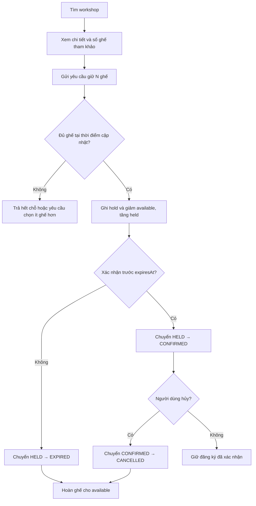
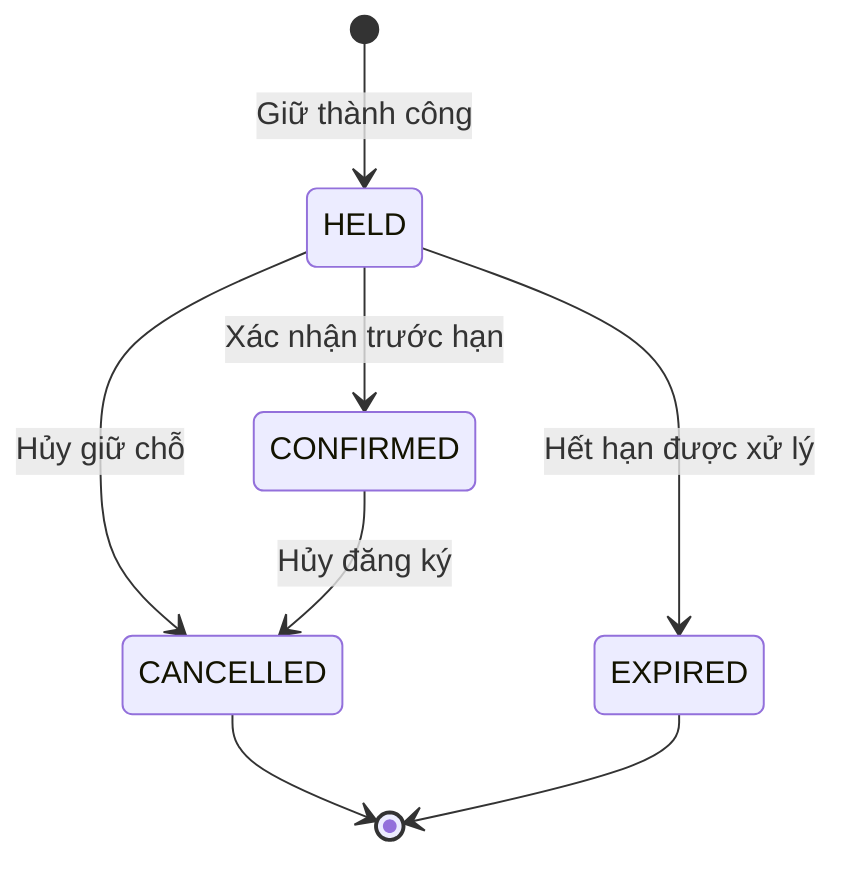

# Mô tả một nghiệp vụ và lập danh sách truy vấn cùng các bất biến

Khi xây dựng hệ thống dùng **Database NoSQL**, lỗi thiết kế thường xuất hiện trước cả khi viết câu truy vấn đầu tiên: nhóm phát triển chọn collection, bảng hoặc partition key nhưng chưa thống nhất người dùng cần làm gì, đọc dữ liệu theo cách nào và những điều kiện nghiệp vụ nào tuyệt đối không được vi phạm.

Với cơ sở dữ liệu quan hệ, việc chuẩn hóa schema rồi xây dựng truy vấn khá quen thuộc. Trong nhiều hệ NoSQL, đặc biệt với key-value và wide-column store, **mẫu truy cập dữ liệu (access pattern)** còn quyết định cách chọn khóa, index, partition và dữ liệu cần nhân bản. Vì vậy, một bài thực hành tổng hợp nên bắt đầu từ ba sản phẩm có thể kiểm chứng:

1. **Mô tả nghiệp vụ:** tác nhân, mục tiêu, luồng thành công, luồng lỗi, ranh giới và giả định.
2. **Danh sách truy vấn/thao tác:** mỗi thao tác đọc hoặc ghi có đầu vào, bộ lọc, sắp xếp, độ lớn kết quả, tần suất và kỳ vọng nhất quán.
3. **Bất biến nghiệp vụ (invariant):** các mệnh đề phải luôn đúng sau mỗi chuyển trạng thái đã được xác nhận, kể cả khi yêu cầu đồng thời, timeout hoặc bị thử lại.

Bài này triển khai xuyên suốt một ví dụ **đặt chỗ workshop có số ghế giới hạn**. Ví dụ đủ nhỏ để hiểu mà vẫn chứa các vấn đề NoSQL thực tế: đọc danh sách, khóa duy nhất, cập nhật có điều kiện, một yêu cầu thay đổi nhiều bản ghi, giữ chỗ tạm thời, hết hạn, retry và báo cáo.

## 1. Bước đầu: viết một mô tả nghiệp vụ có thể kiểm thử

### 1.1. Bối cảnh và mục tiêu

Một nền tảng tổ chức workshop cho phép người dùng xem những buổi học còn chỗ, giữ trước từ 1 đến 4 ghế, rồi xác nhận đăng ký trong một khoảng thời gian. Người dùng có thể hủy. Nếu giữ chỗ quá hạn mà chưa xác nhận, hệ thống giải phóng ghế để người khác đặt.

Nền tảng có ba nhóm người tham gia:

| Tác nhân | Mục tiêu | Quyền tương ứng |
|---|---|---|
| Khách truy cập | Tìm workshop và xem số chỗ đang nhận đặt | Chỉ đọc thông tin công khai |
| Người đăng ký | Giữ, xác nhận, hủy và xem lịch sử đặt chỗ của mình | Thao tác trên reservation thuộc chính mình |
| Người tổ chức | Tạo lịch workshop, xem danh sách đặt chỗ và báo cáo tổng hợp | Quản lý các buổi workshop của tổ chức được phân quyền |
| Tiến trình hệ thống | Giải phóng các hold quá hạn, phát sự kiện cho hệ khác | Chạy nền theo phạm vi và quyền được cấu hình |

**Phạm vi của bài thực hành:** một đơn đặt chỗ (*reservation*) thuộc **một workshop session**; `quantity` là số ghế nguyên dương, tối đa 4. Chưa xét thanh toán, voucher, chọn số ghế cụ thể, ghế theo hạng và hoàn tiền. Nếu bổ sung các nghiệp vụ đó, cần xem lại danh mục thao tác lẫn bất biến.

Quy tắc nghiệp vụ ban đầu:

- Một session có `capacity` ghế cố định sau khi mở đăng ký.
- Mỗi lần giữ chỗ được cấp một `reservationId` và có `expiresAt`.
- Giữ chỗ chỉ thành công khi còn đủ ghế.
- Xác nhận chỉ được thực hiện khi hold vẫn còn hiệu lực.
- Hủy hold hoặc hủy đăng ký đã xác nhận trả lại đúng số ghế đã lấy.
- Một yêu cầu bị gửi lại với cùng `idempotencyKey` không được tác động lên ghế lần nữa.
- Danh sách công khai có thể hiển thị số ghế trễ nhẹ; **quyết định chấp nhận giữ chỗ luôn phải dựa trên kiểm tra nguyên tử tại thời điểm ghi**.

Đây là giả định thiết kế cho bài học, chưa phải yêu cầu mặc định của mọi hệ thống bán vé hoặc đặt lịch.

### 1.2. Viết user story và điều kiện chấp nhận

Ví dụ user story:

> Là người đăng ký, tôi muốn giữ hai ghế cho một workshop để có thời gian xác nhận, và tôi không muốn bị trừ ghế hai lần nếu mạng làm ứng dụng gửi lại yêu cầu.

Điều kiện chấp nhận:

1. Khi session còn ít nhất hai ghế, thao tác giữ chỗ mới có thể thành công và trả về mã đặt chỗ, thời điểm hết hạn.
2. Nếu chỉ còn một ghế, giữ hai ghế bị từ chối; mọi bộ đếm và reservation vẫn đúng.
3. Hai yêu cầu tranh cùng số ghế cuối không được khiến tổng số ghế được giữ và xác nhận vượt quá sức chứa.
4. Gửi lại cùng yêu cầu và khóa idempotency phải trả về kết quả đã có hoặc trạng thái có thể tra cứu, không tạo thêm chỗ.
5. Sau khi quá hạn, hold không còn được phép xác nhận; một tiến trình nền cuối cùng giải phóng ghế.

Việc viết điều kiện chấp nhận trước giúp tránh các câu mơ hồ như “hỗ trợ concurrency”, “data consistency tốt” hoặc “đảm bảo không mất dữ liệu” nhưng không có cách chứng minh.

### 1.3. Mô tả luồng thành công và luồng thay thế



Một luồng thành công không đủ: cần mô tả trường hợp cùng lúc hai người giữ chỗ, người dùng đóng trình duyệt, tiến trình giải phóng đến muộn, mất kết nối sau khi commit và thao tác hủy đụng độ thao tác xác nhận.

## 2. Từ lời kể sang ngôn ngữ miền nghiệp vụ

### 2.1. Xác định thực thể và thuộc tính

**WorkshopSession** đại diện cho một buổi tổ chức cụ thể; nhiều buổi cùng tên có thể diễn ra ở thời điểm khác nhau.

| Thuộc tính | Ý nghĩa |
|---|---|
| `sessionId` | Khóa ổn định của một buổi |
| `organizerId` | Đơn vị tổ chức |
| `title`, `category`, `startsAt` | Thông tin hiển thị và tìm kiếm |
| `capacity` | Tổng số ghế có thể nhận |
| `available` | Ghế chưa phân bổ |
| `held` | Ghế đang được giữ tạm |
| `confirmed` | Ghế đã đăng ký thành công |
| `status` | `DRAFT`, `OPEN`, `CLOSED` hoặc `FINISHED` |
| `version` | Phiên bản dùng cho cập nhật có điều kiện nếu cần |

**Reservation** đại diện cho yêu cầu giữ và quá trình xác nhận/hủy:

| Thuộc tính | Ý nghĩa |
|---|---|
| `reservationId` | Khóa đặt chỗ |
| `sessionId`, `userId` | Buổi học và chủ thể đặt |
| `quantity` | Số ghế, từ 1 đến 4 |
| `state` | `HELD`, `CONFIRMED`, `CANCELLED`, `EXPIRED` |
| `createdAt` | Thời điểm tạo |
| `expiresAt` | Thời hạn xác nhận hold |
| `confirmedAt`, `cancelledAt` | Dấu thời gian chuyển trạng thái |
| `idempotencyKey` | Khóa bảo vệ retry của một yêu cầu nghiệp vụ |
| `requestFingerprint` | Dấu vân tay nội dung đã chuẩn hóa, để phát hiện dùng lại khóa sai payload |

Một session có thể có nhiều reservation. Khi người dùng hủy rồi đặt lại, đó có thể là **reservation mới** với khóa mới; không nhất thiết phục hồi bản ghi đã hủy.

### 2.2. Ví dụ dữ liệu ở dạng document

```json
{
  "_id": "session-ws-101",
  "organizerId": "org-42",
  "title": "Workshop lập trình Java",
  "category": "software",
  "startsAt": "2026-12-05T02:00:00Z",
  "status": "OPEN",
  "capacity": 12,
  "available": 12,
  "held": 0,
  "confirmed": 0,
  "version": 1
}
```

```json
{
  "_id": "res-1001",
  "sessionId": "session-ws-101",
  "userId": "user-07",
  "quantity": 2,
  "state": "HELD",
  "createdAt": "2026-12-01T03:00:00Z",
  "expiresAt": "2026-12-01T03:10:00Z",
  "idempotencyKey": "hold-request-001",
  "requestFingerprint": "hash-of-normalized-request"
}
```

Các timestamp trên dùng UTC và kiểu JSON string để dễ đọc. Trong ứng dụng thật, dùng kiểu thời gian phù hợp với driver/database, thống nhất cách biểu diễn khi ghi và so sánh; không so thời gian từ hai máy với quy ước khác nhau.

### 2.3. Phân biệt dữ liệu nguồn với dữ liệu suy ra

`available`, `held` và `confirmed` là các **bộ đếm lưu cùng session** để quyết định nhanh có đủ ghế không. Đồng thời, trạng thái reservation chính là dữ liệu nguồn để đối chiếu số lượng đã giữ/xác nhận.

Thiết kế này chủ động **phi chuẩn hóa** vì đọc tổng số ghế không phải quét toàn bộ reservation. Đổi lại, mỗi chuyển trạng thái phải cập nhật cả reservation và các bộ đếm theo cùng một cơ chế đúng đắn. Nếu datastore không hỗ trợ cập nhật nguyên tử cho cả hai đối tượng như thiết kế, cần thay mô hình lưu dữ liệu hoặc quy trình điều phối.

## 3. Vẽ máy trạng thái trước khi viết truy vấn

Máy trạng thái giúp phát hiện những chuyển đổi không được phép như xác nhận hold đã hủy hoặc hoàn ghế hai lần.



Hai trạng thái kết thúc `CANCELLED` và `EXPIRED` được giữ làm lịch sử. Hệ thống không xóa ngay reservation vừa hết hạn chỉ để “tiết kiệm dữ liệu”, bởi thao tác xóa không bảo đảm ghế đã được hoàn và có thể làm mất bằng chứng khi xử lý yêu cầu gửi lại.

| Trạng thái hiện tại | Lệnh | Điều kiện | Trạng thái mới | Điều chỉnh ghế |
|---|---|---|---|---|
| Chưa có reservation | Hold | Session `OPEN`, đủ ghế, khóa request mới | `HELD` | `available -= q`, `held += q` |
| `HELD` | Confirm | `now < expiresAt` và quyền hợp lệ | `CONFIRMED` | `held -= q`, `confirmed += q` |
| `HELD` | Cancel | Người có quyền hủy | `CANCELLED` | `held -= q`, `available += q` |
| `HELD` | Expire | `now >= expiresAt` | `EXPIRED` | `held -= q`, `available += q` |
| `CONFIRMED` | Cancel | Chính sách cho phép hủy | `CANCELLED` | `confirmed -= q`, `available += q` |
| `EXPIRED` | Confirm | Bất kỳ | Không đổi | Không đổi |
| `CANCELLED` | Cancel lặp | Bất kỳ | Không đổi | Không đổi |

Trong ví dụ, `q = reservation.quantity` và các thay đổi của một dòng phải được thực hiện như **một chuyển trạng thái logic**. Không được coi phần cập nhật bộ đếm và phần cập nhật reservation là hai thành công độc lập.

## 4. Lập danh sách truy vấn theo từng tình huống sử dụng

Với NoSQL, nên bắt đầu từ nhu cầu **ai cần tìm dữ liệu gì**, theo **điều kiện nào**, **theo thứ tự nào**, **trả tối đa bao nhiêu**, **bao nhiêu lần mỗi giây**. Sau đó mới quyết định khóa và index.

Một bản catalog truy vấn dùng các cột:

- **ID:** tham chiếu ổn định để nối với API, index, test và bất biến.
- **Mục tiêu:** câu hỏi nghiệp vụ mà truy vấn trả lời.
- **Input/Filter:** khóa tìm kiếm và điều kiện.
- **Sort/Page:** cách giới hạn và sắp xếp kết quả.
- **Output:** trường cần trả, có bao gồm dữ liệu nhạy cảm không.
- **Cardinality/Load:** kích thước dự kiến và tần suất.
- **Consistency:** mức mới của dữ liệu, tính nguyên tử hoặc quy tắc giao dịch.
- **Invariants:** những điều cần bảo vệ/kiểm chứng.

### 4.1. Catalog thao tác đọc

| ID | Ai gọi / mục tiêu | Filter và sort | Dữ liệu trả về | Kỳ vọng |
|---|---|---|---|---|
| **Q01** | Khách xem một buổi | `sessionId = ?` | Tiêu đề, thời gian, trạng thái, số ghế tham khảo | Đọc theo khóa; số ghế hiển thị có thể trễ theo hợp đồng |
| **Q02** | Khách tìm workshop sắp mở | `category = ?`, `status = OPEN`, `startsAt >= now`, sort thời gian tăng | Danh sách tóm tắt, cursor | Phân trang; tránh full scan |
| **Q03** | Khách tìm theo organizer | `organizerId = ?`, `startsAt` trong khoảng | Các buổi của đơn vị tổ chức | Đọc theo organizer và thời gian |
| **Q04** | Người dùng xem đặt chỗ | `reservationId = ?` + kiểm quyền `userId` | Trạng thái, `expiresAt`, `quantity` | Không trả reservation người khác |
| **Q05** | Người dùng xem lịch sử | `userId = ?`, sort `createdAt` giảm, cursor | Các reservation của người dùng | Trang ổn định, không quét toàn bộ dữ liệu |
| **Q06** | Tổ chức xem danh sách buổi | `sessionId = ?`, lọc trạng thái, phân trang | Danh sách reservation đã cho phép hiển thị | Chỉ organizer sở hữu session |
| **Q07** | Tổ chức xem tổng số chỗ | `sessionId = ?` | `available`, `held`, `confirmed`, `capacity` | Từ bản ghi session đã được cập nhật đúng |
| **Q08** | Quản trị xem báo cáo theo ngày | `organizerId` và khoảng thời gian | Số hold, xác nhận, hủy theo buổi | Có thể là read model/báo cáo bất đồng bộ |

Với Q02, trường `startsAt >= now` thay đổi liên tục. Không sử dụng giá trị `now` như một phần khóa lưu vật lý; truy vấn dùng tham số thời gian hiện tại và index/range access thích hợp. Với Q04, việc tìm bằng `reservationId` rất nhanh nhưng **chưa đủ bảo mật**: phải xác định reservation thuộc user đang xác thực, hoặc người có quyền quản lý session.

### 4.2. Catalog lệnh ghi và tác vụ nền

| ID | Lệnh / mục đích | Đọc/điều kiện tại thời điểm ghi | Thay đổi | Điều kiện thành công |
|---|---|---|---|---|
| **C01** | Tạo session | `sessionId` mới, organizer hợp lệ | Tạo session, các bộ đếm từ capacity | Không tạo trùng ID |
| **C02** | Giữ `q` ghế | Session `OPEN`, `available >= q`, idempotency hợp lệ | Tạo reservation `HELD` và cập nhật counters | Hai thay đổi cùng thành công |
| **C03** | Xác nhận hold | Reservation `HELD`, chưa hết hạn, đúng người | `HELD → CONFIRMED`, chuyển `held → confirmed` | Chỉ xác nhận một lần |
| **C04** | Hủy reservation | `HELD` hoặc `CONFIRMED`, còn được hủy | Chuyển `CANCELLED`, trả đúng ghế | Hủy lặp không hoàn ghế lần hai |
| **C05** | Expire hold | `HELD` và `expiresAt <= now` | `HELD → EXPIRED`, trả ghế | Không tranh thắng C03/C04 trên cùng hold |
| **C06** | Đổi thời gian session | Có quyền organizer, chính sách thay đổi cho phép | Cập nhật thuộc tính lịch và version | Không làm vô hiệu hóa reservation nếu chưa có quy trình xử lý |
| **C07** | Xuất sự kiện thay đổi | Có chuyển trạng thái commit | Lưu hoặc phát event cho downstream | Retry an toàn, có thể đối soát |

Các ID `Qxx` là truy vấn/đọc, `Cxx` là command/thao tác ghi. Trong tài liệu kiến trúc NoSQL, “query catalog” thường bao gồm cả read và write access pattern; đặt tên riêng giúp làm rõ lệnh nào cần điều kiện nguyên tử.

### 4.3. Ghi thêm tần suất và giới hạn dữ liệu

Giả sử hệ thống thử nghiệm có:

| Access pattern | Tải giả định | Kích thước kết quả | Chỉ tiêu minh họa |
|---|---|---|---|
| Q01 xem session | 300 lần/giây | 1 document | p95 dưới 100 ms trong môi trường đo đã chọn |
| Q02 liệt kê | 80 lần/giây | Tối đa 20 item/trang | p95 dưới 200 ms |
| Q05 lịch sử cá nhân | 40 lần/giây | Tối đa 30 item/trang | Có cursor, không tải toàn bộ lịch sử |
| C02 giữ chỗ | 40 lần/giây, có burst/hot session | 1 session + 1 reservation | Không oversell, phản hồi theo deadline nghiệp vụ |
| C03 xác nhận | 20 lần/giây | 1 reservation + 1 session | Không xác nhận quá hạn |
| C05 expire hold | Batch định kỳ | Một số hold quá hạn mỗi lần quét | Có giới hạn batch và có thể chạy lại an toàn |

Đây là **dữ liệu đặt ra cho bài tập**, không phải benchmark hoặc chuẩn SLO cho mọi hệ thống. Trong sản phẩm thật phải đo hoặc ước lượng từ người dùng, chiến dịch bán hàng và tăng trưởng. C02 có thể tập trung vào một session rất nóng dù tổng 40 lần/giây có vẻ thấp.

## 5. Viết bất biến dưới dạng mệnh đề có thể kiểm tra

**Bất biến** là điều kiện mà trạng thái bền vững của hệ thống phải thỏa sau mỗi thao tác đã commit. Khác với một yêu cầu UI, bất biến có thể kiểm bằng truy vấn hoặc kiểm chứng bằng phép tính.

Đối với session `s`:

- \(C_s\): tổng sức chứa (`capacity`).
- \(A_s\): số ghế còn trống (`available`).
- \(H_s\): số ghế đang giữ (`held`).
- \(F_s\): số ghế đã xác nhận (`confirmed`).

### 5.1. I01 — Bảo toàn số ghế

\[
\boxed{C_s=A_s+H_s+F_s}
\]

Mọi số lượng đều là số nguyên không âm:

\[
C_s\ge 0,\quad A_s\ge 0,\quad H_s\ge 0,\quad F_s\ge 0
\]

Nếu `capacity = 12`, `available = 4`, `held = 3`, `confirmed = 5`, bất biến đúng. Nhưng `available = 4`, `held = 4`, `confirmed = 5` làm tổng thành 13, tức đã phát sinh sai lệch dù từng bộ đếm riêng lẻ không âm.

I01 phải đúng sau **mọi chuyển trạng thái đã commit**. Các giá trị trả qua cache hoặc báo cáo bất đồng bộ có thể trễ, nhưng bản ghi authoritative cần bảo toàn quan hệ này.

### 5.2. I02 — Bộ đếm khớp reservation thực tế

Với tập reservation thuộc session \(s\):

\[
H_s=\sum_{\substack{r.sessionId=s\\r.state=HELD}}r.quantity
\]

\[
F_s=\sum_{\substack{r.sessionId=s\\r.state=CONFIRMED}}r.quantity
\]

Nếu một hold quá hạn **chưa được worker chuyển sang `EXPIRED`**, nó vẫn ở trạng thái `HELD` và vẫn được tính trong `held`; không được tự loại khỏi tổng chỉ vì thời gian đã qua. Nó **không đủ điều kiện xác nhận** nhưng ghế chỉ được giải phóng khi chuyển trạng thái và cập nhật bộ đếm cùng commit.

I02 đòi hỏi mọi quy trình thay đổi reservation và bộ đếm đều thống nhất. Có thể dùng kiểm tra đối soát định kỳ để tìm sai lệch, nhưng đối soát không thay thế cơ chế cập nhật đúng tại thời điểm giao dịch.

### 5.3. I03 — Không giữ vượt khả năng phục vụ

Đối với lệnh C02 yêu cầu giữ \(q\) ghế:

\[
1\le q\le 4,\quad A_s^{before}\ge q
\]

Nếu lệnh thành công:

\[
A_s^{after}=A_s^{before}-q,\qquad
H_s^{after}=H_s^{before}+q
\]

Nếu không đáp ứng điều kiện, không có thay đổi nào được commit. Kiểm tra `available` bằng một phép đọc rồi ghi vô điều kiện tạo ra lỗi race: hai client cùng thấy còn một ghế có thể đều xác nhận giữ thành công.

### 5.4. I04 — Mỗi yêu cầu chỉ có một hiệu quả nghiệp vụ

Một `idempotencyKey` thuộc scope của người dùng/tổ chức và loại hành động phải ánh xạ tới cùng một yêu cầu chuẩn hóa và **cùng một kết quả bền vững**. Dùng lại khóa nhưng thay `sessionId` hoặc `quantity` là xung đột.

Lưu khóa cùng dấu vân tay của payload và áp dụng unique constraint/conditional create trên key đúng scope. Không chỉ “đọc chưa có rồi insert” vì hai client có thể cùng thấy chưa có.

Chính sách giữ idempotency record trong bao lâu phải dài đủ cho khoảng retry đã cam kết. Nếu xóa quá sớm, client gửi lại một yêu cầu cũ có thể tạo hiệu quả mới.

### 5.5. I05 — Chuyển trạng thái hợp lệ và chỉ một lần

Các chuyển đổi chỉ nằm trong máy trạng thái ở mục 3. Hai tác vụ cùng muốn chuyển `HELD` sang trạng thái khác phải có tối đa một tác vụ thành công từ **cùng trạng thái ban đầu**.

Ví dụ, xác nhận và expire đến cùng lúc: không thể vừa chuyển `HELD → CONFIRMED` vừa chuyển `HELD → EXPIRED` và cả hai đều sửa bộ đếm. Cần cập nhật có điều kiện theo `state = HELD` kết hợp giới hạn thời gian, hoặc cơ chế transaction/concurrency tương đương.

### 5.6. I06 — Hết hạn có ngữ nghĩa rõ ràng

- C03 chỉ thành công khi `state = HELD` và `now < expiresAt`.
- C05 chỉ thành công khi `state = HELD` và `now >= expiresAt`.
- `now` phải được xác định theo quy ước thời gian nhất quán, có lưu ý độ lệch đồng hồ; ứng dụng có thể dùng thời điểm đáng tin cậy từ backend và chính sách deadline đã thống nhất.

Worker chạy trễ được phép khiến hold tồn tại thêm một thời gian ở trạng thái `HELD`, nhưng không được khiến hold đó được xác nhận sau hạn. Việc “đến hạn thì xóa record bằng TTL” không tự làm giảm `held` hay tăng `available`.

### 5.7. I07 — Hủy không hoàn ghế hai lần

Nếu hủy một reservation `HELD` có `quantity=q`, chỉ một chuyển đổi được phép tăng `available` lên \(q\). Hủy lặp phải trả kết quả idempotent hoặc trạng thái đã hủy, không cộng thêm lần nữa.

Nếu hủy `CONFIRMED`, giảm `confirmed` và tăng `available` theo chính sách; không giảm `held` vốn đã về 0 khi xác nhận. Đây là hai nhánh logic khác nhau, không nên dùng một lệnh “hoàn ghế” mù trạng thái.

### 5.8. I08 — Quyền sở hữu và ranh giới dữ liệu

Một `userId` chỉ đọc, xác nhận hoặc hủy reservation của chính mình; organizer chỉ xem được dữ liệu thuộc session mà họ quản lý. Lấy được `reservationId` không đồng nghĩa được quyền thao tác.

Trong môi trường nhiều tenant, mọi truy vấn theo khóa phải kết hợp kiểm tra tenant/ownership hoặc kiểm soát tương đương. Tránh dùng tham số `userId` từ request body làm bằng chứng danh tính; danh tính phải lấy từ cơ chế xác thực đã được xác minh.

### 5.9. I09 — Dữ liệu đã xác nhận phải phục hồi được

Một reservation đã được trả lời `CONFIRMED` chỉ được coi là thành công theo mức durability/consistency được cấu hình. Nếu client timeout quanh thời điểm commit, kết quả có thể chưa rõ; tra cứu theo khóa idempotency/reservation trước khi thực hiện lại.

Mất response **không chứng minh thao tác chưa ghi**. Nếu phải retry, sử dụng cùng định danh và cùng payload, không tạo reservation mới chỉ vì response cũ biến mất.

### 5.10. I10 — Sự kiện phụ trợ không làm sai nguồn dữ liệu chuẩn

Nếu hệ phát `ReservationConfirmed` đến email hoặc báo cáo, một lần retry transaction không được gửi email hoặc message trực tiếp từ callback có thể chạy lại. Dùng outbox khi backend hỗ trợ cập nhật nguyên tử cùng dữ liệu nguồn, hoặc quy trình phát sự kiện có đối soát, consumer idempotent và giải thích rõ giới hạn.

Các báo cáo có thể trễ, nhưng cuối cùng phải hội tụ với dữ liệu đã commit, không ghi nhận hai lần cùng một event nghiệp vụ.

### 5.11. Ma trận bất biến và nơi kiểm tra

| ID | Bất biến | Thao tác có nguy cơ vi phạm | Bằng chứng kiểm chứng |
|---|---|---|---|
| I01 | `capacity = available + held + confirmed`; không âm | C01–C05 | Đọc counters sau mỗi chuyển trạng thái |
| I02 | `held/confirmed` khớp tổng reservation theo trạng thái | C02–C05 | Aggregate reservation theo `sessionId` |
| I03 | Không chấp nhận hold nếu không đủ ghế | C02 | Kiểm thao tác đồng thời và tổng ghế cuối |
| I04 | Một idempotency key không tạo hai hiệu quả | C02, retry C03/C04 | Unique record, fingerprint, stock delta |
| I05 | Chuyển trạng thái đúng sơ đồ, một lần | C03–C05 | Lịch sử state transition và counters |
| I06 | Không confirm hold hết hạn | C03, C05 | Thử ở biên thời gian và lịch thực thi đồng thời |
| I07 | Hủy chỉ hoàn ghế một lần | C04 | Hủy lặp/hủy cạnh tranh |
| I08 | Chủ thể không truy cập dữ liệu ngoài quyền | Q04/Q06, C03/C04 | Kiểm truy cập chéo user/organizer |
| I09 | Dữ liệu đã xác nhận không biến mất ngoài hợp đồng durability | C02/C03, failover | Đối chiếu trước/sau sự cố |
| I10 | Event/retry không tạo tác dụng phụ trùng | C07, consumer | Replay event, consumer restart, reconciliation |

## 6. Gắn truy vấn và bất biến với cách lưu NoSQL

Không nên chọn index chỉ vì một câu truy vấn “có thể” xuất hiện. Dùng catalog ở mục 4 để xác định những đường truy cập quan trọng nhất.

### 6.1. Đề xuất bố trí collection cho MongoDB

Ví dụ có hai collection:

```text
sessions
  _id
  organizerId, category, startsAt, status
  capacity, available, held, confirmed, version

reservations
  _id
  sessionId, userId, quantity, state
  idempotencyKey, requestFingerprint
  createdAt, expiresAt, confirmedAt, cancelledAt
```

Index ứng viên theo truy vấn:

| Truy vấn | Index ứng viên | Ghi chú |
|---|---|---|
| Q01/Q07 | `sessions._id` | Đọc trực tiếp một document |
| Q02 | `(category, status, startsAt, _id)` | Hỗ trợ lọc và phân trang theo thời gian; xác nhận bằng `explain` |
| Q03 | `(organizerId, startsAt, _id)` | Duyệt session của organizer theo thời gian |
| Q04 | `reservations._id`, kiểm `userId` | Có thể lọc ownership ngay trong query |
| Q05 | `(userId, createdAt desc, _id desc)` | Keyset pagination; tránh `skip` quá sâu |
| Q06 | `(sessionId, state, createdAt desc, _id desc)` | Danh sách reservation theo trạng thái |
| C05 | `(state, expiresAt, _id)` | Tìm hold quá hạn bằng batch |
| C02 retry | Unique key trên scope của `idempotencyKey` | Bảo đảm uniqueness ở cấp database |

Danh sách này chỉ là **ứng viên để thử**, không khẳng định mọi index đều cần. Chúng làm tăng chi phí ghi và dung lượng; phải kiểm chứng bằng kế hoạch truy vấn, cardinality và thống kê workload. Nếu shard collection, cần xét quy tắc unique index và shard key của phiên bản MongoDB cụ thể.

### 6.2. Khi dùng DynamoDB hoặc wide-column

Với hệ thiên về truy vấn theo partition key, có thể cần:

- Key cho session theo `sessionId`.
- Key/index để liệt kê session theo `category` và `startsAt`.
- Key/index để lấy lịch sử reservation theo `userId` và `createdAt`.
- Key/index/tác vụ riêng để duyệt hold hết hạn theo khoảng thời gian mà không phải scan toàn bộ bảng.

Trong DynamoDB, key model và GSI thường xuất phát từ access pattern; cập nhật có điều kiện dùng `ConditionExpression`. Nếu C02 cập nhật **cả session và reservation**, cần thiết kế transaction nhiều item như `TransactWriteItems` trong phạm vi giới hạn của dịch vụ, hoặc thay đổi mô hình để giữ bất biến theo cơ chế khác. Không xem việc có GSI là bảo đảm đọc ngay dữ liệu mới nhất; GSI có đặc tính nhất quán riêng.

Trong Cassandra, cần chọn partition key để mỗi truy vấn đọc hiệu quả và kiểm tra tính phù hợp của lightweight transaction (LWT) nếu nghiệp vụ cần compare-and-set. Không giả định transaction nhiều partition tương đương cơ chế MongoDB. Nếu thiết kế không thể thực thi I01–I07 một cách chấp nhận được, đó là tín hiệu cần sửa thiết kế hoặc cân nhắc datastore khác, không phải lý do để bỏ bớt bất biến.

### 6.3. Đặt câu hỏi về dữ liệu nhân bản

Q02 hiển thị số ghế trong danh sách workshop. Nếu câu truy vấn danh sách quá đắt vì phải đọc nhiều session, có thể tạo read model/search index riêng. Khi đó phải ghi rõ:

- Nguồn chuẩn của `available` là gì?
- Read model được cập nhật qua event/change stream với độ trễ dự kiến bao lâu?
- UI có chấp nhận hiển thị “còn chỗ” dù C02 vừa thất bại vì chỗ đã hết không?
- Có thể phục hồi read model bằng backfill/replay không?

Cho phép cache/read model trễ là quyết định UX; **không được lấy số ghế cũ từ cache để ghi một hold thành công**.

## 7. Biến bất biến thành lệnh ghi nguyên tử

Tư duy triển khai bắt đầu từ bất biến, sau đó chọn primitive dữ liệu đáp ứng nó. Không cần viết tất cả lệnh trong bài phân tích yêu cầu, nhưng nên chứng minh một trường hợp quan trọng có cách thực hiện hợp lý.

### 7.1. Lỗi của “đọc rồi ghi”

Giả sử còn một ghế:

```text
T1: đọc available = 1
T2: đọc available = 1
T1: tạo reservation R1 (1 ghế)
T2: tạo reservation R2 (1 ghế)
T1: cập nhật available = 0
T2: cập nhật available = 0
Kết quả: available không âm, nhưng có hai hold cho một ghế
```

Việc chỉ kiểm `available >= 0` có thể bỏ sót lỗi. I02 và I03 sẽ phát hiện sự không nhất quán giữa số reservation và số ghế thực.

### 7.2. Lệnh có điều kiện trên một document

Trong MongoDB, một bước điều chỉnh ghế có thể sử dụng filter và update nguyên tử trên **một session**:

```javascript
db.sessions.updateOne(
  {
    _id: "session-ws-101",
    status: "OPEN",
    available: { $gte: 2 }
  },
  {
    $inc: {
      available: -2,
      held: 2,
      version: 1
    }
  }
);
```

Lệnh này bảo vệ việc trừ ghế trong một document. Nhưng **nó chưa đủ** để bảo đảm cùng lúc tạo được reservation tương ứng. Nếu insert reservation thất bại sau update, I02 sẽ sai.

### 7.3. Ranh giới giao dịch cho C02

Trong một backend hỗ trợ transaction nhiều document phù hợp, có thể thực hiện ý tưởng sau:

```text
HOLD(sessionId, userId, quantity, idempotencyKey):
  validate input và quyền
  nếu idempotencyKey đã tồn tại:
      so sánh fingerprint
      cùng nội dung → trả kết quả đã lưu
      khác nội dung → trả conflict

  transaction:
      insert reservation(HELD, quantity, expiresAt, idempotencyKey)
      update session
          WHERE _id = sessionId
            AND status = OPEN
            AND available >= quantity
          SET available = available - quantity
              held = held + quantity
      nếu không có session nào khớp:
          abort transaction
  commit
  trả reservationId, expiresAt
```

Unique constraint trên idempotency key bảo vệ trường hợp **hai giao dịch cùng thấy khóa chưa tồn tại**. Nếu insert bị duplicate, lớp service đọc lại reservation và xử lý replay/conflict theo cùng fingerprint. Khi transaction có kết quả commit chưa rõ, phải truy hồi thay vì đổi sang khóa mới.

Mỗi lệnh thay đổi counters và reservation cần cùng ranh giới commit. Ví dụ C03 cũng dùng điều kiện `state=HELD AND expiresAt>now` để chỉ một luồng xác nhận; các counters được chuyển tương ứng trong cùng transaction. C05 dùng `state=HELD AND expiresAt<=now` và cạnh tranh với C03/C04 trên cùng reservation.

**Không dựa vào TTL để tự hoàn ghế:** TTL thường chỉ xóa record theo điều kiện thời gian; nó không thực hiện logic giảm `held` và tăng `available` theo nguyên tắc nghiệp vụ. Chỉ xóa hoặc lưu trữ bản ghi sau khi chuyển trạng thái và hết nhu cầu idempotency/audit.

### 7.4. Một chiến lược khác cũng cần được đánh giá

Nếu backend không có transaction đa document với bảo đảm phù hợp, có thể thiết kế **một document duy nhất làm aggregate cho mỗi session**, trong đó thông tin giữ chỗ nằm trong cùng ranh giới nguyên tử, hoặc dùng bộ đếm phân bổ vé/tài nguyên theo cơ chế điều phối chặt chẽ. Điều này thay đổi giới hạn kích thước document, contention, cách tìm lịch sử theo người dùng và chi phí ghi.

Không có một cấu trúc dữ liệu lý tưởng cho mọi backend. Điểm đánh giá quan trọng là **có thể chứng minh các bất biến khi hoạt động đồng thời hay không**, với tải và chi phí chấp nhận được.

## 8. Tính thử trên một dòng thời gian dữ liệu

Giả sử session có `capacity = 12`, ban đầu chưa ai đăng ký.

| Bước | Hành động | available | held | confirmed | Tổng |
|---|---|---:|---:|---:|---:|
| 0 | Tạo session | 12 | 0 | 0 | 12 |
| 1 | U1 giữ 2 ghế | 10 | 2 | 0 | 12 |
| 2 | U2 giữ 3 ghế | 7 | 5 | 0 | 12 |
| 3 | U1 xác nhận | 7 | 3 | 2 | 12 |
| 4 | U2 hết hạn và được worker xử lý | 10 | 0 | 2 | 12 |
| 5 | U3 giữ 4 ghế | 6 | 4 | 2 | 12 |
| 6 | U3 hủy hold | 10 | 0 | 2 | 12 |
| 7 | U1 hủy đăng ký đã xác nhận | 12 | 0 | 0 | 12 |

Ở mọi bước, tổng đúng 12. Nếu worker xử lý expiry của U2 hai lần mà cộng lại 3 ghế ở lần hai, `available` trở thành 13 ở bước 4 và I01 sai. Nếu U1 xác nhận từ hold đã hết hạn, I06 sai dù bộ đếm có thể vẫn cộng đúng.

### 8.1. Một phép thử cạnh tranh ngắn

Thiết lập `capacity=1`, `available=1`. Hai user đồng thời yêu cầu giữ một ghế với **hai idempotency key khác nhau**:

```text
Given: 1 ghế trống, không có reservation
When: U1 và U2 cùng thực hiện C02
Then:
  đúng tối đa 1 reservation HELD được commit
  available = 0, held = 1, confirmed = 0 nếu có 1 bên thành công
  bên còn lại nhận hết chỗ hoặc kết quả xử lý lỗi phù hợp
  không có reservation được tạo dở nhưng thiếu ghế
```

Kết quả không cần quy định U1 luôn thắng. Lịch chạy quyết định ai thắng; bất biến quyết định **điều gì không được sai**.

## 9. Liên kết catalog truy vấn với bộ kiểm thử

Danh sách truy vấn chỉ hữu ích khi có thể dùng nó làm cơ sở kiểm thử. Lập ma trận sau:

| Test ID | Truy vấn/lệnh | Tình huống | Điều được chứng minh |
|---|---|---|---|
| T01 | Q01/Q02 | Tìm session bằng ID, category, ngày; có phân trang | Đường đọc phục vụ đúng trường và thứ tự |
| T02 | C02 | Giữ đúng số ghế khi còn đủ | I01–I03 |
| T03 | C02 | Giữ vượt số ghế còn trống | Không thay đổi dữ liệu khi điều kiện sai |
| T04 | C02 | Hai luồng cùng giành ghế cuối | Không oversell, không sinh reservation dở |
| T05 | C02 | Gửi lại cùng idempotency key, cùng payload | I04, không giữ thêm ghế |
| T06 | C02 | Cùng idempotency key, khác quantity | Từ chối conflict, giữ kết quả ban đầu |
| T07 | C03 | Xác nhận trước hạn | `held` giảm, `confirmed` tăng, trạng thái đúng |
| T08 | C03/C05 | Confirm và expiry tranh cùng hold | Chỉ một chuyển trạng thái thắng |
| T09 | C04/C05 | Cancel và expiry chạy đồng thời | Không hoàn ghế hai lần |
| T10 | C04 | Hủy lặp và retry sau timeout | I07, I09 |
| T11 | Q04/Q06/C03 | Người dùng khác cố truy cập/hủy | I08, không lộ dữ liệu |
| T12 | C05 | Worker chạy muộn sau thời gian hết hạn | Không cho xác nhận quá hạn; cuối cùng giải phóng ghế |
| T13 | C02/C03 | Lỗi sau khi sửa một record nhưng trước commit | Không để dữ liệu commit một phần |
| T14 | C02/C03 | Mất response sau khi commit | Truy hồi kết quả theo khóa; không tác động hai lần |
| T15 | Q05 | Nhiều reservation, lật trang trong lúc có bản ghi mới | Cursor/sort ổn định theo hợp đồng |
| T16 | Q08/C07 | Consumer sự kiện bị restart và replay | Read model hội tụ, không nhân đôi số liệu |

Với mỗi test, phân biệt **response của API** và **trạng thái cuối của database**. Ví dụ T14 có thể khiến client nhận timeout dù reservation đã được commit; test phải đọc lại bằng idempotency key thay vì khẳng định không có dữ liệu chỉ vì response thất bại.

### 9.1. Kiểm nghiệm bằng property-based thinking

Thay vì chỉ thử một lịch cố định, có thể sinh nhiều chuỗi hành động hợp lệ và không hợp lệ:

```text
CreateSession(capacity = C)
Repeat randomly:
  Hold(user, q, key)
  Confirm(reservation)
  Cancel(reservation)
  Expire(reservation)
  Retry(previous_command)

After every committed operation:
  assert available >= 0
  assert held >= 0
  assert confirmed >= 0
  assert capacity == available + held + confirmed
  assert held == SUM(quantity WHERE state == HELD)
  assert confirmed == SUM(quantity WHERE state == CONFIRMED)
  assert a request key produces at most one business effect
```

Chạy test trong môi trường DB thật hỗ trợ topology và transaction đã chọn sẽ cung cấp bằng chứng mạnh hơn mock đơn thuần về xử lý cạnh tranh. Có thể bắt đầu bằng logic thuần trong unit test, sau đó kiểm tra integration test có nhiều client/session riêng.

## 10. Mẫu tài liệu để nhóm tự điền

Một mẫu YAML nghiệp vụ:

```yaml
business:
  name: "Đặt chỗ workshop"
  purpose: "Giữ và xác nhận số ghế giới hạn"
  actors: [guest, member, organizer, expiry-worker]
  scope:
    included:
      - "Xem session và số ghế"
      - "Giữ, xác nhận, hủy reservation"
      - "Giải phóng hold quá hạn"
    excluded:
      - "Thanh toán"
      - "Chọn số ghế cụ thể"
  policies:
    max_quantity_per_reservation: 4
    hold_duration_minutes: 10
    public_inventory_may_be_stale: true
  authoritative_entities: [session, reservation]
  dependencies:
    - "Xác thực người dùng"
    - "Worker xử lý expiry"

access_patterns:
  - id: Q02
    kind: read
    actor: guest
    filter: [category, status, startsAt]
    sort: [startsAt, sessionId]
    page_size: 20
    consistency: "Cho phép số ghế hiển thị trễ"
  - id: C02
    kind: command
    actor: member
    input: [sessionId, quantity, idempotencyKey]
    atomic_boundary: [session, reservation]
    consistency: "Trừ ghế có điều kiện và tạo hold cùng commit"
    invariants: [I01, I02, I03, I04]

invariants:
  - id: I01
    expression: "capacity == available + held + confirmed"
    required_after: "every committed transition"
  - id: I02
    expression: "held/confirmed equal corresponding reservation sums"
    required_after: "every committed transition"
  - id: I04
    expression: "one business effect per idempotency key + payload"
    required_after: "every retry or duplicate request"

open_questions:
  - "Có được hủy CONFIRMED sát giờ bắt đầu không?"
  - "Khi organizer giảm capacity, giải quyết ghế đã giữ như thế nào?"
```

Đây là mẫu mô tả có chủ đích lược bớt các mục khác; khi nộp bài thực hành, cần điền **đầy đủ** các access pattern và bất biến tương ứng. Trường `open_questions` giúp ghi rõ điều chưa được chốt, tránh tự bịa quy tắc trong lúc thiết kế schema.

### 10.1. Mẫu một hàng catalog

```text
ID: C02
Tên: Giữ ghế
Actor: Người dùng đã đăng nhập
Input: sessionId, quantity, idempotencyKey
Output: reservationId, state, expiresAt hoặc business conflict
Tần suất: 40 request/giây; burst tập trung một session
Điều kiện: status=OPEN và available>=quantity
Nguyên tử: session counters + reservation + idempotency
Consistency: quyết định đặt chỗ phải dùng trạng thái authoritative
Retry: cùng key, cùng payload; biết xử lý commit-unknown
Index/Key: sessionId; unique idempotency key đúng scope
Liên quan: I01, I02, I03, I04, I05, I09
Test: T02, T03, T04, T05, T06, T13, T14
```

Một hàng như vậy khiến người chọn database phải trả lời cụ thể: backend có cập nhật điều kiện không, uniqueness hoạt động theo phạm vi nào, có transaction hoặc thiết kế atomic thay thế không, và cần bao nhiêu round trip cho một thao tác.

## 11. Tự kiểm tra các quyết định chưa được làm rõ

Ngay cả khi catalog và invariants đã được lập, sản phẩm vẫn có câu hỏi cần hỏi stakeholder:

| Câu hỏi | Vì sao ảnh hưởng thiết kế NoSQL? |
|---|---|
| Một người được giữ nhiều reservation cho cùng session không? | Quyết định unique key, giới hạn chống spam và điều kiện cạnh tranh |
| Có cho phép hủy sau giờ bắt đầu không? | Thay đổi state machine và quy tắc hoàn ghế |
| Organizer có thể tăng/giảm capacity khi đã có hold không? | Thay đổi I01, điều kiện update và kiểm thử cạnh tranh |
| Hold có phải hết hạn chính xác tới mili giây không? | Đồng hồ hệ thống, transaction condition, xử lý expiration worker |
| Có chấp nhận oversell tạm thời không? | Thay đổi hoàn toàn yêu cầu về nhất quán và mô hình phân phối |
| Session có thể có hàng triệu reservation không? | Chọn partition, index, pagination, TTL retention và lưu trữ |
| Báo cáo cần realtime hay trễ vài phút? | Chọn aggregate query trực tiếp hay materialized view |
| Cần giữ lịch sử đã hủy bao lâu? | Retention, truy vết idempotency, audit và chi phí |
| Dữ liệu có tách tenant/region không? | Scope unique key, data locality, privacy và replication |
| Điều gì xảy ra khi session bị hủy toàn bộ? | Bulk state transition, notification, đối soát và rollback |

Việc để trống các câu hỏi làm ảnh hưởng tính đúng có nghĩa bản thiết kế **chưa được chốt**, chứ không phải hệ thống được phép tự quyết định.

## 12. Các lỗi thường gặp khi làm bài này

| Cách làm thiếu sót | Hậu quả | Cách cải thiện |
|---|---|---|
| Vẽ collection trước khi hiểu người dùng cần query gì | Chọn partition/index khó hỗ trợ truy cập thật | Bắt đầu bằng user story và catalog |
| Chỉ viết “CRUD workshop/reservation” | Không rõ filter, sort, quy mô, concurrency | Ghi từng access pattern bằng ID |
| Chỉ ghi “không được âm” | Vẫn có thể có hai hold cho cùng ghế cuối | Kiểm bảo toàn và đối soát reservation |
| Đếm ghế từ cache để chấp nhận giữ chỗ | Cache stale dẫn đến oversell | Kiểm điều kiện nguyên tử ở nguồn chuẩn |
| Tạo reservation và trừ counters độc lập | Crash giữa hai lệnh để lại trạng thái dở | Transaction/aggregate atomic phù hợp |
| Xóa hold bằng TTL và mặc định ghế được hoàn | TTL không chuyển counters nghiệp vụ | Expiry worker thực hiện chuyển trạng thái có điều kiện |
| Bắt retry bằng khóa mới | Tạo booking trùng sau timeout | Idempotency key ổn định qua mọi lần thử lại |
| Không ghi quyền vào catalog | Đọc theo ID làm lộ dữ liệu người khác | Kiểm ownership/tenant theo mỗi access path |
| Chỉ kiểm response API | Không phát hiện tồn kho và reservation lệch | Kiểm trạng thái DB sau thao tác |
| Coi reporting eventual là vi phạm bất biến | Nhầm read model trễ với nguồn chuẩn sai | Tách bất biến authoritative và độ trễ read model |
| Tạo nhiều index mà không có lý do | Ghi chậm, tăng chi phí | Liên kết từng index với truy vấn và đo |
| Đánh đồng transaction trên mọi NoSQL | Thiết kế dùng bảo đảm datastore không có | Đối chiếu semantics backend và điều chỉnh aggregate |

## 13. Bài thực hành tổng hợp cần nộp

Sử dụng nghiệp vụ đặt chỗ ở trên, hoặc tự chọn một nghiệp vụ có **giới hạn tài nguyên, thay đổi trạng thái và ít nhất một thao tác cạnh tranh** như kho hàng, mượn sách, cấp mã giảm giá hoặc đăng ký lớp học.

### Phần A — Mô tả nghiệp vụ

Viết khoảng một trang giải thích mục tiêu, tác nhân, ranh giới và dữ liệu nguồn chuẩn. Vẽ flow thành công và máy trạng thái. Ghi ít nhất ba trường hợp thất bại: không đủ tài nguyên, retry sau timeout và hai yêu cầu cạnh tranh.

### Phần B — Danh sách truy vấn

Lập bảng ít nhất **8 truy vấn đọc hoặc lệnh ghi**, trong đó có đọc theo khóa, đọc danh sách có phân trang, tìm theo thuộc tính khác khóa chính, cập nhật có điều kiện, tạo mới chống trùng, một quy trình nền. Mỗi hàng có input/filter, output, sort/page nếu cần, khối lượng/tần suất, consistency và index/partition key đề xuất.

### Phần C — Danh sách bất biến

Viết ít nhất **6 bất biến** dưới dạng biểu thức hoặc quy tắc có thể assert. Gắn mỗi bất biến với các lệnh có thể làm sai nó. Ít nhất một bất biến liên quan đến bảo toàn tài nguyên, một đến idempotency, một đến chuyển trạng thái và một đến quyền truy cập.

### Phần D — Kiểm tra tính khả thi trên NoSQL

Chọn một backend cụ thể và mô tả cách dữ liệu được tổ chức để hỗ trợ catalog. Với hai command có nguy cơ race, chỉ ra atomic boundary, filter điều kiện, uniqueness và cách xử lý conflict/retry. Nêu rõ giới hạn của backend đã chọn; ví dụ transaction nhiều document, consistency của index hay tính nguyên tử chỉ trong một item.

### Phần E — Test và bằng chứng

Tạo tối thiểu năm kịch bản Given/When/Then. Trong đó phải có hai yêu cầu tranh tài nguyên cuối, retry cùng key, timeout không rõ commit, chuyển trạng thái không hợp lệ và một tình huống kiểm tra quyền. Mỗi test cần chỉ ra **đọc lại dữ liệu gì** để chứng minh invariant.

Một bộ hồ sơ hoàn chỉnh nên gồm:

```text
business-scenario.md     # Câu chuyện, actors, scope, state machine
access-patterns.md       # Qxx/Cxx, input/filter/sort/load/consistency
invariants.md            # Ixx, biểu thức, thời điểm cần giữ đúng
data-model.md            # Key/partition/index và lựa chọn atomicity
test-cases.md            # Given/When/Then, expected state, retry/race
open-questions.md        # Quy tắc nghiệp vụ chưa được quyết định
```

Tên tệp chỉ là minh họa cấu trúc đầu ra của bài thực hành; có thể gộp thành một tài liệu nếu dự án yêu cầu. Khi trình bày, phải có liên kết truy vết **user story → truy vấn/lệnh → bất biến → thiết kế lưu trữ → test**.

Ví dụ, yêu cầu “hai khách cùng đặt ghế cuối” liên kết đến C02, I01–I04, cập nhật điều kiện cùng transaction và T04. Nếu không thể nối các phần này, người học chưa chứng minh được thiết kế đáp ứng nghiệp vụ.

Năng lực trọng tâm của bài học là chuyển một lời kể đời thường thành **hợp đồng dữ liệu có thể thực hiện và kiểm thử**. Từ hợp đồng đó, việc chọn MongoDB, DynamoDB, Cassandra hay một hệ NoSQL khác mới có cơ sở: hệ được chọn phải phục vụ được các mẫu truy cập thực tế, duy trì đúng bất biến và có cách xác minh kết quả khi tải, lỗi và cạnh tranh xảy ra.
