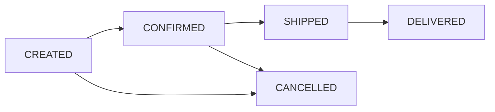
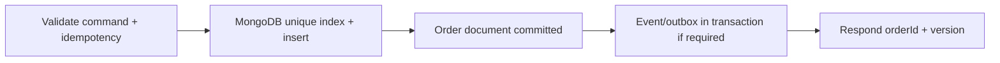
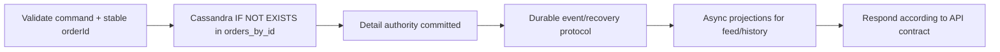
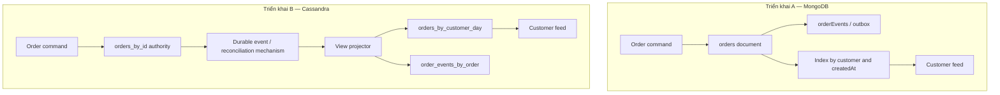
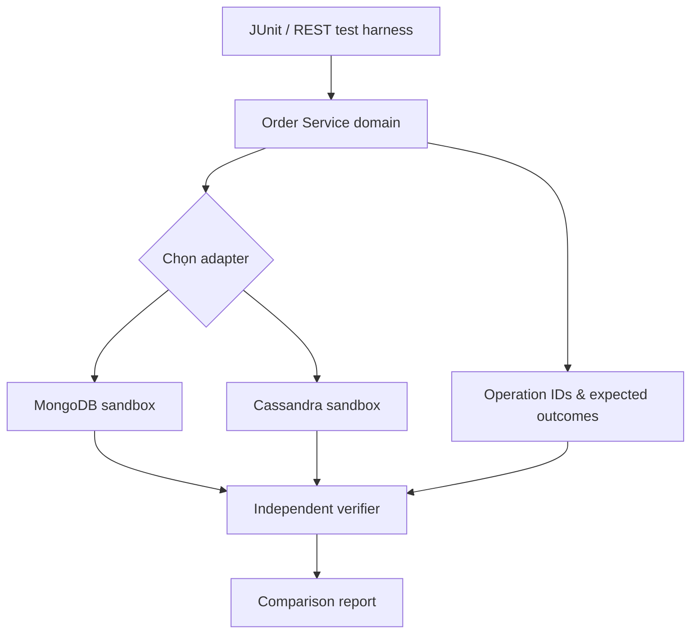
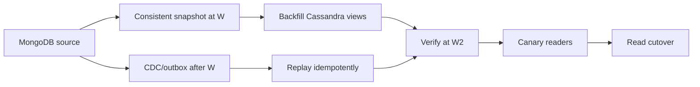

# Biểu diễn cùng nghiệp vụ trong hai mô hình dữ liệu khác nhau

## 1. Cùng một đơn hàng, vì sao có thể cần hai cách tổ chức dữ liệu?

Một ứng dụng Java quản lý việc đặt hàng có những chức năng quen thuộc:

- Khách tạo đơn hàng với nhiều dòng sản phẩm.
- Khách xem chi tiết đơn hàng theo mã đơn.
- Khách xem danh sách 20 đơn mới nhất của mình.
- Nhân viên cập nhật trạng thái theo chuỗi hợp lệ: tạo đơn → xác nhận → giao → hoàn tất; đôi khi hủy đơn.
- Bộ phận chăm sóc khách hàng xem lịch sử thay đổi trạng thái.
- Hệ thống bảo đảm không tạo trùng đơn khi client gửi lại yêu cầu vì timeout.

Có thể lưu nghiệp vụ đó bằng một **document** chứa toàn bộ đơn hàng, hoặc bằng **nhiều bảng/partition thiết kế theo truy vấn**. Cả hai cùng biểu diễn một nghiệp vụ, nhưng cách chúng bảo đảm truy vấn nhanh, cập nhật nguyên tử, giữ dữ liệu đồng bộ và mở rộng theo tải là khác nhau.

Trong bài này, ta dùng **MongoDB (document model)** và **Apache Cassandra (wide-column, query-oriented model)** làm hai triển khai minh họa. Không giả định một hệ “tốt hơn” trong mọi tình huống. Mục tiêu là tạo hai thiết kế có thể so sánh được theo cùng yêu cầu nghiệp vụ, chỉ rõ cả **điểm thuận tiện** lẫn **giới hạn bảo đảm** của từng hệ.

Bài học thuộc module **Database No SQL**, chương **Thực hành tổng hợp**, chủ đề **“Biểu diễn cùng nghiệp vụ trong hai mô hình dữ liệu khác nhau”**.

> **Ý chính:** Chuyển từ document sang wide-column không phải đổi cú pháp `INSERT`/`find`. Bạn thường phải đổi **ranh giới aggregate, khóa truy cập, hình thức nhân bản dữ liệu, cách ghi nhiều view, chính sách nhất quán và cơ chế kiểm chứng dữ liệu**.

### Mục tiêu học tập

Sau bài học, bạn có thể:

1. Tóm tắt một nghiệp vụ bằng thực thể, bất biến, truy vấn và đường ghi.
2. Thiết kế document MongoDB và bảng Cassandra phục vụ **cùng user stories**.
3. Phân biệt dữ liệu nguồn có thẩm quyền và read model/projection được nhân bản.
4. Chọn khóa `_id`, partition key, clustering columns và index dựa trên access pattern.
5. Giải thích khả năng atomic update, compare-and-set, transaction, LWT và giới hạn multi-partition.
6. Lập kế hoạch create/update/list/history, idempotency, pagination và deletion trong hai mô hình.
7. Thiết kế code Java 17 ở tầng domain và repository độc lập với engine.
8. Đưa ra tiêu chí test so sánh chức năng và business invariants, thay vì chỉ kiểm JSON tương tự.
9. Đánh giá write amplification, fan-out, partition growth, indexing, replication, consistency và chi phí.
10. Chọn mô hình dữ liệu có căn cứ hoặc lập kế hoạch chuyển đổi khi access pattern thay đổi.

## 2. Định nghĩa bài toán nghiệp vụ chung

Đặt tên dịch vụ là **Order Service**.

### 2.1. Dữ liệu của một đơn hàng

Một đơn có:

| Trường | Ý nghĩa | Ràng buộc minh họa |
|---|---|---|
| `orderId` | Định danh duy nhất do hệ cấp | Không đổi, không null |
| `customerId` | Chủ sở hữu đơn | Không đổi với đơn đã tạo |
| `createdAt` | Thời điểm tạo | UTC instant, immutable |
| `updatedAt` | Thời điểm cập nhật gần nhất | Không giảm |
| `status` | Trạng thái | Giá trị thuộc state machine |
| `currency` | Đơn vị tiền | Ví dụ `VND` |
| `totalMinor` | Tổng tiền theo đơn vị nhỏ nhất đã định nghĩa | Số nguyên, không âm |
| `items` | Danh sách dòng hàng | Không rỗng, số lượng giới hạn |
| `version` | Phiên bản aggregate | Tăng theo các thay đổi đã commit |
| `requestId` | Idempotency key của lệnh tạo | Duy nhất theo contract |
| `events` | Lịch sử trạng thái | Không thiếu, không đảo thứ tự logical |

Ví dụ đơn:

```json
{
  "orderId": "O-1001",
  "customerId": "C-42",
  "createdAt": "2026-11-14T08:30:00Z",
  "updatedAt": "2026-11-14T08:30:00Z",
  "status": "CREATED",
  "currency": "VND",
  "totalMinor": 350000,
  "items": [
    {"sku": "BOOK-01", "quantity": 2, "unitPriceMinor": 100000},
    {"sku": "PEN-03", "quantity": 3, "unitPriceMinor": 50000}
  ],
  "version": 1,
  "requestId": "req-9a1"
}
```

Ở đây `totalMinor` là đơn vị tiền được **định nghĩa bởi hợp đồng dữ liệu cho VND trong ví dụ**; tuyệt đối không mặc định mọi currency đều có hai chữ số thập phân. Không dùng `double` để cộng tiền.

### 2.2. Các yêu cầu API

| API/use case | Access pattern | Kỳ vọng |
|---|---|---|
| Tạo đơn | `POST /orders`, requestId | Không nhân đôi logical order |
| Xem chi tiết | `GET /orders/{orderId}` | Đọc đủ item, status, version |
| Xem theo khách | `GET /customers/{customerId}/orders?limit=20` | Mới trước; phân trang ổn định |
| Đổi trạng thái | `PATCH /orders/{orderId}/status` | Chuyển hợp lệ, tránh stale write |
| Xem sự kiện | `GET /orders/{orderId}/events` | Theo phiên bản/thứ tự |
| Hủy | `POST /orders/{orderId}/cancel` | Không hủy đơn đã giao/hoàn tất |
| Đối soát | Verify theo IDs/versions | Không mất/trùng/mâu thuẫn |
| Phục hồi | Restore/replay | Không hồi sinh đơn đã xóa theo policy |

### 2.3. Những gì cố tình không gộp vào đơn hàng

Tồn kho, thanh toán thật và vận chuyển có các ranh giới giao dịch/nhất quán riêng. Bài này **không** hứa thao tác tạo đơn đồng thời trừ tồn kho hoặc thu tiền ở hai hệ là một transaction nguyên tử nếu chưa thiết kế protocol liên dịch vụ.

Giả định đơn tạo ra là trạng thái `CREATED`, còn reservation/payment được xử lý bằng workflow có idempotency và compensation nếu cần.

## 3. Bất biến phải giữ trong mọi mô hình

### 3.1. Bất biến số tiền

\[
totalMinor=\sum_{i=1}^{n}quantity_i\times unitPriceMinor_i
\]

với `quantity_i > 0`, `unitPriceMinor_i >= 0` và giới hạn tràn số rõ. Trong Java có thể dùng `Math.multiplyExact`/`Math.addExact` hoặc `BigInteger` nếu miền giá trị vượt `long`.

### 3.2. Bất biến danh tính

Một `orderId` xác định một logical order. Với `requestId` và cùng scope idempotency:

```text
same customerId + same requestId + same request payload
 -> at most one committed logical order
```

Nếu requestId bị dùng lại với payload khác, trả conflict/reject theo contract, không âm thầm lấy đơn cũ làm kết quả cho nghiệp vụ khác.

### 3.3. Bất biến trạng thái



Không chuyển `SHIPPED→CREATED` hoặc `DELIVERED→CANCELLED` trong ví dụ, trừ khi thiết kế nghiệp vụ bổ sung quy trình return/refund riêng.

### 3.4. Bất biến phiên bản

Mỗi thay đổi trạng thái đã commit làm `version` tiến từ \(v\) lên \(v+1\). Một update dựa trên version cũ không được ghi đè version mới.

### 3.5. Bất biến quyền truy cập

Customer C-42 không thể xem/sửa đơn của C-99 dù biết `orderId`. Luôn kiểm owner/tenant ở tầng authorization; partition key, collection name và route không thay thế phân quyền.

### 3.6. Bất biến lịch sử

Nếu đơn ở version 3 là `SHIPPED` thì history phải đủ căn cứ giải thích các thay đổi tới version 3 theo mức bảo đảm nghiệp vụ được chọn. Nếu lưu events ở nơi khác bằng eventual projection, không được tuyên bố history luôn đồng bộ tức thì với aggregate.

## 4. Chọn một nguồn sự thật và phân loại các view

Một thiết kế có thể chứa:

- **Authoritative order:** quyết định status, total, owner và version.
- **Customer order feed:** bản danh sách để trả các đơn mới nhất nhanh.
- **Order event history:** lịch sử chuyển trạng thái.
- **Search/read cache:** dữ liệu dẫn xuất phục vụ truy vấn nhanh.
- **Idempotency ledger:** liên kết requestId với orderId và outcome.

Nếu mỗi view được cập nhật ở thời điểm khác nhau, phải khai báo rõ:

| Phần | Tính đúng cần giữ | Có thể stale không? |
|---|---|---|
| Order detail | Không vi phạm state/version | Tùy consistency đọc, nhưng là nguồn authority |
| Customer feed | Không hiện đơn người khác, không nhân đôi | Có thể chậm vài giây nếu contract cho phép |
| Event history | Thứ tự/version/event IDs đúng | Có thể lag nếu asynchronous |
| Search index | Không vi phạm tenant/delete policy | Có thể lag trong freshness SLO |
| Idempotency mapping | Một request chỉ một effect | Cần strong guard tại write path |

### 4.1. Đừng gộp mọi read model thành “dữ liệu đúng ngay”

MongoDB có thể cập nhật nhiều document trong transaction nếu cấu hình và giới hạn hỗ trợ. Cassandra thường dùng các bảng query-specific cập nhật riêng; một logged batch không phải transaction isolation xuyên nhiều partitions. Hai đường có thể đạt **cùng yêu cầu ở mức ứng dụng** bằng giao thức và độ trễ hiển thị khác nhau, nhưng không thể tự động coi chúng có consistency semantics giống hệt.

## 5. Hai tư duy thiết kế dữ liệu

### 5.1. Document model

Câu hỏi thiết kế:

- Những gì thường được đọc và sửa **cùng một aggregate**?
- Cái gì nên nhúng (embed) vào document để đọc một lần?
- Document có giới hạn kích thước/tần suất cập nhật không?
- Những truy vấn ngoài khóa chính cần index nào?
- Khi cần transactional consistency giữa collections, có hỗ trợ và chi phí ra sao?

Mô hình điển hình:

```text
orders collection
  -> order document
       -> embedded line items
       -> status/version/timestamps
```

### 5.2. Wide-column/query-first model

Câu hỏi thiết kế:

- Mỗi query truy cập bằng partition key nào?
- Dữ liệu cần cùng partition để đọc hiệu quả là gì?
- Làm sao có query order detail, customer list, event history mà không join/fan-out?
- Cần nhân bản field nào ở các bảng?
- Làm sao cập nhật các bản sao, giải quyết lag/duplicates/reordering?
- Partition có lớn không giới hạn theo customer hoặc order?

Mô hình điển hình:

```text
orders_by_id        (PK = order_id)
orders_by_customer  (PK = customer_id or customer+bucket)
order_events        (PK = order_id, clustering by version)
idempotency_by_req  (PK = customer_id + request_id)
```

### 5.3. Không phải quan hệ 1–1 giữa “loại DB” và mọi lựa chọn

MongoDB cũng có thể denormalize nhiều collections; Cassandra có thể dùng collections/UDTs phù hợp để giữ bounded data. So sánh ở đây là hai thiết kế **cụ thể**, không phải tuyên bố mọi document store hay mọi wide-column store phải giống các ví dụ.

## 6. Ma trận access pattern dẫn đường cho cả hai mô hình

| Use case | Khóa truy cập | Tần suất giả định | Consistency cần |
|---|---|---|---|
| Get detail | `orderId` | Cao | Auth và version đúng |
| List recent | `customerId + createdAt` | Rất cao | Có thể stale tối đa theo SLA |
| Update status | `orderId + expectedVersion` | Trung bình | CAS/atomic on aggregate |
| List events | `orderId + version range` | Thấp–trung | Order/version đúng |
| Create idempotently | `customerId + requestId` | Cao | Không double-create |
| Daily reporting | Ngày + status | Theo batch | Có thể eventual |
| Customer deletion | `customerId` | Hiếm, quan trọng | Xóa dữ liệu theo retention/privacy |

Thiết kế tốt **không** chỉ tối ưu use case có QPS cao nhất: đường ghi đúng và compliance có thể cần cơ chế đắt hơn để giữ invariant.

## 7. Mô hình A — MongoDB: một document cho aggregate đơn hàng

### 7.1. Document mẫu

```javascript
{
  _id: "O-1001",
  customerId: "C-42",
  requestId: "req-9a1",
  createdAt: ISODate("2026-11-14T08:30:00Z"),
  updatedAt: ISODate("2026-11-14T08:30:00Z"),
  status: "CREATED",
  currency: "VND",
  totalMinor: NumberLong("350000"),
  version: NumberLong("1"),
  items: [
    {sku: "BOOK-01", quantity: 2, unitPriceMinor: NumberLong("100000")},
    {sku: "PEN-03", quantity: 3, unitPriceMinor: NumberLong("50000")}
  ],
  schemaVersion: 1
}
```

Trong MongoDB, field `_id` có unique index mặc định. Bounded list `items` được nhúng để một point lookup trả về aggregate cùng lúc, giúp đơn giản hóa phần lớn read path.

### 7.2. Ranh giới nhúng

Giả sử tối đa 50 dòng hàng/đơn, item có dữ liệu nhỏ và thường đọc cùng order. Embed hợp lý. **Không** embed vô hạn audit events, ảnh sản phẩm hoặc mọi lần webhook retry vào cùng document; BSON document có giới hạn kích thước, và document tăng liên tục gây rewrite/latency/contended updates.

### 7.3. Những fields immutable

`_id`, `customerId`, `requestId`, `createdAt` và item snapshot/price tại lúc tạo đơn thường nên được giữ nguyên. Status/`updatedAt`/`version` thay đổi theo state machine. Nếu cho sửa items sau tạo, tổng tiền cần được cập nhật atomically theo cùng aggregate invariant.

### 7.4. Bất biến tiền

Java application tính `totalMinor` từ lines rồi validate trước insert. Một document validator có thể kiểm kiểu/range cơ bản; không mặc định validator dễ dàng diễn đạt mọi công thức giá tiền hoặc business state machine. Integration tests phải kiểm domain logic và các write paths.

## 8. MongoDB indexes cho cùng bộ user stories

```javascript
db.orders.createIndex(
  { customerId: 1, createdAt: -1, _id: -1 },
  { name: "by_customer_recent" }
)

db.orders.createIndex(
  { customerId: 1, requestId: 1 },
  { unique: true, name: "uniq_request_per_customer" }
)
```

### 8.1. Vì sao index cho danh sách là compound?

Query:

```javascript
db.orders.find({ customerId: "C-42" })
  .sort({ createdAt: -1, _id: -1 })
  .limit(20)
```

Compound index có thể hỗ trợ filter theo `customerId` và thứ tự mới trước với tie-breaker `_id`. Đừng tự kết luận luôn index-only: trả `items` có thể cần fetch document; kiểm `explain()`.

### 8.2. Idempotency index và `_id`

`(customerId,requestId)` unique bảo vệ chống hai insert với cùng request ID thuộc cùng customer. **Phải** kiểm request payload hash/business identity khi requestId trùng, và trả đúng prior outcome. Unique index không tự làm toàn bộ idempotency protocol.

### 8.3. Các index tùy nghiệp vụ

Nếu nhân viên lọc `status` theo ngày, có thể cần index riêng. Nhưng mỗi index tăng dung lượng và write amplification. Không tạo chỉ mục cho mọi field rồi mong write throughput giữ nguyên.

### 8.4. Phân vùng ngang

Khi sharding MongoDB, lựa chọn shard key ảnh hưởng routing và uniqueness constraints. Không mặc định unique compound index trên arbitrary fields hoạt động toàn cluster y hệt replica set unsharded; phải thiết kế shard key/index/idempotency scope theo rules của MongoDB phiên bản triển khai.

## 9. MongoDB: đọc chi tiết và danh sách

### 9.1. Lấy một đơn

```javascript
db.orders.findOne({ _id: "O-1001" })
```

Đường read trả toàn bộ bounded items. Application kiểm `customerId` thuộc authenticated user trước khi trả data; đừng dùng biết `_id` như cơ chế quyền.

### 9.2. Danh sách mới nhất và phân trang ổn định

Trang đầu:

```javascript
db.orders.find({ customerId: "C-42" })
  .sort({ createdAt: -1, _id: -1 })
  .limit(20)
```

Trang tiếp theo có cursor `(lastCreatedAt,lastId)`:

```javascript
db.orders.find({
  customerId: "C-42",
  $or: [
    { createdAt: { $lt: ISODate("2026-11-14T08:00:00Z") } },
    {
      createdAt: ISODate("2026-11-14T08:00:00Z"),
      _id: { $lt: "O-0999" }
    }
  ]
})
.sort({ createdAt: -1, _id: -1 })
.limit(20)
```

Đây là **keyset pagination** cho sort key bất biến. Trong môi trường có concurrent inserts, “các trang tiếp theo” không tương đương một consistent snapshot toàn collection nếu không dùng snapshot/time-bound contract. Đưa version/cutoff vào cursor khi cần freeze view.

### 9.3. Customer feed truy vấn trực tiếp hay tạo view?

MongoDB có thể phục vụ customer feed trực tiếp từ collection `orders` + index. Khi traffic quá lớn hoặc cần shape riêng, có thể tạo projection riêng — nhưng đổi lại thành eventual consistency/maintenance cost như các hệ khác. Không coi document model mặc định không có data duplication.

## 10. MongoDB: cập nhật trạng thái có điều kiện

Giả sử đơn ở version 1 và status `CREATED`, worker muốn chuyển sang `CONFIRMED`.

```javascript
db.orders.findOneAndUpdate(
  {
    _id: "O-1001",
    status: "CREATED",
    version: NumberLong("1")
  },
  {
    $set: {
      status: "CONFIRMED",
      updatedAt: ISODate("2026-11-14T08:35:00Z")
    },
    $inc: { version: NumberLong("1") }
  },
  { returnDocument: "after" }
)
```

### 10.1. Lợi thế của single-document atomic update

Trong một document, kiểm `_id/status/version` và cập nhật status/version diễn ra cùng atomic write operation. Nếu hai workers cùng thử version 1, thông thường chỉ một worker khớp điều kiện sau khi write thành công; worker còn lại nhận “không có document matched” và cần đọc lại/trả conflict, không tự retry bằng cách bỏ version guard.

### 10.2. State machine vẫn cần domain validation

Một command yêu cầu `CREATED→DELIVERED` không hợp lệ dù `findOneAndUpdate` có thể thực hiện nếu thiếu status guard. Repository/service phải kiểm transition và giữ expectedStatus trong filter hoặc dùng logic tương đương.

### 10.3. Unknown result

Client timeout không chứng minh update chưa commit. Retry dùng stable command/operation ID, đọc current state/version hoặc transactional ledger tương ứng. Không tự `$inc` lại mà bỏ điều kiện.

### 10.4. Timestamp và monotonic version

`updatedAt` để hiển thị/audit, **không** thay `version` làm CAS token khi clocks lệch. MongoDB BSON Date có millisecond precision; nếu cần event sequence, dùng version/IDs.

## 11. MongoDB: lịch sử sự kiện và outbox

Nếu embed toàn bộ events vào order, document sẽ tăng không giới hạn. Thiết kế khác:

```javascript
db.orderEvents.insertOne({
  _id: "evt-O-1001-v2",
  orderId: "O-1001",
  version: NumberLong("2"),
  type: "STATUS_CHANGED",
  from: "CREATED",
  to: "CONFIRMED",
  occurredAt: ISODate("2026-11-14T08:35:00Z")
})
```

Index:

```javascript
db.orderEvents.createIndex(
  { orderId: 1, version: 1 },
  { unique: true, name: "events_by_order_version" }
)
```

### 11.1. Vấn đề dual write

Nếu update `orders` thành công nhưng insert `orderEvents` thất bại, history thiếu event. Nếu insert event trước rồi update status thất bại, history có thể chứa event chưa có business state tương ứng.

### 11.2. Cách lựa chọn

- MongoDB deployment hỗ trợ transaction multi-document: cập nhật order và insert event/outbox **trong cùng transaction**, với write concern/read semantics phù hợp và xử lý unknown commit/retry.
- Hoặc biến event/operation ledger làm nguồn authority rồi xây trạng thái projection theo protocol đã định.
- Hoặc chấp nhận history/eventual audit với quy trình reconciliation, nếu business cho phép (thường không phù hợp audit nghiêm ngặt).

### 11.3. Outbox không tự gửi exactly-once

Outbox record commit với order, publisher có thể phát trùng khi retry. Consumers phải idempotent theo eventId/version, và nguồn có thể lưu trạng thái publish/checkpoint theo supported process. Không lấy “Kafka message đã gửi” làm bằng chứng transaction nguồn đã commit nếu thiếu liên kết.

## 12. MongoDB: lợi thế và giới hạn của mô hình document

**Phù hợp khi:**

- Bounded items được đọc cùng order.
- Atomic order status/version ở một document.
- Cần truy vấn linh hoạt trên nhiều fields với indexes.
- Dữ liệu thay đổi shape/schema theo version.
- Một source collection có thể phục vụ nhiều query patterns.

**Cần cân nhắc khi:**

- Items/events tăng vượt giới hạn document hoặc rất thường xuyên thay đổi.
- Một order document bị write contention nặng.
- Nhân bản nhiều read views/indexes làm write amplification tăng.
- Cross-document transactions có cost/complexity.
- Sharding shard key kém làm hot shard, scatter-gather, index uniqueness constraints.
- Reporting quét toàn bộ history ảnh hưởng OLTP.
- Documents với optional fields thiếu/null không được schema-version hóa.

## 13. Mô hình B — Cassandra: dữ liệu theo đường truy cập

Với Cassandra, mục tiêu chính là tạo các tables được thiết kế sẵn cho từng loại query. Không mặc định có relational join tùy ý hoặc secondary index nào cũng thay thế partition-key-based access.

### 13.1. Các bảng chính

```text
orders_by_id
  PK: order_id
  -> authoritative order status/version/items snapshot

orders_by_customer_day
  PK: (customer_id, day_bucket)
  clustering: created_at DESC, order_id ASC/DESC
  -> 20 đơn mới nhất và phân trang theo ngày

order_events_by_order
  PK: order_id
  clustering: event_version
  -> lịch sử trạng thái

idempotency_by_customer_request
  PK: (customer_id, request_id)
  -> một request mapping tới một order
```

Có **dữ liệu trùng** giữa `orders_by_id` và `orders_by_customer_day`, ví dụ `status`, `total_minor`, `created_at`. Đây là deliberate denormalization để truy vấn không cần join.

### 13.2. Các lựa chọn về authority

Trong bài, `orders_by_id` giữ **order detail authority**. Các bảng feed/history được cập nhật có kiểm soát từ event/ledger hoặc workflow có reconciliation; không hứa tất cả chúng nhất quán tức thời nếu write operations nằm ở nhiều partitions.

### 13.3. Bảng đánh đổi

| Mục | MongoDB document | Cassandra query-first |
|---|---|---|
| Order detail | Một document có items | Một partition/row được tối ưu |
| Customer recent | Index trên collection | Bảng theo customer/day bucket |
| State CAS | Filter + atomic document update | Conditional update/LWT khi cần |
| Event history | Collection riêng hoặc outbox | Bảng partition theo order |
| Data duplication | Thường ít hơn cho các query này | Chủ động trùng fields giữa bảng |
| Flexible ad-hoc filter | Có lợi thế qua index/aggregation | Thường cần query-specific table |
| Cross-view atomicity | Có thể transaction khi deployment hỗ trợ | Không mặc định atomic isolation xuyên partitions |
| Growth control | Giới hạn document, indexes, shard design | Partition key/bucket/TTL/compaction design |
## 14. Cassandra CQL: mô hình lưu đơn hàng

Ví dụ dưới dùng **một keyspace đã được provision ở môi trường thử nghiệm**. RF, datacenter names, authentication và phiên bản CQL phải được xác định theo cluster thực; không sao chép mã CQL minh họa lên production mà không có runbook.

### 14.1. Kiểu dòng hàng hữu hạn

```sql
CREATE TYPE order_line (
    sku text,
    quantity int,
    unit_price_minor bigint
);
```

### 14.2. Bảng chi tiết authoritative

```sql
CREATE TABLE orders_by_id (
    order_id text PRIMARY KEY,
    customer_id text,
    request_id text,
    payload_sha256 text,
    created_at timestamp,
    updated_at timestamp,
    status text,
    currency text,
    total_minor bigint,
    items frozen<list<frozen<order_line>>>,
    version bigint,
    schema_version int
);
```

Một order có **bounded items** nên lưu như một frozen collection trong một row/partition. Nếu business cho phép hàng chục nghìn items mỗi order, phải thiết kế bounded subpartitions/tables khác và bổ sung giao thức invariant; không biến frozen list thành giải pháp vô hạn.

### 14.3. Bảng danh sách theo khách và ngày

```sql
CREATE TABLE orders_by_customer_day (
    customer_id text,
    day_bucket date,
    created_at timestamp,
    order_id text,
    status text,
    currency text,
    total_minor bigint,
    version bigint,
    PRIMARY KEY (
        (customer_id, day_bucket),
        created_at,
        order_id
    )
) WITH CLUSTERING ORDER BY (
    created_at DESC,
    order_id DESC
);
```

`day_bucket` ở đây là **ngày UTC của created_at** theo contract, không dùng múi giờ mặc định của node/Java app. Nếu sản phẩm cần ngày theo vùng kinh doanh, phải ghi ZoneId và lựa chọn bucketing thống nhất.

### 14.4. Bảng lịch sử theo đơn

```sql
CREATE TABLE order_events_by_order (
    order_id text,
    version bigint,
    event_id text,
    occurred_at timestamp,
    event_type text,
    from_status text,
    to_status text,
    PRIMARY KEY ((order_id), version)
) WITH CLUSTERING ORDER BY (version ASC);
```

Một partition giữ events của một order, clustering theo `version`. Nếu lịch sử một order có thể tăng vô hạn, áp retention/bucketing hoặc archive riêng, và test query across buckets.

### 14.5. Bảng ánh xạ request

```sql
CREATE TABLE idempotency_by_customer_request (
    customer_id text,
    request_id text,
    order_id text,
    payload_sha256 text,
    outcome text,
    PRIMARY KEY ((customer_id, request_id))
);
```

Ở đây composite partition key `(customer_id,request_id)` giúp một request mapping có một logical key, tránh dồn mọi request của whale tenant vào một partition chỉ vì `customer_id`. Tuy nhiên **bảng này không tự tạo atomic transaction với `orders_by_id`**; cách chọn authority và xử lý partial failures được giải thích bên dưới.

### 14.6. Vì sao nhiều bảng?

Cassandra không tối ưu cho một câu query tùy ý:

```sql
SELECT * FROM orders_by_id
WHERE customer_id = 'C-42'
ORDER BY created_at DESC
LIMIT 20;
```

`customer_id` không phải partition key của `orders_by_id`. Không bật `ALLOW FILTERING` như cách giải quyết tổng quát cho customer feed ở dữ liệu lớn. Tạo `orders_by_customer_day` phục vụ đúng access pattern.

## 15. Cassandra: truy vấn chi tiết, feed và history

### 15.1. Chi tiết theo mã đơn

```sql
SELECT order_id, customer_id, created_at, status,
       currency, total_minor, items, version
FROM orders_by_id
WHERE order_id = 'O-1001';
```

Đây là point lookup theo partition key. Application kiểm `customer_id` trước khi trả kết quả.

### 15.2. Danh sách trong một bucket

```sql
SELECT order_id, created_at, status, total_minor, version
FROM orders_by_customer_day
WHERE customer_id = 'C-42'
  AND day_bucket = '2026-11-14'
LIMIT 20;
```

Dữ liệu được sắp trong partition theo clustering order đã khai báo; vẫn cần xem driver paging/paging state và query semantics của bản CQL/driver cụ thể.

### 15.3. Đọc nhiều ngày

Để trả “20 đơn mới nhất” khi một ngày chỉ có 3 đơn:

1. Xác định ngày hiện tại theo bucket contract.
2. Query bucket mới nhất với bounded page size.
3. Nếu chưa đủ, query ngày trước.
4. Merge theo `(createdAt DESC, orderId DESC)`.
5. Tạo opaque cursor chứa bucket position/last composite key, scope, schema/routing version và expiry.
6. Tôn trọng deadline/max buckets; nếu sản phẩm cần truy vấn hàng năm dữ liệu lạnh, thiết kế index/bảng phù hợp hoặc search/projection khác.

Không dùng `SELECT ... WHERE customer_id = ?` bỏ `day_bucket` rồi kỳ vọng Cassandra quét tất cả partitions như SQL relational.

### 15.4. Lịch sử theo version

```sql
SELECT version, event_id, event_type, from_status,
       to_status, occurred_at
FROM order_events_by_order
WHERE order_id = 'O-1001';
```

Có thể giới hạn khoảng versions:

```sql
SELECT version, event_type, occurred_at
FROM order_events_by_order
WHERE order_id = 'O-1001'
  AND version >= 2
  AND version < 50;
```

Query này phù hợp clustering by version; không cần full-table scan.

## 16. Cassandra: tạo đơn theo một key có điều kiện

Một câu ghi nguồn chi tiết:

```sql
INSERT INTO orders_by_id (
    order_id, customer_id, request_id, payload_sha256,
    created_at, updated_at, status, currency, total_minor,
    items, version, schema_version
) VALUES (?, ?, ?, ?, ?, ?, ?, ?, ?, ?, ?, ?)
IF NOT EXISTS;
```

Dùng prepared statement và Java driver bindings phù hợp. `IF NOT EXISTS` là conditional write dựa trên cơ chế LWT của Cassandra, có chi phí/consistency semantics cần đo.

### 16.1. Vì sao không đủ để xử lý idempotency?

Nếu mỗi retry tạo **orderId khác nhau**, hai câu `INSERT ... IF NOT EXISTS` đều có thể thành công. Idempotency phải dựa trên identity ổn định của cùng command:

- Request/operation ID được server xác thực scope.
- Mapping order ID ổn định.
- Payload hash để phát hiện reuse requestId với body khác.
- Conditional creation chỉ một effect.
- Retry/unknown outcome theo cùng identity.

### 16.2. Hai chiến lược hợp lệ tùy contract

**Chiến lược A — ID quyết định từ idempotency scope:**

```text
orderId = stableDeterministicId(customerId, requestId)
```

Sau đó mọi retry đều target cùng `orders_by_id` partition và `IF NOT EXISTS` có thể ngăn double-create. ID generation phải không có collision trong accepted domain, ổn định qua deployments và không thay thế authorization; lưu payload hash để reject reuse sai.

**Chiến lược B — request ledger có authority riêng:**

`idempotency_by_customer_request` được bảo vệ bằng conditional insert, rồi order creation chạy theo workflow. Nhưng vì đây là **hai partitions/tables**, vẫn phải định nghĩa recovery khi ledger đã reserve ID nhưng order chưa tạo, hoặc ngược lại. Một state machine có `PENDING/COMMITTED/FAILED`, lease và reconciliation có thể giải quyết.

### 16.3. Không mặc định logged batch là multi-partition transaction

Cassandra BATCH, kể cả logged batch, có những bảo đảm về atomicity/availability khác transaction serializable multi-row trong RDBMS. Nó **không** tạo isolation tương đương một multi-document MongoDB transaction cho các độc lập partitions. Đừng dùng BATCH để tuyên bố vừa tạo order vừa tạo feed vừa tạo event là một commit có serializable snapshot.

### 16.4. Ghi các views

Sau khi authoritative order tồn tại, cập nhật customer feed và history qua projection/event pipeline có version/idempotency, hoặc workflow đảm bảo có khả năng khôi phục và đối soát. Nêu rõ feed có thể lag theo SLA; không tự đổi contract thành “tức thời” mà thiếu cơ chế.

## 17. Cassandra: cập nhật trạng thái bằng LWT

Ví dụ:

```sql
UPDATE orders_by_id
SET status = 'CONFIRMED',
    updated_at = ?,
    version = 2
WHERE order_id = 'O-1001'
IF version = 1 AND status = 'CREATED';
```

### 17.1. Kiểm `[applied]`

LWT có thể trả `[applied]=false` vì bản ghi đã được người khác cập nhật hoặc điều kiện không khớp. Đây là **business concurrency conflict** cần xử lý, không tự retry bằng câu unconditional update.

### 17.2. Khi nào dùng LWT?

Khi app cần một quyết định tuần tự theo một partition, ví dụ state transition. LWT thường đắt hơn normal write; benchmark cần đo hot key contention, p99, timeout và conditional failure rate. Không áp cho mọi metrics counter hoặc event insert nếu không cần.

### 17.3. CQL timestamp không phải version

`updated_at` phục vụ audit/hiển thị; không dựa vào clock máy client để giải quyết update conflicts thay cho `version` CAS.

### 17.4. Partial update và giá trị UNSET

Trong Cassandra Java driver, một binding optional field có thể dùng unset semantics khác set-to-null/tombstone. Với status transition, không để nullable DTO vô tình xóa `customer_id`/`total_minor`. Tạo statements chỉ thay những columns được phép.

### 17.5. Chuyển trạng thái và sự kiện

Sau khi LWT update thành công, một process có thể crash trước khi ghi `order_events_by_order`. Vì vậy **hai bảng không tự có atomic transition + event append**. Muốn lịch sử đầy đủ, phải thiết kế durable event authority/outbox/protocol bền, hoặc ít nhất cơ chế tạo/reconcile events từ authoritative version và event metadata.

Không thể dựng chính xác mọi historical transitions nếu chỉ còn current `status/version` mà không giữ thông tin sự kiện bền. Một cách hạn chế là cập nhật trạng thái và `pendingEvent` trong **cùng authoritative row** rồi chặn transition tiếp theo cho đến khi event được persist xác nhận; nó có throughput/availability costs và phải xử lý retry. Hệ yêu cầu strict audit có thể chọn event-sourced aggregate/log với transaction semantics tương ứng.

## 18. Cassandra: bảng read model và out-of-order events

Ví dụ projection `orders_by_customer_day` chứa `version` để tránh event v2 ghi đè v3.

### 18.1. Event sơ đồ

```json
{
  "eventId": "evt-O-1001-v2",
  "orderId": "O-1001",
  "customerId": "C-42",
  "sourceVersion": 2,
  "type": "STATUS_CHANGED",
  "status": "CONFIRMED",
  "createdAt": "2026-11-14T08:30:00Z",
  "occurredAt": "2026-11-14T08:35:00Z"
}
```

### 18.2. Áp version theo từng row

Logic minh họa:

```text
lookup (customerId, dayBucket, createdAt, orderId)
if missing:
    create initial projection with expected version
else if event.sourceVersion > stored.version:
    apply compare-and-set with expected stored.version
else:
    skip duplicate/stale event
```

Read-then-write đơn thuần **không** đủ khi nhiều consumers cạnh tranh; nếu cần monotonicity phải dùng conditional update/LWT hoặc giao thức serialize per aggregate đã chứng minh.

### 18.3. Một lời cảnh báo với event v3 tới trước v2

Nếu event v3 mang **đầy đủ snapshot status/total/owner**, có thể áp v3 trước và bỏ v2 cho projection “current order”. Nhưng history/audit vẫn phải giữ cả event v2 nếu contract yêu cầu. Nếu event chỉ chứa delta `increment by 5`, bỏ event v2 sẽ làm sai state. Thiết kế event format và consumer algorithm tương ứng.

### 18.4. Bản feed có thể tồn tại nhưng stale

Cassandra customer feed có thể trả `CREATED` khi authoritative detail đã `CONFIRMED`. Hợp đồng có thể:

- Hiển thị feed eventual với freshness SLO.
- Nếu người dùng mở đơn, đọc lại authoritative detail.
- Hoặc bỏ field trạng thái khỏi feed, chỉ trả order IDs rồi fetch status ở source (đánh đổi read amplification).
- Hoặc chọn một engine/view có consistency mạnh hơn nếu requirement bắt buộc.

### 18.5. Chống duplicate row

Primary key `(customerId,dayBucket,createdAt,orderId)` có thể biến replay cùng order thành upsert cùng row. Nhưng nếu source routing đổi `dayBucket` hoặc `createdAt` bị thay đổi, cùng order sẽ rơi vào row khác. Chốt immutable createdAt/bucket rules và giữ routingVersion trong migrations.

## 19. Cassandra: partition growth, clustering và retention

### 19.1. Customer feed theo ngày

Partition key `(customerId,dayBucket)` giới hạn tổng đơn trong một bucket theo ngày. Tuy nhiên một whale customer có hàng triệu đơn/ngày vẫn có partition quá lớn; có thể thêm time hour bucket hoặc stripe.

### 19.2. Event history theo order

Một order bình thường có vài transitions; partition events nhỏ. Nếu audit nhận vô hạn retries/webhooks và eventType nhiều, phải giới hạn/bucket event history thay vì để một partition tăng mãi.

### 19.3. TTL và việc xóa dữ liệu

TTL có thể xóa dữ liệu logic theo thời hạn nhưng sinh tombstones và ảnh hưởng repair/compaction. Nếu retention cần lâu dài vì tài chính, không bật TTL tùy tiện. Nếu xóa theo privacy, phải đảm bảo read model, backup/restore và event logs tuân chính sách.

### 19.4. Quorum không giải quyết schema duplication

RF=3 và `LOCAL_QUORUM` giúp một số consistency guarantees cho **một partition/key** theo CL. Nó không khiến `orders_by_id` và `orders_by_customer_day` cập nhật cùng lúc hoặc cho cross-table transaction tự động.

### 19.5. Cần đo compaction/repair dưới skew

Bảng `orders_by_customer_day` cho hot customer và bảng events có kích thước tăng khác nhau. Test partition sizes, tombstones, compaction, streaming, node failure và read p99 theo query path.

## 20. Biểu diễn cùng bản ghi ở hai mô hình

### 20.1. MongoDB

```json
{
  "_id": "O-1001",
  "customerId": "C-42",
  "status": "CONFIRMED",
  "version": 2,
  "totalMinor": 350000,
  "items": [
    {"sku": "BOOK-01", "quantity": 2, "unitPriceMinor": 100000},
    {"sku": "PEN-03", "quantity": 3, "unitPriceMinor": 50000}
  ]
}
```

### 20.2. Cassandra: detail authority (conceptual row)

| order_id | customer_id | status | version | total_minor | items |
|---|---|---|---:|---:|---|
| O-1001 | C-42 | CONFIRMED | 2 | 350000 | Frozen list of two order_line values |

### 20.3. Cassandra: customer feed (conceptual row)

| customer_id | day_bucket | created_at | order_id | status | version |
|---|---|---|---|---|---:|
| C-42 | 2026-11-14 | 2026-11-14T08:30:00Z | O-1001 | CONFIRMED | 2 |

### 20.4. Cassandra: event history (conceptual rows)

| order_id | version | event_type | from_status | to_status |
|---|---:|---|---|---|
| O-1001 | 1 | ORDER_CREATED | — | CREATED |
| O-1001 | 2 | STATUS_CHANGED | CREATED | CONFIRMED |

**Cùng business fact**, nhưng Cassandra duy trì nhiều vật thể lưu trữ khác nhau. Khi thiết kế benchmark và test, cần đo **sự đồng bộ** giữa chúng, không chỉ độ trễ của một câu CQL.

## 21. So sánh thao tác: tạo đơn

### 21.1. Document path



- Một document order là aggregate source.
- Unique index/matching payload bảo vệ idempotency scope.
- Nếu event/outbox thuộc invariant, dùng transaction multi-document được hỗ trợ hoặc authority protocol khác.
- Unknown commit cần lookup theo requestId/orderId.

### 21.2. Wide-column path



- Conditional create bảo vệ một partition khi order ID ổn định.
- Feed/history có thể cập nhật sau.
- Nếu API yêu cầu trả thành công chỉ khi **đã có history bền**, phải kiểm event protocol trước response.
- Không coi tất cả bảng cùng committed chỉ từ `[applied]=true` ở source table.

### 21.3. Kiểm sau timeout

Cả hai mô hình cần API `GET outcome by requestId` hoặc lookup theo deterministic orderId/ledger để client retry không tạo order mới. Phân biệt:

```text
NOT_FOUND_AND_SAFE_TO_RETRY
COMMITTED_ORDER_EXISTS
IN_PROGRESS_OR_UNKNOWN
CONFLICTING_REQUEST_PAYLOAD
```

Không tự gán mọi timeout thành `NOT_FOUND` nếu read consistency hoặc data movement chưa đủ chứng minh.

## 22. So sánh thao tác: đổi trạng thái

### 22.1. MongoDB

Ghi một document với `status/version` guard, và nếu cần audit event/outbox cùng commit, dùng transaction đa document theo supported deployment/driver. Document version tăng một lần cho một logical status transition.

### 22.2. Cassandra

Ghi `orders_by_id` bằng LWT `IF version=? AND status=?`, kiểm `[applied]`; cập nhật các projections với event IDs/sourceVersion và reconciliation. Khi audit là strict, cần mechanism giữ event bền cùng decision, không chỉ “sẽ viết bảng events sau”.

### 22.3. Cùng acceptance criteria

- Chỉ một worker chuyển từ CREATED v1 sang CONFIRMED v2.
- Worker khác dùng expected v1 nhận conflict/đọc lại.
- Không có SHIPPED→CREATED.
- Retry cùng operation ID không tăng version thêm lần nữa.
- Mọi view eventually đạt version v2 trong freshness SLO.
- History theo phiên bản đúng và không duplicate event effects.
- Customer authorization vẫn đúng.

## 23. So sánh thao tác: xem danh sách khách hàng

### 23.1. MongoDB

Query một indexed collection theo `customerId + createdAt + _id`; feed thường đọc từ cùng authoritative documents, tùy read concern/read preference. Có thể tạo separate projection khi tải/shape đòi hỏi.

### 23.2. Cassandra

Query một hoặc nhiều `orders_by_customer_day` partitions, ghép kết quả mới trước, và chấp nhận projection lag theo contract hoặc hydrate detail từng order để bảo vệ freshness. Thời gian query phụ thuộc số buckets fan-out, partition size và clustering range.

### 23.3. Hai mô hình có khác biệt gì trong pagination?

- MongoDB: keyset cursor dựa `(createdAt,_id)`, index giúp query.
- Cassandra: cursor ngoài clustering key còn cần bucket position; driver paging state không nên công bố như cursor có thể tồn tại mãi sau schema/routing changes.
- Cả hai: concurrent inserts/deletes có thể làm thay đổi danh sách; nếu phải snapshot-stable, cần hợp đồng cutoff/snapshot/reconciliation.

## 24. So sánh thao tác: lịch sử và kiểm toán

### 24.1. MongoDB

`orderEvents` collection index `(orderId,version)`. Có thể transactionally commit với order nếu requirement nghiêm ngặt và deployment hỗ trợ. Khi dùng async outbox consumer, event delivery có thể duplicate, cần dedup.

### 24.2. Cassandra

`order_events_by_order` clustered by version trả lịch sử hiệu quả. Nhưng **việc ghi vào bảng đó và đổi status ở bảng khác** không đương nhiên atomic; cần chọn authority/event-source protocol và dự phòng projector/crash recovery.

### 24.3. Audit yêu cầu mạnh hơn read model

Nếu báo cáo pháp lý đòi “mọi chuyển trạng thái đã xác nhận đều có chứng cứ”, một eventual feed còn lag vài giây có thể chấp nhận, nhưng missing history event thì không. Thiết kế pipeline phải thể hiện sự khác biệt.

### 24.4. Không dùng thời gian máy làm thứ tự duy nhất

`occurredAt` từ nhiều máy có thể lệch và có precision thấp hơn tần suất update; dùng authoritative version/event sequence cho thứ tự trong một order.

## 25. Sơ đồ nhìn từ kiến trúc hệ thống



**Lưu ý:** Sơ đồ không hàm ý Cassandra tự có “durable event” giữa tables; đó là thành phần ứng dụng phải thiết kế/chọn để đáp ứng invariant.

## 26. Những thứ cần bất biến trong mã Java

Không để DTO phụ thuộc vào document/row representation. Domain model nên mang ý nghĩa nghiệp vụ:

```java
import java.time.Instant;
import java.util.List;

public record Order(
    String orderId,
    String customerId,
    String requestId,
    Instant createdAt,
    Instant updatedAt,
    OrderStatus status,
    String currency,
    long totalMinor,
    List<OrderLine> items,
    long version
) {}

public record OrderLine(
    String sku,
    int quantity,
    long unitPriceMinor
) {}

public enum OrderStatus {
    CREATED, CONFIRMED, SHIPPED, DELIVERED, CANCELLED
}
```

### 26.1. Validation trong domain, không do DB quyết định hết

- `orderId/customerId/requestId` nonblank.
- `items` không rỗng và số lượng giới hạn.
- `quantity > 0`.
- `unitPriceMinor >= 0`.
- `totalMinor` đúng tổng và không overflow.
- `currency` hợp lệ.
- `version >= 1`.
- Status transitions thuộc state machine.
- createdAt/updatedAt có UTC instant semantics.
- Không serialize raw secrets/PII trong events.

### 26.2. Snapshot item, không lookup current product price

Nếu giá sản phẩm thay đổi sau khi đặt, đơn cũ phải giữ line-item price tại thời điểm tạo. Cả Mongo embedded items lẫn Cassandra frozen items snapshot đều cần thực hiện điều đó.

## 27. Java 17: hàm kiểm tổng tiền độc lập database

```java
import java.util.List;
import java.util.Objects;

public final class OrderTotals {
    private OrderTotals() {}

    public static long calculate(List<OrderLine> items) {
        Objects.requireNonNull(items, "items");
        if (items.isEmpty() || items.size() > 50) {
            throw new IllegalArgumentException(
                "items must contain 1..50 lines");
        }

        long total = 0;
        for (OrderLine line : items) {
            Objects.requireNonNull(line);
            if (line.sku() == null || line.sku().isBlank()) {
                throw new IllegalArgumentException("sku required");
            }
            if (line.quantity() <= 0 || line.unitPriceMinor() < 0) {
                throw new IllegalArgumentException("invalid line");
            }

            long subtotal = Math.multiplyExact(
                line.quantity(), line.unitPriceMinor());
            total = Math.addExact(total, subtotal);
        }
        return total;
    }
}
```

### 27.1. Vì sao không dùng `double`?

Tiền phải giữ độ chính xác; integer minor units có thể phù hợp nếu hợp đồng currency xác định đơn vị nhỏ nhất và miền đủ trong `long`. Nếu product có chiết khấu/rates nhiều chữ số thập phân, dùng `BigDecimal` với explicit rounding và chuyển về minor units ở bước được phê duyệt.

### 27.2. Test ở tầng domain

```java
import org.junit.jupiter.api.Test;
import java.util.List;
import static org.junit.jupiter.api.Assertions.*;

class OrderTotalsTest {
    @Test
    void sumsLinesExactly() {
        long result = OrderTotals.calculate(List.of(
            new OrderLine("BOOK-01", 2, 100000L),
            new OrderLine("PEN-03", 3, 50000L)
        ));
        assertEquals(350000L, result);
    }

    @Test
    void rejectsOverflow() {
        assertThrows(
            ArithmeticException.class,
            () -> OrderTotals.calculate(List.of(
                new OrderLine("HUGE", 2, Long.MAX_VALUE)
            ))
        );
    }
}
```

Đây là unit tests cho business invariant; chưa kiểm persistence/cross-view correctness.
## 28. Tầng repository chung để tránh phụ thuộc mô hình lưu trữ

Ứng dụng có thể định nghĩa hợp đồng theo nghiệp vụ, không theo tên phương thức của driver:

```java
import java.time.Instant;
import java.util.Optional;

public interface OrderStore {
    Optional<Order> findById(String orderId);

    CreateOutcome createIfAbsent(Order order);

    TransitionOutcome changeStatus(
        String orderId,
        OrderStatus expectedStatus,
        long expectedVersion,
        OrderStatus nextStatus,
        Instant changedAt,
        String commandId
    );
}

public enum CreateOutcome {
    CREATED,
    ALREADY_EXISTS_SAME_COMMAND,
    CONFLICTING_COMMAND
}

public enum TransitionOutcome {
    APPLIED,
    VERSION_CONFLICT,
    NOT_FOUND,
    UNKNOWN_COMMIT
}
```

Các declarations là những file Java riêng (`OrderStore.java`, `CreateOutcome.java`, `TransitionOutcome.java`). Không đặt nhiều public top-level types vào một file và mong compiler chấp nhận.

### 28.1. Vì sao outcome không chỉ boolean?

Một update có thể:

- Thành công.
- Không tìm thấy order.
- Bị version conflict.
- Bị yêu cầu chuyển trạng thái sai.
- Bị timeout khi kết quả commit **chưa rõ**.

Nếu chỉ trả `false` cho mọi trường hợp, caller có thể retry một command không idempotent hoặc trả sai HTTP status.

### 28.2. Giao diện không phải xóa bỏ khác biệt consistency

Hai implementations có thể dùng cùng domain types, nhưng semantics phải là **điều thực sự chứng minh được**. Ví dụ một implementation chỉ đảm bảo feed eventual, trong khi implementation khác trực tiếp đọc source. API contract cần thể hiện freshness hoặc yêu cầu hòa giải.

### 28.3. Không biến repository thành relational join ẩn

Nếu `findById` ở Cassandra cần đọc bốn partitions vì thiết kế aggregate rời rạc, abstraction đẹp không cứu được tail latency. Repository contract phải được soi cùng query/partition plan.

## 29. Java: state machine độc lập MongoDB/Cassandra

```java
public final class OrderTransitions {
    private OrderTransitions() {}

    public static boolean allowed(
        OrderStatus from,
        OrderStatus to
    ) {
        return switch (from) {
            case CREATED ->
                to == OrderStatus.CONFIRMED
                || to == OrderStatus.CANCELLED;
            case CONFIRMED ->
                to == OrderStatus.SHIPPED
                || to == OrderStatus.CANCELLED;
            case SHIPPED -> to == OrderStatus.DELIVERED;
            case DELIVERED, CANCELLED -> false;
        };
    }

    public static void requireAllowed(
        OrderStatus from,
        OrderStatus to
    ) {
        if (!allowed(from, to)) {
            throw new IllegalArgumentException(
                "Invalid order transition: " + from + " -> " + to);
        }
    }
}
```

### 29.1. Cùng bài test cho cả hai mô hình

```java
import org.junit.jupiter.api.Test;
import static org.junit.jupiter.api.Assertions.*;

class OrderTransitionsTest {
    @Test
    void followsBusinessStateMachine() {
        assertTrue(OrderTransitions.allowed(
            OrderStatus.CREATED, OrderStatus.CONFIRMED));
        assertTrue(OrderTransitions.allowed(
            OrderStatus.CONFIRMED, OrderStatus.SHIPPED));
        assertFalse(OrderTransitions.allowed(
            OrderStatus.SHIPPED, OrderStatus.CREATED));
        assertFalse(OrderTransitions.allowed(
            OrderStatus.DELIVERED, OrderStatus.CANCELLED));
    }
}
```

### 29.2. Kiểm ở server, không tin client

Client không được gửi trạng thái mới rồi repository ghi bất chấp state machine. Domain validation và CAS guard phải nằm trong trusted service. Một stale client phiên bản cũ không được ghi đè trạng thái mới.

## 30. MongoDB Java driver: chuyển trạng thái trong một document

Một đoạn adapter minh họa với MongoDB Sync Driver. Giả định collection `orders` lưu `_id` là string, `status` string và `version` BSON Int64.

```java
import com.mongodb.client.MongoCollection;
import com.mongodb.client.model.FindOneAndUpdateOptions;
import com.mongodb.client.model.ReturnDocument;
import org.bson.Document;

import java.time.Instant;
import java.util.Date;

import static com.mongodb.client.model.Filters.and;
import static com.mongodb.client.model.Filters.eq;
import static com.mongodb.client.model.Updates.combine;
import static com.mongodb.client.model.Updates.inc;
import static com.mongodb.client.model.Updates.set;

public final class MongoStatusAdapter {
    private final MongoCollection<Document> orders;

    public MongoStatusAdapter(
        MongoCollection<Document> orders
    ) {
        this.orders = orders;
    }

    public boolean tryTransition(
        String orderId,
        OrderStatus prior,
        long expectedVersion,
        OrderStatus next,
        Instant changedAt
    ) {
        OrderTransitions.requireAllowed(prior, next);

        var filter = and(
            eq("_id", orderId),
            eq("status", prior.name()),
            eq("version", expectedVersion)
        );

        var update = combine(
            set("status", next.name()),
            set("updatedAt", Date.from(changedAt)),
            inc("version", 1L)
        );

        Document result = orders.findOneAndUpdate(
            filter,
            update,
            new FindOneAndUpdateOptions()
                .returnDocument(ReturnDocument.AFTER)
        );

        return result != null;
    }
}
```

### 30.1. Giới hạn

- Code minh họa đường **single-document CAS**; chưa triển khai auditing/outbox transaction hay idempotent command ledger.
- `result == null` có thể do not-found, version conflict hoặc owner mismatch; nếu cần phân loại, đọc authoritative state với read policy hợp lệ.
- Exception/timeout có thể tạo `UNKNOWN_COMMIT`, không tự coi là false.
- `updatedAt` nên được cấp theo server/workflow timestamp contract; không coi client clock là source of truth.
- Nếu ứng dụng sharded, bảo đảm query targeting và index/shard key policy hợp lệ.
- Khi cần insert event/outbox cùng commit, dùng MongoDB transaction đúng supported deployment và tránh thêm các thao tác ngoài DB vào transaction.

### 30.2. Vì sao adapter này không thay mọi code Mongo?

Vì API còn phải giải quyết idempotency, transaction retry, read/write concerns, validation/authorization và JSON mapping. Mục tiêu code là cho thấy khác biệt **CAS tại một document**, không phải cung cấp hệ production hoàn chỉnh.

## 31. Cassandra Java driver: cập nhật có điều kiện

Với Apache Cassandra Java Driver 4.x tương thích deployment, có thể prepare statement:

```java
import com.datastax.oss.driver.api.core.CqlSession;
import com.datastax.oss.driver.api.core.cql.PreparedStatement;
import com.datastax.oss.driver.api.core.cql.ResultSet;
import com.datastax.oss.driver.api.core.cql.Row;
import java.time.Instant;

public final class CassandraStatusAdapter {
    private final CqlSession session;
    private final PreparedStatement transition;

    public CassandraStatusAdapter(CqlSession session) {
        this.session = session;
        this.transition = session.prepare(
            "UPDATE orders_by_id " +
            "SET status=?, updated_at=?, version=? " +
            "WHERE order_id=? " +
            "IF version=? AND status=?"
        );
    }

    public boolean tryTransition(
        String orderId,
        OrderStatus prior,
        long expectedVersion,
        OrderStatus next,
        Instant changedAt
    ) {
        OrderTransitions.requireAllowed(prior, next);

        long newVersion = Math.addExact(expectedVersion, 1);

        ResultSet rs = session.execute(transition.bind(
            next.name(),
            changedAt,
            newVersion,
            orderId,
            expectedVersion,
            prior.name()
        ));

        Row row = rs.one();
        if (row == null) {
            throw new IllegalStateException(
                "Missing conditional result");
        }
        return row.getBoolean("[applied]");
    }
}
```

### 31.1. Ý nghĩa thực tế

- `[applied]=true`: điều kiện của lệnh cập nhật **một partition** được chấp nhận.
- `[applied]=false`: điều kiện không đạt; caller phải đọc lại/quyết định phù hợp.
- Timeout/driver exception: outcome có thể chưa rõ, không tự retry một lệnh không idempotent bằng cách nới điều kiện.
- Chọn serial consistency và regular consistency theo cluster topology và bảo đảm của hệ; có thể ảnh hưởng latency đáng kể.
- Bảng feed/events **không** được cập nhật bởi câu CQL này; cần event/projection protocol riêng.

### 31.2. LWT không phải cách tối ưu mọi writes

LWT thực hiện cơ chế conditional consensus với chi phí cao hơn normal write trong nhiều workloads. Đo contention ở orderId nóng, request p99 và scale-out, thay vì áp LWT cho logs append-only không yêu cầu condition.

### 31.3. Test driver mapping

Cassandra CQL `timestamp` thường được map với `Instant` ở driver mới; CQL `bigint` với Java `long`; frozen UDT/list cần codec/bind phù hợp. Khi triển khai thực tế, thử roundtrip items, version, UTC precision và null/UNSET semantics ở driver đang dùng.

## 32. Đừng nhầm code giống nhau là bảo đảm giống nhau

| Vấn đề | Mongo status adapter | Cassandra status adapter |
|---|---|---|
| Nơi thực hiện CAS | Filter/update trên document | LWT trên một partition |
| Kết quả không matched | `null` document | `[applied]=false` |
| Cách xác định not-found | Read/contract phụ trợ | Read/contract phụ trợ |
| Event/outbox cùng commit | Transaction nhiều document nếu hỗ trợ | Không tự atomic với table khác |
| Bảo đảm read sau write | Read concern/read preference/session | CL và read protocol |
| Giới hạn hiệu năng | Contention trên document/shard | LWT contention trên partition |
| Timeout unknown commit | Phải reconcile | Phải reconcile |
| Projection update | Có thể không cần cho list đơn giản | Thường cần một bảng riêng |

**Tầng domain giống nhau** không chứng minh cùng consistency guarantees. Phải kiểm semantic behavior, không chỉ phương thức trả boolean true.

## 33. Thiết kế command ID và retry an toàn

Một request đổi trạng thái:

```json
{
  "commandId": "cmd-O-1001-2",
  "expectedVersion": 1,
  "newStatus": "CONFIRMED"
}
```

### 33.1. Tình huống nguy hiểm

1. Server chuyển v1→v2 thành công.
2. Response bị mất vì mạng.
3. Client retry command, CAS v1 thất bại.
4. Caller thấy conflict rồi báo "không cập nhật" dù command ban đầu đã thành công.

### 33.2. Cách giải quyết

Có thể lưu **durable command outcome ledger** hoặc event record có `commandId` được commit với quyết định authoritative. Khi retry:

- Nếu commandId đã commit với payload tương ứng, trả prior outcome.
- Nếu commandId trùng nhưng payload khác, reject.
- Nếu mới, kiểm state/version rồi thử transition.
- Nếu outcome unknown, reconcile theo ledger/source state.

MongoDB có thể tận dụng transaction multi-document để đưa command outcome record cùng state mutation. Cassandra cần command authority/protocol có recovery semantics, ví dụ deterministic command/event identity + conditional state transition và durable pending decision.

### 33.3. Chỉ lưu `lastCommandId` có đủ không?

Nếu sau command A có command B, `lastCommandId` bị thay, retry A muộn không thể tìm dấu vết. Với hợp đồng retry dài hạn cần ledger/retention độc lập hoặc immutable event sequence, không chỉ field cuối.

### 33.4. Bắt buộc phân biệt duplicate và stale

Duplicate command đã commit nên có thể trả cùng outcome; **stale command khác** phải bị conflict. Không được thấy trạng thái đã là CONFIRMED rồi cho mọi request `CREATED→CONFIRMED` là thành công nếu command IDs/payload không khớp.

## 34. Khi dữ liệu duplicate giữa các bảng

Cassandra `orders_by_customer_day` chứa status/total trùng với `orders_by_id`. Có ba chiến lược:

### 34.1. Đồng bộ trong request

Sau ghi source, application ghi feed ngay. Độ trễ client bao gồm cả hai writes; nếu write thứ hai fail, vẫn có partial state. Không có cross-partition atomicity chỉ vì gửi chúng tuần tự.

### 34.2. Async projection

Source tạo một durable event theo protocol, projector cập nhật feed theo `sourceVersion`. Request trả sau source commit (hoặc sau durable event commitment theo SLA); feed có eventual lag. Cần monitor backlog/lag, retry, idempotency và repair.

### 34.3. On-demand hydrate

Feed chỉ lưu IDs/time, còn status đọc từ source khi hiển thị. Giảm stale status nhưng tạo N+1 reads, network fan-out và latency; dùng bounded batching/caching và đo p99.

### 34.4. Giữ bản projection version monotonic

Một projected row không được lùi từ v3 về v2 khi events tới sai thứ tự. Nếu dùng CAS `IF version=?` phải xử lý cạnh tranh và initial insert; read-then-write không lock là không đủ.

### 34.5. Không “sửa nguồn” từ projection

Nếu feed status khác source, source authority vẫn là `orders_by_id` theo thiết kế. Reconciliation định hướng source→view; không dùng lastUpdated timestamp của một projection stale để ghi ngược authoritative status.

## 35. Cassandra historical deletes, TTL và source migrations

### 35.1. Mỗi bảng có vòng đời khác nhau

Order detail có thể cần retention dài; feed có thể chỉ giữ hai năm; event audit có thời hạn khác theo compliance. Thiết kế retention theo dữ liệu nghiệp vụ, không tự TTL mọi bảng như nhau.

### 35.2. Xóa một order không phải một lệnh đơn bảng nếu có views

Xóa source order rồi quên `orders_by_customer_day` và `order_events_by_order` có thể để lại orphan/stale data. Tạo deletion event/tombstone/version, projector dọn theo policy, có reconciliation và suppression list khi restore từ backup.

### 35.3. Tránh “hồi sinh” dữ liệu

Nếu replica cũ hoặc CDC replay đưa status v1 sau khi đã delete version v5, target phải không phục vụ bản cũ. Dùng deletion ledger với generation/version, anti-entropy/repair policy đúng engine.

### 35.4. Time bucket migration

Thay bucket từ ngày sang giờ hoặc thêm stripe làm routing keys thay đổi. Bảo toàn `orderId`, `createdAt` và routingVersion; backfill + CDC catch-up, dual-read rồi cutover.

### 35.5. Cassandra tombstone không đồng nghĩa logical business event

Một CQL cell tombstone phục vụ storage reconciliation; nó không tự chứa đầy đủ “ai hủy đơn, vì sao” cho audit. Business event/audit record vẫn cần.

## 36. MongoDB lịch sử, schema version và deletion

### 36.1. Thay đổi schema trong document

Document v1 có `totalMinor`, v2 thêm `promotionCode` hoặc `taxDetails`. Java reader phải biết phân biệt field missing và explicit null; version-aware defaults không được làm sai tiền/identity.

### 36.2. Unbounded arrays

Một lỗi thường gặp là cứ `$push` status event vào `orders.events` mãi. Sau nhiều năm document có thể quá lớn và mọi status update đụng aggregate nóng. Tách event history ra collection query theo `orderId/version`.

### 36.3. Soft delete và customer privacy

Nếu `deleted=true` trong source nhưng customer feed vẫn query thiếu filter, đơn bị xóa vẫn có thể lộ. Khi restore backup cũ, áp lại deletion/suppression ledger trước khi cho application serving.

### 36.4. Sharding khác document modeling

Một schema document tốt cho point read chưa chắc shard key tốt cho workload; nếu chọn `customerId` làm shard key, whale customer có thể nóng một shard. Nếu chọn hashed `orderId`, list by customer có thể fan-out hoặc cần projection/index/routing khác. Kiểm query targeting và unique index constraints theo engine version.

## 37. Một bảng ánh xạ hai schema

| Business concept | MongoDB | Cassandra |
|---|---|---|
| Logical order ID | `orders._id` | `orders_by_id.order_id` |
| Owner | `customerId` | `customer_id` |
| Items snapshot | Embedded array | Bounded frozen list of UDT |
| Status/version | Fields trong document | Fields trong `orders_by_id` |
| Recent customer orders | Compound index query | `orders_by_customer_day` |
| Status history | `orderEvents` collection | `order_events_by_order` |
| Idempotent create | Unique index + payload check | Stable order ID + conditional insert/ledger |
| Status CAS | findOneAndUpdate filter | LWT conditional update |
| Multi-view sync | Transaction/outbox hoặc projection | Durable event/reconciliation protocol |
| Query flexibility | Index/aggregation linh hoạt hơn cho các truy vấn này | Query-oriented tables cần biết key |
| Large history | Separate collection | Partition by order, bucket when necessary |
| Latency/cost risks | Index writes, document contention, shard hotspots | LWT, write amplification, fan-out, repair |
| Rebuild feed | Index/source document hoặc projection | Reproject từ authority/event source |

## 38. Cùng dữ liệu nhưng không nhất thiết cùng bytes

MongoDB có BSON document với nested array và kiểu số BSON Int64. Cassandra có rows/partition/clustering, UDT/collection và timestamp CQL.

Nếu so raw bytes hoặc JSON strings, hai mô hình không giống nhau dù business facts giống nhau. **Verification phải chuẩn hóa logical representation**:

```text
(orderId, customerId, createdAtMillis, status, version,
 currency, totalMinor, orderedItems[(sku,qty,unitPriceMinor)])
```

### 38.1. Chuẩn hóa đúng

- Sort items theo position nếu thứ tự có ý nghĩa, không sort theo sku tùy tiện.
- Giữ số integer exact, không convert qua double.
- Normalize timestamps theo precision mà cả hai storage contracts thực sự hỗ trợ (ví dụ milliseconds nếu đã thống nhất).
- Phân biệt missing/NULL nếu chúng có ý nghĩa.
- Dùng cùng schemaVersion, currency, status enum.
- Không so projection v2 với source v3 rồi báo data corruption; cần cutoff/sourceVersion.

### 38.2. Hash/checksum

Có thể dùng SHA-256 trên encoding canonical, length-prefixed, field-type-aware và stable sorted IDs để so datasets; thêm count, min/max IDs và manifest theo bucket để khoanh vùng. Hash bằng nhau **không** tự chứng minh business invariants hoặc authority đúng nếu cả hai nguồn cùng sai.

## 39. Kiểm chứng tương đương hành vi, không chỉ dữ liệu

Một bộ test cùng business commands nên chạy trên mỗi implementation và thu **business outcomes**:

```text
Given: order O-1001 CREATED v1
When: confirm with expectedVersion 1
Then: status CONFIRMED v2
And: repeat same commandId returns same logical outcome
And: second distinct command with expectedVersion 1 conflicts
And: history eventually shows event v2 within SLA
And: customer feed version eventually >= 2
And: totalMinor/items/customerId unchanged
```

### 39.1. Hai implementation có thể khác latency và freshness

Không yêu cầu feed Cassandra đồng bộ tức thì nếu contract của nó đã công bố eventual consistency; nhưng phải kiểm bound freshness thật. Nếu sản phẩm bắt buộc đọc ngay, thiết kế Cassandra cần thêm mechanisms/fallback — không giảm tiêu chí chỉ để bài test pass.

### 39.2. Test source vs projections

Nguồn authority được verify bằng direct read/consistency contract. Views cần sourceVersion/watermark và chống stale event. Một API trả đúng status từ cache không chứng minh Cassandra detail row đã ghi đúng.

## 40. So sánh hiệu năng phải giữ cùng điều kiện nghiệp vụ

Các phép đo nên được tách:

| Workload | MongoDB path | Cassandra path | Metric |
|---|---|---|---|
| Get detail | Point lookup document | Point lookup table | p50/p99, bytes |
| List 20 recent | Indexed find | Bucket query + merge | p99, #partitions touched |
| Create order | Insert + unique check | Conditional insert + projection protocol | committed orders/s, retries |
| Transition status | Document CAS (+ event txn) | LWT (+ event protocol) | p99, conflict rate |
| Read history | Indexed event collection | Clustering range | p99, rows scanned |
| Bulk customer export | Indexed/aggregated scan | Multi-bucket fan-out | Time, I/O |
| Node failure | Replica/shard topology | RF/CL/repair | Availability, recovery time |
| Projection rebuild | Index or event replay | Full feed reproject | Completion + correctness |

### 40.1. Đừng so “1 write” với “3 writes” như cùng semantics

Một Cassandra create có thể ghi source + idempotency + feed/history, còn MongoDB test chỉ insert source mà bỏ audit. Hai bài không cùng workload. Để so công bằng, hoặc đo **minimal source commit** riêng, hoặc đo **toàn bộ business workflow** ở mức bảo đảm tương ứng.

### 40.2. Quorum/consistency là phần của cấu hình

Ghi MongoDB write concern/read preference, Cassandra RF/CL/serial consistency, node count, zones, replication lag, dataset size, index definitions và driver pooling. Không kết luận một engine “nhanh hơn” chỉ từ mặc định cài đặt khác nhau.

### 40.3. Metrics quan trọng

- Offered load và committed throughput.
- p50/p95/p99 latency, timeout/error.
- Conditional/LWT conflict rate.
- Request retries, unknown outcomes.
- Read amplification và network bytes.
- Write amplification/index maintenance.
- Memory/CPU/disk/compaction.
- Hot partition/shard size và QPS.
- Customer feed freshness lag.
- Backup/repair/recovery duration.
- Cost per logical order.
## 41. Thiết kế một phòng thực hành có thể chạy được

Một lab tốt có **hai triển khai độc lập** của cùng command/query contract, không tạo ra “hai database cùng lúc” rồi dùng một bên làm cache của bên kia khi chưa nói rõ.

### 41.1. Sơ đồ môi trường



### 41.2. Yêu cầu môi trường

- Java 17 hoặc phiên bản đã chốt.
- MongoDB replica set test nếu cần multi-document transaction/failover.
- Cassandra nhiều node test nếu cần RF/CL/quorum; single-node đủ cho một số functional tests nhưng không chứng minh resilience.
- MongoDB Sync Driver, Cassandra Java Driver tương thích server version.
- JUnit 5 và Testcontainers hoặc môi trường staging riêng theo khả năng.
- Synthetic dataset; không dùng dữ liệu đơn hàng khách thật.
- Chính sách xóa resource sau chạy, giới hạn CPU/disk/network.
- Không để test harness có credentials production.
- Kết quả lưu ngoài DB đang được xóa/restore để không mất evidence.

### 41.3. Cấu hình adapter

Ví dụ:

```yaml
orderLab:
  activeModel: mongo  # hoặc cassandra
  datasetSeed: 5802026
  readPolicy: "documented-per-adapter"
  writePolicy: "documented-per-adapter"
  customerFeedFreshnessMaxSeconds: 10
  maxOrderItems: 50
  currency: "VND"
  syntheticTenantPrefix: "LAB-C"
  output:
    saveOperationLedger: true
    saveDataManifest: true
    saveLatencyHistograms: true
```

Đây là cấu hình **minh họa** cho lab, không phải file cấu hình có sẵn của một framework.

### 41.4. Không che giấu đặc thù engine

Phần domain và API giống nhau; phần adapter, schema, query plan, consistency, index, driver configuration và migration được đặt riêng. Đó là mục đích của bài thực hành, không phải lỗi thiết kế.

## 42. Bộ dữ liệu thử nghiệm chung

Tạo synthetic orders:

| Order | Khách | Items | Tổng minor | Ngày tạo | Trạng thái |
|---|---|---|---:|---|---|
| O-1001 | C-42 | BOOK-01×2, PEN-03×3 | 350000 | 2026-11-14 08:30Z | CREATED |
| O-1002 | C-42 | BOOK-01×1 | 100000 | 2026-11-14 08:35Z | CONFIRMED |
| O-1003 | C-42 | PEN-03×2 | 100000 | 2026-11-13 18:00Z | SHIPPED |
| O-1004 | C-99 | BOOK-01×2 | 200000 | 2026-11-14 09:00Z | CREATED |
| O-1005 | C-42 | BOOK-01×1 | 100000 | 2026-10-01 07:00Z | DELIVERED |

### 42.1. Thêm edge cases

- Hai đơn cùng `createdAt`, khác `orderId`.
- Một đơn 50 items.
- Một khách có 50.000 đơn trải qua nhiều years.
- Một “whale” customer nhận 50% requests.
- Một order được update trạng thái 3 lần.
- Một order bị cancel sau CONFIRMED.
- Hai clients race version 1.
- Một requestId bị gửi lại cùng/different payload.
- Một event v3 tới trước v2.
- Một customer có ID cùng chuỗi với customer khác trong hệ tenant khác (test scope).
- Một dữ liệu có deletion/retention request.

### 42.2. Dữ liệu phải cùng nghĩa

Không tạo O-1001 ở MongoDB 350000 nhưng ở Cassandra 350.00 theo đơn vị khác. Seed file nên chứa domain facts chung, adapters chuyển sang BSON/CQL representation của mình.

### 42.3. Stable manifest

Sau seed, lưu:

```text
orderId
customerId
createdAt
status
version
totalMinor
sorted-or-positioned-items
expectedEventVersions
```

Từ đó các tests so logical state. Nếu có dữ liệu đồng thời thay đổi, cần snapshot/watermark thay vì so ngẫu nhiên lúc hai bên đang chạy.

## 43. Test matrix: cùng hành vi, hai implementations

| ID | Tình huống | Expected business result | MongoDB test | Cassandra test |
|---|---|---|---|---|
| T01 | Create hợp lệ | Order v1 CREATED | Insert document | Conditional insert |
| T02 | Duplicate requestId + same body | Một order, prior outcome | Unique index + lookup | Stable ID/ledger |
| T03 | Duplicate requestId + different body | Conflict, không ghi mới | Payload hash check | Payload hash check |
| T04 | Get detail | Đúng items/amount/status | `findOne` | `orders_by_id` |
| T05 | Wrong customer | Forbidden/not-found theo policy | Auth check | Auth check |
| T06 | List newest 20 | Sort ổn định, owner scope | Compound index | Bucket query+merge |
| T07 | Same timestamp | Tie-breaker by orderId | Keyset cursor | Clustering/cursor |
| T08 | Pagination sau insert | Contract không bỏ/trùng không lý do | Cursor/cutoff | Bucket/cursor/cutoff |
| T09 | CREATED→CONFIRMED | v1→v2 | Document CAS | LWT |
| T10 | SHIPPED→CREATED | Reject | State guard | State guard |
| T11 | Two concurrent v1 updates | Một transition đúng | Atomic filter | LWT |
| T12 | Timeout after commit | Reconcile, không double-effect | Ledger/current state | Ledger/current state |
| T13 | Event delivery duplicate | No duplicate logical event | Unique eventId/index | Event key/version guard |
| T14 | Event v3 trước v2 | Current projection không lùi | Projector version check | Projector version check |
| T15 | Customer feed lag | Trong freshness budget | Nếu dùng projection | Async view |
| T16 | Missing event | Integrity alert/rebuild | Outbox/transaction checks | Reconciler/event source |
| T17 | Delete/cancel | State machine đúng | Atomic source | LWT source |
| T18 | Privacy deletion | Không phục vụ record đã xóa | Source, index, cache | All duplicated tables |
| T19 | Large customer | p99/partition budget | Index/shard metrics | Bucket skew metrics |
| T20 | Restore/replay | Data cùng semantic state | Snapshot/oplog | Snapshot/SSTables/log solution |

### 43.1. Lưu kết quả theo semantics

Ví dụ:

```json
{
  "testId": "T11",
  "model": "cassandra",
  "expected": "one_accepted_transition",
  "observed": {
    "appliedCount": 1,
    "version": 2,
    "status": "CONFIRMED"
  },
  "dataInvariantPass": true,
  "eventIntegrity": "VERIFIED_TO_WATERMARK",
  "durationMs": 34,
  "result": "PASS"
}
```

Các con số chỉ minh họa output format, không phải benchmark thật.

### 43.2. Không đánh dấu PASSED khi chưa chạy

Nếu chỉ có Cassandra single-node test, các kịch bản RF/CL và node failure phải ghi `NOT_RUN`/`PARTIAL_SCOPE`, không giả làm PASS.

## 44. Test concurrency: hai người cùng xác nhận một đơn

### 44.1. Dựng tình huống

```text
Order O-1001: CREATED, version=1

Worker A: CONFIRMED, expected=1, command=A
Worker B: CANCELLED, expected=1, command=B
```

### 44.2. Mong đợi

Chỉ một command được chấp nhận từ v1. Command còn lại phải được đánh giá lại dựa trên trạng thái mới; không tạo hai committed states version 2 mâu thuẫn.

### 44.3. Kiểm từ nguồn authority

Dùng authoritative read/consistency phù hợp sau các command; so trạng thái, version, command outcome IDs và history. Không chỉ kiểm số HTTP 2xx vì retry/timeout có thể khiến status code không phản ánh outcome commit.

### 44.4. Điều không tương đương

MongoDB update filter và Cassandra LWT đều có thể bảo vệ **single aggregate row/document** trong ví dụ, nhưng:

- Execution latency và contention khác.
- Multi-document/table event atomicity khác.
- Read-after-write policy khác.
- Retry/unknown commit semantics khác.
- Cass LWT serial consistency/replication config cần theo DC.

### 44.5. Khi thêm tồn kho

Nếu hai đơn cùng reserve tồn kho tại một hệ khác, CAS status trên order **không** tự bảo vệ số lượng tồn kho toàn cửa hàng. Cần workflow reservation/escrow/transaction boundary riêng.

## 45. Các kịch bản lỗi cần diễn tập

### 45.1. MongoDB transaction commit response bị mất

Client không biết transaction order+outbox đã commit chưa. Test cách driver/app resolve unknown commit, kiểm idempotency ledger và không phát event trùng logical. Không gọi payment gateway bên trong transaction retry callback vì callback có thể chạy lại.

### 45.2. Cassandra LWT applied nhưng projector dừng

Order authority là CONFIRMED v2, customer feed vẫn CREATED v1. Khi projector restart, phải bắt kịp event source/version mà không tạo hai rows. Nếu không có durable event/reconciliation, đây là **lỗ hổng thiết kế**, không phải chỉ cần tăng retry count.

### 45.3. Cassandra source node mất giữa cập nhật

Phụ thuộc RF/CL/serial consistency, write/read có thể unavailable hoặc outcome chưa rõ. Test theo contract, không hạ CL để ép yêu cầu thành công bằng cách đánh đổi safety.

### 45.4. MongoDB index thiếu sau restore

Document detail đọc được, nhưng danh sách khách chậm vì thiếu compound index. Restore drill phải kiểm index definition và performance, không chỉ count rows.

### 45.5. Cassandra customer partition quá lớn

Một khách “whale” có nhiều đơn cùng ngày. Query latest 20 có thể nhanh ở một số access patterns nhưng repair/compaction/streaming vẫn tốn; thử day→hour/stripe migration nếu cần và đo read fan-out.

### 45.6. Event tới sai thứ tự

Projection nhận status v3 rồi v2. Version guard không được ghi lùi, đồng thời audit history phải giải thích v2/v3 theo semantics. Nếu event payload là delta không có full state, bỏ qua v2 có thể làm sai; khi ấy cần replay có thứ tự.

### 45.7. CDC retention gap

Projector offline quá lâu, checkpoint đã nằm ngoài retention. Không tự tiếp tục từ “now” rồi cho rằng feed đủ. Dùng snapshot/backfill+CDC có cutoff nhất quán và đối soát.

### 45.8. Khôi phục backup trước privacy deletion

Bản backup chứa đơn đã phải xóa hoặc ẩn theo policy hiện tại. Áp deletion/suppression ledger trước khi phục vụ. Không phân biệt Mongo/Cassandra mà cho phép hồi sinh dữ liệu.

## 46. Chuyển từ document model sang query-first model

Đôi khi bài toán thay đổi: traffic customer feed tăng mạnh hoặc cần truy vấn lịch sử theo partition. Migration có thể chuyển **hoặc bổ sung** Cassandra read model, nhưng phải nói rõ source authority đang ở đâu.

### 46.1. Thứ tự migration minh họa



### 46.2. Phân biệt read-model addition với authoritative migration

**Read-model addition:** MongoDB vẫn là authority; Cassandra làm customer feed/history projection. Dễ định nghĩa reconciliation theo một hướng.

**Authoritative migration:** Cassandra trở thành source of truth cho order state. Phải chuyển **write path, command idempotency, audit authority, CAS semantics và rollback strategy**, không chỉ backfill documents.

### 46.3. Snapshot và CDC phải bắt tay không gap

Một snapshot được tạo lúc W và CDC bắt đầu sau W phải có protocol đồng bộ. Nếu dùng clock timestamp thay log position mà commit order chưa rõ, có thể bỏ sót updates giữa hai bước.

### 46.4. Backfill ở cùng schema contract

- Convert BSON Date/CQL timestamp theo milliseconds/UTC contract.
- Convert NumberLong/long chính xác.
- Convert embedded items thành frozen list hoặc table con được thiết kế.
- Giữ order IDs/customer IDs.
- Giữ status/sourceVersion.
- Giữ tombstone/delete events.
- Ghi `schemaVersion` và `routingVersion` nếu có.
- Giới hạn backfill rate để không làm production quá tải.

### 46.5. Canary và cutover

Đọc đồng thời Mongo source và Cassandra target cho một nhóm synthetic/canary queries, so results ở cùng watermark. Chỉ chuyển production reads khi completeness và freshness đạt. Không để code path mới gửi ghi ngược vào source theo projection timestamp.

### 46.6. Rollback sau khi Cassandra nhận writes authoritative

Nếu Cassandra đã trở thành authority và nhận version 101–105, rollback bằng snapshot Mongo v100 sẽ mất committed writes. Cần bidirectional CDC/controlled reverse migration hoặc forward recovery có nguồn log được chứng minh; không copy snapshot cũ đè lên history mới.

## 47. Chuyển từ wide-column sang document model

Chiều ngược lại cũng có lý do: cần các queries linh hoạt hơn hoặc order aggregate nhỏ được đọc cùng lúc.

### 47.1. Dựng document từ nhiều rows

Nguồn Cassandra gồm `orders_by_id` (authority), `orders_by_customer_day` (projection) và `order_events_by_order` (history).

Khi tạo Mongo order document:

- Đọc authority row.
- Chuyển items đã bounded.
- Giữ id/version/createdAt/currency/totalMinor.
- Không lấy status “mới nhất” từ feed nếu feed có thể lag.
- Lịch sử events sang collection riêng nếu unbounded.
- Rebuild indexes và unique constraints.
- Reconcile sourceVersion/command ledger.

### 47.2. Khó khăn vì dữ liệu trùng đã sai trước migration

Nếu Cassandra source và feed lệch, cần xác định authority rõ; không merge theo field-wise latest timestamp tùy tiện. Data cleanup/repair nằm trong migration plan.

### 47.3. Document size và hotspot

Một row Cassandra có bounded item list chưa bảo đảm mọi business entity vừa dưới MongoDB document limit trong tương lai. Thiết kế growth limits, archived events và hot aggregate behavior.

### 47.4. Test restore và index readiness

Mongo target có đủ records nhưng compound index chưa build xong có thể không đạt API p99. Measurement phải tính cả index build, application cutover, retries và query correctness.

## 48. Mô hình nào nên được chọn?

Không có câu trả lời đúng độc lập với workload.

| Tiêu chí | Document-oriented triển khai này thường thuận tiện khi | Wide-column triển khai này thường thuận tiện khi |
|---|---|---|
| Truy vấn chính | Đọc một aggregate có nested data | Biết trước query keys và access patterns |
| Nhu cầu ad-hoc filter | Thường linh hoạt hơn qua indexes | Cần tables/views riêng, tránh filtering rộng |
| Atomic boundary | Order nằm trong một document | Order row/partition và LWT theo key |
| Customer feed | Compound index trên source | Table clustering theo customer/bucket |
| Tải history rất lớn | Event collection riêng/index | Bảng events theo partition+clustering |
| Độ trễ cập nhật nhiều views | Transaction/outbox tùy deployment | Projection/ledger/reconciliation là trọng tâm |
| Partition growth | Document size/sharding/index pressure | Partition size/bucket/compaction/repair |
| Write skew | Hot document/shard | Hot partition/LWT |
| Vận hành | Replica sets/shards/index management | RF/CL/token ring/repair/compaction |
| Schema evolution | Flexible document shape + validation | Table/UDT/versioned projections |

### 48.1. Quyết định có thứ tự ưu tiên

1. Business invariants nào **không** được phép sai?
2. Read patterns nào chiếm phần lớn latency/cost?
3. Read freshness nào cần guarantee?
4. Partition/key cardinality và data growth thế nào?
5. Write contention/tỷ lệ concurrency ra sao?
6. Team có vận hành được engine/DR/quorum không?
7. Khi thay query patterns, chi phí migration/reindex/reprojection là bao nhiêu?
8. Test thực tế ở tải/size/failure profile có pass SLO không?

### 48.2. Có thể kết hợp hai mô hình

Một kiến trúc thực tế có thể giữ MongoDB authoritative orders và Cassandra query-first feed, hoặc Cassandra authority và search/read projections. Nhưng kết hợp không miễn phí: cần CDC, idempotency, versioning, source-of-truth policy, retention, data verification và vận hành thêm hệ thống.

### 48.3. Không chọn chỉ dựa trên slogan

“MongoDB không cần schema” là sai nếu app cần business contract, validators và migrations. “Cassandra ghi luôn nhanh” là sai với LWT hot partition, repair/compaction hoặc keys phân bố kém. Chọn theo bằng chứng, không theo tên công nghệ.

## 49. Các phản mẫu nên tránh

| Phản mẫu | Hậu quả | Cách tiếp cận phù hợp |
|---|---|---|
| Copy document thành một hàng rồi gọi là wide-column | Query theo customer không hiệu quả | Thiết kế theo access pattern |
| Thay Cassandra PK sau khi dữ liệu tăng mà không migration | Mất khả năng tìm record | Routing/schema version + backfill |
| Dùng `ALLOW FILTERING` làm customer feed tổng quát | Scan lớn, tail latency | Table by customer/day |
| Embed vô hạn status events vào Mongo order | Document growth/contention | Event collection riêng |
| Giả định Cassandra BATCH = cross-partition serializable transaction | Dual view inconsistent | Durable protocol/reconciliation |
| Ghi source rồi feed mà không xử lý partial failure | Feed thiếu/stale | Outbox/repair |
| Dùng timestamp để giải conflict | Clock skew/stale overwrite | Version/CAS |
| Retry create với ID mới | Duplicate order | Stable requestId/orderId |
| Retry update bằng unconditional write | State version lùi | CAS + reconcile unknown |
| GSI/index cho mọi trường | Write amplification | Index theo query cần |
| Nhúng items không có bound | Large document/collection | Aggregate size contract |
| `customerId` duy nhất làm partition vô hạn | Whale partition | Bucket/stripe |
| Đổi stripe count mà không routingVersion | Query bỏ sót | Versioned migration |
| So raw BSON và CQL serialized bytes | False mismatch | Canonical domain data |
| So counts thay stable IDs | Missing/duplicate không bị phát hiện | ID/version manifests |
| Dùng eventual projection như authority | Stale overwrite | One source of truth |
| Không kiểm privacy delete trong views | Lộ dữ liệu đã xóa | Deletion ledger/suppression |
| Bỏ qua client authentication vì có orderId | Cross-customer access | Ownership check |
| So latency với RF/consistency khác nhau | Kết luận không công bằng | Same guarantee/load |
| Chỉ unit-test domain mà bỏ driver test | Codec/index errors | Real DB integration |
| Cho full migration chạy trong production không canary | Rủi ro data loss | Sandbox, canary, cutover plan |
## 50. Bài tập thực hành

### Bài 1 — Xác định aggregate

Một đơn có customer, items, shipment, payment và status events.

**Yêu cầu:** Chọn các trường thuộc aggregate Order và các chức năng nên tách qua service/protocol. Giải thích vì sao không nhúng mọi payment/shipping events vô hạn vào một document.

### Bài 2 — Tạo document MongoDB

Dựa trên O-1001, viết document có `_id`, owner, lines, status, version, timestamps và totalMinor. Kiểm money invariant.

### Bài 3 — Lựa chọn khóa Cassandra

Thiết kế một `orders_by_id` table để tìm order bằng `orderId`, đồng thời mô tả vì sao partition key=`status` không phù hợp.

### Bài 4 — Customer recent feed

Một khách có 100.000 đơn trong 5 năm.

**Yêu cầu:** Viết Mongo compound index + query và Cassandra table theo customer/day, sau đó so độ phức tạp của pagination.

### Bài 5 — Tạo idempotently

Client gửi cùng `requestId=req-A` ba lần vì timeout.

**Yêu cầu:** Thiết kế đường create ở MongoDB và Cassandra để chỉ tạo một order, kể cả khi response đầu tiên bị mất.

### Bài 6 — RequestId bị dùng lại sai payload

Cùng customerId/requestId nhưng dòng hàng và total khác.

**Yêu cầu:** Vì sao phải so payload hash/scope? Expected API result là gì?

### Bài 7 — Kiểm số tiền

Hai dòng hàng có quantity 2×100000 và 3×50000.

**Yêu cầu:** Dùng Java `OrderTotals.calculate`, kiểm overflow và giải thích vì sao không dùng double.

### Bài 8 — Status CAS ở MongoDB

Order CREATED v1; hai clients cùng chuyển sang CONFIRMED.

**Yêu cầu:** Viết filter/update atomically guarded và dự đoán matched/non-matched results.

### Bài 9 — Status LWT ở Cassandra

Viết `UPDATE ... IF version=? AND status=?` cho CREATED v1→CONFIRMED v2.

**Yêu cầu:** Phân biệt `[applied]=false`, timeout và not-found; không tự retry unconditional.

### Bài 10 — Chuyển trạng thái bất hợp lệ

Thử `DELIVERED→CANCELLED` và `SHIPPED→CREATED`.

**Yêu cầu:** Test cùng `OrderTransitions` cho cả hai adapters.

### Bài 11 — Lịch sử trạng thái

Một order có event versions 1,2,3.

**Yêu cầu:** Thiết kế Mongo `orderEvents` index và Cassandra clustering key, kiểm query theo version range.

### Bài 12 — Dual-write failure

MongoDB source order đã CONFIRMED nhưng `orderEvents` insert fail.

**Yêu cầu:** Đề xuất transaction/outbox/reconciliation; chỉ ra điều kiện deployment/driver cần.

### Bài 13 — Cassandra projection failure

Cassandra `orders_by_id` đã v2, `orders_by_customer_day` còn v1 vì consumer crash.

**Yêu cầu:** Viết recovery plan với durable event, sourceVersion và freshness SLO.

### Bài 14 — Vì sao BATCH không đủ?

Một developer gộp updates của `orders_by_id` và `orders_by_customer_day` trong Cassandra logged batch rồi tuyên bố có ACID serializable transaction.

**Yêu cầu:** Phân tích bảo đảm thực tế và chỉ ra các khoảng partial visibility/điều phối cần xử lý.

### Bài 15 — Event đến sai thứ tự

Projection nhận event v3 rồi v2.

**Yêu cầu:** Chọn strategy version guard; phân biệt full-state event với delta event.

### Bài 16 — Retry sau unknown commit

Server gửi lệnh CONFIRMED, mất response, client retry `commandId` cũ.

**Yêu cầu:** Thiết kế durable command outcome và tránh duplicate history events.

### Bài 17 — Customer feed và cutoff

Trong lúc user phân trang, có ba đơn mới được chèn.

**Yêu cầu:** So Mongo keyset cursor với Cassandra bucket-aware cursor, định nghĩa snapshot/cutoff nếu cần ổn định.

### Bài 18 — Hai đơn cùng timestamp

O-101 và O-102 có cùng `createdAt`.

**Yêu cầu:** Tại sao cần orderId làm tie-breaker ở Mongo sort index và Cassandra clustering order?

### Bài 19 — Whale tenant

Một customer tạo 1 triệu đơn trong một ngày.

**Yêu cầu:** Xác định rủi ro `(customerId,dayBucket)` partition, đề xuất hour bucket/stripe và chi phí đọc nhiều buckets.

### Bài 20 — Hot order

Một order liên tục nhận 10.000 updates/s.

**Yêu cầu:** Vì sao Cassandra LWT hoặc Mongo single-document CAS có thể thành điểm nghẽn? Đề xuất batching/queue và bảo toàn state machine.

### Bài 21 — Chuyển từ Mongo document sang Cassandra

Dataset 10 triệu orders.

**Yêu cầu:** Viết snapshot + CDC backfill plan, chia order detail/feed/history, xác định authority, watermarks và rollback.

### Bài 22 — Chuyển từ Cassandra sang Mongo

Trong Cassandra, customer feed và detail có status khác nhau.

**Yêu cầu:** Chọn nguồn authority để dựng Mongo document; không merge theo updatedAt tùy tiện.

### Bài 23 — Read model hỏng index

Sau restore Mongo, `orders` có đủ records nhưng thiếu index customer recent.

**Yêu cầu:** Test chức năng và hiệu năng để quyết định service-ready.

### Bài 24 — Cassandra TTL và lịch sử

Một hệ áp TTL 30 ngày lên `order_events_by_order` nhưng yêu cầu audit 7 năm.

**Yêu cầu:** Tìm mâu thuẫn, thiết kế retention/archive policy.

### Bài 25 — Xóa dữ liệu khách hàng

Customer C-42 yêu cầu xóa theo chính sách đã được duyệt.

**Yêu cầu:** Liệt kê Mongo docs/events/indexes và Cassandra source/feed/history/backups cần xử lý, chống resurrection khi restore.

### Bài 26 — Ánh xạ kiểu dữ liệu

Mongo lưu `NumberLong("350000")` và BSON Date; Cassandra lưu `bigint` và `timestamp`.

**Yêu cầu:** Xây Java codec sang một logical representation để so cross-engine, xử lý milliseconds.

### Bài 27 — COUNT không đủ

Hai stores cùng có 1 triệu đơn, nhưng một store thiếu O-10 và trùng O-11 ở projection.

**Yêu cầu:** Thiết kế stable ID/version manifest và canonical digest buckets.

### Bài 28 — Authorization

Một user C-99 biết orderId O-1001 của C-42.

**Yêu cầu:** Thiết kế read/update authorization cho Mongo và Cassandra; giải thích vì sao biết key không cấp quyền.

### Bài 29 — Phân tích query plans

Mongo có index customer recent; Cassandra có table `orders_by_customer_day`.

**Yêu cầu:** Ghi query plan/access pattern, number of scanned rows, partitions touched, network bytes và p99.

### Bài 30 — Benchmark công bằng

Một benchmark chỉ insert Mongo order document, nhưng Cassandra insert order + customer feed + event + ledger.

**Yêu cầu:** Chọn benchmark minimal-source-write và full-business-workflow riêng; ghi consistency, RF, indexes, error budgets.

### Bài 31 — Tạo bảng test pass/fail

**Yêu cầu:** Lập ít nhất 12 tests trong section 43 thành Given/When/Then, chạy trên hai adapter implementations và ghi differences ở freshness.

### Bài 32 — Recovery sau node loss

Một Cassandra node giữ nhiều hot customer-day partitions bị lỗi.

**Yêu cầu:** Test RF/CL/quorum/read availability, streaming/repair và backlog; so Mongo sharded replica behavior tương đương.

### Bài 33 — Search projection

Đội sản phẩm muốn tìm đơn theo SKU, status và ngày trên toàn bộ customers.

**Yêu cầu:** So Mongo indexes/aggregation với Cassandra query-first table hoặc search engine; phân tích write amplification và eventual consistency.

### Bài 34 — Tạo API độc lập storage

**Yêu cầu:** Định nghĩa `OrderStore`, status transition service, `CustomerOrderFeed` và `OrderEventHistory` interfaces; giữ type/domain semantics giống nhau nhưng khai báo freshness riêng.

### Bài 35 — Bài tổng hợp

Thiết kế đầy đủ hai phương án cho Order Service với 100 triệu orders, 200.000 customers, có whale tenant và RTO/RPO xác định. Cần bàn giao:

1. User stories và business invariants.
2. Mongo document/index/transaction/outbox design.
3. Cassandra tables/keys/clustering/LWT/projection protocol.
4. Java domain/repository mapping.
5. Idempotency và unknown commit resolution.
6. Data retention/deletion/restore strategy.
7. Test functional/concurrency/failure/scale.
8. Metrics and cost per committed order.
9. Decision matrix kèm những rủi ro còn lại.

## 51. Checklist cho bài thực hành tổng hợp

### Hiểu nghiệp vụ

- [ ] Có cùng bộ user stories cho cả hai models?
- [ ] Có mô tả order aggregate/owner/items/status/version?
- [ ] Đã chốt total money unit/currency/overflow?
- [ ] Có state machine và các transition bất hợp lệ?
- [ ] Có requestId/commandId scope và idempotency contract?
- [ ] Có authorization/tenant boundaries?
- [ ] Có phân biệt source authority với projection?
- [ ] Có yêu cầu freshness riêng cho detail/feed/history?
- [ ] Có giới hạn số dòng hàng và retention history?
- [ ] Có DR/privacy deletion requirements?

### MongoDB document model

- [ ] Embedded items bounded và thường đọc cùng aggregate?
- [ ] Các fields immutable được bảo vệ?
- [ ] Có unique key/index cho orderId và requestId scope?
- [ ] Có compound index cho customer recent?
- [ ] Có keyset cursor với tie-breaker?
- [ ] CAS dùng id + expectedStatus + expectedVersion?
- [ ] Không cập nhật status/version vô điều kiện?
- [ ] Event history/outbox không nhúng vô hạn?
- [ ] Khi cần atomic multi-document, transaction path được kiểm?
- [ ] Shard key/index uniqueness constraints đã được xét?
- [ ] Read/write concern và read preference tương ứng contract?
- [ ] Backup/restore giữ schema/indexes/deletions?

### Cassandra wide-column model

- [ ] Partition key của `orders_by_id` hỗ trợ point lookup?
- [ ] Customer feed có bảng query-oriented riêng?
- [ ] Clustering order và bucket rules nhất quán?
- [ ] Có limit partition growth với whale customers?
- [ ] Frozen items bounded và driver codec được kiểm?
- [ ] LWT áp dụng đúng cho state CAS?
- [ ] Không dùng BATCH như giả định cross-partition serializable txn?
- [ ] Có idempotency authority và recovery cho partial failures?
- [ ] Event/history có durable source hoặc reconciliation?
- [ ] View projector chống duplicate/out-of-order events?
- [ ] RF/CL/serial consistency/failure domains được xác định?
- [ ] Tombstones/TTL/repair/compaction/streaming được kiểm?
- [ ] Không dùng ALLOW FILTERING như join thay thế?

### Java và test

- [ ] Java domain types độc lập database?
- [ ] Có validation + `Math.addExact/multiplyExact`?
- [ ] Có `OrderStore` contract với outcome rõ?
- [ ] Mongo/Cassandra adapters có distinct mapping?
- [ ] Có test same Given/When/Then trên cả hai?
- [ ] Có real-driver integration tests, không chỉ mock?
- [ ] Có test unauthorized cross-customer lookup?
- [ ] Có concurrency và unknown-commit cases?
- [ ] Có test projection lag, recovery, out-of-order?
- [ ] Có data manifest với stable IDs/versions/amounts?
- [ ] Có test delete/restore/privacy suppression?
- [ ] Có timestamp/unit/decimal conversion tests?
- [ ] Có test large customer/large order constraints?

### Benchmark và vận hành

- [ ] So cùng offered load, payload và read/write mix?
- [ ] Ghi node counts, RF/CL, write concern và indexes?
- [ ] Tách minimal source write với full business workflow?
- [ ] Có p95/p99, conflicts, retries, errors?
- [ ] Có per-customer/per-partition hot-key metrics?
- [ ] Có freshness lag và CDC completeness metrics?
- [ ] Có write amplification/index maintenance/fan-out cost?
- [ ] Có backup/repair/rebalance/failover tests trong sandbox?
- [ ] Có decision rubric theo business priorities?
- [ ] Không dùng đoán định slogan để quyết định model?
- [ ] Có ghi rõ giới hạn thử nghiệm, blockers và evidence?

## 52. Tài liệu tham khảo

Những đường dẫn sau là điểm bắt đầu để đối chiếu **đúng server/driver version**, vì cấu hình sharding, LWT, indexes, consistency và syntax có thể thay đổi theo phiên bản:

- [MongoDB Data Modeling](https://www.mongodb.com/docs/manual/data-modeling/) — embedded documents, references, design theo access patterns.
- [MongoDB Schema Design Patterns](https://www.mongodb.com/docs/manual/data-modeling/design-patterns/) — document model tradeoffs.
- [MongoDB Create Indexes](https://www.mongodb.com/docs/manual/indexes/) — compound, unique, partial và query optimization.
- [MongoDB Query with Null or Missing Fields](https://www.mongodb.com/docs/manual/tutorial/query-for-null-fields/) — field presence semantics.
- [MongoDB Atomicity and Transactions](https://www.mongodb.com/docs/manual/core/write-operations-atomicity/) — single-document atomicity và transaction boundaries.
- [MongoDB Transactions](https://www.mongodb.com/docs/manual/core/transactions/) — multi-document transactions, limitations và retry.
- [MongoDB Sharding](https://www.mongodb.com/docs/manual/sharding/) — shard keys, routing và uniqueness.
- [MongoDB Java Sync Driver](https://www.mongodb.com/docs/drivers/java/sync/current/) — Java API, codecs và sessions.
- [Apache Cassandra Documentation](https://cassandra.apache.org/doc/latest/) — CQL, partitioning, replication và consistency.
- [Apache Cassandra Data Modeling](https://cassandra.apache.org/doc/latest/cassandra/developing/data-modeling/) — query-driven tables và partition design.
- [Apache Cassandra CQL](https://cassandra.apache.org/doc/latest/cassandra/developing/cql/) — table definitions, collections, conditional writes.
- [Apache Cassandra Operations](https://cassandra.apache.org/doc/latest/cassandra/managing/) — repair, compaction, backups và node maintenance.
- [Apache Cassandra Java Driver](https://docs.datastax.com/en/developer/java-driver/latest/) — CqlSession, prepared statements, data type conversions, conditional results.
- [Java 17 Records](https://docs.oracle.com/en/java/javase/17/language/records.html) — immutable domain carriers.
- [Java 17 Math](https://docs.oracle.com/en/java/javase/17/docs/api/java.base/java/lang/Math.html) — `addExact`, `multiplyExact`.
- [JUnit 5 User Guide](https://junit.org/junit5/docs/current/user-guide/) — parametrized tests, assertions và concurrency tests.
- [Testcontainers for Java](https://java.testcontainers.org/) — integration testing with real databases in containers.
- [Apache Kafka Documentation](https://kafka.apache.org/documentation/) — events, ordering và consumer offsets.
- [OpenTelemetry Documentation](https://opentelemetry.io/docs/) — distributed tracing/metrics cho API/DB/CDC.
- [Designing Data-Intensive Applications](https://dataintensive.net/) — partitioning, replication, consistency, event-based systems và data models.
- [Google SRE Books](https://sre.google/books/) — SLO, capacity, reliability và failure-testing.

Các đoạn CQL, Mongo shell và Java trong bài là minh họa có chủ đích cho **một** thiết kế. Không sử dụng chúng như script triển khai production khi chưa xác nhận server/driver versions, RF/CL, sharding, IAM/auth, data retention và quy trình phục hồi.

## 53. Kết luận

**Biểu diễn cùng một nghiệp vụ trong hai mô hình dữ liệu khác nhau** buộc chúng ta nói rõ hơn về bản chất nghiệp vụ: đâu là aggregate, trường nào bất biến, lệnh nào có thể lặp, truy vấn nào quan trọng, dữ liệu nào authoritative và mức độ mới của mỗi read model cần đến đâu.

Với Order Service trong bài:

1. **MongoDB document-oriented:** Một document chứa bounded items, trạng thái và version giúp point reads và atomic aggregate updates tương đối trực tiếp; compound indexes phục vụ customer feed. Khi có history/outbox ở collection khác, cần xử lý transaction và delivery semantics.
2. **Cassandra wide-column/query-oriented:** Thiết kế các bảng `orders_by_id`, `orders_by_customer_day`, `order_events_by_order` và idempotency mapping theo từng access pattern; đổi lại phải quản lý data duplication, projection lag, LWT, partition growth và reconciliation khi bảng không cập nhật cùng lúc.
3. **Java domain giống nhau:** `Order`, `OrderLine`, status transition, money invariant và `OrderStore` có thể được chia sẻ; nhưng adapter và consistency/failure contracts **không thể giả vờ giống nhau**.
4. **So sánh đúng:** Chạy cùng bộ user stories, cùng business invariants, workload và failure cases; đối soát IDs/versions/timestamps/amounts bằng canonical domain values, không chỉ đếm rows hay so JSON bytes.
5. **Mở rộng có đánh đổi:** MongoDB indexes/shard keys và Cassandra partition keys/buckets có thể cùng đối mặt hot tenant, write amplification và chi phí migration. Phải đo đọc/ghi/repair/recovery theo phân bố dữ liệu thực.
6. **Migration là giao thức:** Chuyển mô hình không kết thúc ở bulk copy. Cần source authority, snapshot+CDC watermark, idempotency, deletion history, dual-read/canary và rollback hoặc forward recovery an toàn.

Câu hỏi tổng kết của bài:

> **Nếu hai ứng dụng dùng hai schema rất khác nhau nhưng cùng nhận một lệnh tạo đơn, một lệnh xác nhận bị retry và một truy vấn liệt kê đơn mới nhất khi dữ liệu đang được ghi, liệu chúng có trả đúng cùng kết quả nghiệp vụ — hoặc công bố rõ khác biệt về freshness — và chứng minh không mất, không nhân đôi, không lộ dữ liệu hay không?**

Khi trả lời được bằng **schema, mã nguồn, query plan, test đồng thời, manifest đối soát và số liệu benchmark**, ta thực sự hiểu cách đưa **cùng nghiệp vụ** vào **hai mô hình NoSQL khác nhau**, thay vì chỉ biết viết hai loại câu lệnh truy vấn.


