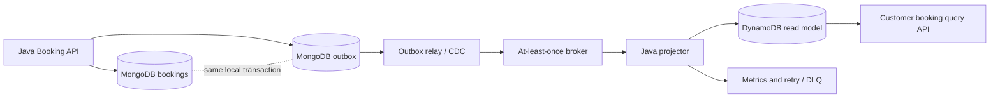
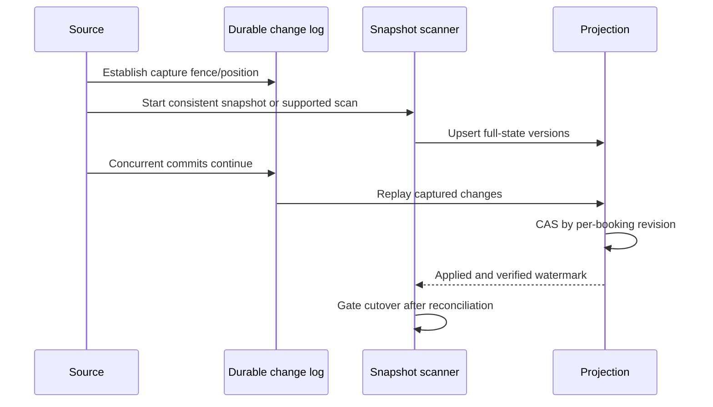

# Đồng bộ một kho dữ liệu dẫn xuất và xử lý sự kiện trùng

Khi một ứng dụng lưu dữ liệu nghiệp vụ trong MongoDB nhưng cần truy vấn theo khách hàng ở DynamoDB, tìm kiếm trong OpenSearch và tăng tốc bằng Redis, dữ liệu giữa các hệ **không tự đồng bộ**. Một thay đổi đã commit ở nguồn có thể tới kho dẫn xuất muộn, được giao nhiều lần, bị giao sai thứ tự hoặc được apply thành công nhưng consumer mất ACK. Nếu thiết kế chỉ dựa trên giả định “mỗi event được xử lý đúng một lần”, một lần retry có thể làm tăng counter hai lần, ghi lùi trạng thái booking hoặc hồi sinh bản ghi đã xóa.

Bài **“Đồng bộ một kho dữ liệu dẫn xuất và xử lý sự kiện trùng”** thuộc chương **Thực hành tổng hợp** của module **Database No SQL**. Đây là một workshop end-to-end: từ xác định **nguồn dữ liệu có thẩm quyền**, phát sự kiện bằng **transactional outbox**, tiêu thụ qua cơ chế **at-least-once**, cập nhật read model có **điều kiện theo revision**, đến **backfill, CDC catch-up, quan sát và diễn tập lỗi**.

Một ví dụ xuyên suốt là hệ thống cho thuê xe:

- **MongoDB** là nguồn có thẩm quyền cho `Booking`.
- Một **outbox** lưu sự kiện thay đổi cùng giao dịch cập nhật booking.
- Một **relay/broker** chuyển sự kiện tới consumer, có thể gửi lại.
- **DynamoDB** là kho dẫn xuất `bookings_by_customer` để tối ưu đọc.
- Java 17 chạy projector, kiểm tra trùng/sai thứ tự và thực hiện đối soát.
- Redis và OpenSearch được nhắc đến như các hướng mở rộng, không phải nguồn giữ invariant đặt xe.

Bài có hai cấp thực hành: **mô phỏng Java 17 chạy độc lập** để quan sát chính xác logic và **phác thảo triển khai với API NoSQL thật** để thay thế các adapter. Code mô phỏng không giả vờ có durability, distributed transaction hay đảm bảo exactly-once của một hệ production.

## Mục tiêu đầu ra

Sau khi học xong, bạn sẽ có thể:

1. Vẽ được luồng thay đổi nguồn → outbox → relay/broker → projector → read model.
2. Giải thích **vì sao một event có thể được giao nhiều lần** dù publisher/consumer đều viết đúng code.
3. Thiết kế event **đủ dữ liệu để tái tạo trạng thái** và có `aggregateRevision` đáng tin.
4. Áp dụng **conditional write/CAS ở chính kho dẫn xuất** để chống duplicate và out-of-order.
5. Giữ **tombstone có version** để một event cũ không hồi sinh booking đã xóa.
6. Phân biệt **state projection idempotency** với **business side-effect idempotency**.
7. Viết một projector Java 17 chạy với luồng event lỗi có chủ đích.
8. Thiết kế **snapshot + CDC handoff** không bỏ sót thay đổi trong lúc backfill.
9. Đo lag, watermark, mismatch và các trạng thái `applied / duplicate / stale / conflict`.
10. Chọn chính sách ACK/retry/DLQ/reconciliation và kiểm thử bằng failure injection.

> **Nguyên tắc quan trọng:** **At-least-once delivery + thao tác cập nhật có điều kiện, idempotent** có thể tạo ra **hiệu ứng trạng thái cuối giống như mỗi sự kiện được áp đúng một lần** trong một phạm vi đã chứng minh; điều đó **không đồng nghĩa delivery exactly-once**, cũng không tự đảm bảo side effects ở payment, email hoặc nhiều kho dữ liệu xảy ra đúng một lần.

---

# Phần I — Đề bài, dữ liệu và hợp đồng

## 1. Vì sao có kho dữ liệu dẫn xuất?

Một truy vấn nghiệp vụ:

```text
GET /customers/{customerId}/bookings?status=CONFIRMED
```

có thể cần xem bookings của một khách trong nhiều tháng, phân trang theo thời gian và lọc trạng thái. Dữ liệu canonical trong MongoDB có thể được tối ưu theo `bookingId`, trong khi API đọc cần một read model theo `tenantId + customerId`.

Thay vì buộc mọi truy vấn quét/tập hợp lại nguồn, ta xây một projection chỉ chứa những trường cần cho read path.

### 1.1. Nguồn chính và nguồn dẫn xuất

| Thuộc tính | Canonical store | Derived store |
| --- | --- | --- |
| Mục đích | Bảo toàn trạng thái/invariant nghiệp vụ | Phục vụ truy vấn cụ thể |
| Quyền quyết định booking hợp lệ | Có | Không |
| Phương thức cập nhật | Command/transaction có thẩm quyền | Từ changes/events |
| Có thể xây lại từ nguồn? | Không mặc định | Phải có kế hoạch xây lại |
| Độ trễ | Theo API command | Theo lag/freshness contract |
| Xử lý xóa nhầm | Backup/PITR và business recovery | Rebuild từ nguồn sạch |
| Phát side effect | Theo workflow được kiểm soát | Không mặc định |

### 1.2. Không dùng read model để xác nhận còn xe

DynamoDB read model hoặc OpenSearch có thể chưa thấy booking mới trong vài giây. Nếu `reserve()` dựa vào read model stale để quyết định xe còn trống, hệ có thể double-booking. Command phải dùng authority/conditional reservation protocol phù hợp.

---

## 2. Kiến trúc thực hành



Trong sơ đồ, **Booking và Outbox phải commit trong cùng transactional scope mà công nghệ nguồn hỗ trợ**, không phải hai writes rời nhau qua hai dịch vụ.

### 2.1. Những lần duplicate có thể xuất hiện

- Relay publish xong nhưng crash trước khi đánh dấu outbox item đã gửi.
- Broker đã giao event nhưng consumer crash trước khi ACK.
- Consumer ghi DynamoDB thành công nhưng trả ACK bị timeout.
- Broker redelivery vì lease/visibility timeout hết.
- Consumer chủ động replay từ checkpoint cũ.
- Backfill snapshot và CDC cùng tạo cập nhật cho một booking.
- Operator replay DLQ để xử lý sự kiện lỗi.

### 2.2. Những lần mất dữ liệu có thể xuất hiện

- Cập nhật nguồn thành công nhưng publish event riêng thất bại.
- Outbox bị xóa trước khi relay/consumer đọc xong.
- CDC resume token hết hạn hoặc log bị truncate.
- Consumer ACK trước khi ghi destination bền vững.
- DLQ được xem như nơi “bỏ qua” event không có reconciliation.

Thiết kế cần xử lý **cả giao trùng lẫn khả năng bỏ sót**, không chỉ một trong hai.

---

## 3. Bài toán dữ liệu cụ thể

Một booking canonical:

```json
{
  "_id": "booking-1001",
  "tenantId": "rental-a",
  "customerId": "customer-42",
  "vehicleId": "vehicle-77",
  "status": "CONFIRMED",
  "totalMinorUnits": 790000,
  "currency": "VND",
  "revision": 12,
  "createdAt": "2026-11-14T08:00:00Z",
  "updatedAt": "2026-11-14T08:05:00Z"
}
```

Read model tối ưu theo khách:

```json
{
  "pk": "TENANT#rental-a#BOOKING#booking-1001",
  "gsi1pk": "TENANT#rental-a#CUSTOMER#customer-42",
  "gsi1sk": "2026-11-14T08:00:00Z#booking-1001",
  "bookingId": "booking-1001",
  "status": "CONFIRMED",
  "totalMinorUnits": 790000,
  "currency": "VND",
  "projectionRevision": 12,
  "deleted": false
}
```

Các key và field chỉ là **mô hình minh họa**; cách thiết kế GSI/PK phải kiểm theo access pattern, phân bố tải, limits và security.

### 3.1. Chỉ copy những gì cần

Không mặc định sao chép toàn bộ thông tin khách hàng, PII, payment credential hoặc nội dung nội bộ vào read model. Bất kỳ projection nào cũng tạo thêm một nơi cần kiểm soát quyền và xóa dữ liệu theo policy.

### 3.2. Một booking tương ứng một projection row

Trong bài này, **identity của row đích ổn định theo `(tenantId, bookingId)`**. Nếu `customerId` thay đổi, GSI attributes cập nhật trên cùng row thay vì xóa/ghi hai rows độc lập. Điều đó giúp bảo vệ conditional revision trên một item.

### 3.3. Một hệ có thể cần nhiều projections

`bookings_by_vehicle`, `bookings_by_customer`, `search_bookings` có thể cần các sink khác nhau. Mỗi sink phải có checkpoint, idempotency, error budget và khả năng rebuild riêng.

---

## 4. Hợp đồng sự kiện phiên bản hóa

Một event thay đổi trạng thái hoàn chỉnh:

```json
{
  "eventId": "evt-4c6f7e",
  "schemaVersion": 1,
  "eventType": "BookingSnapshotChanged",
  "tenantId": "rental-a",
  "bookingId": "booking-1001",
  "aggregateRevision": 12,
  "operationId": "api-req-1009",
  "occurredAt": "2026-11-14T08:05:00Z",
  "deleted": false,
  "after": {
    "customerId": "customer-42",
    "vehicleId": "vehicle-77",
    "status": "CONFIRMED",
    "totalMinorUnits": 790000,
    "currency": "VND",
    "createdAt": "2026-11-14T08:00:00Z"
  }
}
```

### 4.1. Vai trò từng trường

| Trường | Vai trò |
| --- | --- |
| `eventId` | Phân biệt một event, hỗ trợ log/dedupe/tracing |
| `operationId` | Gom những attempt thuộc cùng logical business command |
| `schemaVersion` | Biết cách giải mã/upcast payload |
| `tenantId`, `bookingId` | Định danh aggregate và phạm vi quyền |
| `aggregateRevision` | Thứ tự có thẩm quyền **trong một aggregate** |
| `occurredAt` | Audit/quan sát; không thay commit ordering |
| `deleted` | Tombstone event cho trạng thái đã xóa |
| `after` | Toàn bộ trạng thái tối thiểu để tạo lại projection |

### 4.2. `schemaVersion` không phải `aggregateRevision`

`schemaVersion=2` nghĩa event format được nâng cấp. `aggregateRevision=12` nghĩa booking đã đến trạng thái thứ 12 theo protocol nguồn. Không so hai loại version này với nhau.

### 4.3. Timestamp không phải điều kiện an toàn để ghi đè

Nếu clients ở hai region có clock skew, `occurredAt` lớn hơn không chứng minh event mới hơn. Điều kiện cập nhật projection sử dụng revision/commit position **được source authority cấp**.

---

## 5. Chọn full-state event cho bài thực hành

Có hai kiểu events:

**Delta:**

```json
{
  "bookingId": "booking-1001",
  "aggregateRevision": 13,
  "delta": {"status": "CANCELLED"}
}
```

**Full-state snapshot:**

```json
{
  "bookingId": "booking-1001",
  "aggregateRevision": 13,
  "deleted": false,
  "after": {
    "customerId": "customer-42",
    "status": "CANCELLED",
    "totalMinorUnits": 790000,
    "currency": "VND"
  }
}
```

### 5.1. Vì sao chọn full-state?

Nếu event revision 13 được giao trước revision 12, một projector chỉ lưu **trạng thái mới nhất** có thể áp rev13 rồi bỏ rev12, miễn event rev13 thực sự chứa đủ trạng thái cần cho projection. Với delta, bỏ rev12 có thể làm thiếu cập nhật field/counter.

### 5.2. Điều kiện cho phép nhảy revision

- Revision đơn điệu theo booking.
- Full-state event thể hiện trạng thái **sau commit**.
- Projector là phép chiếu thuần trạng thái, không thực hiện side effect phụ thuộc từng transition.
- Fields bắt buộc không được suy từ event cũ đã bỏ qua.
- Delete tombstone có revision và tồn tại đủ lâu.
- Không có nguồn ghi song song tạo hai histories với cùng revision.

### 5.3. Khi bắt buộc phải xử lý từng event

Với ledger, increment, booking audit hoặc email notifications, **không được bỏ rev12 chỉ vì rev13 đến trước**. Cần phát hiện gap, giữ thứ tự, dedupe `eventId` và bảo đảm side-effect idempotency riêng.

---

## 6. Ba ý nghĩa khác nhau của “trùng”

### 6.1. Delivery duplicate

Broker giao lại cùng `eventId` vì mất ACK.

```text
evt-12 -> consumer -> destination applied
          ACK lost
evt-12 -> consumer again
```

### 6.2. Business duplicate

Ứng dụng gửi lại command với `operationId` mới dù request trước đã commit.

```text
reserve(vehicle-77) -> timeout, but committed
reserve(vehicle-77) -> new request ID -> second booking created
```

Projector dedupe không sửa được lỗi double-booking được tạo **tại source**. Nguồn phải có idempotent command/uniqueness invariant.

### 6.3. Semantic duplicate

Hai events khác `eventId` nhưng cùng `aggregateRevision` và payload:

```text
evt-a: booking-1001 rev12 CONFIRMED
evt-b: booking-1001 rev12 CONFIRMED
```

Có thể do publisher tạo lại event. Với **full-state projection**, cả hai có cùng kết quả. Nhưng nếu cùng revision mà **payload khác nhau**, đó là dấu hiệu vi phạm source protocol cần cảnh báo, không lặng lẽ chọn bản cuối.

---

## 7. At-most-once, at-least-once và exactly-once

| Giao vận | Tính chất | Hậu quả thường gặp |
| --- | --- | --- |
| At-most-once | Một message có thể bị mất, không giao lại | Tránh duplicate nhưng có thể bỏ sự kiện |
| At-least-once | Retry cho đến khi được xử lý theo protocol | Có thể giao trùng |
| Exactly-once *trong một phạm vi cụ thể* | Một hệ có thể đảm bảo transaction/dedupe nội bộ theo contract | Không tự mở rộng đến nhiều databases và external APIs |

### 7.1. “Exactly once” không được nói chung chung

Một broker có transaction API vẫn không tự atomic với một DynamoDB write và một HTTP payment API. Cần xác định boundaries: broker log, consumer offset, destination item, side effects.

### 7.2. Mục tiêu thực tế

**At-least-once + idempotent sink updates + ACK đúng thời điểm + reconciliation.**

Đây là cách đáp ứng nhiều read-model workflows mà không đòi một distributed transaction giữa MongoDB, broker và DynamoDB.

---

## 8. Bốn bất biến cần bảo toàn

**Invariant A — Source authority**

Với một booking, chỉ canonical store/command protocol được quyết định trạng thái nghiệp vụ, không lấy projection stale làm chuẩn.

**Invariant B — Revision không đi lùi**

\[
r_{\mathrm{projection}}(b)
\leq r_{\mathrm{source}}(b)
\]

và các lần project thành công không được làm `r_projection(b)` giảm trong cùng epoch.

**Invariant C — Retry không nhân đôi effect**

Nếu cùng event được giao \(n\) lần, projected state cuối vẫn bằng trạng thái khi apply một lần (trong các preconditions đã định).

**Invariant D — Delete không bị hồi sinh**

Một `DELETE(rev=13)` đã được lưu dưới dạng tombstone không được bị `UPSERT(rev=12)` ghi đè.

### 8.1. Lưu ý về revision source

Bất biến `projection ≤ source` chỉ so được khi cả hai cùng một data epoch/lineage và source có revision có thẩm quyền. Sau restore của source, cần kế hoạch **epoch mới/rebuild**, không trộn số revision cũ/mới mù quáng.

---

# Phần II — Ghi nguồn và transactional outbox

## 9. Dual-write trực tiếp có cửa sổ mất event

Thiết kế ngây thơ:

```java
saveBookingToMongoDB(booking);
publishEventToBroker(event);
```

Một lỗi:

```text
MongoDB commit OK
JVM crash
Broker publish never happened
```

Booking tồn tại nhưng derived table không biết.

Đổi thứ tự cũng không giải quyết:

```text
Broker publish OK
MongoDB commit fails
```

Projection có thể phản ánh trạng thái chưa từng commit.

### 9.1. Cần atomicity trong **cùng nguồn**

Ghi mutation và record outbox trong **một transaction** hoặc cùng một durable atomic unit mà engine hỗ trợ. Sau đó relay có thể retry publish.

### 9.2. Outbox không tự chống duplicate

Nó giảm lost-change window, nhưng relay có thể gửi lại event sau crash. Consumer vẫn phải idempotent.

---

## 10. Thiết kế outbox document

Ví dụ:

```json
{
  "_id": "evt-4c6f7e",
  "aggregateType": "Booking",
  "aggregateId": "booking-1001",
  "tenantId": "rental-a",
  "aggregateRevision": 12,
  "schemaVersion": 1,
  "type": "BookingSnapshotChanged",
  "payload": {
    "deleted": false,
    "after": {
      "customerId": "customer-42",
      "status": "CONFIRMED",
      "totalMinorUnits": 790000
    }
  },
  "createdAt": "2026-11-14T08:05:00Z",
  "publishState": "PENDING",
  "publishAttempts": 0
}
```

### 10.1. Keys và uniqueness

- `eventId` duy nhất.
- `(tenantId, bookingId, aggregateRevision)` nên không được đại diện cho hai payloads khác nhau; có thể dùng unique constraint nếu mô hình/source cho phép.
- Một `operationId` hỗ trợ idempotency của command; không thay thế `eventId`.
- Nên tránh publish lại với ID mới khi một event chỉ đang retry, trừ khi protocol downstream chấp nhận semantic dedupe.

### 10.2. Publish state phải có semantics

`PENDING`, `LEASED`, `PUBLISHED`, `FAILED` chỉ là operational states. Đánh dấu `PUBLISHED` sau broker ACK vẫn **không đảm bảo consumer đã apply**; cần thêm monitoring/reconciliation ở downstream.

### 10.3. Outbox retention

Không xóa outbox cũ chỉ vì broker nhận message nếu consumer có retention/replay requirements khác. Thiết kế archival hoặc dữ liệu nguồn + CDC reconciliation để luôn có đường phục hồi.

---

## 11. MongoDB: giao dịch ghi booking và outbox

Với MongoDB deployment/phiên bản có transaction support, một Java service có thể tạo transaction scope cho `bookings` và `outbox`. Logic tương đương minh họa bằng `mongosh`:

```javascript
const session = db.getMongo().startSession();

const rental = session.getDatabase("rental");
const bookings = rental.getCollection("bookings");
const outbox = rental.getCollection("outbox");

const bookingId = "booking-1001";
const tenantId = "rental-a";
const commandId = "api-req-1009";

try {
  session.withTransaction(() => {
    const previous = bookings.findOne({
      _id: bookingId,
      tenantId: tenantId
    });

    if (!previous) {
      throw new Error("Booking not found");
    }

    const nextRevision = previous.revision + 1;
    const nextState = "CONFIRMED";

    const update = bookings.updateOne(
      {
        _id: bookingId,
        tenantId: tenantId,
        revision: previous.revision
      },
      {
        $set: {
          status: nextState,
          updatedAt: new Date()
        },
        $inc: { revision: 1 }
      }
    );

    if (update.matchedCount !== 1) {
      throw new Error("Concurrent mutation; retry command safely");
    }

    outbox.insertOne({
      _id: "evt-" + commandId + "-" + nextRevision,
      tenantId,
      aggregateId: bookingId,
      aggregateRevision: nextRevision,
      schemaVersion: 1,
      type: "BookingSnapshotChanged",
      payload: {
        deleted: false,
        after: {
          customerId: previous.customerId,
          vehicleId: previous.vehicleId,
          status: nextState,
          totalMinorUnits: previous.totalMinorUnits,
          currency: previous.currency,
          createdAt: previous.createdAt
        }
      },
      createdAt: new Date(),
      publishState: "PENDING"
    });
  }, {
    readConcern: { level: "snapshot" },
    writeConcern: { w: "majority" }
  });
} finally {
  session.endSession();
}
```

**Giới hạn minh họa:** Ví dụ giả định những field ngoài `status` không bị thay đổi độc lập ngoài quy trình revision/CAS; một implementation thật nên xây event từ **trạng thái sau update** trong cùng transaction. Đồng thời, command cần một **idempotency record/unique operationId có thẩm quyền** để một retry sau timeout không áp transition lần hai. Tùy môi trường, `mongosh` có thể có các API/transaction requirements khác; dùng đúng tài liệu của version triển khai.

### 11.1. Vì sao filter có `revision`?

Hai commands cùng đọc revision 11 không được cùng áp dụng transition rev12. Conditional write ở source giúp mỗi booking có thứ tự revision hợp lệ.

### 11.2. Vì sao không publish broker trong transaction callback?

Driver có thể retry transaction callback trong một số lỗi transient. Gọi API ngoài transaction có thể tạo side effect nhiều lần dù DB cuối cùng chỉ commit một lần.

### 11.3. Không dùng event timestamp làm source revision

Clock client và `new Date()` không tạo phiên bản đơn điệu có thẩm quyền khi clients đồng thời ghi.

---

## 12. Các trạng thái của relay

```text
PENDING
   |
   | claim with lease / fencing
   v
CLAIMED
   |
   | broker publish success
   v
PUBLISHED

CLAIMED -- timeout/crash --> eligible for retry
CLAIMED -- exhausted policy --> ALERT/NEEDS_ATTENTION
```

### 12.1. Claim cần có lease/token

Nếu hai relay workers cùng đọc một item `PENDING` và cùng publish, cả hai có thể gửi message. Tình huống này **không sai** nếu downstream idempotent, nhưng gây overhead. Có thể dùng atomic claim và lease expiry.

### 12.2. Sau publish ACK vẫn có duplicate

```text
Relay publishes evt-12
Broker ACKs
Relay crashes before marking PUBLISHED
Relay restarts and republishes evt-12
```

Bởi vậy dedupe **phải nằm ở consumer/sink**, không chỉ relay.

### 12.3. Fencing stale relay

Lease hết hạn không tự ngăn worker cũ tiếp tục đánh dấu outbox `PUBLISHED`. Update trạng thái relay phải có token/generation/condition phù hợp, hoặc protocol đảm bảo duplicate harmless.

---

## 13. Polling outbox hay CDC outbox?

### 13.1. Polling

Relay truy vấn các documents `PENDING` theo index và claim batches.

Ưu điểm: triển khai theo API thông thường, dễ hiểu. Hạn chế: polling load, claim races, lease, DB maintenance.

### 13.2. Change streams/CDC

Relay subscribe commits tương ứng với outbox documents, stream events ra broker.

Ưu điểm: latency thấp hơn tùy pipeline, ít polling. Hạn chế: **resume token, retention window, topology/version, backfill, restart và quyền**.

### 13.3. Có thể kết hợp

Dùng CDC để low-latency, có periodic reconciliation trên durable outbox để tìm changes bị missed khi resume token không còn. Không được giả CDC stream có lịch sử vô hạn.

---

## 14. ACK và retry từ broker

Bất kể dùng Kafka-like broker, SQS-like queue hay một mechanism khác, nguyên tắc:

```text
Receive event
   |
   v
Validate schema and authorization context
   |
   v
Conditional apply / dedupe at derived store
   |
   +-- success/no-op verified --> ACK
   |
   +-- transient failure ----> do not ACK / retry with backoff
   |
   +-- poison event ---------> DLQ/park + alert + reconciliation
```

### 14.1. Không ACK trước destination write

Nếu consumer ACK xong rồi mới ghi DynamoDB và bị crash ở giữa, event có thể **không bao giờ được gửi lại**.

### 14.2. Ghi thành công nhưng ACK thất bại

Đây là nguyên nhân phổ biến của duplicate delivery. Conditional write ở sink phải khiến lần giao lại an toàn.

### 14.3. Không retry vô hạn với dữ liệu sai schema

Schema không giải mã được cần được giữ ở DLQ/parked stream có alert và playbook. Không được bỏ qua event im lặng khiến projection sai mãi.

---

# Phần III — Idempotency và ordering ở kho dẫn xuất

## 15. Cách cập nhật sai: blind upsert

Một consumer ngây thơ:

```javascript
// Ví dụ sai về correctness nếu delivery duplicate/out of order.
db.booking_views.updateOne(
  { _id: "booking-1001" },
  {
    $set: {
      status: event.after.status
    }
  },
  { upsert: true }
);
```

Luồng:

```text
rev11 CONFIRMED -> apply
rev12 CANCELLED -> apply
rev11 CONFIRMED -> retry arrives
```

Kết quả cuối quay về `CONFIRMED` dù source là `CANCELLED`.

### 15.1. Blind upsert có thể gây hỏng không nhìn thấy ngay

Consumer trả success cho mọi request; metrics đều xanh. Chỉ khi reconciliation hoặc khách xem booking mới thấy status sai.

---

## 16. Quy tắc apply monotonic version

Đối với **full-state projection** theo một booking:

\[
\mathrm{apply}(e, s)=
\begin{cases}
\mathrm{replaceState}(e), & \text{nếu } s=\varnothing
\text{ hoặc } e.rev>s.rev\\
\mathrm{noOp}, & \text{nếu } e.rev<s.rev\\
\mathrm{noOp}, & \text{nếu } e.rev=s.rev
\text{ và payload tương đương}\\
\mathrm{CONFLICT}, & \text{nếu } e.rev=s.rev
\text{ và payload khác nhau}.
\end{cases}
\]

Đây là một **sequential specification** để kiểm logic projector. Trong database thật, phép kiểm revision và write phải là **atomic per item**, không là read-then-write ở Java.

### 16.1. Vì sao `eventId` chưa đủ?

Một event cùng revision được tạo lại với ID khác có thể vượt qua bảng dedupe eventId. `revision` giúp bảo vệ **monotonic state** trong trường hợp full-state updates.

### 16.2. Vì sao revision đơn điệu phải gắn aggregate?

`rev12` của booking A không thể so với `rev13` của booking B để suy ra global order. Mỗi aggregate có một thứ tự riêng.

### 16.3. Epoch sau restore

Khi canonical DB được khôi phục về quá khứ, revision số học có thể lùi và read model cũ giữ version lớn hơn. Cần **restore epoch mới**, rebuild hoặc namespace switch; không tùy tiện bỏ guard.

---

## 17. Không dùng client read-then-write để chống ghi lùi

Một cách sai:

```text
Consumer A reads current rev=10.
Consumer B reads current rev=10.
Consumer B writes rev=12.
Consumer A writes rev=11.
```

Dù A từng so `11>10`, nó đã ghi lùi sau B.

### 17.1. Atomic conditional write

Quy tắc `incomingRevision > currentRevision` phải được DB thực thi **trong chính một mutation**, ví dụ DynamoDB conditional expression, MongoDB atomic per-document update, Cassandra LWT theo case, Redis Lua/CAS phù hợp.

### 17.2. Chỉ ACK khi biết điều kiện thật

Khi conditional write từ chối, đọc current revision/fingerprint để phân biệt:

- Duplicate: cùng rev và cùng payload.
- Stale: current rev cao hơn.
- Conflict: cùng rev, payload khác.
- Race/retryable: incoming rev cao hơn nhưng bị condition fail vì một condition khác, hoặc read không nhất quán.

Không coi mọi conditional failure là duplicate.

---

## 18. DynamoDB: mô hình conditional PutItem

Phép ghi projection theo nguyên tắc:

```text
PK = TENANT#rental-a#BOOKING#booking-1001

Condition:
  attribute_not_exists(projectionRevision)
  OR projectionRevision < :incomingRevision
```

Ví dụ request dạng pseudo-JSON cho SDK/CLI builder, **không phải lệnh AWS CLI có thể chạy nguyên văn**:

```json
{
  "TableName": "BookingCustomerView",
  "Item": {
    "pk": {"S": "TENANT#rental-a#BOOKING#booking-1001"},
    "bookingId": {"S": "booking-1001"},
    "projectionRevision": {"N": "12"},
    "deleted": {"BOOL": false},
    "status": {"S": "CONFIRMED"},
    "gsi1pk": {"S": "TENANT#rental-a#CUSTOMER#customer-42"},
    "gsi1sk": {"S": "2026-11-14T08:00:00Z#booking-1001"}
  },
  "ConditionExpression": "attribute_not_exists(#rev) OR #rev < :incoming",
  "ExpressionAttributeNames": {
    "#rev": "projectionRevision"
  },
  "ExpressionAttributeValues": {
    ":incoming": {"N": "12"}
  }
}
```

### 18.1. Vì sao `PutItem` phù hợp ví dụ full-state?

Nó thay thế toàn item bằng snapshot projection ở revision mới. Nếu event thiếu một field quan trọng, không được áp trong chế độ này. Event schema và transform phải được xác minh trước.

### 18.2. `ConditionalCheckFailedException` nghĩa gì?

Condition không đáp ứng **ở thời điểm write**; không có nghĩa bản event này chắc chắn đã apply trước đó. Cần kiểm `projectionRevision` và fingerprint để phân loại.

### 18.3. Read sau failed condition

Dùng consistent read trên base table khi cần xác minh trạng thái cuối theo API được hỗ trợ. Không dựa vào GSI eventual read để kết luận revision vừa ghi.

### 18.4. GSI không là strong read path

DynamoDB GSI thường chỉ hỗ trợ eventual-consistent reads. Projector có thể đã `PutItem` thành công nhưng query GSI chưa nhìn thấy ngay; tách **applied watermark** và **visible watermark**.

---

## 19. Delete phải mang tombstone version

Event xóa booking:

```json
{
  "eventId": "evt-delete-13",
  "schemaVersion": 1,
  "tenantId": "rental-a",
  "bookingId": "booking-1001",
  "aggregateRevision": 13,
  "deleted": true,
  "after": null
}
```

Nếu consumer thực hiện physical delete item, sau đó rev11 được redeliver:

```text
rev13 DELETE -> item removed
rev11 UPSERT -> item does not exist -> inserted again
```

Bản ghi bị **hồi sinh**.

### 19.1. Giữ tombstone trong base table

```json
{
  "pk": "TENANT#rental-a#BOOKING#booking-1001",
  "projectionRevision": 13,
  "deleted": true
}
```

Không đưa các `gsi1pk/gsi1sk` của booking sống vào tombstone; query customer GSI sẽ không trả bản ghi đã xóa qua những keys đó, còn base item vẫn giữ revision để chống replay cũ.

### 19.2. TTL tombstone cần có căn cứ

Chỉ xóa tombstone khi đã chứng minh **không còn old events/backfill snapshots/replay paths** có thể tái tạo record. Trong nhiều hệ, giữ marker lâu dài hoặc dùng deletion ledger riêng có thể an toàn hơn.

### 19.3. Privacy deletion

Tombstone nên chứa **ít metadata tối thiểu** như ID/revision/epoch, không giữ PII không cần thiết. Backup/retention policy phải tính cả những dữ liệu nhạy cảm đã bị xóa.

---

## 20. Event ID dedupe và revision guard giải quyết hai lớp khác nhau

Một **inbox** có thể giữ event IDs đã xử lý:

```text
INBOX#{consumerName}#{eventId}
```

Nhưng:

- Inbox đơn thuần ngăn cùng event ID gây side effect lặp.
- Revision guard ngăn **state regression** khi events đến sai thứ tự.
- Một operation thay đổi **nhiều items** có thể cần transaction/atomic inbox+side-effect.
- Inbox retention phải dài hơn replay/delivery horizon được cam kết nếu không có guard khác.

### 20.1. Khi nào cần inbox?

- Consumer thực hiện side effects không thuần state replacement.
- Projection gồm nhiều records không có một atomic per-key write.
- Một event phải ghi “đã xử lý” cùng mutation một cách nguyên tử.
- Event không chứa full snapshot và cần xử lý lần lượt.
- Downstream API không có revision-based CAS phù hợp.

### 20.2. Không ghi inbox `PROCESSED` rồi mới update destination

Nếu consumer crash ở giữa, lần giao lại thấy `PROCESSED` và bỏ qua dù destination chưa ghi. Inbox và mutation phải cùng transactional scope nếu mô hình đòi exactly-once effect.

---

## 21. Event trùng khác event sai thứ tự

**Trùng:**

```text
rev10, rev10, rev10
```

**Sai thứ tự:**

```text
rev10, rev12, rev11
```

**Thiếu lịch sử:**

```text
rev10, rev12 (rev11 không bao giờ đến)
```

Với **full-state projection**, rev12 có thể đủ để hiện thực state cuối ở rev12 dù rev11 chưa tới. Nhưng với delta counter:

```text
rev10: +1
rev11: +1
rev12: +1
```

bỏ rev11 khiến kết quả thấp đi một đơn vị.

### 21.1. Quy tắc theo loại consumer

| Consumer | Có thể bỏ old revision? | Cần lưu gap? |
| --- | --- | --- |
| Full-state booking view | Có, theo điều kiện đã nêu | Để giám sát/đối soát |
| Incremental counter | Không mặc định | Có |
| Payment side-effect | Không mặc định | Có, kèm idempotency |
| Immutable audit ledger | Không | Có |
| Search document snapshot | Có thể, có version guard | Cần catch-up/freshness |
| Inventory reservation | Không dùng projection eventual để quyết định | Dùng authority/transaction |

---

## 22. Cách đánh dấu mỗi lần xử lý

Một projector nên phân loại kết quả:

```text
APPLIED
DUPLICATE_NOOP
STALE_NOOP
REVISION_CONFLICT
RETRYABLE_ERROR
POISON_EVENT
INCONCLUSIVE
```

### 22.1. `DUPLICATE_NOOP`

Cùng revision và cùng canonical payload/fingerprint; projection đã có trạng thái mong muốn.

### 22.2. `STALE_NOOP`

Projection có revision cao hơn event. Với full-state projection không có transition side effect, event được bỏ an toàn theo protocol.

### 22.3. `REVISION_CONFLICT`

Cùng revision nhưng payload khác; cần alert và điều tra nguồn/version authority.

### 22.4. `RETRYABLE_ERROR`

Throttling, network timeout hoặc transient DB errors. Không ACK trước khi xác minh apply.

### 22.5. `POISON_EVENT`

Payload không giải mã, thiếu field, sai tenant/security contract hoặc version không được hỗ trợ. Park/DLQ có alert và sửa dữ liệu/consumer, không bỏ qua.

---

## 23. Không biến read model thành nguồn ra lệnh

Nếu DynamoDB view đang hiển thị `CONFIRMED` ở rev11 nhưng canonical MongoDB đã `CANCELLED` ở rev12, các thao tác nhạy cảm như “cấp khóa xe” hoặc “hoàn tiền” cần đọc authority hoặc dùng command protocol có đủ validation.

### 23.1. Query UX và command semantics

- Trang “Danh sách booking” có thể chấp nhận stale vài giây.
- Nút “Xác nhận giao xe” phải kiểm trạng thái thật, không tin read model.
- API có thể trả `sourceRevision`/`projectionRevision` cho client biết freshness khi phù hợp.
- Có thể route một số reads sang canonical khi cần read-your-writes.

### 23.2. Data ownership

Mọi sửa booking phải đi qua command service/source, không cho read model consumer ghi ngược trực tiếp vào canonical store trừ khi là một workflow được thiết kế riêng.

---

## 24. Tiêu chí thành công của workshop

Bài thực hành coi là đạt khi:

1. Nguồn có event outbox **cùng atomic transaction** với mutation.
2. Consumer không làm trạng thái projection đi lùi trong cùng epoch.
3. Event giao trùng không tạo duplicate projection item hoặc side effect.
4. Event mới đến trước event cũ vẫn dẫn đến state cuối chính xác khi full-state.
5. Delete rev cao không bị old upsert resurrect.
6. Retry sau sink ACK timeout không phá trạng thái.
7. Một event cùng revision nhưng payload khác được phát hiện.
8. Backfill + live events không có gap không thể phục hồi.
9. Có cơ chế đối soát nguồn–đích theo key/tenant/revision.
10. Có monitoring khi lag, DLQ, mismatch hoặc retention vượt giới hạn.

**Các chương sau xây bộ mô phỏng Java 17, chỉ ra cách ánh xạ vào DynamoDB/MongoDB thật, rồi diễn tập lỗi theo những tiêu chí này.**
# Phần IV — Lab Java 17: projector chịu trùng và sai thứ tự

## 25. Kịch bản cần chạy

Ta mô phỏng một booking có các sự kiện **full-state**, nơi revision tăng ở nguồn:

```text
rev1 CREATED
rev2 CONFIRMED
rev3 CANCELLED
rev4 DELETED
```

Broker/relay có thể giao:

```text
rev1, rev2, rev2, rev1, rev4, rev3, rev4
```

Thứ tự này cố ý chứa:

- Một lần duplicate rev2.
- Một event rev1 cũ quay lại.
- Rev4 delete đến trước rev3.
- Một lần duplicate delete rev4.

Kết quả phải là **tombstone revision 4**, không phải record `CANCELLED` hay `CONFIRMED`.

### 25.1. Kỳ vọng của projector

| Event được nhận | Revision đích trước | Kết quả | Revision sau |
| --- | ---: | --- | ---: |
| rev1 CREATED | Chưa có | `APPLIED` | 1 |
| rev2 CONFIRMED | 1 | `APPLIED` | 2 |
| rev2 CONFIRMED lặp | 2 | `DUPLICATE_NOOP` | 2 |
| rev1 CREATED cũ | 2 | `STALE_NOOP` | 2 |
| rev4 DELETED | 2 | `APPLIED` | 4 |
| rev3 CANCELLED muộn | 4 | `STALE_NOOP` | 4 |
| rev4 DELETED lặp | 4 | `DUPLICATE_NOOP` | 4 |
| rev4 CONFIRMED khác payload | 4 | `REVISION_CONFLICT` | 4 |

### 25.2. Điều kiện trước khi chạy

- Cài **JDK 17 trở lên**.
- Dùng một thư mục lab không chứa dữ liệu production.
- Không cần MongoDB, DynamoDB hay broker thật cho phần mô phỏng.
- Test này chỉ xác minh **logic hàm cập nhật trong một JVM**, chưa chứng minh distributed durability.

---

## 26. File `DerivedViewLab.java` — chương trình chạy độc lập

Đặt toàn bộ đoạn sau trong **một file** tên `DerivedViewLab.java`.

```java
import java.util.List;
import java.util.Objects;
import java.util.Optional;
import java.util.concurrent.ConcurrentHashMap;
import java.util.concurrent.atomic.AtomicReference;

public final class DerivedViewLab {

    enum ApplyResult {
        APPLIED,
        DUPLICATE_NOOP,
        STALE_NOOP,
        REVISION_CONFLICT
    }

    record Key(String tenantId, String bookingId) {
        Key {
            Objects.requireNonNull(tenantId);
            Objects.requireNonNull(bookingId);

            if (tenantId.isBlank() || bookingId.isBlank()) {
                throw new IllegalArgumentException("Blank key");
            }
        }
    }

    record Body(
        boolean deleted,
        String customerId,
        String status,
        long totalMinorUnits,
        String currency
    ) {
        Body {
            if (!deleted &&
                (customerId == null || status == null ||
                 currency == null)) {
                throw new IllegalArgumentException(
                    "Live event must contain full projection state"
                );
            }
        }
    }

    record Event(
        String eventId,
        Key key,
        long revision,
        Body body
    ) {
        Event {
            Objects.requireNonNull(eventId);
            Objects.requireNonNull(key);
            Objects.requireNonNull(body);

            if (eventId.isBlank() || revision < 1) {
                throw new IllegalArgumentException(
                    "Invalid event ID or revision"
                );
            }
        }
    }

    record Row(long revision, Body body) {}

    static final class Projector {
        private final ConcurrentHashMap<Key, Row> rows =
            new ConcurrentHashMap<>();

        ApplyResult apply(Event incoming) {
            AtomicReference<ApplyResult> outcome =
                new AtomicReference<>();

            // Atomic per key in this ONE JVM only.
            rows.compute(incoming.key(), (key, existing) -> {

                if (existing == null ||
                    incoming.revision() > existing.revision()) {

                    outcome.set(ApplyResult.APPLIED);
                    return new Row(
                        incoming.revision(),
                        incoming.body()
                    );
                }

                if (incoming.revision() <
                    existing.revision()) {

                    outcome.set(ApplyResult.STALE_NOOP);
                    return existing;
                }

                if (existing.body().equals(incoming.body())) {
                    outcome.set(ApplyResult.DUPLICATE_NOOP);
                    return existing;
                }

                outcome.set(ApplyResult.REVISION_CONFLICT);
                return existing;
            });

            return outcome.get();
        }

        Optional<Row> find(Key key) {
            return Optional.ofNullable(rows.get(key));
        }

        long countVisibleForCustomer(
                String tenantId, String customerId) {

            return rows.entrySet().stream()
                .filter(entry ->
                    entry.getKey().tenantId().equals(tenantId))
                .map(entry -> entry.getValue().body())
                .filter(body -> !body.deleted())
                .filter(body ->
                    body.customerId().equals(customerId))
                .count();
        }
    }

    private static Event event(
            String id, Key key, long revision,
            boolean deleted, String status) {

        Body body = deleted
            ? new Body(true, null, null, 0L, null)
            : new Body(
                false, "customer-42", status,
                790000L, "VND"
              );

        return new Event(id, key, revision, body);
    }

    private static void expect(
            ApplyResult actual, ApplyResult expected) {

        if (actual != expected) {
            throw new AssertionError(
                "Expected " + expected + ", got " + actual
            );
        }

        System.out.println(actual);
    }

    public static void main(String[] args) {
        Key key = new Key("rental-a", "booking-1001");
        Projector projector = new Projector();

        Event v1 = event("evt-1", key, 1, false, "CREATED");
        Event v2 = event("evt-2", key, 2, false, "CONFIRMED");
        Event v3 = event("evt-3", key, 3, false, "CANCELLED");
        Event v4 = event("evt-4", key, 4, true, null);

        expect(projector.apply(v1), ApplyResult.APPLIED);
        expect(projector.apply(v2), ApplyResult.APPLIED);

        // Same event delivered again:
        expect(
            projector.apply(v2),
            ApplyResult.DUPLICATE_NOOP
        );

        // Old event arrives after a newer event:
        expect(
            projector.apply(v1),
            ApplyResult.STALE_NOOP
        );

        // Tombstone wins even when rev3 has not arrived:
        expect(projector.apply(v4), ApplyResult.APPLIED);

        expect(
            projector.apply(v3),
            ApplyResult.STALE_NOOP
        );

        expect(
            projector.apply(v4),
            ApplyResult.DUPLICATE_NOOP
        );

        // The same revision with a DIFFERENT payload
        // indicates a source/event contract conflict.
        Event conflict = event(
            "evt-4-conflict", key, 4, false, "CONFIRMED"
        );

        expect(
            projector.apply(conflict),
            ApplyResult.REVISION_CONFLICT
        );

        Row finalRow = projector.find(key).orElseThrow();

        if (finalRow.revision() != 4 ||
            !finalRow.body().deleted()) {
            throw new AssertionError("Tombstone was lost");
        }

        long visible = projector.countVisibleForCustomer(
            "rental-a", "customer-42"
        );

        if (visible != 0) {
            throw new AssertionError(
                "Deleted booking was resurrected"
            );
        }

        System.out.println(
            "FINAL revision=4 deleted=true visible=0"
        );
    }
}
```

### 26.1. Lệnh chạy

```bash
javac DerivedViewLab.java
java DerivedViewLab
```

### 26.2. Kết quả dự kiến

```text
APPLIED
APPLIED
DUPLICATE_NOOP
STALE_NOOP
APPLIED
STALE_NOOP
DUPLICATE_NOOP
REVISION_CONFLICT
FINAL revision=4 deleted=true visible=0
```

Đây là **kết quả dự kiến từ logic**, không phải khẳng định đã chạy compile trong STEP 4.

### 26.3. Điều mô phỏng chứng minh

`ConcurrentHashMap.compute()` cho ta một atomic read-modify-write **trong JVM này** trên một key. Khi dùng một tiến trình, các events sai thứ tự hoặc duplicate không làm giảm `revision`.

### 26.4. Điều mô phỏng không chứng minh

- Không bền qua restart JVM.
- Không dùng network/broker.
- Không có distributed CAS giữa nhiều projector instances.
- Không có DynamoDB GSI/eventual read lag.
- Không bảo vệ khi source cấp revisions trùng/không đơn điệu.
- Không bảo vệ multi-item projections hoặc payment side effects.
- Không chứng minh initial snapshot và CDC stream không có gaps.
- Không thực hiện schema migration/restore epoch.

Ở production, thay `ConcurrentHashMap.compute()` bằng **atomic conditional write của kho NoSQL đích**, đồng thời xây consumer ACK/retry/reconciliation phù hợp.

---

## 27. Vì sao `Body.equals()` hữu ích?

Trong Java, `Body` là `record`, nên có `equals()` theo các trường của value object. Nếu hai events có cùng revision và cùng trạng thái projection, chúng được xem là semantic duplicate.

### 27.1. Event ID khác, state giống

Hai event IDs khác nhau có thể đại diện cùng snapshot state do source retry hoặc thay đổi pipeline. Với một **state-only projection**, việc apply lần hai không cần tạo effect.

### 27.2. Event ID giống, state khác

Đây là dấu hiệu mạnh hơn của lỗi producer/broker/serialization. Hệ thống production nên kiểm event identity/integrity, không chỉ state equality.

### 27.3. Fingerprint trong dữ liệu thực

Nếu không muốn đọc toàn item để so payload, có thể lưu fingerprint được tính bằng canonical serialization của **những trường projection có nghĩa**. Đừng hash JSON theo key order tùy ý; phải ổn định hóa schema, null, types và normalization trước.

---

## 28. Bài thử thứ tự: rev3 đến trước rev2

Thay phần đầu luồng ở `main` bằng:

```java
expect(projector.apply(v1), ApplyResult.APPLIED);
expect(projector.apply(v3), ApplyResult.APPLIED);
expect(projector.apply(v2), ApplyResult.STALE_NOOP);
```

Kết quả state cuối rev3 `CANCELLED`.

### 28.1. Tại sao hợp lý trong bài?

`v3` chứa **full-state** của booking; nó không cần `v2` để biết status và các fields liên quan.

### 28.2. Nếu rev2 chứa charge event?

Không thể bỏ qua rev2 nếu consumer có trách nhiệm charge/refund hoặc ghi immutable ledger. Khi có side effects, event ordering và inbox/outbox transaction là yêu cầu bổ sung.

---

## 29. Bài thử đồng thời trên cùng key

Tạo nhiều threads gọi `projector.apply()` với các events ngẫu nhiên về thứ tự. Với `ConcurrentHashMap.compute()`, mỗi update trên cùng key được giải quyết nguyên tử trong JVM.

### 29.1. Nhưng production có nhiều replicas

Hai projector pods có thể xử lý cùng booking đồng thời từ những broker partitions khác nhau. **Java `synchronized` hoặc ConcurrentHashMap trong mỗi pod không phối hợp giữa pods**.

### 29.2. Chỗ đúng để giữ bất biến

- DynamoDB `ConditionExpression`.
- MongoDB atomic update/compare-and-set trên cùng document.
- Redis script/CAS phù hợp.
- Cassandra LWT theo scope và chi phí của nó.
- Transactional inbox+mutation nếu cần nhiều rows.

### 29.3. Per-key message ordering giúp giảm retry, không thay CAS

Có thể partition broker theo `(tenantId, bookingId)` để giữ order trong stream, nhưng redelivery, rebalance, replay và snapshot backfill vẫn có thể đảo thứ tự. Sink phải bảo vệ.

---

# Phần V — Ánh xạ projector vào kho NoSQL thực

## 30. DynamoDB: lưu projection theo key ổn định

Thiết kế một table:

```text
Table: BookingCustomerView

Primary key:
  pk (String)

Optional GSI:
  gsi1pk (String)
  gsi1sk (String)
```

Item sống:

```json
{
  "pk": "TENANT#rental-a#BOOKING#booking-1001",
  "gsi1pk": "TENANT#rental-a#CUSTOMER#customer-42",
  "gsi1sk": "2026-11-14T08:00:00Z#booking-1001",
  "projectionRevision": 12,
  "deleted": false,
  "status": "CONFIRMED",
  "payloadFingerprint": "versioned-canonical-hash"
}
```

Item tombstone:

```json
{
  "pk": "TENANT#rental-a#BOOKING#booking-1001",
  "projectionRevision": 13,
  "deleted": true,
  "payloadFingerprint": "hash-for-delete-state"
}
```

### 30.1. Vì sao tombstone không có GSI keys?

DynamoDB GSI chỉ chứa items có index key attributes phù hợp. Giữ tombstone ở base table nhưng bỏ GSI keys giúp query danh sách khách không thấy booking đã xóa. Phải hiểu index freshness vẫn eventual.

### 30.2. PK/tenant isolation

Không dùng `bookingId` làm key nếu IDs chỉ unique trong từng tenant. Ghép một encoding không gây nhầm lẫn và enforce authorization ở API; naming pattern chỉ là ví dụ.

### 30.3. DynamoDB item limit và hot partition

Một item không nên chứa toàn lịch sử booking; chỉ giữ projection mới nhất. Partition key distribution và GSI throughput/hot-tenant behavior cần được đo dưới tải.

---

## 31. Java AWS SDK v2: skeleton conditional write

Đoạn sau **không chạy độc lập**: cần dependency AWS SDK v2, `DynamoDbClient` đã cấu hình đúng region/credentials/table. Nó minh họa atomic condition **ở phía DynamoDB**.

```java
import java.util.Map;

import software.amazon.awssdk.services.dynamodb.DynamoDbClient;
import software.amazon.awssdk.services.dynamodb.model.AttributeValue;
import software.amazon.awssdk.services.dynamodb.model.PutItemRequest;
import software.amazon.awssdk.services.dynamodb.model.ConditionalCheckFailedException;

public final class DynamoProjectionWriter {

    private final DynamoDbClient dynamo;
    private final String tableName;

    public DynamoProjectionWriter(
            DynamoDbClient dynamo, String tableName) {
        this.dynamo = dynamo;
        this.tableName = tableName;
    }

    private static AttributeValue str(String value) {
        return AttributeValue.builder().s(value).build();
    }

    private static AttributeValue num(long value) {
        return AttributeValue.builder()
            .n(Long.toString(value)).build();
    }

    public void write(
            String pk,
            long revision,
            String fingerprint,
            boolean deleted,
            String customerIndexKey,
            String customerIndexSort,
            String status) {

        Map<String, AttributeValue> item =
            new java.util.HashMap<>();

        item.put("pk", str(pk));
        item.put("projectionRevision", num(revision));
        item.put(
            "deleted",
            AttributeValue.builder().bool(deleted).build()
        );
        item.put("payloadFingerprint", str(fingerprint));

        if (!deleted) {
            item.put("gsi1pk", str(customerIndexKey));
            item.put("gsi1sk", str(customerIndexSort));
            item.put("status", str(status));
        }

        PutItemRequest request = PutItemRequest.builder()
            .tableName(tableName)
            .item(item)
            .conditionExpression(
                "attribute_not_exists(#r) OR #r < :incoming"
            )
            .expressionAttributeNames(
                Map.of("#r", "projectionRevision")
            )
            .expressionAttributeValues(
                Map.of(":incoming", num(revision))
            )
            .build();

        try {
            dynamo.putItem(request);
        } catch (ConditionalCheckFailedException conflict) {
            // DO NOT automatically treat this as "duplicate".
            // Read the base item consistently and compare
            // revision + fingerprint to classify stale/duplicate
            // versus same-revision payload conflict.
            throw conflict;
        }
    }
}
```

### 31.1. Chỗ còn phải hoàn thiện

- Decode/validate event schema.
- Canonical payload fingerprint.
- Retry policy khi network timeout.
- Strong base-table read khi conditional check fail.
- Kiểm `currentRevision > incoming` và `== incoming`.
- Lưu `eventId`/trace metadata nếu cần.
- Xử lý KMS/IAM/metrics, SDK rate limits.
- Không lưu PII trong logs/DLQ.
- State cho `RETRYABLE_ERROR` và `REVISION_CONFLICT`.

### 31.2. Vì sao dùng atomic condition?

Nếu hai consumer instances cùng xử lý rev11 và rev12, chỉ một mutation có thể thắng tùy thứ tự, và mutation có revision cũ hơn **không thể ghi lùi** lên trạng thái đã có revision mới hơn.

### 31.3. Lưu ý của `PutItem`

`PutItem` thay toàn item; event phải được transform thành **full projection state**. Nếu event chỉ có `status` nhưng table còn field cần giữ, `PutItem` sẽ làm mất fields đó.

---

## 32. Sau conditional failure nên phân loại thế nào?

Giả định incoming revision 12, hệ trả `ConditionalCheckFailedException`.

Đọc base item (theo consistency mode phù hợp), rồi:

```text
current revision = 13:
  STALE_NOOP (nếu đây là full-state projection)

current revision = 12:
  compare fingerprint
    equal    -> DUPLICATE_NOOP
    unequal  -> REVISION_CONFLICT

current revision = 11:
  unexpected state/race/other condition
  retry with bounded backoff and diagnostics
```

### 32.1. Không coi GSI result làm state authority

GSI reads có eventual consistency. Sau conditional fail, `GetItem` trên base table với strongly consistent option nơi được hỗ trợ là lựa chọn phù hợp để kiểm latest revision.

### 32.2. Unknown write result

Nếu `PutItem` timeout, không biết request đã commit chưa. Retry **cùng full-state event và revision** là an toàn về state nếu conditional update đúng; trường hợp retry báo conflict có thể là do lần đầu đã apply. Sau đó phân loại bằng revision/fingerprint.

### 32.3. Những nơi có concurrency/replication mode khác

Nếu table là global multi-writer với conflict resolution làm version regression hoặc overwrites tại layer replication, điều kiện theo item ở một region chưa đủ chứng minh global invariant. Cần xác định authority/version semantics và region write policy đúng.

---

## 33. MongoDB làm derived store: so sánh theo revision

Nếu kho dẫn xuất cũng là MongoDB, một cách đơn giản là dùng update pipeline để **atomic so revision rồi ghi state** trên cùng document. Ví dụ minh họa `mongosh`:

```javascript
const incoming = {
  _id: "rental-a#booking-1001",
  revision: 12,
  deleted: false,
  customerId: "customer-42",
  status: "CONFIRMED"
};

db.booking_views.updateOne(
  { _id: incoming._id },
  [
    {
      $replaceWith: {
        $cond: [
          {
            $lt: [
              { $ifNull: ["$projectionRevision", -1] },
              incoming.revision
            ]
          },
          {
            _id: incoming._id,
            projectionRevision: incoming.revision,
            deleted: incoming.deleted,
            customerId: incoming.customerId,
            status: incoming.status
          },
          "$$ROOT"
        ]
      }
    }
  ],
  { upsert: true }
);
```

### 33.1. Điều cần xác minh

- Aggregation pipeline updates và operators được hỗ trợ ở đúng MongoDB version.
- Atomicity ở phạm vi một document.
- `upsert`/pipeline behavior và `_id` uniqueness.
- Same-revision payload conflict cần được phát hiện qua additional read/fingerprint.
- `modifiedCount=0` không phân biệt duplicate/stale/missing semantic conflict.
- Cần preserve/replace đúng những fields mong muốn.
- Khi delete, giữ tombstone, không xóa document.

### 33.2. Không dùng `find()` rồi `updateOne({_id})` mù

Concurrent consumers có thể cùng đọc revision cũ và ghi lùi. Quyết định phải được thực hiện trong một atomic DB mutation hoặc transactional protocol phù hợp.

---

## 34. Redis làm derived cache: dùng version guard

Redis có thể dùng Hash:

```text
booking:rental-a:booking-1001
  revision=12
  status=CONFIRMED
  deleted=false
```

Một client-side sequence sai:

```text
HGET revision -> 10
other worker HSET revision=12
HSET revision=11
```

### 34.1. Cần compare-and-update atomically

Có thể dùng Redis Lua/script hoặc WATCH/MULTI/EXEC với retry phù hợp để kiểm `incomingRevision > storedRevision` trong một atomic procedure.

### 34.2. TTL và eviction tạo bẫy

Khi cache key bị evict, historical event rev9 có thể đến và tạo lại cache theo state cũ. Nếu cache chỉ là ephemeral và mỗi cache miss luôn đọc canonical source, có thể chấp nhận theo contract; nếu dùng cache làm projection authoritative thì cần persisted high-watermark/tombstone hoặc strategy khác.

### 34.3. Cache nên dễ rebuild

Redis cache dẫn xuất có thể chọn key namespace theo version và được rewarm từ canonical source. Không dùng cache để quyết định booking uniqueness.

---

## 35. OpenSearch: full-state reindex và external version

OpenSearch/Elasticsearch index có thể chứa một document/search projection per booking, với source revision.

### 35.1. External versioning có thể hữu ích

Một số phiên bản/product APIs hỗ trợ externally managed version, nhưng semantics cho `index`, `update`, `delete`, replay và retention của delete tombstones phải đọc đúng tài liệu. Đừng giả mọi versioning option (`external`, `external_gte`, seq_no/primary_term) là tương đương.

### 35.2. Delete tombstone tốt hơn blind delete khi replay rất cũ

Nếu index document bị xóa vật lý rồi một event cũ trở lại, old upsert có thể tạo lại document. Cần:

- Tombstone/high-watermark store bên ngoài index, hoặc
- Versioned soft delete document với filter khỏi search, hoặc
- Replay horizon/retention được chứng minh.

### 35.3. Alias cutover

Nếu reindex vào `bookings-v2`, áp snapshot + CDC vào v2, đợi target **searchable** đúng watermark và đổi alias có kiểm soát. Việc OpenSearch báo write ACK không tự đảm bảo search query lập tức thấy document.

---

## 36. Cassandra hoặc wide-column projection

Một read table Cassandra có thể dùng primary key theo query pattern:

```sql
CREATE TABLE rental.bookings_by_customer (
  tenant_id text,
  customer_id text,
  created_at timestamp,
  booking_id text,
  status text,
  source_revision bigint,
  deleted boolean,
  PRIMARY KEY (
    (tenant_id, customer_id),
    created_at, booking_id
  )
);
```

Đây là ví dụ schema cho query; **việc di chuyển `customer_id`** khi thay đổi sẽ tạo vấn đề phải dọn row ở partition cũ. Không mặc định chỉ một atomic mutation bảo vệ mọi rows liên quan.

### 36.1. Nếu cần condition ở một row

Cassandra LWT/CAS có thể là một lựa chọn với chi phí/giới hạn consistency riêng. Một write timestamp-based last-write-wins thông thường không thay thế atomic revision check.

### 36.2. Nếu sự kiện đổi partition key

Một event có thể phải xóa row cũ và thêm row mới. Hai operations có partial failure; cần biết old key từ event/source hoặc có một authoritative pointer/transactional reconciliation strategy.

### 36.3. Read table immutable per event

Một thiết kế khác append event rows theo `(aggregateId, revision)` có thể chịu duplicate bằng unique key, nhưng query state/latest, tombstone/compaction và retention sẽ có trade-offs. Chọn theo access pattern, không áp một mô hình cho mọi bài toán.

---

# Phần VI — Bootstrap dữ liệu có sẵn và bắt kịp changes

## 37. Tại sao không chỉ bật CDC rồi bắt đầu?

Nếu nguồn đã có 10 triệu bookings trước ngày projector ra đời, CDC thường chỉ chứa các mutations trong một retention window. Bật consumer hôm nay có thể không cung cấp trạng thái của 10 triệu bookings chưa thay đổi.

### 37.1. Cần initial snapshot/backfill

Một migration đầy đủ cần:

1. Có baseline của những records đã tồn tại.
2. Thu được những writes phát sinh trong lúc scan.
3. Áp được snapshots và subsequent events dù chúng đến sai thứ tự.
4. Chứng minh không có gap vượt ngoài retention.
5. Kiểm coverage và source–target equivalence.

---

## 38. Snapshot + CDC: thứ tự tối thiểu an toàn

Một thiết kế tổng quát:



### 38.1. Không đơn giản “scan xong rồi mới subscribe”

Một booking được cập nhật đúng lúc scan có thể bị bỏ qua nếu subscription chỉ bắt đầu sau khi scan hoàn tất.

### 38.2. Capture phải có continuity từ fence

Có thể dùng engine-provided snapshot/change stream handoff hoặc một protocol cẩn thận dựa trên log position/resume token. **Log continuity phải được chứng minh**; một timestamp client `T0` không tự là global consistent cut.

### 38.3. Backfill và CDC cùng ghi vào đích

Nếu snapshot rev7 đến sau CDC rev9, revision guard khiến rev7 `STALE_NOOP` thay vì ghi lùi.

### 38.4. Sharded source

Một MongoDB sharded cluster có metadata và positions per shard; consistent snapshot/stream handoff cần cơ chế được hỗ trợ. Không giả `last timestamp` của một shard là global fence của mọi shard.

---

## 39. Mô hình backfill worker

Một worker theo page/range:

```text
Get stable range/page from canonical source
  |
  v
Transform document to full-state event
  |
  v
Conditional apply by source revision
  |
  v
Persist batch progress after durable apply
  |
  v
Continue / retry with checkpoint
```

### 39.1. Không dùng offset pagination trên dữ liệu thay đổi nếu không có snapshot semantics

`skip(1_000_000)`/offset sâu có thể tốn I/O và bỏ/lặp rows khi thêm/xóa trong scan. Dùng keyset/range scan hoặc engine snapshot mechanism phù hợp.

### 39.2. Checkpoint phải đặt sau apply

Nếu checkpoint trước khi đích ghi, crash có thể bỏ vĩnh viễn một page. Nếu checkpoint sau khi ghi, crash có thể replay một page, nhưng projector idempotent sẽ xử lý được.

### 39.3. Chia tải

Phân shard/tenant/time buckets có giới hạn concurrency, bytes/s và per-shard headroom. Một batch job chạy quá mạnh có thể làm foreground booking API p99 tăng.

---

## 40. `createdAt` không phải source ordering

Một booking có thể được cập nhật nhiều lần trong vài giây và clock client sai. Vì vậy:

- `createdAt` dùng cho GSI sort theo ngày tạo booking.
- `updatedAt` dùng cho audit/freshness khi semantics rõ.
- `aggregateRevision` hoặc log position dùng cho **thứ tự thay đổi**.
- Source commit/watermark dùng cho **catch-up**.
- `eventId` dùng cho **tracing/dedupe**.

Không dùng một trường thay thế bừa cho tất cả.

---

## 41. Tính lag đúng nghĩa

Các mốc:

```text
T0: source commit
T1: event captured by outbox/CDC
T2: broker received
T3: consumer delivered
T4: destination applied
T5: destination visible to query
```

Định nghĩa:

\[
L_{\mathrm{capture}}=T_1-T_0,\qquad
L_{\mathrm{broker}}=T_2-T_1,
\]

\[
L_{\mathrm{apply}}=T_4-T_0,\qquad
L_{\mathrm{visible}}=T_5-T_0.
\]

### 41.1. Phân biệt apply và visible

Đối với DynamoDB GSI hoặc OpenSearch search, item/index write có thể apply trước khi query path nhìn thấy. Không công bố “lag=0” chỉ vì consumer vừa nhận ACK.

### 41.2. Cross-machine clocks

Không trừ trực tiếp timestamps của các hosts có skew không kiểm soát. Dùng server commit/monotonic measurements, propagated tracing context và clock uncertainty để báo estimate đúng.

### 41.3. Lag dưới tải

Theo dõi p50/p95/p99, max backlog, per-tenant/shard hot spots. Average lag nhỏ có thể che một tenant bị chậm hàng giờ.

---

## 42. Khi nào có thể chuyển reads sang projection?

Một cutover gate:

- Initial scan coverage đã được chứng minh.
- CDC subscription không có gap hoặc expired cursor.
- Apply watermark đủ gần source theo SLO.
- Visible watermark đủ gần source theo query path.
- Các invariants/row hashes được đối soát.
- Tombstones và deletes chính xác.
- Không có poison event chưa được xử lý cho dữ liệu quan trọng.
- IAM/tenant ACL đúng.
- Thử canary/shadow queries đạt correctness và p99.
- Có rollback/forward fix và nguồn canonical còn phục vụ.

### 42.1. Không coi queue rỗng là đủ

Broker lag có thể bằng 0 nhưng index chưa refresh, một event trong flight hoặc scanner bỏ sót source rows. Cần kết hợp **watermark + reconciliation + freshness**.

### 42.2. Shadow read

Với một tỷ lệ có giới hạn, query cả nguồn và projection rồi so IDs/status/revisions (không phát side effects). Cần tính chênh lệch thời điểm đọc và write concurrency trước khi gọi mismatch.

---

## 43. Reconciliation giữa nguồn và đích

Đây là lớp phòng thủ khi CDC miss hoặc bug đã gây drift.

### 43.1. Ví dụ reconciliation theo một booking

```text
Source booking-1001:
  rev13, deleted=true

Projection booking-1001:
  rev11, deleted=false

Decision:
  Projection behind.
  Fetch source authoritative state.
  Reapply full-state rev13 via CAS.
```

### 43.2. Đối soát nào?

- Số records theo tenant/partition, không chỉ tổng.
- Missing keys và extra keys.
- Revision distribution.
- Status/amount/customerIndexKey equality.
- Delete/tombstone correctness.
- Index query coverage.
- Privacy/ACL differences.
- Source commit vs applied/visible watermark.

### 43.3. Một row count bằng nhau không chứng minh đúng

10.000 records ở cả hai kho nhưng 200 IDs khác nhau vẫn có count bằng nhau. Có thể hash/canonical compare theo ranges và sample có kiểm soát.

### 43.4. Reconciliation phải dùng quyền đọc phù hợp

Không dùng eventual replica đang stale làm source truth cho kết luận quan trọng. Phải chọn read policy được chấp nhận theo source contract.

---

## 44. Backfill/reconciliation idempotency

Một source snapshot có thể đọc booking rev20, trong lúc CDC đã apply rev21. Worker gửi rev20:

```text
Projection current rev21
Backfill event rev20
Result STALE_NOOP
```

Chính tính monotonic giúp **chạy lại backfill không phá dữ liệu mới**.

### 44.1. Nhưng `STALE_NOOP` không luôn là dữ liệu đúng

Nếu event rev21 là corrupted snapshot, revision guard chỉ ngăn regression, không phát hiện business wrong state. Reconciliation vẫn phải so source canonical và các invariants.

### 44.2. Không tự repair bằng dữ liệu cũ

Nếu source replica đọc được rev18 trong khi leader đã rev21, một “repair job” ngây thơ có thể cố ghi rev18. Cần source read mode và CAS.

---

## 45. Khi source bị restore về quá khứ

Một bài toán khó:

```text
Before disaster:
  source rev100
  projection rev100

Source restored from backup:
  source rev90
  projection still rev100
```

Mọi event mới `rev91`, `rev92` có thể bị guard ở projection từ chối vì `<100`.

### 45.1. Cách giải quyết

Đặt **source epoch** hoặc projection generation mới, ví dụ `epoch=2026-recovery-02`, xây lại projection từ nguồn phục hồi rồi chuyển alias/table routing.

### 45.2. Không tắt version guard tùy tiện

Nếu chỉ xóa điều kiện revision để “cho dữ liệu chạy lại”, event cũ từ queue vẫn có thể ghi đè dữ liệu mới. Phải fence old consumers và tách old/new timelines.

### 45.3. External systems

Nếu payment provider vẫn lưu giao dịch sau restore point, cần reconciliation nghiệp vụ. Rebuilding projection không thể sửa ledger/payment đúng nghĩa.

---

# Phần VII — Consumer operation và error handling

## 46. Vòng xử lý và ACK

Một handler chuẩn cho full-state event:

```text
onDelivery(event):
  1. Validate envelope/schema/tenant/revision.
  2. Compute canonical projection state.
  3. Conditionally apply event at destination.
  4. If APPLIED -> ACK.
  5. If DUPLICATE_NOOP verified -> ACK.
  6. If STALE_NOOP, allowed by snapshot contract -> ACK.
  7. If REVISION_CONFLICT -> park + alert, do not treat as success.
  8. If transient/unknown -> retry or verify destination, no early ACK.
  9. If poison schema -> DLQ/park + alert, preserve evidence.
```

### 46.1. ACK có thể thất bại sau khi apply

Consumer restart và nhận event lại; `projectionRevision` khiến lần thứ hai no-op. Đây là tình huống cần được demo, không phải lỗi hiếm khó tưởng tượng.

### 46.2. ACK trên stale event có điều kiện

Với full-state projection, old event không có side effect cần áp, nên có thể ACK sau khi chứng minh destination đã ở revision mới hơn. Với ledger/delta consumer, không được dùng cùng policy.

### 46.3. Đừng ACK `REVISION_CONFLICT` một cách im lặng

Nếu broker bắt buộc ACK để cho partition tiếp tục, event có thể được chuyển sang **durable quarantine/DLQ** với audit và SLA xử lý, nhưng hệ không được báo “projection healthy” trước khi vấn đề được giải quyết.

---

## 47. Retry và backpressure

Transient failures phổ biến:

- Throttling.
- Network timeout/connection reset.
- Temporary IAM/token issue.
- Partition hot key.
- Service quota.
- Index/target unavailable.
- Leader/failover.

### 47.1. Backoff + jitter

Nếu 1.000 consumers retry đồng loạt mỗi 100 ms, target đang yếu có thể càng tệ. Dùng exponential backoff có jitter, bounded max attempts/time và per-key fairness.

### 47.2. Giới hạn concurrency

- Max inflight messages.
- Per-tenant concurrency.
- Per-partition ordering needs.
- Destination writes/s.
- Available connection pools.
- Error budget / latency SLO.

### 47.3. Không dùng sleep vô hạn trong message handler

Hệ queue có visibility timeout/lease khác nhau. Retry logic phải phối hợp message redelivery/lease extension, consumer heartbeat và checkpoint; nếu không cùng event có thể được giao cho worker khác trong lúc worker cũ còn chạy.

---

## 48. DLQ không phải thùng rác

DLQ/parking lot cần:

```text
run ID / consumer version
eventId, aggregateId, revision
classification and error code
original broker offset/token
payload fingerprint or redacted payload
first/last failure timestamps
retry count and next action
owner and escalation policy
```

### 48.1. Không bỏ qua event âm thầm

Một poison event có thể khiến projection của một booking không được cập nhật, hoặc event sau cùng rev cao hơn có thể tự sửa state nhưng thiếu audit/side effect. Phải xác định loại projection và mức độ cần completeness.

### 48.2. Replay từ DLQ

Khi sửa code/schema, replay event với **cùng identity/revision** qua idempotent sink. Đừng tự cấp revision mới để “ép” event cũ thắng khi source không đổi.

### 48.3. DLQ retention và privacy

Event có thể chứa PII. Áp encryption, access control, expiry và chính sách xóa dữ liệu như các kho khác, không xuất raw payload vào hệ ticket/chat công khai.
# Phần VIII — Giám sát độ trễ, tính đúng và độ tin cậy

## 49. Bộ chỉ số tối thiểu

Không thể kết luận kho dẫn xuất khỏe chỉ bằng số messages đã tiêu thụ. Một dashboard hữu ích có:

| Chỉ số | Ý nghĩa vận hành |
| --- | --- |
| `outbox_pending_count` | Số thay đổi nguồn chưa publish |
| `outbox_oldest_age_seconds` | Tuổi outbox record cũ nhất |
| `relay_publish_errors` | Lỗi gửi tới broker |
| `broker_delivery_attempts` | Số lần delivery, tính cả lần gửi lại |
| `projector_applied_total` | Cập nhật có thay đổi trạng thái đích |
| `projector_duplicate_noop_total` | Trùng cùng revision và nội dung |
| `projector_stale_noop_total` | Event phiên bản cũ tới muộn |
| `projector_revision_conflicts_total` | Cùng revision nhưng payload không khớp |
| `projector_retryable_errors_total` | Lỗi tạm thời hoặc outcome chưa rõ |
| `projector_poison_total` | Payload/schema/authorization invalid |
| `dlq_oldest_age_seconds` | Thời gian event nằm ở vùng cách ly |
| `source_to_applied_lag_ms` | Trễ từ source commit tới apply |
| `source_to_visible_lag_ms` | Trễ tới khi query nhìn thấy |
| `backfill_remaining_estimate` | Tiến độ migration ban đầu |
| `reconciliation_mismatch_count` | Khác biệt nguồn–đích có bằng chứng |
| `last_rebuild_drill_success` | Tình trạng diễn tập dựng lại từ nguồn |

### 49.1. Applied khác visible

DynamoDB base table có thể nhận write trước khi một GSI query thấy giá trị mới; OpenSearch có bước refresh trước khi search nhìn thấy. `PutItem SUCCESS` chưa chứng minh API danh sách khách hàng đã trả dữ liệu mới.

### 49.2. Watermark theo phạm vi

Không lấy `max(offset)` trên nhiều broker partitions để kết luận tất cả events đã tới. Cần per-partition/shard applied position và điểm chung được cơ chế stream hỗ trợ; Kafka offset, MongoDB resume token và DynamoDB Streams sequence không so trực tiếp bằng một số.

### 49.3. Metrics không được lộ PII

Không dùng email, tên khách, `eventId` hay `bookingId` làm metric labels. Dùng labels ổn định theo service, consumer, region, tenant tier và error class; điều tra sự kiện cụ thể bằng logs/traces phân quyền.

---

## 50. Tuyên bố freshness SLO

Một SLO nội bộ minh họa:

> 99% booking updates phải hiển thị trong API danh sách khách hàng không quá 10 giây sau khi thay đổi tại nguồn được commit, khi các điều kiện vận hành được mô tả vẫn thỏa.

Đây không phải mặc định của MongoDB hay DynamoDB.

### 50.1. Phép đo

\[
L_{\mathrm{visible}} =
t_{\mathrm{visible\ in\ customer\ API}} -
t_{\mathrm{source\ commit}}.
\]

Timestamps dùng để trừ phải có clock provenance hoặc uncertainty phù hợp. Một `occurredAt` do client tự cấp không tự là server commit point.

### 50.2. Freshness SLO không tạo strong consistency

API cần read-your-writes tức thời nên có cơ chế chờ source revision được projection apply/visible hoặc fallback về authoritative read path. Một projection eventual không thể được dùng để ra quyết định booking độc quyền chỉ vì lag trung bình nhỏ.

### 50.3. Theo dõi phân phối và outliers

Một tenant bị trễ 30 phút có thể bị che bởi p50 toàn hệ 100 ms. Theo dõi oldest event age, p99, nhóm hot partitions và các events liên quan delete/security.

---

## 51. Alert và mức ưu tiên

| Điều kiện | Hướng xử lý |
| --- | --- |
| Revision conflict khác 0 | Cảnh báo correctness, kiểm source authority |
| Cảnh báo duplicate tăng | Kiểm ACK, retries, relay crash; không mặc định dữ liệu sai |
| Projection stale vượt SLO | Kiểm outbox/broker/consumer/sink/index visibility |
| CDC retention sắp hết trước catch-up | Ưu tiên recovery hoặc rebootstrap |
| Tombstone bị replay cũ vượt retention | Dừng cutover, kiểm resurrection |
| DLQ có event xóa dữ liệu riêng tư | Ưu tiên xử lý quyền riêng tư |
| Backfill ảnh hưởng API p99 | Giảm rate/concurrency, giữ checkpoint |
| Consumer apply lag = 0 nhưng mismatch > 0 | Kiểm lost events/source key/scan coverage |

Không dùng chỉ số queue depth đơn lẻ làm cổng nghiệm thu. Queue rỗng có thể đi kèm dropped events hoặc index chưa visible.

---

# Phần IX — Diễn tập lỗi có chủ đích

## 52. Bảng fault injection

| Fault trong lab | Kết quả mong muốn |
| --- | --- |
| Cùng `eventId` gửi hai lần | Một apply, một duplicate-noop |
| Khác `eventId`, cùng revision/payload | Trạng thái chỉ áp một lần |
| Rev12 đến trước rev11 | Rev11 không ghi lùi rev12 |
| DELETE rev13, sau đó UPSERT rev12 | Tombstone rev13 được giữ |
| Cùng rev nhưng payload khác | Revision conflict được ghi nhận |
| Consumer crash trước sink write | Message redelivery rồi apply |
| Consumer crash sau sink write, trước ACK | Redelivery rồi no-op |
| Destination timeout dù đã commit | Retry và verify không nhân effect |
| Broker tạm mất | Outbox vẫn giữ events cần publish |
| Event sai schema | Park/DLQ với alert, không ACK như thành công |
| CDC cursor expired | Không bỏ qua gap; rebootstrap |
| Snapshot rev9 tới sau live rev11 | Snapshot stale-noop |
| Missing unchanged source row | Reconciliation phát hiện |
| GSI read lag | Applied và visible được đo riêng |
| Source restore từ rev100 về rev90 | Thay epoch/rebuild, không tắt guard |
| Hai tenants có cùng bookingId | Compound key ngăn cross-tenant write |

### 52.1. Ba lớp thử nghiệm

- **Unit:** Java 17 projector và tính đúng của hàm apply.
- **Integration:** broker ACK, DynamoDB atomic condition, source driver, timeout/retry.
- **End-to-end:** MongoDB command commit → outbox → delivery → customer query; đo lag và đối soát.

Một bài test pass ở một lớp không thay thế bằng chứng ở lớp khác.

---

## 53. Diễn tập A — ghi đích thành công nhưng ACK thất bại

```text
T0 Broker delivers evt-12
T1 Projector PutItem with revision=12 succeeds
T2 Projector crashes before broker ACK
T3 Broker redelivers evt-12
T4 PutItem condition rejects equal revision
T5 Consistent base-table read sees rev12, same fingerprint
T6 DUPLICATE_NOOP; broker ACK
```

### 53.1. Chứng cứ cần giữ

`eventId`, `attemptId`, source revision, destination result/readback, ACK outcome, broker offset/receipt và log lỗi có quyền giới hạn.

### 53.2. Tránh vòng retry vô hạn

Một conditional reject có thể là duplicate hợp lệ. Phải phân loại, không mặc định `ConditionalCheckFailedException` là transient error cần retry mãi.

---

## 54. Diễn tập B — event đến sai thứ tự

```text
Source commits rev11 then rev12
Broker delivers rev12
Projection applies rev12
Broker delivers rev11
Projection returns STALE_NOOP
```

Hợp lệ với **full-state event** không có side effect phụ thuộc transition. Nếu rev11 chứa delta cộng tiền mà rev12 chỉ đổi status, bỏ rev11 có thể sai; lúc đó thiết kế cần ordered/gap-aware replay.

### 54.1. Bài học

**Delivery order không phải version authority.** Phải chọn semantics theo loại event/consumer, không dựa vào thứ tự messages được nhận trong JVM.

---

## 55. Diễn tập C — xóa rồi hồi sinh

Nếu rev13 xóa vật lý item ở đích, event cũ rev12 có thể tạo lại item do condition `attribute_not_exists(revision)` trở thành đúng.

### 55.1. Quy trình đúng

```text
rev13 DELETE -> base item {revision:13, deleted:true}
                no customer GSI key attrs
rev12 UPSERT -> revision condition fails -> STALE_NOOP
```

### 55.2. Thời gian giữ tombstone

Giữ đủ lâu cho toàn bộ source/history/backfill/replay horizon, hoặc dùng deletion ledger/high-watermark bền. Nếu chưa chứng minh horizon hữu hạn, không tự đặt TTL ngắn.

---

## 56. Diễn tập D — cùng revision nhưng khác payload

```text
evt-a: booking-42 rev9 CONFIRMED
evt-b: booking-42 rev9 CANCELLED
```

Nếu nguồn dùng revision làm thứ tự trạng thái, đây là lỗi nghiêm trọng. Không so `occurredAt` để chọn thắng.

### 56.1. Xử lý

1. Quarantine event mâu thuẫn.
2. Ghi trace liên quan nhưng tránh lộ PII.
3. Đọc bản authoritative theo ID/revision.
4. Kiểm producer/command transaction và unique revision allocation.
5. Sửa protocol và rebuild key bị ảnh hưởng.
6. Chạy lại reconciliation theo scope.

---

## 57. Diễn tập E — CDC bị gap

Một consumer offline bốn ngày, trong khi native CDC chỉ giữ hai ngày.

### 57.1. Không subscribe từ “mới nhất” rồi gọi DONE

Rows không thay đổi sau gap sẽ không tự được sửa; những delete/update trong gap có thể mất vĩnh viễn khỏi stream đang giữ.

### 57.2. Recovery

- Detect gap/expired resume token.
- Đóng read cutover nếu projection không còn tin cậy.
- Tạo consistent snapshot + durable change fence mới.
- Rebootstrap và replay changes theo protocol.
- Reconcile key coverage, revisions, tombstones và index visibility.
- Chỉ mở full traffic khi gates đạt.

---

## 58. Diễn tập F — backfill đè live event

Scanner đọc booking rev30, trong lúc nguồn đã lên rev31 và CDC apply rev31. Khi scanner gửi rev30, CAS trả `STALE_NOOP`.

### 58.1. Vẫn cần coverage check

Version guard giúp không ghi lùi **những records đã xuất hiện**, nhưng không tự bổ sung một record cũ chưa từng được scanner đọc và không còn mutation mới trong CDC.

### 58.2. Chọn source snapshot đúng

Một scan có thứ tự ổn định và capture fence liên tục cần theo đúng công cụ/version/source topology. Không dùng timestamp máy client như global commit position.

---

## 59. Diễn tập G — GSI chưa cập nhật dù PutItem thành công

```text
T0 PutItem base item at rev20 succeeds
T1 Query GSI still returns rev19
T2 Query GSI sees rev20
```

### 59.1. Phân loại

Đây có thể là replication/visibility lag theo hợp đồng GSI; không nhất thiết là lost write ở base table.

### 59.2. Giải pháp

Đo visible lag theo user API, điều chỉnh query routing/fallback khi cần RYW và theo dõi p99 freshness. Không retry writes rev20 vô hạn để ép GSI đồng bộ tức thì.

---

# Phần X — Triển khai, quan sát và sửa sự cố

## 60. Trình tự rollout một read model mới

```text
DESIGN CONTRACT
    |
CREATE TARGET TABLE / INDEX
    |
ENABLE SOURCE OUTBOX
    |
DEPLOY PROJECTOR SHADOW MODE
    |
START CAPTURE FENCE + BACKFILL
    |
REPLAY CDC / CATCH-UP
    |
VERIFY COVERAGE AND CORRECTNESS
    |
CANARY CUSTOMER READ API
    |
FULL READ CUTOVER
    |
MONITOR AND RECONCILE
    |
CONTRACT OLD READ PATH
```

### 60.1. Shadow read

Chạy read model nhưng chưa trả dữ liệu cho người dùng; so results theo keys/revision với canonical source trong điều kiện có thể so hợp lệ. Shadow reads phải không tạo side effect và giới hạn tải.

### 60.2. Canary

Chuyển traffic theo các nấc nhỏ (ví dụ 1%, 5%, 25%, 100%) và chỉ tiếp tục khi freshness, correctness, p99, authorization và cost đạt gate.

### 60.3. Rollback

Nếu read model sai, chuyển reads về nguồn/old model. **Không rollback canonical booking database** chỉ để sửa projection lag.

---

## 61. Sự cố: source-to-visible lag tăng

Cách điều tra:

1. Nguồn có commit outbox đúng không?
2. Outbox pending/oldest age tăng?
3. Relay có publish ACK và lease working?
4. Broker backlog per partition?
5. Consumer retry/throttle/poison?
6. Destination capacity/GSI read visibility?
7. Có hot tenant/partition?
8. CDC còn đủ history để catch-up?
9. Có build index/rebalance/compaction cạnh tranh tài nguyên?

Hướng khắc phục: throttle optional backfill, sửa kết nối/quota/schema, tăng capacity có giới hạn, tiếp tục replay từ durable checkpoint, kiểm live freshness. Không “xử lý” bằng ACK trước destination write.

---

## 62. Sự cố: queue trống nhưng projection sai

Có thể do lost events, wrong key mapping, bug upcaster, old snapshot regressing, tombstone bị mất hoặc consumer đánh dấu success sai.

### 62.1. Quy trình

1. Chọn một key sai và đọc source authoritative revision.
2. Tra outbox/event ID/cursor cho revision đó.
3. Tra broker delivery/consumer outcome.
4. Tra destination item và fingerprint/revision.
5. So source fields với projection schema.
6. Kiểm cache/GSI visibility riêng.
7. Reapply authoritative full-state qua conditional update đúng epoch.
8. Scan/reconcile cả partition/tenant liên quan.
9. Sửa nguyên nhân và thêm regression test.

### 62.2. Không blind upsert toàn table

Nếu source read bị stale hoặc backfill chưa đúng epoch, blind upsert có thể làm sai thêm. Giữ revision guard và source read contract.

---

## 63. Sự cố: poison event

Một event schemaVersion mới chưa có upcaster hoặc thiếu required `customerId` không nên biến thành projection `customerId=""` cho dễ vượt qua.

### 63.1. Playbook

- Park event cùng identity/revision.
- Alert owner.
- Kiểm schema registry/producer version/validation.
- Bổ sung decoder/upcaster an toàn.
- Replay event gốc (không sửa revision để ép thắng).
- Reconcile row sau replay.
- Đóng sự cố khi evidence chứng minh đúng.

### 63.2. Security

DLQ có thể chứa PII hoặc payload độc hại. Dùng encryption, quota, permission, retention, audit; không copy raw payload lên ticket mở.

---

## 64. Sự cố: booking đã xóa hiện lại

Kiểm các nguồn:

- Physical delete đã làm mất tombstone revision?
- TTL tombstone hết hạn trước replay horizon?
- Một backfill snapshot cũ ghi sau delete?
- Sink bỏ condition trên một code path?
- Source restore về epoch trước?
- Cache/search còn hiển thị record đã xóa?

### 64.1. Hành động

Tạm dừng critical read path nếu có rủi ro; xác minh source deletion authority; ghi lại tombstone với revision/epoch hợp lệ; kiểm replay horizon, purge cache/index đúng policy; chạy reconciliation và báo mức độ ảnh hưởng quyền riêng tư nếu có.

---

## 65. Sự cố: outbox không thoát backlog

Kiểm `publishState`, polling index, claim lease, relay fencing, broker ACK, credential/quota, retention TTL và dead relay workers.

### 65.1. Không xóa pending outbox để giảm disk

Đó có thể là nguồn duy nhất chứa changes chưa publish. Xóa sẽ biến vấn đề lag thành **mất dữ liệu dẫn xuất vĩnh viễn nếu không có rebuild**.

### 65.2. Sau khi phục hồi

Cho relay publish lại an toàn, để consumers dedupe, kiểm source-to-visible lag và đối soát rows bị ảnh hưởng.

---

## 66. Bảo vệ tenant và dữ liệu nhạy cảm

Một projection có thêm bản copy của thông tin khách hàng. Checklist:

- Compound key bao gồm tenant namespace đáng tin.
- Tenant ID từ authenticated source, không phải HTTP body không kiểm.
- Reader API enforce tenant authorization.
- IAM/KMS/network least privilege cho source, relay, consumer và sink.
- Không lộ PII trong metrics, traces, DLQ hoặc sample dataset.
- Phân biệt deletion/tombstone metadata tối thiểu với PII cần xóa.
- Áp privacy deletion/suppression lên cache, search, read model, backups theo policy.
- Rebuild/restore không tái xuất dữ liệu khách đã bị xóa hợp lệ.

### 66.1. Không gửi email/thanh toán khi replay

Projection rebuilding phải ở chế độ side-effect-free. Email/charge payments có idempotency workflow riêng, không chỉ dùng `aggregateRevision` của read model.

---

## 67. Thay đổi schema events sau một năm vận hành

Event v2 có thể thêm trường `pickupLocationId`.

### 67.1. Reader mới cần hiểu event cũ

Replays từ backup/outbox vẫn có v1 records. Consumer mới cần upcaster hoặc explicit fallback dựa trên authority, không tự bịa một location.

### 67.2. `schemaVersion` khác `aggregateRevision`

Cùng một aggregateRevision có thể được biểu diễn qua schema versions khác nhau. Khi so fingerprint, nên so **canonical semantic representation** sau upcast, không hash raw JSON có field order khác nhau.

### 67.3. Writer mới không được phá consumers cũ

Triển khai reader compatibility trước producer emits schema mới hoặc dùng topic/adapter version policy. Contract gắn với retention/replay window, không chỉ thời điểm release.

---

## 68. Capacity khi catch-up

Giả định backlog 2,4 triệu events, nguồn tiếp tục đến **900 events/s**, destination apply capacity **1.500 events/s**.

\[
T_{\mathrm{catchup}}
=
\frac{2{,}400{,}000}{1500-900}
=
4000\mathrm{\ seconds}
\approx 66{,}7\mathrm{\ phút}.
\]

Đây là phép tính minh họa với rates ổn định. Hot partition, throttling, events lớn, GSI maintenance hoặc poison queue làm ETA thực khác.

### 68.1. Khi không có headroom

Nếu consumer apply ≤ event arrival, backlog không thể giảm trong khi tải vẫn như cũ. Cần thêm capacity, tối ưu write model, chia partitions hợp lý hoặc giảm tải được phép.

### 68.2. Không tăng workers mù

Một tenant/key quá nóng có thể chỉ bị contention nặng hơn. Tăng workers phải giữ per-key correctness và giới hạn concurrency/cost.

---

## 69. Khi nào chỉ dùng revision guard, khi nào cần inbox?

| Consumer | Revision guard có thể đủ cho state? | Yêu cầu bổ sung |
| --- | --- | --- |
| Full-state per-booking projection | Có theo preconditions | Atomic condition, tombstone, fingerprint |
| Incremental counter +1 | Không | Event dedupe, gap/order control |
| Email/webhook | Không | Side-effect idempotency |
| External payment | Không | Provider request ID, ledger reconciliation |
| Append immutable audit | Unique event ID hữu ích | Complete ordered event history |
| Multi-item projection | Không tự đủ | Transaction/recovery for partial writes |
| Search document snapshot | Có thể | Index visibility, delete version retention |
| Redis ephemeral cache | Tùy cache contract | Source fallback, eviction policy |
| Cross-region multi-writer | Không nếu revision không là global authority | Conflict protocol/epoch |

---

# Phần XI — Thực hành độc lập

## 70. Bộ dữ liệu đề nghị

Tạo synthetic records:

```text
Tenant rental-a:
  booking-1 rev1 CREATED
  booking-1 rev2 CONFIRMED
  booking-1 rev3 CANCELLED
  booking-1 rev4 DELETED

Tenant rental-b:
  booking-1 rev1 CREATED
  booking-2 rev1 CREATED
  booking-2 rev2 CONFIRMED
```

Hai tenants cùng dùng `booking-1` để bắt lỗi key không chứa tenant namespace.

---

## 71. Bài tập 1 — Vẽ boundary

Vẽ MongoDB → outbox → relay → broker → DynamoDB. Đánh dấu transaction nào thực sự atomic và chỗ có thể replay.

**Gợi ý:** Source booking mutation và outbox commit cùng một local transaction; broker/sink nằm ngoài.

---

## 72. Bài tập 2 — Publish sau commit

Mô phỏng crash giữa `saveBooking()` và `publishEvent()`.

**Hỏi:** Lost-change window ở đâu? Transactional outbox sửa được phần nào?

---

## 73. Bài tập 3 — Relay crash

Relay gửi `evt-12`, broker ACK, relay crash trước mark sent.

**Hỏi:** Điều gì xảy ra khi relay retry? Tại sao đó không phải lỗi thiết kế nếu consumer idempotent?

---

## 74. Bài tập 4 — Delivery duplicate

Gửi cùng event `rev8` hai lần vào `Projector.apply`.

**Hỏi:** Lần đầu/lần hai trả outcome gì?

**Gợi ý:** `APPLIED` rồi `DUPLICATE_NOOP`.

---

## 75. Bài tập 5 — Event cũ đến muộn

Gửi rev10 rồi rev9.

**Hỏi:** Final revision? Làm sao bảo vệ giữa hai projector pods?

**Gợi ý:** 10; atomic conditional write ở sink.

---

## 76. Bài tập 6 — Equal revision conflict

Cùng revision nhưng `status` khác.

**Hỏi:** Có nên dùng event đến sau hoặc `occurredAt` lớn hơn để chọn thắng?

**Gợi ý:** Không; phải điều tra source protocol.

---

## 77. Bài tập 7 — Tombstone

Physical delete rev13, old UPSERT rev12 giao lại.

**Hỏi:** Vì sao có nguy cơ resurrection? Thiết kế item tombstone thế nào?

---

## 78. Bài tập 8 — GSI và delete

Base item chứa `{revision:13, deleted:true}` nhưng không còn GSI key attributes.

**Hỏi:** Vì sao cách này giúp vừa chống replay vừa không hiển thị item trong customer query?

---

## 79. Bài tập 9 — Dedupe chỉ theo event ID

Hai events khác ID nhưng cùng rev và full-state payload.

**Hỏi:** Inbox theo `eventId` có tự loại semantic duplicate không?

**Gợi ý:** Không; cần revision/fingerprint.

---

## 80. Bài tập 10 — Delta counter

Rev5 và rev6 đều `increment(+1)` nhưng rev6 đến trước rev5.

**Hỏi:** Có được dùng quy tắc bỏ rev thấp để ra total đúng không?

**Gợi ý:** Không; cần đủ các delta.

---

## 81. Bài tập 11 — CAS race

Consumer A đọc dest rev7. Consumer B ghi rev9. A ghi rev8 không điều kiện.

**Hỏi:** Lỗi gì xảy ra? Phải đặt version check ở đâu?

---

## 82. Bài tập 12 — DynamoDB condition fail

Incoming rev12, dest đang rev13.

**Hỏi:** Outcome nào? Có cần retry liên tục không?

**Gợi ý:** `STALE_NOOP` theo full-state model.

---

## 83. Bài tập 13 — Equal revision readback

Incoming rev12, dest rev12.

**Hỏi:** Vì sao cần so fingerprint trước khi ACK?

---

## 84. Bài tập 14 — Unknown result

DynamoDB write timeout, nhưng retry rev15 bị condition reject và readback có cùng rev/fingerprint.

**Hỏi:** Có khả năng lần đầu đã commit không? Kết luận nào?

---

## 85. Bài tập 15 — Early ACK

Consumer ACK broker rồi mới gửi write; JVM crash trước write.

**Hỏi:** Event bị mất như thế nào?

---

## 86. Bài tập 16 — Poison event

Event schemaVersion mới chưa được consumer hỗ trợ.

**Hỏi:** Cần xử lý ra sao để không âm thầm mất cập nhật?

**Gợi ý:** Park/DLQ, alert, upcaster/replay.

---

## 87. Bài tập 17 — Snapshot và CDC race

Backfill gửi rev20 sau khi CDC rev21 đã apply.

**Hỏi:** State cuối nào đúng? Tại sao?

---

## 88. Bài tập 18 — Expired cursor

Consumer offline quá retention, resume token invalid.

**Hỏi:** Có thể subscribe mới nhất và tuyên bố dữ liệu đầy đủ không?

**Gợi ý:** Không; rebootstrap và reconciliation.

---

## 89. Bài tập 19 — Record không đổi

Một booking có từ năm trước và không phát sinh CDC event gần đây.

**Hỏi:** Nó vào read model bằng cách nào?

**Gợi ý:** Initial snapshot/backfill.

---

## 90. Bài tập 20 — GSI lag

Base table đã apply rev20 nhưng GSI query chưa thấy ngay.

**Hỏi:** Đo `applied` và `visible` riêng như thế nào?

---

## 91. Bài tập 21 — Restore epoch

Source rev100 được restore về rev90, dest vẫn rev100.

**Hỏi:** Vì sao không nên tắt CAS để ép update rev91? Cần làm gì?

---

## 92. Bài tập 22 — Tenant collision

Hai tenants cùng `bookingId=booking-1`.

**Hỏi:** Vì sao key chỉ dùng bookingId là lỗi correctness/security?

---

## 93. Bài tập 23 — Email side effect

Consumer vừa update projection vừa gửi email; broker redelivery.

**Hỏi:** Version guard tại projection có bảo đảm không gửi email trùng không?

**Gợi ý:** Không, email cần idempotency riêng.

---

## 94. Bài tập 24 — Thời gian catch-up

Backlog 2,4 triệu, apply 1.500/s, arrivals 900/s.

**Hỏi:** ETA lý thuyết? Điều gì xảy ra nếu apply chỉ đạt 800/s?

---

## 95. Bài tập 25 — Reconciliation

Source rev31 `CANCELLED`, projection rev29 `CONFIRMED`, queue lag bằng 0.

**Hỏi:** Vì sao đây vẫn là lỗi? Hãy liệt kê các bước tìm lost change.

---

## 96. Bài tập 26 — Privacy

Booking được xóa ở MongoDB, nhưng DLQ vẫn chứa `customerName`, OpenSearch vẫn trả kết quả cũ.

**Hỏi:** Những thành phần và quy trình nào phải xử lý?

---

## 97. Bài tập 27 — Java lab

Thay thứ tự gửi vào `DerivedViewLab.main` bằng:

```text
rev3, rev1, rev4, rev2, rev4
```

**Yêu cầu:** Liệt kê outcomes, final revision, tombstone status. Giải thích vì sao full-state cho phép nhảy revision còn delta không mặc định cho phép.

---

## 98. Bài tập 28 — Parallel apply

Tạo 8 threads cùng apply các revisions 1–20 ngẫu nhiên vào một `Projector` trong JVM.

**Yêu cầu:** Chứng minh final revision là 20 nếu event rev20 đã apply, bất kể reorder. Sau đó giải thích tại sao code Java này **không** là distributed CAS cho nhiều pods.

---

## 99. Bài tập 29 — Triển khai production

Thiết kế rollout gồm:

1. Tạo target table/GSI.
2. Bật transactional outbox.
3. Deploy projector shadow.
4. Snapshot source + capture fence.
5. CDC catch-up.
6. Reconciliation.
7. Canary read.
8. Cutover.
9. Monitor/rollback horizon.
10. Contract old read path.

**Yêu cầu:** Với mỗi pha, nêu gate, metric, rollback và ai chịu trách nhiệm.

---

## 100. Bài tập 30 — Thiết kế tổng hợp

Ứng dụng Java cho thuê xe dùng MongoDB canonical, một broker at-least-once, DynamoDB customer view, Redis cache và OpenSearch search. Events có full after-image, revision đơn điệu, tombstone và tenant ID.

Thiết kế hồ sơ:

1. Source authority và booking uniqueness.
2. Event schema, ID, operation ID và revision.
3. Atomic source update + outbox.
4. Relay lease/publish/ACK.
5. Broker partitioning và delivery contract.
6. Projector atomic conditional write.
7. Same revision fingerprint check.
8. Tombstone retention và sparse GSI.
9. Unknown outcomes/duplicates/out-of-order.
10. Full-state vs delta handling.
11. Inbox khi có side effects.
12. Backfill + CDC gapless handoff.
13. Per-tenant reconciliation và visible watermark.
14. DLQ/schema evolution/PII policy.
15. Retry budgets và hot-partition capacity.
16. Restore epoch/rebuild.
17. Canary rollout và rollback.
18. Fault injection tests.
19. Freshness and correctness SLOs.
20. Runbook/owners/evidence artifacts.

**Gợi ý:** Chứng minh bằng sự kiện mẫu rằng **trùng/đảo thứ tự không làm giảm revision hoặc hồi sinh booking**, đồng thời nêu rõ **khi nào version guard là chưa đủ**.

---

# Phần XII — Checklist và lỗi thường gặp

## 101. Checklist nghiệm thu

### Source

1. Có canonical store và business invariant rõ.
2. Source commit + outbox cùng atomic scope phù hợp.
3. Event ID, tenant, aggregate, revision, schema version đầy đủ.
4. Full-state event bao phủ fields cần cho projection.
5. Revision do source authority cấp, đơn điệu theo aggregate.
6. Source command retries có idempotency/uniqueness.

### Broker và consumer

7. Relay có retry/lease và durable outbox.
8. Broker ACK chỉ sau apply/no-op verified.
9. Không biến timeout thành chắc chắn failed write.
10. Có inbox/transaction khi state effect không thuần replacement.
11. Có poison/DLQ policy, không bỏ message im lặng.
12. Có retry budget/backoff/jitter và metrics.
13. Có stream retention/cursor recovery path.

### Projection

14. Atomic revision condition tại destination.
15. Duplicate/stale/semantic conflict được phân loại.
16. Delete có tombstone/high-watermark.
17. Same-rev different payload không bị che.
18. Cross-tenant keys không va chạm.
19. GSI/index visibility được đo theo API thực.
20. Có plan cho source epoch/restore.

### Bootstrap và vận hành

21. Có snapshot + change capture không gap.
22. Backfill có checkpoint và giới hạn tài nguyên.
23. Reconciliation keys/revisions/fields/tombstones.
24. Có applied/visible watermarks.
25. Có fault tests crash/timeout/replay/out-of-order.
26. Có alert backlog age, mismatch, DLQ, conflict.
27. Có canary cutover/rollback.
28. Có bảo vệ quyền riêng tư ở mọi sinks.
29. Có runbook và owner.
30. Có diễn tập rebuild định kỳ.

---

## 102. Ba mươi ngộ nhận

1. **“Broker luôn giao một lần.”** At-least-once thường có redelivery.
2. **“Transactional outbox giải quyết mọi duplicate.”** Consumer vẫn phải idempotent.
3. **“EventId đủ để ngăn event cũ ghi lùi.”** Cần version guard.
4. **“Hai API writes vào hai databases là atomic.”** Có thể partial success.
5. **“Timeout chứng minh write không commit.”** Có thể unknown outcome.
6. **“ACK broker trước write an toàn.”** Crash có thể mất event.
7. **“Conditional failure luôn là duplicate.”** Có thể stale hoặc conflict.
8. **“Timestamp client là global commit order.”** Không bảo đảm.
9. **“Full-state và delta dùng chung replay strategy.”** Delta có thể cần đủ history.
10. **“Revision giữa hai bookings so được toàn cục.”** Thường chỉ theo aggregate.
11. **“Java synchronized bảo vệ nhiều pods.”** Không.
12. **“Client read-before-write chặn races.”** Cần atomic mutation.
13. **“Physical delete chặn resurrection.”** Có thể ngược lại.
14. **“Tombstone TTL ngắn luôn tốt.”** Chỉ khi replay horizon đã chứng minh.
15. **“DynamoDB GSI strong như base table.”** Thường eventual.
16. **“Queue rỗng chứng minh dữ liệu đủ.”** Không, có thể mất unchanged records.
17. **“Subscribe CDC sau scan không bỏ event.”** Có gap giữa scan và subscribe.
18. **“Backfill xong nghĩa hết drift.”** Old writers/retries còn hoạt động.
19. **“Schema version chính là source revision.”** Hai trường có mục đích khác.
20. **“DLQ là nơi vứt message xấu.”** Đó là quarantine cần can thiệp.
21. **“Mọi error retry vô hạn.”** Poison event cần phân loại.
22. **“Có thể sửa canonical từ projection khi lệch.”** Source là authority.
23. **“ACK duplicate verified luôn làm mất dữ liệu.”** No-op an toàn theo contract.
24. **“Skip old revision an toàn cho payment ledger.”** Không mặc định.
25. **“Chống duplicate projection đồng thời chống duplicate email.”** Side effect khác.
26. **“Xóa ở nguồn là xóa khỏi mọi nơi.”** Có cache/index/DLQ/backup.
27. **“Restore source rev90 cùng epoch với dest rev100.”** Cần epoch/rebuild.
28. **“Cứ tăng workers là bắt kịp.”** Hot key/throttle có thể xấu hơn.
29. **“Cùng row count là cùng dataset.”** Keys/fields/revisions có thể khác.
30. **“Unit test pass chứng minh end-to-end.”** Cần integration/fault/rebuild drill.

---

## 103. Kết luận

**Đồng bộ một kho dữ liệu dẫn xuất và xử lý sự kiện trùng** cần thiết kế đồng thời ở ba ranh giới: **nguồn phải lưu bền thay đổi**, **đường chuyển phát có thể retry**, và **kho đích phải áp dữ liệu an toàn dù nhận trùng hoặc sai thứ tự**.

Với nguồn MongoDB, transactional outbox giúp gắn thay đổi booking với bản ghi phát sự kiện trong cùng transaction. Với đường broker at-least-once, ACK phải xảy ra sau khi state được áp hoặc no-op được xác minh. Với read model DynamoDB, atomic conditional write theo `aggregateRevision`, semantic fingerprint và tombstone giúp **không ghi lùi và không hồi sinh bản ghi bị xóa** khi event là full-state snapshot có source revision đáng tin. Nếu event là delta, ledger hoặc có external side effects, cần thêm **ordered replay, inbox, transaction/idempotency và reconciliation**.

Một hệ được coi là sẵn sàng khi có thể chạy lại lab Java, cố tình tạo crash sau sink write trước ACK, đảo thứ tự events, backfill dữ liệu cũ, xóa booking, làm CDC hết retention, rồi **phục hồi projection từ nguồn có thẩm quyền mà vẫn giữ đúng invariants, freshness SLO và quyền truy cập dữ liệu**. Kết quả không nên chỉ là một con số “messages processed”, mà là **bằng chứng về trạng thái cuối đúng, những ngoại lệ được phát hiện và khả năng xây lại khi sự cố xảy ra**.
