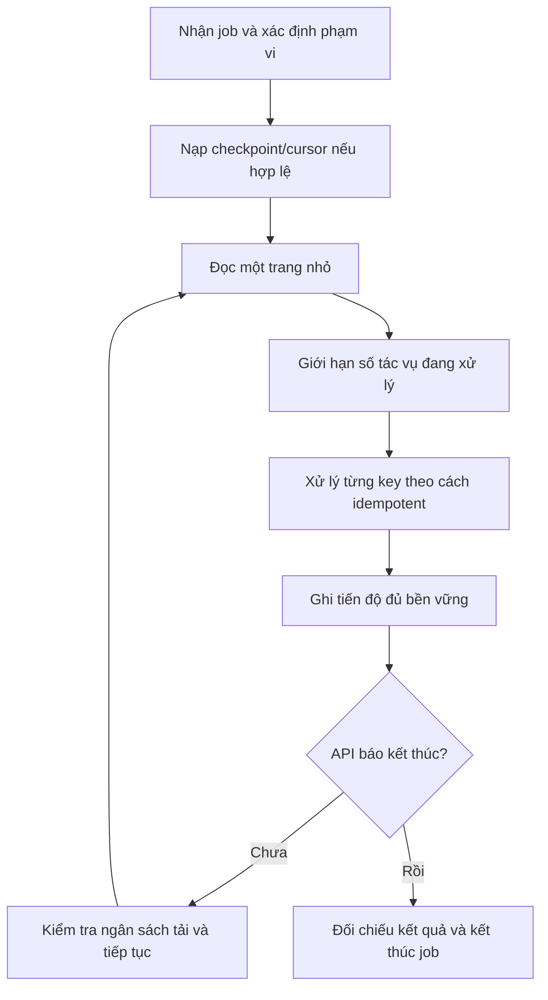

# Tìm hoặc duyệt nhiều khóa và chi phí quét không gian khóa

## 1. Khi không biết chính xác khóa cần đọc

Trong mô hình dữ liệu **khóa–giá trị (key–value)**, thao tác cơ bản nhất là truy xuất giá trị khi đã biết định danh của nó:

```text
GET("user:42:profile") -> {"name":"An","city":"Hanoi"}
```

Ứng dụng có khóa `user:42:profile` nên store có thể xác định mục dữ liệu cần đọc. Nhưng nhu cầu thực tế thường phức tạp hơn:

- Liệt kê tất cả khóa bắt đầu bằng `user:`.
- Tìm mọi phiên đăng nhập của một người dùng để thu hồi.
- Lấy 20 đơn hàng gần nhất của một khách hàng.
- Xóa các khóa thuộc một tenant.
- Đếm số khóa đang lưu hoặc tìm khóa sắp hết hạn.
- Xuất toàn bộ dữ liệu phục vụ sao lưu, đối soát hay di chuyển.

Những yêu cầu này đều cần **tìm hoặc duyệt nhiều khóa**. Chúng không còn là một phép tra cứu theo định danh, và chi phí của chúng có thể khác rất xa `GET(key)`.

Mục tiêu của bài là hiểu **khi nào phải quét**, một vòng quét thực hiện công việc gì, các chi phí và rủi ro cần tính, và cách thiết kế dữ liệu để tránh phải quét không gian khóa trên đường xử lý thường xuyên.

### 1.1. Bốn kiểu truy cập phải tách biệt

| Kiểu truy cập | Ví dụ | Đặc điểm |
|---|---|---|
| **Point lookup** | `GET("user:42")` | Biết chính xác một khóa |
| **Batch lookup** | Lấy `user:42`, `user:43`, `user:44` | Biết sẵn một tập khóa, có thể gộp request nếu sản phẩm hỗ trợ |
| **Range/prefix lookup** | Mọi khóa `order:customer42:*` | Chỉ biết một phần khóa hoặc khoảng khóa; hiệu quả tùy cấu trúc chỉ mục và thứ tự lưu |
| **Full keyspace scan** | Duyệt mọi khóa để kiểm tra từng khóa/value | Phải xét toàn bộ phạm vi dữ liệu được quét, thường có chi phí tăng theo kích thước tập dữ liệu |

**Một batch gồm 1.000 khóa đã biết khác về bản chất với việc quét để tìm ra 1.000 khóa.** Batch vẫn có chi phí nhiều thao tác nhưng không buộc store khám phá toàn bộ tập khóa.

### 1.2. “Tên khóa có tiền tố” không có nghĩa database tự lập chỉ mục theo tiền tố

Ví dụ ứng dụng đặt tên khóa:

```text
order:tenant17:O-1001
order:tenant17:O-1002
order:tenant21:O-1003
cart:tenant17:U-42
```

Nhìn bằng mắt, các khóa `order:tenant17:*` tạo thành một nhóm. Nhưng **quy ước đặt tên** không tự tạo khả năng truy vấn nhóm hiệu quả. Nếu store sử dụng hash để phân bố khóa, các tên có chung tiền tố có thể nằm ở những vị trí khác nhau.

Một sản phẩm có thể hỗ trợ quét theo pattern, một sản phẩm chỉ hỗ trợ truy cập điểm, và sản phẩm khác cung cấp **range scan** thực sự nhờ sắp xếp khóa. Cần biết chính xác API và cách lưu/phân vùng của sản phẩm trước khi khẳng định “truy vấn prefix nhanh”.

## 2. Chi phí của một vòng quét đến từ đâu?

### 2.1. Mô hình chi phí cơ bản

Giả sử kho đang có:

- \(N\): tổng số khóa nằm trong phạm vi phải duyệt.
- \(M\): số khóa phù hợp điều kiện tìm kiếm; thường \(M \leq N\).
- \(P\): số khóa tối đa được kiểm tra hoặc trả về trong một lần gọi, tùy API.
- \(V\): lượng dữ liệu value cần đọc thêm sau khi tìm được khóa.

Nếu hệ thống phải xét mọi khóa để tìm khóa phù hợp, thì về mặt thuật toán, công việc duyệt toàn phạm vi là:

\[
T_{\text{scan}} = O(N)
\]

Nếu sau khi tìm được khóa còn phải đọc value và lọc theo nội dung, chi phí bổ sung phụ thuộc số lần đọc, kích thước value và khả năng lọc phía server:

\[
\text{Work} \approx \text{khóa được xét} + \text{value được đọc} + \text{dữ liệu truyền mạng}
\]

Các biểu thức này là **khung tư duy về quy mô công việc**, không phải công thức tính chính xác latency hay giá tiền. Ví dụ một lệnh quét ở sản phẩm A có thể duyệt metadata trong bộ nhớ, còn thao tác scan của dịch vụ B có thể đọc các item và tiêu thụ đơn vị dung lượng đọc.

Từ `O(N)` cũng không thể suy ra một request đơn lẻ luôn chặn server trong suốt vòng quét. Điều đó phụ thuộc cách API phân trang và scheduler thực hiện công việc.

### 2.2. Kết quả ít không đồng nghĩa với quét ít

Giả sử store có 10 triệu khóa, chỉ 50 khóa khớp `invoice:tenant17:*`.

Nếu không có một chỉ mục thực sự theo tiền tố, hệ thống vẫn có thể phải xét phần lớn hoặc toàn bộ 10 triệu khóa để xác định 50 khóa đó.

| Tình huống | Tổng khóa xét | Khóa phù hợp | Kết luận |
|---|---:|---:|---|
| Quét toàn bộ và tất cả đều khớp | 1.000.000 | 1.000.000 | Có chi phí duyệt lớn và dữ liệu trả về lớn |
| Quét toàn bộ, rất ít khớp | 1.000.000 | 20 | Dữ liệu kết quả nhỏ nhưng công việc xét khóa có thể vẫn lớn |
| Tra cứu 20 khóa đã biết | 20 lần truy cập logic | 20 | Không cần dò 1.000.000 khóa để tìm định danh |
| Truy vấn qua chỉ mục phục vụ điều kiện | Phụ thuộc cấu trúc chỉ mục | 20 | Có thể giảm phạm vi đọc nhưng tốn chi phí duy trì chỉ mục |

Do đó, **bộ lọc chỉ làm nhỏ kết quả chưa chắc làm nhỏ công việc đọc**. Đây là điểm dễ nhầm giữa `MATCH`, `FILTER`, `LIMIT` và một chỉ mục có thể thu hẹp vùng dữ liệu cần truy cập.

### 2.3. Các thành phần chi phí thực tế

Một vòng quét có thể tạo ra đồng thời nhiều loại chi phí:

1. **CPU:** duyệt cấu trúc quản lý khóa, kiểm tra pattern hoặc biểu thức lọc.
2. **Bộ nhớ và tài nguyên server:** tạo kết quả, quản lý con trỏ, giữ metadata, tranh tài nguyên với request trực tuyến.
3. **I/O đĩa hoặc bộ nhớ:** truy cập page, SSTable, item hoặc metadata; tùy kiến trúc sản phẩm.
4. **Mạng:** truyền hàng nghìn tên khóa rồi phát sinh thêm hàng nghìn lệnh đọc value.
5. **Số lượt gọi:** phân trang quá nhỏ gây nhiều round trip; phân trang quá lớn làm tăng độ trễ mỗi lượt hoặc kích thước phản hồi.
6. **Giới hạn dịch vụ/chi phí tiền:** với dịch vụ tính phí theo thao tác hoặc dữ liệu đọc, scan có thể tiêu thụ read capacity hay tăng hóa đơn.
7. **Tác động lên người dùng:** quét cạnh tranh với request bình thường, có thể làm p95/p99 latency và tỷ lệ timeout tăng.
8. **Chi phí nghiệp vụ:** nếu dữ liệu thay đổi khi đang duyệt, kết quả có thể thiếu, trùng hoặc không nhất quán như một ảnh chụp tại một thời điểm.

Đánh giá một vòng quét cần nhìn cả **tổng thời gian, lưu lượng tác động lên hệ thống và mức đúng đắn của tập kết quả**.

## 3. Phân trang và con trỏ: cách duyệt từng phần

### 3.1. Vì sao không lấy tất cả khóa trong một phản hồi?

Nếu hàng triệu khóa được trả về trong một request, client và server phải giữ lượng dữ liệu lớn, độ trễ có thể dài và thao tác dễ timeout. Nhiều sản phẩm cung cấp API duyệt theo **lô (batch/page)** với con trỏ hoặc khóa tiếp tục.

Mô hình khái niệm:

```text
cursor = START

repeat:
    page, nextCursor = SCAN(cursor, batchHint=200)
    PROCESS(page)
    cursor = nextCursor
until cursor == END
```

Đoạn này là **mã giả**. Trong một sản phẩm, con trỏ có thể là số, chuỗi opaque, continuation token hoặc “last evaluated key”. Phải giữ nguyên token theo contract của API; không được tự cộng số hay đoán trang tiếp theo.

### 3.2. Một trang nhỏ giúp chia tải, không biến quét thành truy vấn rẻ

Nếu một vòng quét cần xét \(N\) mục và mỗi lượt trung bình xét \(P\) mục, số lượt gọi xấp xỉ \(N/P\). Thực tế còn phụ thuộc số phần tử được server trả về, tỷ lệ khớp, sự biến động dữ liệu, phân vùng và gợi ý batch.

Ví dụ có 1.000.000 khóa và một lô trung bình tương đương 500 khóa, việc duyệt có thể cần cỡ hàng nghìn lượt gọi. Tăng kích thước lô giảm round trip nhưng có thể tăng độ trễ, băng thông và tải ở từng lượt.

Kết quả của phân trang là **phân bổ công việc thành các đợt nhỏ hơn**, chứ không xóa đi công việc phải làm trên toàn tập.

### 3.3. Đừng nhầm “hết kết quả trang” với “hết vòng duyệt”

Một API có bộ lọc có thể trả về **trang không chứa khóa phù hợp** dù con trỏ còn dữ liệu chưa đi qua.

Ví dụ:

```text
Page 1: keys = [],          nextCursor = "c2"
Page 2: keys = ["user:42"], nextCursor = "c3"
Page 3: keys = [],          nextCursor = END
```

Nếu client dừng khi `keys` rỗng ở trang 1 sẽ bỏ sót `user:42`. Điều kiện kết thúc phải theo **dấu hiệu hoàn tất của API**, không theo số lượng phần tử nhận được.

### 3.4. Con trỏ không tự chứng minh snapshot consistency

Nếu tập khóa thay đổi trong lúc đang duyệt:

- Một khóa được thêm mới có thể được nhìn thấy hoặc không.
- Một khóa bị xóa có thể không còn xuất hiện trong trang kế tiếp.
- Một số API có thể trả lại cùng khóa nhiều lần.
- Thứ tự khóa thường không được đảm bảo.
- Kết quả tổng thể có thể không đại diện chính xác cho trạng thái tại một thời điểm duy nhất.

Tính chất cụ thể phụ thuộc database và cơ chế scan. Nếu cần **xuất chính xác một tập khóa tại cùng một mốc thời gian**, phải tìm hỗ trợ snapshot/backup/transaction hoặc giải pháp thay thế được tài liệu xác nhận.

## 4. Ví dụ cụ thể: Redis `KEYS` và `SCAN`

Redis cung cấp hai nhóm lệnh thường được nhắc đến khi cần tìm nhiều key. Đây là **cú pháp và hành vi riêng của Redis**, không phải chuẩn dùng chung cho mọi hệ NoSQL.

### 4.1. `KEYS pattern`: tìm khớp trong một lần gọi

Ví dụ:

```redis
KEYS user:*
```

Lệnh yêu cầu trả các key có tên khớp pattern. `KEYS` có độ phức tạp theo số lượng khóa trong database được quét, và có thể giữ server bận trong một lần gọi. Trên tập dữ liệu lớn, điều đó có nguy cơ làm ảnh hưởng các request khác.

**Không nên đưa `KEYS user:*` vào endpoint nghiệp vụ chạy thường xuyên trên môi trường production lớn.** Redis mô tả `KEYS` phù hợp hơn với các trường hợp debug/kiểm tra đặc biệt có kiểm soát. Cần nhớ pattern match ở đây không tương đương một secondary index truy vấn prefix.

### 4.2. `SCAN`: duyệt tăng dần bằng cursor

Một vòng duyệt Redis có thể bắt đầu bằng:

```redis
SCAN 0 MATCH user:* COUNT 100
```

Redis trả hai thành phần: **cursor mới** và **danh sách key tìm thấy trong lượt đó**. Client tiếp tục gọi `SCAN <cursor> ...` bằng cursor nhận được và dừng **khi cursor trả về bằng `0`**.

Minh họa logic, với các cursor và key giả định:

```text
> SCAN 0 MATCH user:* COUNT 100
cursor: "4128"
keys:   ["user:42", "user:81"]

> SCAN 4128 MATCH user:* COUNT 100
cursor: "680"
keys:   []

> SCAN 680 MATCH user:* COUNT 100
cursor: "0"
keys:   ["user:93"]
```

**Cần hiểu đúng ba tham số/giá trị:**

- `cursor` là trạng thái tiếp tục lượt duyệt; không phải vị trí chỉ số tăng đều.
- `MATCH user:*` lọc tên key theo pattern; nó **không làm Redis có một chỉ mục prefix tự động**.
- `COUNT 100` là gợi ý về lượng công việc/element của mỗi lượt, **không đảm bảo** luôn trả đúng 100 key phù hợp.

Redis `SCAN` giúp chia quá trình duyệt thành các lần gọi nhỏ hơn. Tổng công việc của một vòng duyệt hoàn chỉnh vẫn tỷ lệ với tập key được duyệt, nên một vòng `SCAN` đủ dài vẫn có chi phí đáng kể.

### 4.3. Khi dữ liệu biến động, kết quả `SCAN` cần được xử lý thận trọng

Tài liệu Redis nêu những đặc điểm quan trọng của một vòng duyệt đầy đủ:

- Một phần tử hiện diện liên tục từ đầu đến cuối lượt duyệt đầy đủ sẽ được trả về ít nhất một lần.
- Một phần tử không hiện diện trong suốt cả lượt duyệt sẽ không được trả về như phần tử “tồn tại liên tục”.
- Phần tử được thêm hoặc xóa giữa chừng **có thể xuất hiện hoặc không**.
- Một key có thể được trả về **nhiều lần**.
- Một lượt `SCAN` có thể trả về mảng rỗng trong khi cursor chưa kết thúc.

Diễn giải thành cách viết client:

```python
# Mã giả Python: hàm redis_scan trả (cursor, keys).
cursor = 0

while True:
    cursor, keys = redis_scan(
        cursor=cursor,
        match="user:*",
        count=200
    )

    for key in keys:
        process_idempotently(key)

    if cursor == 0:
        break
```

Hàm `process_idempotently` phải an toàn khi xử lý lại cùng key. Nếu không thể đạt tính idempotent, cần cơ chế lưu dấu đã xử lý, deduplicate theo key hoặc một thiết kế có snapshot/manifest phù hợp.

**Không bỏ qua trang rỗng bằng cách dừng sớm. Không cho rằng thứ tự các key đã nhận được là thứ tự ổn định.**

### 4.4. `SCAN` trả về khóa; đọc value là bước khác

Ví dụ một job muốn tìm user có `status = "INACTIVE"`, trong khi status nằm trong JSON value:

```text
1) SCAN các key user:*
2) GET value của từng key
3) Parse JSON
4) Lọc value.status == "INACTIVE"
5) Xuất kết quả hoặc xử lý
```

Công việc đọc value có thể chiếm phần đáng kể chi phí, đặc biệt khi mỗi value lớn và số lượng key nhiều. Batch/pipelining có thể giảm round trip nhưng không làm biến mất số item phải đọc. Tốc độ đọc và số kết nối cần được giới hạn để không ảnh hưởng tải chính.

Nếu cần lọc `status` thường xuyên, nên cân nhắc một cấu trúc tra cứu phụ hoặc cơ chế index/query thích hợp thay vì cứ quét toàn bộ value.

### 4.5. `SCAN` khác `HSCAN`, `SSCAN` và `ZSCAN`

Trong Redis, các lệnh này duyệt các **loại tập phần tử khác nhau**:

| Lệnh | Phạm vi |
|---|---|
| `SCAN` | Duyệt tên key trong keyspace của database/phạm vi kết nối |
| `HSCAN` | Duyệt field và value trong một hash |
| `SSCAN` | Duyệt member trong một set |
| `ZSCAN` | Duyệt member và score trong một sorted set |

Chẳng hạn `HSCAN users:42 0` không duyệt mọi key của server; nó duyệt thành phần bên trong hash có key `users:42`. Khi lập thuật toán phải xác định đang **duyệt keyspace** hay **duyệt một cấu trúc được gắn với một key**.

Trong triển khai Redis Cluster, việc duyệt toàn bộ dữ liệu cluster còn phải xét phân bố key theo các node/slot. Đừng giả định một vòng `SCAN` trên một kết nối bất kỳ sẽ bao phủ tất cả key của mọi node; phải đọc hướng dẫn cho topology và client đang sử dụng.

## 5. Ví dụ khác: DynamoDB `Scan` và `Query`

Amazon DynamoDB cho thấy rõ sự khác nhau giữa **quét tập dữ liệu** và **truy vấn có điều kiện trên khóa**. Cú pháp sau mang tính minh họa dịch vụ DynamoDB, không dùng trực tiếp được cho Redis.

### 5.1. `Scan`: duyệt bảng hoặc chỉ mục

Một thao tác `Scan` đọc các item trong bảng hoặc secondary index thuộc phạm vi yêu cầu. Với tập dữ liệu lớn, một lần gọi chỉ lấy một trang; client phải tiếp tục bằng token theo contract của DynamoDB nếu muốn duyệt hết.

Ví dụ JSON request ở mức ý tưởng:

```json
{
  "TableName": "Orders",
  "Limit": 100,
  "FilterExpression": "#st = :paid",
  "ExpressionAttributeNames": {
    "#st": "status"
  },
  "ExpressionAttributeValues": {
    ":paid": { "S": "PAID" }
  }
}
```

Điều cần hiểu:

- `FilterExpression` loại item khỏi **kết quả trả về sau khi đọc/đánh giá**, không phải một cách tránh đọc toàn bộ các item không liên quan.
- `Limit` trong `Scan` ràng buộc số item được **đánh giá** trong lần gọi trước khi áp dụng filter; không đảm bảo nhận đủ số bản ghi khớp điều kiện.
- Một lần gọi `Scan` bị giới hạn lượng dữ liệu đọc theo trang của dịch vụ (trong tài liệu DynamoDB có ngưỡng tối đa 1 MB dữ liệu trước khi tiếp tục).
- Khi có `LastEvaluatedKey`, client dùng `ExclusiveStartKey` tương ứng cho lần gọi sau; việc phân trang phải theo contract response, không theo “đã đủ 100 kết quả” hay “trang rỗng”.
- Chi phí đọc và read capacity phụ thuộc lượng dữ liệu được đánh giá/đọc theo quy định của DynamoDB, không chỉ số item được filter giữ lại.

Một `Scan` dài có thể dùng tài nguyên đọc vốn dành cho ứng dụng trực tuyến. DynamoDB cũng hỗ trợ parallel scan cho trường hợp phù hợp, nhưng phân tải giữa nhiều worker có thể **làm tăng áp lực tổng** chứ không làm một cuộc quét tự nhiên rẻ đi.

### 5.2. `Query`: tận dụng thiết kế khóa

Giả sử bảng được thiết kế để truy cập đơn hàng theo khách hàng:

```text
Partition key: customerId
Sort key:      createdAt#orderId
```

Khi cần lấy các đơn của `customerId = "C-42"` theo thời gian, một `Query` với key condition tương ứng thường có đường truy cập tập trung hơn `Scan` toàn bảng. DynamoDB `Query` yêu cầu điều kiện bằng trên partition key, có thể kết hợp điều kiện trên sort key; giới hạn và hành vi cụ thể do tài liệu DynamoDB quyết định.

Điểm có thể rút ra ở mức mô hình:

> Nếu một truy vấn được gọi thường xuyên, hãy tạo **đường truy cập phù hợp với thông tin đầu vào của truy vấn**, thay vì quét mọi bản ghi rồi lọc ở ứng dụng.

Không được suy ra rằng mọi hệ key–value hỗ trợ `Query` kiểu DynamoDB; đây là khả năng của một sản phẩm với mô hình khóa và index của nó.

### 5.3. `Scan` không tự tạo ảnh chụp nhất quán toàn bảng

Phân trang nhiều lần trong khi dữ liệu liên tục thay đổi có thể cho một tập kết quả không tương ứng với một thời điểm duy nhất. Với DynamoDB, ngay cả khi chọn consistent read ở phạm vi được hỗ trợ, một `Scan` không cung cấp snapshot isolation cho toàn bộ lượt quét.

Nếu nghiệp vụ đòi hỏi đối soát chính xác, cần xem giải pháp xuất dữ liệu, backup, snapshot hoặc cơ chế phù hợp với yêu cầu consistency. Không thể chỉ bật tùy chọn consistent read rồi coi nhiều trang scan như một transaction.

## 6. Các bẫy dễ gặp khi thiết kế một job duyệt nhiều khóa

### 6.1. Quét để tìm đối tượng bằng thuộc tính bên trong value

Ví dụ:

```text
Key:   session:<sessionId>
Value: {"userId":"U-42","ip":"...","createdAt":"..."}
```

Nghiệp vụ muốn “thu hồi **mọi session của U-42**”. Nếu key chỉ chứa `sessionId`, ứng dụng không thể suy từ user ID ra các khóa tương ứng. Quét toàn bộ các session rồi đọc value để lọc theo `userId` có thể rất tốn kém.

Một phương án là duy trì cấu trúc phụ:

```text
user-sessions:U-42 -> {sessionA, sessionB, sessionC}
```

Quy trình khi tạo session:

1. Ghi `session:<sessionId>`.
2. Đăng ký session ID vào tập `user-sessions:<userId>`.
3. Khi thu hồi, lấy tập session ID rồi xóa/vô hiệu hóa các session tương ứng.

Cách này tạo đường truy cập theo user ID, nhưng **đặt ra bài toán đồng bộ**: tạo session thành công mà cập nhật tập phụ thất bại thì sao? Session hết TTL nhưng còn tên trong tập phụ thì sao? Hai thao tác có thể cần transaction, script, log sự kiện hoặc cơ chế dọn dẹp, tùy sản phẩm.

Đây là ví dụ **đổi chi phí quét khi đọc lấy chi phí duy trì chỉ mục ở lúc ghi**.

### 6.2. Dùng pattern để xóa hàng loạt mà không kiểm soát kết quả

Ví dụ muốn xóa mọi key `cache:tenant17:*` khi tenant bị vô hiệu hóa. Một job “SCAN tất cả và DELETE key phù hợp” có thể gặp:

- Key mới được tạo trong khi job đang chạy.
- Key đã được xóa bởi TTL hoặc công việc khác.
- Key được trả lại nhiều lần.
- Key bị ghi đè bằng dữ liệu mới sau lúc được scan nhưng trước lúc delete.
- Nhiều key cùng biến mất làm ảnh hưởng tải hoặc tính đúng đắn.
- Cấu hình cluster/tenant khiến phạm vi duyệt không đúng như kỳ vọng.

Một hướng thiết kế thường an toàn và hiệu quả hơn cho **cache có thể tái tạo** là dùng **namespace version**:

```text
cache:tenant17:v7:<resourceId>
cache:tenant17:v8:<resourceId>
```

Khi tăng phiên bản từ `v7` sang `v8`, các lần đọc mới chỉ sử dụng namespace hiện hành; dữ liệu cũ được dọn bằng TTL hoặc cleanup có giới hạn. Đây là kỹ thuật thiết kế cụ thể, không thể áp dụng mù quáng cho dữ liệu nguồn cần xóa ngay hoặc yêu cầu pháp lý về xóa. Phải tính cả việc cập nhật version được quan sát nhất quán như thế nào.

### 6.3. Dùng `LIMIT 20` rồi tưởng là “20 kết quả tốt nhất”

Trong một vòng scan không có thứ tự xác định, lấy 20 khóa đầu tiên **không tương đương** với “20 đơn mới nhất” hoặc “20 đơn có giá trị cao nhất”. Kết quả đúng cho yêu cầu top-N cần một thứ tự đã định nghĩa và một đường truy cập hỗ trợ thứ tự đó.

Nếu không có chỉ mục, việc tìm top-N chính xác có thể yêu cầu xem tất cả ứng viên rồi sắp xếp/chọn lọc. Giới hạn số lượng item trong **trang scan** không biến nó thành một truy vấn có thứ tự.

### 6.4. Quên tính dữ liệu thay đổi giữa các trang

Ví dụ người dùng mới phát sinh session và session cũ hết hạn liên tục. Một “báo cáo toàn bộ session đang tồn tại” thực hiện trong nhiều phút không có nghĩa nó khớp với trạng thái ở bất kỳ thời điểm đơn lẻ nào.

Cần định nghĩa trước báo cáo chấp nhận điều gì:

- **Best effort:** chấp nhận dữ liệu thay đổi, trùng được xử lý, có thể thiếu khóa mới.
- **At-least-once processing:** mỗi phần tử hợp lệ có thể xử lý nhiều lần; tác vụ phải idempotent.
- **Point-in-time correctness:** yêu cầu ảnh chụp/snapshot hay luồng sự kiện có mốc xác định.
- **Exactly-once business effect:** cần thiết kế giao dịch, idempotency và dấu vết trạng thái; scan tự nó không đảm bảo.

“Đã đi hết cursor” là hoàn thành **một lượt duyệt theo API**, chưa chắc là đã đạt yêu cầu nghiệp vụ về đầy đủ và nhất quán.

## 7. Những phương án thay thế việc quét liên tục

### 7.1. Xác định access pattern ngay khi thiết kế khóa

Hãy liệt kê các kiểu truy cập:

| Yêu cầu | Đã biết định danh gì? | Đường truy cập nên cân nhắc |
|---|---|---|
| Lấy hồ sơ người dùng | `userId` | Point lookup `user:<id>` |
| Liệt kê session của một người dùng | `userId` | Tập ID/secondary index theo user |
| Lấy đơn hàng mới nhất | `customerId` và thời gian | Khóa ghép/range index hoặc cấu trúc có thứ tự |
| Thống kê đơn hàng theo trạng thái | `status`, thời gian | Index/materialized view hoặc hệ phân tích |
| Xóa cache theo tenant | `tenantId` | Namespace version, index theo tenant, TTL có chủ đích |
| Xuất toàn bộ kho để sao lưu | Toàn bảng/toàn kho | Backup/export/snapshot do sản phẩm hỗ trợ |

Nguyên tắc: **đường truy cập chính nên có chi phí tăng theo tập dữ liệu cần trả về, không phải tổng số khóa của hệ thống**, nếu workload và sản phẩm cho phép.

### 7.2. Duy trì index phụ tại tầng ứng dụng

Giả sử cần biết mọi đơn hàng của khách hàng `C-42`:

```text
order:O-1001 -> {..., "customerId":"C-42"}
order:O-1002 -> {..., "customerId":"C-42"}

orders-by-customer:C-42 -> [O-1002, O-1001]
```

Index phụ giúp lấy ID theo khách hàng rồi batch-read các value. Nhưng hãy giải quyết:

- Ai chịu trách nhiệm cập nhật index khi thêm, đổi, xóa đơn?
- Việc cập nhật index và bản ghi chính có nguyên tử không?
- Nếu index còn ID của key hết hạn hoặc đã xóa thì bỏ qua thế nào?
- Nếu index bị thiếu ID mới, có cách rebuild và phát hiện sai khác không?
- Danh sách ID có quá lớn để nằm trong một value không?
- Cần sắp xếp theo thời gian, phân trang, giới hạn số ID và chống truy cập đồng thời ra sao?

**Một index phụ là dữ liệu cần được quản lý**, không chỉ là “một key khác”. Trường hợp yêu cầu mạnh về tính đúng đắn có thể phù hợp hơn với database cung cấp index/transaction được quản lý.

### 7.3. Tổ chức dữ liệu theo phân vùng thời gian hoặc tenant

Thay vì gom vô hạn dữ liệu vào một danh sách, có thể tạo nhiều nhóm:

```text
orders:tenant17:2026-11 -> [orderId...]
orders:tenant17:2026-12 -> [orderId...]
```

Nếu màn hình chủ yếu xem đơn trong tháng, ứng dụng đã biết vùng dữ liệu cần đọc. Cách này giảm phạm vi truy xuất cho nhu cầu cụ thể, nhưng khi truy vấn qua nhiều tháng hoặc yêu cầu sắp xếp tổng thể vẫn phải ghép kết quả, xử lý dedup và giới hạn.

Không mặc định một key chứa danh sách ngày/tháng tự tạo hiệu năng tốt: cần tính kích thước value, tần suất cập nhật, điểm nóng và khả năng mở rộng của cấu trúc.

### 7.4. Dùng hệ truy vấn, search hoặc analytics riêng

Nếu ứng dụng liên tục cần tìm theo nhiều thuộc tính độc lập, ví dụ:

```text
status = "PAID"
AND createdAt between A and B
AND customerCountry = "VN"
ORDER BY totalAmount DESC
```

thì việc scan mọi key rồi lọc value thường không phải một thiết kế tốt. Có thể chọn một hệ document có index phù hợp, công cụ tìm kiếm, cơ sở dữ liệu quan hệ, hoặc pipeline phân tích với dữ liệu được đồng bộ từ nguồn.

Nhưng mô hình nhiều hệ lưu trữ cũng có chi phí: đồng bộ dữ liệu, độ trễ nhất quán, vận hành, giám sát và xử lý lỗi. Chọn nó khi truy vấn và khối lượng tải biện minh được chi phí đó.

### 7.5. Scan vẫn có chỗ đứng

Quét có thể hợp lý khi:

- Khởi tạo index lần đầu hoặc di chuyển dữ liệu.
- Duy trì/dọn dẹp ngoại tuyến, có thể giới hạn tốc độ.
- Kiểm tra dữ liệu hoặc debug với tập khóa nhỏ.
- Đọc toàn bộ dataset thật sự là yêu cầu của batch processing.
- Kiểm tra các mẫu dữ liệu khi hệ thống chưa có index.

Điều kiện tiên quyết là **định lượng chi phí, giới hạn tải, chọn thời điểm chạy và chấp nhận đúng ngữ nghĩa duyệt**. Đối với backup chính xác, nên ưu tiên cơ chế snapshot/export được sản phẩm thiết kế riêng.

## 8. Thiết kế một job scan an toàn hơn

Một job duyệt nhiều khóa hoạt động trong production nên có giới hạn và khả năng tiếp tục sau lỗi.

### 8.1. Luồng xử lý tham khảo



Chú ý: không phải mọi cursor đều có thể lưu rồi dùng lại sau thời gian dài. Một số cursor/token gắn với thời điểm, phiên kết nối, topology hoặc có hạn sử dụng. **Chỉ checkpoint cursor để resume nếu tài liệu sản phẩm cho phép**. Nếu không, thiết kế công việc có thể bắt đầu lại an toàn từ đầu bằng idempotency và dấu tiến độ riêng.

### 8.2. Pseudocode với xử lý trang và ngân sách tải

```python
def run_keyspace_job(store, cursor):
    # Đây là mã giả; cursor và điều kiện kết thúc phụ thuộc API.
    while True:
        page = store.scan_page(
            cursor=cursor,
            pattern="cache:tenant17:*",
            batch_hint=200
        )

        for key in page.keys:
            # Có thể gặp trùng key giữa các trang.
            # Nghiệp vụ cần định nghĩa cách xử lý idempotent.
            process_idempotently(key)

        # Chỉ lưu cursor nếu API đảm bảo có thể resume.
        record_progress_if_supported(page.next_cursor)

        # Giới hạn số item/giây và mức cạnh tranh theo tải thực tế.
        enforce_load_budget()

        if page.completed:
            break

        cursor = page.next_cursor
```

Mã này diễn tả cấu trúc logic, chưa xử lý đầy đủ timeout, retry, trạng thái chưa biết khi ghi, phân vùng cluster, phân quyền hoặc transaction. Các chi tiết này phụ thuộc sản phẩm và mục tiêu job.

### 8.3. Những chỉ số nên quan sát

Để không gây quá tải, theo dõi ít nhất:

| Nhóm đo lường | Ý nghĩa |
|---|---|
| Số khóa đã duyệt / đã khớp / đã xử lý | Tách tổng công việc ra khỏi số kết quả |
| Số trang, kích thước trang, số lần gọi | Phát hiện việc phân trang quá nhỏ hoặc bất thường |
| p95/p99 latency của scan và của request thường | Kiểm tra scan có làm chậm người dùng |
| CPU, bộ nhớ, I/O và network | Xem bottleneck thực tế của node/service |
| Read capacity/throughput hoặc quota | Ước lượng ảnh hưởng tới dịch vụ và chi phí |
| Tỷ lệ timeout, retry, throttling | Phát hiện quá tải hoặc cấu hình batch không phù hợp |
| Số key trùng, key đã biến mất, parse lỗi | Hiểu mức biến động dữ liệu và độ bền của job |
| Tốc độ xử lý, tiến độ, số lần resume | Ước lượng công việc còn lại và khả năng phục hồi |

Phải **ưu tiên ổn định của truy vấn nghiệp vụ**. Một job scan có thể chậm hơn để không tranh tài nguyên với request chính; đây là đánh đổi có chủ đích.

### 8.4. Kiểm soát phạm vi và quyền truy cập

Khả năng liệt kê key có thể làm lộ thông tin về cấu trúc, định danh hoặc sự tồn tại của dữ liệu. Không cho phép người dùng tùy ý truyền `pattern = "*"` rồi scan toàn kho qua một endpoint công khai.

Với hệ đa tenant, phải bảo đảm:

- Quyền truy cập được kiểm soát ở API và tầng lưu trữ phù hợp.
- Việc lọc tenant không chỉ dựa vào giả định “key khác tenant chắc không ai đoán được”.
- Bộ lọc hoặc access pattern không khiến request của một tenant quét dữ liệu của mọi tenant.
- Tên key và value được log theo quy tắc bảo vệ dữ liệu nhạy cảm.
- Công việc xóa hàng loạt có phạm vi xác định và có cơ chế xác nhận/khôi phục theo yêu cầu nghiệp vụ.

## 9. Tình huống thiết kế: tìm mọi session của người dùng để đăng xuất khỏi tất cả thiết bị

Giả sử ứng dụng có 10 triệu session đang hoạt động:

```text
session:8c01 -> {"userId":"U-42","device":"phone"}
session:3c90 -> {"userId":"U-42","device":"laptop"}
session:f218 -> {"userId":"U-19","device":"tablet"}
...
```

Người dùng `U-42` bấm “Đăng xuất khỏi mọi thiết bị”.

### Phương án A — Quét mọi session

1. Scan các key `session:*`.
2. Đọc value từng key.
3. Chọn session có `userId = "U-42"`.
4. Xóa/vô hiệu hóa các session đó.

Phương án này đơn giản về mô hình lưu nhưng tốn công việc tỷ lệ với tổng số session; trong lúc quét còn có session được tạo hoặc hết hạn. Nó khó là lựa chọn thích hợp cho request tương tác cần phản hồi nhanh.

### Phương án B — Chỉ mục session theo người dùng

Lưu thêm:

```text
sessions-by-user:U-42 -> {8c01, 3c90}
```

Khi tạo/xóa session, cập nhật cấu trúc phụ. Khi đăng xuất, lấy các ID và vô hiệu hóa từng session. Cách này giảm nhu cầu scan toàn bộ nhưng cần giải quyết sự nhất quán của mapping, TTL, thao tác đồng thời và các ID mồ côi.

### Phương án C — Phiên bản phiên đăng nhập

Trong một số mô hình xác thực, token/session mang hoặc tham chiếu đến một phiên bản, và hồ sơ bảo mật người dùng lưu:

```text
security-session-version:U-42 -> 7
```

Một lần “đăng xuất khỏi mọi thiết bị” tăng version lên `8`; các yêu cầu mang version cũ bị từ chối khi quá trình kiểm tra phiên bản được thực hiện. Cách này tránh liệt kê để vô hiệu hóa từng session, nhưng **không tự giải quyết** tất cả yêu cầu bảo mật: hệ thống phải kiểm tra version đáng tin cậy ở đúng điểm, xác định xử lý các token dài hạn và cache quyền truy cập, cân nhắc độ trễ thu hồi và lỗi store.

Ba phương án đều xuất phát từ cùng một yêu cầu, nhưng khác nhau về **chi phí đọc, chi phí ghi, độ phức tạp và mức đảm bảo thu hồi**. Đó là lý do access pattern phải được thiết kế trước khi chọn cách đặt khóa.

## 10. Bài tập thực hành

### Bài 1 — Phân loại truy cập

Với các yêu cầu sau, hãy xác định point lookup, batch lookup, index/range lookup hay scan:

1. Lấy giỏ hàng với `cart:42`.
2. Lấy giỏ của 100 người dùng khi đã có 100 `userId`.
3. Tìm mọi giỏ có chứa SKU `BK-01` nhưng SKU chỉ nằm trong JSON value.
4. Liệt kê đơn hàng của khách hàng `C-42` khi hệ thống đã có chỉ mục theo khách hàng.
5. Đếm toàn bộ các key nằm trong kho dữ liệu.

**Gợi ý:** (1) point; (2) batch; (3) cần scan nếu chưa có index/đường truy cập khác; (4) index/range theo cách tổ chức dữ liệu; (5) có thể cần scan hoặc API thống kê riêng, phụ thuộc sản phẩm và yêu cầu độ chính xác.

### Bài 2 — Trang rỗng có kết thúc không?

Một API trả về:

```text
cursor=0    -> keys=["a"], cursor=15
cursor=15   -> keys=[],    cursor=9
cursor=9    -> keys=["b"], cursor=0
```

Hãy cho biết client phải dừng sau trang nào.

**Đáp án:** dừng khi API báo kết thúc ở trang thứ ba, không dừng ở trang rỗng thứ hai. Điều kiện kết thúc dựa trên cursor hoặc cờ hoàn tất được tài liệu quy định.

### Bài 3 — Phân tích scan và filter

Một table có 5 triệu item. Chỉ 500 item có `status = "FAILED"`. Ứng dụng muốn xuất 500 item đó bằng cách scan toàn bảng rồi áp dụng filter.

**Câu hỏi:** số item trả về thấp có chứng minh chi phí đọc thấp không?

**Đáp án:** không. Nếu filter không giúp thu hẹp phạm vi đọc qua index thì nhiều item vẫn phải được đánh giá; với DynamoDB `Scan`, `FilterExpression` được áp dụng sau khi đọc các item trong trang theo contract dịch vụ. Nếu truy vấn theo `status` xảy ra thường xuyên, cần cân nhắc mô hình khóa/index phù hợp.

### Bài 4 — Thiết kế đường truy cập thay thế

Hệ thống lưu:

```text
order:<orderId> -> {customerId, createdAt, status, total}
```

Yêu cầu mới: “hiển thị 20 đơn gần nhất của mỗi khách hàng, phân trang”.

Hãy đề xuất:

1. Khóa và cấu trúc index/nhóm theo khách hàng.
2. Cách xác định thứ tự khi hai đơn có cùng `createdAt`.
3. Cách đồng bộ index khi tạo, sửa và xóa đơn.
4. Cách xử lý phân trang khi đơn hàng được thêm trong lúc người dùng xem trang tiếp theo.
5. Cách xác minh giải pháp không cần scan toàn bộ `order:*`.

**Gợi ý:** có thể thiết kế thứ tự `(createdAt, orderId)` làm tie-breaker và dùng index duy trì theo khách hàng nếu sản phẩm hỗ trợ; chọn continuation token có ý nghĩa theo thứ tự này. Phải đọc tài liệu về tính nhất quán và index của hệ cụ thể, không giả định mọi key–value store có range query.

## 11. Câu hỏi kỹ thuật cần trả lời trước khi dùng scan

Trước khi đưa một vòng quét vào hệ thống, hãy xác định:

- **Phạm vi:** tất cả key, một bảng, một partition, một tenant, hay một tập khóa?
- **API:** trả tên key hay cả value; bộ lọc áp dụng trước hay sau khi đọc; có dùng index không?
- **Chi phí:** bao nhiêu khóa/item/byte có thể bị quét; cần bao nhiêu trang và read capacity?
- **Thứ tự:** có sắp xếp ổn định không; có hỗ trợ range query đúng nghĩa không?
- **Tính nhất quán:** có snapshot không; key được thêm/xóa giữa chừng sẽ xử lý thế nào?
- **Trùng lặp và lỗi:** job có idempotent không; retry và resume có an toàn không?
- **Tác động production:** giới hạn batch/concurrency, quota, thời gian chạy và chỉ số giám sát?
- **Khả năng thay thế:** có thể tạo index, cấu trúc nhóm, event stream hoặc thay đổi access pattern không?

Trong mô hình key–value, **biết chính xác khóa** thường là tình huống truy cập đơn giản nhất. Khi cần **tìm nhiều khóa**, ta phải trả lời thêm những câu hỏi về tổ chức dữ liệu, phạm vi duyệt, phân trang, thứ tự và consistency. Một API `SCAN` giúp làm công việc quét theo từng phần, nhưng không biến toàn bộ không gian khóa thành một chỉ mục truy vấn rẻ. Thiết kế dữ liệu theo các câu hỏi truy cập thực tế mới là cách chủ động kiểm soát chi phí và độ tin cậy khi hệ thống phát triển.

