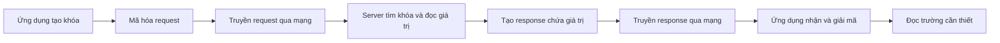
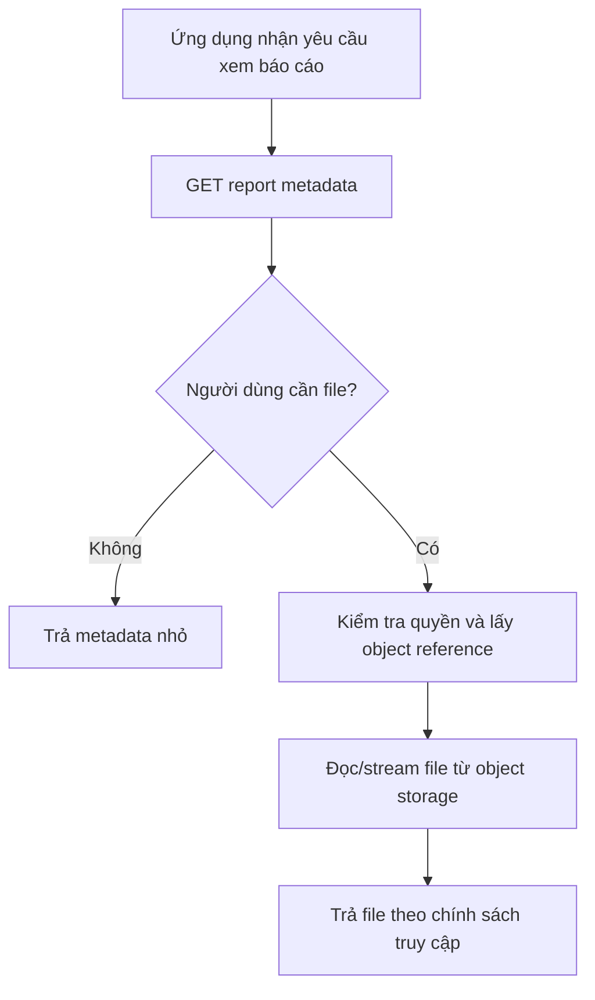

# Kích thước giá trị, khóa quá lớn và giới hạn truyền dữ liệu trong mô hình khóa–giá trị

Mô hình **khóa–giá trị (key–value)** trông rất đơn giản: ứng dụng cung cấp một khóa, hệ lưu trữ tìm giá trị tương ứng, rồi trả về hoặc cập nhật giá trị đó. Tuy nhiên, khi dữ liệu và lưu lượng tăng, **kích thước khóa, kích thước giá trị, số lượng khóa và tần suất truy cập từng khóa** có thể quyết định độ trễ, băng thông, bộ nhớ và khả năng mở rộng của hệ thống.

Ví dụ, một lệnh `GET` chỉ cần tìm đúng khóa có thể vẫn chậm nếu giá trị trả về là vài megabyte. Một khóa định danh chỉ dài vài chục byte vẫn có thể trở thành điểm nghẽn nếu hàng trăm nghìn yêu cầu cùng truy cập nó. Một keyspace chứa hàng triệu khóa nhỏ cũng có thể dùng nhiều bộ nhớ vì mỗi khóa đi kèm metadata và cấu trúc quản lý. Do đó, không thể đánh giá hiệu năng key–value chỉ bằng độ phức tạp tra cứu trên lý thuyết.

Bài học sử dụng cú pháp Redis cho các ví dụ thao tác, nhưng lập luận về kích thước, serialization, mạng, hot key và phân trang áp dụng cho nhiều hệ key–value. **Giới hạn kích thước chính xác là thuộc tính của từng sản phẩm, phiên bản, cấu hình, kiểu dữ liệu và API**; các ngưỡng dung lượng dùng trong ví dụ sau là giả định thiết kế để thực hành, không phải giới hạn chung của NoSQL hay giới hạn mặc định của Redis.

## 1. Phân biệt bốn vấn đề thường bị gọi chung là “khóa quá lớn”

Trước khi tối ưu, cần xác định chính xác hiện tượng đang xảy ra. Các cụm từ “big key”, “large value” và “hot key” liên quan nhưng không thay thế cho nhau.

| Hiện tượng | Ý nghĩa | Biểu hiện điển hình | Hướng xử lý đầu tiên |
|---|---|---|---|
| **Khóa dài (long key name)** | Chuỗi/byte định danh khóa chứa quá nhiều ký tự hoặc thông tin | Tăng dung lượng metadata, payload request, khó theo dõi và quản trị | Rút gọn tên khóa, đặt quy ước nhất quán, băm phần định danh dài nếu cần |
| **Giá trị lớn (large value)** | Một giá trị string/blob/JSON chứa nhiều byte | `GET`/`SET` tốn băng thông, thời gian mã hóa/giải mã và bộ nhớ | Chỉ lưu dữ liệu cần truy cập cùng nhau, tách payload hoặc giữ tham chiếu |
| **Collection lớn dưới một khóa (large collection key)** | Một hash/list/set/sorted set có rất nhiều phần tử | Đọc toàn bộ tốn tài nguyên, thao tác duyệt hoặc xóa có thể đắt | Phân trang, chia nhóm, giới hạn số phần tử, lựa chọn lệnh theo phạm vi |
| **Khóa nóng (hot key)** | Một hoặc vài khóa nhận lưu lượng bất thường so với phần còn lại | Một shard/node quá tải, p99 cao dù tổng cụm còn tài nguyên | Đo phân bố request; giảm tần suất, cache cục bộ, phân tán hoặc thay đường đọc |

Ngoài ra còn có **số lượng khóa (key cardinality)**: tạo hàng chục triệu khóa nhỏ cũng tiêu thụ metadata, làm tăng chi phí dọn dẹp và có thể gây áp lực bộ nhớ. Giải pháp “tách một value thành hàng trăm nghìn key” có thể giảm kích thước mỗi value nhưng tạo ra bài toán key cardinality và nhiều network round trip.

Một ví dụ dễ hình dung:

```text
user:42                       -> khóa ngắn, value có thể nhỏ hoặc lớn
user:42:session:v3            -> khóa ngắn, value thường nhỏ
tenant:42:export:2026-11      -> khóa ngắn nhưng value có thể là file 30 MiB
dashboard:global:today        -> khóa ngắn nhưng có thể là hot key
device:7:reading:000000001   -> một trong hàng triệu khóa nhỏ
```

Chỉ nhìn tên khóa không xác định được toàn bộ chi phí. Phải đo cả kích thước giá trị thực, kiểu dữ liệu, số phần tử và tần suất truy cập.

## 2. Một lần `GET` thực sự đi qua những gì?

Một request key–value không kết thúc tại phép tìm khóa. Nếu ứng dụng lấy một JSON lớn từ Redis, đường đi có thể gồm các bước:



Nếu server trả cả blob 2 MiB trong khi ứng dụng chỉ cần một trạng thái 10 byte, phần lớn byte được truyền và xử lý là không cần thiết. Một lookup có chi phí thuật toán thấp vẫn có thể phát sinh các chi phí thực tế:

- **Network I/O:** truyền số byte của request và response, chịu ảnh hưởng thông lượng, latency, packet, congestion và mã hóa TLS.
- **Serialization/deserialization:** tạo JSON, MessagePack hoặc protobuf rồi chuyển thành đối tượng của chương trình.
- **Bộ nhớ tạm và sao chép:** buffer của client/server/driver, bản sao payload khi chuyển kiểu dữ liệu và giải nén.
- **Bộ nhớ lưu trữ:** nội dung của key/value cộng metadata, index/hash table, allocator, fragmentation và cấu trúc nội bộ.
- **Ghi bền vững và sao chép:** ghi thay đổi lớn có thể tác động đến log, persistence, replication và network giữa các replica.
- **Thu gom bộ nhớ:** chương trình JVM hoặc runtime có GC có thể phải cấp phát và thu hồi các mảng byte lớn lặp đi lặp lại.

Đường đi thực tế tùy hệ lưu trữ và deployment. Không phải lần `GET` nào cũng đọc đĩa; nhiều key–value store như Redis phục vụ dữ liệu từ RAM trong điều kiện bình thường, nhưng giao tiếp mạng và tạo response vẫn có chi phí. Nếu dữ liệu được lưu trên đĩa, cache hay SSD thì profile hiệu năng khác.

## 3. Kích thước khóa: vì sao tên khóa dài cũng có giá?

Tên khóa là dữ liệu. Khóa được gửi trên đường mạng trong request, cần được quản lý trong cấu trúc tra cứu và thường xuất hiện trong log, telemetry hoặc công cụ kiểm tra. Một khóa dài vài kilobyte lặp lại trên hàng triệu bản ghi có thể tiêu thụ đáng kể tài nguyên dù từng giá trị chỉ chứa vài byte.

Giả sử có 5 triệu khóa và cùng một tiền tố thừa dài thêm 120 byte. Riêng chuỗi ký tự thêm đó chiếm xấp xỉ **600 triệu byte** trước mọi overhead. Hệ lưu trữ có thể tối ưu biểu diễn nội bộ khác nhau nên không suy ra mức RAM chính xác từ phép nhân, nhưng phép tính cho thấy việc lặp một định danh không cần thiết có giá rõ ràng.

### 3.1. Đặt tên khóa có cấu trúc

Một quy ước dễ hiểu và đủ ngắn có thể dùng:

```text
<application>:<environment>:<entity>:<version>:<tenant>:<id>

shop:prod:cart:v2:t42:u103
shop:prod:product:v1:t42:p991
shop:prod:rate:v1:t42:u103
```

Các phần cần thiết phụ thuộc mục tiêu triển khai; không bắt buộc nhét mọi trường vào tên khóa. Nếu môi trường tách biệt hoàn toàn bằng instance/namespace riêng, lặp `prod` có thể không cần. Ngược lại, trong hệ nhiều tenant, phải bảo đảm tenant là một phần của phạm vi truy cập và logic phân quyền, không chỉ một tiền tố dễ đoán.

Quy ước tốt cần đáp ứng bốn điều: **tạo khóa nhất quán**, **không trùng giữa các thực thể khác nhau**, **dễ phân tích**, và **có khả năng thay đổi phiên bản khi mô hình value đổi**. Tránh đưa token truy cập, mật khẩu, thông tin định danh cá nhân nhạy cảm hoặc nguyên văn một truy vấn chứa dữ liệu bí mật vào tên khóa: key có thể bị lộ trong log/monitoring hoặc snapshot.

### 3.2. Khi định danh đầu vào quá dài

Ví dụ hệ thống muốn cache một request theo URL và mọi tham số, trong đó một URL có thể dài hàng chục kilobyte. Có thể dùng **digest cố định độ dài của đầu vào chuẩn hóa**:

```text
Đầu vào: method + route + tenant + tham số đã chuẩn hóa + version
        ↓
Hàm băm mật mã (ví dụ SHA-256)
        ↓
cache:search:v3:t42:<digest>
```

Phải chuẩn hóa thứ tự tham số, cách mã hóa ký tự, dấu cách, chữ hoa/thường và phạm vi tenant trước khi băm. Nếu hai request tương đương tạo hai khóa khác nhau, cache bị phân mảnh; nếu hai request khác quyền truy cập tạo cùng khóa, có nguy cơ trả sai dữ liệu. Digest làm rủi ro va chạm cực thấp khi dùng đúng nhưng không miễn trừ việc thiết kế canonicalization và kiểm tra quyền. Với thông tin nhạy cảm có ít khả năng biến thiên, băm trần còn có thể bị dò từ điển; có thể cần HMAC với khóa bí mật và quản lý khóa phù hợp.

### 3.3. Key dài khác với “key nóng”

Khóa `homepage:top-products` chỉ dài vài chục ký tự nhưng có thể nhận 50.000 lượt đọc/giây. Rút tên còn `h:p` không làm biến mất tải. Với hot key, hướng giải quyết có thể là giảm số lần truy vấn qua cache tầng ứng dụng/CDN, giữ nhiều bản sao đọc phù hợp, cập nhật theo đợt hoặc chia lưu lượng khi ngữ nghĩa cho phép. Cần đo theo **request rate trên từng key hoặc nhóm key**, không suy từ chiều dài tên khóa.

## 4. Kích thước giá trị: một value lớn gây hiệu ứng dây chuyền

Giả sử cache hồ sơ người dùng chứa một JSON 600 KiB nhưng API chỉ cần tên, avatar và cấp thành viên khoảng 1 KiB. Mỗi lần đọc hồ sơ, ứng dụng lấy toàn bộ 600 KiB rồi bỏ phần lớn trường. Khi cùng thao tác lặp hàng trăm hoặc hàng nghìn lần mỗi giây, chi phí mạng và cấp phát tăng nhanh.

| Giá trị lưu dưới một khóa | Lệnh đọc | Dữ liệu thường phải trả về | Nguy cơ |
|---|---|---|---|
| String JSON 600 KiB | `GET key` | Toàn bộ string 600 KiB | Đọc thừa khi chỉ cần một vài trường |
| Hash nhiều field | `HGET key field` | Giá trị một field | Tiết kiệm payload nếu field nhỏ và truy vấn phù hợp |
| Hash nhiều field | `HGETALL key` | Toàn bộ field và value trong hash | Có thể nặng tương tự đọc toàn bộ blob |
| List nhiều phần tử | `LRANGE key 0 -1` | Toàn bộ list | Response tăng theo số phần tử |
| List nhiều phần tử | `LRANGE key 0 49` | Tối đa 50 phần tử trong phạm vi | Hữu ích cho phân trang khi thứ tự phù hợp |
| Sorted set lớn | `ZRANGE key 0 49` | Phần tập được chọn | Hữu ích cho bảng xếp hạng/cửa sổ kết quả |

Hash và list không tự động giải quyết mọi vấn đề: chúng vẫn có metadata, cấu trúc lưu, giới hạn kích thước, hot key và các lệnh đọc toàn bộ có thể gây áp lực lớn. Không phải trường JSON nào cũng nên tách thành hash field. Cần cân nhắc mẫu cập nhật, tính nguyên tử, cách truy xuất và chi phí bảo trì.

### 4.1. Kích thước logic khác bộ nhớ chiếm dụng

Nếu `STRLEN key` cho biết một string chứa 10.000 byte thì không có nghĩa key đó chỉ chiếm đúng 10.000 byte trong RAM. Còn các thành phần quản lý key, định dạng đối tượng, cấu trúc cấp phát và phân mảnh. Ngược lại, một số hệ thống có nén dữ liệu nên dung lượng trên đĩa nhỏ hơn chuỗi byte ban đầu; quy mô trên mạng có thể lại khác nếu giao thức/client truyền dạng chưa nén.

Nên phân biệt ít nhất bốn đại lượng:

1. **Logical size:** byte của nội dung ứng dụng trước khi đóng gói/nén.
2. **Serialized size:** byte sau khi mã hóa thành JSON/binary format.
3. **Transferred size:** byte thực truyền qua đường mạng, gồm payload và overhead giao thức, có thể có nén/TLS.
4. **Resident/storage size:** bộ nhớ hoặc dung lượng lưu trữ do engine báo, gồm overhead và cách bố trí nội bộ.

Lưu một object Java có nhiều trường rồi gọi `toString().length()` không đo được các đại lượng trên. Độ dài `String` trong JVM được tính theo đơn vị UTF-16; với tiếng Việt và emoji, số byte UTF-8 của payload có thể khác đáng kể so với số ký tự hiển thị.

### 4.2. Cập nhật giá trị lớn cũng là vấn đề

Nếu một JSON chứa cả giỏ hàng, lịch sử xem và cấu hình người dùng, thao tác thay đổi một cờ nhỏ có thể buộc ứng dụng đọc, giải mã, chỉnh sửa, mã hóa rồi ghi lại toàn bộ JSON. Việc cập nhật một phần có thể thực hiện bằng lệnh hoặc cấu trúc dữ liệu khác nếu engine hỗ trợ. Cần xác định rõ **thao tác cập nhật diễn ra ở mức field, item hay toàn bộ blob**, và khi hai client ghi đồng thời, có thể bị mất cập nhật không.

Một blob lớn còn làm tăng chi phí khi hết TTL, bị evict, rewrite hoặc replicate, tùy nội bộ sản phẩm. Vì vậy đo riêng **đọc**, **ghi**, **cập nhật nhỏ** và **xóa/expiry** thay vì chỉ benchmark một lệnh `GET` trên dữ liệu tĩnh.

## 5. Giới hạn kích thước của engine, client và hệ thống mạng

Không có một giới hạn byte duy nhất cho mọi key–value database. Mỗi sản phẩm có ràng buộc riêng cho:

- **Độ dài tên khóa**, kiểu khóa được phép dùng và cách so sánh/phân bố khóa.
- **Dung lượng của một value** hoặc một phần tử/item; một số sản phẩm giới hạn string khác với collection.
- **Kích thước request/response** trong protocol, proxy, gateway, client driver hoặc load balancer.
- **Giới hạn bộ nhớ và chính sách eviction**, kích thước bộ đệm, timeout đọc/ghi và giới hạn pipeline.
- **Kích thước thông điệp khi replication/persistence** và giới hạn vận hành khi khôi phục, sao lưu, di chuyển dữ liệu.

Chẳng hạn Redis và Memcached có mô hình giới hạn item khác nhau; cấu hình Redis của một cluster in-memory cũng có các ràng buộc khác dịch vụ Redis được quản lý. Không nên sao chép một con số “tối đa X MB” từ một phiên bản rồi dùng như định luật NoSQL. Trước khi triển khai, đọc tài liệu phiên bản đang vận hành và kiểm tra xem **driver, proxy, network, memory policy** có áp đặt mức thấp hơn hay không.

### Hard limit và operational limit

**Hard limit** là mức vượt quá sẽ bị từ chối hoặc lỗi theo hợp đồng của sản phẩm. **Operational limit** là ngưỡng nội bộ nhóm đặt thấp hơn để giữ độ trễ và chi phí chấp nhận được. Một hệ quản trị có thể cho phép value rất lớn nhưng ứng dụng vẫn chọn giới hạn cache entry ở 64 KiB hoặc 256 KiB sau khi đo tải thực tế.

Ví dụ chính sách giả định:

```yaml
cacheDesignPolicy:
  # Các số dưới đây chỉ là ngưỡng của ứng dụng minh họa.
  maxKeyUtf8Bytes: 256
  maxValueSerializedBytes: 131072     # 128 KiB
  warnValueSerializedBytes: 32768    # 32 KiB
  ttlSeconds: 900
  onOversizedValue: skip_cache_and_record_metric
  onOversizedKey: reject_invalid_cache_key
```

Ngưỡng ứng dụng phải dựa trên tính năng, tỷ lệ hit/miss, kích thước bản ghi và phép đo. Với một số đối tượng hiếm truy cập, bỏ qua cache khi value quá lớn có thể hiệu quả hơn lưu rồi evict liên tục.

## 6. Tính băng thông và độ trễ từ kích thước payload

Một ước lượng nhanh giúp nhìn thấy vấn đề trước khi tối ưu code:

\[
\text{Payload bytes/s} = \text{requests/s} \times \text{bytes transferred/request}
\]

\[
\text{Payload MiB/s} = \frac{\text{Payload bytes/s}}{1{,}048{,}576}
\]

Ví dụ một dịch vụ đọc 1.000 lần/giây, mỗi response trung bình 128 KiB:

```text
1.000 request/s × 128 KiB/request = 128.000 KiB/s
                                = 125 MiB/s
```

Con số **125 MiB/s** mới tính payload phản hồi theo giả định, chưa tính request, TCP/TLS/protocol, các hop qua proxy, replication, retry và việc response có bị nén hay không. Nếu chuyển sang đọc trường 2 KiB thay vì toàn bộ value 128 KiB, tổng payload cho cùng 1.000 request/s còn khoảng 1,95 MiB/s. Lợi ích thực tế phụ thuộc độ lớn phần dữ liệu cần đọc và số lệnh phát sinh thêm.

### Băng thông không phải thành phần duy nhất của latency

Một mô hình tối giản:

\[
T_{\text{response}} \approx T_{\text{network base}} + T_{\text{transfer}} + T_{\text{server}} + T_{\text{decode}} + T_{\text{queue}}
\]

Trong đó `T_transfer` tăng khi payload lớn trong điều kiện thông lượng hữu hạn, còn `T_queue` tăng khi kết nối, server hoặc client bão hòa. Đây là cách suy luận định tính, không phải công thức mô phỏng chính xác TCP hay hàng đợi.

**Độ trễ trung bình** dễ che khuất việc một số request lớn làm nghẽn buffer hoặc tạo bản sao trong heap. Hãy đo `p50`, `p95`, `p99` và timeout cùng phân bố kích thước payload, thay vì chỉ báo “GET trung bình mất 2 ms”.

### Pipelining và batch giúp gì, không giúp gì?

Pipelining nhiều lệnh nhỏ có thể giảm chi phí nhiều lượt round trip; `MGET` hoặc batch có thể phù hợp với một số đường truy cập. Nhưng **không làm tổng byte dữ liệu biến mất**. Nếu gom 500 giá trị 200 KiB vào cùng một response, payload vẫn khoảng 100 MiB chưa tính overhead; client có thể phải giữ một response quá lớn trong bộ nhớ và khiến phần đuôi latency xấu hơn.

Giới hạn số lệnh hoặc tổng byte của mỗi batch theo phép đo. Batch nhỏ và có kiểm soát thường dễ xử lý timeout, retry và backpressure hơn batch lớn vô hạn.

## 7. Quan sát kích thước key/value với Redis

Redis là ví dụ dễ thực hành vì có những lệnh cho phép nhìn cả byte string và mức chiếm dụng bộ nhớ. Các câu lệnh sau dành cho **key thử nghiệm**. Chỉ số trả về phụ thuộc phiên bản, kiểu dữ liệu và cấu hình; không sử dụng dữ liệu production nhạy cảm trong ví dụ.

```redis
SET app:demo:profile:v1:u42 '{"name":"Mai","tier":"gold","city":"Da Nang"}' EX 900
TYPE app:demo:profile:v1:u42
STRLEN app:demo:profile:v1:u42
MEMORY USAGE app:demo:profile:v1:u42
TTL app:demo:profile:v1:u42
```

Ý nghĩa:

- `TYPE` cho biết kiểu dữ liệu được lưu dưới khóa.
- `STRLEN` trả số **byte của string value**; đây không phải số ký tự của object JSON đã parse và cũng không tính key/metadata.
- `MEMORY USAGE` ước lượng byte mà Redis dùng cho khóa và giá trị, có tính overhead liên quan theo cách engine đo.
- `TTL` cho biết thời hạn còn lại đối với khóa có thời gian hết hạn; không nói kích thước.

Với kiểu hash, cần xem cả số trường và kích thước trường:

```redis
HSET app:demo:profile-fields:v1:u42 name Mai tier gold city "Da Nang"
HLEN app:demo:profile-fields:v1:u42
HSTRLEN app:demo:profile-fields:v1:u42 city
MEMORY USAGE app:demo:profile-fields:v1:u42
HGET app:demo:profile-fields:v1:u42 tier
```

`HLEN` là **số field**, không phải byte. `HSTRLEN` đo byte của giá trị một field hash. `HGET` lấy field cần thiết; ngược lại `HGETALL` tải toàn bộ hash và có thể tạo response lớn tương tự một blob. Cũng như vậy, `LLEN` hoặc `SCARD` cho số phần tử chứ không phản ánh trực tiếp lượng RAM.

### Tìm những khóa có nguy cơ lớn

Với Redis CLI, lệnh kiểm tra kiểu `redis-cli --bigkeys` có thể giúp phát hiện khóa có kích thước bất thường theo kiểu dữ liệu. Công cụ thường cần quét keyspace để thống kê và có thể tạo thêm tải; chỉ chạy sau khi đánh giá khả năng chịu tải của môi trường. `SCAN` cho phép duyệt dần theo cursor mà không cần một lệnh lấy toàn bộ keyspace, nhưng **không miễn phí** và có thể trả trùng hoặc bỏ qua phần dữ liệu đang thay đổi theo ngữ nghĩa duyệt.

```redis
SCAN 0 MATCH app:demo:* COUNT 100
```

`COUNT` chỉ là gợi ý cho mỗi lượt quét, không phải giới hạn cứng số khóa trả về. Tránh sử dụng `KEYS *` trên môi trường có keyspace lớn để tìm vấn đề kích thước; lệnh quét toàn bộ có thể ảnh hưởng thời gian phản hồi. Với Redis Cluster, việc quan sát từng node/shard và mức chênh lệch giữa node cần được xem xét riêng.

### `GETRANGE` không đồng nghĩa với truy cập field JSON

Redis string có lệnh đọc một khoảng byte:

```redis
GETRANGE app:demo:profile:v1:u42 0 15
```

Lệnh này lấy **đoạn byte theo offset**, hữu ích với định dạng được thiết kế truy cập theo byte. Nó không hiểu cây JSON hay tự tìm `tier`. Với UTF-8 nhiều byte, cắt tùy ý còn có thể chia đôi ký tự. Nếu cần truy xuất theo field, hãy chọn cấu trúc dữ liệu hoặc công nghệ hỗ trợ field-level access phù hợp; các module mở rộng xử lý JSON có bộ tính năng khác Redis string cơ bản.

## 8. Đo kích thước serialized thực tế trong Java

Ứng dụng Java thường có nhiều tầng: object → serializer → byte[] → client driver → socket. Cần đo tại nơi gần payload thực tế, bởi `String.length()` không cho biết số byte UTF-8 và `Object.toString()` không phải hợp đồng serialized của JSON hay protobuf.

Ví dụ utility đo byte cho **chuỗi đã được serializer tạo ra**:

```java
import java.nio.charset.StandardCharsets;
import java.util.Objects;

public final class CachePayloadPolicy {
    // Các ngưỡng chỉ dành cho ví dụ, không phải giới hạn của Redis.
    private static final int MAX_KEY_BYTES = 256;
    private static final int MAX_VALUE_BYTES = 128 * 1024;

    private CachePayloadPolicy() {}

    public static boolean cacheable(String key, String serializedJson) {
        Objects.requireNonNull(key, "key");
        Objects.requireNonNull(serializedJson, "serializedJson");

        int keySize = key.getBytes(StandardCharsets.UTF_8).length;
        int valueSize = serializedJson.getBytes(StandardCharsets.UTF_8).length;

        return keySize <= MAX_KEY_BYTES && valueSize <= MAX_VALUE_BYTES;
    }
}
```

Trong production, có thể tối ưu để serializer trả về trực tiếp `byte[]`, đo `bytes.length` rồi dùng cùng mảng đó để ghi, tránh tạo thêm bản sao không cần thiết. Đối với payload đã nén, phải theo dõi **cả kích thước trước và sau nén**; dữ liệu nén nhỏ trên mạng vẫn có thể giải nén thành object rất lớn trong heap.

Đừng ghi nguyên giá trị lớn vào log chỉ để đo. Log nên chứa kích thước, loại dữ liệu, nhóm key đã chuẩn hóa, thời gian mã hóa và mã lỗi; tránh key có thông tin nhạy cảm hoặc response thô.

## 9. Chọn mô hình dữ liệu theo phần thực sự được đọc

Có ba nhu cầu khác nhau dễ bị trộn vào một value:

1. **Đọc tất cả cùng nhau:** một object nhỏ, thay đổi cùng lúc và luôn được trả nguyên vẹn có thể phù hợp với một value.
2. **Đọc một số field:** tách field hoặc dữ liệu theo phần thường truy cập có thể giảm truyền thừa.
3. **Đọc nhiều phần tử có phân trang:** nên có đường truy cập lấy cửa sổ nhỏ thay vì danh sách tích lũy không giới hạn.

Ví dụ một trang giỏ hàng chứa 5 sản phẩm có thể được lưu như một JSON nhỏ, vì việc đọc/ghi toàn bộ giỏ hàng là hợp lý. Nhưng nếu nhét toàn bộ **lịch sử 10 năm giao dịch** vào cùng value `user:42`, hầu hết thao tác chỉ cần 20 giao dịch gần nhất sẽ phải tải dữ liệu không liên quan.

### Một value lớn so với nhiều khóa nhỏ

| Phương án | Điểm mạnh | Chi phí và giới hạn |
|---|---|---|
| Một JSON dưới một khóa | Lấy snapshot nguyên vẹn trong một lần đọc, đơn giản với object nhỏ | Mọi lần GET thường trả cả blob; cập nhật nhỏ có thể rewrite lớn |
| Một hash với nhiều field | Có thể `HGET` phần cần thiết; cập nhật từng field | Tất cả field vẫn cùng key/điểm nóng, nhiều field gây overhead, `HGETALL` nặng |
| Một khóa mỗi thực thể/phần tử | Phân tán TTL và đơn vị cập nhật, chọn đúng item để đọc | Nhiều metadata key, cần tra cứu/chỉ mục tập khóa, nhiều round trip |
| Một sorted set/list có giới hạn | Truy cập theo thứ tự và cửa sổ nhỏ bằng lệnh range | Phải kiểm soát số phần tử, phân trang và thao tác quản trị/retention |
| Một manifest nhỏ trỏ tới object storage | Cache chỉ giữ metadata, dữ liệu lớn nằm ở tầng phù hợp cho blob | Thêm dependency, thời gian truy xuất, quy trình version và dọn dữ liệu |

Không có phương án luôn thắng. Lựa chọn phụ thuộc tần suất đọc từng field, phần dữ liệu đọc trung bình, nhu cầu cập nhật nguyên tử, TTL, tốc độ ghi và cách chịu lỗi.

## 10. Tách hot metadata khỏi payload lớn

Một cách cải thiện thực tế là không buộc mọi request phải đọc cùng một value kích thước lớn.

Giả sử một bản báo cáo có metadata vài trăm byte nhưng nội dung PDF 20 MiB. Nhu cầu thông thường là hiển thị danh sách: tên, thời điểm tạo, người sở hữu, trạng thái; chỉ khi người dùng tải xuống mới cần dữ liệu đầy đủ.



Một metadata value giả định:

```json
{
  "reportId": "r-20261114-03",
  "tenantId": "t42",
  "status": "READY",
  "contentType": "application/pdf",
  "contentLength": 20971520,
  "objectVersion": "v17",
  "objectRef": "reports/t42/r-20261114-03/v17.pdf",
  "checksumSha256": "<digest-of-original-file>"
}
```

`objectRef` là một định danh nội bộ; không nên coi nó là URL công khai có thể tải mà không kiểm tra quyền. Một luồng hoàn chỉnh cần xử lý: metadata đã publish nhưng file không tồn tại, file tồn tại nhưng metadata chưa publish, retry upload, phiên bản mới đang tạo, xóa file sau retention và checksum không khớp. Có thể ghi đối tượng trước, kiểm tra thành công rồi công bố metadata theo một bước rõ ràng; các bản tạm/không được tham chiếu cần được thu gom sau.

Object storage và CDN phù hợp hơn cho tải/stream blob lớn trong nhiều trường hợp, nhưng không phải lựa chọn bắt buộc: nếu value lớn cần đọc thường xuyên với độ trễ rất thấp, phải đo cả chi phí thêm hop và cơ chế cache trung gian.

## 11. Chia một giá trị thành nhiều phần: khi nào cần, đánh đổi gì?

Khi không thể chuyển payload lớn sang storage khác, một phương án là **chunking**: chia thành nhiều phần dưới các khóa riêng, cùng metadata về phiên bản và thứ tự.

```text
document:883:manifest
  -> {version: 7, chunkCount: 4, length: ..., checksum: ...}

document:883:v7:chunk:0000 -> bytes[0..n]
document:883:v7:chunk:0001 -> bytes[n..2n]
document:883:v7:chunk:0002 -> bytes[2n..3n]
document:883:v7:chunk:0003 -> bytes[3n..end]
```

Những ưu điểm có thể có: tránh một value cực lớn, retry phần bị lỗi, đọc phần dữ liệu nếu định dạng hỗ trợ, giới hạn memory buffer cho từng phần. Tuy nhiên, chunking **không tự giảm tổng byte của lần tải toàn bộ document** và làm hệ thống phức tạp hơn.

Cần giải quyết ít nhất các vấn đề:

- **Phiên bản và tính toàn vẹn:** manifest chỉ được trỏ sang version mới khi các chunk đã ghi đủ; reader phải dùng nhất quán một version, kiểm tra số chunk và checksum.
- **Thiếu/hỏng chunk:** biết khi nào retry, trả lỗi hoặc phục hồi từ nguồn chuẩn; không ghép âm thầm một file thiếu byte.
- **Xóa:** TTL của manifest/chunk không được tạo tình trạng tồn tại manifest nhưng mất một phần dữ liệu mà không được xử lý; cần dọn version cũ và chunk mồ côi.
- **Hiệu năng:** nhiều key có thêm metadata và nhiều lệnh; pipelining/batch có thể giảm round trip nhưng cần giới hạn tổng payload.
- **Đồng thời:** người ghi version mới không được làm người đọc kết hợp chunk v6 với v7; thiết kế publish/version pointer rõ ràng.

Nếu mục tiêu chỉ là tải một video hoặc file nhiều megabyte, thường nên xem xét storage hỗ trợ range request/streaming từ đầu. Chunking trên một key–value store không được dùng chỉ vì “Redis có thể lưu nhiều key”.

## 12. Nén dữ liệu: tiết kiệm mạng nhưng không miễn phí

JSON có nhiều tên trường lặp hoặc nội dung văn bản có thể nén tốt. Dữ liệu đã nén như ảnh JPEG, MP4, ZIP thường ít được lợi từ một lớp nén nữa. Có thể chọn nén ở cấp ứng dụng hoặc cấp truyền tải theo tính năng sản phẩm.

Mô hình đo:

```text
payload gốc -> serialize -> (optional compress) -> key-value write
key-value read -> (optional decompress) -> deserialize -> object
```

Đánh đổi gồm CPU nén/giải nén, latency, bộ nhớ tạm, khả năng đọc từng trường và khó khăn khi đổi thuật toán nén. Khi nén một JSON toàn khối, muốn lấy một field nhỏ vẫn thường cần đọc và giải nén toàn bộ khối. Nên cân nhắc tách hot field trước khi chỉ tập trung nén blob.

Ví dụ record metadata để nhận diện cách giải mã:

```json
{
  "schemaVersion": 3,
  "encoding": "zstd",
  "uncompressedBytes": 491520,
  "payloadRef": "cache:report:v3:t42:r883"
}
```

Đây chỉ là mẫu định dạng; triển khai thực tế phải xác định payload và metadata được lưu, đọc, cập nhật nguyên tử ra sao. Cần giới hạn **kích thước sau giải nén** để tránh một payload nén nhỏ làm tiêu thụ bộ nhớ bất thường hoặc gây DoS. So sánh p95/p99, CPU và băng thông ở cả tải đọc lẫn ghi trước khi quyết định bật nén.

## 13. TTL, eviction và biến động kích thước theo thời gian

Cache lưu dữ liệu tạm thường dựa vào TTL và chính sách eviction khi thiếu bộ nhớ. Khi value quá lớn, một cache entry có thể chiếm nhiều dung lượng tương đương hàng nghìn entry nhỏ, khiến tỷ lệ cache hit thấp hoặc gây chu kỳ nạp–evict liên tục.

Ví dụ bộ nhớ có hạn và một endpoint trả response lớn thay đổi mỗi vài giây:

```text
Client request -> cache miss -> database query -> serialize 4 MiB
               -> SET vào cache -> đẩy nhiều entry nhỏ ra ngoài
Client tiếp theo -> vẫn đọc object lớn hoặc miss key nhỏ khác
               -> nhiều truy vấn lại backend
```

Chỉ đặt TTL không giải quyết pattern này. Cần xem kích thước và **giá trị thực của cache entry**: số lần đọc lại, chi phí tính toán lại, kích thước và tác động đến các entry khác.

Một số vấn đề vận hành liên quan:

- **Expiry cùng thời điểm:** hàng nghìn khóa hết TTL một lúc có thể tạo làn sóng request về backend (cache stampede); có thể cần jitter, single-flight hoặc stale-while-revalidate khi nghiệp vụ cho phép.
- **Giá trị phình theo thời gian:** list/hash có thể tăng mãi nếu không có retention, trim hoặc bucket.
- **Eviction:** cấu hình policy quyết định key nào bị loại khi gần giới hạn; cần đo `used_memory`, evicted keys, hit rate và OOM/error.
- **Thay đổi metadata:** một key có value nhỏ hôm nay có thể thành value lớn sau một bản ghi lỗi hoặc batch bất thường.
- **Dữ liệu nhạy cảm:** TTL không thay thế yêu cầu bảo vệ dữ liệu, giới hạn truy cập và chính sách xóa/khôi phục.

Với cache có nhiều bản ghi rất lớn, **không lưu những object vượt ngưỡng** hoặc lưu metadata trỏ tới nguồn khác đôi khi cải thiện hệ thống hơn tăng RAM.

## 14. Giới hạn truyền dữ liệu tại giao diện và API

Vấn đề key–value bắt đầu từ **dữ liệu mà API yêu cầu**, không chỉ từ câu lệnh database. Nếu endpoint luôn trả toàn bộ lịch sử hoạt động của user, backend khó tránh payload lớn dù cấu trúc lưu trữ đã tối ưu.

Một thiết kế API nên phân biệt:

- **Endpoint list:** trả tập trường ngắn và phân trang (`limit`, `cursor`, `nextCursor`), không trả nội dung chi tiết của mọi item.
- **Endpoint detail:** lấy một item theo ID, có thể tải payload lớn khi thật sự cần.
- **Endpoint download/export:** dùng streaming, range/partial content hoặc job tạo file tùy nghiệp vụ; tránh giữ toàn bộ file trong heap.
- **Endpoint update:** dùng patch/đơn vị cập nhật thích hợp nếu ngữ nghĩa cho phép, tránh upload lại hàng megabyte chỉ để sửa một cờ.

Một ví dụ thiết kế phân trang:

```http
GET /api/users/u42/events?limit=20&cursor=eyJ2ZXJzaW9uIjoxfQ

HTTP/1.1 200 OK
Content-Type: application/json

{
  "items": [
    { "id": "e981", "type": "LOGIN", "at": "2026-11-14T09:00:00Z" },
    { "id": "e980", "type": "VIEW", "at": "2026-11-14T08:59:00Z" }
  ],
  "nextCursor": "<opaque-cursor>"
}
```

Cursor phải được tạo và kiểm tra theo thứ tự sắp xếp và phạm vi người dùng/tenant; chuỗi trong ví dụ chỉ minh họa định dạng. Giới hạn `limit` ở server, tránh để client yêu cầu một triệu bản ghi. Phân trang giúp giảm response tức thời và hạn chế bộ nhớ, nhưng cần quy định khi dữ liệu thêm/xóa đồng thời và có thể không phải snapshot nhất quán nếu không có cơ chế đặc biệt.

### Khi phải trả nhiều dữ liệu

Sử dụng **streaming hoặc background export** có giới hạn để giảm peak memory trong request thông thường. Cần timeout, hủy request, backpressure và giám sát bytes sent. Streaming giảm nhu cầu giữ toàn bộ payload trong RAM cùng lúc, **không giảm số byte thực phải truyền**. Nếu người dùng chỉ cần 20 trường của 100.000 bản ghi, chọn cột/projection từ đầu thường có giá trị hơn nén một export khổng lồ.

## 15. Hot key, hot shard và fan-out không được giải quyết chỉ bằng chia nhỏ value

Giả sử key `feed:global` được đọc 100.000 lần/giây. Chia value thành mười chunk có thể biến một lượt đọc thành mười lượt đọc; tổng request tới storage có thể tăng, dù từng response nhỏ hơn. Điều cần giải quyết trước là xác định đặc điểm tải:

1. Có phải mọi client đều cần đúng một snapshot mới nhất?
2. Có thể dùng CDN, cache tại process hoặc client cache trong một khoảng thời gian ngắn không?
3. Có cần read replica hoặc phân phối dữ liệu đọc sang nhiều shard không, và ngữ nghĩa nhất quán cho phép đến đâu?
4. Có thể chia tập người dùng theo tenant, khu vực, category hoặc time bucket để giảm tập truy cập một khóa không?
5. Tần suất **ghi** vào hot key có cao không, hay chỉ đọc? Giải pháp cho hai loại tải khác nhau.

Trong hệ key–value được shard theo khóa, mọi thao tác với cùng khóa thường đi tới cùng vùng sở hữu và có thể tạo điểm nóng. Tách theo nhiều khóa chỉ hữu ích nếu truy vấn cũng phân chia được mà không phải ghép lại tất cả ở mỗi lần đọc. Đối với một counter ghi liên tục, có thể phải dùng thiết kế counter phân tán rồi tổng hợp, nhưng điều này thay đổi tính nhất quán và độ mới của kết quả.

Ngoài hot key, có **hot partition/shard**: nhiều khóa khác nhau nhưng cùng hash slot, node hoặc vùng sở hữu, dẫn đến quá tải cục bộ. Với Redis Cluster, các key chứa cùng một hash tag trong dấu `{...}` có thể được gán vào cùng slot có chủ ý. Tính năng hữu ích cho một số thao tác đa khóa, nhưng cũng có nguy cơ gom quá nhiều tải vào một slot nếu thiết kế không cân đối.

## 16. Thiết kế benchmark để thấy chi phí thực

Một benchmark có ý nghĩa phải phản ánh **phân bố kích thước**, không chỉ giá trị trung bình. Nếu 99% item có giá trị 1 KiB và 1% có giá trị 4 MiB, trung bình có thể che giấu các response lớn làm ảnh hưởng băng thông, bộ nhớ tạm và p99.

### Bối cảnh giả định

Ứng dụng có 100.000 hồ sơ, trong đó phần lớn response đọc metadata nhỏ, nhưng một nhóm chứa JSON history lớn. Mục tiêu là biết có nên giữ nguyên JSON, tách field hay đưa nội dung dài sang object storage.

| Trường hợp | Tỷ lệ request giả định | Payload mong đợi | Phép đo chính |
|---|---:|---:|---|
| Đọc tên/trạng thái | 75% | 0,5–2 KiB | p50/p95, bytes transferred |
| Đọc thông tin chi tiết | 20% | 8–64 KiB | p95/p99, decode CPU |
| Tải lịch sử đầy đủ | 5% | 256 KiB–4 MiB | network, heap peak, timeout, p99 |

Thử ba phương án dưới cùng tải và bộ dữ liệu:

**A — Một value JSON:** tất cả thông tin nằm dưới `profile:u42`; mọi lần lấy metadata dùng GET toàn bộ. Dễ viết nhưng có đọc thừa.

**B — Metadata + detail:** `profile:meta:u42` cho truy vấn thường xuyên, dữ liệu chi tiết ở một hash hoặc một key khác; chỉ đọc phần cần thiết. Thêm chi phí quản lý phiên bản và đồng bộ.

**C — Metadata + tham chiếu payload lớn:** chỉ giữ metadata nhỏ trong key–value, nội dung lịch sử ở tầng phù hợp; đường tải đầy đủ đi qua API/download riêng. Có thêm đường truy cập và cơ chế phục hồi.

Đo ở cùng mức tải và quy mô, gồm:

| Nhóm chỉ số | Cần thu thập |
|---|---|
| Độ trễ | p50/p95/p99 theo từng loại request, timeout và error rate |
| Lưu lượng | request/s hoàn thành, request/s được gửi, bytes in/out, băng thông đỉnh |
| Phân bố kích thước | p50/p95/p99 của key/value bytes, kích thước lớn nhất và số entry vượt ngưỡng |
| Client | Thời gian serialize/deserialize, cấp phát/GC, số connection đang chờ |
| Storage | RAM/used memory, fragmentation, hit/miss, evictions, slow commands, CPU |
| Đồng bộ/độ đúng | Retry, payload thiếu, mismatch version, cache stale và số bản ghi cần đối soát |
| Chi phí | Mức dùng RAM, egress, băng thông liên node, storage/blob và chi phí vận hành |

### Quy trình chạy

1. Tạo dữ liệu đại diện với cả khóa dài, giá trị lớn hiếm và hot key; ghi lại seed, kích thước và phân bố.
2. Cố định phiên bản Redis/driver, CPU/RAM, mạng, chính sách eviction/TTL, dữ liệu đã warm hay cold cache.
3. Chạy baseline A, warm-up và một khoảng đo đủ dài; lưu số liệu thô và error rate.
4. Triển khai B hoặc C, giữ workload và các điều kiện so sánh ổn định, sau đó chạy lại nhiều lần để nhận biết độ biến thiên.
5. Tăng dần throughput và số client, thử ngắt kết nối hoặc timeout, quan sát request nào lỗi và có mất/cũ dữ liệu không.
6. Kết luận riêng cho từng loại request; một phương án có thể tăng p95 của download nhưng giảm đáng kể độ trễ và chi phí của API thông dụng.

Đừng kết luận “hash luôn nhanh hơn string JSON” chỉ từ một lần thử ở tập dữ liệu nhỏ, vì encoding, kích thước field, pattern update và cách ứng dụng gọi lệnh đều ảnh hưởng. Cũng không thể dùng throughput gửi từ load generator làm số request thực hoàn thành nếu generator hoặc server đã quá tải.

## 17. Đề xuất giới hạn và cơ chế bảo vệ ở tầng ứng dụng

Một chiến lược vận hành thường kết hợp **giới hạn theo byte**, **giới hạn số phần tử**, **giới hạn số request và số byte mỗi batch**, cùng **chính sách xử lý khi vượt ngưỡng**. Ví dụ:

| Kiểm soát | Ví dụ chính sách ứng dụng | Khi vượt ngưỡng |
|---|---|---|
| Key UTF-8 bytes | 256 byte | Từ chối khóa không hợp lệ hoặc dùng digest ổn định |
| Cache value serialized | 128 KiB | Bỏ qua cache, ghi metric, cân nhắc tách payload |
| Collection items/page | 50 | Bắt buộc phân trang bằng cursor hoặc range |
| Batch response budget | 1 MiB | Tách batch và áp dụng backpressure |
| Export trực tiếp qua API | 8 MiB | Đưa sang endpoint stream/export có giới hạn |
| TTL cho dữ liệu tạm | Theo nhu cầu nghiệp vụ, có jitter khi phù hợp | Tái tạo/cập nhật an toàn, tránh stampede |

**Đây là các ví dụ minh họa, không phải cấu hình khuyến nghị chung**. Với bản ghi vài trăm byte và hàng triệu lượt đọc/giây, ngưỡng khác với hệ cần lưu metadata hình ảnh hoặc dữ liệu nhị phân hàng trăm kilobyte.

Một cơ chế bảo vệ tốt còn cần:

- **Circuit breaker/backpressure:** giảm số request đang chờ khi tầng key–value hoặc mạng nghẽn.
- **Timeout và retry có giới hạn:** tránh retry đồng loạt làm tăng thêm tải; ghi nhận thao tác có thể đã thành công dù client timeout.
- **Idempotency cho ghi:** cùng yêu cầu lặp không tạo tác dụng phụ không mong muốn.
- **Fallback có điều kiện:** cache miss hoặc cache-skip phải dựa vào nguồn dữ liệu chuẩn; không trả nhầm dữ liệu của tenant khác.
- **Metrics theo nhóm key:** đo theo loại/tên đã chuẩn hóa, tránh label cardinality bùng nổ khi đưa nguyên từng key vào Prometheus.
- **Giám sát phân phối kích thước:** cảnh báo tỷ lệ entry lớn và sự tăng trưởng p95/p99, không chỉ tổng RAM của node.

Giới hạn tại tầng ứng dụng không thay thế giới hạn của nhà cung cấp storage, ngược lại có thể ngăn request vượt quá giá trị đã biết là không có ích ngay từ đầu.

## 18. Xử lý tình huống production: GET chậm sau khi triển khai tính năng mới

Giả sử p99 của endpoint `/api/profile` tăng đột ngột sau khi bổ sung lịch sử hoạt động vào JSON lưu cache. Người trực không nên mặc định “Redis chậm”. Một quy trình chẩn đoán hợp lý:

```text
Triệu chứng: p99 endpoint tăng, network out tăng mạnh
  |
  +-- Đo kích thước response và serialized value sau thay đổi
  |     -> Có trường history làm JSON tăng từ 8 KiB lên 900 KiB?
  |
  +-- Đối chiếu p99 Redis command, network, client decode/GC
  |     -> Nghẽn ở server, đường truyền hay phía ứng dụng?
  |
  +-- Xem hot key, tỷ lệ cache hit, eviction, timeout, retry
  |     -> Cùng key bị gọi liên tục hoặc cache churn?
  |
  +-- Tạm hạn chế trường history ở API nếu được phép
  |     -> Thử giảm kích thước trên một nhóm request có kiểm soát
  |
  +-- Tách metadata/historical payload hoặc đổi đường đọc
        -> Đo lại p95/p99, bytes/s, heap, miss rate
```

Khi so sánh trước/sau, cần đảm bảo tải và dữ liệu tương đương. Với bản ghi cập nhật thường xuyên, `MEMORY USAGE` một vài key chỉ là gợi ý điều tra; không thay thế phân tích phân bố nhiều key. Nếu đọc metadata có kích thước trở lại nhỏ nhưng p99 vẫn cao, cần kiểm tra thêm contention, network, lỗi kết nối, driver configuration và giới hạn node.

### Runbook ngắn

1. Xác nhận tác động bằng p95/p99 endpoint, tỷ lệ lỗi và bytes/request; xác định thời điểm bắt đầu.
2. Chọn một nhóm key đại diện để quan sát kiểu dữ liệu, logical size và `MEMORY USAGE`; tránh quét toàn bộ production khi hệ đang quá tải.
3. Phân tách thời gian client serialization, thời gian chờ pool, thời gian server command và network; kiểm tra phân bố hot key và eviction.
4. Giảm tải có kiểm soát bằng pagination, bỏ qua cache của oversized value, rollback thay đổi value hoặc dùng đường download riêng khi phù hợp.
5. Theo dõi số liệu sau điều chỉnh; ghi lại nguyên nhân, quy tắc ngăn tái phát và trigger cảnh báo mới.

Mục tiêu xử lý sự cố là khôi phục **trải nghiệm của người dùng** và tránh hệ thống quá tải lan truyền. Một Redis server có số lệnh/giây tốt vẫn chưa chứng minh API nhanh nếu ứng dụng tốn hàng chục millisecond để decode payload lớn.

## 19. Những sai lầm thường gặp

| Nhầm lẫn | Vì sao dẫn đến thiết kế yếu | Cách tiếp cận đúng hơn |
|---|---|---|
| “GET có O(1) nên value 10 MiB vẫn nhanh” | Độ phức tạp tìm khóa không xóa chi phí truyền và cấp phát 10 MiB | Đo bytes, p95/p99, mạng và thời gian decode |
| “Chỉ cần đổi JSON thành hash là hết big key” | Hash vẫn có thể chứa hàng triệu field; `HGETALL` trả rất nhiều dữ liệu | Thiết kế field truy cập và giới hạn collection |
| “Khóa tên ngắn thì không có vấn đề” | Key có thể hot hoặc value rất lớn | Đo request rate và dung lượng từng nhóm |
| “Chia mọi value thành nhiều key càng nhỏ càng tốt” | Metadata và số round trip tăng; khó ghép version nhất quán | Chia theo phạm vi đọc/update và giới hạn fan-out |
| “Nén xong là đủ” | Tốn CPU giải nén và vẫn có thể đọc quá nhiều dữ liệu | Tách trường nóng, chỉ nén khi số liệu chứng minh có lợi |
| “Pipelining giải quyết băng thông” | Batch vẫn truyền tổng byte; buffer lớn có thể làm p99 xấu | Giới hạn byte/batch và request đang chờ |
| “Cứ đặt TTL dài thì ít miss” | Entry lớn có thể đẩy nhiều entry hữu ích ra khỏi cache | Đánh giá lợi ích lưu cache trên mỗi byte |
| “Giới hạn Redis cho phép thì ứng dụng nên dùng tối đa” | Giới hạn kỹ thuật cao hơn mức vận hành an toàn | Đặt ngưỡng ứng dụng theo workload và thử nghiệm |
| “Chỉ nhìn p50 là đủ” | Request lớn hiếm gây tail latency và timeout | Theo dõi p95/p99 theo payload size và endpoint |
| “Mỗi key là một nhãn metric” | Nổ cardinality trong hệ monitoring | Chuẩn hóa nhóm key/kiểu thao tác, không lộ nội dung key |

## 20. Bài thực hành tổng hợp: tối ưu cache hồ sơ và lịch sử

**Bối cảnh:** một ứng dụng có 200.000 người dùng. Một số có vài giao dịch, một số có hàng chục nghìn. Cache hiện lưu toàn bộ JSON hồ sơ và lịch sử giao dịch dưới `profile:<userId>`. Màn hình danh sách chỉ cần tên/trạng thái, còn màn hình lịch sử cần 20 giao dịch mỗi trang. Tải đọc danh sách cao hơn đọc toàn bộ lịch sử rất nhiều.

Hãy hoàn thành các nhiệm vụ sau:

1. **Mô tả vấn đề:** phân biệt khóa dài, value lớn, key cardinality và hot key trong bối cảnh này. Chỉ ra loại nào đã có bằng chứng, loại nào phải đo mới biết.
2. **Ước lượng chi phí:** tính băng thông khi response `GET` trung bình 256 KiB với 800 lượt đọc/giây, rồi đối chiếu với response metadata 2 KiB. Ghi rõ phần chưa tính như TCP/TLS, retry và replication.
3. **Chọn mô hình:** đề xuất hai phương án lưu trữ, ví dụ metadata riêng + lịch sử phân trang bằng sorted set/khóa giao dịch, hoặc metadata + tham chiếu nguồn lịch sử. Nêu đường đọc/ghi, TTL và chi phí quản lý.
4. **Viết thao tác:** dùng Redis CLI tạo một string JSON, một hash metadata, đo `STRLEN`, `HLEN`, `HSTRLEN`, `MEMORY USAGE`, đọc một field bằng `HGET`, và lấy một cửa sổ nhỏ thay cho đọc toàn bộ collection.
5. **Xử lý ghi:** giả định giao dịch mới đến hai lần do retry. Thiết kế khóa nhận diện sự kiện và quy tắc idempotency để lịch sử không bị ghi trùng, đồng thời tránh race khi cập nhật projection.
6. **Phân trang:** giải thích vì sao trả toàn bộ 20.000 giao dịch trong một `GET` là không phù hợp với màn hình chỉ hiển thị 20 giao dịch; mô tả cursor/range và cách xử lý dữ liệu thêm mới.
7. **Đo lường:** viết workload A/B với 80% request metadata, 19% đọc một trang lịch sử, 1% export; đo p50/p95/p99, bytes/s, hit/miss, heap/GC, eviction và retry.
8. **Giới hạn vận hành:** đề xuất ngưỡng key/value bytes và số item/page theo dữ liệu đo; mô tả chính sách khi entry vượt ngưỡng, khi cache hết RAM và khi tải tăng đột biến.

### Câu hỏi tự kiểm tra

- Key 20 byte trỏ tới value 3 MiB và key 5 KiB trỏ tới value 200 byte khác nhau ở những chi phí nào?
- Vì sao độ dài tên khóa ảnh hưởng cả RAM lẫn request nhưng không đủ để xác định hot key?
- Khi chuyển từ `GET` một JSON lớn sang `HGET` một field, những loại chi phí nào có thể giảm? Trường hợp nào có thể không giảm?
- Vì sao `STRLEN`, `MEMORY USAGE`, kích thước `byte[]` của client và số byte trên wire không nhất thiết bằng nhau?
- Pipelining 1.000 lệnh đọc 1 MiB mỗi lệnh có làm tổng byte phải truyền giảm không? Nguy cơ nào xuất hiện ở client?
- Nếu manifest trỏ đến 10 chunk mà một chunk đã hết TTL, ứng dụng phải xử lý thế nào để không trả file sai?
- Khi 99% key nhỏ và 1% key rất lớn, dùng kích thước trung bình có thể bỏ sót tín hiệu gì?
- Vì sao streaming hỗ trợ memory footprint nhưng không loại bỏ nhu cầu băng thông khi phải trả toàn bộ dữ liệu?

## 21. Cách nối quyết định dữ liệu với giới hạn thực tế

Thiết kế key–value hiệu quả bắt đầu bằng việc trả lời: **mỗi lượt truy cập cần bao nhiêu byte, bao nhiêu lần mỗi giây, dữ liệu có tăng không giới hạn và yêu cầu đúng đắn khi cập nhật là gì?** Tên khóa cần đủ rõ và đủ gọn, value nên phản ánh phần dữ liệu được đọc/cập nhật cùng nhau, còn collection phải có chiến lược phân trang và retention.

Sau khi chọn mô hình, cần tính sơ bộ băng thông, đặt giới hạn kích thước ở tầng ứng dụng, rồi đo payload, độ trễ và bộ nhớ trong điều kiện tải thực. Những phép đo sẽ cho biết nên giữ một value nguyên vẹn, truy cập theo field, chia theo bản ghi, bổ sung cache tầng khác hay chuyển blob sang dịch vụ thích hợp. **Khả năng tra cứu nhanh bằng khóa chỉ phát huy giá trị khi lượng dữ liệu đi qua mỗi thao tác cũng được kiểm soát.**
