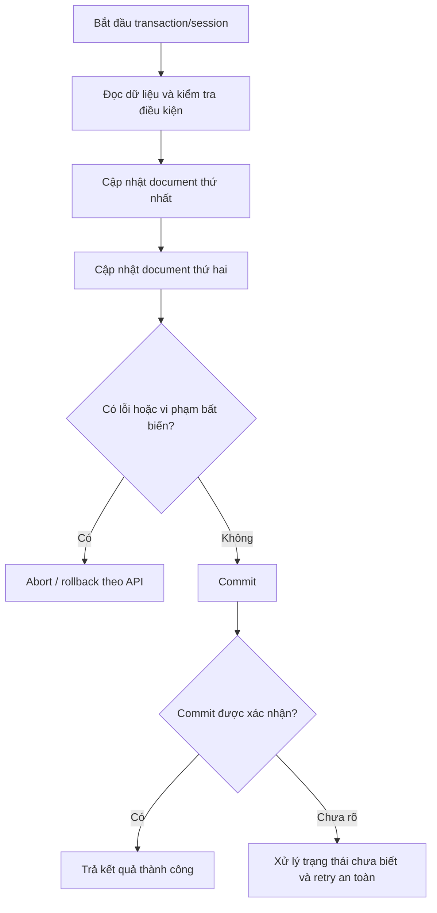
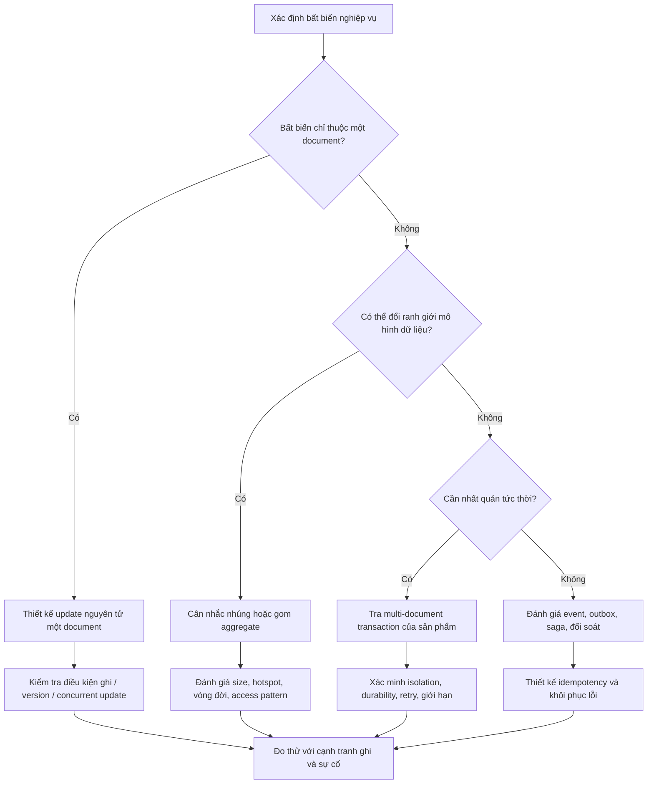

# Tính nguyên tử một tài liệu và giao dịch nhiều tài liệu theo từng hệ

## 1. Vì sao ranh giới tài liệu lại quan trọng?

Trong cơ sở dữ liệu dạng tài liệu (*document database*), dữ liệu thường được tổ chức thành các tài liệu có cấu trúc, chẳng hạn JSON hoặc BSON. Một tài liệu có thể chứa các trường đơn, đối tượng lồng nhau và mảng.

Ví dụ một đơn hàng:

```json
{
  "_id": "O-1001",
  "customerId": "C-42",
  "status": "PENDING",
  "items": [
    {"sku": "BOOK-1", "quantity": 2, "unitPriceCents": 120000},
    {"sku": "PEN-2", "quantity": 1, "unitPriceCents": 15000}
  ],
  "totalCents": 255000,
  "version": 3
}
```

Nếu cần đồng thời thay đổi `status`, `version` và một phần tử của `items`, câu hỏi kỹ thuật đầu tiên là: **những thay đổi đó có được ghi cùng một đơn vị nguyên tử hay không?** Khi cập nhật thêm một tài liệu khác, chẳng hạn tồn kho, chúng ta lại phải hỏi: **có cơ chế giao dịch nào bao trùm cả hai tài liệu không?**

Hai câu hỏi tương ứng với hai phạm vi khác nhau:

- **Nguyên tử ở một tài liệu (single-document atomicity):** một thao tác cập nhật một tài liệu được áp dụng trọn vẹn hoặc không được áp dụng, theo bảo đảm của sản phẩm.
- **Giao dịch nhiều tài liệu (multi-document transaction):** một nhóm thao tác trên nhiều tài liệu được phối hợp theo một hợp đồng giao dịch; phạm vi, mức cô lập, khả năng phục hồi và điều kiện hỗ trợ tùy sản phẩm.

Điểm cốt lõi: **“document database” là một họ mô hình dữ liệu, không phải một tiêu chuẩn giao dịch chung.** Có hệ hỗ trợ giao dịch ACID nhiều tài liệu, có hệ chỉ bảo đảm nguyên tử trong một tài liệu, có hệ cung cấp batch nguyên tử nhưng khác transaction đọc–ghi, và mỗi sản phẩm có các giới hạn riêng.

### Mục tiêu học tập

Sau bài này, bạn có thể:

1. Giải thích ý nghĩa và giới hạn của nguyên tử trong phạm vi một tài liệu.
2. Phân biệt **atomicity**, **isolation**, **consistency**, **durability** và tính nhất quán đọc giữa các bản sao.
3. Nhận biết khi nào nhúng dữ liệu vào cùng tài liệu giúp bảo vệ bất biến; khi nào cần giao dịch nhiều tài liệu.
4. Hiểu rủi ro của cập nhật đọc–sửa–ghi, ghi đồng thời, timeout và retry.
5. So sánh cách tiếp cận giao dịch của một số hệ document phổ biến mà không suy diễn tính năng giữa các sản phẩm.
6. Thiết kế quy trình ghi có idempotency, quan sát lỗi và kiểm chứng đúng phạm vi bảo đảm.

## 2. Các khái niệm cần phân biệt

### 2.1. Atomicity là gì?

Một thao tác nguyên tử được quan sát như một đơn vị **hoàn tất hoặc không hoàn tất** trong phạm vi bảo đảm đã định nghĩa. Ví dụ, giả sử một lệnh cập nhật hai trường của **cùng một tài liệu**:

```text
Đơn hàng O-1001
Trước: status=PENDING, version=3
Sau:   status=PAID,    version=4
```

Nếu sản phẩm bảo đảm lệnh cập nhật đó nguyên tử ở mức tài liệu, ta không mong một thao tác đọc hợp lệ nhìn thấy **trạng thái trung gian do chính lệnh ấy** tạo ra như `status=PAID` nhưng `version=3`.

Tuy nhiên, khẳng định trên chỉ áp dụng cho **một thao tác trong phạm vi một tài liệu**. Hai lệnh cập nhật liên tiếp, dù cùng tác động lên một tài liệu, vẫn có thể bị các thao tác khác chen vào nếu không có cơ chế phù hợp.

### 2.2. Bốn chữ ACID không có cùng nghĩa với “một lệnh ghi nguyên tử”

| Thuộc tính | Câu hỏi cần trả lời | Điều thường bị nhầm |
|---|---|---|
| **Atomicity (A)** | Nhóm thay đổi nào phải cùng thành công hoặc cùng không có hiệu lực? | Một lệnh cập nhật nguyên tử không tự làm cả luồng nghiệp vụ nguyên tử |
| **Consistency (C)** | Giao dịch phải duy trì những bất biến dữ liệu nào? | Không đồng nghĩa *consistency* trong định lý CAP |
| **Isolation (I)** | Các giao dịch đồng thời nhìn thấy nhau và tương tác ra sao? | Không phải cứ có transaction là mặc nhiên serializable |
| **Durability (D)** | Sau khi xác nhận thành công, dữ liệu sống sót qua những sự cố nào? | Không thể suy từ atomicity ra bảo đảm không mất dữ liệu |

Ví dụ, ghi nguyên tử trạng thái `PAID` và số phiên bản vào một document **không chứng minh** rằng thao tác đó đã bền vững qua mất điện, đã được sao chép sang tất cả các replica, hay đã được đồng bộ với hệ thanh toán bên ngoài.

### 2.3. “Consistency” có nhiều ngữ cảnh

Cần phân biệt ít nhất ba câu hỏi:

1. **Bất biến nghiệp vụ (ACID consistency):** một đơn hàng không được vừa `CANCELLED` vừa `SHIPPED`; tổng tiền không được âm; số dư không được giảm dưới 0.
2. **Tính nhất quán quan sát của thao tác đọc:** sau một lệnh ghi thành công, một lượt đọc cụ thể có thấy giá trị vừa ghi hay có thể thấy bản sao cũ?
3. **Tính nhất quán giữa các bản sao/region:** các replica hội tụ, xác nhận và phục vụ đọc theo cơ chế nào?

Một hệ có thể cung cấp ghi nguyên tử một tài liệu nhưng cho phép một số lượt đọc từ bản sao phụ nhìn thấy dữ liệu cũ trong thời gian ngắn. Hai đặc tính này **không mâu thuẫn** vì chúng trả lời những câu hỏi khác nhau.

## 3. Đơn vị nguyên tử của một tài liệu

### 3.1. Khi nhiều trường nằm trong một tài liệu

Xét tài liệu tồn kho:

```json
{
  "_id": "SKU-01",
  "available": 18,
  "reserved": 2,
  "updatedAt": "2026-11-14T08:30:00Z"
}
```

Nghiệp vụ “đặt giữ hai sản phẩm” cần:

```text
available giảm 2
reserved  tăng 2
Không cho available âm
```

Nếu database hỗ trợ một lệnh cập nhật nhiều trường nguyên tử, có thể áp dụng toàn bộ thay đổi trên **một tài liệu**. Ví dụ sau dùng **cú pháp MongoDB**:

```javascript
const result = await db.collection("inventory").updateOne(
  {
    _id: "SKU-01",
    available: { $gte: 2 }
  },
  {
    $inc: {
      available: -2,
      reserved: 2
    },
    $currentDate: { updatedAt: true }
  }
);

if (result.matchedCount === 0) {
  throw new Error("Không đủ tồn kho hoặc mã SKU không tồn tại");
}
```

Ở MongoDB, một lệnh cập nhật tài liệu là nguyên tử trong phạm vi tài liệu, kể cả khi nó sửa nhiều trường. Điều kiện `available >= 2` và phần thay đổi được xử lý như một phép cập nhật có điều kiện; hai request cạnh tranh trên cùng tài liệu không thể cùng “đi qua” điều kiện dựa trên số lượng đã bị request kia tiêu thụ theo cách làm âm số tồn kho trong ví dụ này.

**Giới hạn của ví dụ:** thao tác chỉ cập nhật tài liệu `inventory/SKU-01`. Nếu còn phải ghi tài liệu `order/O-1001` hay `reservation/R-22`, bảo đảm nguyên tử của lệnh `updateOne` **không bao gồm** các tài liệu đó.

### 3.2. Một tài liệu có thể chứa đối tượng lồng nhau và mảng

Ví dụ:

```json
{
  "_id": "CART-42",
  "userId": "U-42",
  "items": [
    { "sku": "BOOK-1", "quantity": 1 },
    { "sku": "PEN-2", "quantity": 3 }
  ],
  "totalItems": 4
}
```

Trong một hệ hỗ trợ cập nhật nguyên tử ở mức document, thay đổi một phần tử trong `items` và cập nhật `totalItems` **trong cùng một lệnh cập nhật** có thể nằm trong một ranh giới nguyên tử. Đây là lợi ích thực tế của việc nhóm các trường có quan hệ chặt vào cùng một document.

Nhưng **không phải mảng nào cũng nên nhúng mãi vào một document**. Nếu mảng tăng vô hạn hoặc có nhiều request cùng cập nhật một tài liệu nóng, có thể gặp giới hạn kích thước, tranh chấp ghi, chi phí chuyển/ghi lại dữ liệu và khó phân quyền từng phần. Ranh giới tài liệu là một lựa chọn mô hình hóa, cần cân bằng cả tính đúng đắn lẫn hiệu năng.

### 3.3. Nguyên tử của một lệnh khác với nguyên tử của nhiều lệnh

Xét chuỗi sau:

```text
1. UPDATE order/O-1001: status=PAID
2. UPDATE inventory/SKU-01: available=available-2
```

Lệnh (1) và (2) đều có thể nguyên tử **riêng lẻ**. Nhưng nếu máy chủ ứng dụng hoặc database gặp lỗi giữa hai lệnh, hệ thống có thể còn lại:

```text
order.status = PAID
inventory.available chưa giảm
```

Ngay cả khi cả hai thao tác tác động **cùng một document** nhưng được tách thành hai lệnh độc lập, người đọc khác vẫn có thể thấy trạng thái sau lệnh đầu và trước lệnh thứ hai. Để bảo vệ bất biến xuyên nhiều thao tác, cần gộp thành một cập nhật nguyên tử phù hợp hoặc dùng một cơ chế giao dịch thực sự.

## 4. Ghi đồng thời: atomicity không tự ngăn mất cập nhật

### 4.1. Kịch bản read–modify–write

Giả sử một tài liệu giỏ hàng có:

```json
{
  "_id": "CART-42",
  "version": 7,
  "items": [{ "sku": "BOOK-1", "quantity": 1 }]
}
```

Hai request cùng thực hiện:

1. Đọc tài liệu.
2. Sửa dữ liệu trong bộ nhớ.
3. Ghi đè toàn bộ document.

| Thời điểm | Request A | Request B |
|---|---|---|
| T1 | Đọc version 7, số lượng 1 | |
| T2 | | Đọc version 7, số lượng 1 |
| T3 | Ghi số lượng 2 | |
| T4 | | Ghi số lượng 2 |
| Kết quả | | Hai yêu cầu cùng tăng một, nhưng số lượng chỉ là 2 |

Mỗi thao tác ghi đơn lẻ vẫn có thể nguyên tử. Lỗi nằm ở **điều phối nhiều bước**: cả hai client đều tính giá trị mới từ cùng một snapshot cũ. Hiện tượng này gọi là *lost update*.

### 4.2. Cập nhật trực tiếp bằng toán tử nguyên tử

Nếu sản phẩm có lệnh tăng trường trực tiếp, hãy để database thực hiện phép tăng thay vì tải rồi ghi đè toàn bộ tài liệu.

Ví dụ MongoDB:

```javascript
await db.collection("carts").updateOne(
  { _id: "CART-42", "items.sku": "BOOK-1" },
  { $inc: { "items.$.quantity": 1 } }
);
```

Đây là ví dụ cú pháp dành cho **một phần tử mảng khớp điều kiện**, không phải lời bảo đảm về mọi biến thể array update hoặc tính đúng đắn của toàn bộ giỏ hàng. Từng lệnh cập nhật là đơn vị nguyên tử ở mức tài liệu.

### 4.3. Optimistic concurrency bằng số phiên bản

Khi nghiệp vụ cần đọc–tính toán–ghi, có thể dùng **compare-and-set (CAS)** hoặc cập nhật điều kiện với số phiên bản:

```javascript
const current = await db.collection("carts")
  .findOne({ _id: "CART-42" });

const nextItems = calculateNewItems(current.items);

const result = await db.collection("carts").updateOne(
  {
    _id: "CART-42",
    version: current.version
  },
  {
    $set: { items: nextItems },
    $inc: { version: 1 }
  }
);

if (result.matchedCount === 0) {
  // Có ghi khác chen vào; tải lại và tính toán lại.
  throw new Error("VERSION_CONFLICT");
}
```

Điều kiện `version = current.version` phải được **kiểm tra nguyên tử cùng phép ghi** bởi database. Không được thực hiện “GET version → so sánh ở client → ghi vô điều kiện” rồi gọi đó là CAS.

Optimistic concurrency không làm xung đột biến mất. Nó khiến xung đột **hiện rõ**, để ứng dụng có thể báo lỗi hoặc retry có giới hạn và tính toán lại từ trạng thái mới.

### 4.4. Điều kiện nghiệp vụ nên nằm trong phép cập nhật khi có thể

Thay vì:

```text
READ order.status
IF status == PENDING:
    WRITE order.status = PAID
```

có thể dùng một phép cập nhật có điều kiện:

```javascript
const result = await db.collection("orders").updateOne(
  { _id: "O-1001", status: "PENDING" },
  {
    $set: { status: "PAID" },
    $inc: { version: 1 }
  }
);

if (result.matchedCount === 0) {
  // Đơn hàng không tồn tại hoặc không còn ở PENDING.
}
```

Cách này phù hợp để kiểm soát **chuyển trạng thái trong một tài liệu**, ví dụ chỉ được chuyển `PENDING → PAID` một lần. Nó chưa đủ cho một quy trình liên quan đồng thời đến lịch sử thanh toán, số dư, tồn kho và hệ thống bên ngoài.

## 5. Khi nào phải xét giao dịch nhiều tài liệu?

### 5.1. Bất biến vượt qua ranh giới một document

Các tình huống thường gặp:

- Chuyển tiền từ ví A sang ví B đang được lưu ở **hai document**.
- Tạo đơn hàng và trừ tồn kho ở **hai collection**.
- Đăng ký một suất giới hạn và ghi người đăng ký vào một document khác.
- Chuyển quyền sở hữu tài nguyên và cập nhật cả tài liệu chủ cũ lẫn chủ mới.
- Tạo tài liệu chính cùng nhiều mục chỉ mục phụ mà nghiệp vụ yêu cầu phải nhất quán tức thời.

Ví dụ chuyển tiền: từ ví A chuyển 5.000 đơn vị tiền sang ví B:

```text
Wallet A: 20.000 -> 15.000
Wallet B: 10.000 -> 15.000

Bất biến: A không âm; tổng số dư A+B không đổi
```

Nếu cập nhật ví A thành công mà ví B thất bại, bất biến bảo toàn tiền bị phá vỡ. Nếu hệ thống yêu cầu **cả hai cập nhật cùng thành công hoặc cùng hủy**, cần một cơ chế giao dịch phù hợp hoặc thiết kế nghiệp vụ thay thế có khả năng bù trừ và đối soát.

### 5.2. Transaction không phải tên gọi khác của batch

Một API batch có thể chỉ giảm số lượt gửi request. Nó không nhất thiết hứa rằng:

- mọi lệnh trong batch đều thành công hoặc đều thất bại;
- không có giao dịch khác chen vào giữa các thao tác;
- có rollback nếu một lệnh sau bị lỗi;
- dữ liệu có thể được đọc trên một snapshot nhất quán;
- kết quả đã commit bền vững qua một tập sự cố cụ thể.

Chỉ khi tài liệu sản phẩm **nêu rõ bảo đảm atomicity/isolation/durability và phạm vi áp dụng** mới được xem batch đó đáp ứng yêu cầu giao dịch.

### 5.3. Một giao dịch thông thường cần những bước gì?



Đây là sơ đồ **khái niệm**. Việc database có cấp transaction/session, snapshot, cơ chế retry hoặc phạm vi rollback như sơ đồ hay không là đặc tả của từng sản phẩm.

Không nên hiểu “sau commit là mọi replica lập tức trả dữ liệu mới”. **Khả năng quan sát kết quả ở những tuyến đọc khác nhau** phụ thuộc read preference, read consistency, replication và cấu hình giao dịch.

## 6. Ví dụ giao dịch nhiều tài liệu trên MongoDB

MongoDB bảo đảm nguyên tử cho thao tác ghi một tài liệu và hỗ trợ giao dịch nhiều tài liệu khi triển khai ở topology và phiên bản phù hợp, chẳng hạn replica set hoặc sharded cluster được hỗ trợ. Driver cung cấp session để nhóm các thao tác vào cùng một transaction.

Ví dụ minh họa bằng **MongoDB Node.js driver**, giả sử có collection `wallets`:

```json
{ "_id": "A", "balanceCents": 20000 }
{ "_id": "B", "balanceCents": 10000 }
```

Nghiệp vụ chuyển 5.000 đơn vị từ A sang B:

```javascript
async function transferMoney(client, fromId, toId, amountCents) {
  if (!Number.isSafeInteger(amountCents) || amountCents <= 0) {
    throw new Error("Số tiền phải là số nguyên dương an toàn");
  }
  if (fromId === toId) {
    throw new Error("Ví nguồn và đích phải khác nhau");
  }

  const wallets = client.db("demo").collection("wallets");
  const session = client.startSession();

  try {
    await session.withTransaction(async () => {
      const debit = await wallets.updateOne(
        {
          _id: fromId,
          balanceCents: { $gte: amountCents }
        },
        {
          $inc: { balanceCents: -amountCents }
        },
        { session }
      );

      if (debit.matchedCount !== 1) {
        throw new Error("Ví nguồn không tồn tại hoặc không đủ tiền");
      }

      const credit = await wallets.updateOne(
        { _id: toId },
        { $inc: { balanceCents: amountCents } },
        { session }
      );

      if (credit.matchedCount !== 1) {
        throw new Error("Ví đích không tồn tại");
      }
    }, {
      readConcern: { level: "snapshot" },
      writeConcern: { w: "majority" }
    });
  } finally {
    await session.endSession();
  }
}
```

**Ý nghĩa của ví dụ:**

- Hai `updateOne` ghi lên hai document riêng, nhưng cùng thuộc transaction do `session` quản lý.
- Điều kiện trừ tiền nằm trong phép cập nhật ví nguồn, giúp tránh đưa số dư âm qua nhánh này.
- Nếu một bước thất bại và transaction bị abort, phần ghi của transaction không được commit một nửa.
- `withTransaction` có cơ chế xử lý retry cho một số lỗi tạm thời theo API driver. Vì callback **có thể được gọi lại**, không đặt email, HTTP call thanh toán hoặc bất kỳ tác dụng ngoài database nào bên trong callback mà không có cơ chế riêng để chống lặp.
- `readConcern` và `writeConcern` được khai báo ở cấp transaction để minh họa phạm vi cấu hình; cần tra tài liệu và quy tắc về từng concern trước khi chọn cho production.

Đây là ví dụ về **nguyên tử nhiều document**, chưa phải một hệ chuyển tiền hoàn chỉnh: nó còn thiếu sổ giao dịch, mã yêu cầu duy nhất, đối soát, kiểm toán, bảo mật, quản trị số nguyên tiền tệ và cách xử lý **không chắc commit đã xảy ra** sau timeout ở biên API.

### 6.1. Retry một transaction khác retry một yêu cầu nghiệp vụ

Một giao dịch có thể đã commit thành công tại database nhưng kết nối bị đứt trước khi client nhận kết quả. Ứng dụng nhận lỗi hoặc timeout và người dùng bấm “chuyển tiền” lần nữa.

Nếu chỉ chạy lại đoạn `transferMoney` phía trên, số tiền **có thể bị chuyển thêm lần nữa**. Bảo đảm atomicity không đồng nghĩa với **idempotency xuyên nhiều HTTP request**.

Giải pháp thường là cấp **requestId/transferId duy nhất** cho một yêu cầu nghiệp vụ, rồi ghi một bản ghi sổ chuyển tiền có ràng buộc duy nhất **trong cùng transaction** với thay đổi số dư:

```text
transfers:
  _id: "REQ-9A7F"
  fromId: "A"
  toId: "B"
  amountCents: 5000
  status: "COMMITTED"
```

Khi retry cùng ID, ứng dụng không tự thực hiện lại chuyển tiền; nó kiểm tra bản ghi đã tồn tại, so khớp nội dung yêu cầu và trả kết quả tương ứng. Điều này vẫn phải dựa trên cơ chế ràng buộc duy nhất, giao dịch và xử lý trạng thái không rõ ràng được sản phẩm hỗ trợ.

**Không coi “duplicate key” là bằng chứng yêu cầu mới đã thành công** nếu chưa kiểm tra bản ghi trùng thực sự thuộc cùng yêu cầu và đã đạt trạng thái nghiệp vụ mong đợi.

### 6.2. Transaction vẫn có xung đột và giới hạn

Nhiều giao dịch đồng thời sửa cùng một số document có thể gây write conflict, abort hoặc retry. Transaction dài có thể giữ tài nguyên, tăng độ trễ và gây tác động lớn hơn khi liên quan nhiều shard.

Vì vậy, nên:

- Giữ số thao tác và thời gian transaction hợp lý.
- Có chiến lược retry với backoff/giới hạn, dựa trên loại lỗi mà driver cho phép retry.
- Không gọi dịch vụ bên ngoài bên trong transaction rồi giả định rollback ở database sẽ hoàn tác được các lệnh HTTP đó.
- Kiểm tra số bản ghi khớp điều kiện; một lệnh cập nhật trả “không có bản ghi” có thể **không phải lỗi database**, nhưng vẫn là thất bại nghiệp vụ.
- Xác định cách đọc kết quả sau commit theo tính nhất quán cần thiết.
- Đọc giới hạn transaction, timeout, cơ chế khóa/xung đột, topology và phiên bản từ tài liệu MongoDB phù hợp.

Transaction mở rộng phạm vi atomicity; nó không thay thế việc thiết kế access pattern và bất biến đúng.

## 7. Các hệ document khác nhau như thế nào?

Việc MongoDB có `withTransaction` không chứng minh mọi hệ document đều cung cấp cùng một API hoặc cùng mức bảo đảm. Bảng sau mô tả **định hướng khái niệm**, không thay thế đặc tả theo phiên bản và cách triển khai:

| Hệ thống | Ghi một tài liệu | Nhiều tài liệu | Điều phải kiểm tra trước khi dùng |
|---|---|---|---|
| **MongoDB** | Thao tác ghi một document có tính nguyên tử | Hỗ trợ multi-document transactions trên topology phù hợp | Session, transaction scope, read/write concern, sharding, write conflict, giới hạn và retry |
| **Apache CouchDB** | Cập nhật một document theo cơ chế revision/MVCC; ghi từng document được xử lý nguyên tử | Không coi `_bulk_docs` là transaction ACID tất cả hoặc không gì trên nhiều document | Xung đột revision, phản hồi từng document, replication và conflict resolution |
| **Couchbase** | Có các thao tác key–value ở mức document và cơ chế CAS/atomic operations | Cung cấp giao dịch nhiều document qua API Transactions ở những phiên bản/dịch vụ hỗ trợ | SDK và server version, cluster setup, phạm vi transaction, retry, timeout và query integration |
| **Cloud Firestore** | Các thao tác ghi document theo ngữ nghĩa dịch vụ | Có transaction và batched writes nguyên tử theo điều kiện/giới hạn dịch vụ | Giới hạn thao tác, cách chạy lại transaction, hành vi offline, concurrency mode và consistency |

Một số hệ dữ liệu được mô tả là **key–value + document** (ví dụ DynamoDB) cũng hỗ trợ ghi một item nguyên tử và giao dịch nhiều item thông qua API riêng như `TransactWriteItems`. Nhưng item, document, partition và transaction trong mỗi sản phẩm có ngữ nghĩa riêng; không chuyển nguyên API hoặc giả định phạm vi bảo đảm từ MongoDB sang DynamoDB.

### 7.1. Apache CouchDB: cập nhật revision và xung đột

CouchDB sử dụng cơ chế **multi-version concurrency control (MVCC)**. Một tài liệu có trường revision `_rev`; khi cập nhật, client thông thường phải gửi revision mà mình đang sửa.

Ví dụ tài liệu đọc được:

```json
{
  "_id": "order-1001",
  "_rev": "3-abc123",
  "status": "PENDING"
}
```

Client gửi cập nhật với `_rev = "3-abc123"`. Nếu có client khác đã cập nhật document sang revision mới trước đó, ghi dựa trên revision cũ có thể bị từ chối với **HTTP 409 Conflict**. Ứng dụng cần đọc lại, quyết định cách hợp nhất hoặc báo xung đột.

Điều này thể hiện **kiểm soát xung đột ở cấp document**. Nó không tạo giao dịch nguyên tử khi ứng dụng cập nhật một danh sách gồm hàng chục document bằng `_bulk_docs`. Trong CouchDB, mỗi document trong bulk có thể thành công hoặc thất bại riêng; client phải kiểm tra kết quả từng mục.

Cũng cần phân biệt **xung đột do hai client cập nhật cùng document** với **xung đột revision giữa các bản sao sau replication**. Cơ chế phát hiện và giải quyết xung đột cần được đọc theo tài liệu CouchDB và topology thực tế.

### 7.2. Couchbase: transaction nhiều document có API riêng

Couchbase cung cấp các thao tác document/KV và, trong các phiên bản hỗ trợ, một API giao dịch nhiều document qua SDK. Thay vì dùng cú pháp MongoDB, ứng dụng làm việc với **transaction context** và các thao tác được phép trong context đó.

Ở mức ý tưởng:

```text
transactions.run(ctx => {
    walletA = ctx.get(idA)
    walletB = ctx.get(idB)

    assert(walletA.balance >= amount)

    ctx.replace(walletA, balanceA - amount)
    ctx.replace(walletB, balanceB + amount)
})
```

Đây là **mã giả nhằm mô tả phạm vi**, không phải API compile được của Couchbase. Tên phương thức, mô hình transaction, điều kiện retry, timeout, phiên bản SDK và quy tắc tương tác với SQL++/KV phải lấy từ tài liệu cụ thể.

Cách nghĩ đúng là: **một transaction có hợp đồng do product và SDK triển khai**, không phải “mọi thao tác nào nằm trong callback đều tự động rollback được”. Các side effect ngoài database vẫn cần thiết kế riêng.

### 7.3. Cloud Firestore: transaction khác batch viết

Firestore có hai khái niệm đáng phân biệt:

- **Batched writes:** nhóm các thao tác ghi document để commit nguyên tử theo điều kiện dịch vụ; không phải nơi tùy ý thực hiện các lượt đọc rồi quyết định thay đổi trong cùng API batch.
- **Transactions:** đọc document, thực hiện quyết định từ dữ liệu đọc và ghi theo hợp đồng transaction; SDK có thể chạy lại hàm giao dịch khi dữ liệu bị thay đổi/xung đột.

Ví dụ mô tả ý tưởng “nếu còn chỗ thì đăng ký”:

```text
transaction:
    đọc event/E-1001
    kiểm tra seatsAvailable > 0
    ghi event/E-1001: seatsAvailable -= 1
    ghi registration/R-xyz
commit
```

Mẫu trên chỉ chính xác khi dịch vụ hỗ trợ phạm vi thao tác đó và ứng dụng tuân thủ thứ tự đọc/ghi, giới hạn, concurrency và retry được tài liệu Firestore quy định. Đặc biệt, callback transaction có thể được chạy lại nên **không phát email hoặc gọi cổng thanh toán trực tiếp trong callback**.

### 7.4. Vì sao phải tra tài liệu phiên bản?

Dù cùng sản phẩm, một bảo đảm có thể thay đổi theo:

- Phiên bản server và driver/SDK.
- Tự vận hành hay dịch vụ managed.
- Cụm đơn, replica set, sharded cluster hoặc nhiều vùng.
- Mức đọc/ghi đã chọn, replica được truy vấn và chế độ nhất quán.
- Loại thao tác (single document, batch, transaction, query, index update).
- Timeout, giới hạn kích thước/độ dài/số thao tác và chính sách retry.

Các cổng tài liệu chính thức để đối chiếu:

- [MongoDB — Transactions](https://www.mongodb.com/docs/manual/core/transactions/)
- [MongoDB — Atomicity and Transactions](https://www.mongodb.com/docs/manual/core/write-operations-atomicity/)
- [Apache CouchDB — Documentation](https://docs.couchdb.org/en/stable/)
- [Couchbase — Transactions](https://docs.couchbase.com/server/current/learn/data/transactions.html)
- [Cloud Firestore — Transactions and batched writes](https://firebase.google.com/docs/firestore/manage-data/transactions)
- [Amazon DynamoDB — Transactions](https://docs.aws.amazon.com/amazondynamodb/latest/developerguide/transactions.html)

Các URL là điểm bắt đầu tra cứu; trong dự án thực tế cần chọn **tài liệu đúng phiên bản, SDK và topology**.

## 8. Nhúng hay tham chiếu: quyết định phạm vi nguyên tử từ cách mô hình hóa

Trong document database, nhiều quyết định về tính đúng đắn được đưa ra **trước khi viết transaction**, khi xác định dữ liệu nào nằm chung một tài liệu.

### 8.1. Nhúng khi dữ liệu thường thay đổi cùng nhau

Ví dụ đơn hàng chứa thông tin snapshot của từng dòng hàng:

```json
{
  "_id": "O-1001",
  "status": "PENDING",
  "items": [
    {
      "sku": "BOOK-1",
      "nameAtPurchase": "NoSQL Foundations",
      "quantity": 2,
      "unitPriceCents": 120000
    }
  ],
  "subtotalCents": 240000
}
```

Ưu điểm của nhúng:

- Đọc một document đã có đủ thông tin hiển thị đơn hàng.
- Có thể cập nhật nhiều trường của **đơn hàng đó** trong một phép ghi nguyên tử.
- Không cần join nhiều tài liệu để hiển thị các trường snapshot.

Đổi lại:

- Value có thể lớn; giới hạn kích thước document khác nhau theo sản phẩm.
- Mảng tăng không giới hạn khiến document phình và khó cập nhật.
- Cùng thông tin được lặp lại (ví dụ tên sản phẩm tại thời điểm mua) cần có chủ đích.
- Dữ liệu nhiều người cùng sửa có thể trở thành điểm tranh chấp.

Đây là **thiết kế aggregate theo ranh giới nghiệp vụ**, không đơn giản là “nhét mọi thứ vào một JSON”.

### 8.2. Tham chiếu khi vòng đời và đường truy cập khác nhau

Các tài liệu `order`, `inventory`, `payment`, `shipment` có thể được các dịch vụ/nhóm khác nhau quản lý và có vòng đời riêng:

```text
order/O-1001  -> paymentId=P-900, shipmentId=S-22
payment/P-900 -> providerStatus=CAPTURED
shipment/S-22 -> deliveryStatus=CREATED
```

Việc tham chiếu giúp từng đối tượng thay đổi độc lập và dễ mở rộng theo mẫu truy cập. Nhưng các bất biến xuyên document không còn được bảo vệ chỉ bởi một lệnh ghi đơn tài liệu.

Trước khi chọn transaction nhiều tài liệu, hãy hỏi:

1. Điều kiện nào **bắt buộc đúng ngay lập tức** sau mỗi commit?
2. Điều kiện nào có thể **hội tụ dần** bằng sự kiện, retry hoặc đối soát?
3. Có thật sự cần cập nhật đồng thời tất cả tài liệu, hay có thể thay đổi ranh giới aggregate?
4. Transaction có kéo dài qua nhiều phân vùng hoặc phạm vi mà sản phẩm không hỗ trợ không?
5. Có hệ ngoài database tham gia (thanh toán, email, kho vận) hay không?

## 9. Transaction không bao phủ tác dụng ngoài database

### 9.1. Trường hợp thanh toán và đơn hàng

Giả sử một luồng gồm:

```text
1. Gọi API thanh toán và trừ tiền ở bên cung cấp
2. Cập nhật order.status = PAID trong database
3. Gửi email xác nhận
```

Ngay cả khi database hỗ trợ multi-document transaction, nó **không tự rollback** khoản tiền đã trừ ở nhà cung cấp hay thu hồi email đã gửi khi transaction thất bại.

Với quy trình nhiều hệ, cần các kỹ thuật phối hợp ở cấp ứng dụng:

- **Idempotency key** cho lời gọi ngoài khi nhà cung cấp hỗ trợ.
- **Transactional outbox** để ghi sự kiện cần phát trong cùng transaction với cập nhật dữ liệu nguồn; worker gửi lại sự kiện an toàn.
- **Saga/compensating actions** cho chuỗi bước phân tán có thể bù trừ, với trạng thái rõ ràng và khả năng đối soát.
- **Inbox/deduplication** để consumer không tạo tác dụng nghiệp vụ hai lần khi event được giao lại.

Không nên chọn một kỹ thuật chỉ vì tên gọi. Hãy xác định sự cố và bất biến nào phải được xử lý, rồi dùng cơ chế phù hợp với phạm vi dữ liệu và các hệ đang tham gia.

### 9.2. Ví dụ outbox trong transaction nhiều tài liệu

Giả sử vừa cần thay đổi đơn hàng vừa ghi sự kiện `OrderPaid`:

```text
Transaction:
  UPDATE orders/O-1001 -> status=PAID
  INSERT outbox/EV-2026-11-001 -> {type: OrderPaid, orderId: O-1001}
Commit

Worker:
  đọc outbox chưa gửi
  publish event
  đánh dấu gửi hoặc giữ để retry
```

Transaction đảm bảo đơn hàng và bản ghi outbox được commit cùng nhau **nếu chúng cùng nằm trong phạm vi transaction do sản phẩm hỗ trợ**. Nó không làm lệnh publish ra broker chính xác một lần. Consumer vẫn cần idempotency hoặc cơ chế khử trùng thích hợp.

Nếu hệ document **không có** transaction nhiều tài liệu phù hợp, cần thay đổi thiết kế: chẳng hạn nhúng outbox vào cùng document khi hợp lý, sử dụng change feed đáng tin cậy có điều kiện, hoặc cơ chế phối hợp/đối soát khác. Không nên giả định hai lệnh ghi liên tiếp tương đương một transaction.

## 10. Những lỗi và tình huống khó phải xử lý

### 10.1. Timeout không cho biết chắc transaction đã thất bại

Hãy xét:

```text
Client                     Database
  |---- COMMIT -------------->|
  |                           | commit thành công
  |        X mất kết nối      |
  |<--- không nhận ACK ------|
```

Client thấy timeout nhưng database có thể đã commit. Nếu gửi lại yêu cầu chuyển tiền dưới một ID mới, ứng dụng có nguy cơ xử lý trùng. Đây là **uncertain commit outcome**.

Cách xử lý phù hợp có thể bao gồm retry commit theo hướng dẫn của driver, đọc trạng thái nghiệp vụ qua request ID, áp dụng idempotency và đối soát. **Không tự xem mọi timeout là rollback**.

### 10.2. Write conflict, deadlock và retry

Khi nhiều transaction đụng cùng dữ liệu, database có thể cho một giao dịch tiếp tục và bắt giao dịch khác abort/retry. Phản hồi lỗi có thể là write conflict, transaction aborted, transient transaction error hoặc mã riêng của sản phẩm.

Ứng dụng cần phân biệt:

- **Lỗi nghiệp vụ không nên retry y nguyên:** không đủ số dư; đơn hàng đã hủy; tài nguyên không còn.
- **Lỗi tạm thời có thể retry theo contract:** xung đột ghi hoặc thay đổi topology.
- **Lỗi có trạng thái commit chưa rõ:** phải hỏi lại trạng thái hoặc dùng cơ chế retry commit/idempotency được hỗ trợ.
- **Lỗi cấu hình hoặc quyền:** retry liên tục không giải quyết được.

Retry phải có giới hạn, backoff và theo dõi metrics; nếu callback transaction được tự động retry, code bên trong phải an toàn khi chạy lại.

### 10.3. Write skew và mức isolation

Giả sử có hai bác sĩ `A` và `B` trong hai document. Bất biến: **luôn có ít nhất một bác sĩ trực**.

Hai transaction cùng lúc:

1. Transaction X đọc `A=on, B=on` rồi chuyển A sang `off`.
2. Transaction Y đọc `A=on, B=on` rồi chuyển B sang `off`.

Nếu cả hai cùng commit dưới một mức isolation cho phép tình huống này, kết quả là **không còn bác sĩ trực**, dù mỗi transaction đã kiểm tra bất biến trên dữ liệu mình đọc. Đây là ví dụ điển hình của *write skew*.

**Atomicity không tự bảo đảm serializability.** Thậm chí các chế độ snapshot isolation có thể có hành vi khác serializable đối với bất biến xuyên document. Khi bất biến cần nhiều đối tượng đồng thời, phải kiểm tra isolation được sản phẩm thực sự cung cấp và thiết kế điều kiện ghi/khóa/điểm phối hợp tương ứng.

### 10.4. Query hoặc index ở ngoài transaction

Một số sản phẩm cho phép thao tác document theo key nhưng có quy tắc riêng đối với query, index, aggregation hoặc full-text search bên trong transaction. Không mặc định kết quả truy vấn từ một cơ chế index cập nhật bất đồng bộ sẽ có cùng snapshot hoặc cùng bảo đảm như thao tác ghi document.

Câu hỏi phải hỏi trong tài liệu:

- Loại query nào được phép chạy trong transaction?
- Query đọc trên snapshot nào và có nhìn thấy write của transaction không?
- Điều kiện bảo đảm của index và thứ tự cập nhật index là gì?
- Đọc lại sau commit trên một replica khác có thấy dữ liệu mới chưa?

### 10.5. Transaction càng rộng càng tốn chi phí điều phối

Một transaction nhiều document có thể tạo thêm:

- Công việc phối hợp commit và lưu trạng thái transaction.
- Tranh chấp trên nhiều document, collection hoặc partition.
- Retention của snapshot/MVCC và tài nguyên giữ trong thời gian giao dịch.
- Số lượt mạng và chi phí retry khi conflict.
- Giới hạn số thao tác, kích thước, thời gian và các phân vùng tham gia.
- Phức tạp phục hồi và quan sát khi failover.

Chi phí này thay đổi rất mạnh theo sản phẩm. Vì thế nên sử dụng single-document atomic update khi bất biến thực sự nằm trong một document; dùng multi-document transaction **khi chính yêu cầu nghiệp vụ cần tính nguyên tử đó**, không phải vì cứ có transaction là mọi thao tác đều nên bọc vào một giao dịch lớn.

## 11. Quy trình quyết định ranh giới cập nhật

Có thể sử dụng quy trình sau:



### 11.1. Mẫu ghi quyết định kỹ thuật

```yaml
businessInvariant: "Số lượng có sẵn của một SKU không âm"
documentsInvolved:
  - "inventory/<sku>"
atomicBoundaryNeeded: "Một document inventory"
candidateMechanism: "Conditional atomic update"
product:
  name: "<tên hệ database>"
  version: "<phiên bản>"
  topology: "<replica/sharded/managed, ...>"
guaranteesToVerify:
  - "Điều kiện và cập nhật được thực hiện nguyên tử"
  - "Hành vi khi hai request cùng đặt hàng"
  - "Durability và read consistency sau ghi"
failureCases:
  - "Không đủ tồn kho"
  - "Timeout sau khi gửi write"
  - "Retry cùng request ID"
validation:
  - "Hai request cạnh tranh trên cùng SKU"
  - "Mô phỏng timeout và failover"
  - "Kiểm tra kết quả bằng số lượng và lịch sử"
```

Nếu bất biến chuyển thành “tồn kho phải giảm **và** document đơn hàng phải tạo cùng lúc”, `atomicBoundaryNeeded` thay đổi: cần xem multi-document transaction hoặc thiết kế nghiệp vụ thay thế. Không giữ nguyên giải pháp chỉ vì thao tác trên `inventory` vẫn nguyên tử.

## 12. Bài tập áp dụng

### Bài 1 — Đánh dấu phạm vi nguyên tử

Tài liệu:

```json
{
  "_id": "O-1001",
  "status": "PENDING",
  "payment": { "method": "CARD", "authorized": false },
  "items": [{ "sku": "A", "quantity": 1 }]
}
```

Ba thao tác:

1. Một lệnh cập nhật đồng thời `status` và `payment.authorized` trong document `O-1001`.
2. Hai lệnh liên tiếp, lệnh đầu cập nhật `status` rồi lệnh sau cập nhật `payment.authorized` của cùng document.
3. Một lệnh cập nhật `O-1001`, một lệnh cập nhật document `inventory/A`.

**Hãy xác định:** trường hợp nào có thể được bảo vệ chỉ bởi một thao tác nguyên tử trên một document? Trường hợp nào cần cơ chế khác?

**Gợi ý:** (1) có thể nằm trong một atomic update nếu sản phẩm hỗ trợ; (2) vẫn có trạng thái trung gian giữa hai lệnh; (3) vượt ranh giới document nên phải kiểm tra transaction hoặc thiết kế lại quy trình.

### Bài 2 — Vì sao có nguyên tử vẫn sai số lượng?

Hai user cùng tăng trường `cart.items[0].quantity` bằng cách đọc cả cart rồi `replace` nguyên document.

**Câu hỏi:** nếu hai lần replace đều nguyên tử, vì sao kết quả có thể bị mất một lần tăng? Sửa bằng cách nào?

**Gợi ý:** hai client tính trên cùng phiên bản cũ; dùng update có toán tử nguyên tử, điều kiện version/CAS hoặc transaction phù hợp với đường đọc–ghi thực tế.

### Bài 3 — Transaction không cứu được email

Ứng dụng mở transaction rồi:

```text
1. Cập nhật order=PAID
2. Gửi email "đã thanh toán"
3. Commit
```

Nếu email gửi thành công nhưng commit thất bại thì sao? Nếu driver retry callback thì sao?

**Gợi ý:** email là tác dụng bên ngoài, không được rollback bằng transaction database; callback retry có thể gửi trùng. Cần tách bằng outbox/event và consumer idempotent hoặc một cách phối hợp có bảo đảm phù hợp.

### Bài 4 — Chọn công nghệ và chứng minh phạm vi

Nghiệp vụ cần cập nhật đồng thời 3 document ở 2 collection. So sánh MongoDB, Apache CouchDB, Couchbase và Firestore theo bảng:

| Tiêu chí cần tìm | Câu hỏi |
|---|---|
| Atomicity | Có giao dịch nhiều document hay chỉ từng document? |
| Isolation | Snapshot, serializable hay mức nào cho thao tác này? |
| Triển khai | Có yêu cầu topology/SDK/version? |
| Limits | Bao nhiêu thao tác/tài liệu, timeout, kích thước, phân vùng? |
| Retry | Khi conflict và khi commit chưa rõ thì xử lý thế nào? |
| Chi phí | Có ảnh hưởng đến độ trễ và thông lượng không? |

**Yêu cầu:** tìm tài liệu chính thức đúng phiên bản rồi ghi đường dẫn vào mỗi kết luận. Không điền “có ACID” nếu chưa rõ ACID được áp dụng ở phạm vi nào.

### Bài 5 — Bất biến xuyên hai document dưới snapshot isolation

Hai bác sĩ A và B được lưu ở hai document. Mỗi giao dịch kiểm tra “vẫn còn một người trực” trước khi cho một bác sĩ nghỉ.

**Câu hỏi:** hai giao dịch đồng thời có thể cùng qua điều kiện không? Để giữ bất biến, có thể dùng chiến lược nào?

**Gợi ý:** có thể xảy ra write skew tùy isolation. Có thể bổ sung một document điều phối chung được cập nhật có điều kiện, dùng mức isolation mạnh hơn nếu được hỗ trợ hoặc điều chỉnh mô hình để bất biến nằm trong một ranh giới nguyên tử.

## 13. Kết nối với thiết kế hệ thống thực tế

Với document database, **ranh giới một tài liệu** thường là nơi ứng dụng nhận được cách cập nhật đơn giản và có thể bảo vệ nhiều trường cùng lúc. Đây là lợi thế rõ ràng của việc mô hình hóa các dữ liệu thường được đọc và thay đổi cùng nhau thành một aggregate có cấu trúc.

Tuy nhiên, nguyên tử một tài liệu chỉ trả lời câu hỏi **một phép ghi có thể thay đổi những gì cùng lúc**. Nó không tự xử lý hai request cùng đọc trạng thái cũ, không cung cấp transaction cho các document khác, không đảm bảo mức isolation cao nhất, không xác định độ bền trước mọi sự cố và không ngăn HTTP request bị thực hiện trùng.

Khi bất biến trải qua nhiều tài liệu, cần xem **khả năng giao dịch chính xác của sản phẩm đang dùng**; khi nghiệp vụ trải qua nhiều hệ thống, còn phải giải quyết idempotency, sự kiện, bù trừ và đối soát. Cách thiết kế đúng bắt đầu từ **bất biến cần giữ, ranh giới dữ liệu và tình huống lỗi**, rồi mới chọn atomic update, transaction hoặc quy trình phối hợp phù hợp.

