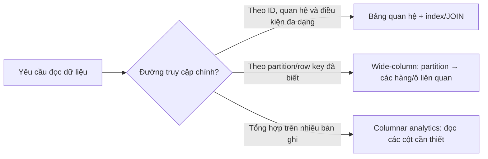
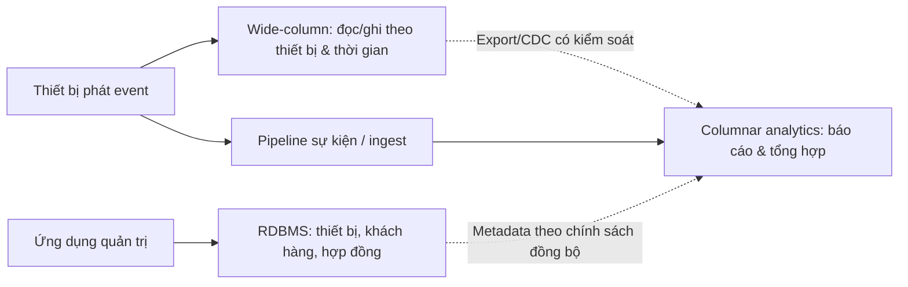

# Phân biệt mô hình cột rộng với bảng quan hệ và kho phân tích dạng cột

## 1. Ba khái niệm dễ bị nhầm vì cùng có “hàng” và “cột”

Khi tìm hiểu NoSQL, bạn có thể thấy **wide-column database**, **column-family store**, **relational database** và **columnar database** đều sử dụng các từ *table*, *row*, *column*. Nhưng những từ này mô tả những khía cạnh **khác nhau** của một hệ lưu trữ:

- **Mô hình cột rộng (wide-column / column-family)** tập trung vào cách tổ chức dữ liệu theo **khóa hàng hoặc khóa phân vùng**, các cột/ô dữ liệu liên quan và đường truy cập được thiết kế trước. Apache Cassandra, Apache HBase và Google Cloud Bigtable là những ví dụ quan trọng, dù mô hình cụ thể của chúng không giống hệt nhau.
- **Mô hình quan hệ (relational)** tổ chức dữ liệu thành các **quan hệ (relations)** với lược đồ, thuộc tính, khóa và các phép toán quan hệ. Một RDBMS như PostgreSQL cung cấp SQL, JOIN, ràng buộc và giao dịch, trong phạm vi khả năng của sản phẩm và cấu hình.
- **Kho phân tích dạng cột (columnar analytical store)** chủ yếu nói đến **cách sắp xếp vật lý dữ liệu theo cột** và các kỹ thuật đọc tập dữ liệu lớn để tổng hợp. ClickHouse, các kho dữ liệu dùng định dạng Parquet và nhiều data warehouse tận dụng kiểu lưu cột để xử lý workload OLAP.

**Không thể suy từ chữ “column” rằng một wide-column database lưu dữ liệu theo cùng cách và phục vụ cùng kiểu truy vấn với một columnar analytics engine.** Đồng thời, hình thức bảng trong Cassandra CQL cũng không có nghĩa bảng đó có ngữ nghĩa và khả năng truy vấn giống bảng quan hệ.

### Mục tiêu học tập

Sau bài này, bạn có thể:

1. Phân biệt ba tầng: **mô hình logic**, **khóa và mẫu truy cập**, **cách lưu trữ vật lý**.
2. Đọc một thiết kế Cassandra/Bigtable mà không áp đặt các giả định từ SQL quan hệ.
3. Giải thích tại sao kho phân tích cột phù hợp với tổng hợp hàng triệu dòng nhưng không mặc nhiên thay thế wide-column store phục vụ truy xuất theo khóa.
4. Chọn đường truy cập thích hợp cho workload giao dịch, sự kiện, chuỗi thời gian và phân tích.
5. Nhận biết những ngộ nhận về JOIN, index, transaction, phân vùng, schema và “cột linh hoạt”.

## 2. Bản đồ so sánh ở mức khái niệm

| Góc nhìn | Bảng quan hệ | Mô hình cột rộng | Kho phân tích dạng cột |
|---|---|---|---|
| Trọng tâm | Dữ liệu dưới dạng quan hệ và các phép truy vấn trên quan hệ | Truy cập hàng/nhóm hàng qua row key hoặc partition key đã thiết kế | Đọc và tính toán trên số lượng lớn dòng, thường chỉ với một số cột |
| Ví dụ | PostgreSQL, MySQL | Cassandra, HBase, Bigtable | ClickHouse, hệ thống dùng Parquet/columnar warehouse |
| Cấu trúc logic | Bảng, hàng, cột, khóa chính/ngoại, quan hệ | Keyspace/table hoặc row key + column family + qualifier, tùy sản phẩm | Bảng/sự kiện/dataset; có thể trình bày bằng SQL |
| Tối ưu thường gặp | Truy vấn linh hoạt, JOIN, toàn vẹn dữ liệu, workload giao dịch | Đọc/ghi khối lượng lớn theo khóa/partition và mẫu truy cập định trước | Scan, filter, group, aggregate trên tập dữ liệu lớn |
| Truy cập hiệu quả | Tùy index, optimizer, thống kê, partitioning | Thường phụ thuộc mạnh vào partition key/row key và clustering/range | Thường tận dụng chỉ đọc các cột cần thiết, nén và xử lý theo khối |
| JOIN | Là phép toán tiêu chuẩn của SQL quan hệ | Không mặc nhiên có; Cassandra CQL không hỗ trợ JOIN quan hệ thông thường | Nhiều hệ OLAP có JOIN SQL; chi phí tùy engine |
| Giao dịch | Nhiều RDBMS cung cấp ACID và các mức isolation | Phạm vi atomicity/transaction tùy sản phẩm và thao tác | Phạm vi giao dịch và cách cập nhật tùy engine |
| Schema | Thường khai báo kiểu dữ liệu và ràng buộc | Cassandra CQL có schema khai báo; Bigtable/HBase có mô hình cột linh hoạt hơn | Có schema logic hoặc metadata cột, thường gắn với pipeline phân tích |
| Chi phí đáng chú ý | JOIN, index, locking/MVCC, ghi nhiều bảng | Hot partition, wide partition, tombstone, dữ liệu trùng lặp, truy vấn trái khóa | Scan dung lượng lớn, ingestion, merge/compaction, độ mới dữ liệu |
| Câu hỏi đầu tiên | “Dữ liệu có quan hệ và bất biến gì?” | “Ứng dụng đọc/ghi theo khóa nào?” | “Phải phân tích những cột và số bản ghi nào?” |

Bảng này là **bản đồ định hướng**. Nó không định nghĩa mọi tính năng của từng sản phẩm: RDBMS có thể có columnstore index; kho phân tích cũng có thể hỗ trợ point lookup; wide-column store có thể có cơ chế chỉ mục mở rộng. Quyết định thực tế phải dựa trên tài liệu phiên bản, cấu hình và phép đo workload.

## 3. Cùng một bộ dữ liệu, ba cách nhìn

Giả sử một hệ thống IoT nhận số đo nhiệt độ từ thiết bị.

| tenant_id | device_id | observed_at (UTC) | temperature_c | battery_pct |
|---|---|---|---:|---:|
| t17 | d42 | 2026-11-14 08:00 | 28.1 | 93 |
| t17 | d42 | 2026-11-14 08:01 | 28.3 | 93 |
| t17 | d77 | 2026-11-14 08:00 | 30.2 | 77 |
| t21 | d15 | 2026-11-14 08:00 | 26.9 | 81 |

Ứng dụng có ba kiểu câu hỏi:

- **Q1:** Lấy 20 số đo mới nhất của **một thiết bị** trong **một ngày**.
- **Q2:** Sửa hoặc tra cứu metadata của một thiết bị, đồng thời quản lý quan hệ giữa thiết bị, khách hàng và hợp đồng.
- **Q3:** Tính **nhiệt độ trung bình theo ngày**, trên **toàn bộ thiết bị** trong ba tháng.

Cả ba dùng dữ liệu có cột và hàng, nhưng **đường truy cập** rất khác nhau. Dạng lưu phục vụ Q1 không nhất thiết tốt cho Q3, và Q2 có những yêu cầu ràng buộc nghiệp vụ không thể đánh giá chỉ bằng thông lượng ghi.

### 3.1. Hình dung cấu trúc truy cập



Ba lựa chọn này có thể **phối hợp trong cùng hệ thống**. Chúng cũng có thể có vùng chức năng chồng lấn; sơ đồ chỉ làm rõ tư duy thiết kế.

## 4. Bảng quan hệ: bảng là một quan hệ dữ liệu và đối tượng của SQL

Trong RDBMS, một bảng thường có cấu trúc cột rõ ràng, kiểu dữ liệu và các ràng buộc. Để lưu số đo IoT, thiết kế đơn giản có thể gồm:

```sql
-- Ví dụ cú pháp gần với PostgreSQL.
CREATE TABLE devices (
    tenant_id       text NOT NULL,
    device_id       text NOT NULL,
    display_name    text NOT NULL,
    installed_at    timestamptz,
    PRIMARY KEY (tenant_id, device_id)
);

CREATE TABLE readings (
    tenant_id       text NOT NULL,
    device_id       text NOT NULL,
    event_id        uuid NOT NULL,
    observed_at     timestamptz NOT NULL,
    temperature_c   numeric(6,2),
    battery_pct     integer,
    PRIMARY KEY (tenant_id, device_id, event_id),
    FOREIGN KEY (tenant_id, device_id)
        REFERENCES devices(tenant_id, device_id)
);

CREATE INDEX readings_device_time_idx
    ON readings (tenant_id, device_id, observed_at DESC);
```

Điểm quan trọng là:

- Bảng `readings` giữ các bản ghi có cấu trúc chung và có thể khai báo **foreign key** đến `devices`.
- RDBMS có thể dùng **index** để tăng tốc một số đường truy cập và dùng **query optimizer** chọn kế hoạch thực thi.
- SQL có thể JOIN dữ liệu từ nhiều bảng để trả lời câu hỏi nghiệp vụ.
- Giao dịch có thể nhóm nhiều thay đổi và duy trì bất biến, trong phạm vi khả năng và isolation level được chọn.

Để lấy 20 số đo mới nhất của thiết bị:

```sql
SELECT observed_at, temperature_c, battery_pct
FROM readings
WHERE tenant_id = 't17'
  AND device_id = 'd42'
ORDER BY observed_at DESC
LIMIT 20;
```

Bản thân SQL không bảo đảm truy vấn nhanh; hiệu năng phụ thuộc chỉ mục, kích thước bảng, phân bố dữ liệu, thống kê và kế hoạch thực thi. Điểm đặc trưng của mô hình quan hệ là **cách biểu đạt linh hoạt các phép lọc, JOIN và aggregate**, cùng khả năng quản lý ràng buộc dữ liệu.

### 4.1. Khóa chính quan hệ và khóa phân vùng cột rộng không cùng một ý nghĩa

Trong một RDBMS, `PRIMARY KEY` chủ yếu xác định **tính duy nhất** và ràng buộc `NOT NULL` cho bộ thuộc tính đã chọn. Hệ thống có thể xây index tương ứng, nhưng cách đặt khóa chính không phải luôn là quy tắc bắt buộc quyết định phân bố vật lý dữ liệu trên nhiều node.

Trong Cassandra, cấu trúc `PRIMARY KEY` của bảng CQL còn mã hóa **partition key** và **clustering columns**: nó quyết định cách tìm partition và thứ tự logic trong partition. Bỏ qua sự khác biệt này rất dễ dẫn tới viết truy vấn không phù hợp với mô hình dữ liệu.

### 4.2. Có schema không đồng nghĩa với “chỉ xử lý row-by-row”

Một RDBMS có thể lưu dữ liệu theo hàng là chủ yếu, nhưng vẫn dùng index, partitioning, vật hóa truy vấn, tính toán vector hóa hoặc columnstore extension/index tùy sản phẩm. Không nên giải thích rằng “SQL = luôn đọc nguyên cả hàng” vì planner có thể phục vụ truy vấn từ index hoặc cấu trúc tối ưu khác.

**Mô hình quan hệ nói về cách biểu diễn và thao tác dữ liệu logic.** Cách dữ liệu nằm trên đĩa hoặc trong bộ nhớ là một quyết định triển khai khác.

## 5. Wide-column: thiết kế quanh row key hoặc partition key

Nhóm wide-column được gọi như vậy vì các sản phẩm tiên phong tổ chức dữ liệu thành những hàng có thể chứa nhiều cột/ô theo key và/hoặc các nhóm cột. Tuy nhiên, “wide-column” là nhãn phân loại rộng chứ không phải một API hay một định dạng lưu trữ tiêu chuẩn.

### 5.1. Tư duy column-family kiểu Bigtable/HBase

Có thể hình dung một mô hình kiểu Bigtable như ánh xạ thưa giữa row key, column và phiên bản thời gian:

\[
(\text{row key},\ \text{column family:qualifier},\ \text{timestamp}) \longrightarrow \text{cell value}
\]

Sơ đồ khái niệm:

```text
Row key: sensor#d42#2026-11-14T08:00
   meta:tenant             -> "t17"
   reading:temperature     -> "28.1"
   reading:battery         -> "93"

Row key: sensor#d42#2026-11-14T08:01
   meta:tenant             -> "t17"
   reading:temperature     -> "28.3"
   # Có thể không có ô reading:battery
```

Ý nghĩa:

- **Row key** là định danh chính để tìm hàng; thứ tự row key và thiết kế range có thể ảnh hưởng đường scan.
- **Column family** là nhóm cột được định nghĩa/quản lý theo cơ chế của sản phẩm.
- **Qualifier** có thể khác nhau giữa các hàng; không phải hàng nào cũng chứa đủ mọi cột.
- Các cell có thể có **phiên bản dựa trên timestamp**, tùy cơ chế và cấu hình.
- Một tập dữ liệu có nhiều cột tùy chọn có thể biểu diễn theo kiểu **sparse**, tránh buộc mọi hàng phải mang đủ giá trị của mọi trường.

Đó là cách diễn đạt mô hình để đọc tài liệu. Các chi tiết về số phiên bản giữ lại, atomicity theo hàng, range scan, tablet/region và garbage collection phải xem tài liệu của Bigtable/HBase cụ thể. Không thể suy trực tiếp các tính năng đó sang Cassandra.

### 5.2. Cassandra dùng một biến thể khác: bảng CQL, partition và clustering

Cassandra thường được xếp vào nhóm wide-column/column-family, nhưng schema CQL hiện đại có các **cột được khai báo với kiểu dữ liệu**, nhìn bề ngoài tương tự bảng SQL.

Cách đọc đúng trong Cassandra:

1. **Partition key** quyết định các hàng logic nào được nhóm vào cùng một partition và ảnh hưởng cách định tuyến/lưu trữ.
2. **Clustering columns** xác định cách sắp thứ tự các hàng trong partition.
3. **Các cột dữ liệu khác** lưu payload ứng với mỗi hàng.
4. **Mẫu truy vấn** thường cần tương thích với cấu trúc partition/clustering đã thiết kế.

Một partition có thể chứa nhiều hàng với các giá trị clustering khác nhau. Vì thế, “wide” trong thiết kế Cassandra có thể gắn với **một partition chứa nhiều hàng/sự kiện**; nó không có nghĩa bạn luôn tạo hàng với hàng triệu trường tùy ý như một object JSON động.

### 5.3. Một thiết kế Cassandra cho Q1

Ta muốn đọc số đo của một thiết bị theo ngày, ưu tiên dữ liệu mới nhất. Một bảng phục vụ trực tiếp đường truy cập đó có thể là:

```sql
-- Cassandra CQL: ví dụ minh họa thiết kế theo truy vấn.
CREATE TABLE readings_by_device_day (
    tenant_id       text,
    device_id       text,
    bucket_day      date,
    observed_at     timestamp,
    event_id        uuid,
    temperature_c   decimal,
    battery_pct     int,
    PRIMARY KEY (
        (tenant_id, device_id, bucket_day),
        observed_at,
        event_id
    )
) WITH CLUSTERING ORDER BY (observed_at DESC, event_id ASC);
```

Trong `PRIMARY KEY` trên:

- `(tenant_id, device_id, bucket_day)` là **partition key ghép**.
- `observed_at` và `event_id` là **clustering columns**.
- Một partition đại diện cho các số đo của một thiết bị thuộc một tenant trong một ngày.
- Dùng `event_id` làm tie-breaker giúp các sự kiện cùng `observed_at` vẫn có định danh khác nhau, với điều kiện ứng dụng cấp ID duy nhất.

Truy vấn theo đúng partition:

```sql
-- Cassandra CQL: cần nêu đầy đủ thành phần partition key.
SELECT observed_at, event_id, temperature_c, battery_pct
FROM readings_by_device_day
WHERE tenant_id = 't17'
  AND device_id = 'd42'
  AND bucket_day = '2026-11-14'
LIMIT 20;
```

Nhờ clustering order đã cấu hình, cách đọc này hướng đến các sự kiện mới nhất trong partition đã biết. Đây là minh họa **mô hình hóa theo access pattern**, không phải lời bảo đảm tuyệt đối về latency. Trong triển khai thật còn phải xét kích thước partition, tải, replication, consistency level, paging và driver.

### 5.4. Vì sao cần chia theo ngày?

Nếu chỉ dùng `(tenant_id, device_id)` làm partition key và một thiết bị ghi mỗi giây trong nhiều năm, một partition có thể tích tụ rất nhiều bản ghi. Partition quá lớn làm tăng chi phí truy cập, compact, repair và quản trị.

Thêm `bucket_day` giới hạn dữ liệu theo thời gian:

```text
Partition (t17, d42, 2026-11-13)
    23:59 -> ...
    23:58 -> ...

Partition (t17, d42, 2026-11-14)
    08:01 -> ...
    08:00 -> ...
```

Đổi lại, truy vấn “lấy 20 sự kiện mới nhất xuyên nhiều ngày” có thể cần đọc nhiều partition và hợp nhất kết quả ở tầng ứng dụng. Một ngày có phù hợp hay không phụ thuộc tốc độ ghi, retention, kích thước bản ghi và yêu cầu đọc; có hệ thống cần chia theo giờ, có hệ thống chia theo tuần.

**Bucket không có kích thước lý tưởng chung.** Phải tính số hàng/partition, độ lệch dữ liệu, hot partition và chi phí truy vấn qua nhiều bucket.

## 6. Đọc dữ liệu: khác nhau ở chỗ “đường truy cập nào được tối ưu?”

### 6.1. Truy vấn theo partition là điểm mạnh của nhiều wide-column store

Giả sử Q1 được gọi hàng trăm nghìn lần/ngày:

> “Cho tôi 20 bản ghi mới nhất của thiết bị d42 trong ngày 14/11.”

Cassandra table `readings_by_device_day` đặt ngay các trường đã biết trong partition key. Khi driver và cluster tìm đúng partition, các hàng trong đó có thể được duyệt theo clustering order, phù hợp với nhu cầu lấy dữ liệu gần nhất.

Một hệ SQL cũng có thể xử lý Q1 tốt nếu index thích hợp. Sự khác biệt không phải “Cassandra làm được, SQL không làm được”, mà là **cách Cassandra yêu cầu tổ chức bảng và khóa sát truy vấn**, thường rõ ràng hơn đối với đường truy cập phân tán.

### 6.2. Truy vấn trái partition key có thể khó hoặc tốn kém

Giả sử ứng dụng đột ngột muốn:

> “Tìm tất cả bản ghi có `temperature_c > 40` trong mọi thiết bị và mọi ngày.”

Với bảng Cassandra vừa tạo, `temperature_c` là một cột payload, không thuộc partition key/clustering key. Không thể mặc nhiên viết một câu CQL theo mẫu SQL bất kỳ và kỳ vọng Cassandra tự quét/chọn index tối ưu.

Ví dụ ý tưởng **không được xem là truy vấn hợp lệ/hiệu quả mặc định cho bảng đã thiết kế**:

```sql
-- Không coi đây là truy vấn có thể thực hiện hiệu quả
-- chỉ vì bảng CQL có cột temperature_c.
SELECT *
FROM readings_by_device_day
WHERE temperature_c > 40;
```

Tùy sản phẩm và phiên bản, có thể có secondary index, storage-attached index, search integration hoặc yêu cầu đặc biệt như lọc phía server. Nhưng các tính năng đó có giới hạn, chi phí và điều kiện riêng. Thêm `ALLOW FILTERING` một cách máy móc trong Cassandra không biến full scan thành đường truy cập rẻ.

Một thiết kế khác là **bảng hoặc luồng dữ liệu phục vụ riêng cho cảnh báo**, ví dụ lưu sự kiện bất thường theo tenant và bucket thời gian, hoặc đẩy vào hệ phân tích. Điều này có thể tạo dữ liệu trùng lặp và yêu cầu nhất quán giữa các bản sao logic.

### 6.3. Mô hình quan hệ cho phép truy vấn linh hoạt hơn nhưng vẫn có giá

Trong RDBMS, SQL dễ biểu đạt điều kiện khác nhau; tối ưu hóa dựa trên index, statistic và execution plan. Nhưng khi dữ liệu rất lớn, một truy vấn không có index tốt vẫn có thể quét bảng rộng, tốn I/O và CPU.

Điểm cần so sánh là:

- **Khả năng biểu đạt truy vấn** (có thể viết câu hỏi nào?).
- **Đường thực thi** (query planner và cấu trúc dữ liệu đọc gì?).
- **Hiệu năng dưới workload thật** (latency, throughput, đồng thời, dung lượng, chi phí).

Tránh đồng nhất “SQL linh hoạt” với “truy vấn nào cũng nhanh”, cũng như tránh đồng nhất “wide-column phân tán” với “không bao giờ scan”.

## 7. Columnar analytics: “dạng cột” nói về cách lưu và tính toán

Bây giờ xét Q3:

> “Tính trung bình nhiệt độ theo ngày trên toàn bộ thiết bị trong ba tháng.”

Ta không chỉ biết một `device_id`. Công việc có thể cần xem rất nhiều bản ghi, nhưng mỗi bản ghi chỉ cần một vài trường: thời gian và nhiệt độ.

**Columnar storage** tổ chức phần dữ liệu của cùng một cột gần nhau theo cấu trúc lưu trữ, thường kết hợp nén và metadata hỗ trợ loại bỏ vùng không cần đọc.

### 7.1. So sánh ý tưởng lưu theo hàng và theo cột

Với ba hàng dữ liệu:

```text
R1 = (d42, 08:00, 28.1, 93)
R2 = (d42, 08:01, 28.3, 93)
R3 = (d77, 08:00, 30.2, 77)
```

Một biểu diễn **row-oriented** về mặt trực giác:

```text
[d42 | 08:00 | 28.1 | 93]
[d42 | 08:01 | 28.3 | 93]
[d77 | 08:00 | 30.2 | 77]
```

Một biểu diễn **column-oriented** về mặt trực giác:

```text
device_id:      [d42, d42, d77]
observed_at:    [08:00, 08:01, 08:00]
temperature_c:  [28.1, 28.3, 30.2]
battery_pct:    [93, 93, 77]
```

Khi chỉ cần tính trung bình `temperature_c`, hệ columnar có thể tập trung đọc cột đó và các cột cần cho điều kiện lọc/nhóm. Dữ liệu cùng loại thường thuận lợi cho nén theo mã hóa chuyên biệt. Nhiều engine còn xử lý theo block/vector thay vì gọi hàm cho từng hàng một cách đơn lẻ.

Sơ đồ này diễn đạt **nguyên lý lưu vật lý**, không khẳng định mọi engine lưu đúng bốn mảng liên tục. Ví dụ, Apache Parquet dùng row group, column chunk và page; ClickHouse có các phần dữ liệu/marks và index theo cách của engine. Chi tiết phụ thuộc định dạng và sản phẩm.

### 7.2. Vì sao cách lưu này có lợi cho OLAP?

Một phép tính trên tập lớn thường có các đặc điểm:

1. Số lượng **hàng** cần xét rất lớn.
2. Chỉ cần một phần nhỏ **cột**.
3. Cần thực hiện tổng hợp, nhóm, lọc, sắp xếp hoặc JOIN trên số lượng lớn bản ghi.
4. Có thể chấp nhận một chiến lược ingest hoặc dữ liệu phân tích được nạp theo lô/luồng riêng.
5. Tối ưu throughput khi quét nhiều dữ liệu quan trọng hơn latency cập nhật từng ô nhỏ.

Ví dụ query SQL mang tính minh họa trên kho phân tích chứa cột `bucket_day`:

```sql
SELECT
    bucket_day,
    AVG(temperature_c) AS avg_temperature,
    COUNT(*) AS reading_count
FROM readings_analytics
WHERE bucket_day >= DATE '2026-09-01'
  AND bucket_day < DATE '2026-12-01'
GROUP BY bucket_day
ORDER BY bucket_day;
```

Truy vấn này cần tính toán qua nhiều bản ghi nhưng chỉ phải sử dụng các trường liên quan. Engine dạng cột có thể tận dụng **column pruning**, compression, predicate/partition pruning, vectorized execution và xử lý phân tán nếu được hỗ trợ.

**“Đọc các cột cần thiết” không có nghĩa luôn bỏ qua mọi hàng không phù hợp.** Hiệu quả còn phụ thuộc dữ liệu đã được sắp xếp/phân vùng như thế nào, thống kê vùng dữ liệu, khả năng đẩy filter xuống storage và độ chọn lọc của điều kiện.

### 7.3. Kho OLAP dạng cột có luôn tốt cho GET một bản ghi không?

Không. Một yêu cầu như:

> “Đổi thuộc tính của thiết bị d42, kiểm tra ràng buộc với hợp đồng và trả kết quả giao dịch ngay.”

có thể yêu cầu giao dịch cập nhật đơn lẻ, kiểm tra ràng buộc và độ trễ thấp. Một số kho phân tích vẫn hỗ trợ thao tác ghi, UPDATE/DELETE và truy xuất theo khóa, nhưng **chi phí và ngữ nghĩa không mặc định tương đương RDBMS OLTP**.

Ngược lại, các hệ SQL quan hệ có thể phục vụ analytics với index/vật hóa/columnstore; cần đánh giá sản phẩm và khối lượng tải cụ thể. Cách đặt tên **OLTP/OLAP** là cách mô tả workload chủ đạo, không phải một phân loại cấm mọi tính năng chéo.

## 8. Ba sơ đồ giúp nhìn ra sự khác biệt cốt lõi

### 8.1. Bảng quan hệ

```text
devices
+----------+-----------+------------------+
|tenant_id |device_id  |display_name      |
+----------+-----------+------------------+
|t17       |d42        |Kho A - cảm biến  |
+----------+-----------+------------------+

readings
+----------+-----------+----------------+--------------+
|tenant_id |device_id  |observed_at     |temperature_c |
+----------+-----------+----------------+--------------+
|t17       |d42        |08:00           |28.1          |
|t17       |d42        |08:01           |28.3          |
+----------+-----------+----------------+--------------+

JOIN và ràng buộc liên hệ readings với devices.
```

Ở đây trọng tâm là **quan hệ logic**, bất biến và cách truy vấn dữ liệu kết hợp.

### 8.2. Wide-column theo partition và clustering (Cassandra)

```text
readings_by_device_day

Partition key = (tenant=t17, device=d42, day=2026-11-14)
    observed_at DESC   event_id   temperature   battery
    08:01              e-02       28.3          93
    08:00              e-01       28.1          93

Partition key = (tenant=t17, device=d77, day=2026-11-14)
    observed_at DESC   event_id   temperature   battery
    08:00              e-03       30.2          77

Đọc tốt khi có đủ partition key; quét khác partition
đòi hỏi thiết kế đường truy cập phù hợp.
```

Ở đây trọng tâm là **định tuyến đến phân vùng và đọc các hàng liên quan theo clustering**.

### 8.3. Kho phân tích theo cột

```text
readings_analytics (minh họa logic của một block dữ liệu)

Block thời gian: 2026-11-14
    device_id:      [d42, d42, d77, ...]
    observed_at:    [08:00, 08:01, 08:00, ...]
    temperature_c:  [28.1, 28.3, 30.2, ...]
    battery_pct:    [93, 93, 77, ...]

Query AVG(temperature_c) theo ngày
    -> cần chủ yếu ngày + temperature_c
    -> scan/aggregate qua nhiều bản ghi
```

Ở đây trọng tâm là **tối ưu đọc cột và tính toán qua tập dữ liệu lớn**.

Những sơ đồ trên thể hiện các khía cạnh khác nhau: **quan hệ**, **đường truy cập theo khóa**, và **tổ chức vật lý để scan theo cột**. Chúng không phải ba kiểu trình bày của cùng một storage engine.

## 9. Phân biệt hai họ wide-column quan trọng: Cassandra và Bigtable/HBase

Gộp tất cả vào một câu “wide-column có cột tùy ý” sẽ dẫn đến hiểu sai Cassandra; gộp tất cả vào “mỗi partition chứa nhiều row CQL” lại không diễn đạt đúng Bigtable/HBase.

| Câu hỏi | Cassandra (CQL) | Bigtable/HBase (mô hình column-family) |
|---|---|---|
| Định danh truy cập chính | Partition key + clustering columns | Row key; dữ liệu truy cập bằng key/range theo khả năng API |
| Schema | Cột CQL thường được khai báo tên và kiểu | Column family được định nghĩa; qualifier có thể linh hoạt theo hàng |
| Hình thức dữ liệu | Các hàng CQL trong partition, sắp theo clustering | Các cell theo row key, family, qualifier; có cơ chế phiên bản cell |
| “Cột rộng” nói đến điều gì? | Một partition có thể chứa nhiều hàng với các khóa clustering | Một hàng có thể có nhiều cell/qualifier; dữ liệu thưa |
| Thứ tự truy cập | Clustering order bên trong partition | Row-key ordering/range theo kiến trúc sản phẩm |
| Truy vấn đa thuộc tính | Cần thiết kế theo khóa hoặc index phù hợp | Cần thiết kế row key/index/giải pháp truy vấn bổ sung |
| Giao dịch và nhất quán | Có mức consistency và khả năng thao tác đặc thù; xem phiên bản | Hành vi atomicity/consistency đặc thù theo row, thao tác và sản phẩm |

Không đồng nhất các bảo đảm của ba sản phẩm. Ví dụ, một thao tác cập nhật nhiều ô trong một hàng ở Bigtable không tự suy ra hành vi tương đương với transaction nhiều partition trong Cassandra, hoặc với transaction nhiều bảng ở PostgreSQL.

### 9.1. “Column family” không phải “cột đo lường trong warehouse”

Trong Bigtable/HBase, **column family** là cách nhóm các cột/cell để quản lý dữ liệu theo mô hình sản phẩm. Trong warehouse, **columnar storage** là cách đặt các giá trị cùng cột gần nhau để scan/aggregate hiệu quả.

Hai hệ thống có thể đều lưu dữ liệu “theo cột” ở một khía cạnh, nhưng cấu trúc truy cập, khả năng xử lý và workload được tối ưu không giống nhau.

### 9.2. Từ “wide” không có nghĩa “không cần giới hạn”

Một partition chứa quá nhiều hàng hoặc một row có quá nhiều cell có thể gây vấn đề hiệu năng, kích thước dữ liệu và vận hành. “Wide-column” không phải lời khuyên tạo partition/hàng vô hạn hay lưu mọi dữ liệu của một tenant vào một khóa khổng lồ.

Trong Cassandra, cần chú ý **wide partitions, hot partitions, tombstones, compaction, repair và paging**. Trong HBase/Bigtable, cần chú ý row key làm điểm nóng, kích thước row, region/tablet distribution và thiết kế key range. Mức độ ảnh hưởng khác nhau theo sản phẩm, topology và phiên bản.

## 10. Schema, ràng buộc, JOIN và phi chuẩn hóa

### 10.1. Bảng có cùng tên cột chưa chắc có cùng mô hình quan hệ

Bảng Cassandra CQL:

```sql
CREATE TABLE orders_by_customer (
    customer_id text,
    order_time  timestamp,
    order_id    uuid,
    total       decimal,
    status      text,
    PRIMARY KEY (customer_id, order_time, order_id)
);
```

có hình thức SQL-like, nhưng là thiết kế để truy vấn theo `customer_id` và thứ tự `order_time`. Mục tiêu chính không phải tạo một quan hệ dữ liệu chuẩn hóa tổng quát để tùy ý JOIN qua nhiều bảng.

Một RDBMS có thể chia dữ liệu thành `customers`, `orders` và `order_items`, thiết lập khóa ngoại rồi JOIN khi đọc. Một thiết kế Cassandra có thể cố ý tạo các bảng phục vụ truy vấn như:

```text
orders_by_customer         -> đọc đơn theo customer_id
orders_by_status_day       -> đọc đơn theo status và ngày
order_details_by_id        -> đọc chi tiết theo order_id
```

Đây là **query-based modeling / denormalization có chủ đích**. Một đơn hàng có thể xuất hiện ở nhiều cấu trúc để phục vụ các đường truy cập khác nhau.

### 10.2. Phi chuẩn hóa giải quyết truy cập nhưng tạo chi phí ghi

Nếu một đơn đổi trạng thái từ `PENDING` sang `PAID`, các biểu diễn “theo khách hàng”, “theo trạng thái”, “theo ngày” có thể phải cập nhật hoặc chuyển dữ liệu. Điều cần thiết kế là:

- Cấu trúc nào chứa **nguồn sự thật**?
- Khi cập nhật một lần mà có nhiều bản ghi/partition liên quan, làm sao xử lý trường hợp chỉ cập nhật một phần?
- Hệ thống có chấp nhận **eventual consistency** ở bảng tra cứu phụ không?
- Có cơ chế replay/reconciliation để sửa dữ liệu sai khác không?
- Khi xóa/sửa bản ghi nguồn, các bản sao phụ có được đồng bộ đúng không?

Với bất biến cần transaction chặt chẽ giữa nhiều đối tượng, mô hình quan hệ có khả năng giao dịch phù hợp có thể đơn giản hơn. Tuy nhiên, không thể kết luận mọi RDBMS luôn tốt hơn: phải cân nhắc tải, phân phối, yêu cầu latency và khả năng của từng hệ.

### 10.3. Đừng nhầm schema linh hoạt với không có hợp đồng dữ liệu

- **Bảng quan hệ:** thường dùng DDL để khai báo kiểu và constraints.
- **Cassandra CQL:** cũng có DDL với schema và kiểu; đây không phải một key–value store cho phép mọi dòng tự thêm cột tùy ý mà không thay schema.
- **Bigtable/HBase:** cho phép linh hoạt hơn về qualifier và sự hiện diện của cell, nhưng vẫn cần quy ước dữ liệu, quản lý family và hạn chế của API.
- **Kho cột phân tích:** thường có schema/metadata cho dataset, hỗ trợ thay đổi schema tùy engine và định dạng.

Dù không có foreign key cưỡng chế ở store, **bất biến nghiệp vụ vẫn tồn tại**. Khả năng không bị database bắt lỗi không biến dữ liệu sai thành dữ liệu hợp lệ.

## 11. Giao dịch, tính nhất quán và khả năng phân phối

Đây là điểm phải phân biệt **định nghĩa khái niệm** với **bảo đảm sản phẩm**.

### 11.1. RDBMS có ACID không có nghĩa mọi truy vấn luôn nhìn cùng một snapshot

RDBMS hỗ trợ các mức isolation khác nhau; một transaction dưới `READ COMMITTED` có thể quan sát dữ liệu theo cách khác một transaction ở `REPEATABLE READ` hoặc `SERIALIZABLE`. Việc có ACID không có nghĩa tất cả khả năng phân tán và độ bền khi mất cả vùng dữ liệu đều được bảo đảm tự động.

Nếu hệ được phân mảnh trên nhiều node hoặc dùng replica đọc, cần xem hợp đồng của chính hệ đó. Khả năng giao dịch thường rất mạnh nhưng vẫn có giới hạn cấu hình, phạm vi, contention và chi phí.

### 11.2. Wide-column thường đặt nặng phân phối, nhưng bảo đảm phụ thuộc hệ

Cassandra có mô hình replication và lựa chọn consistency level đối với nhiều thao tác, cũng có các cơ chế điều kiện như lightweight transactions tùy trường hợp. Tuy nhiên, **consistency level** của thao tác đọc/ghi không đồng nghĩa với **ACID transaction đa bảng, đa partition** như trong RDBMS.

Bigtable/HBase có đặc tả riêng cho atomicity ở phạm vi hàng và phiên bản cell. Không suy diễn tính năng giữa các sản phẩm chỉ vì đều thuộc nhóm wide-column.

Một quyết định thực tế cần ghi:

1. Ghi được ACK khi điều kiện nào thỏa?
2. Sau ACK, đọc ở cùng node, khác replica hoặc khác region được bảo đảm thấy gì?
3. Nếu nhiều client cập nhật cùng một key/partition, điều kiện ghi và xung đột được xử lý ra sao?
4. Có transaction/atomicity qua nhiều item, partition hoặc bảng không?
5. Khi timeout hoặc failover, client xác định thao tác đã thành công bằng cách nào?

### 11.3. Kho phân tích thường có chiến lược nạp và cập nhật khác

Nhiều kho phân tích tối ưu **append/ingestion và đọc aggregate**. Cách xử lý UPDATE/DELETE, merge dữ liệu, transaction snapshot, deduplication hoặc độ mới của materialized view phụ thuộc engine. Không nên mặc định chúng có giao dịch OLTP giống PostgreSQL hoặc nhận từng event một với cùng chi phí như kho phục vụ realtime.

Khả năng thực thi các truy vấn SQL của một hệ không đủ để suy ra cùng transaction semantics với RDBMS.

## 12. Đánh đổi hiệu năng theo loại truy vấn

### 12.1. Q1 — “20 số đo mới nhất của một thiết bị”

- **RDBMS:** index theo thiết bị và thời gian có thể xử lý hiệu quả; ưu điểm là có thể kết hợp với bảng metadata và ràng buộc.
- **Cassandra:** partition theo thiết bị + bucket ngày, sắp trong partition theo thời gian giúp đường đọc tự nhiên.
- **Columnar OLAP:** có thể đọc được, nhất là khi dữ liệu được sắp xếp/partition phù hợp, nhưng không mặc nhiên là nơi lý tưởng cho mỗi lần point query có latency rất thấp.

### 12.2. Q2 — “Chuyển thiết bị giữa các hợp đồng, cập nhật trạng thái và ràng buộc”

- **RDBMS:** transaction và ràng buộc liên quan thường giúp giữ bất biến rõ ràng.
- **Wide-column:** có thể thiết kế được, nhưng phải hiểu phạm vi atomicity và chi phí đồng bộ nhiều đường truy cập.
- **Columnar:** hữu ích cho phân tích lịch sử hợp đồng, nhưng cập nhật nghiệp vụ liên quan nhiều đối tượng cần xét đặc tả giao dịch.

### 12.3. Q3 — “AVG nhiệt độ toàn quốc theo ngày trong 90 ngày”

- **RDBMS:** có thể thực hiện bằng SQL, nhưng có thể cần index, partition, materialized view hoặc một hệ phân tích chuyên dụng để đáp ứng quy mô.
- **Cassandra:** một bảng tối ưu Q1 có thể phải quét rất nhiều partition để tính Q3. Tạo thêm bảng tổng hợp theo ngày hoặc pipeline phân tích sẽ phù hợp hơn nếu Q3 thường xuyên.
- **Columnar:** phù hợp với kiểu đọc nhiều hàng, ít cột, GROUP BY và aggregation; tận dụng column pruning, nén và vectorized scan nếu engine hỗ trợ.

### 12.4. Bảng chấm nhanh theo workload

| Workload | Quan hệ | Wide-column | Columnar analytics |
|---|---|---|---|
| Tìm theo ID hoặc khóa đã biết | Tốt với index phù hợp | Thường là trường hợp tối ưu | Tùy engine và data layout |
| Ghi dày đặc theo nhiều partition | Tùy cấu hình/khả năng mở rộng | Một mục tiêu thiết kế phổ biến | Tùy ingestion pipeline và hình thức nạp |
| JOIN nhiều thực thể với ràng buộc | Thường tự nhiên | Phải thiết kế/đồng bộ khác; Cassandra CQL không có JOIN quan hệ | Nhiều engine hỗ trợ JOIN phân tích |
| Đổi nhiều thực thể trong một giao dịch | Nhiều RDBMS hỗ trợ tốt | Phụ thuộc phạm vi atomicity cụ thể | Phụ thuộc engine; thường không phải trọng tâm |
| Đọc 2–5 cột trên hàng tỷ bản ghi | Có thể cần thiết kế phân tích | Có thể đòi hỏi quét rộng và tổng hợp riêng | Thường là điểm mạnh |
| Truy vấn ad-hoc nhiều điều kiện | SQL + index/optimizer | Thường bị ràng buộc bởi khóa và cấu trúc đã thiết kế | Thường hỗ trợ tốt ad-hoc analytics |
| Dữ liệu sparse với nhiều qualifier thay đổi | Cần thiết kế schema phù hợp | Bigtable/HBase có mô hình phù hợp; Cassandra khác | Có thể xử lý nhưng phụ thuộc schema/định dạng |
| Dữ liệu quan sát theo thiết bị, ngày | Có thể dùng partition/index | Rất hợp với partition + clustering | Hợp để tổng hợp lịch sử |

“Tốt” không có nghĩa luôn nhanh hơn. Phải đo trên cùng kiểu request, số node, dataset, độ phân bố key, mức nhất quán và ngân sách.

## 13. Những sai lầm kiến trúc thường xảy ra

### 13.1. Lấy cú pháp CQL giống SQL làm bằng chứng có thể JOIN tự do

Cassandra sử dụng `CREATE TABLE`, `SELECT` và `WHERE`, nhưng giới hạn truy vấn khác SQL quan hệ. Thiết kế bảng Cassandra nên xuất phát từ **các truy vấn biết trước**. Nếu cần nhiều phép JOIN linh hoạt, phải đánh giá mô hình khác hoặc tạo bản sao dữ liệu phục vụ đường truy cập.

### 13.2. Nghĩ wide-column đồng nghĩa với kho phân tích cột

Cassandra, HBase và Bigtable không tự động có cùng cấu trúc columnar batch execution như một kho OLAP. Việc đặt tên **column family** không đủ để kết luận truy vấn `AVG` trên hàng tỷ bản ghi qua nhiều partition sẽ rẻ.

Ngược lại, gọi ClickHouse là “wide-column NoSQL” chỉ vì nó lưu dữ liệu dạng cột cũng làm lệch cách hiểu về kiến trúc và workload.

### 13.3. Tạo một partition khổng lồ để “đọc nhanh mọi thứ”

Một partition cho toàn bộ sự kiện của một tenant trong nhiều năm có thể gây vấn đề hot partition, dữ liệu quá lớn và compaction/repair nặng. Cần tính bucket, retention, số hàng và khối lượng truy cập.

### 13.4. Thiết kế theo dữ liệu trước rồi mới hỏi truy vấn

Nếu tạo bảng chỉ để giống mô hình quan hệ sau đó áp dụng CQL, các câu hỏi truy vấn trái partition key có thể rất tốn kém. Hãy bắt đầu bằng:

- Khách hàng truy vấn theo ID thiết bị, tenant hay thời gian?
- Một partition nên chứa bao nhiêu dữ liệu?
- Cần thứ tự nào?
- Có query nào cần scan đa partition không?
- Có cần duy trì nhiều bảng phục vụ các access pattern khác nhau không?

### 13.5. Bỏ qua chi phí của phi chuẩn hóa

Một bảng thứ hai phục vụ truy vấn mới có thể làm mỗi ghi cần thêm một hoặc nhiều thao tác và tạo rủi ro lệch dữ liệu. Không nên chỉ đo latency đọc mà bỏ qua write amplification, deduplication và khả năng rebuild dữ liệu phụ.

### 13.6. Nghĩ “columnar” là định nghĩa của SQL hoặc NoSQL

Có RDBMS hỗ trợ columnstore và có kho phân tích dùng SQL. **SQL là ngôn ngữ truy vấn; relational là mô hình dữ liệu; columnar là cách lưu/thi hành ở tầng vật lý.** Các khái niệm này không cùng một trục phân loại.

## 14. Thiết kế phối hợp: một nguồn dữ liệu, nhiều đường truy cập

Một ứng dụng lớn có thể dùng cả ba loại hệ thống cho những chức năng khác nhau:



Trong phương án này:

- **RDBMS** giữ thông tin cấu hình, quan hệ, hợp đồng, quyền và các giao dịch có bất biến chặt chẽ.
- **Wide-column** giữ chuỗi sự kiện/đọc nhanh theo partition được ứng dụng dùng thường xuyên.
- **Columnar analytics** lưu dữ liệu lịch sử phục vụ báo cáo, tổng hợp và truy vấn nhiều chiều.

Đây là **kiến trúc minh họa**, không phải khuôn mẫu bắt buộc. Có những dự án chỉ cần một RDBMS; có dự án dùng một hệ thống đáp ứng cả workload giao dịch lẫn phân tích. Thêm nhiều hệ lưu trữ chỉ hợp lý khi lợi ích vượt chi phí hạ tầng và độ phức tạp đồng bộ.

### 14.1. Những vấn đề phát sinh khi dùng nhiều kho

1. **Nguồn sự thật (source of truth):** thuộc tính nào được cập nhật ở đâu?
2. **Độ trễ đồng bộ:** dashboard có thể chậm hơn dữ liệu realtime bao lâu?
3. **Idempotency:** một event được gửi hai lần có làm nhân đôi số đo không?
4. **Thứ tự sự kiện:** event đến muộn có được xử lý đúng ngày và đúng phiên bản không?
5. **Schema evolution:** khi thêm trường, hệ ghi và hệ phân tích đọc thế nào?
6. **Backfill/replay:** có thể nạp lại dữ liệu lịch sử mà không làm sai số liệu không?
7. **Phân quyền và xóa:** dữ liệu nhạy cảm cần được bảo vệ và xóa ở tất cả bản sao theo chính sách.
8. **Chi phí:** nhân bản lưu trữ, vận hành pipeline, theo dõi lỗi và xử lý khôi phục.

Một pipeline analytics không tự động giải quyết tính nhất quán giữa những hệ thống này. Nó cần hợp đồng dữ liệu, cơ chế quan sát và kiểm tra đối soát.

## 15. Quy trình lựa chọn khi đứng trước một bài toán cụ thể

Trước khi quyết định dùng wide-column, relational hay columnar, hãy trả lời theo thứ tự:

### Bước 1 — Viết rõ các câu hỏi truy cập

Ví dụ:

- “Lấy đúng một device theo ID.”
- “Lấy 100 event mới nhất của một device trong 24 giờ.”
- “Tạo hợp đồng và gắn 20 thiết bị atomically.”
- “Tổng hợp 2 tỷ event theo quốc gia và tháng.”

Không bắt đầu từ tên database. Một workload có thể gồm nhiều đường truy cập cần ưu tiên khác nhau.

### Bước 2 — Phân loại loại công việc

| Câu hỏi | Hàm ý |
|---|---|
| Có biết đầy đủ ID/partition key trước khi đọc không? | Thuận lợi cho point/partition lookup |
| Cần nhiều JOIN hay thay đổi điều kiện lọc linh hoạt không? | Quan hệ/SQL query engine có thể thuận tiện |
| Có bất biến bắt buộc giữ qua nhiều đối tượng không? | Cần transaction/constraints phù hợp |
| Phần lớn query xử lý hàng triệu dòng nhưng vài cột không? | Columnar analytics đáng cân nhắc |
| Có write throughput lớn và đường truy cập ít thay đổi không? | Wide-column có thể phù hợp |
| Độ mới của dữ liệu phải gần như tức thời hay chấp nhận trễ? | Ảnh hưởng kiến trúc pipeline, index và consistency |

### Bước 3 — Với wide-column, thiết kế key và partition từ query

Với Cassandra, ghi rõ:

```text
Query:
    20 readings mới nhất của một thiết bị trong ngày.

Partition key:
    (tenant_id, device_id, bucket_day)

Clustering:
    (observed_at DESC, event_id)

Value columns:
    temperature_c, battery_pct

Expected partition size:
    dựa trên số event/ngày và dung lượng mỗi event

Additional query:
    tổng hợp theo quốc gia/90 ngày
    -> cần cấu trúc hoặc hệ phân tích riêng
```

Với Bigtable/HBase, bài toán tương ứng phải diễn đạt bằng **row key, column families, qualifiers và phạm vi row scan** theo cơ chế của sản phẩm, không sao chép cú pháp CQL.

### Bước 4 — Xác định bảo đảm dữ liệu

Cần mô tả:

- Xác nhận ghi và độ bền sau sự cố.
- Phạm vi nguyên tử của một thao tác và của nhiều thao tác.
- Consistency khi đọc từ replica/region khác.
- Xử lý ghi trùng, out-of-order và retries.
- RPO/RTO, backup, restore và thời gian lưu dữ liệu.

Tên mô hình không đủ thay thế thông số và tài liệu sản phẩm.

### Bước 5 — So sánh bằng workload thật

Đánh giá với dữ liệu đại diện, gồm:

- p50/p95/p99 latency cho từng loại query.
- Throughput ghi/đọc trong tải đồng thời.
- Khả năng mở rộng khi số partition, size và số node tăng.
- Hot partitions, compaction, index build và storage amplification.
- Chi phí vận hành và lưu trữ.
- Thời gian chạy các query tổng hợp, dữ liệu đưa vào bộ nhớ và network shuffle.

Một phép benchmark “database X nhanh hơn Y” chỉ có nghĩa khi hai hệ cùng giải bài toán với các bảo đảm phù hợp và cấu hình được mô tả rõ.

## 16. Bài tập thực hành

### Bài tập A — Xác định đúng mô hình

Phân loại phát biểu sau là **quan hệ**, **wide-column**, **columnar analytics** hoặc **không chỉ thuộc một loại**:

1. “Tôi muốn lưu các bản ghi cùng `device_id` gần nhau để đọc theo thứ tự thời gian.”
2. “Tôi muốn có foreign key từ order đến customer và cập nhật đồng thời nhiều bảng.”
3. “Tôi muốn chỉ đọc cột doanh thu, tháng và vùng từ hàng tỷ giao dịch để tính tổng.”
4. “Tôi muốn dùng SQL để lọc dữ liệu.”
5. “Tôi muốn một row có nhiều qualifier có thể xuất hiện thưa thớt theo thời điểm.”

**Gợi ý:** (1) thiết kế theo partition/clustering của wide-column; (2) khả năng tiêu biểu của RDBMS; (3) workload thuận lợi cho columnar analytics; (4) không đủ phân loại vì SQL có trên nhiều engine; (5) gợi mô hình Bigtable/HBase, phải đối chiếu sản phẩm.

### Bài tập B — Thiết kế Cassandra cho truy vấn rõ ràng

Yêu cầu: “Lấy 100 event mới nhất theo `device_id` và `tenant_id`, dữ liệu lưu 90 ngày, mỗi thiết bị ghi 10 event/giây.”

Hãy trả lời:

1. Nếu một partition chứa 90 ngày, số event lý thuyết là bao nhiêu? Một partition quá lớn có nguy cơ gì?
2. Nên thử bucket theo giờ hay theo ngày; cần đo thêm thông tin nào?
3. Khi truy vấn 100 event gần nhất băng qua ranh giới bucket, client cần làm gì?
4. Các event cùng timestamp phân biệt bằng trường nào?
5. Điều gì xảy ra nếu đột ngột cần truy vấn “tất cả event cảnh báo của mọi thiết bị”?

**Gợi ý:** với 10 event/giây, một ngày có \(10 \times 86.400 = 864.000\) event; 90 ngày có 77.760.000 event trên một thiết bị nếu tốc độ liên tục. Bucket theo ngày vẫn cần kiểm tra kích thước và load; có thể cần bucket ngắn hơn. Truy vấn xuyên bucket cần lấy từ các bucket liên quan và ghép theo thứ tự. Truy vấn theo alert cần đường truy cập/index/bảng hoặc pipeline khác.

### Bài tập C — Vì sao kho phân tích cần lưu cột?

Một dataset có 2 tỷ row, mỗi row có 40 cột. Báo cáo chỉ cần ba cột `day`, `country` và `revenue`.

Hãy giải thích:

- Vì sao một columnar engine có thể đọc ít byte hơn so với layout chỉ tối ưu cho đọc toàn bộ hàng?
- Nén dữ liệu cùng loại giúp gì?
- Phân vùng theo ngày và metadata min/max có thể bỏ qua phần dữ liệu nào?
- Vì sao query vẫn có thể tốn tài nguyên khi phải đọc quá nhiều row hoặc GROUP BY có cardinality lớn?

**Gợi ý:** lựa chọn cột làm giảm I/O khi engine hỗ trợ column pruning; compression và vectorized processing cải thiện scan/aggregate. Nhưng không có công nghệ nào biến tổng hợp qua dữ liệu khổng lồ thành thao tác không tốn chi phí.

### Bài tập D — Chọn mô hình cho một dự án thực tế

Hệ thống bán hàng cần:

- Đặt đơn và trừ tồn kho với bất biến chặt.
- Ghi 500.000 sự kiện tương tác mỗi phút.
- Xem 50 sự kiện gần nhất của một khách hàng.
- Phân tích chuyển đổi theo chiến dịch hàng tuần.

Hãy đề xuất **đường dữ liệu** cho từng nhu cầu và giải thích khi nào một hệ thống là đủ, khi nào nên kết hợp nhiều hệ thống. Với mỗi quyết định, nêu mức nhất quán cần thiết và chi phí đồng bộ.

**Gợi ý:** nghiệp vụ đơn/tồn kho cần khảo sát transaction/constraints; event log và truy cập theo customer có thể phù hợp với partitioned store; phân tích theo chiến dịch có thể cần columnar engine. Tuy nhiên, với quy mô và ngân sách phù hợp, một RDBMS có index/partition cùng pipeline tổng hợp có thể vẫn đáp ứng. Không có đáp án đúng chỉ dựa vào tên mô hình.

## 17. Thuật ngữ và nguồn tra cứu tiếp

| Thuật ngữ | Cách hiểu trong bài |
|---|---|
| **Relational model** | Mô hình quan hệ, các phép thao tác trên quan hệ và ràng buộc dữ liệu |
| **Row-oriented storage** | Cách tổ chức vật lý ưu tiên lưu dữ liệu của một hàng gần nhau |
| **Columnar storage** | Cách tổ chức vật lý ưu tiên lưu các giá trị cùng cột gần nhau, thường phục vụ scan/aggregate |
| **Wide-column / column-family** | Nhóm mô hình lưu trữ phân tán theo row/partition key và cấu trúc cột/ô liên quan |
| **Partition key** | Thành phần khóa xác định phân vùng dữ liệu, theo ngữ nghĩa sản phẩm |
| **Clustering column** | Cột xác định thứ tự logic giữa các row trong một Cassandra partition |
| **Column qualifier** | Tên cột con trong một column family, theo mô hình Bigtable/HBase |
| **Sparse data** | Dữ liệu trong đó nhiều ô/trường có thể không xuất hiện |
| **Denormalization** | Cố ý lưu dữ liệu lặp hoặc cấu trúc phụ để phục vụ đường đọc |
| **OLTP** | Workload nhiều thao tác giao dịch/đọc–ghi có tính tương tác |
| **OLAP** | Workload truy vấn phân tích, quét/tổng hợp nhiều bản ghi |
| **Column pruning** | Bỏ qua việc đọc các cột không cần cho truy vấn |
| **Predicate/partition pruning** | Loại bỏ vùng dữ liệu không thể thỏa điều kiện dựa trên metadata/index |
| **Hot partition** | Một partition nhận lượng truy cập hoặc dữ liệu vượt trội, tạo điểm nghẽn |
| **Tombstone** | Dấu đánh dấu xóa trong một số hệ LSM; ảnh hưởng đọc và quá trình dọn dữ liệu |

Để tra cứu đặc tả thay vì suy diễn từ nhãn mô hình, bắt đầu từ tài liệu chính thức:

- [Apache Cassandra Documentation](https://cassandra.apache.org/doc/latest/) — CQL, partition key, clustering, data modeling, consistency và vận hành.
- [Google Cloud Bigtable documentation](https://cloud.google.com/bigtable/docs) — row key, column family, cell, dữ liệu thưa và tablet.
- [Apache HBase Reference Guide](https://hbase.apache.org/book.html) — region, row key, column family và mô hình cell.
- [PostgreSQL Documentation](https://www.postgresql.org/docs/) — mô hình bảng, constraints, query plans, index và giao dịch.
- [Apache Parquet format](https://parquet.apache.org/docs/) — columnar file format, row group và column chunk.
- [ClickHouse Documentation](https://clickhouse.com/docs) — columnar processing, MergeTree, query analytics và ingestion.

Tài liệu của từng sản phẩm có thể thay đổi theo phiên bản, topology và dịch vụ quản lý. Khi cần dựa vào một bảo đảm cụ thể, phải chọn đúng tài liệu của hệ thống đang chạy.

## 18. Kết luận: nhận diện đúng câu hỏi mà mỗi mô hình giải quyết

**Bảng quan hệ** đặt trọng tâm ở cấu trúc logic của dữ liệu, mối quan hệ và thao tác truy vấn/giao dịch. **Wide-column** nhấn mạnh cách nhóm và truy cập dữ liệu theo row/partition key, đặc biệt hữu ích khi ứng dụng có những mẫu truy cập rõ ràng và muốn phân phối tải. **Columnar analytics** tập trung vào cách lưu và xử lý dữ liệu để đọc ít cột nhưng tính toán trên nhiều hàng.

Khi gặp chữ “column”, hãy hỏi rõ: **đang nói về cột trong lược đồ quan hệ, column family của một mô hình wide-column, hay cách lưu các giá trị cùng cột cho truy vấn phân tích?** Khi trả lời được câu đó, bạn mới có nền tảng đúng để đọc tài liệu sản phẩm, thiết kế khóa, chọn query và so sánh hiệu năng theo workload của chính mình.

