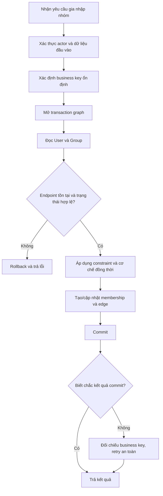
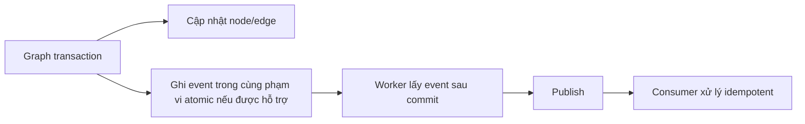

# Giao dịch, cập nhật quan hệ và tính toàn vẹn theo từng hệ

## 1. Đồ thị biểu diễn quan hệ, nhưng ai bảo đảm quan hệ đúng?

Trong cơ sở dữ liệu đồ thị (graph database), ứng dụng lưu **đỉnh (vertex/node)**, **cạnh (edge/relationship)** và **thuộc tính (property)**. Những thao tác cơ bản như thêm đỉnh, nối cạnh, thay đổi thuộc tính và xóa cạnh có vẻ đơn giản. Tuy nhiên, một thay đổi nhỏ có thể ảnh hưởng đến nhiều quy tắc nghiệp vụ.

Ví dụ, trong hệ thống cộng tác:

```text
(:User {userId: "U42"})-[:MEMBER_OF {role: "EDITOR"}]->
(:Group {groupId: "G7"})
```

Khi thêm quan hệ này, ứng dụng có thể cần giữ các điều kiện:

- Người dùng `U42` và nhóm `G7` đều tồn tại.
- Người dùng có quyền gia nhập nhóm.
- Một cặp người dùng–nhóm chỉ có tối đa một tư cách thành viên hiện hành.
- Vai trò `EDITOR` chỉ được cấp khi thỏa chính sách của nhóm.
- Nếu client gửi lại request do timeout, ứng dụng không tạo thêm một membership.
- Nếu có lỗi giữa lúc cập nhật nhiều node/cạnh, graph không bị bỏ dở ở trạng thái sai.
- Nếu sự kiện thay đổi quyền cần gửi đến dịch vụ khác, hai hệ thống có cách đồng bộ đáng tin cậy.

Những điều kiện này liên quan đến **transaction**, **concurrency** và **integrity**, chứ không chỉ liên quan đến cú pháp tạo cạnh.

**Điểm cốt lõi:** không có một quy tắc giao dịch áp dụng giống nhau cho mọi sản phẩm NoSQL đồ thị. Neo4j, JanusGraph, Amazon Neptune và ArangoDB có cách mô hình hóa, API, constraint, isolation và backend khác nhau. Khi đọc bài, hãy phân biệt *yêu cầu về tính đúng đắn của nghiệp vụ* với *bảo đảm mà một graph database cụ thể thực sự cung cấp*.

### Mục tiêu học tập

Sau bài này, bạn sẽ có thể:

1. Xác định bất biến (invariant) trước khi tạo, sửa hoặc xóa relationship.
2. Phân biệt atomicity, isolation, consistency, durability, retry và idempotency.
3. Giải thích vì sao transaction không tự bảo vệ mọi quy tắc phức tạp của graph.
4. Thiết kế cập nhật quan hệ khi có nhiều request đồng thời.
5. Phân biệt những đặc tính phải tra cứu ở Neo4j, JanusGraph, Neptune hoặc hệ đồ thị khác.
6. Xây dựng phương án xử lý lỗi, xóa dữ liệu và đồng bộ sang hệ ngoài.

## 2. Năm lớp toàn vẹn trong mô hình đồ thị

### 2.1. Toàn vẹn định danh

Định danh nghiệp vụ phải phân biệt đúng các thực thể. Ví dụ:

> Trong phạm vi ứng dụng, không được có hai node `User` với cùng `userId = "U42"`.

Một hệ đồ thị có thể hỗ trợ index hoặc unique constraint trên thuộc tính. Nhưng việc **tạo index để tìm kiếm nhanh** và việc **cưỡng chế uniqueness khi ghi đồng thời** là hai khả năng cần phân biệt.

Nếu chỉ dùng hai câu lệnh riêng:

```text
IF NOT EXISTS(User("U42")):
    CREATE User("U42")
```

thì hai client có thể cùng quan sát “chưa tồn tại” và cùng tạo node. Đây là **check-then-create race**. Cần ràng buộc duy nhất hoặc cơ chế ghi điều kiện được đảm bảo bởi sản phẩm.

### 2.2. Toàn vẹn cấu trúc

Cạnh `MEMBER_OF` trong ví dụ đi từ `User` đến `Group`. Ứng dụng có thể yêu cầu:

- Đầu nguồn phải là `User`; đầu đích phải là `Group`.
- Cả hai node phải hợp lệ và chưa bị vô hiệu hóa.
- Không được tạo cạnh tự nối nếu loại quan hệ đó cấm.
- Khi xóa node, các cạnh liên quan phải được xử lý theo chính sách.

Một số graph engine không cho cạnh tồn tại độc lập nếu không có endpoint. Nhưng điều đó **không đồng nghĩa** hệ thống tự cưỡng chế mọi quy tắc về nhãn node, trạng thái người dùng, quyền, hoặc logic xóa liên quan.

### 2.3. Toàn vẹn cardinality

Cardinality quy định **một node có thể tham gia bao nhiêu quan hệ thuộc một loại**:

| Bất biến | Ví dụ | Mức độ cần xử lý |
|---|---|---|
| Tối đa một quan hệ cho một cặp | Một user follow một user khác tối đa một lần | Uniqueness theo cặp endpoint và loại edge |
| Tối đa một cạnh đi ra | Mỗi nhân viên có một quản lý trực tiếp hiện hành | Kiểm soát nhiều cạnh cạnh tranh |
| Ít nhất một cạnh liên quan | Một nhóm hoạt động phải có ít nhất một admin | Kiểm tra toàn bộ tập thành viên |
| Cho phép nhiều cạnh cùng hai node | Một khách hàng mua nhiều lần ở một cửa hàng | Cần định danh mỗi sự kiện, chẳng hạn `orderId` |
| Chỉ một cạnh hiện hành theo thời gian | Một người có thể đổi quản lý nhưng không có hai quản lý đồng thời | Kiểm soát khoảng hiệu lực và cập nhật lịch sử |

Không thể áp một uniqueness constraint đơn giản cho mọi loại cardinality. Đặc biệt, ràng buộc “ít nhất một” hay “không có hai khoảng thời gian chồng nhau” thường cần logic nghiệp vụ và cơ chế đồng thời.

### 2.4. Toàn vẹn cấu trúc toàn cục

Có những bất biến phụ thuộc **nhiều cạnh cùng lúc**:

- Cây danh mục không được có chu trình.
- Mạng quan hệ phụ thuộc không được tạo vòng theo một loại edge nhất định.
- Mỗi node, trừ root, phải kết nối với đúng một parent.
- Không được có đường dẫn cấp quyền vượt qua một vùng bị cấm.

Một graph database có thể hỗ trợ truy vấn đường đi để **kiểm tra** những điều kiện đó. Nhưng một câu kiểm tra bằng query chưa tự bảo vệ invariant khi transaction khác đồng thời thay đổi graph.

### 2.5. Toàn vẹn giữa các hệ thống

Khi graph lưu membership, còn hệ thống quyền lưu projection tương ứng, thay đổi graph thường phải dẫn đến event hoặc cập nhật bên ngoài.

Ví dụ:

```text
Graph: CREATE (U42)-[:MEMBER_OF]->(G7)
Broker: PUBLISH MemberJoined(U42, G7)
IAM: GRANT role for U42 in G7
```

Ngay cả khi graph database bảo đảm ACID cho một transaction nội bộ, transaction ấy thường **không bao trùm** broker và hệ IAM. Ứng dụng cần xác định mô hình đồng bộ, thứ tự, retry và reconciliation.

## 3. Transaction bảo vệ điều gì?

### 3.1. Bốn chữ ACID và phạm vi của chúng

| Thuộc tính | Ý nghĩa | Câu hỏi cần đặt |
|---|---|---|
| **Atomicity** | Một nhóm thao tác thành công hoặc thất bại theo phạm vi cam kết | Có thể tạo node membership và hai edge trong cùng một transaction không? |
| **Consistency** | Dữ liệu giữ các điều kiện hợp lệ được database hoặc ứng dụng thực thi | Constraint nào thật sự được cưỡng chế lúc commit? |
| **Isolation** | Các transaction đồng thời được phép nhìn/ảnh hưởng lẫn nhau ra sao | Hai thao tác cùng kiểm tra “không có edge” có thể cùng tạo edge không? |
| **Durability** | Thay đổi đã commit được duy trì theo cam kết lưu bền | Ghi được xác nhận ở thời điểm nào, và sau failover điều gì được giữ? |

Từ “consistency” trong ACID nói đến việc duy trì trạng thái hợp lệ. Nó không đồng nghĩa với một mức đọc replica hoặc “mọi node trong cluster thấy cùng trạng thái ngay lập tức”.

### 3.2. Ví dụ cập nhật bị xé thành nhiều transaction

Giả sử biểu diễn membership thành node có vòng đời riêng:

```text
(User U42) --HAS_MEMBERSHIP--> (Membership U42:G7)
(Membership U42:G7) --IN_GROUP--> (Group G7)
```

Workflow:

1. Tạo `Membership`.
2. Nối `User` tới `Membership`.
3. Nối `Membership` tới `Group`.

Nếu mỗi bước commit riêng, lỗi ở bước 2 hoặc 3 có thể để lại node/cạnh mồ côi theo nghĩa nghiệp vụ. Nếu graph engine cho phép cùng thực hiện ba bước trong **một transaction**, rollback có thể đảm bảo không có trạng thái trung gian đó sau khi transaction thất bại.

Vẫn phải phân biệt:

- **Một request chứa nhiều lệnh:** chưa chắc là transaction nguyên tử cho mọi lệnh.
- **Một batch ghi:** chưa chắc rollback tất cả item nếu một item lỗi.
- **Một transaction cục bộ:** chưa chắc bao gồm thay đổi ở dịch vụ khác.
- **Một transaction đã commit:** chưa chắc mọi replica ở mọi vùng thấy dữ liệu ngay theo cùng một cách.

### 3.3. Atomicity không thay thế isolation

Giả sử mỗi nhân viên có tối đa một quản lý trực tiếp. Ban đầu chưa có cạnh `REPORTS_TO`.

```text
T1: đọc E1, thấy chưa có REPORTS_TO
T2: đọc E1, thấy chưa có REPORTS_TO
T1: tạo (E1)-[:REPORTS_TO]->(M1)
T2: tạo (E1)-[:REPORTS_TO]->(M2)
```

Nếu hai transaction cùng commit dưới cơ chế không bảo vệ điều kiện trên, trạng thái cuối có hai quản lý. Mỗi transaction có thể hoàn toàn atomic nhưng **bất biến liên transaction đã bị phá**.

Các cơ chế bảo vệ có thể bao gồm constraint phù hợp, locking/serialization, optimistic concurrency, cập nhật có điều kiện trên dữ liệu đại diện hoặc mức isolation cao hơn được engine hỗ trợ. Không chọn giải pháp chỉ vì thấy transaction có chữ ACID.

### 3.4. Các lỗi cạnh tranh phổ biến

| Vấn đề | Tình huống | Hậu quả |
|---|---|---|
| Duplicate creation | Hai request tạo cùng quan hệ | Hai edge cho một nghiệp vụ |
| Lost update | Hai client sửa thuộc tính `role` | Một cập nhật ghi đè cập nhật kia |
| Write skew | Hai quản trị viên đồng thời hạ vai trò của nhau | Nhóm không còn admin |
| Phantom edge | Đang kiểm tra “không tồn tại cạnh” thì cạnh mới được tạo | Điều kiện đọc không còn đúng |
| Deadlock/conflict | Hai transaction khóa tài nguyên theo thứ tự khác nhau | Một transaction bị hủy/retry |
| Ambiguous commit | Client timeout sau khi gửi commit | Không rõ có cần retry hay không |

Những tình huống này đặc biệt quan trọng khi graph được cập nhật bởi nhiều instance ứng dụng hoặc worker nền.

## 4. Ví dụ Neo4j: ràng buộc node và tạo quan hệ

Các lệnh bên dưới dùng **Neo4j Cypher**, không phải một ngôn ngữ NoSQL chung. Chúng minh họa cách kết hợp constraint với thiết kế quan hệ; cần đối chiếu tài liệu phiên bản và edition đang dùng.

### 4.1. Đặt ràng buộc định danh

Ví dụ cú pháp Neo4j 5:

```cypher
CREATE CONSTRAINT user_id_unique IF NOT EXISTS
FOR (u:User)
REQUIRE u.userId IS UNIQUE;

CREATE CONSTRAINT group_id_unique IF NOT EXISTS
FOR (g:Group)
REQUIRE g.groupId IS UNIQUE;
```

Đây là uniqueness constraint trên thuộc tính. Nó giúp ngăn hai node cùng nhãn có `userId` hoặc `groupId` trùng nhau. Đừng nhầm với **property existence constraint**: yêu cầu “mọi user phải có ID” và yêu cầu “ID không được trùng” cần kiểm tra khả năng, edition và ngữ nghĩa khác nhau.

Tạo dữ liệu:

```cypher
MERGE (u:User {userId: 'U42'})
ON CREATE SET u.displayName = 'An';

MERGE (g:Group {groupId: 'G7'})
ON CREATE SET g.name = 'Data Engineering';
```

`MERGE` cố khớp hoặc tạo pattern theo semantics của Cypher. Nó **không phải lời bảo đảm rằng mọi loại pattern sẽ không bao giờ bị nhân đôi dưới concurrency**. Constraint trên business ID là lớp bảo vệ quan trọng khi nhiều request cùng tạo node.

### 4.2. Tạo relationship trực tiếp

Ví dụ liên kết user vào group:

```cypher
MATCH (u:User {userId: $userId})
MATCH (g:Group {groupId: $groupId})
MERGE (u)-[r:MEMBER_OF]->(g)
ON CREATE SET
  r.joinedAt = datetime(),
  r.state = 'ACTIVE'
RETURN u.userId AS userId,
       g.groupId AS groupId,
       r.state AS state;
```

Lệnh này phù hợp để minh họa cách khớp hoặc tạo cạnh trong graph. Tuy nhiên:

- `MATCH` không tìm được một endpoint thì phần tạo cạnh sẽ không chạy cho hàng đó.
- `MERGE` kiểm tra pattern được chỉ định, không tự thực thi mọi bất biến về số lượng cạnh, trạng thái hoặc quyền.
- Nếu dữ liệu đã có nhiều `MEMBER_OF` giữa hai node, query có thể gặp nhiều relationship.
- Nếu nhiều transaction đồng thời tạo cạnh cùng cặp, phải kiểm chứng tính duy nhất dưới isolation/locking và các constraints được sản phẩm hỗ trợ.
- `ON CREATE SET` không tự xử lý request “gia nhập lại” khi cạnh đã có nhưng đang `REVOKED`.

**Một lần chạy đúng trên môi trường development không chứng minh được an toàn khi hàng nghìn request ghi đồng thời.**

### 4.3. Khi quan hệ có định danh riêng

Nếu membership có nhiều trường như `role`, `joinedAt`, `validTo`, `state`, hoặc cần lịch sử, có thể dùng node trung gian:

```text
(User U42)
   |
   | HAS_MEMBERSHIP
   v
(Membership {userId:"U42", groupId:"G7"})
   |
   | IN_GROUP
   v
(Group G7)
```

Trong Neo4j 5 có thể minh họa uniqueness theo cặp thuộc tính trên node:

```cypher
CREATE CONSTRAINT membership_pair_unique IF NOT EXISTS
FOR (m:Membership)
REQUIRE (m.userId, m.groupId) IS UNIQUE;
```

Một lệnh tạo/cập nhật trong transaction:

```cypher
MATCH (u:User {userId: $userId})
MATCH (g:Group {groupId: $groupId})
MERGE (m:Membership {
  userId: $userId,
  groupId: $groupId
})
ON CREATE SET
  m.state = 'ACTIVE',
  m.joinedAt = datetime()
MERGE (u)-[:HAS_MEMBERSHIP]->(m)
MERGE (m)-[:IN_GROUP]->(g)
RETURN m.userId, m.groupId, m.state;
```

Bất biến node `Membership` duy nhất theo (`userId`, `groupId`) được diễn đạt rõ. Nhưng cách này không tự biến graph thành hệ có foreign key quan hệ:

- Một code path khác vẫn có thể tạo cạnh phụ không đúng.
- `Membership` có thể tồn tại trong tình trạng thiếu liên kết nếu ghi sai transaction boundary.
- Ràng buộc unique trên node không mặc nhiên bảo đảm có đúng một `HAS_MEMBERSHIP` và `IN_GROUP` trong mọi tình huống.
- Tái kích hoạt membership `REVOKED` phải là thao tác nghiệp vụ riêng với điều kiện phù hợp.

Chọn node trung gian khi quan hệ có vòng đời hoặc cần danh tính riêng. Với một quan hệ đơn giản, mô hình trực tiếp bằng edge có thể gọn hơn.

### 4.4. Transaction driver và callback có thể được thực thi lại

Minh họa dùng JavaScript Driver Neo4j với **mã giả rút gọn**:

```javascript
async function joinGroup(driver, userId, groupId) {
  const session = driver.session({ database: "neo4j" });

  try {
    return await session.executeWrite(async tx => {
      const result = await tx.run(
        "MATCH (u:User {userId: $userId}) " +
        "MATCH (g:Group {groupId: $groupId}) " +
        "MERGE (m:Membership {userId: $userId, groupId: $groupId}) " +
        "MERGE (u)-[:HAS_MEMBERSHIP]->(m) " +
        "MERGE (m)-[:IN_GROUP]->(g) " +
        "RETURN m",
        { userId, groupId }
      );

      if (result.records.length !== 1) {
        throw new Error("User hoặc Group không tồn tại");
      }

      return result.records[0].get("m");
    });
  } finally {
    await session.close();
  }
}
```

Ví dụ tập trung vào **phạm vi transaction của callback**, không bao gồm mọi kiểm tra quyền, trạng thái, xung đột và lỗi nghiệp vụ cần có trong sản phẩm thực tế.

Managed transaction trong một số Neo4j driver có thể retry khi gặp lỗi tạm thời. Vì vậy callback phải an toàn khi lặp lại: không trừ tiền, gửi mail hoặc publish event bên ngoài graph ngay trong callback nếu không có thiết kế idempotent. Phiên bản driver và cấu hình retry phải được xác minh theo tài liệu chính thức.

## 5. Cập nhật quan hệ: tạo, sửa, chuyển, xóa

### 5.1. Tạo cạnh và quyết định bản sắc của quan hệ

Hai cạnh giữa cùng cặp node có thể là:

- **Sai**, nếu một user chỉ được follow một user khác một lần.
- **Đúng**, nếu hai cạnh là hai giao dịch mua khác nhau với hai `orderId`.

Do đó, hãy định nghĩa identity của relationship:

```text
FOLLOWS:
    key = (followerId, followeeId)

PURCHASED:
    key = orderId

EMPLOYED_BY:
    key = (personId, companyId, validFrom)
```

Bộ khóa này thuộc **mô hình nghiệp vụ**. Database có hay không constraint thực thi chính xác bộ khóa đó là chuyện phải kiểm chứng theo sản phẩm.

### 5.2. Sửa thuộc tính cạnh

Ví dụ đổi vai trò trong Neo4j:

```cypher
MATCH (u:User {userId: $userId})-[r:MEMBER_OF]->
      (g:Group {groupId: $groupId})
SET r.role = 'MODERATOR',
    r.updatedAt = datetime()
RETURN r.role;
```

Query có thể tác động nhiều relationship nếu pattern khớp nhiều cạnh. Để cập nhật đúng một quan hệ, phải có cách xác định cạnh hoặc bảo đảm cardinality tương ứng. Nếu sửa dựa vào giá trị cũ, cần xét **lost update**.

Ví dụ hai request đều đọc `role = 'EDITOR'`, rồi một request đổi thành `MODERATOR`, request kia đổi thành `VIEWER`. Nếu yêu cầu “chỉ được đổi vai trò khi phiên bản còn đúng”, nên dùng conditional update/CAS hoặc một cơ chế khóa theo khả năng hệ.

### 5.3. Chuyển đầu mút của cạnh

Đồ thị tổ chức:

```text
Trước: (E1)-[:REPORTS_TO]->(M1)
Sau:   (E1)-[:REPORTS_TO]->(M2)
```

Một thao tác chuyển quản lý thường cần:

1. Kiểm tra `E1` và `M2` tồn tại.
2. Kiểm tra người thực hiện được quyền thay đổi.
3. Đảm bảo `M2` không thuộc tập cấp dưới của `E1` nếu không cho tạo chu trình.
4. Xóa hoặc kết thúc hiệu lực cạnh tới `M1`.
5. Tạo cạnh mới tới `M2`.
6. Ghi audit hoặc version nếu cần.
7. Commit trong transaction có phạm vi và isolation phù hợp.

Nếu xóa cạnh cũ rồi tạo cạnh mới ở hai transaction tách biệt, có thể tồn tại khoảng thời gian nhân viên không có quản lý. Nếu tạo mới rồi xóa cũ, có thể tạm thời có hai quản lý. Không nên giả định thay đổi endpoint chỉ là `SET` một thuộc tính: nhiều graph model biểu diễn endpoint như thành phần định danh của cạnh.

### 5.4. Xóa cạnh

Neo4j Cypher:

```cypher
MATCH (u:User {userId: $userId})-[r:MEMBER_OF]->
      (g:Group {groupId: $groupId})
DELETE r;
```

Nếu quan hệ có lịch sử quan trọng, xóa vật lý không phải lúc nào là lựa chọn thích hợp. Có thể thay bằng:

```cypher
MATCH (u:User {userId: $userId})-[r:MEMBER_OF]->
      (g:Group {groupId: $groupId})
SET r.state = 'REVOKED',
    r.revokedAt = datetime();
```

Khi giữ cạnh lịch sử, mọi query “thành viên hiện tại” phải lọc theo `state`/thời gian hiệu lực phù hợp. Nếu bỏ qua điều kiện lọc, ứng dụng có thể cấp lại quyền dựa trên quan hệ đã hết hiệu lực.

### 5.5. Xóa node và các cạnh lân cận

Trong Neo4j, xóa node có relationship thường phải giải quyết relationship trước. `DETACH DELETE` có thể xóa node cùng các cạnh nối tới nó:

```cypher
MATCH (u:User {userId: $userId})
DETACH DELETE u;
```

Nhưng thao tác ấy **không tự thực hiện** quy tắc nghiệp vụ về node trung gian, bảng audit, hệ IAM, object storage, các bản sao dữ liệu hay sự kiện bên ngoài. Nó cũng không thay thế chính sách giữ lịch sử.

Đối với thao tác xóa có nhiều đối tượng liên quan, phải chọn rõ một trong các chính sách:

| Chính sách | Mục đích |
|---|---|
| Restrict | Không cho xóa khi còn quan hệ phụ thuộc |
| Detach / cascade | Xóa những cạnh hoặc node phụ thuộc theo một phạm vi cụ thể |
| Soft delete | Đánh dấu không hoạt động nhưng giữ lịch sử |
| Rewire | Chuyển quan hệ sang node mới khi gộp dữ liệu |
| Archive | Đưa dữ liệu cũ sang hệ lưu trữ khác rồi dọn tập hiện hành |

Mỗi chính sách có hậu quả riêng đối với quyền, lịch sử, khôi phục và consistency.

## 6. Bất biến quan hệ nhiều cạnh

### 6.1. Một nhân viên có tối đa một quản lý

Một câu truy vấn phát hiện dữ liệu sai:

```cypher
MATCH (e:Employee)-[r:REPORTS_TO]->(m:Employee)
WITH e, count(r) AS managerCount
WHERE managerCount > 1
RETURN e.employeeId AS employeeId, managerCount;
```

Đây chỉ là **công cụ kiểm tra hiện trạng**. Nó không tự ngăn hai transaction đồng thời tạo quan hệ mới.

Có thể cần serialize thay đổi theo `employeeId`, khóa một node đại diện, optimistic version hoặc constraint phù hợp được engine hỗ trợ. Phải kiểm tra với nhiều request đồng thời thay vì chỉ chạy tuần tự.

### 6.2. Không tạo chu trình trong cây phân cấp

Giả sử cạnh `PARENT_OF` có hướng từ cha sang con:

```text
A --PARENT_OF--> B --PARENT_OF--> C
```

Nếu thêm `C --PARENT_OF--> A` sẽ tạo vòng. Để xem thêm cạnh `newParent --PARENT_OF--> child` có gây vòng không, kiểm tra xem `child` đã đi đến `newParent` qua các cạnh `PARENT_OF` chưa.

Ví dụ Neo4j:

```cypher
MATCH (child:Category {categoryId: $childId})
MATCH (newParent:Category {categoryId: $parentId})
RETURN EXISTS {
  MATCH (child)-[:PARENT_OF*1..]->(newParent)
} AS wouldCreateCycle;
```

Ngoài ra phải cấm `childId = parentId` nếu không cho một node tự làm cha. Tuy nhiên, truy vấn kiểm tra trên **không tự bảo vệ khi có concurrent writes**.

Hai transaction có thể thấy hai cạnh được đề xuất đều an toàn trên đồ thị cũ, nhưng khi cả hai cùng commit lại tạo chu trình. Đây là dạng write skew/phantom. Cần cơ chế bảo vệ toàn bộ phần đồ thị có liên quan, chẳng hạn serialize cập nhật cấu trúc cây hoặc cơ chế khóa/isolation phù hợp với sản phẩm.

### 6.3. Nhóm phải luôn có ít nhất một quản trị viên

Giả sử nhóm G7 có hai admin A và B. Hai request đồng thời hạ quyền:

```text
T1: nhìn thấy A và B là admin; hạ quyền A
T2: nhìn thấy A và B là admin; hạ quyền B
```

Nếu cả hai commit, nhóm không còn admin. Đây là lỗi không thể sửa chỉ bằng constraint “role là một chuỗi hợp lệ”. Cần bảo vệ invariant trên **tập các cạnh của nhóm**.

Chiến lược có thể là cập nhật tuần tự theo group ID, lock nhóm trước khi thay vai trò, sử dụng một trạng thái đại diện có version, hoặc transaction isolation đủ mạnh. Phải chứng minh khả năng khóa/serialization của hệ đồ thị được chọn.

### 6.4. Quan hệ có hiệu lực theo thời gian

Ví dụ:

```text
(P1)-[:EMPLOYED_BY {
  validFrom: "2025-01-01",
  validTo: "2025-12-31"
}]->(Company A)

(P1)-[:EMPLOYED_BY {
  validFrom: "2026-01-01",
  validTo: null
}]->(Company B)
```

Nếu nghiệp vụ cấm một người có hai hợp đồng toàn thời gian chồng nhau, cần kiểm tra giao cắt giữa **các khoảng thời gian**. Một uniqueness constraint trên `personId` không đủ.

Phải thống nhất quy ước thời gian (UTC, khoảng `[from, to)`, cách diễn giải `null`), logic cập nhật lịch sử, và cơ chế bảo vệ concurrent writes.

## 7. Idempotency và retry: tránh tạo tác dụng trùng

### 7.1. Timeout sau commit

Một trường hợp quan trọng:

```text
Client                         Graph DB
   |---- CREATE membership ------>|
   |                              | COMMIT thành công
   |<------ timeout --------------| phản hồi bị mất
   |
   |---- RETRY CREATE ----------->|
```

Client không biết lệnh đã thành công chưa. Retry bằng `CREATE` với ID mới có thể tạo membership khác cho cùng nghiệp vụ. Một transaction atomic vẫn có thể bị gọi lại thành hai transaction độc lập.

### 7.2. Xác định business key ổn định

Ví dụ nghiệp vụ `joinGroup(U42, G7)` có business identity là (`U42`, `G7`). Có thể dùng node membership có unique constraint theo cặp, hoặc một identity khác được hỗ trợ chắc chắn bởi engine.

Retry cần thỏa:

- Dùng lại cùng business key, không sinh khóa mới cho cùng lệnh.
- Đọc/ghi đúng phạm vi consistency cần thiết.
- Phân biệt “request trùng hợp lệ” với “request cùng ID nhưng payload mâu thuẫn”.
- Không kích hoạt lại các side effect bên ngoài nhiều lần.
- Có cơ chế xử lý trạng thái chưa chắc chắn khi mất kết nối sau khi gửi commit.

**Idempotency** là tính chất của tác dụng nghiệp vụ khi xử lý lại. **Atomicity** là tính chất commit/rollback của một đơn vị công việc. Hai khái niệm hỗ trợ lẫn nhau nhưng không thay thế nhau.

### 7.3. Phân loại lỗi

| Lỗi | Cách nghĩ |
|---|---|
| Vi phạm unique constraint | Có thể là request trùng hoặc xung đột dữ liệu; phải kiểm tra business key và payload |
| Deadlock hoặc transient conflict | Có thể retry có giới hạn và backoff theo tài liệu driver |
| Timeout trước khi gửi request | Có thể thử lại nhưng vẫn cần idempotency vì không phải lúc nào xác định chính xác giai đoạn lỗi |
| Timeout sau khi gửi commit | Trạng thái commit không chắc chắn; đọc lại theo business key và retry an toàn |
| Thiếu endpoint / không đủ quyền | Lỗi nghiệp vụ; thường không giải quyết bằng retry vô hạn |
| Partial update ở hệ ngoài | Cần compensation, event replay hoặc reconciliation theo thiết kế tích hợp |

Managed transaction callback có thể chạy lại. Bên trong callback nên chỉ làm những việc tương ứng với transaction và có khả năng lặp an toàn.

## 8. Phân biệt bảo đảm của từng graph database

Một ứng dụng dùng mô hình property graph có thể chuyển đổi ngôn ngữ truy vấn, nhưng không được mặc định **semantics của transaction và constraints được giữ nguyên**.

### 8.1. Neo4j

Neo4j cung cấp Cypher và các API transaction qua server/driver. Những quyết định cần tra cứu:

- Cú pháp `MERGE` và cách khóa khi nhiều transaction tạo cùng pattern.
- Node/relationship uniqueness, property existence, key constraints và khả năng của phiên bản/edition.
- Default isolation và các cơ chế locking; **read committed không đồng nghĩa serializable**.
- Transaction callback, retry, lỗi tạm thời và kết quả commit chưa chắc chắn.
- `DELETE`, `DETACH DELETE` và tác động lên relationship.
- Causal consistency/bookmarks khi làm việc với nhiều session hoặc cluster.

Một constraint unique ID của node không tự bảo vệ “mỗi employee chỉ có một manager” hoặc “không có chu trình”. Phải bổ sung mô hình và cơ chế concurrency phù hợp.

### 8.2. JanusGraph và backend

JanusGraph hỗ trợ graph theo mô hình TinkerPop/Gremlin, thường kết hợp storage backend và indexing backend. Các hành vi về consistency, locking, uniqueness, transaction và thời điểm index phụ nhìn thấy dữ liệu có thể phụ thuộc **cấu hình JanusGraph và backend**.

Mã giả vòng đời transaction:

```text
tx = openGraphTransaction()

try:
    user = findUser(tx, userId)
    group = findGroup(tx, groupId)

    enforceBusinessInvariant(tx, user, group)
    createMembershipEdge(tx, user, group)

    commit(tx)
catch error:
    rollback(tx)
    raise error
```

Đoạn này **không phải Gremlin/Java code thực thi được**. Nó chỉ biểu diễn logic. Trong hệ JanusGraph thực tế phải xác định API transaction của graph/driver, khả năng isolation/locking của storage backend, cách schema/index xử lý uniqueness, và cơ chế đồng bộ với external index.

Đừng suy từ việc có unique composite index rằng mọi race đều được chặn ở mọi backend. Hãy đọc phần consistency/locking của tài liệu phiên bản và thử concurrent writes theo workload.

### 8.3. Amazon Neptune

Amazon Neptune cung cấp các API graph theo những mô hình và ngôn ngữ được hỗ trợ, như Gremlin/openCypher cho property graph và SPARQL cho RDF.

Khi đánh giá transaction và integrity trên Neptune, cần kiểm tra:

- Ngôn ngữ và kiểu graph đang sử dụng.
- Phạm vi một request hay một transaction phiên/connection theo API tương ứng.
- Transaction isolation, write conflict, timeout và retry.
- Khả năng ràng buộc uniqueness hoặc conditional mutation.
- Phạm vi đọc trên writer/reader endpoint và replication.
- Những giới hạn của ngôn ngữ openCypher/Gremlin so với Neo4j hoặc JanusGraph.

**Hỗ trợ cùng một ngôn ngữ truy vấn không đồng nghĩa có cùng constraint, locking hoặc semantics của driver.** Cần đọc tài liệu Neptune cho đúng chế độ, phiên bản và topology.

### 8.4. ArangoDB

ArangoDB là hệ multi-model hỗ trợ document và graph. Edge thường được biểu diễn thành document với các thuộc tính tham chiếu đầu mút như `_from` và `_to`.

Những câu hỏi cần xem theo API:

- Cạnh được tạo qua graph API hay ghi trực tiếp vào edge collection?
- Hệ có kiểm tra endpoint tồn tại trong từng đường ghi không?
- Xóa vertex qua graph API và xóa document trực tiếp khác nhau thế nào?
- Transaction nhiều collection, index và isolation có phạm vi gì?
- Unique index có thể biểu diễn business key của quan hệ như thế nào?

Không được xem các thuộc tính `_from` và `_to` như một lời cam kết chung rằng mọi API đều tự cưỡng chế referential integrity giống foreign key của RDBMS.

### 8.5. Bảng hướng dẫn đọc tài liệu

| Tiêu chí | Neo4j | JanusGraph | Neptune | ArangoDB |
|---|---|---|---|---|
| Ngôn ngữ/API nổi bật | Cypher | Gremlin/TinkerPop | Gremlin, openCypher, SPARQL theo model | AQL/graph API |
| Transaction cần xác minh | Server/driver transaction | Graph + storage backend | Theo ngôn ngữ/request/session mode | Theo collection/graph operation |
| Bảo vệ unique ID | Constraint/index Neo4j | Schema/index và locking config | Khả năng/giới hạn được hỗ trợ | Unique index và API |
| Thao tác cạnh | Cypher relationship | Graph traversal edge mutations | Graph mutations theo ngôn ngữ | Edge collection/graph operations |
| Xóa node và edge | `DELETE`/`DETACH DELETE` | Kiểm tra graph/backend | Kiểm tra mutation semantics | Kiểm tra graph API vs collection API |
| Đồng thời | Isolation/locks/constraints | Backend consistency/locks | Transaction conflict/isolation | Transaction/isolation/deployment |

Bảng chỉ chỉ ra **nơi phải kiểm chứng**, không tuyên bố một phiên bản sản phẩm luôn có hoặc luôn thiếu tính năng. Với một bảo đảm quan trọng, hãy ghi **sản phẩm, phiên bản, topology, backend, API/driver và nguồn tài liệu**.

## 9. Transaction boundary cho một workflow thực tế

Giả sử API:

```http
POST /groups/G7/members/U42
Idempotency-Key: join-G7-U42
```

Luồng xử lý mong muốn:



**Điểm cần đặc biệt lưu ý:** các bước “đọc User và Group” rồi “kiểm tra invariant” chỉ có ý nghĩa bảo vệ khi được kết hợp với cơ chế lưu trữ đủ mạnh để chặn concurrent modification trái phép. Một quy trình có transaction nhưng không có constraint/locking thích hợp vẫn có thể tạo trạng thái sai.

### 9.1. Khi transaction quá nhỏ

Ba thao tác tạo node và hai edge ở ba transaction riêng có thể để lại membership chưa hoàn chỉnh khi lỗi. Việc “sẽ dọn sau” cần có thiết kế recovery rõ ràng nếu ứng dụng chấp nhận consistency eventual.

### 9.2. Khi transaction quá lớn

Đừng mặc nhiên giữ một transaction mở trong lúc:

- Gọi API thanh toán, mail hoặc HTTP service bên ngoài.
- Chờ người dùng xác nhận.
- Chạy thuật toán duyệt đồ thị rất lớn.
- Import hàng triệu node/edge trong một lần.
- Chờ broker nhận sự kiện.

Transaction dài có thể giữ lock, tăng contention, làm timeout hoặc tăng tài nguyên. Cần chia công việc theo **đơn vị bất biến bắt buộc atomic**, đồng thời bổ sung idempotency/checkpoint/reconciliation cho quy trình dài.

## 10. Xóa dữ liệu và gộp node cần chính sách riêng

Giả sử ứng dụng gộp hồ sơ `User U42` vào `User U99`. Nếu chỉ `DETACH DELETE U42` thì các quan hệ của U42 biến mất. Nghiệp vụ có thể muốn:

- Chuyển một số `FOLLOWS` từ U42 sang U99.
- Gộp các vai trò thành viên mà không tạo duplicate.
- Giữ audit lịch sử gắn với U42.
- Không chuyển các quyền nhạy cảm khi hai hồ sơ không thật sự cùng chủ sở hữu.
- Cập nhật external references đến U42.
- Có cách khôi phục khi quá trình thất bại.

Đó là một **workflow migration graph**, không chỉ là lệnh xóa.

Nếu số lượng cạnh lớn, một transaction chuyển mọi cạnh có thể không phù hợp. Có thể cần đánh dấu `MERGING` để chặn thay đổi mới, chuyển theo lô có checkpoint và kiểm tra đối soát, rồi mới hoàn tất gộp. Cơ chế chặn đồng thời phải dựa trên bảo đảm thực sự của database và ứng dụng.

## 11. Nhập dữ liệu đồ thị và cập nhật hàng loạt

Graph thường được nạp từ CSV, stream hoặc dịch vụ khác. Nếu có hàng triệu edges, cần tránh hai thái cực:

- Một transaction cực lớn gây lock, bộ nhớ và timeout.
- Mỗi cạnh được ghi độc lập không có strategy phục hồi và kiểm tra integrity.

Một kế hoạch điển hình:

1. Chuẩn hóa business key và tạo node với ràng buộc định danh.
2. Tạo edges theo key của endpoint đã xác định.
3. Ghi tiến độ batch và lỗi có thể retry.
4. Dùng business key/idempotency để không nhân đôi khi chạy lại.
5. Kiểm tra các invariant trên toàn dataset sau import.
6. Đưa dữ liệu vào trạng thái phục vụ chỉ khi chất lượng đạt mức được định nghĩa.

Phải đọc tài liệu **bulk loader** của từng sản phẩm: không được giả định loader áp dụng cùng constraint, transaction boundary hoặc index update giống API ghi thông thường.

### 11.1. Batch chưa chắc nguyên tử

Một API ghi 10.000 edges có thể tự chia nhiều trang hoặc commit nhiều transaction. Nếu cạnh thứ 7.000 thất bại, các cạnh trước đó có thể đã tồn tại. Hãy xác định cách resume và rollback theo phạm vi thực tế.

### 11.2. Index phụ có thể có độ trễ cập nhật

Một hệ graph sử dụng search index bên ngoài có thể commit graph trước khi kết quả search index phản ánh thay đổi. Nếu ứng dụng dùng query qua index để kiểm tra “chưa có quan hệ” rồi ghi cạnh, độ trễ chỉ mục có thể gây race.

Khi uniqueness là yêu cầu bắt buộc, hãy tìm cơ chế cưỡng chế ở đường ghi phù hợp thay vì dựa vào một search index có khả năng đồng bộ bất đồng bộ.

## 12. Đồng bộ thay đổi graph với các hệ thống ngoài

### 12.1. Dual write không tự atomic

Hai thứ tự dễ xảy ra:

```text
Graph COMMIT thành công -> publish event thất bại
hoặc
Publish event thành công -> Graph COMMIT thất bại
```

Kết quả là graph và hệ subscriber nhìn thấy trạng thái khác nhau. Một transaction graph cục bộ thường không thể rollback thao tác đã gửi đến broker.

### 12.2. Outbox, event replay và reconciliation

Nếu hệ thống hỗ trợ ghi một **outbox event** trong cùng transaction với thay đổi graph, worker có thể publish sau khi commit:



Phải kiểm chứng graph engine có cho ghi outbox **trong cùng transaction** hay không. Một outbox không tự bảo đảm exactly-once end-to-end: broker có thể phát lại, consumer có thể xử lý rồi mất ACK. Cần business event ID, deduplication và reconciliation.

Với các thao tác như thay quyền truy cập, ngoài event-driven update nên có khả năng đối soát dữ liệu nguồn và projection bên ngoài theo lịch hoặc theo sự cố.

## 13. Truy vấn phát hiện trạng thái sai

Một truy vấn kiểm tra không thay thế constraint, nhưng giúp tìm dữ liệu lỗi do import, bug hoặc migration.

### 13.1. Tìm trùng định danh node

Neo4j Cypher:

```cypher
MATCH (u:User)
WITH u.userId AS id, count(*) AS n
WHERE id IS NOT NULL AND n > 1
RETURN id, n
ORDER BY n DESC;
```

Nếu uniqueness constraint đúng phạm vi đã được kích hoạt, trạng thái trùng này không nên xuất hiện từ các đường ghi tuân thủ contract. Nhưng dữ liệu cũ, migration hoặc cấu hình khác có thể cần kiểm tra riêng.

### 13.2. Tìm nhân viên có nhiều quản lý

```cypher
MATCH (e:Employee)-[r:REPORTS_TO]->(m:Employee)
WITH e, count(r) AS managerCount
WHERE managerCount > 1
RETURN e.employeeId AS employeeId, managerCount;
```

Nếu chỉ tính cạnh hiện hành, hãy thêm điều kiện lọc `state` hoặc khoảng thời gian theo mô hình của ứng dụng.

### 13.3. Tìm membership mồ côi

```cypher
MATCH (m:Membership)
WHERE NOT EXISTS {
  MATCH (:User)-[:HAS_MEMBERSHIP]->(m)
}
OR NOT EXISTS {
  MATCH (m)-[:IN_GROUP]->(:Group)
}
RETURN m.userId AS userId, m.groupId AS groupId;
```

Truy vấn phát hiện node trung gian thiếu liên kết. Nếu ứng dụng cho phép trạng thái `PENDING` chưa liên kết, cần loại trừ đúng đối tượng được phép để tránh cảnh báo sai.

### 13.4. Dữ liệu có chu trình

Có thể dùng truy vấn đường đi để tìm cycle theo model đang sử dụng, nhưng cần chú ý chi phí khám phá path, giới hạn chiều sâu, directed/undirected edges và tránh bùng nổ tổ hợp. Với graph rất lớn, có thể cần thuật toán chuyên dụng hoặc xử lý batch có kiểm soát.

## 14. Bài tập vận dụng

### Bài tập A — Quan hệ follow

Ứng dụng có quy tắc:

- User ID duy nhất.
- Không được tự follow.
- Một cặp (`followerId`, `followeeId`) có tối đa một quan hệ `FOLLOWS` hiện hành.
- Người dùng bị khóa không được tạo quan hệ.
- Retry sau timeout không tạo bản sao.

**Câu hỏi:** phần nào cần unique constraint, phần nào cần xác thực quyền, phần nào cần cơ chế tránh race? Tại sao đọc “chưa có cạnh” rồi `CREATE` không đủ khi hai request chạy đồng thời?

**Gợi ý:** constraint định danh node không tự bảo vệ uniqueness theo cặp endpoint. Cần mô hình identity của follow có thể cưỡng chế được dưới concurrency, đồng thời kiểm tra trạng thái và quyền ở transaction boundary phù hợp.

### Bài tập B — Chuyển quản lý và tránh chu trình

Ban đầu:

```text
A --PARENT_OF--> B --PARENT_OF--> C
D --PARENT_OF--> E
```

Muốn chuyển `B` làm con của `E`, tức xóa `A -> B` và thêm `E -> B`.

**Yêu cầu:** mô tả transaction, điều kiện cardinality và acyclicity; đưa ra một tình huống hai transaction riêng lẻ đều thấy hợp lệ nhưng sau commit gây sai.

**Gợi ý:** kiểm tra quyền, node tồn tại, cha hiện hành, đường đi gây chu trình, rồi sửa quan hệ trong transaction phù hợp. Cần serialize/locking để bảo vệ khi đồng thời di chuyển các node liên quan.

### Bài tập C — Nhóm phải có admin

Nhóm G7 có hai admin A và B. Hai API request đồng thời hạ quyền A và B.

**Yêu cầu:** giải thích vì sao “mỗi request chạy trong một transaction” không đủ. Đề xuất một cơ chế bảo vệ invariant “nhóm phải có ít nhất một admin” và kiểm chứng dưới concurrency.

**Gợi ý:** khóa trạng thái đại diện của nhóm, serialize quyền quản trị hoặc dùng isolation/cơ chế cập nhật có điều kiện của engine. Không chỉ đọc `count(admin)` rồi ghi.

### Bài tập D — Xóa node

Một tổ chức có 50.000 membership, cùng dữ liệu audit và các projection ở hệ quyền. Admin muốn xóa tổ chức.

**Yêu cầu:** so sánh restrict, detach, soft delete, batch cleanup và archive. Chọn cách ngăn membership mới trong khi cleanup đang chạy.

**Gợi ý:** có thể dùng trạng thái `DELETING` và chặn mọi đường ghi tương ứng, sau đó cleanup có idempotency và checkpoint. Quy trình phải bảo vệ concurrent requests và đồng bộ hệ ngoài.

### Bài tập E — Chuyển graph engine

Một workflow dùng Neo4j Cypher, uniqueness constraint và managed transaction. Bạn định chuyển sang JanusGraph hoặc Neptune.

**Yêu cầu:** liệt kê tài liệu cần đọc trước khi kết luận có thể giữ nguyên semantics.

**Gợi ý:** ngôn ngữ query, constraint, backend, transaction scope, isolation, locking, retry, endpoint/deletion semantics, replication và concurrency test. Không suy từ “đều là property graph” rằng hai hệ có cùng bảo đảm.

## 15. Các câu hỏi trước khi triển khai cập nhật quan hệ

Với một thao tác graph quan trọng, hãy trả lời rõ:

1. **Bất biến nào** phải đúng sau commit?
2. Bất biến áp dụng cho **một node/edge**, một tập cạnh hay toàn bộ subgraph?
3. Quan hệ có **business key** ổn định không?
4. Engine cưỡng chế được **uniqueness, existence, property constraint** nào?
5. Cần thay đổi bao nhiêu node/cạnh trong **một transaction**?
6. Transaction isolation và locking có chặn được các race khi hai client đồng thời ghi không?
7. Retry theo business key có an toàn nếu **commit thành công nhưng client mất ACK** không?
8. Cần giữ lịch sử, soft delete hay xóa cascade?
9. Có sự kiện hoặc projection **ngoài graph** cần đồng bộ không?
10. Sản phẩm, phiên bản, edition, storage backend và driver nào đang được dùng?
11. Khi lỗi, có kiểm tra lại invariant và đối soát dữ liệu được không?
12. Khi tăng tải, mức contention, deadlock, latency và số lần retry thay đổi thế nào?

Các câu hỏi trên giúp quyết định transaction boundary và cấu trúc dữ liệu thay vì chỉ chọn một cú pháp `CREATE`/`DELETE`.

## 16. Tài liệu chính thức để đối chiếu

Các cổng tài liệu sau là điểm bắt đầu; hãy chọn **đúng phiên bản và cấu hình** của hệ bạn đang triển khai:

- [Neo4j Cypher Manual](https://neo4j.com/docs/cypher-manual/current/) — `CREATE`, `MERGE`, transaction, constraint, locking, `DELETE` và `DETACH DELETE`.
- [Neo4j JavaScript Driver Manual](https://neo4j.com/docs/javascript-manual/current/) — managed transaction, retry và session.
- [Neo4j Operations Manual](https://neo4j.com/docs/operations-manual/current/) — vận hành, cluster, backup và cấu hình.
- [JanusGraph Documentation](https://docs.janusgraph.org/) — transaction, schema/index, consistency, locking và storage backend.
- [Apache TinkerPop Reference](https://tinkerpop.apache.org/docs/current/reference/) — Gremlin và graph traversal APIs.
- [Amazon Neptune User Guide](https://docs.aws.amazon.com/neptune/latest/userguide/intro.html) — graph model, ngôn ngữ truy vấn, transaction và read/write semantics.
- [ArangoDB Documentation](https://docs.arangodb.com/) — graph, edge collection, transaction, index và API.

Tài liệu sản phẩm có thể thay đổi giữa các bản phát hành và dịch vụ quản lý. Đặc biệt với tính nguyên tử và tính nhất quán, cần lưu **đường dẫn tài liệu hỗ trợ khẳng định**, không kết luận chỉ theo tên “graph NoSQL”.

## 17. Kết luận

Graph database giúp biểu diễn quan hệ trực tiếp, nhưng **cạnh được lưu thành công không đảm bảo mọi quy tắc của quan hệ đều đúng**. Điều cần bảo vệ gồm định danh, số lượng cạnh, hướng và nhãn endpoint, trạng thái nghiệp vụ, không có chu trình, quyền truy cập, tính lịch sử và sự đồng bộ giữa các hệ thống.

Một thiết kế vững bắt đầu bằng việc nêu bất biến, chọn transaction boundary, xác minh constraint và isolation của sản phẩm, rồi kiểm tra concurrency, timeout, retry và khôi phục. Khi thay graph engine, phải đối chiếu lại từng bảo đảm theo API và phiên bản cụ thể.

Câu hỏi quan trọng nhất trước khi thêm một relationship là: **sau nhiều thao tác đồng thời, sự cố giữa chừng và các lần retry, đồ thị có còn giữ đúng các bất biến nghiệp vụ đã cam kết hay không?**

