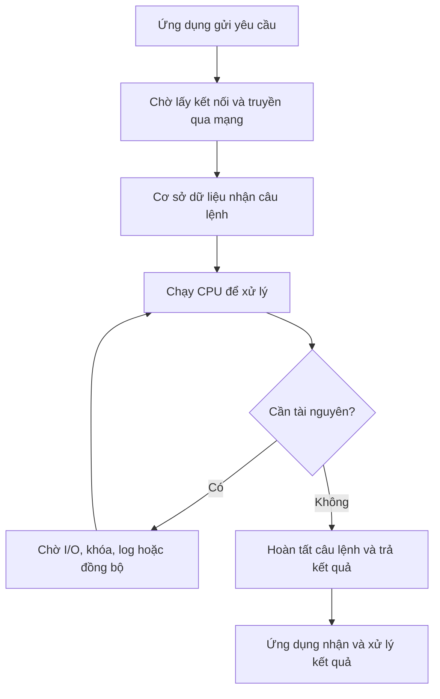

# Thời gian CPU, thời gian chờ và thời gian thực thi toàn trình

Khi một câu lệnh SQL chạy chậm, chỉ nhìn vào thời gian thực thi sẽ cho biết người dùng phải đợi bao lâu, nhưng chưa giải thích được vì sao. Câu lệnh có thể tiêu tốn nhiều CPU để xử lý dữ liệu, có thể nằm chờ đọc dữ liệu hoặc chờ khóa giao dịch, cũng có thể hoàn tất nhanh trong cơ sở dữ liệu nhưng mất thêm thời gian trên đường truyền về ứng dụng. Ba đại lượng **thời gian CPU**, **thời gian chờ** và **thời gian thực thi toàn trình** giúp tách các tình huống đó.

Mục tiêu của việc đo là xác định phần thời gian nào đang chi phối độ trễ, liên hệ nó với kế hoạch thực thi và tải hệ thống, rồi kiểm chứng thay đổi bằng cùng một cách đo. Không nên tối ưu một con số riêng lẻ mà bỏ qua độ trễ người dùng, thông lượng và mức tiêu thụ tài nguyên của toàn bộ tải.

## 1. Phân biệt ba loại thời gian

### Thời gian thực thi toàn trình (elapsed time)

Thời gian thực thi toàn trình, thường gọi là *elapsed time* hoặc *wall-clock time*, là khoảng thời gian thực tế trôi qua giữa hai mốc đo:

```text
elapsed_time = thời điểm kết thúc - thời điểm bắt đầu
```

Đây là đại lượng gần nhất với câu hỏi “một yêu cầu mất bao lâu?”. Tuy nhiên, kết quả phụ thuộc vào vị trí đặt hai mốc đo.

- **Ở phía ứng dụng:** thời gian có thể bao gồm chờ lấy kết nối từ connection pool, truyền yêu cầu qua mạng, thực thi tại máy chủ, truyền các dòng kết quả về và xử lý kết quả trong ứng dụng.
- **Ở phía cơ sở dữ liệu:** thời gian thường bắt đầu khi máy chủ nhận hoặc bắt đầu xử lý câu lệnh và kết thúc khi câu lệnh hoàn tất theo cách đo của hệ quản trị. Nó có thể không bao gồm thời gian chờ lấy kết nối ở ứng dụng hoặc thời gian ứng dụng xử lý dữ liệu sau khi nhận.

Vì vậy, khi so sánh hai báo cáo, cần xác nhận chúng đo cùng một phạm vi. Một câu lệnh có `elapsed time` phía máy chủ thấp vẫn có thể tạo ra độ trễ cao ở người dùng nếu ứng dụng phải chờ connection pool, mạng chậm hoặc đọc một tập kết quả lớn.

### Thời gian CPU (CPU time)

Thời gian CPU là tổng thời gian bộ xử lý thực sự chạy mã để phục vụ công việc đang đo. Trên hệ điều hành, số liệu CPU thường được chia thành thời gian chạy mã người dùng (*user time*) và thời gian chạy trong nhân hệ điều hành (*system time*). Công cụ của từng hệ quản trị có thể định nghĩa và thu thập số liệu ở mức khác nhau, vì vậy phải đọc đúng ý nghĩa của trường đo.

CPU time phản ánh chi phí tính toán, không phải thời gian người dùng phải chờ. Một truy vấn có thể tiêu tốn nhiều CPU vì quét và lọc nhiều dòng, nối các tập dữ liệu lớn, sắp xếp, tính biểu thức phức tạp hoặc thực hiện quá nhiều lần lặp trong kế hoạch thực thi.

Với truy vấn chạy song song, CPU time thường là tổng CPU mà các worker đã sử dụng. Do đó, CPU time có thể lớn hơn elapsed time. Ví dụ, bốn worker cùng chạy trong khoảng một giây có thể tiêu thụ gần bốn giây CPU cộng dồn. Đây không phải lỗi đo; đó là chi phí CPU trên nhiều lõi được cộng lại. Tỷ lệ CPU time trên elapsed time chỉ nên dùng như một ước lượng mức song song khi hai số liệu có cùng phạm vi và cách tính.

### Thời gian chờ (wait time)

Thời gian chờ là khoảng thời gian một tác vụ chưa thể tiếp tục vì đang đợi một tài nguyên hoặc sự kiện. Trong lúc chờ, tác vụ thường không sử dụng CPU để thực hiện công việc của chính nó. Một số nhóm chờ thường gặp:

| Nhóm chờ | Nguyên nhân thường gặp | Hướng điều tra |
|---|---|---|
| I/O dữ liệu | Đọc trang dữ liệu hoặc chỉ mục, đọc dữ liệu tạm | Số lần đọc, độ trễ lưu trữ, cache, kích thước dữ liệu và kế hoạch truy vấn |
| Khóa giao dịch (lock) | Giao dịch khác đang giữ khóa cần thiết | Phiên giữ khóa, thời lượng giao dịch, thứ tự cập nhật và mức tranh chấp |
| Chốt đồng bộ (latch) hoặc mutex | Các luồng tranh chấp cấu trúc nội bộ trong bộ nhớ | Mức đồng thời, điểm nóng và cấu trúc truy cập |
| Ghi log hoặc commit | Chờ ghi log giao dịch xuống vùng lưu trữ bền vững | Độ trễ ghi log, tần suất commit và tải ghi |
| Bộ nhớ và dữ liệu tạm | Không đủ bộ nhớ cho sort/hash, phải dùng vùng tạm | Kích thước sort/hash, số dòng trung gian, spill và cấu hình bộ nhớ |
| Mạng hoặc phía nhận kết quả | Chờ gửi dữ liệu hoặc chờ phía gọi tiêu thụ kết quả | Kích thước kết quả, tốc độ mạng và cách ứng dụng đọc dữ liệu |
| Lập lịch CPU hoặc đồng bộ song song | Luồng sẵn sàng nhưng chưa được cấp CPU, hoặc chờ worker khác | Mức sử dụng CPU toàn máy, hàng đợi chạy và cấu hình song song |

Tên wait event cụ thể phụ thuộc hệ quản trị và phiên bản. Cần xem loại sự kiện cùng ngữ cảnh của nó; không thể kết luận chỉ từ một tên sự kiện rời rạc.

**Không phải mọi tổng thời gian chờ đều cộng trực tiếp được với elapsed time.** Nếu nhiều worker chờ đồng thời, tổng wait time cộng dồn có thể lớn hơn thời gian thực tế trôi qua. Một số công cụ chỉ ghi nhận một phần các loại chờ; một số loại thời gian có thể chồng lấp. Vì vậy, công thức `elapsed = CPU + wait` chỉ là mô hình trực quan cho một tác vụ tuần tự với các khoảng đo không chồng lấp, không phải đẳng thức đúng cho mọi hệ quản trị.

### Ba đại lượng xuất hiện trong vòng đời yêu cầu

Một yêu cầu thường luân phiên giữa chạy CPU và chờ tài nguyên. Nếu đo ở ứng dụng, phạm vi còn có thể bao gồm các bước trước và sau khi cơ sở dữ liệu thực thi:



Sơ đồ mô tả các giai đoạn có thể xuất hiện, không khẳng định mọi yêu cầu đều đi qua tất cả loại chờ. Một truy vấn đơn giản có thể gần như chỉ chạy CPU; một truy vấn khác có thể luân phiên nhiều lần giữa CPU và I/O.

## 2. Đo đúng phạm vi và đúng thời điểm

Trước khi đọc số liệu, hãy xác định rõ bốn điều:

1. **Đối tượng đo:** một lần chạy câu lệnh, một transaction, một session, một nhóm truy vấn hay toàn máy chủ.
2. **Ranh giới thời gian:** đo từ ứng dụng gửi yêu cầu, từ lúc máy chủ nhận câu lệnh hay từ lúc bắt đầu một operator trong execution plan.
3. **Khoảng lấy mẫu:** một lần chạy riêng lẻ hay thống kê trong một khoảng tải. Số liệu tích lũy phải được lấy chênh lệch giữa hai thời điểm nếu muốn biết mức phát sinh trong khoảng đó.
4. **Điều kiện tải:** tham số truy vấn, số kết nối đồng thời, trạng thái cache, dữ liệu và cấu hình phải đủ tương đồng để so sánh.

Với thống kê tích lũy, ví dụ tổng CPU hoặc tổng thời gian thực thi kể từ lần khởi động hay reset thống kê, không được đọc giá trị hiện tại như thể đó là chi phí của một truy vấn vừa chạy. Có thể lấy snapshot trước và sau khoảng đo rồi tính hiệu. Cần ghi lại thời điểm reset và tránh reset thống kê dùng chung trên môi trường sản xuất chỉ để phục vụ một phép thử.

### Dùng số liệu ở cấp truy vấn

Ở PostgreSQL, `EXPLAIN ANALYZE` cho biết thời gian thực tế và số dòng tại các nút của kế hoạch thực thi. Có thể kết hợp với `BUFFERS` để xem hoạt động bộ đệm:

```sql
EXPLAIN (ANALYZE, BUFFERS, WAL, SETTINGS)
SELECT customer_id, COUNT(*)
FROM orders
WHERE created_at >= TIMESTAMP '2026-01-01 00:00:00'
GROUP BY customer_id;
```

Các phần thường cần đọc:

- `Planning Time` là thời gian lập kế hoạch; `Execution Time` là thời gian thực thi theo cách đo của PostgreSQL. Hai số liệu này giúp phân biệt chi phí lập kế hoạch với chi phí chạy câu lệnh.
- `actual time`, `actual rows` và `loops` cho biết thời gian, số dòng thực tế và số lần một nút được thực hiện. Khi `loops` lớn, một nút có vẻ rẻ trong một lần chạy vẫn có thể tạo chi phí lớn do bị lặp nhiều lần.
- `Rows Removed by Filter` cho thấy số dòng bị loại sau khi đọc hoặc xử lý ở nút đó. Số lượng lớn có thể gợi ý điều kiện lọc chưa được áp dụng sớm hoặc kế hoạch phải xử lý nhiều dữ liệu không cần thiết.
- `Buffers: shared hit` biểu thị trang được tìm thấy trong shared buffers; `shared read` biểu thị trang được đọc vào shared buffers. Một lần `shared read` không nhất thiết đồng nghĩa với một lần đọc vật lý từ thiết bị lưu trữ, vì hệ điều hành có thể phục vụ dữ liệu từ page cache.
- Thời gian I/O chỉ xuất hiện khi cấu hình theo dõi I/O phù hợp được bật. Hãy xác nhận cấu hình và phiên bản trước khi kết luận rằng không có số liệu nghĩa là không có I/O.

`EXPLAIN ANALYZE` thực sự chạy câu lệnh. Khi phân tích câu lệnh ghi dữ liệu, nên dùng môi trường thử nghiệm hoặc quy trình giao dịch đã kiểm soát. `ROLLBACK` không hoàn tác mọi tác động ngoài giao dịch, chẳng hạn một số tác động từ sequence hoặc lời gọi ra hệ thống bên ngoài.

### Dùng thống kê tổng hợp và trạng thái chờ

Nếu đã cài và bật `pg_stat_statements`, có thể tìm những mẫu câu lệnh đóng góp nhiều thời gian thực thi nhất:

```sql
SELECT queryid,
       calls,
       total_exec_time,
       mean_exec_time,
       rows
FROM pg_stat_statements
ORDER BY total_exec_time DESC
LIMIT 10;
```

`total_exec_time` giúp tìm nhóm truy vấn có tổng chi phí lớn; `mean_exec_time` cho biết thời gian trung bình mỗi lần gọi. Cần xem cả hai: một truy vấn mất ít thời gian nhưng được gọi hàng trăm nghìn lần có thể tiêu thụ tổng tài nguyên lớn hơn một truy vấn chạy lâu nhưng hiếm khi xuất hiện. Thống kê này là dữ liệu tổng hợp theo mẫu câu lệnh và khoảng thống kê, không cung cấp trực tiếp phân vị p95 hoặc p99.

Để xem các truy vấn đang hoạt động và sự kiện chờ hiện tại, PostgreSQL cung cấp `pg_stat_activity`:

```sql
SELECT pid,
       wait_event_type,
       wait_event,
       state,
       clock_timestamp() - query_start AS elapsed,
       LEFT(query, 120) AS query_sample
FROM pg_stat_activity
WHERE state = 'active'
ORDER BY query_start;
```

`wait_event_type` và `wait_event` cho biết một backend đang chờ sự kiện nào tại thời điểm quan sát. Giá trị rỗng thường có nghĩa là backend không được ghi nhận đang chờ ở thời điểm lấy mẫu; nó có thể đang chạy CPU hoặc ở trạng thái khác. Đây là ảnh chụp trạng thái hiện tại, không phải lịch sử đầy đủ của toàn bộ thời gian câu lệnh đã chạy. Muốn hiểu phân bố chờ theo thời gian, cần lấy mẫu có chu kỳ hoặc dùng công cụ thống kê phù hợp.

Ở hệ quản trị khác, tên công cụ thay đổi nhưng nguyên tắc tương tự:

| Hệ quản trị | Nguồn số liệu thường dùng | Thông tin cần đối chiếu |
|---|---|---|
| MySQL | Performance Schema, các bảng tổng hợp statement và wait event, `EXPLAIN ANALYZE` ở phiên bản hỗ trợ | Thời gian statement, số dòng đọc/trả về, thời gian chờ, sort và bảng tạm |
| SQL Server | `SET STATISTICS TIME ON`, `SET STATISTICS IO ON`, Query Store và wait statistics | CPU time, elapsed time, logical reads, kế hoạch và nhóm wait |
| Oracle Database | Thống kê câu lệnh trong `V$SQL`, thông tin session/event và công cụ theo dõi SQL phù hợp | CPU time, elapsed time, số lần thực thi, I/O và sự kiện chờ |

Tên cột, quyền truy cập và khả năng thu thập phụ thuộc phiên bản, cấu hình và quyền của tài khoản. Hãy kiểm tra tài liệu đúng phiên bản trước khi xây dựng truy vấn giám sát cố định.

## 3. Đọc kết hợp CPU, wait và elapsed

Không có một ngưỡng CPU hoặc wait áp dụng cho mọi cơ sở dữ liệu. Hãy so sánh với đường cơ sở của chính workload, mức tải dự kiến và mục tiêu độ trễ. Bảng sau giúp định hướng bước điều tra tiếp theo:

| Dấu hiệu | Cách diễn giải ban đầu | Việc nên kiểm tra |
|---|---|---|
| Elapsed cao, CPU cao, wait thấp | Truy vấn có thể bị giới hạn bởi tính toán hoặc xử lý quá nhiều dòng | Execution plan, số dòng thực tế, số vòng lặp, phép join, sort, biểu thức và mức song song |
| Elapsed cao, CPU thấp, wait cao | Truy vấn dành nhiều thời gian chờ tài nguyên | Phân loại wait event; kiểm tra I/O, khóa, log, bộ nhớ, mạng hoặc đồng bộ |
| CPU cao và CPU time cộng dồn lớn hơn elapsed | Có thể đang dùng nhiều worker song song | Số worker, mức tiêu thụ CPU toàn máy, hiệu quả song song và tác động tới truy vấn khác |
| Thời gian phía ứng dụng cao nhưng elapsed phía máy chủ thấp | Phần chậm có thể nằm ngoài thời gian thực thi câu lệnh | Connection pool, mạng, thời gian gửi/đọc kết quả và xử lý ở ứng dụng |
| Trung bình thấp nhưng p95/p99 cao | Một nhóm nhỏ yêu cầu bị chậm, thường bị che khuất bởi giá trị trung bình | Truy vấn ngoại lệ, tham số đặc biệt, khóa, tải đột biến và hàng đợi kết nối |

### Khi CPU chi phối

Nếu CPU time chiếm phần lớn thời gian của một truy vấn tuần tự, hãy kiểm tra xem kế hoạch có xử lý nhiều dòng hơn mức cần thiết hay không. Một số dấu hiệu thường gặp là quét bảng lớn, nested loop lặp quá nhiều lần, sort hoặc hash trên tập dữ liệu lớn, ước lượng cardinality sai và hàm được gọi trên từng dòng.

Hướng cải thiện có thể gồm tạo hoặc điều chỉnh chỉ mục phù hợp với điều kiện lọc và thứ tự truy cập, viết lại điều kiện để hệ quản trị có thể dùng chỉ mục, giảm số cột và số dòng phải đọc, hoặc điều chỉnh cách join. Không nên thêm chỉ mục chỉ vì thấy CPU cao: cần xác nhận bằng execution plan và đo chi phí ghi, dung lượng lưu trữ cũng như tác động tới các truy vấn khác.

### Khi thời gian chờ chi phối

Nếu CPU thấp nhưng elapsed cao, hãy phân rã wait time theo sự kiện. Chờ I/O kéo dài có thể liên quan tới truy vấn đọc quá nhiều trang, cache không phù hợp hoặc độ trễ lưu trữ. Chờ lock thường yêu cầu tìm phiên đang giữ khóa, câu lệnh gây tranh chấp và giao dịch giữ khóa quá lâu. Chờ log có thể liên quan tới tải ghi hoặc độ trễ vùng lưu trữ log. Chờ mạng hoặc phía client có thể xuất hiện khi kết quả lớn hoặc ứng dụng đọc từng dòng quá chậm.

Không nên xử lý mọi wait bằng cách tăng tài nguyên. Ví dụ, tăng bộ nhớ không giải quyết được giao dịch giữ khóa lâu; thêm chỉ mục không sửa được hàng đợi connection pool; tăng số worker có thể làm CPU bão hòa và khiến workload khác chậm hơn. Hãy xác định sự kiện cụ thể và tác nhân gây ra nó trước khi thay đổi cấu hình.

## 4. Ví dụ phân tích một truy vấn chậm

Giả sử một lần gọi API có các số liệu minh họa sau:

| Số liệu | Giá trị |
|---|---:|
| Thời gian từ ứng dụng gửi đến khi nhận xong kết quả | 2,3 giây |
| Elapsed time phía cơ sở dữ liệu | 1,9 giây |
| CPU time của câu lệnh | 0,32 giây |
| Wait time I/O được ghi nhận | 0,95 giây |
| Wait time lock được ghi nhận | 0,40 giây |

Các số liệu này gợi ý câu lệnh không bị chi phối chủ yếu bởi tính toán CPU. I/O và lock chiếm phần đáng kể trong các khoảng chờ được ghi nhận. Chênh lệch 0,4 giây giữa thời gian ứng dụng và thời gian phía máy chủ cũng cho thấy cần kiểm tra connection pool, mạng và việc ứng dụng tiêu thụ kết quả. Không được mặc định cộng các wait time để suy ra chính xác phần còn lại của elapsed time nếu chưa xác nhận cách công cụ cộng dồn và khả năng chồng lấp các khoảng chờ.

Quy trình điều tra hợp lý là:

1. Đọc execution plan để xác định nút nào đọc nhiều trang, xử lý nhiều dòng hoặc lặp nhiều lần. Đối chiếu `BUFFERS` và số dòng thực tế với ước lượng của optimizer.
2. Xem wait event I/O để biết truy vấn đang chờ đọc dữ liệu, đọc dữ liệu tạm hay một loại thao tác I/O khác. Kiểm tra độ trễ lưu trữ và mức tải I/O cùng thời điểm.
3. Xác định phiên giữ khóa và câu lệnh đang bị chặn. Xem giao dịch giữ khóa bắt đầu từ khi nào, có giữ transaction mở trong lúc chờ ứng dụng hay không, và có thể rút ngắn vùng cập nhật hay không.
4. Đo riêng thời gian lấy kết nối và thời gian đọc hết kết quả ở ứng dụng để giải thích phần chênh lệch ngoài máy chủ.
5. Đưa ra một giả thuyết có thể kiểm chứng, thay đổi một yếu tố, rồi chạy lại cùng tham số và điều kiện tải.

Nếu plan cho thấy quét quá nhiều dữ liệu, có thể thử chỉ mục phù hợp hoặc giảm tập dữ liệu cần xử lý. Nếu lock wait là nguyên nhân chính, ưu tiên giảm thời gian giữ khóa, rút ngắn transaction hoặc sắp xếp thao tác cập nhật nhất quán để giảm tranh chấp. Sau mỗi thay đổi, phải kiểm tra cả chi phí ghi và các truy vấn liên quan để chắc chắn cải thiện không chuyển nút thắt sang nơi khác.

## 5. Xây dựng mục tiêu hiệu năng từ số liệu

Mục tiêu cần phản ánh trải nghiệm và năng lực phục vụ của hệ thống. Có thể theo dõi các chỉ số sau theo từng nhóm workload:

| Chỉ số | Câu hỏi cần trả lời |
|---|---|
| Elapsed time p50, p95, p99 | Phần lớn yêu cầu và các yêu cầu chậm ở đuôi phân phối mất bao lâu? |
| Throughput (yêu cầu hoặc transaction mỗi giây) | Hệ thống phục vụ được bao nhiêu công việc ở mức tải đã cam kết? |
| CPU time trên mỗi lần gọi hoặc transaction | Chi phí CPU cho một đơn vị công việc có tăng theo thời gian không? |
| Wait time theo loại sự kiện | Tài nguyên nào đang giới hạn tốc độ xử lý? |
| Logical reads, physical reads và dữ liệu tạm | Truy vấn phải duyệt bao nhiêu dữ liệu và có spill ra vùng tạm không? |
| Lock wait và deadlock | Mức tranh chấp giao dịch có ảnh hưởng tới độ trễ và tính ổn định không? |
| CPU, bộ nhớ, IOPS và độ trễ lưu trữ ở cấp máy chủ | Hệ thống còn đủ dư địa khi tải tăng hoặc có đỉnh tải không? |

Không nên đặt một con số chung như “mọi truy vấn phải dưới 100 ms” nếu chưa phân loại workload. Truy vấn tra cứu một bản ghi, báo cáo tổng hợp và tác vụ nền có đặc điểm khác nhau. Hãy xác định SLO theo hành trình nghiệp vụ, chẳng hạn p95 của thao tác tra cứu dưới một giới hạn đã thống nhất ở mức tải đỉnh, đồng thời duy trì thông lượng và tỷ lệ lỗi mục tiêu.

Khi tối ưu, cần theo dõi đồng thời độ trễ và chi phí tài nguyên. Một thay đổi làm một truy vấn nhanh hơn nhưng tăng CPU tổng, tăng lock contention hoặc làm giảm throughput của workload khác có thể khiến toàn hệ thống kém ổn định hơn. Mục tiêu là cải thiện kết quả của workload trong điều kiện tải thực tế.

## 6. Quy trình đo và kiểm chứng sau điều chỉnh

1. **Chọn workload và ranh giới đo.** Ghi rõ câu lệnh hoặc transaction, tham số đại diện, vị trí đo elapsed time và mục tiêu p95/p99 hoặc throughput.
2. **Lấy đường cơ sở.** Thu thập số liệu trong khoảng thời gian đủ đại diện cho tải bình thường và tải cao. Ghi nhận trạng thái cache, số kết nối đồng thời, phiên bản, cấu hình và thời điểm đo.
3. **Tìm nơi đóng góp nhiều chi phí.** Xem cả truy vấn có tổng thời gian cao lẫn truy vấn có độ trễ mỗi lần gọi cao. Phân biệt số liệu trung bình với phân vị và giá trị ngoại lệ.
4. **Kết hợp plan, wait và tài nguyên máy chủ.** Dùng execution plan để hiểu công việc SQL; dùng wait event để tìm tài nguyên bị chờ; đối chiếu CPU, bộ nhớ, I/O, log, mạng và khóa ở cùng khoảng thời gian.
5. **Đặt giả thuyết và thay đổi có kiểm soát.** Mỗi thay đổi phải gắn với một dấu hiệu đo được, chẳng hạn giảm số dòng phải đọc hoặc rút ngắn thời gian giữ khóa. Tránh thay nhiều cấu hình cùng lúc khiến không thể xác định nguyên nhân.
6. **Đo lại trong điều kiện tương đương.** Dùng cùng bộ tham số, dữ liệu, mức đồng thời và cách đo. So sánh p50/p95/p99, throughput, CPU trên mỗi transaction, wait event, I/O và tỷ lệ lỗi.
7. **Kiểm tra ảnh hưởng toàn hệ thống.** Chạy thêm workload liên quan và theo dõi đủ lâu để phát hiện thay đổi về tải ghi, dung lượng chỉ mục, lock contention, hàng đợi và mức sử dụng tài nguyên.

Một kết quả tối ưu đáng tin cậy phải có số liệu trước và sau, điều kiện thử nghiệm được ghi lại, và giải thích được vì sao thay đổi tạo ra kết quả đó. Nếu thời gian trung bình giảm nhưng p99 tăng, hoặc truy vấn nhanh hơn trong thử nghiệm đơn lẻ nhưng throughput giảm khi có nhiều người dùng, cần tiếp tục điều tra trước khi coi thay đổi là thành công.

## 7. Những sai lầm thường gặp

- **Chỉ xem elapsed time:** biết truy vấn chậm nhưng không biết CPU, I/O hay khóa là nguyên nhân.
- **Chỉ xem CPU của máy chủ:** CPU toàn máy không cho biết câu lệnh cụ thể đã tiêu thụ bao nhiêu CPU; ngược lại, CPU time cộng dồn của truy vấn song song có thể lớn hơn elapsed time.
- **Cộng mọi wait time rồi trừ khỏi elapsed:** các khoảng chờ có thể chồng lấp hoặc được cộng dồn trên nhiều worker.
- **Dùng trung bình thay cho phân vị:** một số ít yêu cầu rất chậm có thể làm hỏng trải nghiệm dù mean vẫn thấp.
- **Đọc bộ đếm tích lũy như số liệu của một lần chạy:** luôn kiểm tra đơn vị, phạm vi và khoảng thời gian của bộ đếm.
- **So sánh hai lần đo với điều kiện khác nhau:** cache, tham số, dữ liệu, số kết nối và tải nền đều có thể làm thay đổi kết quả.
- **Tối ưu một câu lệnh mà không kiểm tra workload:** chỉ mục mới có thể làm truy vấn đọc nhanh hơn nhưng khiến thao tác ghi tốn kém hơn và tăng cạnh tranh tài nguyên.
- **Chạy `EXPLAIN ANALYZE` trên câu lệnh ghi mà không kiểm soát tác động:** lệnh này thực thi câu lệnh được phân tích và có thể tạo thay đổi dữ liệu thật.

## 8. Checklist khi đọc một báo cáo hiệu năng

- [ ] Đã xác định elapsed time đo ở ứng dụng hay ở máy chủ cơ sở dữ liệu.
- [ ] CPU time và wait time thuộc cùng câu lệnh, session hoặc khoảng đo cần phân tích.
- [ ] Đã kiểm tra đơn vị, bộ đếm tích lũy và cách tính thời gian chờ của công cụ.
- [ ] Đã xem p50, p95, p99 cùng throughput thay vì chỉ xem trung bình.
- [ ] Đã đối chiếu execution plan với số dòng thực tế, số vòng lặp và hoạt động I/O.
- [ ] Đã phân loại wait event và xác định tài nguyên hoặc phiên liên quan.
- [ ] Đã kiểm tra ảnh hưởng của thay đổi lên các truy vấn, transaction và workload khác.
- [ ] Đã đo lại trong điều kiện tương đương và lưu lại kết quả trước/sau.

Khi ba loại thời gian được đo cùng một phạm vi và đọc trong bối cảnh tải thực tế, chúng tạo thành cơ sở để phân biệt truy vấn bị giới hạn bởi CPU, bị chặn bởi tài nguyên hay chậm ở bên ngoài máy chủ cơ sở dữ liệu. Từ đó, nhóm vận hành có thể chọn đúng điểm cần điều tra và xác nhận cải thiện bằng dữ liệu có thể lặp lại.
