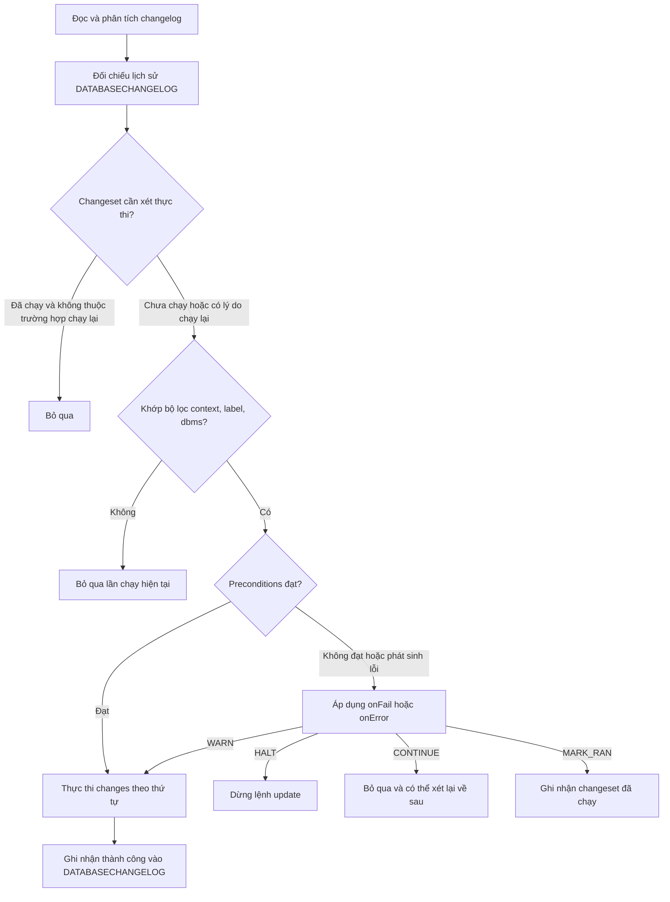

# Vai trò của preconditions và khác biệt với bộ lọc

Khi triển khai migration bằng Liquibase, không phải cứ có một changeset trong changelog thì Liquibase sẽ chạy các câu lệnh của nó. Trước khi thực thi, Liquibase phải quyết định **changeset có thuộc phạm vi triển khai hay không** và **database hiện tại có đáp ứng điều kiện an toàn để thực hiện thay đổi hay không**. Hai câu hỏi này tương ứng với hai nhóm cơ chế thường bị nhầm lẫn:

- **Bộ lọc (filters)** như context, label và DBMS chọn những changeset phù hợp với lần triển khai.
- **Preconditions (tiền điều kiện)** kiểm tra một giả định cụ thể về môi trường hoặc trạng thái database; khi điều kiện không đạt hay khi kiểm tra lỗi, Liquibase xử lý theo chính sách đã khai báo.

Bài Knowledge thuộc chương **Tiền điều kiện** của `DATABASE_SCHEMA_MIGRATION_LIQUIBASE`. Phạm vi module là quản lý thay đổi schema và dữ liệu bằng changelog, changeset, precondition, checksum và lịch sử triển khai; thực hành migration có kiểm chứng, rollback, phối hợp nhiều môi trường và tích hợp Spring Boot hoặc CI/CD. Mục tiêu trực tiếp của bài này là giúp thiết kế precondition đúng chỗ, phân biệt nó với bộ lọc và dự đoán hậu quả của từng cách xử lý khi điều kiện không thỏa mãn.

## 1. Phân biệt bằng hai câu hỏi

Xét changeset `create-payment-index` chỉ dành cho PostgreSQL trong đợt phát hành sản phẩm. Nhóm cần kiểm tra bảng `payment` tồn tại trước khi tạo index.

**Câu hỏi 1 — Có chọn changeset này cho lần triển khai không?** Bộ lọc trả lời câu hỏi này bằng thông tin như `contextFilter="production"`, `labels="release-2026-11"` hoặc `dbms="postgresql"`. Khi changeset không khớp phạm vi được chọn, Liquibase thường bỏ qua nó trong lần `update` hiện tại.

**Câu hỏi 2 — Nếu được chọn, có an toàn hoặc hợp lệ để chạy không?** Precondition `tableExists` kiểm tra bảng `payment` trong database đích. Nếu bảng không tồn tại, Liquibase thực hiện `onFail`, chẳng hạn dừng triển khai bằng `HALT`.

Hai cơ chế có thể dùng cùng nhau. Bộ lọc giúp áp dụng đúng tập changeset; precondition xác nhận giả định mà **change** sắp thực hiện phụ thuộc vào.

| Tiêu chí | Bộ lọc context/label/dbms | Precondition |
|---|---|---|
| Mục tiêu | Chọn phạm vi changeset của lần chạy. | Kiểm tra trạng thái hoặc điều kiện cần thiết trước khi thực thi. |
| Trả lời câu hỏi | “Changeset này có thuộc đợt chạy không?” | “Database/điều kiện hiện tại có phù hợp không?” |
| Dữ liệu đầu vào | Metadata của changeset và cấu hình chạy; DBMS filter dựa vào loại database. | Metadata, database thực tế, kết quả SQL hoặc điều kiện tích hợp. |
| Ví dụ | Context `production`, label `release-a`, `dbms="postgresql"`. | `tableExists`, `columnExists`, `sqlCheck`, `changeSetExecuted`. |
| Khi không khớp | Thông thường không chọn changeset để thực thi trong lần chạy. | Áp dụng `onFail` hoặc `onError`: dừng, cảnh báo, bỏ qua tạm thời hoặc đánh dấu đã chạy tùy phạm vi và cấu hình. |
| Tác động lên `DATABASECHANGELOG` | Changeset mới bị lọc ra thường không có bản ghi thực thi mới. | `MARK_RAN` có thể tạo bản ghi đã chạy dù change không thực thi; `CONTINUE` thường để lại changeset chưa chạy. |
| Dùng để kiểm tra bảng/cột đang tồn tại? | Không. | Có; đây là một nhiệm vụ điển hình. |
| Có thay thế cho kiểm tra checksum và lịch sử? | Không. | Không. |

## 2. Vị trí của precondition trong mô hình thực thi

Luồng xử lý khái quát của `liquibase update`:



Sơ đồ mô tả mục đích và kết quả. Liquibase có thêm các bước validation, checksum, lấy/giải phóng `DATABASECHANGELOGLOCK`, đọc metadata và kiểm tra thay đổi; thứ tự nội bộ cụ thể có thể khác theo phiên bản. Precondition cấp changelog có thể được xử lý ở phạm vi toàn changelog, không nhất thiết chỉ xuất hiện trong nhánh của từng changeset như sơ đồ.

Một changeset đã chạy thành công và không được thiết kế để chạy lại (`runAlways`, `runOnChange`) thường không cần đánh giá precondition để chạy lần thứ hai. Vì vậy, **thêm precondition mới vào một changeset đã phát hành không phải cách chắc chắn để kiểm tra lại schema ở mọi lần update**, và còn có thể tác động đến checksum hoặc validation. Nếu muốn xác minh schema trước một migration mới, hãy tạo changeset mới với precondition tương ứng.

## 3. Cấu trúc precondition ở hai phạm vi

### 3.1. Cấp changeset

Precondition đặt bên trong một `changeSet` bảo vệ những thay đổi của changeset đó. Đây là phạm vi thường dùng để bảo vệ một thao tác DDL hoặc DML cụ thể.

Ví dụ XML:

```xml
<changeSet id="2026-11-create-order-index" author="db-team">
    <preConditions onFail="HALT" onError="HALT">
        <tableExists tableName="customer_order"/>
        <not>
            <indexExists tableName="customer_order"
                         indexName="idx_customer_order_customer_id"/>
        </not>
    </preConditions>

    <createIndex tableName="customer_order"
                 indexName="idx_customer_order_customer_id">
        <column name="customer_id"/>
    </createIndex>

    <rollback>
        <dropIndex tableName="customer_order"
                   indexName="idx_customer_order_customer_id"/>
    </rollback>
</changeSet>
```

Đây là **đoạn nằm trong** `databaseChangeLog` XML, không phải tài liệu XML hoàn chỉnh. Liquibase kiểm tra bảng `customer_order` phải tồn tại và index mang tên đã chọn chưa tồn tại. Nếu cả hai điều kiện đạt, change `createIndex` mới được chạy. Nếu có bất kỳ điều kiện nào thất bại, `onFail="HALT"` khiến migration dừng để người vận hành điều tra.

### 3.2. Cấp changelog

Precondition đặt trực tiếp trong `databaseChangeLog` kiểm tra điều kiện chung đối với luồng changelog, ví dụ yêu cầu database thuộc họ PostgreSQL hoặc tài khoản chạy migration thỏa chính sách truy cập. Khi điều kiện chung không đạt, không nên cho các changeset trong phạm vi này chạy tiếp.

Ví dụ khung XML:

```xml
<?xml version="1.0" encoding="UTF-8"?>
<databaseChangeLog
    xmlns="http://www.liquibase.org/xml/ns/dbchangelog"
    xmlns:xsi="http://www.w3.org/2001/XMLSchema-instance"
    xsi:schemaLocation="http://www.liquibase.org/xml/ns/dbchangelog
                        https://www.liquibase.org/xml/ns/dbchangelog/dbchangelog-latest.xsd">

    <preConditions onFail="HALT" onError="HALT">
        <dbms type="postgresql"/>
    </preConditions>

    <changeSet id="2026-11-create-example" author="db-team">
        <createTable tableName="example_guarded">
            <column name="id" type="BIGINT">
                <constraints primaryKey="true" nullable="false"/>
            </column>
        </createTable>
    </changeSet>
</databaseChangeLog>
```

Đây là kiểm tra **cả changelog** được thiết kế cho PostgreSQL. Các chính sách `CONTINUE` và `MARK_RAN` là hành vi gắn với **precondition cấp changeset**; không đặt chúng bừa vào cấp changelog. Một số phiên bản/tích hợp có ràng buộc thêm với loại precondition hoặc thuộc tính được hỗ trợ, nên luôn kiểm tra bằng đúng Liquibase của dự án.

### 3.3. Tại sao cần chọn đúng phạm vi?

Giả sử changelog chứa 20 changeset, chỉ một changeset dùng tính năng PostgreSQL chuyên biệt. Nếu đặt kiểm tra DBMS ở đầu changelog rồi `HALT` trên MySQL, **toàn bộ changelog** sẽ bị dừng, kể cả 19 changeset độc lập. Khi đó, dùng `dbms="postgresql"` làm bộ lọc riêng cho changeset đặc thù có thể phù hợp hơn; nếu changeset được chọn mà còn cần kiểm tra một đối tượng database, đặt precondition bên trong chính changeset đó.

Ngược lại, nếu module chỉ hỗ trợ PostgreSQL và mọi changeset đều phụ thuộc vào nó, precondition cấp changelog có thể diễn đạt một bất biến chung rõ ràng.

## 4. Các nhóm precondition thường gặp

Precondition có thể kiểm tra metadata, thông tin môi trường, lịch sử changeset hoặc kết quả truy vấn SQL.

| Precondition | Câu hỏi cần trả lời | Lưu ý khi dùng |
|---|---|---|
| `dbms` | Database thuộc loại nào? | Dùng khi cần **dừng có lý do** nếu sai DBMS; nếu chỉ cần chọn changeset tương thích, cân nhắc DBMS filter. |
| `runningAs` | Tài khoản kết nối có đúng user yêu cầu? | Tên user và cách so khớp có thể phụ thuộc DBMS. |
| `tableExists` | Bảng đích đã tồn tại chưa? | Kiểm tra đúng schema/catalog nếu có nhiều schema. |
| `columnExists` | Cột đã có trong bảng chưa? | Giúp bảo vệ các bước thêm cột; không đảm bảo kiểu, constraint của cột đúng. |
| `indexExists` | Index có tồn tại không? | Tên và đặc điểm index có thể phụ thuộc quy tắc của DBMS. |
| `foreignKeyConstraintExists` | Foreign key đã được tạo chưa? | Xác định đúng tên constraint và bảng liên quan. |
| `primaryKeyExists` | Bảng đã có primary key chưa? | Sự tồn tại của PK chưa nói lên cấu trúc key đúng mong đợi. |
| `sequenceExists` | Sequence đã tồn tại chưa? | Phù hợp DBMS dùng sequence. |
| `viewExists` | View đã tồn tại chưa? | Cần cân nhắc định nghĩa view có đúng phiên bản hiện tại hay không. |
| `changeSetExecuted` | Một changeset khác đã được ghi nhận thực thi? | Cần biết đúng `id`, `author` và đường dẫn changelog của changeset mục tiêu. |
| `sqlCheck` | Truy vấn SQL trả về đúng giá trị dự kiến? | Truy vấn cần trả **một giá trị vô hướng**; tránh truy vấn có side effect. |

Các loại precondition khả dụng và thuộc tính chi tiết khác nhau tùy phiên bản Liquibase và extension. Không suy đoán một loại kiểm tra chỉ từ tên gọi; nên đối chiếu reference của phiên bản đã khóa.

### 4.1. Kiểm tra tồn tại và kiểm tra nội dung không giống nhau

`tableExists` chỉ trả lời rằng bảng đã tồn tại trong database mục tiêu. Nó không khẳng định bảng có đúng cột, kiểu dữ liệu, ràng buộc hay dữ liệu phù hợp.

Ví dụ muốn thêm `NOT NULL` cho `customer.email`: chỉ kiểm tra bảng `customer` tồn tại là chưa đủ. Cần biết cột `email` tồn tại và không còn hàng nào có `NULL`; nếu có dữ liệu NULL, DDL thêm ràng buộc có thể thất bại.

### 4.2. Precondition ghép bằng AND, OR và NOT

Các precondition có thể được ghép logic:

- `and`: tất cả điều kiện con phải đạt.
- `or`: ít nhất một điều kiện con phải đạt.
- `not`: phủ định kết quả điều kiện con.

Khi nhiều precondition con xuất hiện cùng phạm vi, mục tiêu thường là chúng đều phải đạt. Để tài liệu dễ đọc và tránh phụ thuộc vào cách biểu diễn của định dạng, có thể khai báo `and` tường minh khi điều kiện phức tạp.

Ví dụ XML:

```xml
<preConditions onFail="HALT">
    <and>
        <tableExists tableName="customer"/>
        <columnExists tableName="customer" columnName="email"/>
        <not>
            <indexExists tableName="customer"
                         indexName="idx_customer_email"/>
        </not>
    </and>
</preConditions>
```

Tránh điều kiện lồng quá sâu mà không có lý do. Mỗi nhánh nên trả lời một giả định có thể giải thích được cho người vận hành.

## 5. Khi nào dùng filter, khi nào dùng precondition?

### 5.1. Context: phân loại mục đích hoặc môi trường

Ví dụ seed data chỉ dành cho môi trường phát triển:

```xml
<changeSet id="seed-demo-users" author="db-team"
           contextFilter="development">
    <insert tableName="demo_user">
        <column name="username" value="test-account"/>
    </insert>
</changeSet>
```

Khi cấu hình context filter của lần chạy không chọn `development`, changeset này được bỏ qua theo cơ chế lọc. Không cần dùng `tableExists` để suy ra đang ở môi trường development. Một database production vẫn có thể có bảng `demo_user`; sự tồn tại của bảng không phải dấu hiệu phân loại môi trường đáng tin cậy.

**Lưu ý:** trong một số phiên bản/cú pháp, nếu người chạy không cung cấp context filter, changeset có context vẫn có thể được xét chạy. Đối với thay đổi chỉ dành cho một môi trường, hãy dùng chính sách triển khai có context rõ ràng, kiểm tra SQL preview và cân nhắc cú pháp bắt buộc context (ví dụ `@` trong context expression nếu phiên bản hỗ trợ). Không dựa vào giả định rằng bỏ trống context luôn có nghĩa là không chạy.

### 5.2. Label: chọn một nhóm thay đổi theo phát hành

Ví dụ thay đổi dành cho một đợt phát hành:

```xml
<changeSet id="add-reporting-index" author="db-team"
           labels="reporting,release-42">
    <createIndex tableName="report_event" indexName="idx_report_event_time">
        <column name="created_at"/>
    </createIndex>
</changeSet>
```

Labels phục vụ việc nhóm và lựa chọn changeset. Một label `release-42` không kiểm tra xem bảng `report_event` có tồn tại thật hay không. Nếu change phụ thuộc bảng này, bổ sung precondition hoặc bảo đảm migration tạo bảng đứng trước trong cùng changelog.

### 5.3. DBMS filter: chọn SQL cho database phù hợp

Ví dụ một change dùng tính năng cụ thể của PostgreSQL:

```xml
<changeSet id="pg-special-index" author="db-team" dbms="postgresql">
    <sql>CREATE INDEX idx_event_payload_gin ON event_log USING gin (payload);</sql>
</changeSet>
```

`dbms="postgresql"` là bộ lọc: trên DBMS khác, changeset không được chọn để thực thi theo phạm vi này. Nếu cần chặn hẳn triển khai vì **toàn bộ module chỉ hỗ trợ PostgreSQL**, precondition `dbms` với `onFail="HALT"` ở cấp changelog thể hiện chính sách mạnh hơn.

### 5.4. Precondition: kiểm tra giả định database tại thời điểm chạy

Ví dụ muốn thêm index trên bảng có thể chưa được tạo trong một số trạng thái môi trường:

```xml
<changeSet id="add-customer-index" author="db-team">
    <preConditions onFail="HALT" onError="HALT">
        <tableExists tableName="customer"/>
    </preConditions>
    <createIndex tableName="customer" indexName="idx_customer_email">
        <column name="email"/>
    </createIndex>
</changeSet>
```

Precondition `tableExists` trả lời câu hỏi cụ thể: **bảng customer có tồn tại trên database đích không?** Nếu không, `HALT` dừng và báo sai lệch thay vì lặng lẽ bỏ qua một thay đổi quan trọng.

Không nên biến precondition thành một bộ lọc môi trường gián tiếp, ví dụ `sqlCheck` một biến dữ liệu có tên `isProduction` để quyết định có chạy hay không, khi context hoặc label đã diễn đạt chính xác phạm vi phát hành.

## 6. Chính sách khi điều kiện không đạt: onFail

Precondition có thể **đánh giá thành công nhưng trả kết quả false**. Đây là tình huống `onFail` xử lý. Nó khác với việc không chạy được truy vấn hoặc không đánh giá được điều kiện, vốn liên quan `onError`.

| Chính sách | Kết quả khi điều kiện thất bại | Ghi lịch sử changeset | Khi nào cân nhắc |
|---|---|---|---|
| `HALT` | Dừng lần triển khai với lỗi. | Không đánh dấu changeset đang lỗi là đã thực thi chỉ vì precondition thất bại. | Mặc định nên cân nhắc cho điều kiện bắt buộc, ví dụ bảng/cột/constraint phải tồn tại. |
| `WARN` | Ghi cảnh báo và tiếp tục xử lý theo ngữ nghĩa Liquibase. | Nếu change chạy thành công sau cảnh báo, lịch sử được ghi theo kết quả thực thi. | Điều kiện cảnh báo không mang tính chặn, đã được đánh giá rủi ro. |
| `CONTINUE` | Bỏ qua changeset hiện tại; lần chạy sau vẫn có thể xét lại. | Thường không tạo bản ghi `EXECUTED` cho changeset bị bỏ qua. | Bước thay đổi được phép hoãn khi điều kiện chưa đạt. |
| `MARK_RAN` | Không thực thi các change, nhưng ghi nhận changeset như đã chạy. | Ghi `EXECTYPE=MARK_RAN` vào `DATABASECHANGELOG`. | Chỉ khi đã xác minh database có trạng thái tương đương kết quả cần đạt. |

`CONTINUE` và `MARK_RAN` chỉ dùng cho precondition **cấp changeset**. `HALT` và `WARN` áp dụng trong phạm vi phù hợp theo tài liệu của phiên bản Liquibase. Tránh tự mặc định rằng `WARN` luôn là lựa chọn an toàn: nó có thể cho phép thực thi change khi điều kiện bảo vệ đã thất bại.

### 6.1. Ví dụ HALT — giả định bắt buộc

Nếu migration thêm foreign key yêu cầu bảng cha tồn tại, hãy dùng `HALT` để phát hiện lỗi thứ tự migration:

```xml
<preConditions onFail="HALT"
               onFailMessage="Khong tim thay bang parent_account">
    <tableExists tableName="parent_account"/>
</preConditions>
```

Thông báo tùy chỉnh giúp log rõ lý do. Việc precondition báo lỗi không thay thế việc xem log SQL và trạng thái database để xác định nguyên nhân thật.

### 6.2. Ví dụ CONTINUE — hoãn một thay đổi tùy chọn

Giả sử hệ thống có tính năng báo cáo chỉ được bật sau một migration khác; một changeset thêm index phục vụ báo cáo có thể được hoãn nếu bảng chưa có:

```xml
<changeSet id="optional-report-index" author="db-team">
    <preConditions onFail="CONTINUE">
        <tableExists tableName="report_event"/>
    </preConditions>
    <createIndex tableName="report_event" indexName="idx_report_event_created">
        <column name="created_at"/>
    </createIndex>
</changeSet>
```

Khi bảng không tồn tại, Liquibase bỏ qua changeset và có thể thử lại khi chạy `update` trong tương lai. Cách này chỉ phù hợp khi việc thiếu index không gây sai chức năng và không làm mất ràng buộc bắt buộc. Với migration quan trọng theo chuỗi, `HALT` thường giúp phát hiện sự cố sớm hơn.

### 6.3. Ví dụ MARK_RAN — chỉ khi hiệu ứng đã có sẵn

Một database được nhập từ hệ thống cũ có thể đã có sẵn bảng mà migration định tạo. Nếu đã **đối chiếu cấu trúc** và xác nhận bảng tương đương, nhóm có thể cân nhắc `MARK_RAN`:

```xml
<changeSet id="baseline-legacy-table" author="db-team">
    <preConditions onFail="MARK_RAN">
        <not>
            <tableExists tableName="legacy_customer"/>
        </not>
    </preConditions>
    <createTable tableName="legacy_customer">
        <column name="id" type="BIGINT">
            <constraints primaryKey="true" nullable="false"/>
        </column>
    </createTable>
</changeSet>
```

Ở đây, nếu bảng **đã tồn tại**, điều kiện `not(tableExists)` thất bại nên Liquibase đánh dấu changeset đã chạy mà không tạo lại bảng. Nhưng **tồn tại** không chứng minh bảng có khóa chính, kiểu dữ liệu, index hay dữ liệu đúng. Nếu chưa xác minh các đặc điểm cần thiết, `MARK_RAN` có thể che khuất khác biệt schema, khiến changeset sau thất bại. Trong nhiều quy trình, baseline có kiểm chứng hoặc kế hoạch đồng bộ riêng dễ kiểm toán hơn.

## 7. Phân biệt onFail và onError

Điều kiện `tableExists` trả về `false` khi không thấy bảng thường là **fail**, không phải lỗi đánh giá. Ngược lại, nếu kết nối database bị ngắt, quyền truy cập metadata không đủ hoặc câu SQL trong `sqlCheck` bị lỗi cú pháp, Liquibase có thể không đánh giá được điều kiện: đây là **error**.

Ví dụ:

```xml
<preConditions
    onFail="HALT"
    onError="HALT"
    onFailMessage="Du lieu chua san sang de thay doi schema"
    onErrorMessage="Khong the kiem tra dieu kien migration">
    <tableExists tableName="customer"/>
</preConditions>
```

Tách hai trường hợp giúp thiết kế thông điệp và xử lý sự cố:

| Tình huống | Phân loại thông thường | Hướng xử lý |
|---|---|---|
| Bảng chưa tồn tại và `tableExists` trả false | `onFail` | Kiểm tra thứ tự, schema, migration phụ thuộc. |
| Cột tồn tại trong điều kiện `not(columnExists)` | `onFail` | Xem cột có cùng định nghĩa mong muốn không. |
| `sqlCheck` trả `2` nhưng kỳ vọng `0` | `onFail` | Xử lý dữ liệu không đáp ứng bất biến. |
| Query trong `sqlCheck` tham chiếu tên cột không tồn tại | `onError` | Sửa SQL hoặc trạng thái schema mà query đang dựa vào. |
| Tài khoản migration không được đọc metadata | Có thể `onError` | Kiểm tra quyền và kết nối. |

Thông thường nên dùng `onError="HALT"` cho các kiểm tra an toàn schema. Bỏ qua lỗi kiểm tra bằng `WARN` có thể khiến DDL chạy trong lúc chưa biết điều kiện có thật sự đạt không.

## 8. Dùng sqlCheck để kiểm tra bất biến dữ liệu

Precondition dựa trên metadata không đủ để kiểm tra nội dung bảng. `sqlCheck` hữu ích khi điều kiện cần một truy vấn chính xác.

Ví dụ cần thêm ràng buộc `NOT NULL` cho cột `customer.email`, nhưng chỉ được làm nếu không còn giá trị NULL:

```xml
<changeSet id="enforce-customer-email-not-null" author="db-team">
    <preConditions onFail="HALT" onError="HALT">
        <tableExists tableName="customer"/>
        <columnExists tableName="customer" columnName="email"/>
        <sqlCheck expectedResult="0">
            SELECT COUNT(*) FROM customer WHERE email IS NULL
        </sqlCheck>
    </preConditions>
    <addNotNullConstraint tableName="customer"
                          columnName="email"
                          columnDataType="VARCHAR(255)"/>
</changeSet>
```

Điểm cần hiểu:

1. `tableExists` và `columnExists` bảo đảm đối tượng mà câu `sqlCheck` phụ thuộc vào đã tồn tại.
2. `SELECT COUNT(*)` trả một giá trị vô hướng; `expectedResult="0"` yêu cầu không có hàng `email IS NULL`.
3. Nếu số hàng NULL lớn hơn 0, điều kiện **không đạt** và `HALT` chặn việc thêm `NOT NULL`.
4. Nếu truy vấn không thể chạy do quyền truy cập hoặc lỗi SQL, `onError` chặn migration.
5. Ngay cả khi kiểm tra đạt, ứng dụng hoặc tiến trình khác có thể ghi dữ liệu sau thời điểm kiểm tra. Cần phối hợp transaction, khóa hoặc kế hoạch triển khai phù hợp với database. Precondition không loại trừ mọi race condition.

`sqlCheck` nên là câu truy vấn chỉ đọc, trả đúng một giá trị dễ so sánh. Tránh `SELECT *`, truy vấn trả nhiều hàng, câu SQL sửa dữ liệu hoặc thao tác quá nặng trên bảng production. Với dữ liệu lớn, hãy cân nhắc chi phí của `COUNT(*)` và chiến lược kiểm chứng tối ưu theo DBMS.

## 9. Preconditions không thay thế các cơ chế khác

### 9.1. Không thay thế lịch sử và checksum

Liquibase ghi định danh changeset bằng `id`, `author` và đường dẫn changelog; lưu thông tin thực thi trong `DATABASECHANGELOG`. Cơ chế checksum giúp phát hiện changeset đã triển khai bị thay đổi ngoài chính sách. Nếu di chuyển file hoặc sửa changeset cũ, precondition không tự sửa được định danh `FILENAME` hay checksum đã ghi.

Nếu Liquibase đột nhiên coi changeset cũ là mới sau khi đổi tên changelog, phải kiểm tra đường dẫn định danh và `logicalFilePath`. Không dùng `MARK_RAN` hàng loạt chỉ để che lỗi định danh.

### 9.2. Không mặc định tạo ra migration idempotent

Một change có precondition `not(tableExists)` có thể bỏ qua việc tạo bảng nếu bảng đã có, nhưng điều đó không chứng minh bảng đã có **đúng cấu trúc**. Idempotency nghiệp vụ cần kiểm tra các bất biến thật sự quan trọng và thiết kế thay đổi phù hợp.

### 9.3. Không bảo đảm rollback an toàn

Precondition trước `update` không phải cam kết rằng rollback có thể khôi phục đầy đủ trạng thái dữ liệu. Ví dụ rollback bằng `dropColumn` làm mất dữ liệu cột dù precondition ban đầu đã đạt. Cần khai báo rollback phù hợp và thử rollback trên database đại diện.

### 9.4. Không thay thế thứ tự migration

Nếu changeset B yêu cầu bảng do changeset A tạo, cách đúng là bảo đảm A đứng trước B. Việc thêm `onFail="CONTINUE"` để B âm thầm đợi A có thể che một lỗi thứ tự trong changelog. Precondition giúp chặn và giải thích lỗi nhưng không nên được dùng để thay thế thiết kế dependency.

## 10. Kiểm chứng precondition trước triển khai

Precondition kiểm tra **trạng thái tại thời điểm Liquibase đánh giá**, nên phải thử trên database đại diện, không chỉ đọc changelog.

Quy trình thực hành:

1. **Xác định mục tiêu changeset:** thay đổi cho môi trường nào, database nào và đợt phát hành nào?
2. **Chọn filter:** context, labels và DBMS filter theo đúng mục đích; khai báo bộ lọc ở changeset cần thiết.
3. **Liệt kê giả định:** bảng nào phải tồn tại, cột nào chưa được tạo, dữ liệu nào cần sạch?
4. **Chọn precondition:** dùng kiểm tra metadata khi đủ, dùng `sqlCheck` khi cần kiểm tra giá trị dữ liệu.
5. **Chọn phản ứng:** `HALT` cho bất biến bắt buộc, các lựa chọn khác chỉ khi hiểu hệ quả.
6. **Kiểm tra định dạng:** chạy `validate` trên changelog và dùng đúng Liquibase Core/extension/driver đã khóa.
7. **Xem changeset dự kiến:** chạy `status` và xem SQL dự kiến; bảo đảm filter không bỏ sót migration quan trọng.
8. **Thử trên database phù hợp:** tạo các trạng thái “điều kiện đạt”, “điều kiện fail” và “điều kiện lỗi” để xác minh kết quả.
9. **Kiểm tra lịch sử:** đối chiếu `DATABASECHANGELOG` để biết changeset được thực thi, bỏ qua hay ghi `MARK_RAN`.
10. **Phát hành có kiểm soát:** dùng cùng artifact changelog và version công cụ đã kiểm thử qua development, staging và production.

Ví dụ các lệnh CLI kiểm chứng (cần có cấu hình kết nối và credentials được cấp an toàn):

```bash
liquibase --changelog-file=db/changelog/master.xml validate
liquibase --changelog-file=db/changelog/master.xml status --verbose
liquibase --changelog-file=db/changelog/master.xml update-sql
```

Tên lệnh và tùy chọn có thể thay đổi theo phiên bản Liquibase; một số tài liệu hoặc bản cũ dùng dạng `updateSQL`. **SQL preview và validation không bảo đảm mọi precondition sẽ vẫn đạt khi chạy thật**, vì schema/dữ liệu có thể thay đổi giữa hai thời điểm. Một số kiểm tra phụ thuộc metadata thực tế, query hoặc extension mà chế độ sinh SQL không mô phỏng đầy đủ. Cần thử `update` trên môi trường an toàn và đối chiếu log, lịch sử cùng schema sau chạy.

### 10.1. Ma trận các tình huống nên thử

| Tình huống | Filter | Precondition | Kỳ vọng |
|---|---|---|---|
| Staging không chọn changeset production | Không khớp | Không cần kiểm tra để quyết định chạy change | Changeset không thực thi ở lần này. |
| Production chọn changeset, bảng đủ điều kiện | Khớp | Đạt | Change chạy và Liquibase ghi nhận thành công. |
| Production chọn changeset, thiếu bảng phụ thuộc | Khớp | Fail, `onFail=HALT` | Dừng triển khai, không ghi changeset đang lỗi là đã thực thi. |
| Chọn changeset tùy chọn, thiếu điều kiện | Khớp | Fail, `onFail=CONTINUE` | Bỏ qua tạm thời, có thể xét lại ở lần chạy sau. |
| Database đã có đối tượng tương đương | Khớp | Fail, `onFail=MARK_RAN` | Không chạy change, ghi trạng thái `MARK_RAN` nếu cấu hình hợp lệ. |
| Truy vấn precondition thiếu quyền | Khớp | Error, `onError=HALT` | Dừng; cần sửa quyền/câu SQL, không mặc định tiếp tục. |

## 11. Những sai lầm dễ gặp trong dự án thực tế

**Sai lầm 1 — “Có context production thì không cần precondition.”** Context chỉ mô tả phạm vi. Trên production, migration vẫn có thể gặp bảng thiếu, dữ liệu bẩn, constraint trùng hoặc schema khác kỳ vọng.

**Sai lầm 2 — “Bảng tồn tại thì cứ MARK_RAN.”** Bảng có thể sai kiểu cột, thiếu index hoặc bị tạo thủ công không đúng quy ước. Ghi `MARK_RAN` khi chưa xác minh đủ có thể khiến lịch sử không phản ánh kết quả cần đạt.

**Sai lầm 3 — “WARN giúp hệ thống linh hoạt và an toàn hơn.”** Với điều kiện bắt buộc, WARN có thể cho phép change chạy trong trạng thái sai. Dùng cảnh báo chỉ khi lỗi điều kiện là thông tin phụ, không đe dọa tính đúng đắn.

**Sai lầm 4 — “Precondition luôn chạy trong mọi lần update.”** Changeset đã ghi nhận có thể bị bỏ qua; bộ lọc hoặc các quy tắc thực thi cũng ảnh hưởng việc nó được xét chạy. Nếu cần health check định kỳ, hãy thiết kế một cơ chế quan sát riêng.

**Sai lầm 5 — “CONTINUE cũng giống MARK_RAN.”** CONTINUE bỏ qua và cho phép xét lại sau; MARK_RAN ghi nhận changeset đã chạy mà không áp dụng change. Hai cách tạo lịch sử khác nhau.

**Sai lầm 6 — “sqlCheck là kiểm tra an toàn tuyệt đối.”** Kết quả truy vấn có thể thay đổi trước khi DDL thực sự chạy. Trên hệ thống nhiều luồng ghi, cần thêm kiểm soát giao dịch, khóa hoặc chiến lược migration phù hợp.

**Sai lầm 7 — “Chỉ cần test trên database trống.”** Preconditions thường được viết chính để bảo vệ upgrade trên schema đang vận hành. Cần thử cả database đã có lịch sử, dữ liệu và cấu trúc đại diện.

## 12. Checklist thiết kế precondition

- [ ] Xác định rõ filter chọn **phạm vi**, precondition kiểm tra **điều kiện thực tế**.
- [ ] Đặt precondition ở phạm vi changeset hoặc changelog phù hợp với đối tượng cần bảo vệ.
- [ ] Viết rõ bất biến cần đạt, thay vì chỉ kiểm tra một dấu hiệu gián tiếp.
- [ ] Chọn `onFail` và `onError` có chủ đích; hiểu khác biệt fail/error.
- [ ] Chỉ dùng `CONTINUE` hoặc `MARK_RAN` ở phạm vi changeset hợp lệ.
- [ ] Với `MARK_RAN`, xác minh schema/dữ liệu thực tế tương đương kết quả migration.
- [ ] Với `WARN`, xác minh việc tiếp tục thực thi không gây sai lệch dữ liệu/schema.
- [ ] Với `sqlCheck`, bảo đảm truy vấn chỉ đọc, trả một giá trị và có chi phí chấp nhận được.
- [ ] Không chỉnh sửa changeset đã triển khai chỉ để thêm điều kiện mà chưa xem tác động checksum.
- [ ] Chạy `validate`, `status`, SQL preview và migration thử trên trạng thái database đại diện.
- [ ] Đối chiếu log và `DATABASECHANGELOG` để xác nhận kết quả thực thi thực tế.
- [ ] Kiểm thử rollback và kế hoạch phục hồi độc lập với precondition của chiều update.

## 13. Câu hỏi tự kiểm tra

1. Filter và precondition trả lời hai câu hỏi khác nhau nào trước khi thực thi changeset?
2. Nếu chỉ muốn một changeset chạy trên PostgreSQL, khi nào nên dùng thuộc tính `dbms`, khi nào nên dùng precondition `dbms`?
3. Context `production` có khẳng định bảng đích tồn tại không? Vì sao?
4. Precondition cấp changelog có thể tác động gì đến những changeset khác với precondition cấp changeset?
5. Khi `tableExists` trả false và khi `sqlCheck` lỗi cú pháp, đâu là `onFail` và đâu là `onError`?
6. Sự khác biệt về lịch sử giữa `CONTINUE` và `MARK_RAN` là gì?
7. Vì sao `WARN` nguy hiểm nếu precondition bảo vệ một ràng buộc dữ liệu bắt buộc?
8. Tại sao `tableExists` chưa đủ để kết luận một bảng legacy tương đương schema mong muốn?
9. Một câu `sqlCheck` trả `0` tại thời điểm kiểm tra có ngăn mọi race condition trước khi DDL chạy không?
10. Vì sao precondition không thay thế checksum, `logicalFilePath`, thứ tự changeset hoặc kế hoạch rollback?

Khi thiết kế migration bằng Liquibase, hãy dùng **bộ lọc** để xác định changeset **có thuộc phạm vi lần triển khai hay không**, và dùng **precondition** để xác minh **database có đáp ứng điều kiện cần thiết để thực thi hay không**. Việc chọn đúng phạm vi kiểm tra và phản ứng khi điều kiện không đạt giúp lịch sử triển khai rõ ràng, giữ được tính kiểm chứng và giảm nguy cơ thay đổi schema hoặc dữ liệu ngoài dự kiến.
