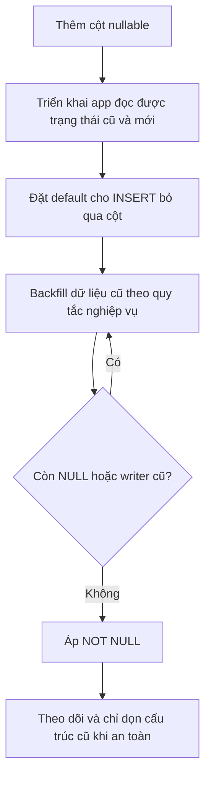

# Thêm cột và lựa chọn giá trị mặc định trong Liquibase

## 1. Mục tiêu và phạm vi

Trong module `DATABASE_SCHEMA_MIGRATION_LIQUIBASE`, người học quản lý thay đổi schema và dữ liệu thông qua **changelog, changeset, precondition, checksum và lịch sử triển khai**, đồng thời thực hành migration có kiểm chứng, rollback, phối hợp nhiều môi trường và tích hợp Spring Boot hoặc CI/CD. Bài học thuộc nhóm **Thay đổi bảng** này tập trung vào một thao tác rất phổ biến: **thêm cột vào bảng đã tồn tại và quyết định giá trị mặc định cho cột mới**.

Ví dụ, ứng dụng xử lý đơn hàng có bảng `purchase_order` và muốn bổ sung cột `processing_state`. Một thiết kế tưởng như đơn giản — `VARCHAR(24) DEFAULT 'PENDING' NOT NULL` — thực chất đặt ra nhiều câu hỏi:

- Những đơn hàng **đã tồn tại** sẽ có giá trị gì ở cột mới?
- Những đơn hàng **được tạo sau migration** sẽ nhận giá trị mặc định nào khi câu `INSERT` không cung cấp cột?
- Nếu ứng dụng gửi `NULL` tường minh, default có được áp dụng không?
- Cột có cần `NOT NULL` ngay hay nên triển khai theo nhiều giai đoạn?
- Có cần điền dữ liệu cũ (*backfill*) theo quy tắc nghiệp vụ khác với giá trị mặc định cho dữ liệu mới?
- Với bảng lớn, migration sẽ giữ lock trong bao lâu và có ảnh hưởng đến giao dịch đang hoạt động không?
- Nếu cần rollback, xóa cột có làm mất dữ liệu đã ghi sau triển khai không?

Trả lời được các câu hỏi đó trước khi viết changeset quan trọng hơn việc chỉ nhớ thuộc tính `defaultValue`.

### Sau bài học, bạn cần làm được

1. Viết changeset `addColumn` để thêm một hoặc nhiều cột với kiểu dữ liệu và ràng buộc phù hợp.
2. Phân biệt `defaultValue*` với `value*`, giá trị mặc định của schema với thao tác cập nhật dữ liệu hiện có.
3. Chọn chiến lược thêm cột nullable, thêm default, backfill và đặt `NOT NULL` theo yêu cầu nghiệp vụ và khả năng DBMS.
4. Đưa ra kế hoạch kiểm chứng, rollback hoặc forward-fix cho migration trên database sạch và database đã có dữ liệu.
5. Tích hợp các kiểm tra này vào Liquibase CLI, Spring Boot hoặc CI/CD mà không sửa changeset đã triển khai.

## 2. Ba khái niệm cần tách biệt

### 2.1. Thêm cột là thay đổi cấu trúc

`addColumn` là change type của Liquibase dùng để mô tả việc bổ sung cột vào bảng hiện có. Liquibase đọc changelog, xác định DBMS rồi tạo câu lệnh DDL thích hợp nếu change type được DBMS đó hỗ trợ. Ví dụ:

```yaml
databaseChangeLog:
  - changeSet:
      id: 2026-11-19-01-add-processing-state
      author: database-team
      changes:
        - addColumn:
            tableName: purchase_order
            columns:
              - column:
                  name: processing_state
                  type: VARCHAR(24)
      rollback:
        - dropColumn:
            tableName: purchase_order
            columnName: processing_state
```

Ví dụ này chỉ thêm cột, không khai báo default hay `NOT NULL`. Trên những DBMS thông thường, cột sẽ cho phép `NULL` nếu không có ràng buộc khác. Hành vi chính xác vẫn cần kiểm chứng trên DBMS và schema đích; không nên coi lựa chọn mặc định của mọi hệ quản trị là giống hệt nhau.

### 2.2. Default của cột áp dụng khi `INSERT` không cung cấp giá trị

Giá trị mặc định (*column default*) là một phần của định nghĩa cột ở database. Trong phần lớn trường hợp, khi một hàng mới được `INSERT` mà **không chỉ định cột đó** hoặc dùng từ khóa `DEFAULT` theo cú pháp của DBMS, database sẽ áp dụng default đã khai báo.

Ví dụ với default `PENDING`:

```sql
INSERT INTO purchase_order (id, customer_id)
VALUES (501, 42);

-- processing_state nhận default nếu cột đã được khai báo DEFAULT 'PENDING'
```

Ngược lại, một lệnh ghi `processing_state = NULL` **không đồng nghĩa** với việc bỏ qua cột:

```sql
INSERT INTO purchase_order (id, customer_id, processing_state)
VALUES (502, 42, NULL);

-- Thông thường đây là NULL tường minh:
-- cột nullable: nhận NULL; cột NOT NULL: bị từ chối.
```

Một số DBMS hoặc cơ chế đặc biệt có quy tắc riêng liên quan đến default khi ghi `NULL`; vì vậy không nên dựa vào default để sửa mọi giá trị `NULL` mà ứng dụng chủ động gửi. Cần kiểm tra luồng ghi thực tế.

### 2.3. Backfill là cập nhật dữ liệu đang tồn tại

Backfill là quá trình điền giá trị cho những hàng đã có trong bảng, thường bằng `UPDATE` hoặc một công việc xử lý theo lô. Đây là **thay đổi dữ liệu**, khác với thiết lập column default cho các hàng tương lai.

Hai mục tiêu có thể khác nhau: đơn hàng cũ có thể mang trạng thái `LEGACY`, trong khi đơn hàng tạo mới sau khi triển khai mang trạng thái `PENDING`. Nếu đặt một default `PENDING` rồi mặc định rằng mọi hàng cũ cũng phải nhận `PENDING`, nhóm có thể làm sai ý nghĩa dữ liệu nghiệp vụ.

## 3. `defaultValue*` và `value*`: giống tên nhưng khác mục đích

Liquibase cung cấp những thuộc tính liên quan đến default và value trong mô tả cột. Cần lựa chọn **đúng kiểu giá trị và đúng tác động**.

| Thuộc tính thường gặp | Ý nghĩa chủ đạo | Tình huống minh họa |
|---|---|---|
| `defaultValue` | Giá trị mặc định dạng chuỗi của cột | `defaultValue: PENDING` cho `VARCHAR` |
| `defaultValueNumeric` | Giá trị mặc định dạng số | `defaultValueNumeric: 0` cho `INTEGER` |
| `defaultValueBoolean` | Giá trị mặc định dạng boolean | `defaultValueBoolean: false` |
| `defaultValueDate` | Giá trị mặc định dạng ngày hoặc thời gian theo cú pháp Liquibase hỗ trợ | Một ngày cố định cho cột ngày |
| `defaultValueComputed` | Biểu thức mặc định để DBMS đánh giá | `CURRENT_TIMESTAMP` trên DBMS hỗ trợ |
| `defaultValueSequenceNext` | Giá trị kế tiếp từ sequence, khi DBMS hỗ trợ | Cơ chế cấp số bằng sequence |
| `value`, `valueNumeric`, `valueBoolean`, `valueDate`, `valueComputed` | Giá trị dùng để thiết lập dữ liệu ở các thao tác tương ứng; với `addColumn`, `value` có thể dùng để điền các hàng **đã có** | Gán một giá trị ban đầu cho dữ liệu cũ |

**Không kết hợp nhiều thuộc tính `defaultValue*` mâu thuẫn trên cùng một cột.** Hãy chọn biến thể phù hợp với kiểu dữ liệu thực và DBMS. Chẳng hạn, không dùng chuỗi `'false'` nếu muốn thể hiện boolean một cách tường minh; dùng `defaultValueBoolean: false` khi phù hợp.

Đặc biệt:

- **`defaultValue*`** mô tả **default của cột trong schema**. Khi thêm cột có default vào bảng đã có dữ liệu, cách DBMS biểu hiện hoặc materialize giá trị của các hàng cũ có thể khác nhau; phải thử trên DBMS đích và với phiên bản cụ thể. Không suy ra rằng tất cả hàng cũ chắc chắn `NULL`, cũng không suy ra rằng việc gán giá trị vật lý cho toàn bộ hàng cũ hoàn toàn miễn phí.
- **`value*`** trong mô tả `addColumn` có thể được Liquibase dùng để **điền giá trị cho các hàng hiện có**, chứ không nhất thiết tạo một default schema cho các `INSERT` về sau. Việc xử lý dữ liệu cũ có thể sinh thêm thao tác cập nhật, tăng thời gian và log/lock với bảng lớn.
- Khi cần backfill **theo điều kiện** (ví dụ chỉ những hàng chưa có trạng thái, hoặc hàng cũ theo `created_at`), changeset `update` với `where` tường minh hoặc một job backfill theo lô thường dễ kiểm soát hơn việc gán một `value` chung cho toàn bộ bảng.

### 3.1. Thêm cột với giá trị mặc định dạng chuỗi

```yaml
databaseChangeLog:
  - changeSet:
      id: 2026-11-19-02-add-state-with-default
      author: database-team
      changes:
        - addColumn:
            tableName: purchase_order
            columns:
              - column:
                  name: processing_state
                  type: VARCHAR(24)
                  defaultValue: PENDING
      rollback:
        - dropColumn:
            tableName: purchase_order
            columnName: processing_state
```

Đây là **phương án thay thế** cho changeset ở mục 2.1, không phải bước bổ sung để chạy tiếp trên cùng bảng. Nếu đã thêm `processing_state` ở bước trước, không được chạy lại `addColumn` cho tên cột đó; khi cần bổ sung default cho cột đã tồn tại, sử dụng `addDefaultValue` như phần tiếp theo.

### 3.2. Giá trị mặc định phải đúng kiểu

```yaml
databaseChangeLog:
  - changeSet:
      id: 2026-11-19-03-add-metadata
      author: database-team
      changes:
        - addColumn:
            tableName: purchase_order
            columns:
              - column:
                  name: retry_count
                  type: INTEGER
                  defaultValueNumeric: 0
              - column:
                  name: requires_review
                  type: BOOLEAN
                  defaultValueBoolean: false
              - column:
                  name: received_at
                  type: TIMESTAMP
                  defaultValueComputed: CURRENT_TIMESTAMP
```

Ba cột mang ba loại default khác nhau: số, boolean và biểu thức thời gian. Ví dụ giả định DBMS hiểu `BOOLEAN`, `TIMESTAMP` và `CURRENT_TIMESTAMP` theo cách tương thích. Nếu chạy trên SQL Server, Oracle hoặc phiên bản DBMS khác, datatype hay expression cần được kiểm chứng/thay đổi; một change type Liquibase không bảo đảm mọi kiểu và biểu thức mặc định đều portable.

**Default tính toán** như `CURRENT_TIMESTAMP` thường được DBMS đánh giá khi một hàng mới được chèn; đừng nhầm nó với một ngày cố định được đặt trong changelog. Mức độ hỗ trợ `defaultValueComputed`, biểu thức có được coi là mặc định động hay không và kết quả theo múi giờ đều phụ thuộc DBMS. Với khóa tự tăng, cần phân biệt sequence/identity với default thông thường; không giả định thêm `defaultValueSequenceNext` tương đương toàn bộ hành vi auto-increment ở mọi DBMS.

### 3.3. `value` cho dữ liệu cũ không tương đương `defaultValue`

```yaml
databaseChangeLog:
  - changeSet:
      id: 2026-11-19-04-add-legacy-marker
      author: database-team
      changes:
        - addColumn:
            tableName: purchase_order
            columns:
              - column:
                  name: origin_marker
                  type: VARCHAR(24)
                  value: LEGACY
```

Trong ngữ cảnh `addColumn`, `value: LEGACY` biểu thị ý định điền giá trị cho các hàng hiện có mà **không tạo mặc định `LEGACY` cho mọi hàng tương lai**. Chỉ dùng cách này khi toàn bộ dữ liệu cũ thực sự cần cùng một giá trị và đã kiểm chứng câu SQL Liquibase sinh ra. Với bảng rất lớn, hãy đánh giá chi phí cập nhật từng hàng và nguy cơ kéo dài transaction/lock.

Đây cũng là ví dụ độc lập trên một cột khác. Nếu thực tế cần một giá trị cho các hàng cũ và giá trị khác cho hàng mới, tách thành các bước `addColumn`, `addDefaultValue` và backfill có điều kiện thường minh bạch hơn.

## 4. Ba phương án thiết kế khi bổ sung cột

| Phương án | Chọn khi | Lợi ích | Rủi ro cần xử lý |
|---|---|---|---|
| **A. Thêm cột nullable, chưa có default** | Tạm thời cho phép ứng dụng cũ chưa biết cột; dữ liệu sẽ được điền sau | Ít giả định về dữ liệu cũ; dễ tách các pha deploy | Ứng dụng đọc có thể gặp `NULL`; cần xử lý fallback/backfill |
| **B. Thêm cột kèm default, vẫn nullable** | Mọi bản ghi mới bỏ qua cột phải nhận một giá trị thống nhất | Hạn chế hàng mới thiếu giá trị khi `INSERT` bỏ qua cột | `NULL` tường minh vẫn có thể xuất hiện; hành vi của hàng cũ và chi phí DDL tùy DBMS |
| **C. Thêm cột `NOT NULL` với default** | Giá trị mặc định hợp lệ cho tất cả các trường hợp và DBMS xử lý DDL trong giới hạn chấp nhận | Một thay đổi có thể thiết lập bất biến ngay | Có thể cần xử lý hàng cũ; nguy cơ lock/rewrite; khó triển khai zero-downtime nếu ứng dụng chưa tương thích |

Không có phương án nào luôn là tốt nhất. Đối với ứng dụng chạy liên tục và bảng lớn, phương án A rồi từng bước bổ sung default, backfill, ràng buộc thường an toàn và dễ kiểm chứng hơn. Với bảng mới tạo hoặc bảng nhỏ, phương án C có thể phù hợp nếu đã test trên DBMS mục tiêu.

### 4.1. Khi nào chọn `NOT NULL` ngay từ đầu?

Ví dụ độc lập:

```yaml
databaseChangeLog:
  - changeSet:
      id: 2026-11-19-05-add-review-flag
      author: database-team
      changes:
        - addColumn:
            tableName: purchase_order
            columns:
              - column:
                  name: requires_review
                  type: BOOLEAN
                  defaultValueBoolean: false
                  constraints:
                    nullable: false
      rollback:
        - dropColumn:
            tableName: purchase_order
            columnName: requires_review
```

Thiết kế này hợp lý nếu `false` có nghĩa nghiệp vụ rõ ràng cho mọi đơn hàng cũ, ứng dụng hiện tại có thể đọc và ghi cột đó, và quá trình thay đổi được kiểm chứng trên dữ liệu đại diện. Nếu `false` có nghĩa “đã được xác minh không cần review”, gán nó cho toàn bộ hàng cũ chưa đánh giá có thể làm sai dữ liệu. Khi đó nên dùng giá trị trung gian hoặc tách pha để đánh giá từng hàng.

## 5. Quy trình nhiều giai đoạn: expand → default → backfill → constrain

Xét bài toán `purchase_order` đã có nhiều bản ghi. Yêu cầu nghiệp vụ: mọi đơn hàng **mới** phải có `processing_state = PENDING` khi ứng dụng không gửi giá trị, còn đơn hàng **cũ** cần được phân loại là `LEGACY` cho đến khi hoàn tất chuyển đổi dữ liệu. Về lâu dài, cột phải `NOT NULL`.

Thiết kế có thể thực hiện qua bốn changeset hoặc nhiều đợt triển khai. Mỗi bước chỉ chạy sau khi có tiền đề phù hợp; các đoạn code dưới đây mang tính hướng dẫn cho một DBMS có hỗ trợ change type tương ứng.

### Giai đoạn 1 — Thêm cột nullable, chưa có default

```yaml
databaseChangeLog:
  - changeSet:
      id: order-state-01-expand
      author: database-team
      changes:
        - addColumn:
            tableName: purchase_order
            columns:
              - column:
                  name: processing_state
                  type: VARCHAR(24)
      rollback:
        - dropColumn:
            tableName: purchase_order
            columnName: processing_state
```

Trong pha này, ứng dụng cần chấp nhận cột vắng hoặc `NULL` trong quá trình chuyển đổi, hoặc có fallback đọc phù hợp. Rollback bằng `dropColumn` chỉ an toàn trước khi cột được ứng dụng sử dụng và có dữ liệu cần giữ lại. Sau khi cột đã chứa dữ liệu mới, xóa cột có thể làm mất dữ liệu đó.

### Giai đoạn 2 — Đặt default cho những `INSERT` mới

```yaml
databaseChangeLog:
  - changeSet:
      id: order-state-02-default
      author: database-team
      changes:
        - addDefaultValue:
            tableName: purchase_order
            columnName: processing_state
            columnDataType: VARCHAR(24)
            defaultValue: PENDING
      rollback:
        - dropDefaultValue:
            tableName: purchase_order
            columnName: processing_state
            columnDataType: VARCHAR(24)
```

`addDefaultValue` thay đổi thuộc tính default của **cột đã tồn tại**, không phải lệnh cập nhật các hàng cũ. `dropDefaultValue` loại bỏ default khi rollback; tên và các thuộc tính bắt buộc của lệnh này có thể khác theo DBMS, do đó cần xác nhận bằng `update-sql` và `rollback-sql` trên phiên bản Liquibase đang dùng. Với một số hệ quản trị, default còn là một constraint có tên riêng; cần quản lý `defaultValueConstraintName` khi tính năng này được DBMS hỗ trợ.

Ở thời điểm pha 2, vẫn có thể có hàng `NULL` do dữ liệu cũ, do ứng dụng gửi `NULL` tường minh hoặc do giao dịch đang chạy trong thời gian chuyển đổi. Vì vậy phải kiểm tra dữ liệu trước khi chuyển sang `NOT NULL`.

### Giai đoạn 3 — Backfill dữ liệu cũ theo ý nghĩa nghiệp vụ

```yaml
databaseChangeLog:
  - changeSet:
      id: order-state-03-backfill
      author: database-team
      changes:
        - update:
            tableName: purchase_order
            columns:
              - column:
                  name: processing_state
                  value: LEGACY
            where: "processing_state IS NULL"
```

`where: "processing_state IS NULL"` tránh ghi đè những hàng đã có giá trị rõ ràng. Nhưng điều kiện này cũng có thể cập nhật một đơn hàng mới mà ứng dụng đã cố ý ghi `NULL`; nếu cần phân biệt **hàng cũ** và **hàng mới**, phải thêm tiêu chí đáng tin cậy như thời điểm cutover hay một khóa được thống nhất, và kiểm chứng logic đó trên dữ liệu thực. Không nên dùng một điều kiện ngày tháng chưa được xác minh rồi cho rằng mọi hàng được phân loại chính xác.

Changeset `update` này **không có một rollback khôi phục dữ liệu cũ an toàn cho mọi trường hợp**: không thể chỉ đặt lại mọi giá trị `LEGACY` thành `NULL`, vì một số hàng có thể đã được ứng dụng cập nhật hợp lệ sau migration. Trước triển khai thật, cần chuẩn bị snapshot/backup hoặc bảng ghi nhận các hàng đã thay đổi nếu yêu cầu rollback dữ liệu, hoặc xây dựng phương án forward-fix có kiểm soát. Không coi thiếu rollback tự động là không có rủi ro.

Với bảng lớn, một `UPDATE` duy nhất có thể tạo lock kéo dài, tăng redo/WAL, chiếm transaction log và ảnh hưởng ứng dụng. Có thể tách backfill thành một job vận hành theo lô, có checkpoint và khả năng tiếp tục, **nhưng phải quản lý nhất quán trạng thái hoàn tất trước khi áp ràng buộc**. Không đặt một job bất đồng bộ giả định “đã xong” chỉ vì Liquibase đã hoàn thành changeset tạo cột.

### Giai đoạn 4 — Kiểm tra không còn `NULL`, rồi đặt `NOT NULL`

Trước khi áp ràng buộc, dùng truy vấn phù hợp với DBMS:

```sql
SELECT COUNT(*) AS missing_state_count
FROM purchase_order
WHERE processing_state IS NULL;
```

Nếu kết quả chưa bằng `0`, không nên thêm `NOT NULL` ngay. Cần tiếp tục backfill và sửa luồng ghi ứng dụng để không tạo thêm giá trị `NULL`. Sau khi điều kiện đạt và thời điểm triển khai thích hợp:

```yaml
databaseChangeLog:
  - changeSet:
      id: order-state-04-not-null
      author: database-team
      preConditions:
        - onFail: HALT
        - sqlCheck:
            expectedResult: "0"
            sql: "SELECT COUNT(*) FROM purchase_order WHERE processing_state IS NULL"
      changes:
        - addNotNullConstraint:
            tableName: purchase_order
            columnName: processing_state
            columnDataType: VARCHAR(24)
      rollback:
        - dropNotNullConstraint:
            tableName: purchase_order
            columnName: processing_state
            columnDataType: VARCHAR(24)
```

`sqlCheck` là lớp bảo vệ ngay tại thời điểm changeset được xử lý, nhưng không thay thế việc chuẩn bị ứng dụng hoặc đánh giá concurrency. Trên DBMS có hỗ trợ transaction/locking phù hợp, cần cân nhắc race giữa bước kiểm tra và bước áp constraint; bản thân câu DDL là cơ chế cuối cùng thực thi ràng buộc. Không cho rằng precondition đã loại bỏ mọi rủi ro ghi đồng thời.

Đây là ví dụ minh họa một **chuỗi thay đổi**; trong dự án thật, có thể cần chia thành nhiều đợt phát hành ứng dụng hoặc dùng cú pháp DBMS-specific để hạn chế lock. Các file changelog thực tế phải được tổ chức theo đúng thứ tự và mỗi changeset có `id`/`author` ổn định.

### 5.1. Biểu đồ tiến trình triển khai



Chuỗi trên giúp giữ khả năng tương thích ngược (*expand/contract*), nhưng thời điểm cụ thể còn phụ thuộc luồng ghi, dữ liệu, chiến lược triển khai ứng dụng và DBMS. Tình trạng “không còn NULL” tại một thời điểm không đủ nếu writer cũ vẫn có thể tạo `NULL` ở thời điểm tiếp theo.

## 6. Khi nào nên dùng `defaultNullValue`?

Liquibase có tùy chọn `defaultNullValue` trong một số thao tác như `addNotNullConstraint`, dùng để xử lý những hàng đang `NULL` trước khi bổ sung ràng buộc trong các DBMS/phiên bản hỗ trợ. Ví dụ minh họa:

```yaml
databaseChangeLog:
  - changeSet:
      id: order-state-not-null-with-fill
      author: database-team
      changes:
        - addNotNullConstraint:
            tableName: purchase_order
            columnName: processing_state
            columnDataType: VARCHAR(24)
            defaultNullValue: UNKNOWN
```

Đây là **phương án thay thế** cho bước backfill và constraint tách riêng ở mục 5, không phải changeset chạy tiếp sau khi đã áp `NOT NULL`. Nó phù hợp nếu **mọi hàng `NULL` phải nhận cùng một giá trị hợp lệ**, bảng nhỏ hoặc đã đánh giá chi phí cập nhật dữ liệu, và hành vi được kiểm chứng trên DBMS thật.

Không nhầm `defaultNullValue` với `defaultValue`:

- `defaultNullValue` nhằm **xử lý các giá trị NULL hiện có** trong quá trình thêm ràng buộc, khi change type/DBMS hỗ trợ.
- `defaultValue` là **default của cột** cho thao tác ghi mới theo quy tắc DBMS.

Không áp dụng `defaultNullValue: UNKNOWN` chỉ để làm migration chạy qua lỗi nếu `UNKNOWN` không phải trạng thái nghiệp vụ hợp lệ. Giá trị “không biết” đôi khi chính xác hơn một giả định sai, nhưng cần được định nghĩa và xử lý ở tầng ứng dụng.

## 7. Các tình huống đặc biệt về giá trị mặc định

### 7.1. Số `0`, chuỗi rỗng và `NULL` không đồng nghĩa nhau

- `defaultValueNumeric: 0` là **số không**, có thể mang ý nghĩa “chưa thử lại lần nào”.
- `defaultValue: ""` là **chuỗi rỗng**, không tương đương `NULL` và đôi khi che giấu dữ liệu thiếu.
- Không có default không tự động đồng nghĩa với `NULL` trong mọi ràng buộc: nếu cột `NOT NULL` mà ứng dụng không gửi giá trị, DBMS thường từ chối `INSERT` khi không có default hợp lệ.
- Một giá trị sentinel như `UNKNOWN` hoặc `-1` cần quy ước và kiểm soát nghiệp vụ rõ ràng, tránh được hiểu nhầm là giá trị thật.

Trong YAML, khi một giá trị có hình thức dễ bị diễn giải sai kiểu (ví dụ `yes`, `on`, số có số 0 đầu, chuỗi chứa `:` hoặc `#`), nên đặt trong dấu nháy và dùng đúng biến thể `defaultValue*` của Liquibase. Đừng để YAML parser vô tình quyết định kiểu dữ liệu nghiệp vụ.

### 7.2. Mốc thời gian cố định và mốc thời gian được tính khi ghi

Một ngày cố định trong changelog khác với biểu thức như `CURRENT_TIMESTAMP`. Nếu yêu cầu lưu “thời điểm bản ghi được tạo”, thường cần một default động được DBMS hỗ trợ; nếu yêu cầu đánh dấu “ngày chuyển đổi dữ liệu”, phải phân biệt thời điểm **migration** với thời điểm **insert** của từng hàng. Với `TIMESTAMP`, phải quan tâm timezone, quy tắc convert, độ chính xác và khả năng của DBMS.

Ví dụ:

```yaml
- column:
    name: created_at
    type: TIMESTAMP
    defaultValueComputed: CURRENT_TIMESTAMP
```

Đây chỉ là một mảnh cấu hình cột, không phải changelog độc lập. Một số DBMS xử lý thời gian của một transaction hoặc một statement khác nhau; vì vậy `CURRENT_TIMESTAMP` không tự bảo đảm đúng chính sách thời gian của ứng dụng.

### 7.3. Default có thể thay đổi mà không cần thêm cột lần nữa

Nếu nghiệp vụ thay đổi từ `PENDING` sang `QUEUED` cho các hàng mới, dùng `addDefaultValue` trong **changeset mới** trên cột đã tồn tại để đổi default theo DBMS, sau khi review tác động. Default mới **không tự chuyển toàn bộ hàng cũ** từ `PENDING` sang `QUEUED`. Nếu cần đổi dữ liệu đã lưu, đó là một migration dữ liệu riêng với điều kiện lựa chọn và rollback riêng.

Trong một số DBMS như SQL Server, default có thể được đại diện bằng một constraint mang tên; việc tạo, thay thế hoặc xóa default cần chú ý tên constraint và hỗ trợ của Liquibase. Không sao chép một đoạn changelog cho PostgreSQL sang SQL Server mà giả định SQL sinh ra và rollback hoàn toàn tương đương.

## 8. Lựa chọn thiết kế theo quy mô bảng và DBMS

### 8.1. `ALTER TABLE` không phải thao tác “miễn phí”

Với bảng nhỏ, thêm cột có default và ràng buộc thường dễ kiểm thử. Với bảng hàng trăm triệu dòng, các chi phí sau có thể quyết định chiến lược:

1. **Metadata lock hoặc schema lock:** DDL có thể chờ giao dịch khác và chặn các truy vấn/ghi trong một khoảng thời gian.
2. **Table rewrite hoặc cập nhật hàng loạt:** một số biến thể thêm cột/default/ràng buộc có thể yêu cầu đọc hoặc ghi nhiều hàng.
3. **Redo/WAL, replication và backup:** backfill làm tăng lưu lượng log và độ trễ trên replica.
4. **Tính nguyên tử của DDL:** không phải DBMS nào cũng rollback DDL đầy đủ trong transaction.
5. **Hành vi của ứng dụng:** các phiên bản cũ và mới có thể cùng ghi vào bảng trong lúc rolling deployment.

Chẳng hạn, PostgreSQL ở những phiên bản hiện đại có một số tối ưu hóa cho `ADD COLUMN` với default không biến động theo quy tắc của DBMS; điều này **không có nghĩa** mọi default, mọi ràng buộc `NOT NULL` và mọi backfill đều không đụng tới dữ liệu hoặc lock. MySQL, SQL Server và Oracle có các giới hạn, phiên bản và chế độ DDL riêng. Kiểm chứng trên đúng DBMS và phiên bản đích, với khối lượng dữ liệu và tải đại diện, quan trọng hơn áp dụng một “công thức nhanh” chung.

### 8.2. Cân nhắc tách backfill khỏi transaction migration

Khi backfill lớn, một changeset `update` bao trọn hàng triệu dòng có thể gây gián đoạn dù DDL thêm cột rất nhanh. Có thể lựa chọn:

- Tách backfill thành job ứng dụng hoặc công cụ vận hành có giới hạn batch size, tốc độ, checkpoint và khả năng chạy tiếp.
- Sử dụng khóa tăng dần hoặc một chỉ số phù hợp để tránh quét toàn bảng lặp lại không cần thiết.
- Giữ job idempotent: chạy lại một batch không làm sai kết quả.
- Giám sát số hàng còn `NULL`, độ trễ replica, lock wait và thời gian transaction.
- Chỉ đặt `NOT NULL` khi dữ liệu đã hoàn tất và các writer hiện tại không còn tạo giá trị không hợp lệ.

Nếu backfill nằm ngoài Liquibase, lịch sử `DATABASECHANGELOG` **không tự ghi nhận mức độ hoàn thành** của job đó. Cần có bước gate trong pipeline hoặc precondition kiểm tra trạng thái thực tế. Không đánh dấu một changeset backfill là hoàn tất khi công việc nền vẫn đang chạy.

### 8.3. Hai loại lock khác nhau

`DATABASECHANGELOGLOCK` của Liquibase giúp tuần tự hóa các tiến trình Liquibase dùng chung bảng lock khi thực hiện migration. Nó **không thay thế** các lock của DBMS do `ALTER TABLE`, `UPDATE` hoặc kiểm tra ràng buộc gây ra. Một migration có thể độc quyền Liquibase lock nhưng vẫn phải chờ schema lock của DBMS hoặc gây chờ cho ứng dụng. Khi phân tích sự cố, cần quan sát cả hai loại lock.

## 9. Precondition, checksum và lịch sử khi thêm cột

### 9.1. Precondition để phát hiện sai trạng thái

Nếu dự án yêu cầu cột chưa tồn tại trước khi thêm, có thể khai báo điều kiện dừng rõ ràng:

```yaml
databaseChangeLog:
  - changeSet:
      id: add-priority-column
      author: database-team
      preConditions:
        - onFail: HALT
        - tableExists:
            tableName: purchase_order
        - not:
            - columnExists:
                tableName: purchase_order
                columnName: priority_level
      changes:
        - addColumn:
            tableName: purchase_order
            columns:
              - column:
                  name: priority_level
                  type: INTEGER
```

Điều kiện giúp thông báo rằng bảng thiếu hoặc cột đã có. Nó không biến thay đổi thành một lệnh vô hại để chạy lặp lại: nếu cột đã tồn tại do thao tác thủ công, cần xác minh định nghĩa cột và lịch sử trước khi quyết định có ghi nhận changeset. Không dùng `onFail: MARK_RAN` chỉ để bỏ qua một sai lệch chưa hiểu, vì có thể khiến `DATABASECHANGELOG` cho thấy đã hoàn tất trong khi schema không tương đương.

### 9.2. Đừng sửa changeset đã triển khai để thay default

Liquibase nhận diện changeset bằng `id`, `author` và danh tính file changelog (có thể chịu ảnh hưởng `logicalFilePath`), lưu trạng thái cùng checksum ở `DATABASECHANGELOG`. Nếu đã triển khai changeset thêm cột mà sau đó thay `defaultValue` hoặc `constraints` ngay trong changeset đó, có thể phát sinh checksum mismatch hoặc làm các môi trường có trạng thái khác nhau.

Thực hành an toàn là **giữ nguyên changeset đã chạy** rồi thêm changeset mới, chẳng hạn `addDefaultValue`, `dropDefaultValue`, `addNotNullConstraint` hoặc `dropNotNullConstraint`. Không đổi `id`/`author` hoặc xóa bản ghi lịch sử để ép Liquibase chạy lại một thay đổi cấu trúc đã tồn tại.

### 9.3. Context và label không thay thế phụ thuộc nghiệp vụ

Nếu cột `processing_state` là bắt buộc cho ứng dụng ở mọi môi trường, không nên gắn `contextFilter: development` chỉ vì thay đổi được thử đầu tiên trên development. Khi bước khác phụ thuộc cột đó được chạy ở production, môi trường thiếu cột sẽ thất bại. Dùng context/label có chủ đích cho dữ liệu seed hoặc phát hành tính năng; đừng dùng chúng để che thay đổi cấu trúc nền tảng khỏi môi trường cần nó.

## 10. Kiểm chứng migration trước và sau khi chạy

Một quy trình triển khai nên xác nhận **changelog**, **SQL dự kiến**, **schema đích**, **dữ liệu hiện hữu** và **tính an toàn của rollback**. Có thể dùng các command Liquibase CLI phù hợp với phiên bản đang cài:

```bash
liquibase --defaults-file=config/liquibase-test.properties validate
liquibase --defaults-file=config/liquibase-test.properties status --verbose
liquibase --defaults-file=config/liquibase-test.properties update-sql
```

`validate` kiểm tra tính hợp lệ của nhiều thành phần changelog; `status --verbose` giúp xem changeset pending; `update-sql` sinh SQL dự kiến mà không thực hiện DDL/DML. Mục tiêu là biết chính xác Liquibase sẽ thêm cột ra sao, liệu có thêm default/ràng buộc đúng kiểu không và có câu `UPDATE` lớn ngoài dự kiến hay không.

Với rollback, dùng command xuất rollback SQL tương ứng của phiên bản Liquibase và **mốc rollback rõ ràng** (tag, count hoặc thời điểm được hỗ trợ), sau đó chạy thử trên database an toàn. Không tự động rollback production chỉ vì một bài kiểm thử thất bại. Đặc biệt, câu `DROP COLUMN` có thể xóa dữ liệu được ghi sau migration và có thể không thể khôi phục nếu thiếu backup.

### 10.1. Truy vấn kiểm tra dữ liệu

Ví dụ các truy vấn SQL đọc-only thường dễ áp dụng:

```sql
-- 1. Bao nhiêu đơn hàng còn thiếu trạng thái?
SELECT COUNT(*) AS null_count
FROM purchase_order
WHERE processing_state IS NULL;

-- 2. Giá trị hiện tại phân bố như thế nào?
SELECT processing_state, COUNT(*) AS row_count
FROM purchase_order
GROUP BY processing_state
ORDER BY row_count DESC;
```

Khi kiểm tra default và thuộc tính nullable, có thể dùng view metadata của DBMS. Ví dụ trên PostgreSQL:

```sql
SELECT column_name, data_type, column_default, is_nullable
FROM information_schema.columns
WHERE table_schema = 'public'
  AND table_name = 'purchase_order'
  AND column_name = 'processing_state';
```

`information_schema` có mức hỗ trợ khác nhau giữa DBMS; cần thay `schema` và truy vấn theo hệ quản trị. Đối chiếu metadata với thực tế ứng dụng: có default `PENDING` không có nghĩa ứng dụng luôn gửi giá trị hợp lệ hoặc mọi hàng đã được backfill.

### 10.2. Kiểm tra lịch sử Liquibase

```sql
SELECT ID, AUTHOR, FILENAME, DATEEXECUTED, ORDEREXECUTED,
       EXECTYPE, MD5SUM
FROM DATABASECHANGELOG
ORDER BY ORDEREXECUTED;
```

Truy vấn nhằm minh họa những trường lịch sử thường dùng; bảng có thể nằm trong schema metadata khác theo cấu hình, và cú pháp cần được điều chỉnh cho DBMS. Kiểm tra rằng các changeset `expand`, `default`, `backfill`, `not-null` được ghi nhận đúng theo kế hoạch. Đừng suy ra schema đúng chỉ từ lịch sử: hãy kiểm tra cột, default, ràng buộc và dữ liệu thật.

### 10.3. Ma trận thử nghiệm tối thiểu

| Kịch bản | Điều cần xác minh |
|---|---|
| Database sạch hoặc bảng mới tạo | Các changeset chạy theo thứ tự; schema cuối cùng đúng |
| Bảng có hàng cũ | Backfill có phân loại đúng và không ghi đè giá trị hợp lệ |
| `INSERT` không cung cấp cột | Database áp dụng default đã chọn |
| `INSERT` cung cấp giá trị tường minh | Database giữ giá trị được gửi nếu hợp lệ |
| `INSERT` cung cấp `NULL` | Hành vi phù hợp với nullable/NOT NULL và quy tắc DBMS |
| Khối lượng dữ liệu đại diện production | Thời gian DDL, chi phí backfill, lock và replication nằm trong giới hạn chấp nhận |
| Chạy lại `update` | Changeset đã áp dụng không bị chạy lại ngoài ý định |
| Rollback hoặc forward-fix | Không làm mất dữ liệu ngoài phạm vi; có chiến lược phục hồi được kiểm chứng |

## 11. Spring Boot và CI/CD: phối hợp thay đổi schema với ứng dụng

Nếu Liquibase được tích hợp vào Spring Boot, changelog thường được khai báo qua `spring.liquibase.change-log`, ví dụ:

```yaml
spring:
  liquibase:
    enabled: true
    change-log: classpath:/db/changelog/db.changelog-master.yaml
```

Với ứng dụng nhiều replica, cần quyết định rõ migration chạy khi startup hay trong một job triển khai riêng. Nếu cả hai đều chạy, các runner phải trỏ đúng database và dùng chung metadata Liquibase. `DATABASECHANGELOGLOCK` giúp điều phối giữa các runner nhưng không bảo đảm **ứng dụng đã tương thích với cột mới**, cũng không làm cho backfill nhanh hơn.

Trong CI/CD, có thể tổ chức các cổng kiểm chứng:

1. Kiểm tra changelog và metadata changeset trong pull request.
2. Sinh `update-sql` với đúng DBMS, driver, phiên bản Liquibase và cấu hình đích.
3. Triển khai bước **expand** trước khi code mới bắt buộc đọc/ghi cột đó.
4. Bật default hoặc triển khai code ghi giá trị phù hợp; tránh writer cũ chủ động gửi `NULL`.
5. Backfill có giám sát và bước xác nhận hoàn tất theo dữ liệu thực.
6. Chỉ sau khi mọi phiên bản ứng dụng liên quan đã tương thích, áp `NOT NULL` hoặc các ràng buộc chặt hơn.
7. Đối chiếu `DATABASECHANGELOG`, schema, dữ liệu và metric vận hành sau triển khai.

Không nhất thiết đặt bảy bước vào cùng một lần `update`; một số bước đòi hỏi nhiều đợt phát hành ứng dụng. Pipeline nên ghi nhận phiên bản changelog, SQL đã review, môi trường và thời điểm cutover. Với migration quan trọng, có thể thêm cổng phê duyệt trước pha constraint hoặc cleanup.

## 12. Sai lầm thường gặp khi thêm cột và chọn default

| Sai lầm | Vì sao nguy hiểm | Cách xử lý |
|---|---|---|
| Nhầm `defaultValue` với `value` | Nhầm default cho dữ liệu mới với cập nhật dữ liệu cũ | Chọn đúng thuộc tính và kiểm tra SQL sinh ra |
| Cho rằng `DEFAULT` luôn thay mọi `NULL` | `NULL` được ghi tường minh có thể không dùng default | Thử luồng ghi thực, kiểm tra dữ liệu và ràng buộc |
| Gán `NOT NULL` ngay khi bảng còn dữ liệu cũ chưa xử lý | DDL có thể thất bại hoặc gây cập nhật/lock lớn | Expand rồi backfill và constraint theo pha |
| Dùng `PENDING` cho mọi đơn hàng cũ mà không xét nghiệp vụ | Có thể biến trạng thái lịch sử thành thông tin sai | Phân biệt backfill cho hàng cũ và default cho hàng mới |
| Dùng `CURRENT_TIMESTAMP` mà không xét timezone | Mốc thời gian có thể không mang ý nghĩa mong muốn | Chốt ngữ nghĩa thời gian và kiểm chứng theo DBMS |
| Nghĩ rằng `rollback: dropColumn` luôn an toàn | Xóa cả dữ liệu ghi sau triển khai | Thử rollback, có backup/forward-fix và bảo vệ dữ liệu |
| Thực thi `UPDATE` toàn bảng trong giờ cao điểm | Có thể tăng lock/log, kéo dài replication lag | Đánh giá volume, chia batch hoặc dời khung triển khai |
| Sửa changeset đã chạy để đổi default | Gây checksum mismatch hoặc phân kỳ lịch sử | Tạo changeset mới với `addDefaultValue`/`dropDefaultValue` |
| Dùng `MARK_RAN` để bỏ qua cột đã tồn tại không rõ nguồn gốc | Lịch sử có thể không tương ứng trạng thái schema | Kiểm tra schema thực tế rồi giải quyết sai lệch có kiểm soát |
| Chỉ nhìn `DATABASECHANGELOG` để kết luận thành công | Không xác minh null count, default hoặc dữ liệu | Kiểm tra schema và truy vấn dữ liệu sau chạy |

## 13. Tình huống thực tế và cách chọn phương án

Giả sử dịch vụ đơn hàng có 30 triệu hàng, ứng dụng được cập nhật kiểu rolling deployment và yêu cầu mới là theo dõi `processing_state`. Một nhóm đề nghị chạy ngay `addColumn` với `defaultValue: PENDING` và `nullable: false`. Đề nghị này có vẻ gọn, nhưng chưa đủ thông tin: các đơn hàng cũ có thực sự đang chờ xử lý không? Database có thể thêm cột với default bằng thay đổi metadata nhanh hay cần rewrite? Trong khi có hai phiên bản ứng dụng cùng chạy, bản cũ có gửi `NULL` tường minh không? Việc rollback có giữ được trạng thái đơn hàng mới không?

Cách lập kế hoạch có kiểm soát hơn:

1. **Chốt ngữ nghĩa:** `LEGACY` dành cho đơn hàng cũ chưa phân loại; `PENDING` dành cho đơn hàng mới ở trạng thái chờ xử lý. Kiểm tra xem có cần thêm các trạng thái `UNKNOWN`, `PROCESSING`, `COMPLETED` không.
2. **Đo dữ liệu và DBMS:** xác nhận dung lượng bảng, index liên quan, kiểu transaction/lock của `ALTER TABLE` và khả năng phục hồi khi có lỗi.
3. **Expand:** thêm cột nullable, bảo đảm cả ứng dụng cũ và mới hoạt động được.
4. **Default:** đặt giá trị cho những `INSERT` mới không gửi cột, đồng thời sửa code ghi/đọc để xử lý `NULL` trong giai đoạn chuyển tiếp.
5. **Backfill:** cập nhật dữ liệu cũ theo lô, có giới hạn tải và cơ chế resume; không gán bừa cho các hàng tạo sau cutover.
6. **Constrain:** khi null count bằng 0 và các writer đã đáp ứng bất biến, áp `NOT NULL` trong khung triển khai được đánh giá trước.
7. **Kiểm chứng và phục hồi:** đối chiếu log, SQL, schema, `DATABASECHANGELOG`; thử rollback hoặc forward-fix trên bản sao có dữ liệu đại diện.

Không có bước nào đòi hỏi phải đọc tay hoặc sửa metadata Liquibase. Sử dụng changeset mới để thay đổi schema, dùng các job có kiểm soát để xử lý dữ liệu lớn khi cần và dựa trên truy vấn thực tế để ra quyết định triển khai.

## 14. Checklist trước khi merge changeset thêm cột

- [ ] Đã xác định kiểu dữ liệu, độ dài, nullable và ý nghĩa nghiệp vụ của cột mới.
- [ ] Đã phân biệt default cho hàng mới và cách xử lý các hàng đã tồn tại.
- [ ] Biến thể `defaultValue*`/`value*` được chọn đúng kiểu, đúng mục đích và đúng DBMS.
- [ ] Đã thử trường hợp `INSERT` bỏ qua cột, gửi giá trị tường minh và gửi `NULL`.
- [ ] Nếu có dữ liệu cũ, kế hoạch backfill phân biệt đúng hàng cũ và mới; có tiêu chí hoàn thành đo được.
- [ ] Thứ tự giữa expand, deploy ứng dụng, đặt default, backfill và `NOT NULL` được ghi rõ.
- [ ] Đã đánh giá lock, thời gian DDL, khả năng rewrite, transaction log và replication cho bảng lớn.
- [ ] Rollback không làm mất dữ liệu không mong muốn; nếu không thể rollback an toàn, đã có forward-fix và phương án backup.
- [ ] Các changeset đã triển khai không bị sửa `id`, `author`, `logicalFilePath` hay nội dung chỉ để đổi default.
- [ ] `validate`, `status --verbose` và `update-sql` đã được thực hiện trong quy trình kiểm chứng với đúng DBMS và cấu hình đích.
- [ ] Đã kiểm tra `DATABASECHANGELOG`, metadata cột/default/constraint và dữ liệu thực sau migration trên môi trường test.
- [ ] Spring Boot/CI/CD thống nhất trách nhiệm chạy migration; không để các replica thực hiện thay đổi không tương thích cùng lúc.

Thêm cột bằng `addColumn` chỉ là bước đầu. Thiết kế giá trị mặc định cần phân biệt **hàng mới, hàng cũ và hàng ghi `NULL` tường minh**, đồng thời xét ngữ nghĩa nghiệp vụ, khả năng của DBMS và trạng thái của ứng dụng trong thời gian triển khai. Khi tách rõ `defaultValue`, `value`, backfill và `NOT NULL`, dùng changeset có danh tính ổn định và kiểm chứng bằng SQL cùng lịch sử `DATABASECHANGELOG`, nhóm có thể mở rộng schema an toàn hơn trong quy trình `DATABASE_SCHEMA_MIGRATION_LIQUIBASE`.
