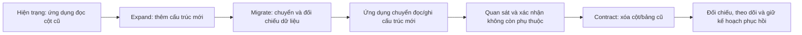
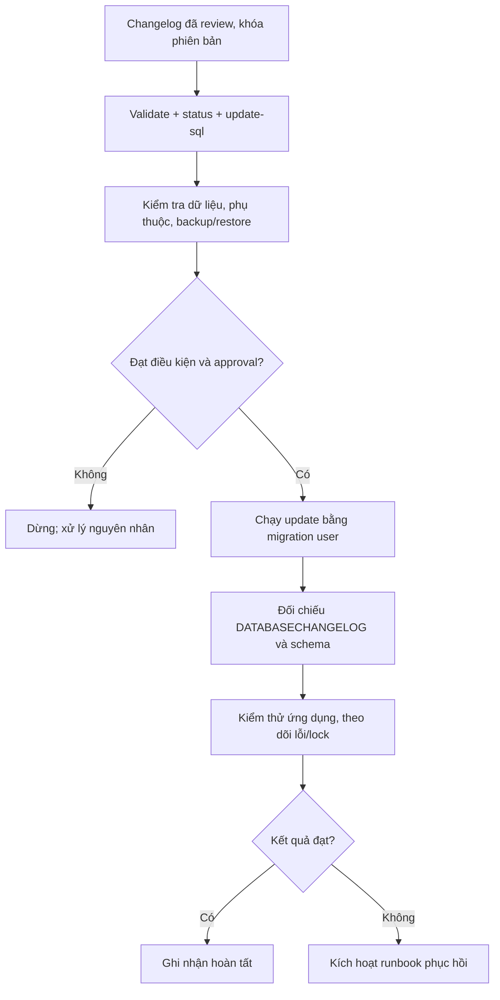

# Xóa cột, xóa bảng và kiểm soát mất dữ liệu

## 1. Mục tiêu và phạm vi

Trong module **DATABASE_SCHEMA_MIGRATION_LIQUIBASE**, người học quản lý thay đổi schema và dữ liệu bằng Liquibase qua changelog, changeset, precondition, checksum và lịch sử triển khai, đồng thời thực hành migration có kiểm chứng, rollback, phối hợp nhiều môi trường và tích hợp Spring Boot hoặc CI/CD. Phần **Thay đổi bảng** đặt ra một vấn đề quan trọng: **xóa cột hoặc bảng là thay đổi có khả năng phá hủy dữ liệu và hợp đồng giữa database với ứng dụng**.

Liquibase có các change type `dropColumn` và `dropTable` để mô tả ý định xóa đối tượng. Tuy nhiên, Liquibase không thể tự biết dữ liệu nào còn giá trị nghiệp vụ, ứng dụng nào còn sử dụng cột, bản sao lưu có phục hồi được hay không, hoặc việc xóa gây mất tính tương thích với phiên bản ứng dụng đang chạy. Những câu hỏi ấy phải được giải quyết bằng thiết kế migration, quan sát hệ thống và quy trình triển khai.

Sau bài học, bạn có thể:

1. Phân biệt `dropColumn`, `dropTable`, `delete` và việc ngừng sử dụng dữ liệu ở tầng ứng dụng.
2. Khai báo changeset xóa cột và xóa bảng bằng YAML Liquibase.
3. Kiểm kê ràng buộc, khóa ngoại, view, trigger, index, quyền và phụ thuộc của ứng dụng trước khi xóa.
4. Thiết kế quy trình **expand → migrate → contract** để giảm downtime và tránh mất dữ liệu ngoài ý muốn.
5. Dùng precondition, xác minh SQL, kế hoạch sao lưu và quy trình phục hồi để kiểm soát rủi ro.
6. Giải thích vì sao `rollback` của Liquibase không tự khôi phục các bản ghi hay giá trị cột đã bị xóa.
7. Tổ chức triển khai qua dev/test/staging/production và pipeline CI/CD với điểm dừng thích hợp.

**Nguyên tắc cốt lõi:** DDL xóa đối tượng và việc dữ liệu còn có thể phục hồi là hai vấn đề khác nhau. Một changeset hợp lệ và có trạng thái `EXECUTED` trong `DATABASECHANGELOG` chưa chứng minh mọi dữ liệu và ứng dụng đều an toàn.

## 2. Các loại thao tác xóa và hậu quả

Không phải mọi thao tác “xóa” đều làm cùng một việc.

| Thao tác | Tác động chính | Rủi ro và điều cần nhớ |
|---|---|---|
| `dropColumn` | Xóa định nghĩa cột khỏi bảng | Giá trị trong cột và các đối tượng phụ thuộc có thể mất hoặc khiến câu lệnh thất bại |
| `dropTable` | Xóa toàn bộ đối tượng bảng | Dữ liệu, cấu trúc và các đối tượng liên quan có thể bị mất theo hành vi DBMS |
| `delete` | Xóa một tập dòng theo điều kiện hoặc toàn bảng | Bảng vẫn tồn tại; số dòng bị xóa phụ thuộc điều kiện |
| SQL `TRUNCATE` | Làm rỗng dữ liệu bảng theo ngữ nghĩa DBMS | Transaction, khóa, reset identity và hành vi cascade khác nhau giữa DBMS |
| Bỏ tham chiếu ở ứng dụng | Ngừng đọc/ghi dữ liệu cũ | Dữ liệu vẫn có thể tồn tại, cho phép theo dõi và phục hồi trong giai đoạn chuyển tiếp |

Liquibase giúp biểu diễn thay đổi và quản lý lịch sử triển khai, còn **DBMS thực thi SQL và xác định chi tiết xử lý DDL**. Ví dụ, một DBMS có thể từ chối xóa cột còn được view tham chiếu, trong khi DBMS khác có lựa chọn cascade với tác động phụ lớn hơn. Cần đánh giá bằng phiên bản DBMS đích thay vì giả định mọi hệ quản trị xử lý giống nhau.

### 2.1. Xóa cấu trúc không đồng nghĩa xóa sạch mọi dấu vết dữ liệu

`dropColumn` hoặc `dropTable` thường khiến dữ liệu không còn truy cập được qua schema hiện tại, nhưng việc xóa vật lý khỏi mọi bản sao lưu, replica, snapshot, log giao dịch và hệ thống downstream còn phụ thuộc cơ sở hạ tầng, chính sách lưu giữ và DBMS. Không được coi DDL xóa đối tượng là quy trình “xóa dữ liệu cá nhân khỏi toàn bộ hệ thống” khi yêu cầu bảo mật hoặc tuân thủ đòi hỏi phạm vi rộng hơn.

### 2.2. Xóa cột cũng là thay đổi API

Schema database là một dạng hợp đồng. Khi xóa `orders.legacy_status`, các thành phần có thể bị ảnh hưởng gồm:

- SQL truy vấn trực tiếp, stored procedure hoặc function.
- ORM entity, mapping của Hibernate/JPA và câu SQL do framework sinh.
- View, materialized view, trigger, index, constraint hoặc computed/generated column.
- Job ETL, báo cáo, dashboard, pipeline CDC, công cụ BI.
- Phiên bản ứng dụng cũ còn chạy trong rolling deployment.
- Công cụ vận hành, script hỗ trợ, quy trình backup/restore và kiểm thử.

Ngay cả khi cột hiện có ít dữ liệu hoặc mọi hàng đều NULL, xóa cột vẫn có thể khiến truy vấn của ứng dụng thất bại. Vì vậy **“cột không còn dữ liệu” và “cột không còn được sử dụng” là hai kiểm tra độc lập**.

## 3. Cú pháp Liquibase: `dropColumn`

Ví dụ YAML xóa cột `legacy_status` khỏi bảng `orders` trong schema `app`:

```yaml
databaseChangeLog:
  - changeSet:
      id: 20261119-drop-orders-legacy-status
      author: database-team
      changes:
        - dropColumn:
            schemaName: app
            tableName: orders
            columnName: legacy_status
```

Các thành phần chính:

- `changeSet.id` và `changeSet.author` cùng định danh file changelog dùng nhận diện changeset trong lịch sử Liquibase.
- `schemaName` xác định schema chứa đối tượng, nếu DBMS và cách cấu hình schema hỗ trợ.
- `tableName` là bảng đích.
- `columnName` là cột sẽ bị xóa.
- `dropColumn` là **change type** mô tả ý định. Liquibase sinh câu lệnh phù hợp với DBMS mà nó kết nối.

Nếu cấu hình đang dùng schema mặc định, `schemaName` có thể không bắt buộc. Tuy nhiên, với destructive migration, **khai báo schema tường minh** thường giúp review dễ hơn và giảm nguy cơ tác động nhầm schema.

### 3.1. Một cột hay nhiều cột?

Một changeset có thể gồm nhiều thao tác `dropColumn` nếu thực sự cần thiết, nhưng gom nhiều xóa phá hủy vào cùng changeset làm việc xác định và phục hồi trạng thái giữa chừng khó hơn, đặc biệt trên DBMS không hỗ trợ transaction DDL theo mong đợi. Ưu tiên chia nhỏ theo nhóm thay đổi có cùng mục tiêu, phụ thuộc và phương án khôi phục.

Ví dụ hai changeset riêng:

```yaml
databaseChangeLog:
  - changeSet:
      id: 031-drop-old-status
      author: database-team
      changes:
        - dropColumn:
            schemaName: app
            tableName: orders
            columnName: old_status

  - changeSet:
      id: 032-drop-old-label
      author: database-team
      changes:
        - dropColumn:
            schemaName: app
            tableName: orders
            columnName: old_label
```

Hai thay đổi này chỉ nên chạy **sau khi** đã xác minh ứng dụng không còn dùng các cột và có kế hoạch khôi phục. Cấu trúc changeset nhỏ không tự bảo đảm thao tác an toàn hay có thể đảo ngược.

### 3.2. Đừng dùng `runAlways` với xóa cột

Một changeset `dropColumn` bình thường chạy một lần và được ghi vào `DATABASECHANGELOG`. Đặt `runAlways: true` thường không phù hợp: lần chạy sau có thể lỗi vì cột đã bị xóa. Nếu cột bị thay đổi thủ công giữa các lần chạy, việc cố gắng chạy lại destructive DDL có thể làm lịch sử và trạng thái khó đối chiếu.

Tương tự, không sửa trực tiếp một changeset xóa cột đã được triển khai để nó xóa cột khác; hãy tạo changeset mới. Checksum của Liquibase hỗ trợ phát hiện việc sửa định nghĩa migration, nhưng không thay thế kiểm tra schema thực tế.

## 4. Cú pháp Liquibase: `dropTable`

Xóa bảng được khai báo bằng `dropTable`:

```yaml
databaseChangeLog:
  - changeSet:
      id: 20261119-drop-obsolete-event-table
      author: database-team
      changes:
        - dropTable:
            schemaName: app
            tableName: obsolete_event
```

Sau khi thực thi thành công, bảng `app.obsolete_event` không còn tồn tại dưới schema hiện tại theo kết quả DBMS. Dữ liệu trong bảng có thể không còn truy cập được; việc khôi phục phải dựa trên bản sao lưu, snapshot hoặc một bản dữ liệu khác đã được chuẩn bị.

### 4.1. Ràng buộc và phụ thuộc

Xóa bảng có thể bị chặn bởi:

- Foreign key từ bảng khác tham chiếu bảng cần xóa.
- View, materialized view, trigger, function hoặc stored procedure phụ thuộc.
- Permission/grant, đồng bộ dữ liệu, job hoặc replication.
- Khóa/transaction của ứng dụng đang đọc ghi bảng.

Một số DBMS hoặc change type có cơ chế xóa kèm ràng buộc liên quan (ví dụ lựa chọn cascade ở những trường hợp được hỗ trợ). **Không bật cascade chỉ để vượt qua lỗi dependency**: nó có thể xóa hoặc ảnh hưởng những đối tượng khác ngoài phạm vi review ban đầu. Tốt hơn là liệt kê từng phụ thuộc và triển khai thay đổi chúng bằng changeset riêng, có thứ tự rõ ràng.

### 4.2. Khi nào nên xóa bảng?

Chỉ nên dùng `dropTable` khi thỏa đồng thời các điều kiện tối thiểu:

1. Dữ liệu không còn cần cho nghiệp vụ, pháp lý và vận hành; hoặc đã được lưu giữ ở nơi phù hợp.
2. Toàn bộ ứng dụng và hệ thống downstream đã ngừng sử dụng bảng.
3. Những phụ thuộc ở DBMS được xác minh và xử lý có chủ đích.
4. Phương án phục hồi, thời hạn lưu bản sao và mức độ mất dữ liệu chấp nhận được đã rõ.
5. Có bằng chứng kiểm thử trên môi trường tương đương production.
6. Có bước xác minh sau cập nhật và người chịu trách nhiệm khi sự cố xảy ra.

Một bảng “không còn truy vấn trong log vài ngày” chưa đủ chứng minh an toàn xóa nếu có báo cáo chạy theo tháng hoặc job hiếm khi kích hoạt.

## 5. Kiểm kê trước khi xóa: hiểu phạm vi thay đổi

Phần khó nhất của destructive migration thường không phải cú pháp YAML, mà là xác nhận **có thể xóa mà không làm hỏng hệ thống**.

### 5.1. Kiểm kê ở database

Kiểm tra:

- Tên database, catalog, schema, bảng và cột chính xác.
- Kiểu dữ liệu, giá trị mặc định, nullability, kích thước và phân bố dữ liệu.
- Primary key, foreign key, unique, check constraint, index, sequence.
- View, trigger, function, procedure, computed/generated column.
- Quyền sở hữu đối tượng và grant truy cập.
- Số lượng bản ghi, khối lượng dữ liệu, kích thước bảng và tốc độ tăng trưởng.
- Các transaction kéo dài, lock đang giữ và thao tác DDL có thể chặn truy vấn hay không.

Lấy dữ liệu từ catalog/metadata chính thức của DBMS hoặc các truy vấn kiểm tra được duyệt. Phạm vi và câu SQL cụ thể sẽ khác giữa PostgreSQL, MySQL, Oracle, SQL Server và các phiên bản.

### 5.2. Kiểm kê ở ứng dụng và hệ thống ngoài

Cần xác nhận cả:

- Entity, migration, repository, SQL viết tay và API truy xuất dữ liệu.
- Dịch vụ khác, cron job, message consumer, worker và batch processing.
- Report, BI dashboard, ETL, dữ liệu trích xuất, CDC và tích hợp đối tác.
- Bản ứng dụng cũ được giữ để rollback hoặc chạy đồng thời khi rolling update.
- Quy trình khôi phục sau sự cố, vì restore ứng dụng cũ có thể đòi schema cũ.

Tra cứu mã nguồn hỗ trợ phát hiện phụ thuộc trực tiếp, nhưng không đủ để tìm SQL động, truy vấn ad hoc hoặc báo cáo chạy không thường xuyên. Có thể dùng thống kê truy vấn, audit DBMS và kết quả kiểm thử tích hợp để bổ sung bằng chứng.

### 5.3. Xác nhận giá trị nghiệp vụ của dữ liệu

Trước khi xóa cột/bảng, phải biết dữ liệu đang được dùng để làm gì và lưu bao lâu. Một bảng có thể đã ngừng ghi nhưng vẫn là nguồn đối soát hoặc phục vụ kiểm toán. Nếu có chính sách retention, việc xóa phải phù hợp thời gian lưu giữ và kế hoạch lưu trữ.

**Một dấu hiệu riêng lẻ không đủ:** cột toàn NULL, bảng không có bản ghi, bảng không được ứng dụng hiện tại tham chiếu hay một precondition trả về đúng vẫn không thay thế đánh giá đầy đủ các phụ thuộc.

## 6. Chiến lược expand → migrate → contract

Cách triển khai an toàn cho thay đổi phá vỡ tương thích thường là tách thành nhiều đợt phát hành.



Giả sử bảng `app.orders` có cột `legacy_status` và ứng dụng sẽ chuyển sang `status`.

### Giai đoạn 1: Expand

Thêm cột `status` nếu chưa có. Tránh xóa `legacy_status` ngay trong cùng đợt nếu ứng dụng cũ vẫn phải hoạt động.

```yaml
databaseChangeLog:
  - changeSet:
      id: 001-add-orders-status
      author: database-team
      preConditions:
        - onFail: HALT
        - tableExists:
            schemaName: app
            tableName: orders
      changes:
        - addColumn:
            schemaName: app
            tableName: orders
            columns:
              - column:
                  name: status
                  type: varchar(24)
```

Changelog này minh họa môi trường nơi bảng `app.orders` đã tồn tại và cột `status` chưa tồn tại. Trong thực tế, phải kiểm tra hiện trạng; nếu cột đã được tạo thủ công hoặc migration trước đó áp dụng một phần, cần xử lý drift bằng quy trình rõ ràng.

### Giai đoạn 2: Migrate dữ liệu

Chuyển dữ liệu cũ sang cột mới theo quy tắc nghiệp vụ, có thể cần mapping giá trị:

```sql
UPDATE app.orders
SET status = legacy_status
WHERE status IS NULL
  AND legacy_status IS NOT NULL;
```

Đây là SQL minh họa khi hai cột dùng chung miền giá trị. Nếu mô hình mới đổi tên trạng thái, gộp giá trị hoặc yêu cầu chuẩn hóa, cần định nghĩa mapping chính xác thay vì sao chép nguyên văn.

Với bảng lớn, cân nhắc chạy backfill theo từng lô, giới hạn transaction, quan sát lock và hiệu năng. Việc chạy một `UPDATE` toàn bảng trong lúc deploy có thể gây timeout, tăng transaction log và ảnh hưởng ứng dụng. Trong giai đoạn chuyển tiếp, ứng dụng cần có chiến lược dual-write hoặc đồng bộ an toàn để thay đổi mới không chỉ được backfill một lần rồi lệch tiếp.

### Giai đoạn 3: Chuyển ứng dụng

Triển khai phiên bản ứng dụng đọc từ `status`. Nếu vẫn có phiên bản cũ chạy song song, cần đảm bảo cách ghi tương thích hoặc giữ cột cũ cho đến khi hoàn tất rolling deployment và hết thời hạn rollback ứng dụng.

Cần xác minh:

- Không còn query nào tham chiếu `legacy_status`.
- Mọi service, worker và batch job đã dùng hợp đồng mới.
- Dữ liệu mới tiếp tục ghi vào `status` đúng quy tắc.
- Các quan sát thực tế và kiểm thử regression đạt yêu cầu.
- Phương án quay lại phiên bản ứng dụng cũ không còn phụ thuộc cột sắp bị xóa, hoặc có kế hoạch khôi phục tương ứng.

### Giai đoạn 4: Contract

Chỉ khi các điều kiện trên đạt, phát hành changeset xóa `legacy_status` trong đợt riêng. Tách đợt contract giúp nhóm quan sát sự ổn định của ứng dụng mới trước khi thực hiện hành động không dễ hoàn nguyên.

**Cần hiểu:** expand-contract không bảo đảm “zero downtime” cho mọi trường hợp; DDL vẫn có thể lấy lock mạnh, quét hoặc viết lại bảng tùy DBMS, phiên bản và cấu trúc dữ liệu. Phải đo thời gian và tính chất khóa trên hệ thống tương đương.

## 7. Dùng precondition để chặn trạng thái không mong muốn

Precondition là điều kiện mà Liquibase đánh giá trước khi thực thi changeset. Nó giúp ngăn một số lỗi dễ dự đoán nhưng **không phải bằng chứng đầy đủ rằng xóa dữ liệu là an toàn**.

### 7.1. Ví dụ xóa cột với kiểm tra dữ liệu

Giả sử `orders.status` và `orders.legacy_status` lưu trạng thái tương đương, dữ liệu đã được đồng bộ và nhóm đã xác nhận không còn ứng dụng nào đọc cột cũ:

```yaml
databaseChangeLog:
  - changeSet:
      id: 20261119-drop-orders-legacy-status
      author: database-team
      preConditions:
        - onFail: HALT
        - tableExists:
            schemaName: app
            tableName: orders
        - columnExists:
            schemaName: app
            tableName: orders
            columnName: legacy_status
        - columnExists:
            schemaName: app
            tableName: orders
            columnName: status
        - sqlCheck:
            expectedResult: "0"
            sql: >
              SELECT COUNT(*)
              FROM app.orders
              WHERE legacy_status IS NOT NULL
                AND (status IS NULL OR status <> legacy_status)
      changes:
        - dropColumn:
            schemaName: app
            tableName: orders
            columnName: legacy_status
```

Giải thích:

1. `tableExists` kiểm tra bảng đích còn tồn tại.
2. Hai `columnExists` kiểm tra cột cũ và mới đúng tên.
3. `sqlCheck` yêu cầu không còn hàng có `legacy_status` khác `status` theo biểu thức đã đặt.
4. Nếu một precondition bị đánh giá thất bại, `onFail: HALT` dừng lần cập nhật theo cơ chế của Liquibase.
5. Nếu điều kiện đạt, Liquibase tiếp tục gửi câu xóa cột tới DBMS.

**Giới hạn của ví dụ:**

- Điều kiện SQL chỉ kiểm tra các hàng có `legacy_status` khác NULL. Nó không đo được các vấn đề khác như khác biệt semantic, dữ liệu ở hệ thống downstream hay ứng dụng còn đọc cột cũ.
- Mọi truy vấn có thể gặp race condition: dữ liệu đổi sau lúc `sqlCheck` hoàn tất nhưng trước lúc DBMS thực hiện DDL.
- SQL cần được kiểm thử trên DBMS đích với kiểu dữ liệu, collations và semantics so sánh thực tế.
- Precondition không chứng minh rằng backup có thể restore.
- Nếu kết quả bất thường, hãy điều tra; không chuyển `onFail` thành `MARK_RAN` chỉ để vượt qua bước chặn.

### 7.2. Ví dụ chỉ xóa bảng rỗng

Khi bảng `app.obsolete_event` phải được làm rỗng và ngừng sử dụng trước khi xóa:

```yaml
databaseChangeLog:
  - changeSet:
      id: 20261119-drop-empty-obsolete-event
      author: database-team
      preConditions:
        - onFail: HALT
        - tableExists:
            schemaName: app
            tableName: obsolete_event
        - sqlCheck:
            expectedResult: "0"
            sql: >
              SELECT COUNT(*)
              FROM app.obsolete_event
      changes:
        - dropTable:
            schemaName: app
            tableName: obsolete_event
```

Nếu bảng chứa bất kỳ hàng nào tại thời điểm kiểm tra, changeset sẽ dừng. Nhưng bảng rỗng vẫn có thể là dependency của view, foreign key hoặc một ứng dụng chưa được nâng cấp. Vì vậy phải kiểm kê ngoài precondition.

### 7.3. Chính sách precondition cần hiểu đúng

| Chính sách | Hành vi khái quát | Lưu ý khi xóa dữ liệu |
|---|---|---|
| `HALT` | Dừng khi điều kiện thất bại | Phù hợp khi cần chặn xóa không đúng trạng thái |
| `WARN` | Ghi cảnh báo và tiếp tục theo hành vi Liquibase | Có nguy cơ thực hiện thay đổi dù kiểm tra không đạt |
| `CONTINUE` | Bỏ qua changeset trong lần xét hiện tại | Có thể bị xét lại ở lượt sau; không chứng minh đã xóa |
| `MARK_RAN` | Đánh dấu đã xử lý mà không chạy thay đổi tương ứng | Có thể che giấu schema chưa được chỉnh nếu thiếu kiểm tra sau triển khai |

Phạm vi áp dụng các giá trị này phụ thuộc vị trí của precondition (cấp changelog hay changeset) và phiên bản Liquibase. Đối với destructive migration, nên ưu tiên điều kiện rõ ràng và lỗi có thể quan sát thay vì mặc định bỏ qua.

### 7.4. Điều kiện phê duyệt triển khai

Có thể dùng một property do pipeline kiểm soát để biểu thị một bước phê duyệt kỹ thuật, chẳng hạn một precondition kiểu `changeLogPropertyDefined` nếu phiên bản Liquibase đang dùng hỗ trợ. Tuy nhiên, property chỉ là giá trị cấu hình; người có quyền chạy lệnh có thể truyền giá trị đó. Nó **không thay thế** quyền của DBMS, cơ chế approval ở CI/CD, chính sách branch protection và kiểm tra quyền truy cập production.

## 8. Mất dữ liệu và khả năng rollback: hai vấn đề riêng

### 8.1. Vì sao `dropColumn` và `dropTable` không tự khôi phục dữ liệu?

Liquibase có thể ghi nhận rằng changeset đã chạy, nhưng bảng `DATABASECHANGELOG` không lưu từng hàng bị xóa hoặc bản sao giá trị cột. Với các thao tác phá hủy như `dropColumn` và `dropTable`, không nên trông chờ cơ chế auto-rollback của Liquibase khôi phục đầy đủ schema và dữ liệu.

Ví dụ một rollback chỉ tái tạo cấu trúc cột:

```yaml
databaseChangeLog:
  - changeSet:
      id: 040-drop-legacy-note
      author: database-team
      changes:
        - dropColumn:
            schemaName: app
            tableName: orders
            columnName: legacy_note
      rollback:
        - addColumn:
            schemaName: app
            tableName: orders
            columns:
              - column:
                  name: legacy_note
                  type: varchar(200)
```

Rollback được khai báo ở đây **chỉ tạo lại cột**. Nó không phục hồi những ghi chú cũ từng nằm trong `legacy_note`, không tự khôi phục index/default/constraint/permission liên quan và không chứng minh schema ban đầu đã trở lại nguyên vẹn. Ví dụ chỉ phù hợp để minh họa giới hạn; không nên gọi đây là kế hoạch khôi phục dữ liệu.

Tương tự, một rollback tạo lại bảng `obsolete_event` bằng `createTable` không làm xuất hiện các hàng đã mất trừ khi đã có bước phục hồi dữ liệu riêng. Nếu khôi phục yêu cầu bản sao lưu, cần xác định nguồn, thời điểm, tính nhất quán và thứ tự phục hồi.

### 8.2. JDBC transaction rollback khác Liquibase rollback

- **JDBC `Connection.rollback()`:** yêu cầu DBMS hoàn tác các thao tác chưa commit trong transaction hiện tại khi DBMS hỗ trợ.
- **Liquibase rollback:** chạy những thay đổi đảo chiều theo lịch sử và định nghĩa rollback, có thể diễn ra ở một lần triển khai khác.
- **Backup/PITR restore:** phục hồi trạng thái dữ liệu từ snapshot, bản sao lưu hoặc lịch sử giao dịch theo khả năng hạ tầng DBMS.

Ba cơ chế này không tương đương nhau. Ví dụ, một số hệ quản trị hỗ trợ transactional DDL tốt hơn hệ quản trị khác; một số loại DDL có implicit commit. Nếu câu `DROP TABLE` đã commit, gọi rollback transaction sau đó không bảo đảm phục hồi bảng. Liquibase rollback cũng không tự tạo dữ liệu bị mất.

### 8.3. Khi nào có thể rollback?

Cần phân loại:

1. **Chưa chạy destructive DDL:** có thể dừng phát hành hoặc quay về phiên bản ứng dụng trước đó mà không cần phục hồi đối tượng đã xóa.
2. **DDL thất bại nhưng chưa commit và DBMS hỗ trợ transactional DDL:** có thể còn khả năng rollback transaction, cần xác minh trạng thái thực tế.
3. **DDL đã commit, dữ liệu đã mất khỏi schema:** cần khôi phục từ backup, snapshot, dữ liệu lưu tạm hoặc tính lại từ nguồn dữ liệu được bảo đảm.
4. **Có dữ liệu mới sau thời điểm backup:** restore toàn database có thể ghi đè thay đổi hợp lệ của các bảng khác. Có thể cần phục hồi có chọn lọc, đối chiếu và merge thay vì thay thế toàn bộ database.

Đừng lập kế hoạch rollback bằng cách giả định “cứ có lệnh `liquibase rollback` là dữ liệu sẽ quay về”. Hãy thiết kế và kiểm thử một quy trình khôi phục cụ thể.

## 9. Lưu dữ liệu trước khi xóa

Tùy mức độ rủi ro, nhóm có thể dùng nhiều lớp bảo vệ.

### 9.1. Backup do DBMS hoặc nền tảng cung cấp

Các hình thức thường gặp:

- Backup toàn database có kiểm tra tính toàn vẹn.
- Snapshot/backup ở mức lưu trữ khi phù hợp với khả năng nhất quán của DBMS.
- Point-in-time recovery (PITR) nếu DBMS, log giao dịch và hệ thống backup hỗ trợ.
- Phục hồi vào database tạm để lấy lại riêng bảng/cột rồi đối chiếu.

Cần xác định **RPO** (mức dữ liệu tối đa có thể mất) và **RTO** (thời gian phục hồi tối đa chấp nhận) cùng khả năng thực tế của hệ thống. Một backup tồn tại nhưng chưa từng thử restore không đủ để kết luận có thể phục hồi kịp thời.

### 9.2. Sao chép dữ liệu trọng yếu sang bảng lưu tạm

Trong một số trường hợp, có thể tạo bảng lưu giá trị cũ trước khi xóa cột. Ví dụ dành cho bảng `orders` có khóa `order_id` kiểu `bigint` và cột `legacy_status` kiểu `varchar(24)`:

```yaml
databaseChangeLog:
  - changeSet:
      id: 020-create-orders-status-archive
      author: database-team
      changes:
        - createTable:
            schemaName: app
            tableName: orders_legacy_status_archive
            columns:
              - column:
                  name: order_id
                  type: bigint
                  constraints:
                    primaryKey: true
                    nullable: false
              - column:
                  name: legacy_status
                  type: varchar(24)
        - sql:
            sql: >
              INSERT INTO app.orders_legacy_status_archive
                (order_id, legacy_status)
              SELECT order_id, legacy_status
              FROM app.orders
```

**Đây chỉ là cách giữ một bản sao dữ liệu trong cùng database**, không phải backup độc lập. Nếu mất cả database hoặc thao tác sai schema, dữ liệu lưu tạm cũng có thể mất. Ngoài ra:

- Phải đảm bảo tên archive chưa tồn tại, cấu trúc phù hợp và thao tác insert có thể hoàn tất.
- Với bảng lớn, copy toàn bộ có thể tốn thời gian, tạo lock hoặc gây đầy dung lượng.
- Nếu ứng dụng tiếp tục ghi cột cũ sau lúc copy, bản archive không còn mới. Cần có cơ chế delta, khóa ghi, dual-write hoặc xác nhận ngừng ghi trước khi xóa.
- Bảng archive có thể chứa dữ liệu nhạy cảm; phải quản lý quyền, mã hóa, retention, index và dọn dẹp đúng quy trình.
- Phải kiểm tra số hàng và giá trị quan trọng, không chỉ dựa vào thông báo “INSERT thành công”.
- Nếu DDL và DML trong cùng changeset không nguyên tử trên DBMS đích, lỗi giữa chừng có thể để lại bảng archive chưa hoàn chỉnh.

Khi phải lưu dữ liệu dài hạn hoặc phục hồi sau thảm họa, không dùng bảng archive cùng database thay thế backup nền tảng.

### 9.3. Phục hồi có chọn lọc

Ví dụ với **PostgreSQL**, nếu bảng `orders_legacy_status_archive` vẫn có dữ liệu đáng tin cậy và đã tái tạo `legacy_status` sau khi drop:

```sql
-- PostgreSQL-specific: minh họa phục hồi dữ liệu từ bảng archive.
UPDATE app.orders AS o
SET legacy_status = a.legacy_status
FROM app.orders_legacy_status_archive AS a
WHERE a.order_id = o.order_id;
```

Câu SQL này chỉ phục hồi các hàng khớp khóa hiện có và chỉ những giá trị đã được lưu ở archive. Nó không tự phục hồi hàng `orders` đã bị xóa, những sửa đổi mới hơn hoặc các phụ thuộc cấu trúc bị mất. Trước khi chạy cần kiểm tra schema, số hàng dự kiến, transaction, quyền và khả năng khôi phục khi lỗi.

Nếu phải khôi phục **bảng đã bị xóa**, thường cần restore dữ liệu từ backup vào vùng tạm rồi quyết định cách tái tạo bảng, constraints, indexes và di chuyển dữ liệu trở lại. SQL và trình tự cụ thể phụ thuộc DBMS.

## 10. Phụ thuộc, thứ tự migration và schema drift

### 10.1. Phụ thuộc theo thứ tự

Ví dụ dự kiến xóa bảng `customer_legacy` nhưng bảng `orders` còn foreign key tham chiếu. Một quy trình có chủ đích có thể cần:

1. Cập nhật ứng dụng và dữ liệu để ngừng sử dụng khóa ngoại cũ.
2. Xác nhận quan hệ dữ liệu không còn cần thiết.
3. Xóa foreign key bằng changeset tường minh, nếu đó là quyết định đã được review.
4. Kiểm tra view/trigger/function hoặc job còn phụ thuộc.
5. Xóa bảng chỉ khi rủi ro và phương án phục hồi được chấp nhận.

Không gộp tất cả bước vào một thay đổi bất khả kiểm soát chỉ vì DBMS có tùy chọn cascade. Cũng không xóa constraint nếu nó vẫn là bảo vệ toàn vẹn dữ liệu cần thiết cho ứng dụng.

### 10.2. Schema drift

Schema drift xảy ra khi database thực tế khác trạng thái mà changelog dự kiến, ví dụ DBA tạo index thủ công, ai đó xóa cột ngoài Liquibase hoặc môi trường staging có schema không giống production.

Nếu changeset `dropColumn` chạy trên database mà cột đã bị xóa thủ công, Liquibase có thể báo lỗi. Đừng tự động dùng `onFail: MARK_RAN` để “đồng bộ” lịch sử nếu chưa xác minh nguồn gốc khác biệt. Việc đánh dấu đã chạy mà không hiểu trạng thái thực tế có thể che giấu migration thiếu bước khác.

Trước destructive change, đối chiếu:

- Định nghĩa trong changelog.
- Dòng trong `DATABASECHANGELOG`, gồm ID, author, filename, checksum và thời gian.
- Trạng thái schema và dữ liệu thật.
- Các thay đổi ngoài Liquibase được ghi nhận trong log vận hành.

Checksum Liquibase theo dõi định nghĩa changeset; nó **không phải checksum của toàn bộ schema**. Một checksum hợp lệ không chứng minh dữ liệu trước xóa đã được sao lưu.

## 11. Transaction, khóa và vận hành trên bảng lớn

### 11.1. Khả năng transaction DDL phụ thuộc DBMS

Trên PostgreSQL, nhiều loại DDL có thể tham gia transaction, nhưng vẫn có ngoại lệ và rủi ro lock. Trên MySQL, nhiều thao tác DDL có implicit commit và hành vi online/in-place thay đổi theo engine, phiên bản và loại thao tác. Oracle, SQL Server và các DBMS khác cũng có khác biệt. Do đó phải kiểm thử **trên đúng sản phẩm, phiên bản và cấu hình** mà production sử dụng.

Thuộc tính `runInTransaction` của Liquibase ảnh hưởng cách changeset được chạy. Không đặt `runInTransaction: false` để “cho nhanh” mà không hiểu hệ quả: nếu một changeset có nhiều lệnh và có lỗi giữa chừng, database có thể ở trạng thái áp dụng một phần trong khi lịch sử Liquibase chưa ghi nhận hoàn tất.

### 11.2. Lock và thời gian thay đổi

Xóa cột có thể rất nhanh ở một tổ hợp DBMS/phiên bản nhất định, nhưng cũng có thể yêu cầu lock mạnh, tái tổ chức dữ liệu hoặc chờ transaction đang hoạt động. Xóa bảng cũng có thể chờ lock, tác động cache và các session đang dùng đối tượng.

Cần khảo sát:

- Loại lock mà DBMS sẽ lấy và khả năng chặn truy vấn.
- Thời gian giữ lock, thời gian chờ tối đa và chiến lược dừng.
- Khối lượng dữ liệu, số index, foreign key và các phụ thuộc.
- Ảnh hưởng tới replication, CDC, backup, monitoring và connection pool.
- Khả năng triển khai trong maintenance window hoặc cần tách ra nhiều bước.

Đừng coi `update-sql` là phép đo lock hay hiệu năng. Nó giúp kiểm tra SQL dự kiến; để dự đoán vận hành cần chạy thử với dữ liệu và tải tương tự production.

### 11.3. Các lần chạy đồng thời

Liquibase quản lý khóa triển khai qua `DATABASECHANGELOGLOCK` để điều phối nhiều tiến trình cùng cập nhật lịch sử. Khóa này không cấm ứng dụng/DBA chạy SQL ngoài Liquibase, và không thay thế lock thực thi của DBMS.

Trong kiến trúc Spring Boot nhiều replica, tránh để nhiều instance vô tình kích hoạt destructive migration khi khởi động. Một job migration chuyên trách trong CI/CD, theo thứ tự triển khai đã duyệt, thường giúp kiểm soát thời điểm xóa đối tượng và quyền kết nối rõ ràng hơn.

## 12. Kiểm chứng trước khi chạy destructive migration

### 12.1. Xác nhận môi trường đích

Bước đầu tiên là biết chắc **đang kết nối tới đâu**: DBMS, host/database, schema, user và bản changelog. Phân biệt staging với production không chỉ bằng tên host hiển thị trong log; kiểm tra bằng cơ chế đã được tổ chức phê duyệt. Thông tin xác thực phải đến từ secret manager hoặc cấu hình runtime được bảo vệ.

### 12.2. Xác minh changelog và danh sách thay đổi

Có thể tổ chức luồng kiểm tra như sau:

```text
Chọn đúng artifact và database đích
    ↓
Xác minh cấu trúc changelog (validate)
    ↓
Kiểm tra pending changeset (status)
    ↓
Xem SQL dự kiến (update-sql)
    ↓
Kiểm tra precondition, phụ thuộc, backup và rollback
    ↓
Phê duyệt thủ tục triển khai
    ↓
Liquibase update
    ↓
Xác minh schema, dữ liệu, ứng dụng và lịch sử
```

Ví dụ lệnh CLI trong môi trường đã cấu hình kết nối riêng:

```bash
liquibase --changelog-file=db/changelog.yaml validate
liquibase --changelog-file=db/changelog.yaml status --verbose
liquibase --changelog-file=db/changelog.yaml update-sql
```

Tên option/command có thể khác giữa các phiên bản Liquibase; hãy kiểm tra công cụ thực tế của dự án. Không cung cấp mật khẩu bằng tham số dòng lệnh hiển thị công khai. Các lệnh xem trước có thể truy cập metadata và lịch sử DBMS, nhưng không tương đương với một lần `update` thành công.

**Cần xem tận câu SQL** được Liquibase sinh ra: schema nào, bảng/cột nào, có `CASCADE` hay không, có thao tác xóa dữ liệu ngoài dự kiến không, và có câu SQL đặc thù DBMS không. Đặc biệt cảnh giác với `DROP TABLE`, `ALTER TABLE ... DROP COLUMN`, `DELETE` không có `WHERE` và `TRUNCATE`.

### 12.3. Những giới hạn của SQL preview

Một bản `update-sql` không thể bảo đảm:

- Precondition vẫn đúng ở thời điểm cập nhật thật.
- Quyền hoặc lock của DBMS không thay đổi.
- Không có ứng dụng nào còn tham chiếu đối tượng.
- Tất cả DDL đều atomic và có thể rollback.
- Backup có thể restore và không ghi đè dữ liệu mới.
- Không có thay đổi song song trong khoảng thời gian giữa preview và update.

Vì vậy, khi thời điểm triển khai đã cách xa thời điểm review hoặc khi có thay đổi về artifact, tham số hay database, phải kiểm tra lại.

### 12.4. Checklist quyết định xóa

| Hạng mục | Bằng chứng cần có trước `update` |
|---|---|
| Chính xác đối tượng | Database, schema, bảng, cột, loại dữ liệu đã xác minh |
| Nghiệp vụ | Dữ liệu không còn cần hoặc đã được lưu giữ hợp lệ |
| Ứng dụng | Không còn query/ORM/job/report phụ thuộc |
| Đồng bộ dữ liệu | Backfill, dual-write và đối chiếu đã hoàn tất |
| Phụ thuộc DBMS | Foreign key, view, trigger, index và grants đã được xử lý |
| Backup | Có bản sao phù hợp, đã thử restore và biết RPO/RTO |
| Rollback/restore | Có runbook và nguồn dữ liệu khôi phục cụ thể |
| Transaction | Hiểu lock, DDL commit và khả năng áp dụng một phần |
| Precondition | Có kiểm tra điều kiện tối thiểu, ưu tiên dừng khi sai |
| CI/CD | Artifact cố định, quyền migration hạn chế, approval đúng môi trường |
| Quan sát | Có log, truy vấn xác minh và người xử lý khi có sự cố |

## 13. Mô hình triển khai nhiều môi trường và CI/CD

### 13.1. Dev và test

Ở dev/test, có thể mô phỏng cả trường hợp dữ liệu sạch và dữ liệu “bẩn”, ví dụ:

- Cột `legacy_status` có giá trị không khớp `status`.
- Có một view hoặc foreign key phụ thuộc đối tượng cần xóa.
- Ứng dụng cũ cố truy vấn cột sau khi xóa.
- Backup thiếu dữ liệu và quá trình restore không khôi phục đủ.
- Changeset bị thử lại sau lỗi, database ở trạng thái áp dụng một phần.

Không chỉ kiểm thử happy path nơi database đã rỗng và mọi cột đều không còn được dùng.

### 13.2. Staging

Staging nên có schema, cấu hình quyền, loại DBMS và khối lượng dữ liệu/tải gần production theo khả năng phù hợp, đồng thời bảo vệ dữ liệu nhạy cảm. Tại đây cần thử:

- Thời gian `dropColumn`/`dropTable` và ảnh hưởng lock.
- Luồng triển khai ứng dụng trước/sau contract.
- Khả năng rollback ứng dụng và khôi phục dữ liệu.
- Sự chính xác của `DATABASECHANGELOG` sau chạy và sau tình huống lỗi.
- Chính sách backup, retention và giám sát.

Staging “thành công” không chứng minh production an toàn tuyệt đối, nhưng giúp phát hiện sớm sự khác biệt cấu hình và phụ thuộc.

### 13.3. Production

Có thể tổ chức pipeline theo các cổng kiểm soát:



Đối với một hệ thống sản xuất, nên tránh xóa schema trong chính lúc nhiều phiên bản ứng dụng còn được dự kiến sử dụng cấu trúc cũ. Chạy migration từ một job có quyền phù hợp giúp tách rời vòng đời DDL và thời điểm khởi động từng replica Spring Boot.

### 13.4. Changelog bất biến và lịch sử triển khai

Không sửa changeset đã triển khai để thay mục tiêu từ bảng A sang bảng B. Thay vào đó, tạo changeset mới và để Liquibase ghi nhận từng bước. Nếu nội dung changeset đã chạy bị sửa, checksum mismatch có thể xuất hiện; giải pháp đúng là điều tra và xử lý theo quy trình thay vì làm mới checksum một cách tùy tiện.

Cũng không nên thay `id`, `author` hoặc đường dẫn file để ép một destructive changeset cũ chạy lại. Điều đó có thể khiến Liquibase coi thay đổi là mới, tiềm ẩn việc xóa nhầm đối tượng hoặc báo lỗi không cần thiết.

## 14. Kiểm chứng sau khi cập nhật

Sau khi chạy `update`, cần xác minh nhiều lớp:

1. **Liquibase:** thông báo hoàn tất, ID/author/file của changeset được ghi trong `DATABASECHANGELOG`, checksum và kiểu thực thi phù hợp.
2. **Schema:** cột/bảng dự kiến không còn; các đối tượng khác vẫn tồn tại đúng.
3. **Dữ liệu:** dữ liệu cần giữ còn nguyên; bảng archive hoặc backup có thể truy cập và đối chiếu.
4. **Ứng dụng:** API, batch, dashboard, pipeline và các truy vấn chính vẫn hoạt động.
5. **Vận hành:** lock/transaction đã giải phóng, replication/CDC không bất thường, error rate không tăng.
6. **Khả năng phục hồi:** quy trình restore và thời hạn giữ bản sao vẫn còn hiệu lực sau deploy.

Không chỉ kiểm tra dòng trong `DATABASECHANGELOG`: một changeset có thể được xử lý theo chính sách đặc biệt, hoặc sự cố ngoài Liquibase làm schema thực tế lệch lịch sử. Cũng không coi “không còn pending changeset” là bằng chứng dữ liệu đã được bảo toàn.

### 14.1. Ví dụ truy vấn lịch sử

```sql
SELECT ID, AUTHOR, FILENAME, DATEEXECUTED, EXECTYPE, MD5SUM
FROM DATABASECHANGELOG
WHERE ID = '20261119-drop-orders-legacy-status'
  AND AUTHOR = 'database-team';
```

Tên bảng lịch sử và schema có thể đã được cấu hình khác mặc định; các cột và cách quote phụ thuộc DBMS. Bản ghi lịch sử giúp xác định Liquibase đã nhận diện changeset nào, **không** lưu giá trị `legacy_status` từng bị xóa.

### 14.2. Khi xác minh thất bại

Nếu changeset được ghi nhận đã chạy nhưng ứng dụng lỗi, cần quyết định có thể tạm chuyển ứng dụng sang phiên bản tương thích hay phải phục hồi schema/dữ liệu. Nếu một phần DDL đã commit, không tiếp tục chạy lại mù quáng. Cần ghi lại những đối tượng đã thay đổi, đánh giá transaction và khôi phục có chủ đích.

Không xóa dòng lịch sử, đổi checksum hay tự động giải phóng khóa Liquibase để “cho chạy lại” khi chưa xác định trạng thái DBMS và tiến trình đang chạy.

## 15. Tình huống thực hành

**Bối cảnh:** Bảng `app.orders` có 2 triệu dòng, chứa `legacy_status` và `status`. Ứng dụng mới chỉ đọc `status`; một worker cũ còn ghi `legacy_status` vào ban đêm. Nhóm muốn xóa cột cũ trước bản phát hành cuối tuần.

**Phân tích:** Chưa đủ điều kiện xóa. Dù precondition đối chiếu dữ liệu hiện tại trả về 0 hàng sai khác, worker cũ vẫn có thể ghi tiếp, gây lệch hoặc lỗi sau khi cột bị xóa. Cần nâng cấp/loại bỏ worker, kiểm tra lịch chạy và nguồn dữ liệu, hoàn tất backfill/dual-write, quan sát đủ chu kỳ hoạt động, sau đó mới xem xét contract.

Một lộ trình phù hợp:

1. Kiểm kê nơi `legacy_status` được đọc/ghi.
2. Nâng cấp worker cũ để dùng `status` hoặc ngừng worker theo kế hoạch có thể kiểm chứng.
3. Chạy backfill có kiểm soát và đo số dòng được cập nhật.
4. Đối chiếu dữ liệu trước khi deploy, đặc biệt các bản ghi thay đổi trong thời gian chuyển tiếp.
5. Chuẩn bị backup/restore đã thử và kế hoạch ứng dụng tương thích.
6. Kiểm tra SQL `dropColumn`, precondition, lock và quyền.
7. Thực hiện contract trong một đợt release riêng với điều kiện dừng rõ ràng.
8. Quan sát lỗi ứng dụng và lịch sử Liquibase; giữ nguồn dữ liệu lưu trữ trong thời hạn được duyệt.

### 15.1. Câu hỏi tự đánh giá

1. Nếu rollback thêm lại cột đã xóa nhưng không có dữ liệu, hệ thống đã phục hồi đầy đủ chưa? Vì sao?
2. Vì sao `onFail: HALT` phù hợp hơn `MARK_RAN` trong changeset xóa cột yêu cầu đối chiếu dữ liệu?
3. Bảng có 0 hàng thì có thể `dropTable` ngay không? Cần kiểm tra các phụ thuộc nào?
4. Khác biệt giữa DBMS có transactional DDL và DBMS có implicit commit ảnh hưởng recovery thế nào?
5. Nếu ứng dụng cũ còn chạy trong rolling deployment, nên xóa cột ở giai đoạn expand hay contract?
6. Vì sao `update-sql` thành công không chứng minh câu `DROP` an toàn khi chạy thật?
7. Nếu bản backup được tạo trong cùng database và ứng dụng tiếp tục ghi dữ liệu, cần kiểm soát điều gì?

### 15.2. Tiêu chí hoàn thành bài thực hành

Một phương án migration được coi là đủ cơ sở để review khi có cả: changelog được version-control, danh sách phụ thuộc, kết quả đối chiếu dữ liệu, phương án backup/restore đã kiểm thử, SQL xem trước, thông tin DBMS/phiên bản, cách chặn khi điều kiện sai, kế hoạch phát hành ứng dụng và bước xác minh sau deploy. Không cần chạy `DROP` trên production để chứng minh hiểu cơ chế; hãy thực hành trên database thử nghiệm trước.

## 16. Các lỗi thiết kế thường gặp

| Triệu chứng hoặc sai lầm | Nguyên nhân | Cách phòng tránh |
|---|---|---|
| `dropColumn` báo đang có dependency | Index, view, constraint hoặc object khác còn tham chiếu | Kiểm kê và xử lý phụ thuộc tường minh |
| `dropTable` bị foreign key chặn | Bảng khác còn tham chiếu khóa | Xem xét mô hình dữ liệu, cập nhật phụ thuộc có kiểm soát |
| Ứng dụng lỗi sau deploy | Vẫn có phiên bản, worker hoặc report dùng cấu trúc cũ | Expand-contract, kiểm thử và theo dõi đủ chu kỳ |
| Rollback tạo lại bảng rỗng | Không có dữ liệu lưu và restore riêng | Lập kế hoạch backup và phục hồi dữ liệu |
| Mất dữ liệu mới khi restore | Khôi phục cả database từ snapshot cũ | Phục hồi vào vùng tạm, đối chiếu và merge có chọn lọc |
| Migration chạy thử tốt nhưng production bị lock | Dữ liệu/tải và DBMS khác staging | Kiểm tra lock, throughput và maintenance window |
| Precondition pass nhưng xóa vẫn nguy hiểm | Điều kiện chỉ kiểm tra một phần trạng thái | Kết hợp phân tích nghiệp vụ, dependency và backup |
| Lịch sử Liquibase không phản ánh schema | Thay đổi thủ công, DDL áp dụng một phần hoặc lịch sử bị sửa | Đối chiếu DBMS thực tế với `DATABASECHANGELOG` |
| Xóa nhầm schema | Dùng default schema/URL sai | Cấu hình schema tường minh, xác minh URL và quyền |
| `runAlways` khiến lệnh DROP chạy lại | Chọn cờ thực thi sai | Để changeset destructive chạy một lần, có kế hoạch mới khi thay đổi |
| Không thể lấy dữ liệu từ backup | Chưa thử restore, backup hỏng hoặc thiếu quyền | Diễn tập restore và theo dõi RPO/RTO |

## 17. Nguyên tắc ghi nhớ

- Xóa cột và bảng là **thay đổi cấu trúc có thể phá hủy dữ liệu**, cần quyết định nghiệp vụ và vận hành.
- `dropColumn` và `dropTable` mô tả thao tác DDL; Liquibase không tự đánh giá việc dữ liệu còn cần hay không.
- Với thay đổi phá vỡ tương thích, ưu tiên **expand → migrate → contract** và phát hành bước xóa ở đợt riêng.
- Xác nhận không còn cả **dữ liệu cần giữ** lẫn **thành phần ứng dụng phụ thuộc**.
- Kiểm kê foreign key, view, index, trigger, stored procedure, báo cáo, worker và các phiên bản ứng dụng cũ.
- Dùng precondition có mục đích rõ ràng, thường dừng khi điều kiện quan trọng không đạt.
- Không xem việc tạo lại cột/bảng bằng rollback là phục hồi toàn bộ dữ liệu đã xóa.
- Đảm bảo backup có thể restore, biết thời điểm backup, RPO/RTO và cách xử lý dữ liệu phát sinh sau backup.
- Kiểm thử transaction, lock và tính không nguyên tử của DDL trên **đúng DBMS đích**.
- Review `validate`, `status`, `update-sql` và đối chiếu kết quả sau `update`.
- Giữ changelog và lịch sử Liquibase có thể truy vết; không sửa checksum hoặc xóa `DATABASECHANGELOG` để che sự cố.
- Trong Spring Boot hoặc CI/CD, dùng job migration có kiểm soát, tách quyền khi phù hợp và tránh chạy destructive DDL ngoài cửa sổ triển khai dự kiến.

**Kết luận:** Viết một changeset `dropColumn` hay `dropTable` rất ngắn, nhưng chứng minh rằng nó an toàn cần nhiều lớp kiểm soát hơn: quản lý phụ thuộc, di chuyển dữ liệu, tương thích ứng dụng, dự phòng có thể phục hồi, precondition và xác minh trên database thực tế. Khi triển khai có kiểm chứng, Liquibase giúp chuẩn hóa thao tác xóa và lịch sử; trách nhiệm bảo vệ dữ liệu và dịch vụ vẫn thuộc về thiết kế migration cùng quy trình vận hành.

