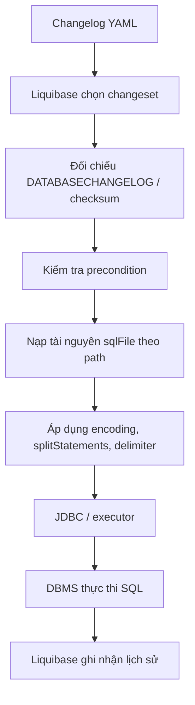
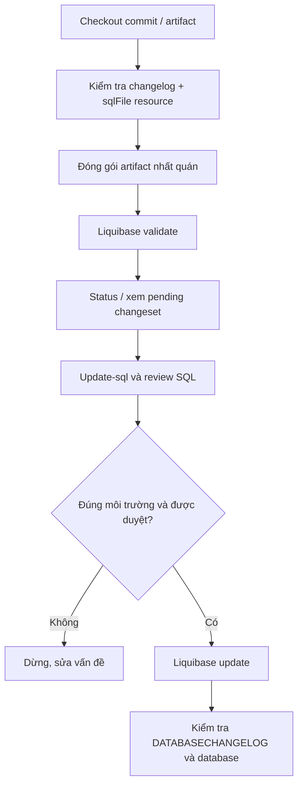

# Sử dụng `sqlFile` và quản lý tài nguyên SQL bên ngoài

## 1. Bối cảnh và mục tiêu học tập

Trong module **DATABASE_SCHEMA_MIGRATION_LIQUIBASE**, trọng tâm là quản lý thay đổi schema và dữ liệu bằng changelog, changeset, precondition, checksum và lịch sử triển khai; thực hành migration có kiểm chứng, rollback, phối hợp nhiều môi trường và tích hợp Spring Boot hoặc CI/CD. Ở phần **SQL và đối tượng**, không phải thao tác nào cũng thuận tiện biểu diễn bằng các change type như `createTable`, `addColumn` hoặc `createIndex`.

Một số thay đổi được viết tự nhiên hơn dưới dạng SQL: định nghĩa view, function, procedure, trigger, chỉ mục đặc biệt của DBMS, cập nhật dữ liệu nhiều bước hoặc thao tác được DBA cung cấp dưới dạng script. Khi SQL dài, đưa toàn bộ vào thuộc tính `sql` trong YAML khiến tài liệu khó đọc và khó kiểm tra. **`sqlFile`** cho phép một changeset tham chiếu tới **một tài nguyên SQL bên ngoài**, còn Liquibase vẫn quản lý thứ tự triển khai và trạng thái changeset.

Sau bài này, bạn có thể:

1. Phân biệt change type `sql`, `sqlFile` và formatted SQL changelog.
2. Tổ chức file `.sql` đi cùng changelog trong repository, classpath hoặc artifact triển khai.
3. Khai báo `path`, `relativeToChangelogFile`, `encoding`, `splitStatements`, `endDelimiter` và `stripComments` có chủ đích.
4. Kiểm soát SQL có nhiều câu lệnh, dấu chấm phẩy bên trong function/procedure, comment và cú pháp riêng DBMS.
5. Hiểu mối liên hệ giữa nội dung file SQL, checksum, `runOnChange`, `DATABASECHANGELOG` và việc sửa changeset đã triển khai.
6. Tạo rollback riêng, kiểm thử dữ liệu và không đồng nhất rollback của Liquibase với hoàn tác transaction.
7. Kiểm tra resource được đóng gói đúng vào Spring Boot JAR hoặc artifact CI/CD và xác minh SQL trước khi chạy `update`.

**Thông điệp chính:** `sqlFile` tách **nội dung SQL** khỏi **metadata điều phối migration**. Nó không tự chuyển đổi SQL giữa các DBMS, không tự động sao lưu dữ liệu và không bỏ qua cơ chế lịch sử của Liquibase.

## 2. `sqlFile` là gì và khác `sql` thế nào?

Liquibase nạp changelog để xác định changeset nào cần thực thi. Một changeset có thể khai báo `sqlFile` để chỉ tới file SQL chứa các câu lệnh thực tế. Liquibase đọc nội dung resource được chỉ định, xử lý theo cấu hình tương ứng rồi sử dụng kênh kết nối đã cấu hình để thực thi trên DBMS.

So sánh ba cách viết:

| Cách viết | SQL nằm ở đâu? | Phù hợp khi nào? | Điều cần chú ý |
|---|---|---|---|
| `sql` | Trong phần `changes` của YAML/XML/JSON changelog | SQL ngắn, dễ đọc ngay tại changeset | SQL dài làm changelog khó review |
| `sqlFile` | Trong file `.sql` được tham chiếu bởi changeset | View, function, procedure, DML dài, SQL riêng DBMS | Phải quản lý đường dẫn, encoding, checksum và đóng gói |
| **Formatted SQL changelog** | Trong file `.sql` có header/marker Liquibase để khai báo changeset | Muốn đặt định nghĩa changeset và SQL trực tiếp trong file SQL | Đây là một **định dạng changelog**, khác SQL thuần được `sqlFile` nạp |

Ví dụ `sql` viết trực tiếp:

```yaml
databaseChangeLog:
  - changeSet:
      id: 001-update-flag-inline
      author: schema-team
      changes:
        - sql:
            sql: >
              UPDATE app.feature_flags
              SET enabled = TRUE
              WHERE flag_key = 'invoice_export'
```

Tương đương về mục đích, nhưng tách SQL ra ngoài:

```yaml
databaseChangeLog:
  - changeSet:
      id: 001-update-flag-external
      author: schema-team
      changes:
        - sqlFile:
            path: sql/update_invoice_flag.sql
            relativeToChangelogFile: true
            encoding: UTF-8
```

Nội dung tài nguyên `sql/update_invoice_flag.sql`:

```sql
UPDATE app.feature_flags
SET enabled = TRUE
WHERE flag_key = 'invoice_export';
```

Hai changeset ví dụ trên có **ID khác nhau**; chỉ minh họa cách tổ chức, **không nên cùng triển khai cả hai** nếu chúng tác động trùng mục đích. Khi dự án đã chọn cách viết, giữ lịch sử changeset có thể truy vết thay vì tự ý chuyển đổi và đổi ID để chạy lại.

### 2.1. SQL thuần không phải formatted SQL changelog

Một file được `sqlFile` tham chiếu thường chỉ chứa nội dung SQL cần chạy. Nó không cần header `--liquibase formatted sql` hay marker `--changeset author:id`. Changelog YAML bên ngoài vẫn là nơi định nghĩa `id`, `author`, precondition, context, label và rollback.

Ngược lại, formatted SQL changelog tự chứa các marker điều khiển của Liquibase, ví dụ:

```sql
--liquibase formatted sql

--changeset schema-team:001-create-view
CREATE VIEW app.v_invoice AS
SELECT invoice_id, status FROM app.invoice;
```

Đoạn trên chỉ minh họa **định dạng khác**. Không nên nhầm một SQL file có marker changeset với SQL thuần để `sqlFile` đọc, vì cách Liquibase phân tích file, xác định danh tính changeset và tổ chức lịch sử khác nhau.

## 3. Cấu trúc thư mục và một ví dụ hoàn chỉnh

Một cách sắp xếp thuận tiện cho dự án Java/Spring Boot là đặt changelog và SQL cạnh nhau dưới thư mục resource:

```text
src/main/resources/
└── db/
    └── changelog/
        ├── db.changelog-master.yaml
        └── sql/
            ├── views/
            │   └── v_order_status.sql
            └── rollback/
                └── drop_v_order_status.sql
```

Ở ví dụ này, `db.changelog-master.yaml` là changelog gốc, còn hai file SQL là tài nguyên tham chiếu. Những đường dẫn dưới đây là **mẫu minh họa**; cần tạo chúng trong dự án thật trước khi chạy. Bài viết này không tạo file SQL hay thực thi migration.

### 3.1. Changelog YAML trỏ tới SQL

```yaml
databaseChangeLog:
  - changeSet:
      id: 20261119-create-order-status-view
      author: schema-team
      dbms: postgresql
      runOnChange: true
      preConditions:
        - onFail: HALT
        - tableExists:
            schemaName: app
            tableName: orders
      changes:
        - sqlFile:
            path: sql/views/v_order_status.sql
            relativeToChangelogFile: true
            encoding: UTF-8
            splitStatements: false
            stripComments: false
      rollback:
        - sqlFile:
            path: sql/rollback/drop_v_order_status.sql
            relativeToChangelogFile: true
            encoding: UTF-8
            splitStatements: false
```

Ý nghĩa các nhóm thuộc tính:

- `id`, `author` và định danh file changelog hình thành danh tính changeset trong lịch sử.
- `dbms: postgresql` giới hạn changeset cho PostgreSQL; không áp dụng SQL này trên mọi DBMS.
- `runOnChange: true` phù hợp khi định nghĩa một view có thể được cập nhật có chủ đích trong cùng changeset; cần hiểu checksum và ảnh hưởng triển khai.
- `preConditions` xác minh bảng `app.orders` tồn tại trước khi áp dụng view.
- `sqlFile.path` là vị trí file SQL; `relativeToChangelogFile: true` yêu cầu giải quyết đường dẫn tương đối theo file changelog.
- `encoding: UTF-8` giúp Liquibase biết mã ký tự của tài nguyên.
- `splitStatements: false` dùng cho file chỉ chứa **một câu SQL**, tránh tách nhầm nội dung phức tạp.
- `rollback` trỏ đến tài nguyên SQL hoàn nguyên riêng.

### 3.2. SQL tạo view được tham chiếu

Nội dung `sql/views/v_order_status.sql`:

```sql
CREATE OR REPLACE VIEW app.v_order_status AS
SELECT
    status,
    COUNT(*) AS order_count
FROM app.orders
GROUP BY status;
```

Đây là một định nghĩa view kiểu PostgreSQL. Với thay đổi phức tạp hơn, `CREATE OR REPLACE VIEW` có những giới hạn về cột, kiểu và phụ thuộc; không bảo đảm mọi sửa đổi đều thay được an toàn. Nếu view chưa tồn tại, câu lệnh tạo mới; nếu đã có và câu lệnh được PostgreSQL hỗ trợ, nó có thể cập nhật định nghĩa.

### 3.3. SQL rollback được tham chiếu

Nội dung `sql/rollback/drop_v_order_status.sql`:

```sql
DROP VIEW IF EXISTS app.v_order_status;
```

Rollback này phù hợp để **xóa view** khi changeset tạo view lần đầu và các phụ thuộc cho phép. Tuy nhiên, nếu changeset có `runOnChange: true` và đã cập nhật định nghĩa view nhiều lần, script `DROP VIEW` **không khôi phục định nghĩa view của phiên bản trước**. Muốn quay lại một định nghĩa cũ, phải lưu phiên bản đó và thiết kế migration bù hoặc quy trình rollback phù hợp.

Không coi một câu `DROP VIEW` là chiến lược rollback hoàn chỉnh cho mọi lần thay đổi view. Các đối tượng tham chiếu view có thể khiến lệnh thất bại; dùng `CASCADE` tùy tiện có thể ảnh hưởng đối tượng khác.

### 3.4. Trình tự thực thi



Sơ đồ là một mô hình logic để hiểu trách nhiệm. Việc nạp SQL, tính checksum và precondition trong triển khai nội bộ có thể xảy ra theo thứ tự cụ thể khác nhau tùy phiên bản. Về bản chất, **Liquibase điều phối**, **tài nguyên SQL chứa câu lệnh**, **driver/executor gửi lệnh**, còn **DBMS thực thi và kiểm tra quyền**.

## 4. Quản lý đường dẫn: `path` và `relativeToChangelogFile`

Đây là nguyên nhân rất phổ biến khiến migration chạy được trên máy phát triển nhưng thất bại trong CI/CD hoặc khi đóng gói JAR.

### 4.1. `path` là đường dẫn tới tài nguyên SQL

Ví dụ:

```yaml
- sqlFile:
    path: sql/views/v_order_status.sql
    relativeToChangelogFile: true
```

Nếu changelog nằm ở `db/changelog/db.changelog-master.yaml`, việc dùng `relativeToChangelogFile: true` khiến đường dẫn được giải quyết tương đối theo nơi đặt changelog. Trong cấu trúc phần 3, resource cần tìm là `db/changelog/sql/views/v_order_status.sql`.

Không suy luận rằng đường dẫn luôn tương đối theo **thư mục hiện tại của terminal**. Khi `relativeToChangelogFile` không được bật, Liquibase giải quyết resource theo cơ chế tìm kiếm và cấu hình đường dẫn của môi trường/phiên bản đang chạy, chẳng hạn search path hoặc classpath. Vì thế kết quả có thể khác khi chuyển giữa CLI, container và Spring Boot.

### 4.2. Tài nguyên phải tồn tại trong artifact chạy thật

Trong Spring Boot, file dưới `src/main/resources` thường được đóng gói vào classpath của ứng dụng. Tuy nhiên, cần kiểm tra bản JAR thực tế có chứa cả changelog YAML **và các file SQL được tham chiếu**. Chỉ có source trong repository không chứng minh artifact đã chứa đủ resource, nhất là khi build có cấu hình lọc hoặc loại trừ tài nguyên.

Với Liquibase CLI chạy độc lập, cần bảo đảm đường dẫn hoặc search path nhìn thấy được những tài nguyên tương ứng. Nếu CI chỉ tải một file changelog mà bỏ thư mục `sql`, changeset sẽ báo không tìm thấy resource.

### 4.3. Path ổn định và khả năng di chuyển

Một số quy tắc thực tế:

1. Dùng đường dẫn tương đối ổn định theo changelog khi phù hợp.
2. Giữ file SQL cùng nhánh version control với changelog gọi nó.
3. Không tham chiếu đường dẫn tuyệt đối trên máy cá nhân như `C:\Users\...` hoặc `/home/developer/...`.
4. Kiểm tra tên file chính xác về chữ hoa/chữ thường; filesystem Linux thường phân biệt case, trong khi một số máy phát triển không phân biệt.
5. Tránh dùng `../` liên tiếp để đi ra khỏi vùng tài nguyên và phụ thuộc layout riêng của build.
6. Nếu đổi vị trí changelog hoặc SQL, đánh giá ảnh hưởng đến cách giải quyết path, checksum và danh tính changeset.
7. Không giả định file resource nằm trên filesystem thật khi chạy từ một JAR đóng gói; thư viện phải đọc được resource qua cơ chế hỗ trợ.

**Đặc biệt:** `sqlFile.path` tham chiếu tới tài nguyên SQL; còn `include` hoặc `includeAll` đưa các **changelog** vào quá trình nạp. Nếu cấu hình `includeAll` quét nhầm cả thư mục SQL thuần, Liquibase có thể tìm cách diễn giải chúng như changelog và gây lỗi. Nên phân tách thư mục hoặc phạm vi include để tránh trộn hai vai trò.

### 4.4. Đường dẫn thay đổi và lịch sử

Danh tính changeset thường liên quan đến ID, author và định danh đường dẫn **changelog chứa changeset**. Đổi tên hoặc chuyển vị trí file changelog có thể làm Liquibase hiểu một changeset cũ là mới nếu không xử lý `logicalFilePath` đúng cách.

Đổi đường dẫn tài nguyên `sqlFile` cũng cần được review vì có thể khiến resource không còn tìm thấy hoặc làm thay đổi định nghĩa dùng tính checksum, tùy phiên bản và cách tính. Không đổi đường dẫn chỉ nhằm né checksum hay ép chạy lại một thay đổi đã triển khai.

## 5. Mã hóa văn bản: `encoding`, BOM và xuống dòng

Một file `.sql` có thể chứa tên đối tượng, literal, comment hoặc dữ liệu Unicode. Để giảm lỗi khác biệt môi trường, nên thống nhất **UTF-8** cho tài nguyên SQL và khai báo khi cần:

```yaml
- sqlFile:
    path: sql/data/seed_description.sql
    relativeToChangelogFile: true
    encoding: UTF-8
```

Ví dụ nội dung SQL:

```sql
UPDATE app.localization
SET display_name = 'Hóa đơn điện tử'
WHERE localization_key = 'invoice.title';
```

Nếu file được lưu bằng một encoding khác nhưng Liquibase đọc như UTF-8, ký tự có dấu có thể bị lỗi hoặc khiến SQL thất bại. Khi đưa SQL do công cụ của DBA xuất ra vào repository, cần xác nhận encoding nguồn; không chỉ đổi đuôi file rồi giả định là UTF-8.

Một số yếu tố cần kiểm tra:

- **BOM** (byte order mark): tùy parser, BOM ở đầu file có thể gây hiện tượng không nhận ra từ khóa đầu tiên hoặc ký tự lạ. Nên kiểm thử với file thực tế và thống nhất định dạng theo công cụ nhóm.
- **CRLF/LF**: đa số parser xử lý được nhiều kiểu xuống dòng, nhưng dấu phân cách câu lệnh hoặc cú pháp script đặc thù có thể phụ thuộc dòng. Chuẩn hóa qua quy trình repository và kiểm chứng SQL.
- **Unicode normalization**: tên và literal chứa ký tự Unicode có thể tương đương về hình thức nhưng khác chuỗi byte. Tránh dùng identifier phức tạp khi không cần thiết.
- **Encoding của client/DBMS**: UTF-8 trong file chưa đủ nếu database, JDBC connection hoặc collation có chính sách khác. Kiểm tra kết quả lưu và truy vấn dữ liệu thật.

Không dùng `encoding` để thay đổi semantics nghiệp vụ. Nó chỉ giúp đọc **ký tự của tài nguyên SQL**, không xử lý quoting, escaping và kiểu dữ liệu.

## 6. Tách câu lệnh: `splitStatements` và `endDelimiter`

Đây là phần dễ gây lỗi nhất khi file SQL dài hoặc có cấu trúc phức tạp.

### 6.1. Vì sao cần tách câu lệnh?

Một file có thể chứa nhiều câu lệnh:

```sql
UPDATE app.settings SET enabled = TRUE WHERE key_name = 'feature_a';
UPDATE app.settings SET enabled = FALSE WHERE key_name = 'feature_b';
```

Khi dùng trình thực thi JDBC thông thường, Liquibase có cơ chế chia nội dung thành các câu lệnh để gửi riêng. Thuộc tính `splitStatements` điều khiển việc phân tách đối với các change type SQL hỗ trợ. Để hiểu và kiểm soát hành vi, **đừng dựa vào mặc định**: chỉ định rõ khi file chứa nhiều lệnh và xem SQL thực tế.

Ví dụ:

```yaml
- sqlFile:
    path: sql/data/update_feature_flags.sql
    relativeToChangelogFile: true
    encoding: UTF-8
    splitStatements: true
    endDelimiter: ";"
```

Cấu hình này diễn đạt ý định chia file theo dấu kết thúc `;` khi parser nhận biết ranh giới câu lệnh. Nhưng việc tách SQL không đơn giản là cắt mọi ký tự `;`: dấu chấm phẩy có thể nằm trong string literal, comment hoặc thân procedure/function.

### 6.2. Khi file là **một câu lệnh phức tạp**

Giả sử PostgreSQL function có các câu lệnh nội bộ kết thúc bằng `;`:

```sql
CREATE OR REPLACE FUNCTION app.normalize_code(input_code text)
RETURNS text
LANGUAGE plpgsql
AS $function$
BEGIN
    IF input_code IS NULL THEN
        RETURN NULL;
    END IF;

    RETURN upper(trim(input_code));
END;
$function$;
```

Nếu Liquibase chia file ở dấu `;` bên trong thân function, SQL sẽ bị cắt sai và DBMS báo syntax error. Một lựa chọn thường phù hợp khi file chứa **một câu lệnh CREATE FUNCTION hoàn chỉnh** là:

```yaml
- changeSet:
    id: 011-create-normalize-code
    author: schema-team
    dbms: postgresql
    runOnChange: true
    changes:
      - sqlFile:
          path: sql/functions/normalize_code.sql
          relativeToChangelogFile: true
          encoding: UTF-8
          splitStatements: false
```

Khi `splitStatements: false`, Liquibase tránh chia các câu lệnh nội bộ theo cơ chế này. File nên chỉ chứa một đơn vị SQL mà executor/driver được dùng thực thi đúng. Không nên gộp nhiều lệnh tùy ý vào file rồi tắt split mà không biết driver và DBMS có xử lý được toàn bộ chuỗi không.

### 6.3. `endDelimiter`: không phải dấu nào cũng giống nhau

Một số công cụ SQL dùng ký hiệu phân cách khác, ví dụ `GO` trong script dành cho SQL Server hoặc dấu `/` ở dòng riêng trong các quy ước liên quan Oracle. `endDelimiter` cho phép cấu hình dấu kết thúc mà cơ chế xử lý của Liquibase dùng, khi thích hợp.

Ví dụ minh họa cho môi trường và SQL được thiết kế để dùng dấu phân cách `GO`:

```yaml
- sqlFile:
    path: sql/sqlserver/batch.sql
    relativeToChangelogFile: true
    splitStatements: true
    endDelimiter: "GO"
```

Ví dụ chỉ cho thấy cách khai báo; muốn hoạt động phải xác minh **phiên bản Liquibase**, nội dung file, executor và DBMS thực tế. `GO` là ký hiệu batch trong một số công cụ, không phải câu SQL chuẩn được DBMS nào cũng hiểu. Đừng gửi nguyên chuỗi `GO` như một lệnh SQL nếu executor không xử lý nó.

### 6.4. Thực thi bằng native executor

Một số cách triển khai/phiên bản hoặc tính năng Liquibase cho phép dùng executor của công cụ database gốc, chẳng hạn client CLI chuyên biệt. Trong trường hợp đó, công cụ gốc có thể tự xử lý dấu phân cách và script. Các lựa chọn `splitStatements` hoặc `endDelimiter` phù hợp với JDBC executor **không nhất thiết phù hợp với native executor**.

Cần xác minh khả năng được hỗ trợ của bản Liquibase đang dùng, cách cấu hình executor, chính sách license nếu liên quan và quy tắc xử lý delimiter. Không bật native executor chỉ vì một script lỗi cú pháp; trước hết phải xác định file đang bị tách sai, thiếu cú pháp DBMS hay dùng lệnh chỉ công cụ CLI mới hiểu.

### 6.5. Quy tắc chọn cấu hình

| Loại file | Gợi ý điều khiển | Điều cần xác minh |
|---|---|---|
| Một `CREATE VIEW` | `splitStatements: false` hoặc cơ chế được kiểm thử | SQL toàn file là một câu lệnh hợp lệ |
| Một `CREATE FUNCTION` chứa nhiều dấu `;` nội bộ | Thường `splitStatements: false` với JDBC | Driver xử lý trọn định nghĩa function |
| Nhiều lệnh SQL độc lập, mỗi lệnh kết thúc `;` | `splitStatements: true` và delimiter thích hợp | Không cắt sai string, comment hoặc block |
| Script có `GO` hoặc ký hiệu đặc thù | `endDelimiter` / executor thích hợp | Phiên bản Liquibase và công cụ DBMS hỗ trợ |
| Script của tool backup, shell hoặc database CLI | Có thể không phù hợp `sqlFile` theo JDBC | Cần quy trình/executor riêng được hỗ trợ |

**Quan trọng:** Không có một giá trị `splitStatements` hay `endDelimiter` tối ưu cho mọi file. Phải đọc nội dung SQL, hiểu DBMS, kiểm tra SQL đã sinh và chạy thử trên đúng executor.

## 7. Xử lý comment: `stripComments`

File SQL có thể chứa các dạng comment:

```sql
-- Thay đổi trạng thái tính năng theo đợt phát hành
UPDATE app.feature_flags
SET enabled = TRUE
WHERE flag_key = 'invoice_export';

/* Ghi chú triển khai:
   xác minh khóa và phụ thuộc trước khi cập nhật. */
```

Thuộc tính `stripComments` điều khiển việc Liquibase loại bỏ comment SQL theo khả năng parser khi xử lý file:

```yaml
- sqlFile:
    path: sql/data/enable_feature.sql
    relativeToChangelogFile: true
    stripComments: false
```

Không nên bật `stripComments: true` một cách máy móc. Một số DBMS hoặc công cụ dùng comment có ý nghĩa đặc biệt, như optimizer hint `/*+ ... */` hay chỉ thị tương tác với executor. Nếu parser loại bỏ chúng, SQL có thể đổi hành vi hoặc mất chỉ thị. Ngược lại, nếu giữ comment, phải bảo đảm nội dung comment không làm công cụ tách câu sai.

Quy tắc review: comment không nên chứa password, token hoặc thông tin cá nhân; việc giữ comment trong file SQL có thể khiến chúng xuất hiện trong log, SQL preview hoặc hệ thống quan sát.

## 8. SQL theo DBMS và tính di động của migration

`sqlFile` gửi nội dung SQL đã chuẩn bị tới DBMS thông qua cách thực thi được cấu hình. Nó **không** tự biến cú pháp PostgreSQL thành cú pháp Oracle hay SQL Server.

Ví dụ:

```sql
CREATE INDEX CONCURRENTLY idx_orders_created_at
ON app.orders(created_at);
```

`CONCURRENTLY` là lựa chọn riêng của PostgreSQL cho một số thao tác index. Nếu nhúng SQL này trong file và chạy trên DBMS khác, có thể phát sinh lỗi. Hơn nữa, `CREATE INDEX CONCURRENTLY` ở PostgreSQL có yêu cầu đặc biệt về transaction; một changeset chạy trong transaction mặc định có thể không phù hợp. Phải tách và kiểm thử theo cơ chế DBMS.

Có thể giới hạn changeset bằng thuộc tính `dbms`:

```yaml
- changeSet:
    id: 101-pg-special-index
    author: schema-team
    dbms: postgresql
    runInTransaction: false
    changes:
      - sqlFile:
          path: sql/postgresql/create_orders_index_concurrently.sql
          relativeToChangelogFile: true
          encoding: UTF-8
          splitStatements: false
```

Đây là ví dụ cho bối cảnh PostgreSQL; muốn dùng production cần kiểm tra phiên bản DBMS, tính hợp lệ của lệnh, quyền, lock và đặc biệt tình huống thất bại giữa chừng. `runInTransaction: false` có thể dẫn tới trạng thái áp dụng một phần nếu file gồm nhiều câu lệnh, vì vậy trong ví dụ này file cần chứa **một thao tác được kiểm soát**.

### 8.1. Đừng coi thay đổi file SQL là “chỉ sửa tài nguyên”

Một khi file SQL nằm trong changeset đã triển khai, nội dung của nó thuộc định nghĩa migration cần được quản lý và review. Đổi bảng mục tiêu, điều kiện `WHERE` hoặc câu DDL trong file cũ có thể làm checksum thay đổi hoặc gây xung đột lịch sử. File SQL phải được review như mã migration, không phải một script hỗ trợ tùy ý có thể sửa bất cứ lúc nào.

### 8.2. Tên schema và property substitution

Với SQL viết tay, có thể cần thay tên schema theo môi trường:

```sql
SELECT COUNT(*) FROM ${targetSchema}.orders;
```

Đây là tham chiếu property của Liquibase trong những ngữ cảnh được hỗ trợ xử lý. Tuy nhiên, **property substitution là thay thế văn bản**, không phải bind parameter của JDBC và không tạo ra khả năng chống SQL injection. Nếu giá trị `targetSchema` không được kiểm duyệt, SQL có thể không hợp lệ hoặc nguy hiểm. Nên dùng allowlist tên schema, nguồn cấu hình có thẩm quyền và kiểm tra SQL được tạo trên đúng môi trường.

Không mặc định mọi file hoặc mọi cơ chế native executor đều thay property giống nhau; xác minh theo Liquibase và executor phiên bản thật.

## 9. Checksum, `runOnChange` và tính bất biến của file SQL

Liquibase ghi nhận changeset vào `DATABASECHANGELOG` cùng danh tính và checksum. Với `sqlFile`, **nội dung tài nguyên SQL được đưa vào cơ chế tính checksum của changeset theo cách Liquibase hỗ trợ**; do đó sửa một câu SQL đã triển khai thường không còn là thay đổi vô hại.

### 9.1. Changeset mặc định: tạo mới khi cần thay đổi về sau

Ví dụ changeset migration dữ liệu:

```yaml
databaseChangeLog:
  - changeSet:
      id: 200-normalize-old-status
      author: schema-team
      changes:
        - sqlFile:
            path: sql/data/normalize_old_status.sql
            relativeToChangelogFile: true
            encoding: UTF-8
```

Sau khi chạy, nhóm phát hiện cần cập nhật thêm một trạng thái mới. Cách dễ kiểm soát là **tạo changeset mới**, với file SQL mới hoặc nội dung SQL mới và ID mới; không sửa lén `normalize_old_status.sql` đã được triển khai. Điều này giữ lịch sử thay đổi có thể đối chiếu qua nhiều môi trường.

Nếu một môi trường đã triển khai file cũ còn môi trường khác chưa triển khai, sửa file cũ có thể dẫn đến khác biệt về checksum hoặc hành vi thực thi, làm việc phát hành khó dự đoán.

### 9.2. `runOnChange: true` cho object có thể thay thế

Với định nghĩa view hoặc procedure được thiết kế có thể tạo lại, `runOnChange: true` cho phép Liquibase xem xét chạy lại khi nội dung liên quan thay đổi theo cơ chế checksum.

```yaml
- changeSet:
    id: 301-upsert-view
    author: schema-team
    runOnChange: true
    dbms: postgresql
    changes:
      - sqlFile:
          path: sql/views/v_order_status.sql
          relativeToChangelogFile: true
          encoding: UTF-8
          splitStatements: false
```

Phù hợp khi file chứa `CREATE OR REPLACE VIEW ...` và DBMS cho phép cập nhật định nghĩa tương ứng. Đây **không** phải cách giải quyết mọi thay đổi: sửa kiểu cột của view, xóa cột hoặc thay phụ thuộc có thể cần migration tường minh.

Những thay đổi chỉ liên quan khoảng trắng/comment có thể không làm cơ chế checksum yêu cầu thực thi lại, tùy loại thay đổi và phiên bản. Vì vậy, đừng kỳ vọng “bất kỳ ký tự nào trong SQL file đổi thì luôn chạy lại”; hãy kiểm tra hành vi thực tế khi cần.

### 9.3. `runAlways` khác `runOnChange`

- `runOnChange: true`: chạy lại khi định nghĩa changeset thay đổi theo cơ chế phát hiện của Liquibase.
- `runAlways: true`: chạy lại mỗi lần quá trình update chọn changeset đó, kể cả không sửa file.
- Nếu dùng cả hai: cần hiểu cả cơ chế checksum lẫn tác dụng phụ của việc lặp. Không dùng `runAlways` cho `CREATE TABLE` hay `INSERT` không idempotent chỉ nhằm “chắc chắn chạy”.

Không sửa ID, author hoặc chuyển changelog sang đường dẫn khác để ép hệ thống coi changeset cũ là mới. Cũng không xóa dòng `DATABASECHANGELOG` hoặc làm mới checksum chỉ nhằm che việc sửa SQL file ngoài quy trình.

## 10. Rollback khi SQL nằm ở tài nguyên bên ngoài

Một file SQL chỉ mô tả chiều tiến (forward migration) không tự cung cấp phương án quay lại. `sqlFile` không suy luận được cách đảo một thao tác tùy ý, đặc biệt với cập nhật dữ liệu hoặc xóa cột/bảng.

### 10.1. Tổ chức file rollback riêng

Changelog có thể tham chiếu một file tiến và một file hoàn nguyên:

```yaml
databaseChangeLog:
  - changeSet:
      id: 401-create-demo-view
      author: schema-team
      dbms: postgresql
      changes:
        - sqlFile:
            path: sql/views/create_demo_view.sql
            relativeToChangelogFile: true
            encoding: UTF-8
      rollback:
        - sqlFile:
            path: sql/rollback/drop_demo_view.sql
            relativeToChangelogFile: true
            encoding: UTF-8
```

File forward:

```sql
CREATE VIEW app.demo_view AS
SELECT order_id, status
FROM app.orders;
```

File rollback:

```sql
DROP VIEW IF EXISTS app.demo_view;
```

Cách này có thể phù hợp khi tạo view mới và muốn xóa view khi rollback. Cần kiểm tra dependency và version DBMS. Nếu có bản view cũ, rollback `DROP VIEW` chỉ xóa đối tượng; nó không phục hồi định nghĩa cũ.

### 10.2. Khi dữ liệu thay đổi, rollback cần dữ liệu cũ

Ví dụ SQL:

```sql
UPDATE app.orders
SET status = 'ARCHIVED'
WHERE status = 'LEGACY';
```

Không thể kết luận câu đảo ngược `UPDATE ... SET status='LEGACY' WHERE status='ARCHIVED'` là an toàn: có thể có những dòng vốn đã mang trạng thái `ARCHIVED` từ trước. Nếu cần rollback chính xác, phải thiết kế lưu tập ID và giá trị gốc, bản sao dữ liệu đáng tin cậy hoặc phương án bù nghiệp vụ có thể kiểm chứng.

Với `DROP TABLE` và `DROP COLUMN`, việc tạo lại đối tượng không tự phục hồi giá trị đã bị xóa. Cần backup/restore và kiểm thử khôi phục theo DBMS.

### 10.3. Rollback khác transaction rollback

JDBC/DBMS transaction rollback chỉ xử lý những thay đổi còn trong transaction phù hợp, tùy hỗ trợ của DBMS. Liquibase rollback là **một lần migration ngược** trên lịch sử đã triển khai. Chúng không đồng nghĩa nhau. Một số DDL có implicit commit hoặc không thể hoàn tác đầy đủ dù changelog đã có khối `rollback`.

Để chuẩn bị phát hành, cần xem trước SQL rollback bằng công cụ đúng phiên bản Liquibase, đánh giá thứ tự và quyền, và thử trên database có trạng thái tương ứng. Không cho rằng có file `rollback.sql` là đủ để đáp ứng RPO/RTO.

## 11. Migration dữ liệu bằng `sqlFile`: hiệu năng và an toàn

File SQL ngoài changelog thường phù hợp với backfill hoặc migration dữ liệu nhiều bước. Tuy nhiên, thao tác dữ liệu lớn cần cân nhắc riêng.

Giả sử bảng `app.orders` có cột `legacy_status` và `normalized_status`. Một script chỉ cập nhật những hàng chưa có giá trị mới:

```sql
UPDATE app.orders
SET normalized_status = upper(trim(legacy_status))
WHERE normalized_status IS NULL
  AND legacy_status IS NOT NULL;
```

Đây là SQL minh họa; mapping `upper(trim(...))` chỉ phù hợp nếu nghiệp vụ xác nhận cách chuyển đổi là đúng. Bài không khuyến nghị dùng nguyên câu SQL cho trạng thái đơn hàng thật khi chưa kiểm tra miền giá trị.

Changelog:

```yaml
databaseChangeLog:
  - changeSet:
      id: 501-backfill-normalized-status
      author: schema-team
      preConditions:
        - onFail: HALT
        - tableExists:
            schemaName: app
            tableName: orders
        - columnExists:
            schemaName: app
            tableName: orders
            columnName: normalized_status
      changes:
        - sqlFile:
            path: sql/data/backfill_normalized_status.sql
            relativeToChangelogFile: true
            encoding: UTF-8
            splitStatements: false
```

### 11.1. Đánh giá tác động lên database

Trước khi chạy DML lớn, kiểm tra:

1. Số hàng dự kiến được cập nhật và tỷ lệ trên toàn bảng.
2. Index, lock, thời gian chạy, transaction log, replication lag và khả năng timeout.
3. Tác dụng của trigger, constraint và các rule nghiệp vụ.
4. Tình trạng ứng dụng đồng thời đọc/ghi dữ liệu.
5. Hành vi khi script chạy lại sau lỗi hoặc khi pipeline bị retry.
6. Nguồn lưu giá trị cũ nếu cần rollback dữ liệu.
7. Sự tương thích giữa các môi trường và phiên bản DBMS.

Một script có điều kiện `WHERE` trông “có thể chạy lại” chưa chắc thật sự idempotent nếu dữ liệu bị thay đổi đồng thời hoặc script chứa hàm không xác định. Cần thử trên dữ liệu đủ đại diện.

### 11.2. Batching và transaction

Một SQL file chứa lệnh cập nhật toàn bảng có thể giữ lock dài và phát sinh lượng log lớn. Với dữ liệu hàng triệu dòng, một job backfill theo lô, checkpoint nghiệp vụ và quan sát tiến độ thường phù hợp hơn việc nhét mọi thao tác vào một changeset duy nhất. Nếu dùng Liquibase, cần xác định chiến lược chia changeset, transaction và phương án retry rõ ràng.

Một changeset có `runInTransaction: false` không mặc nhiên an toàn hơn. Trên DBMS không hỗ trợ transactional DDL hoặc script không nguyên tử, thất bại giữa chừng có thể để lại dữ liệu đã đổi nhưng lịch sử chưa hoàn tất. Cần ghi nhận tình trạng thực tế trước khi chạy lại.

## 12. Tích hợp `sqlFile` với Spring Boot

Trong dự án Spring Boot, có thể cấu hình Liquibase đọc changelog từ classpath:

```yaml
spring:
  liquibase:
    change-log: classpath:db/changelog/db.changelog-master.yaml
```

Khi chạy ứng dụng, Spring Boot tích hợp Liquibase theo cấu hình và thời điểm khởi động. Với cây resource ở phần 3, changelog YAML trỏ tới file SQL tương đối trong cùng khu vực resource. Nếu build JAR thiếu `sql/views/v_order_status.sql`, Liquibase không thể nạp changeset có tham chiếu đó.

Một số điểm cần kiểm tra:

- Build đã đóng gói đủ YAML/XML và `.sql` vào `src/main/resources` hoặc classpath đích.
- `spring.liquibase.change-log` trỏ đúng changelog gốc.
- `relativeToChangelogFile: true` giải quyết đúng vị trí trong artifact thật.
- User kết nối có quyền thực thi DDL/DML, ghi `DATABASECHANGELOG` và khóa Liquibase theo cấu hình schema.
- Profile local, staging, production không vô tình đổi đường dẫn hoặc SQL resource.
- Các file SQL chứa câu lệnh đặc thù DBMS đã được giới hạn bởi `dbms` hoặc thiết kế changelog phù hợp.
- Một lần restart hoặc nhiều replica có thể khởi động Liquibase nhiều lần; các changeset `runAlways` hoặc logic migration không idempotent cần được quản lý cẩn thận.

Với production nhiều replica, một **job migration chuyên trách** trước khi đưa ứng dụng mới lên có thể giúp tách quyền DDL khỏi quyền DML của ứng dụng và điều phối thời điểm thay đổi schema. Quyết định này phụ thuộc kiến trúc triển khai và yêu cầu tương thích giữa các phiên bản ứng dụng.

## 13. Tích hợp CI/CD: một artifact, một bộ tài nguyên, một kết quả review

Trong pipeline, cần bảo đảm **changelog và file SQL luôn đến từ cùng commit/artifact**. Nếu changelog ở revision mới nhưng file SQL được tải từ revision cũ, checksum, SQL và kết quả thực thi có thể không phù hợp.

### 13.1. Một quy trình triển khai có kiểm soát



Trong từng bước, dùng cùng:

- Commit/tag phát hành và đường dẫn changelog.
- Phiên bản Liquibase và extension/JDBC driver.
- Database, schema, context/label filter và các changelog parameter.
- Artifact chứa các tài nguyên SQL được kiểm tra.
- Danh tính migration và cơ chế cấp secret phù hợp.

Không nên tải một file `.sql` từ URL thay đổi theo thời gian ngay lúc deploy nếu không có cơ chế cố định nội dung và tin cậy nguồn. SQL migration cần có provenance và khả năng truy vết như source code.

### 13.2. Lệnh kiểm tra minh họa

Sau khi cấu hình kết nối an toàn ở môi trường chạy, có thể sử dụng các thao tác CLI tương ứng:

```bash
liquibase --changelog-file=db/changelog/db.changelog-master.yaml validate
liquibase --changelog-file=db/changelog/db.changelog-master.yaml status --verbose
liquibase --changelog-file=db/changelog/db.changelog-master.yaml update-sql
```

Đây là các lệnh minh họa theo cách đặt tên CLI hiện đại. Tên lệnh, vị trí flag hoặc cách cấu hình URL có thể khác tùy phiên bản, hãy kiểm tra tài liệu của bản đang dùng. `validate` kiểm tra changelog theo khả năng Liquibase nhưng không chứng minh SQL thành công. `status` cho biết changeset dự kiến xử lý dựa trên lịch sử và bộ lọc. `update-sql` giúp review SQL mà Liquibase dự kiến tạo/gửi. Các bước này không thay thế thử nghiệm trên DBMS thật.

### 13.3. Kiểm tra chính file SQL trong artifact

Ngoài việc chạy `validate`, pipeline nên kiểm tra:

1. Tất cả `sqlFile.path` thực sự tồn tại trong artifact.
2. File được lưu UTF-8 và không có ký tự bất thường.
3. File được đánh giá và không chứa secret, credential, lệnh phá hủy ngoài kế hoạch.
4. Đối tượng SQL đúng schema/database và phù hợp driver/DBMS.
5. `splitStatements`, delimiter và executor không chia sai procedure/function.
6. Quy trình checksum không bị phá do thay file đã triển khai.
7. Resource rollback có mặt và được review như file forward.
8. Có kiểm thử chạy migration từ database sạch **và** database đã có lịch sử, vì hai tình huống có thể khác nhau.
9. SQL preview ở đúng môi trường/phiên bản đã được đối chiếu với kế hoạch phát hành.

Không dùng một commit “đã validate ở local” thay cho bằng chứng artifact chạy ở staging/production có đủ file và chọn đúng changeset.

## 14. Chẩn đoán lỗi thường gặp

| Triệu chứng | Nguyên nhân khả dĩ | Hướng kiểm tra |
|---|---|---|
| Không tìm thấy file SQL | Sai `path`, thiếu resource khi đóng gói, sai classpath/search path | Kiểm tra artifact, `relativeToChangelogFile`, chữ hoa/thường và đường dẫn |
| Chạy được local, lỗi trong JAR | SQL file chưa được copy vào resource hoặc path dựa vào thư mục terminal | Đối chiếu nội dung JAR và cách Liquibase nạp resource |
| SQL lỗi ở dòng `END` hoặc trong function | `splitStatements` cắt nhầm dấu `;` nội bộ | Giữ một câu lệnh trong file, thử `splitStatements: false` khi phù hợp |
| Lỗi gần `GO` hoặc `/` | Delimiter của công cụ SQL gốc được chuyển nguyên vào DBMS | Chọn `endDelimiter`/executor phù hợp và kiểm thử |
| Tiếng Việt bị lỗi ký tự | Encoding file không khớp, BOM hoặc client/database charset | Xác minh UTF-8, driver và dữ liệu thực tế |
| SQL thiếu comment/hint | `stripComments: true` hoặc parser xử lý comment | Kiểm tra cấu hình và SQL thực thi |
| Changelog báo checksum mismatch | Nội dung SQL file trong changeset đã triển khai bị sửa | So sánh revision, phục hồi file cũ hoặc tạo changeset mới |
| View không được cập nhật như mong đợi | Changeset chạy một lần, `runOnChange` chưa phù hợp hoặc checksum không đổi | Kiểm tra `DATABASECHANGELOG`, log và định nghĩa view |
| Rollback xóa view nhưng không khôi phục bản cũ | File rollback chỉ chứa `DROP VIEW` | Thiết kế migration bù hoặc script khôi phục định nghĩa trước |
| DML chạy lâu và giữ lock | Script quá lớn, transaction dài hoặc index/trigger tác động | Ước lượng dữ liệu, batching, transaction và monitoring |
| Chạy SQL PostgreSQL trên DBMS khác | Thiếu bộ lọc `dbms` hoặc chọn nhầm datasource | Kiểm tra DBMS/driver và branch migration |
| SQL preview khác lần chạy thật | Dữ liệu, history, artifact hoặc filter thay đổi sau review | Cố định đầu vào, đối chiếu sát lúc triển khai |

### 14.1. Các nguyên tắc xử lý sự cố

- Chẩn đoán theo lớp: đường dẫn/resource → parser/delimiter → kết nối/DBMS → dữ liệu và quyền → lịch sử Liquibase.
- Trước khi retry, xác định SQL nào đã thực thi và transaction nào đã commit; đặc biệt với script nhiều câu lệnh.
- Không xóa `DATABASECHANGELOG`, đổi ID hoặc làm mới checksum chỉ để tránh lỗi.
- Không khắc phục “không tìm thấy SQL file” bằng cách sao chép ngẫu nhiên sang nhiều thư mục; hãy sửa đúng cơ chế resource loading.
- Nếu cần xử lý khác biệt giữa DBMS, tách change hoặc nhánh triển khai rõ ràng và có kiểm thử.
- Khi chỉnh sửa file ngoài changelog đã từng triển khai, đánh giá ảnh hưởng checksum và lịch sử ở mọi môi trường.

## 15. Bài thực hành: quản lý view bằng `sqlFile`

**Đề bài:** Một dịch vụ dùng PostgreSQL có bảng `app.orders(order_id, status)`. Nhóm muốn tạo view `app.v_order_status` để tổng hợp số lượng đơn theo trạng thái. View cần được tạo trong lần migration đầu; khi có thay đổi định nghĩa được review, Liquibase có thể cập nhật view ở lần triển khai sau. Đồng thời nhóm muốn có lệnh rollback cơ bản.

**Thiết kế đề xuất:**

1. Đặt changelog `db.changelog-master.yaml` và SQL file theo cây thư mục phần 3.
2. Trong changelog, định nghĩa changeset có `id`, `author` cố định, `dbms: postgresql`, `runOnChange: true`, `preConditions` kiểm tra bảng `app.orders`.
3. Dùng `sqlFile` trỏ `sql/views/v_order_status.sql` với `relativeToChangelogFile: true`, `encoding: UTF-8` và cấu hình tách câu phù hợp.
4. Trong file SQL, dùng `CREATE OR REPLACE VIEW ... AS SELECT ... GROUP BY ...`.
5. Khai báo `rollback` trỏ tới `sql/rollback/drop_v_order_status.sql`.
6. Sinh SQL xem trước, kiểm tra tên schema, view và câu lệnh rollback trước khi chạy.
7. Thử trên database sạch và database đã có view, kiểm tra checksum, `runOnChange`, kết quả view và thời gian thực thi.
8. Nếu thay đổi view phức tạp khiến `CREATE OR REPLACE VIEW` không thể thực hiện trực tiếp, thiết kế changeset mới hoặc trình tự thay đổi phụ thuộc thay vì ép cập nhật.
9. Đưa toàn bộ resource vào artifact Spring Boot hoặc pipeline; kiểm tra artifact đóng gói và không dùng secret trong SQL file.

### 15.1. Câu hỏi tự kiểm tra

1. `sqlFile` và formatted SQL changelog khác nhau thế nào về nơi đặt metadata của changeset?
2. Vì sao `relativeToChangelogFile: true` thường giúp giảm lỗi khi chạy từ thư mục hoặc môi trường khác?
3. Điều gì có thể xảy ra nếu file `CREATE FUNCTION` chứa nhiều `;` nhưng `splitStatements` được cấu hình sai?
4. Vì sao một file SQL mới trong repository chưa bảo đảm nó tồn tại khi chạy từ Spring Boot JAR?
5. Sửa nội dung file SQL được tham chiếu bởi changeset đã chạy có thể ảnh hưởng checksum ra sao?
6. `runOnChange: true` thích hợp với view nhưng vì sao không nên tự động dùng cho mọi data migration?
7. File rollback `DROP VIEW` có khôi phục định nghĩa view trước khi update không?
8. Khi chạy từ CI/CD, vì sao phải cố định commit của cả changelog và file SQL?
9. Khi nào nên dùng SQL riêng theo DBMS thay vì cố tạo một script chạy mọi hệ quản trị?
10. SQL file được lưu UTF-8 có đủ bảo đảm mọi literal tiếng Việt sẽ được lưu chính xác vào DBMS không?

### 15.2. Tiêu chí review bài thực hành

Một lời giải đạt yêu cầu cần có: cấu trúc resource rõ ràng; changeset YAML hợp lệ; SQL forward và rollback đúng mục đích; cách giải quyết đường dẫn xác định; encoding phù hợp; cơ chế split/delimiter đã kiểm thử; mô tả checksum, `runOnChange` và rủi ro rollback; cùng kế hoạch xác minh artifact thực sự chứa các file. Các ví dụ ở bài này được cung cấp để học và thiết kế; **không có database hay Liquibase CLI thực tế nào được chạy trong phạm vi bài**.

## 16. Nguyên tắc ghi nhớ

- Dùng `sqlFile` khi cần quản lý SQL dài hoặc SQL đặc thù trong file riêng, nhưng giữ metadata changeset ở changelog.
- Phân biệt **SQL thuần do `sqlFile` nạp** với **formatted SQL changelog** có marker Liquibase.
- Quản lý file SQL như source code migration: review, kiểm soát phiên bản, provenance và artifact bất biến.
- Ghi rõ `path`, ưu tiên `relativeToChangelogFile: true` khi phù hợp và kiểm tra resource trên classpath/JAR.
- Thống nhất UTF-8, kiểm tra BOM và literal chứa Unicode khi migrate dữ liệu.
- Chọn `splitStatements`/`endDelimiter` theo từng loại script và executor; không dùng mặc định cho procedure phức tạp mà thiếu kiểm thử.
- Chỉ dùng `stripComments` sau khi xác nhận comment không chứa hint/chỉ thị cần giữ.
- Giới hạn SQL đặc thù bằng `dbms` hoặc thay đổi có điều kiện; đừng giả định driver sẽ dịch cú pháp.
- Đối chiếu nội dung SQL file với checksum và lịch sử `DATABASECHANGELOG`; ưu tiên changeset mới cho thay đổi cần kiểm toán.
- `runOnChange` phù hợp với một số định nghĩa object có thể thay thế; cần xét cả phụ thuộc và rollback.
- Thiết kế rollback và khôi phục dữ liệu riêng; Liquibase không tự dựng lại dữ liệu đã bị xóa.
- Dùng cùng artifact, cấu hình, filter và driver giữa bước preview với bước triển khai.
- Xem `validate`, `status`, `update-sql` như những nguồn kiểm tra trước cập nhật, rồi xác minh DBMS thực tế sau cập nhật.

**Kết luận:** `sqlFile` giúp tách SQL khỏi changelog để mã migration dễ đọc, dễ review và tái sử dụng trong quy trình phát hành. Nhưng sự tin cậy của một migration vẫn dựa trên việc quản lý đúng **file resource, đường dẫn, charset, cách chia câu SQL, lịch sử checksum, rollback, DBMS đích và artifact triển khai**. Khi những điều kiện này được kiểm chứng, nhóm có thể sử dụng SQL bên ngoài trong Liquibase mà vẫn giữ tính truy vết của toàn bộ vòng đời thay đổi schema và dữ liệu.

