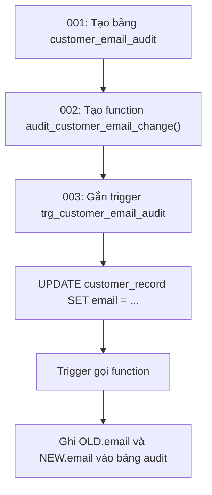

# Quản lý stored procedure, function và trigger

Khi một ứng dụng dùng Liquibase để quản lý schema, thay đổi không chỉ gồm bảng, cột hay index. **Stored procedure**, **function** và **trigger** cũng là đối tượng database có mã nguồn, quyền thực thi, quan hệ phụ thuộc và vòng đời phiên bản. Nếu mã của chúng chỉ được sửa trực tiếp bằng SQL trên production, môi trường development, staging và production có thể chạy cùng một phiên bản ứng dụng nhưng thực thi các quy tắc nghiệp vụ khác nhau.

Bài học thuộc chương **SQL và đối tượng** của `DATABASE_SCHEMA_MIGRATION_LIQUIBASE`. Module hướng đến quản lý thay đổi schema và dữ liệu bằng changelog, changeset, precondition, checksum và lịch sử triển khai; kiểm chứng migration và rollback, phối hợp nhiều môi trường, tích hợp Spring Boot hoặc CI/CD. Trong phạm vi đó, mục tiêu ở đây là **đưa định nghĩa procedure, function và trigger vào changelog có thể kiểm toán, phát hành và kiểm chứng**, không chỉ biết cú pháp `CREATE` tương ứng của một DBMS.

## 1. Ba loại đối tượng và cách chúng hoạt động

| Đối tượng | Đặc trưng | Thường được gọi bằng | Tình huống dùng |
|---|---|---|---|
| **Stored procedure** | Tập lệnh thực thi nghiệp vụ trên database, có thể nhận tham số, thay đổi nhiều bảng. | `CALL`, `EXEC` hoặc cơ chế riêng của DBMS. | Xử lý theo lô, thao tác dữ liệu có giao dịch, tác vụ quản trị. |
| **Function** | Hàm nhận tham số và trả giá trị hoặc tập kết quả; một số DBMS hỗ trợ function trả kiểu đặc biệt dùng cho trigger. | Trong biểu thức SQL, `SELECT` hoặc bằng cơ chế DBMS. | Tính toán/chuẩn hóa dữ liệu, truy vấn tái sử dụng, hàm xử lý trigger. |
| **Trigger** | Đối tượng tự kích hoạt khi sự kiện trên bảng/view hoặc sự kiện hệ thống xảy ra theo DBMS. | Không gọi trực tiếp trong ứng dụng; database kích hoạt theo sự kiện. | Audit, kiểm tra bất biến, đồng bộ dữ liệu phụ trợ. |

Ranh giới này **không hoàn toàn giống nhau giữa các hệ quản trị**. Có DBMS cho procedure tự quản lý transaction theo những giới hạn nhất định; có DBMS giới hạn side effect của function; PostgreSQL cần một trigger function để chạy logic trigger thông thường; SQL Server và Oracle có cú pháp riêng cho trigger body.

### 1.1. Không nhầm function với trigger

Trong PostgreSQL, một trigger thường gồm hai đối tượng:

1. Function `RETURNS trigger` chứa phần thân xử lý `OLD` và `NEW`.
2. Trigger gắn function với một bảng và một sự kiện như `AFTER UPDATE`.

Thay đổi function có thể tác động **mọi trigger đang tham chiếu function đó**; ngược lại, xóa function có thể thất bại nếu trigger còn phụ thuộc nó. Trình tự tạo và rollback phải phản ánh quan hệ này.

### 1.2. Vì sao cần quản lý chúng như migration?

Định nghĩa của routine và trigger có thể thay đổi kết quả ghi dữ liệu mà không đổi cấu trúc cột. Ví dụ trigger tự ghi bảng audit, procedure xóa dữ liệu hết hạn, function tính phí. Nếu không version hóa, việc tìm nguyên nhân dữ liệu lệch sẽ khó hơn vì schema bảng trông vẫn giống nhau.

Liquibase cho phép đưa câu lệnh tạo/sửa/xóa các đối tượng này vào **changeset** để ghi nhận định danh, checksum và thứ tự triển khai trong `DATABASECHANGELOG`. Tuy nhiên, Liquibase không tự bảo đảm tính đúng đắn, tính an toàn bảo mật hay khả năng khôi phục dữ liệu do routine gây ra.

## 2. Chọn loại change trong Liquibase

Liquibase cung cấp các cơ chế khác nhau để định nghĩa SQL routine:

| Cơ chế | Cách sử dụng | Lưu ý |
|---|---|---|
| `createProcedure` | Change chuyên biệt cho stored procedure; thường nhận procedure body hoặc đường dẫn tệp SQL, tùy định dạng và phiên bản. | Kiểm tra hỗ trợ của DBMS/phiên bản Liquibase và cú pháp procedure cụ thể. |
| `sql` | Nhúng SQL trực tiếp trong changelog XML/YAML/JSON. | Phù hợp một định nghĩa ngắn, dễ đọc; cần kiểm soát tách câu lệnh và escape. |
| `sqlFile` | Đọc SQL từ tệp bên ngoài được version control cùng changelog. | Hợp lý khi body dài; phải quản lý path, classpath, encoding, delimiter và checksum. |
| Formatted SQL changelog | Khai báo `--liquibase formatted sql`, các dòng `--changeset` và phần SQL. | Linh hoạt nhưng phải đặc biệt chú ý phần thân chứa dấu chấm phẩy và comment. |
| Extension/change DBMS-specific | Dùng khi cần hỗ trợ riêng cho đối tượng, tính năng hoặc DBMS. | Không mặc định mọi extension cung cấp cùng API hoặc tương thích mọi phiên bản Core. |

**Điểm phân biệt:** một change chuyên biệt như `createProcedure` có thể được Liquibase hiểu ở mức khai báo, nhưng body routine vẫn là **SQL phụ thuộc DBMS**. Khả năng tạo hoặc sửa trigger bằng một change type portable không đồng nhất trên các bản Liquibase; dùng `sql`/`sqlFile` khi Core không cung cấp change phù hợp, thay vì giả định có sẵn một `createTrigger` chung trên mọi hệ.

### 2.1. Ranh giới trách nhiệm

Liquibase chịu trách nhiệm **nạp changelog, xác định changeset nào cần chạy, lấy khóa, gửi SQL, ghi lịch sử**. DBMS chịu trách nhiệm **biên dịch routine, kiểm tra tên đối tượng/quyền và thực thi hành vi trigger/function**. JDBC driver truyền lệnh SQL đến DBMS. Vì vậy:

- Changelog có thể `validate` thành công nhưng body SQL vẫn sai ở DBMS đích.
- Cùng SQL body có thể không chạy trên DBMS khác.
- Routine được tạo thành công nhưng có thể lỗi khi lần đầu được gọi hoặc khi trigger được kích hoạt với dữ liệu đặc biệt.
- Một lỗi ở trong trigger có thể khiến câu `INSERT`/`UPDATE` của ứng dụng thất bại, tùy DBMS và cấu hình transaction.

## 3. Ví dụ có thứ tự: audit khi email khách hàng thay đổi

Ví dụ minh họa dùng **PostgreSQL**. Giả định database đã có bảng `customer_record` với `id BIGINT` và `email VARCHAR(255)`. Ta muốn tạo bảng ghi nhận lịch sử thay đổi email và một trigger tự lưu giá trị cũ/mới khi email khác nhau.

Trình tự:



Các tên đối tượng ở ví dụ được chọn để dễ đọc, không dùng làm quy chuẩn tên chung cho mọi tổ chức. Nếu dự án có nhiều schema, phải xét kỹ schema trong định nghĩa, quyền và `search_path`.

### 3.1. Changelog XML có thể dùng làm mẫu

Ví dụ dưới đây gồm ba changeset PostgreSQL trong **một** changelog. Nó chỉ nên chạy trên database thử nghiệm đã có bảng `customer_record` như giả định.

```xml
<?xml version="1.0" encoding="UTF-8"?>
<databaseChangeLog
    xmlns="http://www.liquibase.org/xml/ns/dbchangelog"
    xmlns:xsi="http://www.w3.org/2001/XMLSchema-instance"
    xsi:schemaLocation="http://www.liquibase.org/xml/ns/dbchangelog
                        https://www.liquibase.org/xml/ns/dbchangelog/dbchangelog-latest.xsd">

    <changeSet id="001-create-customer-email-audit" author="db-team"
               dbms="postgresql">
        <preConditions onFail="HALT" onError="HALT">
            <tableExists tableName="customer_record"/>
        </preConditions>
        <createTable tableName="customer_email_audit">
            <column name="audit_id" type="BIGINT" autoIncrement="true">
                <constraints primaryKey="true" nullable="false"/>
            </column>
            <column name="customer_id" type="BIGINT">
                <constraints nullable="false"/>
            </column>
            <column name="old_email" type="VARCHAR(255)"/>
            <column name="new_email" type="VARCHAR(255)"/>
            <column name="changed_at" type="TIMESTAMP WITH TIME ZONE">
                <constraints nullable="false"/>
            </column>
        </createTable>
        <rollback>
            <dropTable tableName="customer_email_audit"/>
        </rollback>
    </changeSet>

    <changeSet id="002-create-audit-trigger-function" author="db-team"
               dbms="postgresql" runOnChange="true">
        <sql splitStatements="false" stripComments="false"><![CDATA[
CREATE OR REPLACE FUNCTION audit_customer_email_change()
RETURNS trigger
LANGUAGE plpgsql
AS $audit$
BEGIN
    INSERT INTO customer_email_audit
        (customer_id, old_email, new_email, changed_at)
    VALUES
        (OLD.id, OLD.email, NEW.email, CURRENT_TIMESTAMP);
    RETURN NEW;
END;
$audit$;
        ]]></sql>
        <rollback>
            <sql>DROP FUNCTION IF EXISTS audit_customer_email_change();</sql>
        </rollback>
    </changeSet>

    <changeSet id="003-create-customer-email-trigger" author="db-team"
               dbms="postgresql">
        <sql splitStatements="false"><![CDATA[
CREATE TRIGGER trg_customer_email_audit
AFTER UPDATE OF email ON customer_record
FOR EACH ROW
WHEN (OLD.email IS DISTINCT FROM NEW.email)
EXECUTE FUNCTION audit_customer_email_change();
        ]]></sql>
        <rollback>
            <sql>
                DROP TRIGGER IF EXISTS trg_customer_email_audit
                ON customer_record;
            </sql>
        </rollback>
    </changeSet>

</databaseChangeLog>
```

**Diễn giải:**

1. `001` tạo bảng audit; precondition yêu cầu bảng nguồn tồn tại. `onFail="HALT"` giúp phát hiện sai trạng thái thay vì ghi `MARK_RAN` tùy tiện.
2. `002` định nghĩa PostgreSQL function trả `trigger` bằng PL/pgSQL. `OLD` và `NEW` chứa giá trị hàng trước/sau khi cập nhật; `RETURN NEW` là cú pháp hợp lệ cho function kiểu trigger.
3. `003` tạo trigger chỉ cho sự kiện cập nhật cột `email`. Điều kiện `IS DISTINCT FROM` xử lý cả trường hợp có `NULL` khi so sánh.
4. `splitStatements="false"` giúp Liquibase không tách định nghĩa function ở các dấu `;` nằm bên trong block. Đây là một câu `CREATE FUNCTION` hoàn chỉnh gửi tới JDBC.
5. `runOnChange="true"` trên changeset `002` là lựa chọn có chủ đích cho code routine có thể được cập nhật bằng `CREATE OR REPLACE`. Nếu nội dung ảnh hưởng checksum thay đổi, Liquibase có thể thực thi lại changeset đó theo chính sách `runOnChange`.
6. Rollback theo thứ tự ngược giúp **xóa trigger trước, xóa function sau, xóa bảng audit cuối cùng**, tránh xung đột phụ thuộc thông thường. Tuy nhiên, xóa bảng audit làm mất dữ liệu; không thực hiện rollback này trên dữ liệu thật nếu chưa có phương án lưu/khôi phục.

Chú ý thực tế: trên PostgreSQL, body function có thể được thay thế bằng `CREATE OR REPLACE FUNCTION` khi giữ chữ ký và những đặc điểm tương thích. Các thay đổi không được `OR REPLACE` hỗ trợ, chẳng hạn một số thay đổi kiểu trả về, có thể cần quy trình tạo hàm mới rồi chuyển đối tượng phụ thuộc.

### 3.2. Kiểm thử hành vi, không chỉ kiểm tra object tồn tại

Trong database thử, sau khi áp dụng changelog:

```sql
-- Chỉ thực hiện trên dữ liệu kiểm thử đã biết id.
UPDATE customer_record
SET email = 'new@example.test'
WHERE id = 1001;

SELECT customer_id, old_email, new_email, changed_at
FROM customer_email_audit
WHERE customer_id = 1001
ORDER BY changed_at DESC;
```

Trước khi chạy `UPDATE`, phải chuẩn bị sẵn bản ghi `customer_record.id = 1001` và lưu giá trị email ban đầu. Kiểm tra thêm trường hợp cập nhật giá trị email **không đổi**, cập nhật từ/đến `NULL` nếu schema cho phép, cập nhật nhiều hàng và lỗi khi không có quyền ghi audit. Trigger thường chạy trong giao dịch gắn với câu lệnh DML kích hoạt; cần xác minh đặc tính rollback thực tế của DBMS.

Không mặc định trigger chỉ chạy từ ứng dụng Java: mọi câu lệnh SQL đáp ứng sự kiện được cấu hình đều có thể kích hoạt nó, kể cả batch job hoặc thao tác thủ công của người có quyền.

## 4. Stored procedure: triển khai và quản lý chữ ký

Một procedure có thể nhận tham số, thực thi SQL bên trong và được gọi tường minh bằng `CALL` hoặc cú pháp riêng của DBMS. Ví dụ PostgreSQL cho thao tác xóa log audit cũ trên **môi trường thử nghiệm**:

```xml
<changeSet id="004-create-audit-retention-procedure"
           author="db-team" dbms="postgresql"
           runOnChange="true">
    <sql splitStatements="false"><![CDATA[
CREATE OR REPLACE PROCEDURE purge_customer_email_audit(p_before timestamptz)
LANGUAGE plpgsql
AS $proc$
BEGIN
    DELETE FROM customer_email_audit WHERE changed_at < p_before;
END;
$proc$;
    ]]></sql>
    <rollback>
        <sql>
            DROP PROCEDURE IF EXISTS
                purge_customer_email_audit(timestamptz);
        </sql>
    </rollback>
</changeSet>
```

Đây là **một changeset riêng**, có thể đặt sau changeset tạo bảng audit trong changelog ví dụ. Tạo procedure **không tự gọi** procedure. Một lần gọi kiểm thử cần được kiểm soát, chẳng hạn:

```sql
-- Chỉ thử trên dữ liệu audit giả lập; lệnh này xóa dữ liệu.
CALL purge_customer_email_audit(
    CURRENT_TIMESTAMP - INTERVAL '180 days'
);
```

Việc xóa dữ liệu audit có thể bị ràng buộc bởi yêu cầu lưu trữ, kiểm toán và pháp lý. Không coi ví dụ purge là khuyến nghị tự động xóa nhật ký production.

### 4.1. Chữ ký procedure/function quan trọng

DBMS có thể nhận diện routine qua **tên + danh sách kiểu tham số**, có thể hỗ trợ overloading. Ví dụ `purge_customer_email_audit(timestamptz)` khác một procedure cùng tên nhận `date`. Khi viết rollback `DROP PROCEDURE` hay `DROP FUNCTION`, cần chỉ rõ chữ ký khi DBMS yêu cầu, tránh xóa nhầm hoặc không xác định được đối tượng.

Đổi kiểu tham số, tên schema, kiểu trả về hoặc thứ tự tham số có thể khiến application/JDBC call và trigger phụ thuộc không còn tương thích. Nâng cấp routine phải xét như nâng cấp một API:

1. Xác định client và đối tượng nào đang gọi.
2. Tạo phiên bản hoặc chữ ký mới nếu cần tương thích ngược.
3. Chuyển client/trigger theo thứ tự phát hành.
4. Chỉ xóa phiên bản cũ khi không còn caller.

## 5. Dùng sqlFile cho phần thân dài

Với routine dài hàng trăm dòng, tách body SQL ra khỏi XML/YAML giúp editor hỗ trợ highlight, review diff và test độc lập. Ví dụ cấu hình changelog YAML **minh họa** (không tạo file ngoài assignment này):

```yaml
databaseChangeLog:
  - changeSet:
      id: 020-install-customer-routine
      author: db-team
      dbms: postgresql
      runOnChange: true
      changes:
        - sqlFile:
            path: routines/postgresql/customer_routine.sql
            relativeToChangelogFile: true
            encoding: UTF-8
            splitStatements: false
            stripComments: false
      rollback:
        - sql:
            sql: DROP FUNCTION IF EXISTS customer_routine(bigint);
```

Tệp `customer_routine.sql` được **giả định tồn tại trong repository thực tế** theo đường dẫn tương đối tới changelog. Nội dung tệp nên chứa câu `CREATE OR REPLACE FUNCTION` hoàn chỉnh và cú pháp phù hợp PostgreSQL. Không trộn nhiều câu SQL độc lập vào một `sqlFile` có `splitStatements: false` nếu JDBC/DBMS không xử lý chúng như một câu lệnh đơn.

Cần phân biệt:

- `path` và `relativeToChangelogFile` giúp Liquibase **tìm đúng tệp**.
- `encoding` giúp nạp nội dung đúng bộ mã, nhất là comment hoặc chuỗi Unicode.
- `splitStatements` quy định Liquibase có chia nội dung ở dấu phân tách câu SQL hay không.
- `stripComments` quyết định xử lý comment; cần cân nhắc vì một số cú pháp DBMS, directive hoặc hint có ý nghĩa.
- `runOnChange` quyết định khả năng chạy lại changeset khi nội dung thay đổi theo cơ chế checksum.

Với `createProcedure`, phiên bản Liquibase có thể cho phép tham chiếu tệp body theo thuộc tính `path` hoặc khai báo body trực tiếp. Chọn cách nào tùy khả năng hỗ trợ thực tế, không suy ra rằng change type này tương thích với mọi loại function và trigger.

## 6. Vấn đề khó: dấu chấm phẩy, delimiter và khối lệnh

Thân procedure/function thường có nhiều câu SQL nội bộ kết thúc bằng `;`. Nếu Liquibase tách script ở từng dấu chấm phẩy, nó có thể gửi một phần của routine đến JDBC và gây lỗi cú pháp.

### 6.1. PostgreSQL và dollar quoting

PostgreSQL thường dùng `$$...$$` hoặc một cặp dấu có nhãn như `$body$...$body$` để bao phần thân PL/pgSQL. Phần thân có thể chứa nhiều dấu `;`:

```sql
CREATE OR REPLACE FUNCTION customer_state_label(p_enabled boolean)
RETURNS text
LANGUAGE plpgsql
AS $body$
BEGIN
    IF p_enabled THEN
        RETURN 'ACTIVE';
    ELSE
        RETURN 'INACTIVE';
    END IF;
END;
$body$;
```

Với `sql` hay `sqlFile` chứa nguyên vẹn **một** câu `CREATE FUNCTION` này, `splitStatements="false"` thường là lựa chọn đơn giản để tránh chia sai bên trong body. Nếu script có thêm các câu độc lập như `GRANT`, hãy đặt chúng vào change khác, hoặc chọn chiến lược tách câu lệnh đã được kiểm chứng.

### 6.2. MySQL/MariaDB và DELIMITER

Trong các công cụ client MySQL, có thể thấy:

```sql
DELIMITER $$
CREATE PROCEDURE example_proc()
BEGIN
    SELECT 1;
    SELECT 2;
END$$
DELIMITER ;
```

`DELIMITER` là **directive của một số SQL client**, không phải câu SQL `CREATE PROCEDURE` mà JDBC tự động hiểu. Không sao chép nguyên script dành cho `mysql` CLI vào `sqlFile` của Liquibase rồi kỳ vọng JDBC hiểu `DELIMITER`. Thay vào đó, dùng body và cấu hình `splitStatements`/`endDelimiter` phù hợp với cách chạy Liquibase, sau khi kiểm tra phiên bản driver và DBMS. Một giải pháp thực tế là gửi toàn bộ một câu `CREATE PROCEDURE ... BEGIN ... END` như một đơn vị.

### 6.3. SQL Server và GO; Oracle và dấu /

`GO` thường là dấu tách batch của công cụ SQL Server như sqlcmd/SSMS, **không phải một lệnh T-SQL thông thường**. Tương tự, dấu `/` trên dòng riêng có thể được công cụ Oracle dùng để kết thúc khối PL/SQL. Khi chuyển script từ công cụ tương tác sang Liquibase, cần xác định ai chịu trách nhiệm xử lý dấu tách: Liquibase, native executor hay client tool.

Không đoán rằng mọi dấu `GO` hoặc `/` đều nên gửi nguyên tới JDBC. Các tùy chọn như `endDelimiter` và `splitStatements` có vai trò cụ thể, nhưng cách dùng còn phụ thuộc phiên bản Liquibase và executor. Đọc SQL preview và thử trên database đích trước khi triển khai.

### 6.4. Khi nào dùng endDelimiter?

`endDelimiter` giúp định nghĩa cách Liquibase nhận biết điểm kết thúc câu SQL khi **Liquibase là bên tách câu lệnh**. Với một body routine duy nhất, `splitStatements=false` thường tránh được nhiều vấn đề. Với script có nhiều câu và delimiter tùy chỉnh, phải bảo đảm delimiter không xuất hiện ngẫu nhiên trong body/comment và được loại bỏ/giữ đúng khi gửi tới DBMS.

Một số native executor hoặc cơ chế khác có quy tắc tách riêng; không áp dụng máy móc tùy chọn Liquibase cho chúng. Dùng pipeline test để xác nhận đầu vào thật sự được DBMS biên dịch thành một routine hoàn chỉnh.

## 7. Chiến lược version hóa: bất biến hay runOnChange?

Liquibase thường nhận diện changeset bằng bộ ba **`id`, `author` và đường dẫn changelog**, lưu trạng thái ở `DATABASECHANGELOG` và dùng checksum để phát hiện thay đổi nội dung. Có hai chiến lược hợp lý cho routine:

| Chiến lược | Cách làm | Ưu điểm | Hạn chế |
|---|---|---|---|
| **Changeset bất biến** | Mỗi lần sửa routine, thêm changeset mới với `CREATE OR REPLACE` hoặc phương án chuyển đổi tương thích. | Lịch sử rõ từng lần phát hành; dễ liên hệ với commit. | Có thể chứa nhiều định nghĩa routine qua thời gian. |
| **runOnChange** | Giữ changeset định nghĩa routine, khai báo `runOnChange=true` và sửa body khi cần cập nhật. | Thuận tiện với view/function/procedure định nghĩa bằng một nguồn code hiện hành. | Lịch sử không tự giữ đủ mọi body cũ; khó khôi phục phiên bản trước nếu không có version control và quy trình riêng. |

### 7.1. Khi runOnChange phù hợp

`runOnChange` thường phù hợp với **định nghĩa routine có thể thay thế** bằng `CREATE OR REPLACE` mà không phá vỡ chữ ký và đối tượng phụ thuộc. Khi checksum được Liquibase xem là đã thay đổi, changeset có thể chạy lại. Không nhầm nó với `runAlways`, vốn yêu cầu xét chạy ở mỗi lần update đủ điều kiện.

Không dùng `runAlways` cho routine chỉ cần cập nhật khi code đổi trừ khi có lý do cụ thể: chạy DDL lại mọi lần có thể tạo lock, thay đổi quyền/metadata hoặc gây tác động vận hành không mong muốn.

### 7.2. Những thay đổi OR REPLACE không thể xử lý an toàn

Không phải DBMS hay đối tượng nào cũng hỗ trợ `CREATE OR REPLACE` như nhau. Chuyển kiểu trả về của function, đổi chữ ký, đổi trigger timing, đổi tập sự kiện hoặc đổi ràng buộc quyền có thể yêu cầu **tạo đối tượng mới, chuyển phụ thuộc, xóa đối tượng cũ**. Với thay đổi đó, tạo migration phiên bản mới rõ ràng và thử trạng thái nâng cấp thực tế.

**Tối kỵ:** xóa routine hoặc trigger đang dùng rồi tạo lại trong production mà không đánh giá thời điểm gián đoạn, phụ thuộc và các quyền `GRANT`. Một khoảng trống ngắn có thể khiến truy vấn hoặc thao tác ghi của ứng dụng thất bại.

### 7.3. Tránh sửa tệp đã chạy mà không có chính sách

Sửa một `sqlFile` hoặc body trong changeset đã `EXECUTED` nhưng không có `runOnChange` hay cơ chế hợp lệ có thể gây **checksum validation error**. Không dùng `clearCheckSums` làm cách sửa mặc định, vì có thể che giấu sự thay đổi chưa được kiểm chứng. Trước tiên xác định changeset và chính sách bảo trì của repository.

Nếu di chuyển tệp changelog, bảo toàn đường dẫn định danh bằng `logicalFilePath` khi cần. `sqlFile.path` lại là đường dẫn tài nguyên vật lý mà Liquibase cần đọc. Cả hai phải được kiểm tra riêng.

## 8. Phụ thuộc và thứ tự triển khai

Routine và trigger thường phụ thuộc vào bảng, kiểu dữ liệu, extension, function khác, schema và quyền. Một kế hoạch triển khai cần mô tả quan hệ phụ thuộc trước khi viết changeset.

Ví dụ:

```text
schema + quyền cần thiết
    ↓
bảng đích và bảng audit
    ↓
function xử lý trigger
    ↓
trigger tham chiếu function
    ↓
ứng dụng gửi INSERT/UPDATE/DELETE
```

Rollback thông thường đi theo hướng ngược lại:

```text
gỡ trigger
    ↓
gỡ hoặc khôi phục function
    ↓
gỡ cấu trúc phụ trợ nếu thật sự an toàn
```

Không đặt `DROP TABLE` trước `DROP TRIGGER` hoặc `DROP FUNCTION` khi còn phụ thuộc, trừ khi đã kiểm chứng chính xác DBMS cho phép và tác động cascade. **Tránh `CASCADE` tùy tiện**, vì nó có thể xóa thêm đối tượng không được liệt kê trong changelog.

### 8.1. Phối hợp ứng dụng

Một trigger mới có thể làm tăng thời gian ghi hoặc thay đổi behavior của API cũ. Một procedure đổi chữ ký có thể làm ứng dụng phiên bản trước bị lỗi. Khi triển khai rolling deployment, hãy áp dụng quy tắc **expand–migrate–contract**:

1. Thêm routine hoặc chữ ký mới nhưng vẫn giữ API database cũ.
2. Triển khai phiên bản ứng dụng biết gọi routine mới.
3. Quan sát log/metrics và xác nhận không còn caller cũ.
4. Chỉ sau đó tạo changeset gỡ routine hoặc trigger không còn dùng.

Với trigger tự ghi dữ liệu, cần nghĩ tới tương thích với cả ứng dụng cũ và mới trong giai đoạn hai phiên bản chạy đồng thời.

## 9. Rollback: gỡ đối tượng không khôi phục được dữ liệu

Khi rollback, có ít nhất ba loại hành động khác nhau:

1. **Gỡ đối tượng mới:** `DROP TRIGGER`, `DROP PROCEDURE`, `DROP FUNCTION`. Điều này có thể phù hợp khi object được tạo lần đầu và chưa có bên phụ thuộc khác.
2. **Khôi phục body cũ:** khi routine đã được `CREATE OR REPLACE`, chỉ `DROP` routine không khôi phục được phiên bản trước. Cần giữ định nghĩa cũ để áp dụng ngược lại hoặc dùng changeset phục hồi đã kiểm chứng.
3. **Khôi phục dữ liệu:** nếu procedure/trigger từng xóa, ghi đè hoặc phát sinh dữ liệu, việc gỡ routine **không đảo ngược** các thay đổi dữ liệu đã xảy ra.

Vì vậy, rollback script cho routine cần trả lời rõ: “Ta muốn xóa object, phục hồi body cũ, hay khôi phục cả dữ liệu đã bị tác động?”. Nếu câu trả lời bao gồm dữ liệu, có thể cần backup, compensating transaction hoặc quy trình phục hồi nghiệp vụ riêng.

### 9.1. Dữ liệu lịch sử khác lịch sử đối tượng

`DATABASECHANGELOG` ghi nhận changeset đã được Liquibase xử lý. Nó không lưu bản sao mọi phiên bản SQL body của procedure và cũng không ghi mọi lần trigger chạy. Để kiểm toán các thay đổi:

- Version control lưu mã SQL và commit ID.
- Pipeline lưu bản Liquibase/driver, schema đích và artifact phát hành.
- `DATABASECHANGELOG` xác nhận lịch sử migration.
- Log/metrics và bảng audit ứng dụng phản ánh **hành vi thực thi nghiệp vụ**, không thay thế lịch sử migration.

## 10. Bảo mật và hiệu năng của routine/trigger

### 10.1. Quyền và security context

Routine có thể chạy dưới quyền người gọi hoặc quyền chủ sở hữu tùy DBMS và khai báo, ví dụ `SECURITY DEFINER` trên PostgreSQL hay `SQL SECURITY DEFINER` trong một số hệ. Nếu dùng quyền nâng cao, phải giới hạn chặt chẽ:

- Người nào được `CREATE`, `ALTER`, `DROP` hoặc `EXECUTE` routine?
- Routine có đọc/ghi bảng nhạy cảm vượt quyền trực tiếp của caller không?
- Có dùng dynamic SQL với tham số chưa được kiểm soát không?
- Schema và `search_path` có thể dẫn đến việc gọi nhầm object do người khác tạo không?
- Sau `CREATE OR REPLACE` hoặc `DROP/CREATE`, quyền `GRANT` và ownership có còn đúng không?

Không đặt mật khẩu database hoặc dữ liệu nhạy cảm trong body SQL được commit. Một routine `SECURITY DEFINER` viết sai có thể biến thành đường leo thang quyền; cần review quyền thực thi, schema qualification và dynamic SQL trước khi đưa lên production.

### 10.2. Hiệu năng và transaction

Một trigger `FOR EACH ROW` có thể được gọi hàng triệu lần khi batch update một triệu dòng. Nếu mỗi lần trigger gọi thêm query hoặc thao tác mạng, tổng chi phí có thể rất lớn. Cần xem:

- Trigger chạy `BEFORE` hay `AFTER`; ở mức row hay statement.
- Có gọi lồng trigger hoặc phát sinh vòng lặp recursion không?
- Có lock hoặc cập nhật bảng audit tạo contention không?
- Procedure chạy trong transaction nào? DBMS có hỗ trợ commit/rollback bên trong routine ở ngữ cảnh hiện tại không?
- Hành vi lỗi trong routine có khiến câu DML gốc rollback không?

DBMS khác nhau về tính transaction của DDL và routine. PostgreSQL thường hỗ trợ DDL giao dịch đối với nhiều loại object; MySQL có nhiều DDL tự commit; SQL Server/Oracle có quy tắc riêng. **Không giả định một changeset có transaction sẽ rollback mọi DDL theo cùng cách trên tất cả DBMS.**

### 10.3. Precondition không kiểm thử được logic routine

`tableExists` hoặc `sqlCheck` có thể xác minh môi trường cần thiết, nhưng không chứng minh function sẽ trả kết quả đúng khi có `NULL`, giá trị biên hoặc quyền đặc biệt. Trước khi triển khai, phải có bài kiểm thử **gọi thực tế** procedure/function hoặc kích hoạt trigger trên dữ liệu đại diện.

## 11. Kiểm chứng trong CLI, Spring Boot và CI/CD

### 11.1. Các bước kiểm tra trước update

Ví dụ dùng file `db/changelog/master.xml` và thông tin kết nối được cấu hình an toàn:

```bash
liquibase --changelog-file=db/changelog/master.xml validate
liquibase --changelog-file=db/changelog/master.xml status --verbose
liquibase --changelog-file=db/changelog/master.xml update-sql
```

Tên lệnh và tùy chọn SQL preview có thể khác ở những bản Liquibase cũ (ví dụ `updateSQL`). Nên dùng đúng version đã khóa cho môi trường triển khai. `validate` kiểm tra changelog và nhiều quy tắc liên quan; `status` cho biết changeset chưa ghi nhận; `update-sql` giúp review SQL dự kiến. **Không bước nào tự chứng minh body SQL của trigger/function chạy đúng với mọi dữ liệu.**

### 11.2. Kiểm thử trên PostgreSQL

Sau khi chạy `update` trên database thử, kiểm tra object tồn tại và định nghĩa thực tế:

```sql
-- Danh sách routine trong schema public.
SELECT p.proname, p.prokind, pg_get_functiondef(p.oid)
FROM pg_proc p
JOIN pg_namespace n ON n.oid = p.pronamespace
WHERE n.nspname = 'public'
  AND p.proname IN (
      'audit_customer_email_change',
      'purge_customer_email_audit'
  );

-- Trigger gắn với bảng nguồn (bỏ trigger nội bộ).
SELECT t.tgname, pg_get_triggerdef(t.oid)
FROM pg_trigger t
WHERE t.tgrelid = 'public.customer_record'::regclass
  AND NOT t.tgisinternal;
```

Truy vấn ví dụ giả định objects nằm trong schema `public`. Trong môi trường khác phải thay schema cho đúng, đồng thời kiểm tra quyền đọc metadata. Sau đó:

1. Tạo dữ liệu thử đã biết trạng thái.
2. Gọi function/procedure trong ngữ cảnh hợp lệ hoặc thực hiện `UPDATE` để kích hoạt trigger.
3. Xác minh dữ liệu audit, behavior khi giá trị không đổi, `NULL` và nhiều hàng.
4. Thử kịch bản gây lỗi để xác minh transaction của thao tác gốc.
5. Chạy lại `update`: changeset bình thường không chạy lại; changeset `runOnChange` chỉ được xét chạy lại khi nội dung đã thay đổi theo checksum và quy tắc Liquibase.
6. Truy vấn `DATABASECHANGELOG` để đối chiếu ID, AUTHOR, FILENAME, EXECTYPE, DATEEXECUTED và MD5SUM.
7. Kiểm thử rollback trên database riêng rồi xác minh trạng thái object và dữ liệu.

### 11.3. Spring Boot và pipeline

Ứng dụng Spring Boot có thể trỏ đến changelog chứa SQL routines:

```yaml
spring:
  liquibase:
    enabled: true
    change-log: classpath:/db/changelog/master.xml
```

Để chạy thành công, artifact ứng dụng phải chứa cả changelog lẫn các tệp `sqlFile` được include, đồng thời Java runtime có Liquibase Core và JDBC driver tương thích. Nếu pipeline chạy migration riêng trước khi ứng dụng khởi động, phải thống nhất cơ chế nào sở hữu bước `update`. Không để nhiều nơi vô tình chạy các bộ version khác nhau.

Trong CI/CD, luồng tối thiểu nên là: kiểm tra cú pháp và dependency, `validate`, xem SQL preview, chạy trên database thử có schema/lịch sử đại diện, gọi routine/kích hoạt trigger theo test, kiểm tra rollback/restore và mới phát hành artifact đã kiểm chứng.

## 12. Lỗi thường gặp và cách xử lý

| Triệu chứng | Nguyên nhân có thể | Hướng xử lý |
|---|---|---|
| Lỗi cú pháp ở `BEGIN`/`END` hoặc giữa body | Liquibase tách câu ở dấu `;`, body gửi đến DBMS không nguyên vẹn. | Kiểm tra `splitStatements`, `endDelimiter` và SQL cuối cùng. |
| MySQL báo lỗi tại `DELIMITER` | Copy directive dành cho SQL client vào JDBC. | Loại chỉ thị client và cấu hình tách SQL đúng cho Liquibase. |
| SQL Server báo lỗi gần `GO` | `GO` chưa được xử lý như batch separator. | Kiểm tra cấu hình executor và cách gửi batch. |
| PostgreSQL báo unterminated dollar-quoted string | Mất hoặc sai cặp `$body$` khi tách/escape. | Soát dollar quote và gửi nguyên câu `CREATE FUNCTION`. |
| Trigger báo không tìm thấy function | Function chưa tạo, sai schema/signature hoặc quyền. | Kiểm tra thứ tự changeset và metadata routine thực. |
| `CREATE OR REPLACE` thất bại | Đổi kiểu trả về/chữ ký hoặc đặc điểm không thể thay thế tại chỗ. | Tạo version mới, chuyển dependencies, rồi gỡ version cũ. |
| Liquibase báo checksum mismatch | Sửa body của changeset đã chạy nhưng không có chính sách tương thích. | Xác định `runOnChange`/versioning; tránh `clearCheckSums` tùy tiện. |
| Routine tồn tại nhưng gọi bị permission denied | Thiếu `GRANT EXECUTE` hoặc quyền object liên quan. | Kiểm tra owner, security context, caller và schema. |
| Trigger gây timeout khi update hàng loạt | Trigger theo từng hàng gây lock hoặc nhiều truy vấn. | Benchmark với batch size thật, tối ưu query, xem transaction. |
| Rollback không xóa được function | Trigger hoặc object khác còn phụ thuộc. | Gỡ phụ thuộc theo thứ tự, tránh `CASCADE` tùy tiện. |
| Dev chạy được, production lỗi | Khác DBMS/version, classpath SQL file, quyền hoặc schema. | So sánh artifact, driver, changelog path, SQL preview và schema. |
| Drop routine xong nhưng dữ liệu vẫn lệch | Gỡ code không hoàn tác dữ liệu routine đã sửa/xóa. | Dùng kế hoạch khôi phục dữ liệu hoặc compensating migration. |

## 13. Bài thực hành có kiểm chứng

**Bối cảnh:** dùng PostgreSQL thử nghiệm có bảng `customer_record(id, email)`. Nhóm cần audit khi email thay đổi và có một procedure quản trị dữ liệu audit.

### Giai đoạn A — Thiết kế và triển khai

1. Chuẩn bị database thử nghiệm, bảng nguồn và ít nhất hai khách hàng giả lập.
2. Tạo changelog từ ví dụ mục 3, bảo đảm các changeset đi theo thứ tự: bảng audit → trigger function → trigger.
3. Nếu thêm procedure ở mục 4, đặt nó sau bảng audit; chưa gọi procedure xóa dữ liệu.
4. Chạy `validate`, `status` và xem SQL preview. Kiểm tra chuỗi dollar quote còn nguyên và định danh changeset không trùng.
5. Chạy `update`, sau đó kiểm tra object trong metadata PostgreSQL và `DATABASECHANGELOG`.

### Giai đoạn B — Kiểm thử hành vi

1. Thay đổi email của một hàng và xác nhận có một bản ghi audit đúng `OLD`/`NEW`.
2. Cập nhật cùng giá trị email và kiểm tra trigger `WHEN` không ghi bản audit ngoài dự kiến.
3. Cập nhật nhiều hàng, đo thời gian và lượng bản ghi audit.
4. Thử một thao tác lỗi trong transaction và quan sát có rollback thao tác gốc và dữ liệu audit không.
5. Kiểm tra quyền của tài khoản ứng dụng: được phép thực hiện DML cần thiết nhưng không nhất thiết có quyền `CREATE`/`DROP` routine.

### Giai đoạn C — Thay phiên bản function

1. Sửa body `audit_customer_email_change()` theo một yêu cầu mới đã kiểm chứng, chẳng hạn bổ sung logic format theo quy tắc nghiệp vụ.
2. Chạy `validate` và SQL preview, xem chính sách `runOnChange` có chọn lại changeset function đúng như thiết kế hay không.
3. Chạy trên database thử, xác nhận trigger vẫn tham chiếu function hợp lệ và dữ liệu mới đúng.
4. Kiểm thử tình huống cần quay lại body cũ: xác minh `DROP FUNCTION` không phải rollback phù hợp nếu function đang phục vụ trigger.

### Giai đoạn D — Rollback và đánh giá rủi ro

1. Trên database **thử nghiệm riêng**, rollback changeset tạo trigger, kiểm tra trigger không còn.
2. Rollback function sau khi gỡ các đối tượng phụ thuộc.
3. Chỉ gỡ bảng audit nếu dữ liệu giả lập có thể bỏ; xác nhận việc xóa bảng làm mất lịch sử audit.
4. Ghi lại kế hoạch production thay thế: bảo toàn dữ liệu, khôi phục body cũ và mở lại chức năng khi xảy ra lỗi.

**Tiêu chí đạt:** cùng changelog tạo được đủ ba đối tượng, kiểm chứng được logic thực tế, lịch sử Liquibase đúng, rollback tuân theo thứ tự phụ thuộc và người học phân biệt được rollback đối tượng với phục hồi dữ liệu.

## 14. Checklist triển khai production

- [ ] Routine/trigger có nhu cầu rõ và được version control cùng changelog.
- [ ] Đã phân biệt procedure, function, trigger theo DBMS đích.
- [ ] Chọn `createProcedure`, `sql` hoặc `sqlFile` có lý do; kiểm tra hỗ trợ của phiên bản Liquibase.
- [ ] Đã thử cách xử lý `;`, dollar quote, `GO`, `/` hoặc delimiter đặc thù.
- [ ] Có chính sách thay đổi body: changeset mới bất biến hay `runOnChange`.
- [ ] Đã đánh giá chữ ký, tên schema, quyền caller/owner và mọi đối tượng phụ thuộc.
- [ ] Thứ tự tạo/gỡ object đúng; tránh `DROP ... CASCADE` không kiểm soát.
- [ ] Không dùng rollback `DROP` để giả định phục hồi logic cũ hay dữ liệu.
- [ ] Preconditions xác minh trạng thái cần thiết, không che lỗi bằng `MARK_RAN` tùy tiện.
- [ ] Đã thử function/procedure/trigger trên dữ liệu thật đại diện, gồm giá trị biên và lỗi.
- [ ] Đã đo chi phí trigger theo hàng và nguy cơ lock trong batch update.
- [ ] Đã review `SECURITY DEFINER`, dynamic SQL, `search_path` và quyền `EXECUTE`.
- [ ] `validate`, SQL preview, test môi trường đại diện và kế hoạch phục hồi đều đạt.
- [ ] Spring Boot/CI/CD nạp đầy đủ resource SQL và dùng cùng bộ công cụ đã kiểm chứng.

## 15. Câu hỏi tự kiểm tra

1. Stored procedure, function và trigger khác nhau ở cách gọi và thời điểm thực thi nào?
2. Tại sao PostgreSQL thường cần cả trigger function và trigger object?
3. Vì sao Liquibase có thể `validate` thành công nhưng `CREATE FUNCTION` vẫn thất bại?
4. `splitStatements=false` giải quyết vấn đề gì với body PL/pgSQL chứa nhiều dấu `;`?
5. Vì sao `DELIMITER` của MySQL CLI không nên tự động đưa nguyên vào JDBC script?
6. Khi nào nên dùng `sqlFile` thay vì nhúng `sql` trực tiếp trong changelog?
7. `runOnChange` khác `runAlways` và chiến lược changeset bất biến ra sao?
8. Những thay đổi chữ ký/kiểu trả về nào có thể khiến `CREATE OR REPLACE` không đủ an toàn?
9. Vì sao cần xóa trigger trước function khi rollback ví dụ audit?
10. Vì sao xóa procedure/trigger không đồng nghĩa dữ liệu chúng đã tác động được khôi phục?
11. Một function chạy `SECURITY DEFINER` có những rủi ro bảo mật nào?
12. Muốn kiểm chứng trigger ghi audit đúng, cần test những trường hợp dữ liệu nào ngoài việc trigger tồn tại?

## Kết luận

Quản lý stored procedure, function và trigger bằng Liquibase là quản lý **mã thực thi nằm trong database** như một phần có phiên bản của hệ thống. Changelog giúp giữ thứ tự, định danh, checksum và lịch sử triển khai; còn người thiết kế phải chịu trách nhiệm về SQL theo DBMS, delimiter, chữ ký, phụ thuộc, quyền, hiệu năng, dữ liệu và rollback. Khi có kiểm chứng cả định nghĩa lẫn hành vi, các đối tượng SQL này có thể được phát hành nhất quán qua development, staging, production và quy trình Java/Spring Boot/CI/CD.
