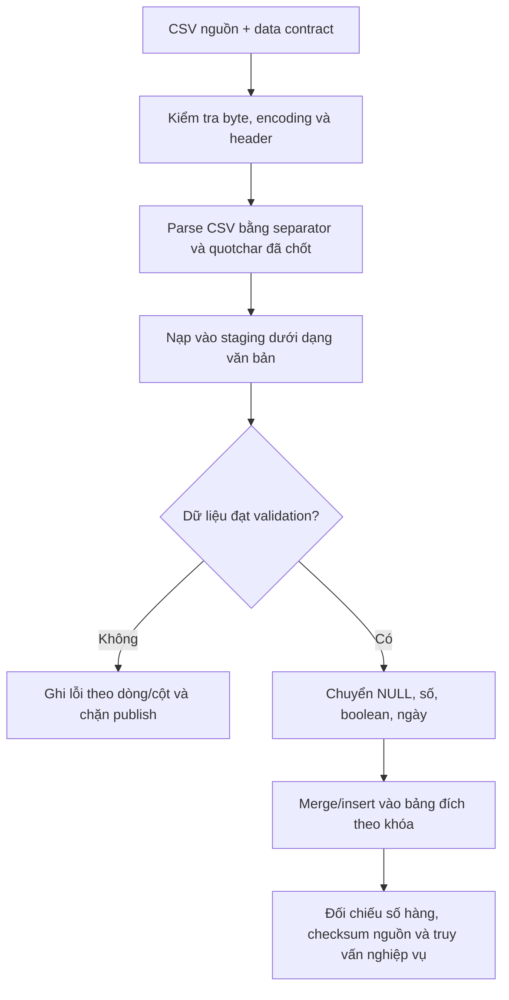

# Xử lý encoding, dấu phân cách, NULL và kiểu dữ liệu khi nạp bằng Liquibase

## 1. Bài toán: một file CSV đúng về hình thức vẫn có thể tạo dữ liệu sai

Trong module `DATABASE_SCHEMA_MIGRATION_LIQUIBASE`, người học quản lý thay đổi schema và dữ liệu bằng Liquibase thông qua **changelog, changeset, precondition, checksum và lịch sử triển khai**. Bên cạnh thay đổi cấu trúc, module còn hướng đến migration có kiểm chứng, rollback, phối hợp nhiều môi trường và tích hợp Spring Boot hoặc CI/CD. Trong nhóm **Chuyển đổi dữ liệu**, việc nạp file CSV vào database bằng `loadData` hoặc cập nhật dữ liệu theo khóa bằng `loadUpdateData` đòi hỏi kiểm soát cả **cách đọc ký tự**, **cách tách trường**, **cách hiểu giá trị thiếu** và **cách chuyển kiểu dữ liệu**.

Ví dụ file CSV nhìn bằng mắt có vẻ bình thường:

```text
customer_id;full_name;credit_limit;active;joined_on;note
1001;"Nguyễn Thị Hà";125000.50;true;2026-11-10;"Ưu tiên; giao buổi sáng"
1002;"Trần ""Minh""";0;false;2026-11-11;__DB_NULL__
1003;"Công ty An Bình";10.25;true;2026-11-12;""
```

Chỉ cần cấu hình sai một thuộc tính, kết quả có thể khác dự kiến:

- Đọc UTF-8 bằng encoding khác khiến `Nguyễn` thành ký tự lỗi, không nhất thiết làm migration thất bại ngay.
- Dùng dấu phẩy thay vì dấu chấm phẩy khiến parser nhận sai số cột.
- Coi `__DB_NULL__` là chuỗi thật thay vì `NULL` làm dữ liệu sai ngữ nghĩa.
- Coi `customer_id` là số trong bước xuất dữ liệu có thể làm mất số 0 đứng đầu nếu nó thực chất là mã định danh.
- Parse `125000.50` theo locale dùng dấu phẩy thập phân hoặc bỏ qua kiểm tra precision có thể làm sai số tiền.
- Một ô trống được hiểu là `NULL`, chuỗi rỗng hay giá trị mặc định tùy công cụ, phiên bản và quy tắc chuyển đổi.

**Mục tiêu kỹ thuật:** mọi giá trị phải đi từ **byte nguồn → ký tự Unicode → bản ghi/trường CSV → giá trị rỗng/NULL → giá trị có kiểu → ràng buộc database** theo những quy tắc đã xác định và kiểm chứng. Không đánh đồng “changelog chạy thành công” với “dữ liệu được nạp đúng”.

## 2. Thiết lập hợp đồng dữ liệu trước khi viết changeset

Trước khi nạp, lập một *data contract* cho mỗi cột, thay vì suy diễn kiểu từ vài hàng đầu của CSV:

| Trường CSV | Cột database | Kiểu database minh họa | Quy tắc bắt buộc |
|---|---|---|---|
| `customer_id` | `id` | `BIGINT` | Số nguyên dương, duy nhất, không rỗng |
| `full_name` | `full_name` | `VARCHAR(200)` | UTF-8, không rỗng, bảo toàn dấu tiếng Việt |
| `credit_limit` | `credit_limit` | `DECIMAL(18,2)` | Dấu chấm thập phân; tối đa 2 chữ số sau dấu chấm; không có dấu phân nhóm hàng nghìn |
| `active` | `active` | `BOOLEAN` hoặc kiểu tương đương | Chỉ chấp nhận `true`/`false` theo quy ước đã kiểm thử |
| `joined_on` | `joined_on` | `DATE` | Ngày ISO `YYYY-MM-DD`, không suy đoán theo locale |
| `note` | `note` | `VARCHAR(500)` | Cho phép văn bản, dấu phân cách trong dấu nháy và NULL có quy ước riêng |

**Bốn quyết định phải được ghi rõ:**

1. **Encoding của file:** UTF-8, có BOM hay không; hệ thống xuất file và hệ thống nạp có thực sự cùng hiểu không?
2. **Dialect CSV:** dấu phân cách, ký tự bao trường, cách escape dấu nháy, ký tự xuống dòng, dòng comment và header.
3. **Chính sách NULL:** ô trống có nghĩa là NULL hay chuỗi rỗng? Có token dành riêng cho NULL không? Literal `NULL` có cần lưu là văn bản không?
4. **Ánh xạ kiểu:** mã định danh có phải số, ngày có múi giờ không, số tiền dùng dấu thập phân nào và cột đích có cho phép NULL không?

Ngoài ra, cần xác nhận **số hàng dự kiến, phạm vi khóa, schema/database đích, quyền truy cập, dữ liệu đã tồn tại, chính sách trùng khóa và trách nhiệm rollback**. Một file tham chiếu nhỏ có thể nạp trực tiếp; một file lớn, phức tạp hoặc không đáng tin cần vùng staging và bộ quy tắc kiểm tra trước khi đẩy vào bảng nghiệp vụ.

## 3. Encoding: từ bytes đến chuỗi ký tự chính xác

### 3.1. UTF-8, BOM và ký tự tiếng Việt

*Encoding* quy định cách các byte trong file được giải mã thành ký tự. UTF-8 là lựa chọn thực hành tốt cho dữ liệu có tiếng Việt và đa ngôn ngữ, nhưng tên file kết thúc bằng `.csv` không chứng minh nội dung đang là UTF-8.

Các tình huống điển hình:

| Dạng file | Dấu hiệu có thể gặp | Rủi ro |
|---|---|---|
| UTF-8 không BOM | Ký tự Unicode hợp lệ; không có prefix BOM | Phổ biến và dễ trao đổi giữa công cụ |
| UTF-8 có BOM | Có thể bắt đầu bằng các byte `EF BB BF` | Một số parser xử lý BOM, một số có thể đưa BOM vào header cột đầu |
| UTF-16 LE/BE | Thường có BOM như `FF FE` hoặc `FE FF` | Không thể đọc như UTF-8 mà vẫn giữ nội dung đúng |
| Windows-1258 hoặc code page khác | Có thể đọc “được” ở ứng dụng cũ | Nếu nhận sai encoding, dấu tiếng Việt dễ bị hỏng |
| File đã bị hỏng qua nhiều lần chuyển mã | Các chuỗi như ký tự thay thế `�` hoặc dấu bị biến dạng | Chuyển mã lại không khôi phục chắc chắn dữ liệu gốc |

Ví dụ, nếu parser dùng sai charset, `Đỗ Thị Hạnh` có thể biến thành chuỗi khác nhưng vẫn là văn bản hợp lệ với database. Lỗi này khó phát hiện bằng kiểm tra số hàng. Hãy có **bộ giá trị Unicode đại diện**, chẳng hạn `Đỗ`, `Nguyễn`, `Trường`, `Tây Nguyên`, để đối chiếu sau nạp.

### 3.2. Chỉ rõ `encoding` trong `loadData`

Ví dụ cấu hình cốt lõi:

```yaml
databaseChangeLog:
  - changeSet:
      id: import-customers-2026-11
      author: database-team
      changes:
        - loadData:
            file: data/customer_import.csv
            relativeToChangelogFile: true
            tableName: customer_import
            encoding: UTF-8
            separator: ";"
            quotchar: '"'
```

`encoding: UTF-8` biểu đạt charset dự kiến để giải mã dữ liệu. `relativeToChangelogFile: true` giúp đường dẫn tài nguyên ổn định tương đối với file changelog thay vì phụ thuộc vào thư mục chạy CLI. Tên file, đường dẫn và hành vi truy cập classpath phải được kiểm tra trong bản đóng gói thực tế.

Ví dụ trên mới cho thấy cách đọc file: bảng và cột đích phải có sẵn, dữ liệu phải đúng cấu trúc, và với dự án nghiêm ngặt vẫn nên khai báo rõ ánh xạ cột và kiểu ở phần tiếp theo. **Không xem `encoding` là công cụ tự sửa file nguồn sai chuẩn.** Nếu nguồn là UTF-16 hoặc code page khác, hãy thực hiện chuyển mã có kiểm chứng trước khi nạp hoặc chọn cấu hình mà phiên bản Liquibase thực tế hỗ trợ.

### 3.3. BOM và header đầu tiên

Giả sử header thực tế là `customer_id` nhưng file có BOM không được loại ở tầng parser. Tên trường đầu có thể bị xem là `\uFEFFcustomer_id` và không khớp với `header: customer_id`. Dấu hiệu thường thấy là lỗi “không tìm thấy header/cột” chỉ ở cột đầu, trong khi các cột khác bình thường.

Quy trình kiểm chứng:

1. Xác minh byte/encoding bằng công cụ xử lý file phù hợp trong pipeline.
2. Chốt chính sách xuất UTF-8 có hoặc không BOM; tránh hai kiểu lẫn lộn trong cùng nguồn.
3. Dùng bước preflight kiểm tra **tên header đúng tuyệt đối**, không chỉ số lượng cột.
4. Nếu cần loại BOM, phải thực hiện có chủ đích và ghi nhận bước chuyển đổi; không tự ý xóa byte ở vị trí khác.

Không nên đoán BOM được xử lý tự động trong mọi phiên bản Liquibase hoặc mọi công cụ chuẩn bị CSV.

### 3.4. Unicode normalization và collation là bài toán khác encoding

Hai chuỗi hiển thị giống nhau có thể dùng cách kết hợp code point khác nhau, ví dụ ký tự có dấu dạng dựng sẵn và dạng chữ + dấu kết hợp. UTF-8 chỉ bảo đảm giải mã code point; nó **không mặc nhiên chuẩn hóa Unicode NFC/NFD**. Nếu logic nghiệp vụ có tra cứu, so sánh hoặc kiểm tra trùng theo tên tiếng Việt, phải quyết định normalization trước khi nạp và kiểm tra tương thích với collation của database.

Collation còn quy định so sánh chữ hoa/thường, dấu và sắp xếp trong DBMS; điều này khác với encoding của CSV. Đừng sửa collation để che đi lỗi file bị giải mã sai.

## 4. Dấu phân cách, dấu nháy và cấu trúc bản ghi CSV

### 4.1. `separator` không đơn giản là dấu phẩy

CSV có nhiều biến thể được dùng trên thực tế. Dữ liệu xuất từ một hệ thống dùng dấu phẩy có thể trông khác với file xuất từ công cụ dùng dấu chấm phẩy do quy ước địa phương. Với ví dụ đầu bài, phải khai báo:

```yaml
separator: ";"
quotchar: '"'
```

Trong Liquibase, thuộc tính tên là `quotchar` (không phải `quotechar` trong nhiều ví dụ API CSV khác). Ký tự `"` bao quanh trường chứa dấu `;` hoặc dấu nháy. Với CSV theo quy ước nháy kép, hai dấu nháy liên tiếp bên trong trường biểu đạt một dấu nháy:

```text
customer_id;full_name;note
1001;"Nguyễn Thị Hà";"Ưu tiên; giao sau 18:00"
1002;"Trần ""Minh""";"Đã gọi"
```

Kết quả mong muốn:

| Trường thô | Giá trị sau parse |
|---|---|
| `"Ưu tiên; giao sau 18:00"` | `Ưu tiên; giao sau 18:00`, là **một ô** |
| `"Trần ""Minh"""` | `Trần "Minh"` |
| `1001` | `1001` |

Nếu dùng sai separator, parser có thể coi cả dòng là một trường hoặc làm lệch vị trí các cột. Nếu dùng sai `quotchar`, dấu `;` nằm trong tên/ghi chú có thể chia dữ liệu thành nhiều ô ngoài ý muốn. Những lỗi này có thể bị bắt bằng số lượng cột hoặc ràng buộc database, nhưng không phải lúc nào cũng gây lỗi rõ ràng.

### 4.2. Xuống dòng bên trong trường và chuẩn dòng

Một số nguồn cho phép dấu xuống dòng nằm trong một trường được bao nháy:

```text
customer_id;note
1001;"Đã xác nhận
Giao sau giờ hành chính"
```

Về logic CSV, đây có thể là **một bản ghi có hai dòng vật lý**, nếu parser hỗ trợ đúng quy ước. Không được đếm đơn giản số ký tự xuống dòng rồi kết luận số hàng dữ liệu; cũng không tự động cắt file thành từng dòng trước khi parser CSV xử lý dấu nháy.

Nguồn có thể dùng LF hoặc CRLF. Khi file có newline trong ô, cần kiểm thử parser và exporter trên đúng phiên bản Liquibase. Nếu công cụ nguồn không cung cấp CSV chuẩn, nên chuẩn hóa hoặc dùng định dạng trung gian có cấu trúc thay vì cố nạp dữ liệu mơ hồ.

### 4.3. Header, khoảng trắng, comment và dòng thừa

Hãy kiểm tra:

- Header có chính xác tên, thứ tự và số cột đã thống nhất không?
- Có cột thừa hoặc thiếu, tên trùng nhau, khoảng trắng đầu/cuối hay BOM trong tên không?
- Có các dòng rỗng, dòng giải thích, comment bắt đầu bằng ký tự đặc biệt hoặc footer tổng số hàng không?
- Trường có khoảng trắng chỉ để hiển thị hay khoảng trắng là một phần dữ liệu hợp lệ?
- Có tab hoặc ký tự phân cách khác xuất hiện ngoài quy tắc không?

Một số phiên bản Liquibase hỗ trợ thuộc tính như `commentLineStartsWith`, `skipLines` hoặc lựa chọn CSV parser khác. Cú pháp, giá trị mặc định và phạm vi áp dụng có thể thay đổi, vì vậy hãy kiểm tra tài liệu phiên bản đang dùng thay vì mặc định mọi dòng bắt đầu bằng `#` đều được bỏ qua.

**Không dùng `trim` mọi trường một cách mù quáng.** Với mã, mật khẩu băm, văn bản cần giữ nguyên hoặc dữ liệu có khoảng trắng có nghĩa, việc tự xóa khoảng trắng làm sai dữ liệu. Nếu cần trim, quy tắc đó phải là một phần của data contract.

## 5. NULL, chuỗi rỗng và giá trị thiếu: phân biệt bốn trạng thái

Đây là vùng rủi ro lớn nhất khi nạp dữ liệu.

| Giá trị nguồn | Ý định có thể có | Nguy cơ khi tự suy đoán |
|---|---|---|
| Ô không có ký tự giữa hai separator | Giá trị thiếu, `NULL` hoặc chuỗi rỗng | Bị parser/importer chuyển theo quy tắc khác mong muốn |
| `""` | Chuỗi rỗng được bao nháy | Một số bộ đọc không giữ sự khác nhau giữa ô trống có nháy và không nháy |
| `NULL` | Có thể là token NULL **hoặc** chuỗi literal `NULL` | Có thể bị tự động chuyển thành NULL hoặc lưu nhầm thành text |
| `__DB_NULL__` | Token riêng do hợp đồng dữ liệu định nghĩa | Nếu không có bước map, database lưu nguyên văn token |
| `" "` | Một dấu cách | Không phải `NULL` và không tự tương đương chuỗi rỗng |
| `0`, `false` | Giá trị số/boolean hợp lệ | Không được coi là “không có giá trị” |

**Không có quy tắc CSV chuẩn chung bắt buộc một ô trống là SQL NULL.** Hành vi do exporter, parser, cấu hình Liquibase, loại cột và phiên bản quyết định. Một số phiên bản/đường nạp nhận diện chuỗi `NULL` đặc biệt; phiên bản mới có thể cung cấp tùy chọn `nullPlaceholder` để cấu hình token. Không suy đoán chính sách nếu chưa kiểm tra đúng bản Liquibase trong dự án.

### 5.1. Khi token NULL có thể trùng với văn bản thật

Nếu tên trạng thái nghiệp vụ hoặc ghi chú thực sự có thể bằng `NULL`, đừng dùng `NULL` làm token một cách thiếu kiểm soát. Có thể quy ước `__DB_NULL__` với cách escape văn bản trùng token, hoặc nạp toàn bộ vào bảng staging dưới dạng text rồi chuyển đổi có điều kiện.

Quan trọng: **dấu nháy trong CSV không phải cam kết rằng parser sẽ giữ khác biệt giữa token NULL được quote và không quote**. Khi cần bảo toàn sự khác nhau đó một cách tuyệt đối, nên chọn một định dạng dữ liệu có mô hình null tường minh hoặc quy ước escape đã kiểm chứng, thay vì chỉ dựa vào dấu `"`.

### 5.2. `nullPlaceholder` phải được đối chiếu với phiên bản

Các phiên bản Liquibase mới có hỗ trợ cấu hình placeholder NULL cho một số thao tác nạp dữ liệu. Trước khi dùng:

1. Xác nhận phiên bản Liquibase/extension hỗ trợ tham số `nullPlaceholder` trong `loadData` và phạm vi đặt tham số (toàn change hay từng column).
2. Kiểm tra xử lý khi trường là chuỗi rỗng, placeholder được quote hoặc placeholder xuất hiện trong literal text.
3. Test các cột `STRING`, `NUMERIC`, `DATE` và `BOOLEAN`, vì dữ liệu thiếu có thể cần chính sách khác nhau.
4. Kiểm tra kết quả **trong database**, không chỉ các log import.

Không thêm tham số theo bài hướng dẫn trên internet của một bản khác rồi mặc định môi trường hiện tại sẽ xử lý đúng. Nếu bản đang dùng không hỗ trợ đầy đủ, giải pháp bền vững là chuẩn hóa nguồn hoặc chuyển qua bảng staging với các quy tắc SQL rõ ràng.

### 5.3. Default của schema không thay thế map NULL khi import

Giả sử cột `active` có `DEFAULT true` trong database. Nếu import chạy:

```sql
INSERT INTO customer_import (id, active)
VALUES (1001, NULL);
```

Thì với SQL/DBMS thông dụng, database nhận **NULL tường minh** nếu cột nullable, hoặc báo lỗi `NOT NULL` nếu không nullable. Default chủ yếu phát huy tác dụng khi **bỏ qua cột** trong `INSERT` hoặc chỉ định `DEFAULT` theo cú pháp phù hợp.

Nếu yêu cầu “ô trống tương đương true”, cần xử lý giá trị thiếu theo data contract bằng bước chuyển đổi; đừng mặc định `DEFAULT true` sẽ sửa mọi ô trống khi `loadData` chủ động gửi NULL.

### 5.4. NULL ở các hệ quản trị

Ngoài parser CSV, DBMS còn có khác biệt. Ví dụ Oracle Database trong nhiều trường hợp coi **chuỗi rỗng của kiểu ký tự** là `NULL`; điều đó ảnh hưởng cách lưu `""`. PostgreSQL và SQL Server có thể phân biệt chuỗi rỗng và SQL NULL cho các kiểu chuỗi thông dụng. Những khác biệt này phải được kiểm chứng theo kiểu dữ liệu và phiên bản; một hợp đồng yêu cầu phân biệt cả hai trạng thái có thể không thực hiện được y hệt trên mọi DBMS.

## 6. Ánh xạ kiểu dữ liệu trong `loadData`

### 6.1. Dùng `columns` để buộc ánh xạ rõ ràng

Trong một changelog dùng YAML, có thể khai báo rõ nguồn header, tên cột đích và nhóm kiểu Liquibase:

```yaml
databaseChangeLog:
  - changeSet:
      id: import-customers-2026-11
      author: database-team
      preConditions:
        - onFail: HALT
        - tableExists:
            tableName: customer_import
      changes:
        - loadData:
            file: data/customer_import.csv
            relativeToChangelogFile: true
            tableName: customer_import
            encoding: UTF-8
            separator: ";"
            quotchar: '"'
            columns:
              - column:
                  header: customer_id
                  name: id
                  type: NUMERIC
              - column:
                  header: full_name
                  name: full_name
                  type: STRING
              - column:
                  header: credit_limit
                  name: credit_limit
                  type: NUMERIC
              - column:
                  header: active
                  name: active
                  type: BOOLEAN
              - column:
                  header: joined_on
                  name: joined_on
                  type: DATE
              - column:
                  header: note
                  name: note
                  type: STRING
```

**Đây là ví dụ mapping cho file không chứa token NULL đặc biệt cần chuyển đổi.** Nếu CSV có `__DB_NULL__` như bản dữ liệu ở đầu bài, phải bổ sung bước xử lý placeholder tương thích phiên bản hoặc chuẩn hóa/staging trước khi dùng mapping trực tiếp. Không chạy nguyên file đó rồi mặc định cột `note` sẽ thành NULL.

Các tên `NUMERIC`, `STRING`, `BOOLEAN`, `DATE` là cách Liquibase mô tả **kiểu nhập từ CSV**, không nhất thiết là tên chính xác của kiểu SQL trong database. Kiểu SQL như `DECIMAL(18,2)`, `VARCHAR(200)` hay `DATE` nằm ở định nghĩa bảng đích và có thể khác theo DBMS.

Một số kiểu và đường nhập nâng cao như `BLOB`, `CLOB`, `COMPUTED` hoặc `SKIP` có quy tắc riêng; cần đối chiếu bản Liquibase thực tế nếu sử dụng. Đặc biệt, `COMPUTED` có thể liên quan đến biểu thức SQL thay vì dữ liệu literal, nên không dùng cho nội dung người dùng chưa được tin cậy.

### 6.2. String: mã định danh có số 0 đầu vẫn là chuỗi

Ví dụ số điện thoại `0901234567`, mã vùng `0012` hoặc mã đơn `000045`. Dù chỉ gồm chữ số, đây thường là **mã**, không phải số dùng cho phép cộng. Khi nguồn đi qua Excel hoặc `NUMERIC`, số 0 đầu dễ bị loại.

Với các trường đó:

- Database dùng `VARCHAR` phù hợp.
- CSV giữ nguyên dấu nháy nếu công cụ xuất cần, không chuyển thành kiểu số.
- Mapping Liquibase dùng `STRING`.
- Kiểm tra chiều dài, zero-padding và tính duy nhất sau khi nạp.

Không dùng độ phân biệt của dữ liệu mẫu để suy đoán kiểu. Nếu nghiệp vụ không thực hiện toán học trên giá trị, `STRING` có thể là kiểu đúng ngay cả khi chuỗi chỉ chứa số.

### 6.3. Numeric: dấu thập phân, hàng nghìn, precision và overflow

Giá trị `1,234.56` hay `1.234,56` mang ý nghĩa khác nhau tùy locale. Trong file dùng dấu phẩy làm separator, ký tự `,` còn có thể chia ô. Hãy thống nhất một dạng máy dễ đọc, ví dụ:

```text
1234.56
-10.00
0
```

Và **từ chối hoặc chuyển đổi có kiểm chứng** các dạng mơ hồ:

```text
1,234.56       # dấu ngăn nhóm và decimal theo một locale
1.234,56       # quy ước locale khác
12 345,00      # dấu cách và decimal comma
NaN            # có thể không hợp lệ với kiểu đích
1e500          # có thể tràn precision/range
```

Với tiền và định mức, dùng kiểu decimal chính xác như `DECIMAL(18,2)` theo yêu cầu nghiệp vụ; không tự chuyển qua float nếu cần bảo toàn giá trị thập phân. Cần kiểm tra **số chữ số phần nguyên, phần thập phân, dấu âm, làm tròn, tràn kiểu và giá trị ngoài phạm vi**. Chỉ vì Liquibase map `NUMERIC` không có nghĩa dữ liệu cuối đã đúng scale/precision của bảng đích.

### 6.4. Boolean: không tự suy đoán mọi cách biểu diễn là tương đương

Nguồn có thể gửi `true/false`, `TRUE/FALSE`, `1/0`, `Y/N` hoặc `yes/no`. Các phiên bản, parser và driver có thể khác nhau trong việc chấp nhận những biểu diễn này. Một hợp đồng đơn giản và dễ kiểm chứng là **chỉ nhận `true` hoặc `false`** trong CSV chuẩn hóa rồi map `BOOLEAN`.

Nếu nguồn dùng `1/0` hoặc `Y/N`, hãy chuyển đổi có chủ đích trước khi nạp hoặc nhập như `STRING` ở staging và đổi kiểu trong SQL/ETL theo quy tắc rõ ràng. Không coi ô trống tương đương `false` trừ khi nghiệp vụ xác nhận.

### 6.5. Ngày và timestamp: ISO, timezone và giá trị không hợp lệ

Đối với cột `DATE`, ưu tiên `YYYY-MM-DD`, ví dụ `2026-11-12`, thay vì `12/11/2026` (mơ hồ giữa ngày/tháng). Với thời điểm có timezone, dùng chuẩn có offset hoặc UTC như `2026-11-12T08:15:00Z`, rồi định nghĩa chính sách lưu ở DBMS.

**Không trộn `DATE` với `TIMESTAMP`:** ngày lịch không nhất thiết là một thời điểm; timestamp có thể cần timezone hoặc không theo kiểu SQL đích. Kiểm tra ngày không có thật (như `2026-02-30`), thời điểm chuyển DST nếu có, precision của phần mili/vi giây và cách driver diễn giải múi giờ. Một bản nạp có thể chạy mà thời điểm bị lệch nếu phụ thuộc vào timezone máy chạy.

## 7. Bảng staging: cách tách lỗi nguồn khỏi bảng nghiệp vụ

Khi file có dữ liệu bẩn, chứa token NULL đặc biệt, date/number không thống nhất hoặc cần backfill lớn, **đừng nạp trực tiếp vào bảng nghiệp vụ rồi hy vọng constraint phát hiện hết**. Dùng staging với các cột chuỗi trước, sau đó kiểm tra và chuyển đổi có chủ đích.

### 7.1. Quy trình hai bước



Ví dụ cấu trúc bảng staging (SQL minh họa trên PostgreSQL):

```sql
CREATE TABLE customer_import_stage (
    batch_id          VARCHAR(80) NOT NULL,
    customer_id_text  TEXT,
    full_name_text    TEXT,
    credit_limit_text TEXT,
    active_text       TEXT,
    joined_on_text    TEXT,
    note_text         TEXT
);
```

Trong thực tế có thể dùng `loadData` với mapping kiểu `STRING` vào staging và gán `batch_id` bằng một bước chuẩn bị nguồn hoặc cơ chế pipeline phù hợp. File nguồn phải có header tương ứng với mapping đã định nghĩa; không mặc định CSV chứa cột `batch_id` khi ví dụ ban đầu chưa có.

### 7.2. Chuyển đổi kiểu và token NULL trong SQL tường minh

Khi staging đã được kiểm tra, một câu lệnh chuyển đổi trên PostgreSQL có thể minh họa cách biểu đạt rõ ý định:

```sql
INSERT INTO customer_import (
    id, full_name, credit_limit, active, joined_on, note
)
SELECT
    CAST(customer_id_text AS BIGINT),
    full_name_text,
    CAST(credit_limit_text AS NUMERIC(18,2)),
    CASE active_text
        WHEN 'true'  THEN TRUE
        WHEN 'false' THEN FALSE
    END,
    CAST(joined_on_text AS DATE),
    NULLIF(note_text, '__DB_NULL__')
FROM customer_import_stage
WHERE batch_id = 'batch-2026-11-19';
```

**Đây là minh họa sau kiểm chứng, không phải câu SQL để chạy trực tiếp lên nguồn chưa kiểm soát.** Nếu `active_text` có `yes`, biểu thức `CASE` trên trả về NULL; cần bước validation bắt mọi giá trị ngoài `true`/`false` trước khi `INSERT`. Nếu `credit_limit_text` không phải số hợp lệ, `CAST` có thể làm toàn bộ lệnh thất bại. Nếu `note_text` thực sự cần chứa literal `__DB_NULL__`, phải có quy tắc escape khác trước khi dùng `NULLIF`.

Trong MySQL, SQL Server hay Oracle, cú pháp chuyển kiểu, khả năng xử lý lỗi và ràng buộc transaction khác PostgreSQL; không đưa raw SQL này vào một changeset “portable” không khai báo `dbms`. Hãy dùng các change type hoặc câu SQL theo DBMS phù hợp.

### 7.3. Validation phải trả lời được “hàng nào sai vì sao”

Trên staging, tạo các kiểm tra có kết quả rõ:

- `customer_id_text` không rỗng, đúng số nguyên, trong miền cho phép, không trùng trong batch hoặc với khóa đích theo chính sách.
- `full_name_text` không rỗng, không chứa ký tự thay thế do lỗi encoding, không vượt độ dài.
- `credit_limit_text` đúng dạng decimal đã thống nhất, phù hợp `DECIMAL(18,2)`.
- `active_text` nằm trong tập cho phép.
- `joined_on_text` là ngày hợp lệ, không chỉ khớp regex.
- `note_text` phân biệt NULL token, chuỗi rỗng và văn bản hợp lệ theo hợp đồng.

Ví dụ hai truy vấn chỉ nhằm phát hiện một số lỗi trước khi chuyển kiểu trên PostgreSQL:

```sql
-- Trường boolean không thuộc tập cho phép:
SELECT customer_id_text, active_text
FROM customer_import_stage
WHERE batch_id = 'batch-2026-11-19'
  AND active_text NOT IN ('true', 'false');

-- Trường decimal không có định dạng 0-2 chữ số thập phân:
SELECT customer_id_text, credit_limit_text
FROM customer_import_stage
WHERE batch_id = 'batch-2026-11-19'
  AND (credit_limit_text IS NULL
       OR credit_limit_text !~ '^-?[0-9]+(\.[0-9]{1,2})?$');
```

Regex chỉ kiểm tra **hình thức**, không thay thế kiểm tra giới hạn giá trị, precision/overflow và ý nghĩa nghiệp vụ. `NOT IN` trong SQL có hành vi ba trạng thái khi dữ liệu NULL, vì vậy nếu cột nullable cần xử lý `IS NULL` riêng. Kế hoạch validation phải xác định trước cách xử lý dòng lỗi: chặn cả batch, chuyển vào bảng lỗi có kiểm soát hay cho phép nạp một phần theo chính sách đã duyệt.

## 8. `loadData` và `loadUpdateData`: chọn đúng ngữ nghĩa khi nạp lại

### 8.1. `loadData` thường phù hợp cho dữ liệu mới được quản lý như migration

`loadData` đọc nội dung nguồn và tạo thao tác chèn theo khả năng của Liquibase/DBMS. Khi changeset đã chạy, Liquibase theo dõi lịch sử trong `DATABASECHANGELOG`; một lượt `update` sau thường không thực hiện lại changeset đã hoàn tất (trừ khi cấu hình đặc biệt như `runAlways`/`runOnChange` thay đổi quy tắc).

Nếu cùng một file được thêm vào changeset khác và nạp lần nữa, database có thể gặp khóa trùng hoặc ghi dữ liệu hai lần. **Không trông chờ lịch sử changeset tự bảo vệ một file được dùng lại ở nhiều định danh changeset khác nhau.**

### 8.2. `loadUpdateData` cho nhu cầu cập nhật theo khóa

`loadUpdateData` là một lựa chọn khi muốn xác định bản ghi theo khóa và cập nhật hoặc thêm dữ liệu theo hành vi hỗ trợ của Liquibase và DBMS. Ví dụ hình thức:

```yaml
databaseChangeLog:
  - changeSet:
      id: reference-customers-upsert-2026-11
      author: database-team
      changes:
        - loadUpdateData:
            file: data/customer_reference.csv
            relativeToChangelogFile: true
            encoding: UTF-8
            separator: ";"
            quotchar: '"'
            tableName: customer_reference
            primaryKey: id
```

Ví dụ giả định file có cột `id` và các cột khác tương thích với bảng đích. Cần xem lại cú pháp, cách sinh SQL và hỗ trợ của phiên bản Liquibase/DBMS. `primaryKey` ở đây là **cột/các cột dùng để nhận diện dòng khi nạp**, không phải bảo đảm file không chứa khóa trùng. Phải kiểm tra uniqueness và quyết định rõ một dòng nguồn được phép ghi đè những trường nào.

Không lạm dụng upsert cho migration lịch sử: nếu dữ liệu đã bị người dùng chỉnh sau khi import, một lượt cập nhật lại có thể ghi đè dữ liệu hợp lệ. Hãy chọn giữa `loadData`, `loadUpdateData`, changeset `update` có `where` tường minh và một job đồng bộ dữ liệu có version riêng dựa trên nhu cầu thực tế.

### 8.3. Dữ liệu nhập là một phần của release

Một thực hành tốt cho data migration là cố định:

- Phiên bản changelog và `id`/`author` của changeset.
- File dữ liệu thuộc release, không chỉ tham chiếu URL hoặc file mutable bên ngoài.
- Encoding/dialect CSV, data contract và bộ quy tắc chuyển đổi.
- Mã băm/artifact digest ở pipeline để xác nhận đúng file đã review.
- Dữ liệu và kết quả đối chiếu trước/sau migration.

Đổi nội dung CSV sau khi changeset đã được triển khai có thể gây khác biệt giữa các môi trường, kể cả khi tên file không thay đổi. Hành vi checksum đối với tài nguyên data file có thể phụ thuộc change type/phiên bản; không được **giả định** Liquibase luôn phát hiện mọi sửa đổi file CSV trong cùng một changeset. Cách dễ kiểm toán nhất là **không chỉnh file đã phát hành**, mà tạo changeset/data artifact mới cho lần thay đổi tiếp theo.

## 9. Rollback cho data migration: khó hơn `DELETE` một lần

Không nên mặc định `loadData` hoặc `loadUpdateData` có rollback tự động khôi phục đúng trạng thái cũ. Ngay cả khi có thể tạo câu `DELETE` theo khóa, nó có thể xóa những dòng đã được ứng dụng chỉnh sửa sau khi nạp hoặc xóa dữ liệu đang được tham chiếu bởi khóa ngoại.

### 9.1. Nạp dữ liệu tham chiếu bất biến

Với một batch insert có khóa dành riêng và chưa bị dữ liệu nghiệp vụ chỉnh sửa, có thể thiết kế rollback chọn lọc:

```yaml
databaseChangeLog:
  - changeSet:
      id: seed-reference-status-2026-11
      author: database-team
      changes:
        - loadData:
            file: data/order_status_2026_11.csv
            relativeToChangelogFile: true
            tableName: order_status
            encoding: UTF-8
      rollback:
        - delete:
            tableName: order_status
            where: "status_code IN ('QUEUED_NEW', 'CANCELLED_NEW')"
```

**Ví dụ chỉ an toàn khi** hai mã đó được changeset này tạo, không tồn tại từ trước, chưa được bảng khác tham chiếu và không bị sửa bởi ứng dụng. Không chọn rollback kiểu `DELETE FROM order_status` không có điều kiện. Nếu dữ liệu phụ thuộc đã hình thành, phương án sửa tiến (*forward-fix*) hoặc rollback ứng dụng có thể an toàn hơn xóa tham chiếu.

### 9.2. Upsert cần lưu trạng thái trước khi cập nhật

Với `loadUpdateData`, rollback đòi hỏi biết giá trị cũ của các hàng đã cập nhật và nhận diện các hàng mới. Nếu không có snapshot/diff, không thể đơn giản “đảo” mọi trường. Có thể ghi bảng audit theo `batch_id`, snapshot trước khi nạp hoặc dùng công cụ migration dữ liệu riêng để khôi phục. Các thao tác rollback phải được thử trên bản sao dữ liệu đại diện, không chỉ kiểm tra SQL hợp lệ.

### 9.3. Transaction và nạp hàng loạt

Không phải mọi DBMS hoặc mọi đường import/DDL đều có khả năng rollback transaction giống nhau. Một file lớn có thể làm tăng transaction log, ảnh hưởng lock, replication hoặc thời gian phục hồi sau lỗi. Nếu tách batch, phải có checkpoint, cơ chế tiếp tục (*resume*) và cách ngăn ghi trùng rõ ràng. Không nên đặt `runInTransaction: false` cho một changeset gồm nhiều thao tác chỉ để làm import chạy nhanh mà chưa phân tích hậu quả khi thất bại giữa chừng.

## 10. Khác biệt môi trường và DBMS

| Chủ đề | PostgreSQL | MySQL / MariaDB | SQL Server | Oracle |
|---|---|---|---|---|
| Charset dữ liệu | Encoding database/client và chuyển đổi Unicode phải đúng | Kiểm tra `utf8mb4`, connection charset/collation | Phân biệt kiểu `VARCHAR`/`NVARCHAR` và collation/encoding theo phiên bản | Kiểm tra database character set, NLS và kiểu character |
| Chuỗi rỗng so với NULL | Thường phân biệt | Thường phân biệt ở kiểu chuỗi thông dụng | Thường phân biệt | Trong nhiều ngữ cảnh, chuỗi rỗng được coi là NULL |
| Decimal/Date parse | Dùng quy tắc kiểu SQL và driver | SQL mode, parser và quy tắc lỗi cần kiểm tra | Kiểu decimal/datetime và chuyển đổi có thể khác | NLS/date format/decimal separators ảnh hưởng nếu parse dạng chuỗi |
| Dữ liệu text đa ngôn ngữ | Kiểm tra collation và normalization khi so sánh | Charset và collation có thể làm khác hành vi so sánh | Unicode type/collation rất quan trọng | Character set và kiểu chuỗi ảnh hưởng khả năng lưu chữ |
| Upsert/merge | Có các cơ chế SQL riêng theo phiên bản | Có `ON DUPLICATE KEY UPDATE` | Có cơ chế cập nhật/insert riêng, cần đánh giá concurrency | Có `MERGE` với ngữ nghĩa và giới hạn riêng |

**Liquibase không triệt tiêu mọi khác biệt DBMS.** `loadData` giúp chuẩn hóa cách khai báo thao tác import, nhưng kiểu đích, charset database, default, constraints, driver và SQL sinh ra vẫn có thể khác. Nếu ứng dụng cần hỗ trợ nhiều DBMS, hãy kiểm thử cùng bộ input trên từng hệ quản trị thực tế; không lấy kết quả PostgreSQL để suy ra MySQL/SQL Server/Oracle chắc chắn giống.

## 11. Quy trình kiểm chứng trước khi gọi `update`

### 11.1. Tách bốn tầng kiểm tra

| Tầng | Mục tiêu | Bằng chứng cần giữ |
|---|---|---|
| File | Encoding, BOM, CSV dialect, header, số cột/hàng, dữ liệu mẫu | Báo cáo preflight, digest, header schema |
| Mapping | Cột nguồn → cột đích, NULL token, kiểu số/boolean/ngày | Data contract và bộ test trường hợp biên |
| Changelog | Changeset, điều kiện, đường dẫn file, checksum, lịch sử | Kết quả `validate`, `status`, SQL dự kiến |
| Database | Ràng buộc, kiểu, row count, dữ liệu, rollback | Truy vấn đối chiếu trước/sau, bản ghi lỗi, audit |

Một lỗi ở tầng file không thể khắc phục bằng cách thay tùy chọn database một cách tùy ý. Một lỗi trùng khóa không được giải quyết bằng việc sửa encoding nếu encoding vốn đã đúng.

### 11.2. Kiểm tra Liquibase CLI

Với file mặc định đã trỏ tới changelog và database test:

```bash
liquibase --defaults-file=config/liquibase-test.properties validate
liquibase --defaults-file=config/liquibase-test.properties status --verbose
liquibase --defaults-file=config/liquibase-test.properties update-sql
```

`validate` hỗ trợ kiểm tra cấu trúc changelog và nhiều quy tắc Liquibase, nhưng không bảo đảm tất cả giá trị trong CSV hợp lệ theo data contract. `status --verbose` giúp xem changeset nào còn pending, còn `update-sql` hỗ trợ review SQL theo DBMS và cách load data đang dùng. Tùy version và cơ chế prepared statements, bản SQL dự kiến có thể không phản ánh toàn bộ bind values hay mọi chi tiết runtime; đừng coi nó thay cho nạp thử.

Thử `update` trên **database test có dữ liệu đại diện**, rồi đối chiếu hàng thực tế:

```sql
SELECT COUNT(*) AS total_rows
FROM customer_import;

SELECT id, full_name, credit_limit, active, joined_on, note
FROM customer_import
WHERE id IN (1001, 1002, 1003)
ORDER BY id;
```

Kiểm tra tên Unicode nguyên vẹn, giá trị decimal chính xác, boolean đúng, date không lệch và NULL thật bằng toán tử `IS NULL`, không bằng cách nhìn chuỗi hiển thị trong một công cụ SQL.

```sql
SELECT COUNT(*) AS missing_note_count
FROM customer_import
WHERE note IS NULL;
```

Nếu dữ liệu có thể có note rỗng, thêm kiểm tra `note = ''` ở DBMS phân biệt chuỗi rỗng và NULL. Với Oracle, điều kiện này có thể có hành vi khác; phải dùng cách kiểm tra phù hợp DBMS đó.

### 11.3. Đọc lịch sử Liquibase nhưng không bỏ qua dữ liệu thật

```sql
SELECT ID, AUTHOR, FILENAME, DATEEXECUTED, EXECTYPE, MD5SUM
FROM DATABASECHANGELOG
ORDER BY DATEEXECUTED, ORDEREXECUTED;
```

Bảng metadata có thể nằm trong schema khác tùy cấu hình. Lịch sử cho biết changeset đã được xử lý, **không chứng minh** mọi giá trị Unicode/decimal/NULL đều đúng. Vì vậy, đối chiếu `DATABASECHANGELOG` với truy vấn nghiệp vụ và báo cáo số dòng, số dòng bị từ chối hoặc được cập nhật.

### 11.4. Tích hợp Spring Boot và CI/CD

Spring Boot có thể chạy Liquibase thông qua cấu hình `spring.liquibase.change-log`:

```yaml
spring:
  liquibase:
    enabled: true
    change-log: classpath:/db/changelog/db.changelog-master.yaml
```

Khi đóng gói, kiểm tra cả **CSV đi kèm** trong artifact và đường dẫn `relativeToChangelogFile`. Một file có sẵn trên máy developer nhưng không nằm trong JAR/container có thể khiến migration chỉ hỏng ở production.

Pipeline nên thực hiện: kiểm tra encoding/header → test CSV mapping → chạy `validate`/`status`/`update-sql` → nạp thử trên DB staging → đối chiếu row count/data quality → phát hành đúng artifact đã duyệt. Tránh để nhiều replica ứng dụng tự import file lớn cùng lúc; `DATABASECHANGELOGLOCK` giúp tuần tự hóa các Liquibase runner chia sẻ metadata, nhưng không giảm áp lực ghi dữ liệu hay giải quyết file/URL cấu hình sai.

## 12. Chẩn đoán sự cố thường gặp

| Triệu chứng | Nguyên nhân có thể | Cách xử lý |
|---|---|---|
| Chữ Việt bị biến dạng hoặc ký tự `�` | File không phải UTF-8, chuyển mã nhiều lần, driver/DB charset khác | Xác minh bytes gốc, charset và chuỗi mẫu; chuyển mã có kiểm soát, kiểm tra cột đích |
| Chỉ header đầu tiên không khớp | BOM hoặc ký tự ẩn ở đầu file | So sánh tên header thực, xử lý BOM trước khi nạp |
| Một dòng bị tách thành nhiều cột | Sai `separator`, sai `quotchar`, escape nháy không đúng | Thử parser trên ô chứa separator và nháy kép |
| Số dòng nhập không khớp số dòng vật lý | Trường CSV có newline được quote, comment/footer, dòng trống | Dùng CSV parser hợp lệ và báo cáo số bản ghi logic |
| Văn bản `NULL` xuất hiện thay vì SQL NULL | Thiếu quy ước token/placeholder | Dùng config hỗ trợ hoặc staging với mapping tường minh |
| Chuỗi literal `NULL` bị mất | Placeholder đụng dữ liệu thật | Chọn token không trùng/escape hoặc staging |
| Các ô trống thành 0 hoặc false ngoài ý muốn | ETL/parser tự gán mặc định | Quy định NULL vs default và test từng loại ô |
| Mất số 0 đầu ở mã | Exporter/cột nạp dùng numeric | Định nghĩa mã là STRING từ nguồn đến database |
| Decimal bị sai hoặc tràn kiểu | Locale khác, dấu ngăn nhóm, precision/scale không phù hợp | Chuẩn hóa decimal, validate range/scale, dùng kiểu DECIMAL |
| Ngày bị đảo tháng/ngày hoặc lệch giờ | Dạng không ISO, timezone/driver/NLS không thống nhất | Dùng ISO, phân biệt DATE/TIMESTAMP, khóa timezone |
| Trùng khóa khi nạp lần hai | Dùng lại file dưới changeset khác hoặc thiếu chính sách upsert | Xác minh lịch sử, dữ liệu hiện có và ý định insert/update |
| Local chạy được, CI không thấy file | CSV không được đóng gói hoặc path phụ thuộc thư mục chạy | Kiểm tra artifact và `relativeToChangelogFile` |
| Import thành công nhưng dữ liệu sai | Chỉ dựa vào status/changelog, thiếu kiểm tra giá trị | So sánh mẫu Unicode/NULL/decimal, số hàng và constraints |

Khi có lỗi, giữ nguyên file nguồn và log cần thiết để phân tích, nhưng **không log secrets hoặc dữ liệu cá nhân không cần thiết**. Nếu dữ liệu đã ghi sai, tạo kế hoạch sửa bằng changeset bổ sung hoặc công cụ sửa dữ liệu có audit; đừng chỉnh tay `DATABASECHANGELOG` để làm lịch sử “trông đúng”.

## 13. Tình huống thực tế: nhập danh sách khách hàng đa ngôn ngữ

Một hệ thống đang chuyển từ file CSV do phòng nghiệp vụ xuất mỗi tháng sang bảng tham chiếu mới. CSV gồm 120.000 dòng, dùng dấu `;`, chứa tên tiếng Việt, trường ghi chú đôi khi có `;` và xuống dòng, mã khách hàng có thể có số 0 đầu và số tiền được xuất theo locale khác nhau.

Nếu nhóm lập tức dùng `loadData` với mặc định, rủi ro gồm: dữ liệu tên bị sai dấu, cột bị lệch khi ghi chú có dấu phân cách, mã mất zero-padding, số tiền nạp sai, literal `NULL` bị hiểu khác nhau và hàng trùng khóa. Cách làm có kiểm soát:

1. **Khóa data contract:** thống nhất charset UTF-8, CSV có header, separator `;`, dấu nháy `"`, số tiền không có thousand separator và decimal dot, date ISO.
2. **Thống nhất NULL:** ví dụ dùng token `__DB_NULL__` chỉ sau khi xác nhận không thể trùng dữ liệu hợp lệ; test riêng empty/quoted empty/NULL.
3. **Preflight toàn file:** kiểm tra encoding và BOM, số trường mỗi bản ghi logic, header, số hàng, ID trùng, numeric/date/boolean không hợp lệ.
4. **Dùng staging:** các trường nguồn nhập như STRING, gắn `batch_id`, ghi báo cáo lỗi theo dòng/cột và giữ file nguồn bất biến.
5. **Chuyển đổi có kiểm soát:** chuyển string sang decimal/date/boolean và NULL trong SQL/ETL phù hợp DBMS; chuẩn hóa Unicode nếu hợp đồng yêu cầu.
6. **Kiểm tra dữ liệu:** so số hàng nguồn–staging–đích; đọc lại các giá trị tiếng Việt, mã có 0 đầu, số tiền cực trị, note rỗng/NULL.
7. **Phát hành thay đổi:** dùng changeset/data artifact có version; lưu checksum nguồn và kết quả đối chiếu trong pipeline; kiểm tra rollback/upsert trước production.
8. **Theo dõi sau nạp:** đối chiếu `DATABASECHANGELOG`, số bản ghi thực, khóa ngoại, tỷ lệ NULL và truy vấn nghiệp vụ.

Với 120.000 dòng, lựa chọn nhập trực tiếp hay staging phụ thuộc chất lượng nguồn, DBMS và khả năng rollback; số lượng hàng đơn thuần không phải ngưỡng kỹ thuật cố định. Điều quan trọng là quy trình có thể giải thích **giá trị nào đã được chuyển đổi, theo luật nào, ở phiên bản nào**.

## 14. Checklist trước khi merge migration nạp dữ liệu

- [ ] Xác nhận nguồn CSV, data owner, mục đích, số hàng và bản phát hành dữ liệu.
- [ ] Đã xác minh encoding và chính sách BOM; dữ liệu tiếng Việt được đọc lại nguyên vẹn.
- [ ] `separator`, `quotchar`, escape dấu nháy, newline và header được khai báo, kiểm thử bằng ca biên.
- [ ] Mọi cột có mapping header → tên DB → kiểu nhập → kiểu SQL → nullability rõ ràng.
- [ ] Đã phân biệt ô trống, chuỗi rỗng, whitespace, literal `NULL`, SQL NULL, `0` và `false`.
- [ ] Token NULL hoặc `nullPlaceholder` được kiểm thử đúng phiên bản Liquibase, tránh đụng dữ liệu thật.
- [ ] Mã định danh giữ nguyên số 0 đầu; numeric dùng decimal/range/scale hợp lệ; boolean và date dùng quy tắc được xác nhận.
- [ ] Đã xác định dữ liệu nào được nạp trực tiếp, dữ liệu nào phải qua staging và validation.
- [ ] Có chính sách xử lý dòng lỗi, trùng khóa, upsert, idempotency và nạp lại theo batch.
- [ ] File CSV/changelog thuộc cùng artifact phát hành hoặc được version hóa rõ, không sửa ngầm sau triển khai.
- [ ] Đã xác minh `loadData`/`loadUpdateData` và mọi option trên phiên bản Liquibase/DBMS thực tế.
- [ ] Có rollback hoặc forward-fix với phạm vi khóa rõ ràng, không xóa nhầm dữ liệu ứng dụng.
- [ ] `validate`, `status --verbose`, `update-sql` và nạp thử trên database đại diện đã được thực hiện.
- [ ] Đã so sánh dữ liệu thật sau nạp: Unicode, số tiền, ngày giờ, NULL, row count và constraint.
- [ ] Spring Boot/CI/CD đóng gói file đúng path và dùng cùng changelog, database, filter và tài nguyên được review.

**Kết luận:** thành công của `loadData` không chỉ nằm ở cú pháp changeset. Một migration dữ liệu đáng tin cậy cần có **encoding xác định, CSV dialect không mơ hồ, chính sách NULL tường minh, ánh xạ kiểu có kiểm tra và bằng chứng đối chiếu sau khi ghi**. Kết hợp các yếu tố này với changelog, changeset, precondition, checksum, `DATABASECHANGELOG`, rollback và CI/CD giúp `DATABASE_SCHEMA_MIGRATION_LIQUIBASE` quản lý thay đổi dữ liệu một cách có thể tái lập, kiểm chứng và phục hồi theo đúng yêu cầu của từng môi trường.
