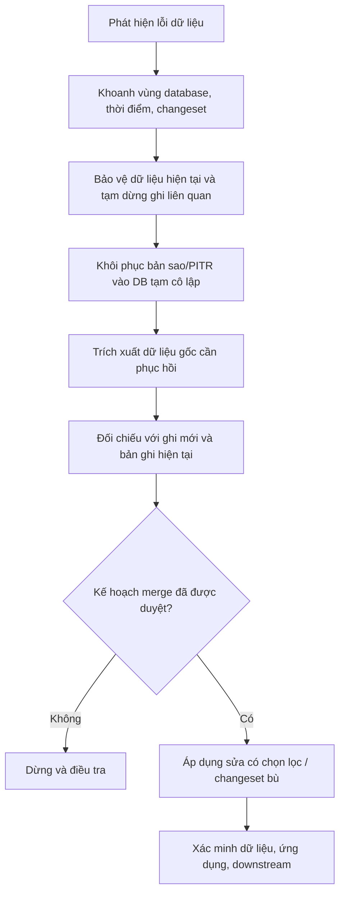
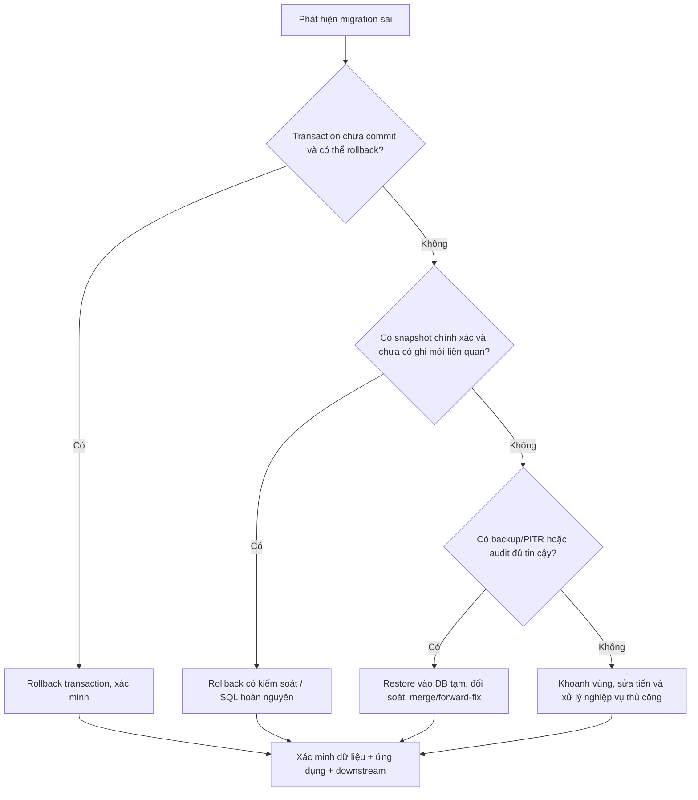

# Lập kế hoạch phục hồi cho thay đổi dữ liệu khó đảo ngược

## 1. Bối cảnh: migration thành công chưa chắc có thể quay lại

Trong module **DATABASE_SCHEMA_MIGRATION_LIQUIBASE**, người học cần nắm cách quản lý thay đổi schema và dữ liệu bằng Liquibase với changelog, changeset, precondition, checksum và lịch sử triển khai; thực hành migration có kiểm chứng, rollback, phối hợp nhiều môi trường và tích hợp Spring Boot hoặc CI/CD. Ở chương **Chuyển đổi dữ liệu**, một thách thức lớn không nằm ở cú pháp `update` hay `delete`, mà là **phải làm gì nếu một thay đổi dữ liệu đã áp dụng nhưng kết quả nghiệp vụ sai**.

Một thay đổi dữ liệu khó đảo ngược có thể là:

- Gộp nhiều trạng thái cũ thành một trạng thái mới: `NEW` và `PENDING` cùng trở thành `OPEN`. Từ `OPEN` không suy ra được giá trị ban đầu.
- Chuẩn hóa hoặc cắt bớt dữ liệu: loại dấu, rút ngắn chuỗi, làm tròn tiền hoặc chuyển đổi múi giờ khi thiếu thông tin nguồn.
- Xóa bản ghi trùng, xóa dữ liệu lịch sử hoặc chuyển dữ liệu sang cấu trúc mới rồi xóa cột cũ.
- Mã hóa lại hoặc băm dữ liệu bằng thuật toán mới, nơi dữ liệu ban đầu không thể tính ngược nếu không lưu bản gốc.
- Cập nhật một tập dữ liệu lớn với mapping nghiệp vụ sai; phần thay đổi đã lan sang cache, báo cáo, CDC hoặc hệ thống ngoài.

Liquibase có thể thực thi SQL, theo dõi changeset trong `DATABASECHANGELOG` và hỗ trợ các cơ chế rollback tương ứng. Nhưng **bảng lịch sử không chứa toàn bộ dữ liệu trước khi thay đổi**. Một changeset hiển thị thành công không bảo đảm có thể phục hồi giá trị gốc.

Mục tiêu của bài:

1. Phân loại mức độ có thể đảo ngược của một data migration.
2. Thiết kế kế hoạch phục hồi **trước khi** chạy thay đổi, thay vì chỉ viết rollback sau sự cố.
3. Phân biệt transaction rollback, Liquibase rollback, forward-fix, restore từ backup và point-in-time recovery (PITR).
4. Lưu dữ liệu trước thay đổi theo định danh tin cậy, có khả năng đối chiếu và giới hạn truy cập.
5. Xây dựng changeset với precondition, bước kiểm tra, checkpoint và SQL hoàn nguyên có phạm vi rõ ràng.
6. Tổ chức migration qua dev/test/staging/production và CI/CD với tiêu chí dừng, phê duyệt và diễn tập phục hồi.
7. Quyết định cách xử lý khi thay đổi đã commit, khi ứng dụng tiếp tục ghi dữ liệu và khi downstream đã tiêu thụ kết quả.

**Nguyên tắc:** Một kế hoạch phục hồi tốt phải trả lời được “khôi phục dữ liệu nào, từ nguồn nào, đến trạng thái nào, trong bao lâu và với tổn thất tối đa bao nhiêu?” — không chỉ “có câu lệnh `rollback` hay không?”.

## 2. Nhận diện thay đổi khó đảo ngược

### 2.1. Các chiều của khả năng đảo ngược

Không nên đánh giá một migration bằng một nhãn đơn giản “rollback được/không được”. Hãy kiểm tra ít nhất bốn chiều:

| Chiều | Câu hỏi cần trả lời | Ví dụ rủi ro |
|---|---|---|
| **Thông tin dữ liệu** | Từ giá trị sau thay đổi có suy ra chính xác giá trị trước đó? | Gộp `NEW` và `PENDING` thành `OPEN` |
| **Cấu trúc** | Schema cũ có thể tái tạo mà không mất cột, constraint, index và quan hệ? | Xóa cột chứa giá trị chưa lưu |
| **Tính thời điểm** | Có thể tách thay đổi migration khỏi ghi mới của ứng dụng sau đó? | Restore bản sao 10:00 ghi đè đơn hàng tạo lúc 10:05 |
| **Tác dụng ngoài DBMS** | Thay đổi đã phát sinh sự kiện, email, hóa đơn, cache hay báo cáo ở ngoài database chưa? | Event đã được gửi đến hệ thống kế toán |

Ví dụ, thao tác `UPDATE ... SET status = 'OPEN' WHERE status IN ('NEW','PENDING')` có thể thực thi trong một transaction và rollback trước khi commit. Sau khi commit, nếu không giữ cặp `(order_id, status_before)`, câu SQL đảo ngược không biết mỗi hàng cần quay về `NEW` hay `PENDING`.

### 2.2. Ma trận phân loại rủi ro

| Loại thay đổi | Mức độ đảo ngược | Phương án cần cân nhắc |
|---|---|---|
| Thêm cột và backfill mà không xóa cột nguồn | Thường dễ hơn nếu dữ liệu nguồn còn nguyên | Quay lại ứng dụng cũ, kiểm tra và dừng sử dụng cột mới |
| Đổi trạng thái một-một và giữ nguồn | Có thể tính ngược nếu mapping thật sự song ánh | SQL đảo chiều đã kiểm thử, kiểm tra cập nhật đồng thời |
| Gộp nhiều giá trị thành một | Không đảo ngược chỉ từ kết quả | Lưu giá trị cũ theo khóa; khôi phục có chọn lọc |
| Xóa/cắt ngắn dữ liệu | Không thể phục hồi từ dữ liệu còn lại | Backup, archive hợp lệ, PITR hoặc nguồn dữ liệu khác |
| Anonymize/hash không lưu dữ liệu gốc | Thường không được hoặc không thể đảo ngược | Thiết kế lại nghiệp vụ để chấp nhận không khôi phục; tuân thủ bảo mật |
| Dữ liệu đã phát sự kiện xuống downstream | Đảo ngược database là chưa đủ | Sự kiện bù, đối soát hệ thống ngoài, quy trình nghiệp vụ |

**Lưu ý về dữ liệu cá nhân:** Không tự tạo bản sao dữ liệu nhạy cảm chỉ để “có thể undo”. Nếu mục tiêu nghiệp vụ hoặc pháp lý là xóa vĩnh viễn, giữ một bản sao ngoài chính sách retention có thể vi phạm yêu cầu. Khi không được phép lưu dữ liệu gốc, phục hồi có thể phải dựa trên tính đúng đắn của thuật toán, kiểm thử trước thay đổi và phương án sửa tiến về phía trước thay vì tái tạo thông tin bị xóa.

## 3. Năm cách phục hồi và phạm vi của từng cách

Các cách sau **không thay thế cho nhau**.

### 3.1. Transaction rollback tại DBMS

Khi SQL chưa commit và DBMS hỗ trợ transaction cho các thao tác đó, ứng dụng hoặc executor có thể yêu cầu `ROLLBACK` đối với transaction hiện hành. Liquibase thường cố chạy một changeset trong transaction khi loại thay đổi và DBMS cho phép; thuộc tính `runInTransaction` có ảnh hưởng đến hành vi này.

Phạm vi transaction rollback chỉ là những thay đổi **chưa commit trong transaction phù hợp**. Nó không xóa được sự kiện đã gửi tới dịch vụ bên ngoài; không hoàn tác một thay đổi đã commit; và không bảo đảm DDL được hoàn tác trên mọi DBMS.

### 3.2. Liquibase rollback

Các lệnh rollback của Liquibase dựa trên lịch sử changeset và các khả năng đảo chiều hoặc khối `rollback` được định nghĩa. Chúng có thể gọi SQL để đưa database về một trạng thái migration trước đó theo chính sách được thiết kế.

Tuy nhiên:

- Một khối `rollback` cho `UPDATE` không tự biết giá trị cũ của từng hàng.
- Liquibase không lưu ảnh chụp dữ liệu theo từng changeset trong `DATABASECHANGELOG`.
- `rollback` của một changeset đã chạy không đồng nghĩa quay ngược thời gian của toàn database.
- Rollback một changeset tạo/xóa đối tượng có thể làm mất dữ liệu mới phát sinh hoặc không khôi phục dữ liệu đã bị xóa.
- Dù có tag, count hoặc mốc thời gian để chọn changeset rollback, dữ liệu cũ vẫn cần nguồn khôi phục riêng nếu thay đổi có mất thông tin.

**Kết luận:** Liquibase rollback là **một lần thực thi thay đổi đảo chiều được quy định**, không phải hệ thống khôi phục backup tự động.

### 3.3. Migration bù hoặc sửa tiến (forward-fix)

Nếu phục hồi về schema/dữ liệu cũ sẽ gây ảnh hưởng lớn, có thể viết **changeset mới** để sửa dữ liệu theo quy tắc được phê duyệt. Ví dụ sau khi mapping trạng thái sai, đưa các hàng bị ảnh hưởng về đúng trạng thái dựa trên audit hợp lệ, hoặc sửa các mapping còn chưa áp dụng.

Ưu điểm: giữ lịch sử thay đổi tuyến tính, dễ review qua CI/CD và có thể hoạt động khi ứng dụng đã chuyển sang schema mới. Nhược điểm: cần biết trạng thái đích đúng, có thể mất thời gian đối chiếu và có thể phải sửa cả downstream.

### 3.4. Restore từ backup/snapshot

Backup hoặc snapshot có thể khôi phục nhiều dữ liệu và đối tượng về một thời điểm. Phải xem xét:

- Backup có nhất quán với database lúc chụp hay không.
- Bản sao có chứa dữ liệu cần khôi phục và còn trong thời gian lưu giữ không.
- Môi trường khôi phục có driver, extension, schema và quyền tương thích không.
- Phục hồi toàn database sẽ làm mất những thay đổi hợp lệ được ghi sau thời điểm backup hay không.
- Có thể restore vào **database tạm/cô lập** để lấy lại chỉ những hàng/cột cần thiết thay vì ghi đè database production hay không.

Một bản backup chưa từng thử restore là **khả năng trên giấy**, chưa phải bằng chứng đáp ứng mục tiêu phục hồi.

### 3.5. Point-in-time recovery (PITR)

PITR sử dụng bản sao nền và log giao dịch theo khả năng của DBMS để khôi phục database tới một thời điểm mục tiêu. Nó có thể rất hữu ích khi cần lấy lại trạng thái trước destructive migration.

Nhưng PITR thường tạo lại **toàn bộ trạng thái database tại một thời điểm**, không biết đâu là thay đổi sai và đâu là ghi nghiệp vụ hợp lệ. Trực tiếp khôi phục production về trước migration có thể làm mất các giao dịch xảy ra sau mốc ấy. Cách an toàn hơn trong nhiều tình huống là **restore vào môi trường riêng, trích xuất dữ liệu cần thiết rồi đối soát/merge có kiểm soát**, sau khi đánh giá điều kiện nhất quán và quyền truy cập.

### 3.6. Bảng so sánh lựa chọn

| Cơ chế | Phù hợp khi | Giới hạn quan trọng |
|---|---|---|
| Transaction rollback | Lỗi phát hiện trước commit, DBMS hỗ trợ | Không áp dụng cho dữ liệu đã commit hoặc hệ thống ngoài |
| Liquibase rollback | Có logic đảo chiều đầy đủ, phạm vi thay đổi rõ | Không tự lưu dữ liệu cũ |
| Changeset bù | Có dữ liệu đối chiếu, hệ thống đã tiếp tục chạy | Phải tránh ghi đè trạng thái hợp lệ mới |
| Restore backup | Có bản sao đầy đủ, cần khôi phục đối tượng/dữ liệu | Có thể mất ghi mới và kéo dài downtime |
| PITR tới DB tạm + merge | Muốn lấy giá trị gốc tại thời điểm trước sự cố | Cần hạ tầng log, đồng bộ mốc thời gian và công cụ đối soát |

## 4. Bắt đầu bằng RPO, RTO và điểm nhất quán dữ liệu

Một runbook phục hồi phải định lượng được mức độ tổn thất chấp nhận:

- **RPO (Recovery Point Objective):** thời điểm dữ liệu có thể khôi phục so với lúc sự cố; thường thể hiện mức mất dữ liệu tối đa chấp nhận tính bằng thời gian.
- **RTO (Recovery Time Objective):** thời gian tối đa chấp nhận để dịch vụ hoặc khả năng nghiệp vụ cần thiết được phục hồi.
- **Recovery scope:** bảng/hàng/tenant/nhóm giao dịch nào cần sửa; có cần phục hồi cả schema hay chỉ một tập giá trị?
- **Consistency point:** mốc chốt dữ liệu khi chụp snapshot hoặc dừng ghi để không lấy một tập bản ghi đang thay đổi dở dang.

Ví dụ minh họa: nếu dịch vụ yêu cầu RPO không quá 5 phút và RTO tối đa 60 phút, một bản xuất CSV tạo hằng ngày **không chứng minh đáp ứng RPO**. Nếu restore và đối soát mất ba giờ, **không đáp ứng RTO** dù backup đầy đủ. Cần diễn tập trên quy mô và khối lượng dữ liệu tương tự môi trường đích.

Phục hồi còn có **ngưỡng chấp nhận nghiệp vụ**: số bản ghi sai tối đa, tỷ lệ đối soát, tính toàn vẹn tài chính, những luồng ứng dụng phải sẵn sàng, việc thông báo đến người phụ trách và cách xử lý sự kiện đã phát đi.

### 4.1. Câu hỏi quyết định trước migration

1. Dữ liệu bị ghi đè/xóa có tái tạo chính xác từ dữ liệu còn lại không?
2. Có nguồn sự thật độc lập và đã kiểm tra khả năng truy cập không?
3. Dữ liệu có tiếp tục được ứng dụng sửa sau migration không?
4. Nếu rollback sau một giờ, làm sao bảo toàn ghi mới trong một giờ đó?
5. Restore toàn database hay khôi phục có chọn lọc hợp lý hơn?
6. Sự kiện/cache/reporting ở hệ thống khác cần bù thế nào?
7. Ai có quyền quyết định dừng dịch vụ, kích hoạt restore và phê duyệt dữ liệu sau phục hồi?

## 5. Ví dụ xuyên suốt: gộp trạng thái đơn hàng và mất giá trị gốc

Giả sử database PostgreSQL có bảng `app.orders`:

| order_id | status |
|---:|---|
| 101 | NEW |
| 102 | PENDING |
| 103 | PAID |
| 104 | NEW |

Quy tắc mới: các đơn ở trạng thái `NEW` hoặc `PENDING` sẽ chuyển thành `OPEN`. Sau khi chạy:

| order_id | status |
|---:|---|
| 101 | OPEN |
| 102 | OPEN |
| 103 | PAID |
| 104 | OPEN |

Nếu chỉ có bảng mới, không thể suy ra các đơn `101` và `104` vốn là `NEW`, còn `102` vốn là `PENDING`. Không thể viết một câu `UPDATE ... WHERE status = 'OPEN'` rồi khôi phục chính xác tất cả trạng thái cũ.

Đây là tình huống thực tế để thiết kế một **migration có lưu dữ liệu trước khi thay đổi**.

### 5.1. Điều kiện giả định để ví dụ có hiệu lực

Các ví dụ sau dành riêng cho **PostgreSQL** và giả định:

- Schema `app` cùng bảng `orders(order_id bigint primary key, status varchar(24))` tồn tại.
- Giá trị `status` nằm trong miền nghiệp vụ đã được chuẩn hóa; ở ví dụ này chỉ xét `NEW`, `PENDING` và các trạng thái khác không cần đổi.
- Đã thống nhất rằng trong khoảng **snapshot → cập nhật → đối chiếu**, ghi vào `orders.status` đối với tập bản ghi liên quan được tạm dừng hoặc có cơ chế đồng bộ bảo đảm tính nhất quán.
- Không có trigger, rule hay hệ thống đồng bộ thay đổi trạng thái ngoài dự kiến trong khoảng này.
- Có kế hoạch backup độc lập, quyền truy cập và hạn giữ dữ liệu lưu tạm phù hợp.

Bản sao trong cùng database phục vụ phục hồi **có chọn lọc**, không thay thế backup/PITR nếu toàn database gặp sự cố.

## 6. Thiết kế changelog: lưu giá trị gốc rồi mới cập nhật

Tách thành **hai changeset** có trách nhiệm rõ ràng: một changeset lưu trạng thái cũ; một changeset thay đổi dữ liệu. Giữ bảng lưu tạm cho đến khi kết thúc thời gian quan sát và đạt tiêu chí dọn dẹp, **không tự xóa ngay sau cập nhật**.

### 6.1. Changeset 1: chụp dữ liệu theo khóa chính

```yaml
databaseChangeLog:
  - changeSet:
      id: 20261119-01-capture-order-status
      author: data-team
      dbms: postgresql
      preConditions:
        - onFail: HALT
        - tableExists:
            schemaName: app
            tableName: orders
        - columnExists:
            schemaName: app
            tableName: orders
            columnName: status
        - not:
            - tableExists:
                schemaName: app
                tableName: order_status_before_20261119
      changes:
        - createTable:
            schemaName: app
            tableName: order_status_before_20261119
            columns:
              - column:
                  name: order_id
                  type: bigint
                  constraints:
                    primaryKey: true
                    nullable: false
              - column:
                  name: status_before
                  type: varchar(24)
                  constraints:
                    nullable: false
        - sql:
            sql: >
              INSERT INTO app.order_status_before_20261119
                (order_id, status_before)
              SELECT order_id, status
              FROM app.orders
              WHERE status IN ('NEW', 'PENDING')
```

Ở đây:

- Bảng lưu tạm có khóa chính `order_id` để gắn mỗi giá trị gốc với đúng đơn hàng.
- Tên bảng lưu tạm mang định danh đợt thay đổi, tránh vô tình dùng lại dữ liệu của một migration khác.
- `not: tableExists` giúp dừng nếu bảng lưu tạm đã tồn tại, thay vì ghi đè.
- `INSERT ... SELECT` lưu **chính xác tập bản ghi** dự định chuyển đổi vào thời điểm thực thi.
- Changeset không có `runAlways` hoặc `runOnChange`: đây là snapshot cho một lần triển khai, không được tự làm mới mỗi lần deploy.

**Giới hạn:** nếu ứng dụng tiếp tục thay đổi trạng thái trong lúc hoặc sau khi chụp, archive có thể không còn phản ánh chính xác giá trị cần khôi phục. Với yêu cầu nhất quán nghiêm ngặt, cần chiến lược khóa ghi, snapshot transaction, versioning, CDC hoặc bảo vệ ở mức DBMS phù hợp. Không chỉ dựa vào câu lệnh `INSERT ... SELECT` để khẳng định dữ liệu bất biến.

### 6.2. Changeset 2: kiểm chứng snapshot rồi cập nhật

Đoạn dưới đây được đặt tiếp trong cùng danh sách `databaseChangeLog` của ví dụ trước:

```yaml
  - changeSet:
      id: 20261119-02-merge-order-status
      author: data-team
      dbms: postgresql
      preConditions:
        - onFail: HALT
        - tableExists:
            schemaName: app
            tableName: order_status_before_20261119
        - sqlCheck:
            expectedResult: "0"
            sql: >
              SELECT COUNT(*)
              FROM app.orders AS o
              WHERE o.status IN ('NEW', 'PENDING')
                AND NOT EXISTS (
                  SELECT 1
                  FROM app.order_status_before_20261119 AS b
                  WHERE b.order_id = o.order_id
                )
        - sqlCheck:
            expectedResult: "0"
            sql: >
              SELECT COUNT(*)
              FROM app.order_status_before_20261119 AS b
              LEFT JOIN app.orders AS o ON o.order_id = b.order_id
              WHERE o.order_id IS NULL
                 OR o.status IS DISTINCT FROM b.status_before
      changes:
        - sql:
            sql: >
              UPDATE app.orders
              SET status = 'OPEN'
              WHERE status IN ('NEW', 'PENDING')
      rollback:
        - sql:
            sql: >
              UPDATE app.orders AS o
              SET status = b.status_before
              FROM app.order_status_before_20261119 AS b
              WHERE o.order_id = b.order_id
                AND o.status = 'OPEN'
```

**Cần đọc kỹ điều kiện rollback:** câu lệnh trên chỉ phù hợp trong một cửa sổ phục hồi có kiểm soát, **trước khi ứng dụng/worker tiếp tục cập nhật trạng thái**, và sau khi đã xác minh bảng lưu tạm đầy đủ. Điều kiện `o.status = 'OPEN'` không phân biệt được bản ghi đang `OPEN` do migration với bản ghi đã bị nghiệp vụ cập nhật lại thành `OPEN` sau đó. Nếu có ghi mới sau migration, rollback này có thể **ghi đè dữ liệu hợp lệ**.

Vì vậy, **không áp dụng rollback trên production đang nhận ghi** mà không có bước dừng ghi/đối soát bổ sung. Nếu hệ thống đã tiếp tục hoạt động, nên dùng khôi phục có chọn lọc hoặc changeset bù dựa trên dữ liệu sự kiện/audit và version của hàng thay vì dùng câu lệnh đảo ngược này trực tiếp.

### 6.3. Tại sao các precondition chưa đủ?

Hai `sqlCheck` chỉ xác nhận rằng:

1. Mọi hàng hiện ở `NEW` hoặc `PENDING` đều có bản sao tương ứng theo `order_id`.
2. Những hàng lưu trong archive còn tồn tại và vẫn giữ đúng `status_before` khi kiểm tra.

Chúng **không bảo đảm**:

- Các bảng có nội dung không đổi giữa khi kiểm tra và khi thực thi câu `UPDATE` (race condition).
- Không có ứng dụng khác ghi trạng thái sau khi migration commit.
- Không có trigger, CDC hoặc hệ thống ngoài phát sinh tác dụng phụ.
- Toàn bộ backup có thể restore hoặc đối tượng không bị xóa ngoài Liquibase.
- Bảng lưu tạm không bị sửa bởi DBA hoặc job không thuộc pipeline.

Muốn bảo đảm hơn, cần kết hợp kiểm soát quyền ghi, transaction isolation/locking phù hợp, giám sát và xác minh tại thời điểm thực thi. Nếu không có điều kiện dừng ghi, hãy thiết kế một kế hoạch đồng bộ/incremental recovery có thể phân biệt thay đổi của migration với thay đổi hợp lệ của ứng dụng.

### 6.4. Vì sao không tự động drop bảng snapshot khi rollback?

Một bảng lưu dữ liệu gốc là **tài sản phục hồi**. Nếu rollback changeset 2 được dùng để khôi phục dữ liệu, bảng lưu tạm phải còn nguyên cho đến khi việc khôi phục và đối chiếu hoàn tất. Nếu tiếp tục rollback changeset 1 và xóa bảng lưu tạm ngay, có thể mất nguồn khôi phục duy nhất.

Đối với changeset 1, ví dụ **không khai báo rollback tự động**. Điều này buộc nhóm xác định chính sách giữ/xóa archive riêng và không mặc định rằng Liquibase có thể rollback mọi changeset trong chuỗi. Cần chú ý các thao tác rollback theo tag/count có thể gặp changeset không có khả năng rollback tương ứng và thất bại; đây là hành vi cần kiểm thử trước khi dựa vào runbook.

Dọn dẹp bảng snapshot nên là **một quyết định/changeset sau** thời gian lưu giữ đã được phê duyệt, kèm kiểm tra nguồn backup độc lập, quyền truy cập và giới hạn retention.

## 7. Quy trình kiểm chứng dữ liệu trước và sau cập nhật

Thực hiện trên **đúng database đích** với phiên bản schema và tập dữ liệu đã xác nhận. Có thể ghi lại số liệu kiểm tra, nhưng không đưa dữ liệu bí mật hoặc định danh cá nhân vào log công khai.

### 7.1. Trước khi chạy

Ví dụ PostgreSQL:

```sql
-- Phạm vi hàng dự kiến được chuyển
SELECT status, COUNT(*) AS row_count
FROM app.orders
WHERE status IN ('NEW', 'PENDING')
GROUP BY status
ORDER BY status;

-- Kiểm tra số lượng hàng và giá trị NULL bất thường
SELECT COUNT(*) AS all_orders,
       COUNT(*) FILTER (WHERE status IS NULL) AS null_status_count
FROM app.orders;
```

Ghi lại: số hàng dự kiến, phân bố trạng thái, giờ kiểm tra, tên database/schema, commit changelog và định danh đợt migration. Kết quả trước khi chạy chỉ là **baseline** tại một thời điểm; nếu database tiếp tục nhận ghi, số liệu cần được kiểm chứng lại sát lúc áp dụng.

### 7.2. Sau changeset snapshot

```sql
SELECT status_before, COUNT(*) AS row_count
FROM app.order_status_before_20261119
GROUP BY status_before
ORDER BY status_before;

SELECT COUNT(*) AS archived_rows
FROM app.order_status_before_20261119;

SELECT COUNT(*) AS missing_or_changed
FROM app.order_status_before_20261119 AS b
LEFT JOIN app.orders AS o ON o.order_id = b.order_id
WHERE o.order_id IS NULL
   OR o.status IS DISTINCT FROM b.status_before;
```

Khi chưa thực hiện bước update và giả định dừng ghi, số hàng archive phải khớp tập dự định chuyển đổi, và `missing_or_changed` phải bằng 0. Cần kiểm tra **cả khóa và giá trị**, không chỉ so tổng số hàng: hai tập sai khác vẫn có thể cùng số lượng.

### 7.3. Sau changeset cập nhật

```sql
-- Không còn hàng thuộc hai trạng thái nguồn trong phạm vi ví dụ
SELECT COUNT(*) AS old_status_rows
FROM app.orders
WHERE status IN ('NEW', 'PENDING');

-- Mọi hàng đã lưu snapshot phải mang trạng thái OPEN
SELECT COUNT(*) AS not_open_from_archive
FROM app.order_status_before_20261119 AS b
LEFT JOIN app.orders AS o ON o.order_id = b.order_id
WHERE o.order_id IS NULL
   OR o.status IS DISTINCT FROM 'OPEN';
```

Trong kịch bản không có ghi đồng thời, hai số đếm kỳ vọng bằng 0. Với production đang nhận ghi, chúng có thể thay đổi vì nghiệp vụ hợp lệ; khi đó cần kiểm tra theo batch ID, audit/version, thời điểm hoặc cơ chế đồng bộ đã thiết kế. Không làm rỗng bảng archive chỉ vì những truy vấn này trả về 0 một lần.

### 7.4. Kiểm tra lịch sử Liquibase

```sql
SELECT ID, AUTHOR, FILENAME, DATEEXECUTED, EXECTYPE, MD5SUM
FROM DATABASECHANGELOG
WHERE ID IN (
  '20261119-01-capture-order-status',
  '20261119-02-merge-order-status'
)
ORDER BY DATEEXECUTED, ORDEREXECUTED;
```

`DATABASECHANGELOG` cung cấp thông tin về identity và kết quả xử lý changeset, nhưng **không chứa các trạng thái cũ** và không thay cho các truy vấn đối chiếu. Tên bảng hoặc schema lưu lịch sử có thể được cấu hình khác mặc định.

## 8. Kiểm soát transaction và tình huống áp dụng một phần

Một changeset chứa nhiều thao tác được Liquibase chạy theo chiến lược transaction tương ứng với DBMS và cấu hình `runInTransaction`. Tuy nhiên, **không được suy ra mọi migration đều atomic**:

- Một số DBMS có implicit commit cho DDL.
- Một số lệnh SQL hoặc thao tác external không thể tham gia transaction.
- Một thay đổi với `runInTransaction: false` có thể áp dụng được một phần rồi thất bại.
- Một lỗi sau khi DBMS đã commit nhưng trước khi cập nhật lịch sử có thể gây chênh lệch giữa schema/dữ liệu và `DATABASECHANGELOG`.
- Một changeset rollback khi dữ liệu đã có ghi mới có thể tạo sai lệch mới.

Với ví dụ archive + update là **hai changeset**, ngay cả khi từng changeset atomic, **toàn bộ hai changeset không mặc nhiên là một transaction nguyên tử duy nhất**. Có thể xảy ra trường hợp snapshot đã commit, update chưa chạy. Đây không nhất thiết là lỗi nếu runbook có cách resume rõ ràng; vấn đề là biết chính xác trạng thái nào đang tồn tại.

### 8.1. Ma trận trạng thái giữa chừng

| Trạng thái phát hiện | Điều đã biết | Hành động ưu tiên |
|---|---|---|
| Chưa snapshot, chưa update | Chưa tạo dữ liệu lưu | Dừng để sửa điều kiện nếu preflight không đạt |
| Snapshot hoàn tất, update chưa bắt đầu | Có bản sao cũ, dữ liệu chính chưa đổi | Xác minh snapshot và trạng thái ghi trước khi tiếp tục |
| Update bị lỗi trước commit, rollback transaction thành công | Database có thể quay về trước thay đổi trong transaction | Đối chiếu thực tế, không dựa vào thông báo lỗi duy nhất |
| Update áp dụng một phần | Có hàng đã đổi, có hàng chưa đổi | Đóng băng ghi, đo phạm vi ảnh hưởng, chuẩn bị phục hồi có chọn lọc |
| Update thành công, ứng dụng chưa ghi tiếp | Có cửa sổ hoàn nguyên thuận lợi hơn | Xác minh và cân nhắc rollback đã kiểm thử |
| Update thành công, ứng dụng đã ghi tiếp | Dữ liệu mới trộn với trạng thái migration | Đối soát theo version/audit, forward-fix hoặc restore vào DB tạm |
| Downstream đã tiêu thụ dữ liệu | Có tác dụng ngoài phạm vi database | Thiết kế sự kiện bù, đối soát liên hệ và xử lý nghiệp vụ |

### 8.2. Không dùng thay đổi lịch sử để che lỗi

Khi gặp lỗi, không tự ý xóa dòng `DATABASECHANGELOG`, gọi `clearCheckSums` để “chữa” dữ liệu hoặc dùng `MARK_RAN` nhằm bỏ qua thay đổi. Những cơ chế đó liên quan lịch sử/changelog, **không phục hồi dữ liệu đã mất**.

Trước khi retry:

1. Kiểm tra changeset nào được ghi nhận.
2. Kiểm tra đối tượng và các hàng thực tế đã đổi.
3. Xác định commit/transaction và khóa còn giữ.
4. So sánh với snapshot/backup và baseline.
5. Chỉ thử lại nếu câu SQL và precondition được chứng minh an toàn ở trạng thái hiện tại.

Đối với data migration không idempotent, lặp lại câu SQL có thể nhân đôi số dư, tạo thêm bản ghi hoặc làm sai trạng thái. Không dùng `runAlways: true` như một cơ chế retry chung.

## 9. Recovery khi ứng dụng đã tiếp tục nhận ghi

Đây là tình huống khó nhất. Một hàng mang `OPEN` sau migration có thể đã trải qua nhiều thay đổi hợp lệ. Nếu áp dụng câu SQL “đảo ngược” một cách mù quáng, có thể xóa mất những thay đổi sau thời điểm migration.

### 9.1. Phân biệt bản ghi bị migration sửa với bản ghi thay đổi sau đó

Nên cân nhắc các cơ chế:

- **Row version/optimistic locking:** lưu version hoặc mốc thay đổi tại thời điểm migration; chỉ hoàn nguyên nếu version còn phù hợp.
- **Audit log hoặc CDC:** xác định chuỗi sự kiện theo khóa, phân biệt migration với thay đổi nghiệp vụ.
- **Batch ID hoặc migration marker:** ghi danh tính lô vào bảng kiểm soát, nếu kiến trúc dữ liệu cho phép.
- **Tập khóa đã lưu trước update:** phục hồi chỉ những hàng thuộc lô, không quét toàn bộ bảng.
- **Đối soát độc lập:** so kết quả với nguồn đáng tin cậy trước khi ghi lại.

Cần lưu ý một timestamp `updated_at` không phải luôn là bằng chứng đủ mạnh nếu độ chính xác, múi giờ, trigger hoặc các tiến trình đồng thời không được quản lý đúng.

### 9.2. Khi nên chọn forward-fix

Ví dụ, nếu ứng dụng đã bắt đầu tạo các đơn mới trực tiếp ở trạng thái `OPEN`, **không thể** khôi phục tất cả hàng `OPEN` về trạng thái cũ từ một câu SQL tổng quát. Phương án hợp lý hơn có thể là:

1. Tạo danh sách những `order_id` thật sự bị migration ảnh hưởng.
2. Đọc dữ liệu nguồn, snapshot hoặc audit để xác định giá trị đúng.
3. Bỏ qua hoặc xử lý thủ công các hàng đã được nghiệp vụ thay đổi sau đó.
4. Tạo changeset bù chỉ cập nhật những hàng có bằng chứng rõ ràng.
5. Đối soát số hàng, giá trị và tác động downstream trước/sau.
6. Ghi lại nguyên nhân và cách sửa trong lịch sử vận hành.

Một changeset bù phải có ID mới, được review và có kế hoạch phục hồi riêng; không sửa SQL của changeset cũ đã áp dụng rồi mong Liquibase “đảo” lịch sử.

### 9.3. Dữ liệu liên quan nhiều hệ thống

Nếu dữ liệu đã được đưa sang search index, cache, data warehouse hoặc event stream, phục hồi database thôi là chưa đủ. Có thể cần:

- Xóa hoặc tái xây cache/search index từ trạng thái đã sửa.
- Phát sự kiện bù có idempotency key và khả năng theo dõi tiêu thụ.
- Chạy lại ETL theo mốc đã kiểm soát.
- Đối soát số liệu báo cáo và thông báo tác động nếu nghiệp vụ yêu cầu.

Không giả định một `ROLLBACK` SQL sẽ thu hồi email đã gửi, hoàn tác khoản thanh toán hoặc xóa sự kiện đã được xử lý ở hệ thống khác.

## 10. Kiến trúc phục hồi từ backup/PITR khi không có snapshot hàng

Đôi khi migration sai đã chạy mà không lưu giá trị gốc. Nếu vẫn có backup hoặc PITR, một quy trình có kiểm soát có thể là:



### 10.1. Vì sao ưu tiên DB tạm?

Giả sử migration sai lúc 10:00, khách hàng tiếp tục tạo đơn đến 10:30. Restore toàn bộ production về 09:59 sẽ đánh mất dữ liệu hợp lệ phát sinh trong 31 phút. Khôi phục vào database tạm cho phép trích riêng `status_before` của các đơn có từ trước mà không tự động xóa những đơn mới.

Nhưng merge vẫn có thể nguy hiểm nếu schema đã đổi, ID bị tái sử dụng, có dữ liệu nhạy cảm hoặc nghiệp vụ đã cập nhật trạng thái sau đó. Cần giới hạn quyền đối với DB tạm, mã hóa phù hợp, không kết nối nhầm ứng dụng production, kiểm soát thời hạn lưu và xóa DB tạm sau khi hoàn tất theo chính sách.

### 10.2. Quy trình restore cần kiểm thử trước

Một bài diễn tập phải đo:

- Thời gian lấy backup và log cần thiết.
- Thời gian dựng DB tạm, kiểm tra DBMS/extension và quyền.
- Tính nhất quán của thời điểm khôi phục.
- Thời gian trích xuất và đối chiếu dữ liệu.
- Khả năng áp dụng thay đổi bù và kiểm tra hậu quả.
- Tổng thời gian phục hồi dịch vụ so với RTO.
- Dữ liệu có thể bị thiếu so với RPO đã cam kết.

Backup không thể dùng, bản sao thiếu log hoặc runbook chỉ có câu “restore lại database” là **blocker vận hành** trước destructive migration có rủi ro cao.

## 11. Precondition và checkpoint trong Liquibase

Precondition có thể kiểm tra điều kiện cấu trúc hoặc dữ liệu trước một changeset. Nó giúp phát hiện một số tình huống không an toàn, nhưng **không thay thế backup, kiểm soát ghi đồng thời và phê duyệt nghiệp vụ**.

Ví dụ chặn nếu chưa có bảng lưu trạng thái:

```yaml
databaseChangeLog:
  - changeSet:
      id: 20261119-03-validate-archive
      author: data-team
      dbms: postgresql
      preConditions:
        - onFail: HALT
        - tableExists:
            schemaName: app
            tableName: order_status_before_20261119
        - sqlCheck:
            expectedResult: "0"
            sql: >
              SELECT COUNT(*)
              FROM app.order_status_before_20261119
              WHERE status_before NOT IN ('NEW', 'PENDING')
      changes:
        - sql:
            sql: >
              SELECT COUNT(*)
              FROM app.order_status_before_20261119
```

Ví dụ là changeset kiểm tra để minh họa: nó không thay thế phép đối chiếu hàng-đến-hàng và không đủ để xác nhận trạng thái production. Các `sqlCheck` có thể dùng SQL đặc thù DBMS; phải kiểm tra quyền và cách đánh giá trên phiên bản thực tế.

Đối với điều kiện an toàn nghiêm ngặt, `onFail: HALT` thường phù hợp hơn các chính sách bỏ qua. `MARK_RAN` có thể ghi nhận một changeset là đã xử lý dù các thay đổi của nó không chạy, khiến đối chiếu lịch sử khó hơn nếu không hiểu rõ. Không dùng precondition thay kiểm thử tính đúng của mapping nghiệp vụ.

### 11.1. Thế nào là checkpoint tốt?

Mỗi checkpoint cần có:

1. Một mục tiêu đo được (ví dụ không còn hàng chưa snapshot).
2. Truy vấn xác minh hoặc test có thể chạy lại.
3. Giá trị kỳ vọng được xác định trước.
4. Ngưỡng sai lệch và hành động nếu sai.
5. Thời điểm, phiên bản artifact và môi trường được ghi nhận.
6. Người hoặc hệ thống chịu trách nhiệm phê duyệt.

Với dữ liệu lớn, có thể kiểm tra theo phân đoạn khóa, tenant hoặc partition thay vì chỉ xem tổng số hàng; các tổng bằng nhau có thể che giấu sai lệch trong tập ID. Với dữ liệu tài chính, đôi khi cần kiểm tra tổng tiền, số giao dịch và invariant nghiệp vụ, không chỉ count.

## 12. Chuẩn bị trước triển khai: dữ liệu, quyền, lịch sử và cấu hình

### 12.1. Cấu hình môi trường

Trước khi chạy `liquibase update`, xác nhận:

- URL, database, schema và loại DBMS đúng môi trường.
- Changelog gốc, các `include`/`includeAll`, SQL resource và commit/artifact được khóa phiên bản.
- Context/label filter không vô tình chọn dữ liệu thử nghiệm trên production.
- Tài khoản migration có quyền vừa đủ và có khả năng truy cập các đối tượng cần kiểm tra.
- Các thay đổi dữ liệu đặc thù SQL/DBMS đã được kiểm thử trên cùng loại database.
- Secret kết nối được cấp từ nguồn runtime an toàn; không đưa password vào changelog hoặc log.
- Trạng thái `DATABASECHANGELOG` và `DATABASECHANGELOGLOCK` không có bất thường chưa giải quyết.

### 12.2. Xem trước SQL và pending changeset

Một quy trình thường dùng với CLI (đã cấu hình kết nối bảo mật) là:

```bash
liquibase --changelog-file=db/changelog.yaml validate
liquibase --changelog-file=db/changelog.yaml status --verbose
liquibase --changelog-file=db/changelog.yaml update-sql
```

Tên lệnh và option có thể thay đổi theo phiên bản Liquibase. Những thao tác trên dùng để kiểm tra changelog, tập changeset dự kiến và SQL Liquibase định gửi; không khẳng định SQL sẽ thành công trên database đang thay đổi. Cũng cần review riêng quy trình rollback và phục hồi dữ liệu.

**Cảnh báo:** `update-sql` không đo được thời gian lock, hiệu ứng trigger, kết quả trên dữ liệu thực, khả năng phục hồi snapshot hoặc tính nhất quán của hệ thống ngoài. Chạy thử trên staging với dữ liệu đại diện mới giúp ước lượng hiệu năng và hành vi giao dịch.

### 12.3. Xác minh backup

Không chỉ hỏi “backup đã bật chưa?”. Cần ghi rõ:

| Thuộc tính | Bằng chứng |
|---|---|
| Backup/snapshot nào? | ID, thời điểm, nguồn, phạm vi |
| Có đủ bảng và dữ liệu gốc? | Restore thử, kiểm tra sample/đối soát |
| Có PITR không? | Mốc log khôi phục được, retention và thời gian cần thiết |
| Ai được truy cập? | Danh tính dịch vụ/nhóm được ủy quyền |
| Khôi phục ở đâu? | Database/cluster tạm cô lập, tài nguyên đủ |
| Có mất ghi mới? | Phương án merge/đối soát sau mốc backup |
| Có đúng RTO/RPO? | Kết quả diễn tập có thời gian và chênh lệch dữ liệu |

## 13. Runbook ứng phó khi migration sai

Runbook cần được viết **trước** release và có người được giao vai trò rõ ràng. Một cấu trúc đề xuất:

### 13.1. Phát hiện và quyết định dừng

**Tín hiệu kích hoạt:**

- Số hàng được cập nhật vượt phạm vi được phê duyệt.
- Invariant nghiệp vụ bị phá vỡ, chẳng hạn tổng tiền hoặc số đơn theo trạng thái sai.
- Tỷ lệ lỗi API tăng sau migration.
- Precondition hoặc đối chiếu dữ liệu trả về giá trị không kỳ vọng.
- Pipeline hoặc Liquibase ghi nhận lỗi transaction/SQL/lock.
- Hệ thống downstream báo dữ liệu không nhất quán.

**Hành động ngay:**

1. Tạm dừng pipeline, không chạy lại changeset một cách mù quáng.
2. Xác định liệu DBMS còn transaction mở hay SQL đã commit.
3. Chặn hoặc giới hạn ghi tiếp vào tập dữ liệu bị ảnh hưởng khi phù hợp với SLA và an toàn vận hành.
4. Giữ nguyên log, phiên bản changelog và các bằng chứng cần cho điều tra, nhưng không sao chép secret.
5. Xác định một điều phối viên sự cố và nhóm chịu trách nhiệm về dữ liệu/DBMS/ứng dụng.

### 13.2. Chẩn đoán phạm vi

Thu thập:

- ID, author, filename, checksum và trạng thái thay đổi trong `DATABASECHANGELOG`.
- Thời điểm, transaction, số hàng đã thực sự thay đổi.
- Tập ID/tenant/partition bị ảnh hưởng.
- Có snapshot hàng, backup hoặc PITR nào.
- Ghi hợp lệ sau migration và tác động ở downstream.
- RTO/RPO còn lại và điều kiện nghiệp vụ cần khôi phục.

Không giả định một changeset đã có `EXECTYPE` ghi nhận thì mọi hàng đều đúng. Cần kiểm tra dữ liệu thực tế; ngược lại một changeset chưa có lịch sử cũng có thể đã gây thay đổi một phần nếu transaction không nguyên tử.

### 13.3. Chọn nhánh phục hồi



Đây là luồng gợi ý, không phải công thức tự động. Các nhánh có thể cần kết hợp nhiều cơ chế hoặc trì hoãn xử lý để bảo vệ dữ liệu. Khi không thể khôi phục chính xác, phải ghi nhận tổn thất và có quyết định nghiệp vụ phù hợp thay vì tự tạo giá trị “ước lượng” như thể là dữ liệu gốc.

### 13.4. Đối chiếu trước khi mở ghi trở lại

Chỉ tiếp tục ghi khi đã có bằng chứng:

- Những hàng bị ảnh hưởng được xử lý theo kế hoạch được duyệt.
- Invariant nghiệp vụ và quan hệ dữ liệu được phục hồi.
- App version phù hợp schema và dữ liệu hiện tại.
- Cache/CDC/event/ETL đã được xử lý theo phạm vi cần thiết.
- Không còn transaction, lock hoặc tiến trình migration bất thường.
- Monitoring và cảnh báo sẵn sàng phát hiện tái phát.

Cần ghi lại thời điểm mở ghi, quyết định và người phê duyệt; tuyệt đối tránh “sửa xong một query là xong sự cố” khi còn các hệ thống đã tiêu thụ dữ liệu sai.

## 14. Tổ chức CI/CD và Spring Boot để giảm xác suất phải phục hồi

### 14.1. Phát hành theo các pha

Với migration dữ liệu lớn, có thể tách:

1. **Expand:** thêm cột/bảng mới mà chưa xóa nguồn.
2. **Capture:** sao lưu/ghi audit tập dữ liệu dự định thay đổi.
3. **Backfill/Migrate:** áp dụng chuyển đổi có checkpoint, có thể chạy theo batch.
4. **Verify:** đối chiếu hàng, giá trị, invariant và hiệu năng.
5. **Switch:** ứng dụng chuyển đọc/ghi cấu trúc mới, đồng thời giữ khả năng tương thích cần thiết.
6. **Observe:** theo dõi đủ thời gian để phát hiện worker/report chạy ít thường xuyên.
7. **Contract:** chỉ xóa dữ liệu/cấu trúc cũ khi đã hết cửa sổ khôi phục hoặc có nguồn recovery đáng tin cậy.

Phương pháp này không làm mọi migration trở nên đảo ngược được, nhưng kéo dài thời gian có thể khôi phục và giảm lượng thay đổi bắt buộc phải hoàn tác đồng thời.

### 14.2. Quản lý trigger và tần suất migration

Nếu Spring Boot tự chạy Liquibase khi khởi động, nhiều replica có thể bắt đầu quy trình migration trong cùng một release. `DATABASECHANGELOGLOCK` hỗ trợ điều phối các tiến trình Liquibase, nhưng không thay thế chiến lược phát hành dữ liệu và giới hạn tác dụng khi retry.

Với destructive/irreversible data migration, một **job Liquibase chuyên trách trong CI/CD** thường giúp nhóm:

- Tách quyền DDL/DML của migration khỏi user ứng dụng.
- Xem trước SQL và thay đổi trên đúng database trước khi deploy.
- Thêm bước phê duyệt nghiệp vụ.
- Phối hợp dừng ghi, snapshot, backup, checkpoint và giám sát.
- Giảm nguy cơ mỗi replica vô tình khởi chạy migration theo thời điểm riêng.

Quyết định dùng job riêng hay Liquibase tự chạy trong ứng dụng phụ thuộc kiến trúc; cần bảo đảm chỉ một cơ chế sở hữu thứ tự cập nhật chính thức và mọi phiên bản ứng dụng tương thích với thời điểm thay đổi schema.

### 14.3. Điều kiện dừng tự động

Pipeline có thể chặn `update` nếu:

- Backup/PITR chưa được xác minh trong giới hạn thời gian yêu cầu.
- Preflight thấy quá nhiều hàng dự định thay đổi hoặc thiếu dữ liệu nguồn.
- Changelog/SQL file/commit khác artifact đã review.
- Không có approval production cho thay đổi phá hủy.
- Schema drift hoặc checksum mismatch chưa được giải thích.
- Có job migration khác đang chạy hoặc dữ liệu chưa ở chế độ an toàn.
- Không có recovery owner/runbook rõ ràng.

Một lệnh `validate` thành công chỉ kiểm tra các khía cạnh changelog mà Liquibase hỗ trợ; nó **không đủ** chứng minh tính đảo ngược hay an toàn nghiệp vụ của câu SQL.

## 15. Rủi ro khi chia batch và chạy lại dữ liệu lớn

Với bảng hàng triệu dòng, một transaction `UPDATE` toàn bộ có thể giữ lock lâu, tạo transaction log lớn và gây áp lực replication. Có thể cần backfill theo batch, nhưng như vậy phải quản lý checkpoint và resume.

Một thiết kế batch nên có:

- Định danh batch cố định và phạm vi khóa (ví dụ `order_id` từ A đến B).
- Trạng thái `PENDING` / `RUNNING` / `COMPLETED` / `FAILED` được quản lý riêng và có thời điểm kiểm chứng.
- Số hàng kỳ vọng, số hàng đã thực thi và số hàng sai khác.
- Dữ liệu gốc được snapshot/ghi audit **trước** khi thay đổi batch đó.
- Cơ chế lặp an toàn khi một batch chạy lại.
- Kế hoạch dừng ở ranh giới batch và phục hồi chỉ các batch sai.
- Giới hạn transaction và tốc độ xử lý để không ảnh hưởng SLA ứng dụng.

Nếu batch A đã commit và batch B thất bại, không nên cố khôi phục toàn database chỉ vì một batch lỗi nếu việc khôi phục có chọn lọc bảo toàn giao dịch mới và đạt yêu cầu nghiệp vụ hơn. Ngược lại, nếu thay đổi liên quan nhiều bảng có ràng buộc chặt, phục hồi từng batch có thể tạo trạng thái thiếu nhất quán; cần quyết định transaction boundary theo invariant.

### 15.1. Đừng nhầm lẫn idempotency với khả năng đảo ngược

Một câu lệnh có thể idempotent nhưng không đảo ngược được:

```sql
-- Chạy lại nhiều lần vẫn để cùng giá trị OPEN,
-- nhưng không thể suy ra hàng nào trước đây NEW/PENDING.
UPDATE app.orders
SET status = 'OPEN'
WHERE status IN ('NEW', 'PENDING');
```

Ngược lại, một câu lệnh có thể có phép đảo chiều về mặt toán học nhưng không an toàn khi retry do ghi đồng thời hoặc tác dụng ngoài database. Cần đánh giá riêng **chạy lại an toàn**, **khôi phục giá trị gốc**, **tính nhất quán transaction** và **tương thích nghiệp vụ**.

## 16. Những lỗi thiết kế kế hoạch phục hồi thường gặp

| Dấu hiệu hoặc sai lầm | Vấn đề ẩn phía sau | Hành động đúng |
|---|---|---|
| “Có `rollback` nên dữ liệu chắc chắn khôi phục” | Rollback SQL không có giá trị gốc | Lưu snapshot/audit hoặc chuẩn bị restore/PITR |
| Dùng `UPDATE status='NEW' WHERE status='OPEN'` để undo | Gộp nhiều trạng thái thành một, không biết gốc | Phục hồi theo khóa từ dữ liệu trước thay đổi |
| Snapshot xong vẫn cho phép ghi liên tục | Dữ liệu archive lệch trạng thái thực tế | Dừng ghi hoặc đồng bộ theo version/audit |
| Restore production về mốc cũ | Làm mất giao dịch hợp lệ sau backup | Cân nhắc DB tạm + merge và đối soát |
| Chỉ so số hàng | Hai tập hàng khác nhau có thể cùng count | Đối chiếu khóa, giá trị và invariant |
| Chỉ có bản backup nhưng chưa test restore | Không biết khả năng phục hồi thật | Diễn tập RTO/RPO với khối lượng phù hợp |
| Tự xóa bảng archive ngay sau migration | Mất nguồn khôi phục khi lỗi phát hiện muộn | Quy định thời gian giữ, quyền và dọn dẹp riêng |
| Chỉnh changeset cũ để sửa lỗi | Phá tính ổn định của checksum/lịch sử | Tạo changeset bù có ID mới |
| Dùng `clearCheckSums` để xử lý dữ liệu lỗi | Chỉ thao tác metadata, không phục hồi giá trị | Điều tra DBMS và dùng recovery plan |
| Chạy `runAlways` trên migration không đảo ngược | Retry có thể gây tác dụng lặp | Thiết kế idempotency, không bật cờ để ép chạy |
| Không kiểm tra downstream | DB phục hồi nhưng event/cache còn dữ liệu sai | Kế hoạch bù và đối soát liên hệ |
| Lưu dữ liệu nhạy cảm ngoài retention | Rủi ro bảo mật và tuân thủ | Review chính sách dữ liệu, giới hạn lưu hoặc không lưu khi bị cấm |
| Chỉ kiểm tra ở dev rỗng | Bỏ qua lock, tải, dữ liệu lỗi và phân quyền | Diễn tập staging với dữ liệu đại diện |
| Không có người quyết định mở ghi | Sự cố kéo dài hoặc tiếp tục tạo dữ liệu sai | Gán vai trò, quyền phê duyệt và tiêu chí kết thúc |

## 17. Checklist phê duyệt trước migration khó đảo ngược

| Nhóm kiểm tra | Bằng chứng tối thiểu |
|---|---|
| Tác động dữ liệu | SQL, phạm vi ID/tenant, số hàng, mapping và invariant nghiệp vụ |
| Tính đảo ngược | Phân loại thông tin nào mất, có thể/không thể tái tạo |
| Nguồn khôi phục | Snapshot theo khóa hoặc backup/PITR được xác minh |
| Quyền và bảo mật | Phạm vi user migration, quyền archive, retention và mã hóa |
| Đồng thời | Kế hoạch dừng ghi/CDC/dual-write và transaction boundary |
| Độ tin cậy | Diễn tập rollback/restore trên DBMS, driver và dữ liệu đại diện |
| Giới hạn phục hồi | RPO, RTO, lượng dữ liệu mất tối đa chấp nhận |
| Changelog | Changeset bất biến, precondition, checksum và SQL preview được review |
| Phát hành | Artifact cố định, filter và database đích, bước approval, người phụ trách |
| Sau cập nhật | Truy vấn đối chiếu, monitoring, downstream và runbook nếu sai |
| Dọn dẹp | Điều kiện xóa archive sau cửa sổ phục hồi, không vi phạm retention |

Nếu một điều kiện mang tính **bắt buộc** chưa đạt, lựa chọn đúng thường là **hoãn thay đổi** hoặc chia lại migration thành các pha ít rủi ro hơn, thay vì chạy trước rồi mới tìm cách phục hồi.

## 18. Tình huống thực hành tự đánh giá

**Đề bài:** Bảng `customer_profile` có 500.000 hàng với cột `legacy_segment` chứa `BRONZE`, `SILVER`, `GOLD`. Dịch vụ mới muốn gộp `BRONZE` và `SILVER` thành `STANDARD`, giữ `GOLD`, và xóa cột cũ sau hai tuần. Ứng dụng có job xuất báo cáo cuối tháng và một consumer đọc CDC.

Hãy thiết kế phương án migration và phục hồi.

### 18.1. Gợi ý đáp án

1. Xác minh mapping được nghiệp vụ duyệt; gộp hai trạng thái là mất thông tin, cần nguồn giá trị gốc nếu có ý định hoàn nguyên chính xác.
2. Kiểm kê ứng dụng, job cuối tháng, CDC, data warehouse và quy định retention.
3. Expand: thêm cột `segment` mới, giữ `legacy_segment` trong giai đoạn chuyển tiếp.
4. Backfill theo batch, lưu cặp `customer_id + legacy_segment` có kiểm soát quyền và retention.
5. Nếu ứng dụng vẫn ghi, phải bảo đảm dual-write hoặc cơ chế đồng bộ/version để không lệch.
6. Verify: đối chiếu từng tập khóa, phân bố `BRONZE`/`SILVER`/`GOLD`, số hàng thiếu và invariant nghiệp vụ.
7. Switch: triển khai ứng dụng mới, theo dõi đủ chu kỳ báo cáo cuối tháng; **hai tuần có thể chưa đủ** vì một job chạy theo tháng.
8. Khi lỗi phát hiện sớm và chưa có ghi mới, rollback có kiểm soát từ bản giá trị cũ; khi đã có ghi mới, dùng audit/CDC để phân biệt và tạo changeset bù.
9. Nếu nguồn gốc bị mất, cân nhắc PITR vào DB tạm và merge theo `customer_id`, không restore đè production khi có cập nhật hợp lệ mới.
10. Chỉ xóa `legacy_segment` ở pha contract sau khi đã xác minh ứng dụng và downstream không dùng nữa, backup/restore đạt RTO/RPO, và có approval.
11. Sau thời hạn phục hồi, dọn archive đúng quy tắc bảo mật; không lưu vô hạn dữ liệu nhạy cảm.

### 18.2. Câu hỏi tự kiểm tra

1. Vì sao từ `STANDARD` không thể suy ra `BRONZE` hay `SILVER` ban đầu?
2. Một changeset `rollback` chỉ thêm lại cột đã xóa có phục hồi dữ liệu không?
3. Nếu application đã ghi tiếp sau khi migration commit, vì sao SQL đảo ngược theo `WHERE status='OPEN'` có thể sai?
4. Khi nào nên ưu tiên restore vào DB tạm thay vì PITR trực tiếp lên production?
5. Tại sao số lượng hàng bằng nhau chưa đủ xác nhận snapshot chính xác?
6. Sự khác nhau giữa `RTO`, `RPO` và checkpoint của batch là gì?
7. Vì sao bảng archive trong cùng database không thay thế backup độc lập?
8. Khi nào cần viết changeset bù thay vì sửa trực tiếp changeset cũ?
9. Nếu dữ liệu phải bị xóa vĩnh viễn theo chính sách, có nên giữ archive để dễ rollback không?
10. Một lần `update-sql` thành công có đủ chứng minh có thể phục hồi trong 60 phút không?

## 19. Nguyên tắc ghi nhớ

- Xác định **tính đảo ngược của thông tin**, không chỉ cú pháp rollback.
- Phân biệt transaction rollback, Liquibase rollback, changeset bù và backup/PITR.
- Lưu dữ liệu nguồn theo khóa đáng tin cậy **trước khi** thực hiện phép biến đổi mất thông tin, khi được phép theo chính sách bảo mật.
- Bảo đảm dữ liệu archive/snapshot nhất quán với phạm vi cập nhật và khả năng ghi đồng thời.
- Giữ dữ liệu gốc đủ lâu để xác minh/khôi phục, nhưng không vượt chính sách retention.
- Không rollback mù quáng khi có ghi mới sau migration; ưu tiên đối soát theo audit/version.
- Kiểm chứng theo tập khóa, giá trị, invariant và tác động ngoài DBMS, không chỉ theo số lượng.
- Diễn tập backup, restore và PITR để chứng minh RTO/RPO thực tế.
- Dừng, điều tra và ghi nhận trạng thái thật khi xảy ra lỗi; không sửa `DATABASECHANGELOG` tùy tiện.
- Cố định changelog và artifact, dùng precondition, SQL preview, review và approval trong CI/CD.
- Với Spring Boot nhiều replica hoặc migration phá hủy, cân nhắc job chuyên trách và thời điểm chạy có kiểm soát.
- Chỉ contract/xóa dữ liệu cũ sau khi đã hết phụ thuộc, hoàn tất quan sát và được phê duyệt.

**Kết luận:** Một migration dữ liệu khó đảo ngược chỉ có thể được coi là có phương án phục hồi khi nhóm đã xác định rõ nguồn dữ liệu gốc, phạm vi ảnh hưởng, điều kiện đồng thời, phương thức khôi phục, ngưỡng RTO/RPO và bằng chứng diễn tập. Liquibase giúp chuẩn hóa changeset, precondition, checksum và lịch sử triển khai; **năng lực khôi phục dữ liệu** phải được thiết kế thêm bằng snapshot/backup/PITR, đối soát, quy trình bù và kiểm soát vận hành. Điều này đặc biệt quan trọng khi một cập nhật thành công về mặt SQL nhưng lại làm mất thông tin nghiệp vụ không thể tính ngược.

