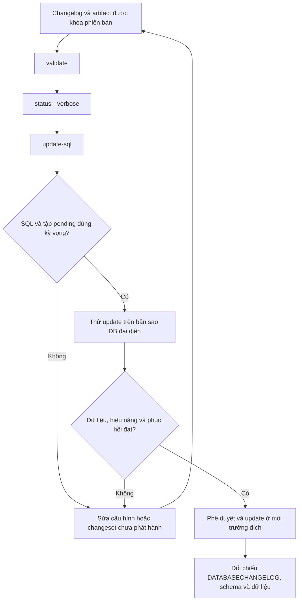

# Xem trước SQL bằng update-sql và xác định giới hạn của bản xem trước

## 1. Vì sao cần xem trước SQL trước khi cập nhật database?

Trong module `DATABASE_SCHEMA_MIGRATION_LIQUIBASE`, mục tiêu là quản lý thay đổi schema và dữ liệu bằng Liquibase qua **changelog, changeset, precondition, checksum và lịch sử triển khai**, đồng thời thực hành migration có kiểm chứng, rollback, phối hợp nhiều môi trường và tích hợp Spring Boot hoặc CI/CD. Khi đưa một thay đổi từ development sang QA, staging và production, nhóm triển khai cần trả lời: **Liquibase dự kiến gửi SQL nào đến database, theo thứ tự nào và trong điều kiện nào?**

`update-sql` là lệnh cho phép **tạo bản xem trước các câu lệnh SQL dự kiến** của quá trình cập nhật, dựa trên changelog, kết nối, cấu hình lọc và lịch sử đang có. Nó rất hữu ích cho review DDL/DML, phát hiện truy vấn quá rộng, các khác biệt giữa DBMS và xác minh tập changeset pending trước khi chấp thuận `update`. Tuy nhiên, **bản xem trước không phải một lần thực thi thử đầy đủ**: nó không chứng minh SQL thật sẽ chạy thành công, không giữ lock, không mất dữ liệu, đủ nhanh hoặc rollback an toàn.

Sau bài học, bạn cần:

1. Phân biệt `validate`, `status --verbose`, `update-sql` và `update`.
2. Sinh và đọc bản SQL xem trước với cùng changelog, DBMS, schema, contexts, labels, properties và phiên bản sẽ dùng triển khai.
3. Hiểu vì sao trạng thái `DATABASECHANGELOG` và precondition có thể làm bản preview khác nhau giữa các môi trường.
4. Nhận diện những điều preview **không** thể kiểm tra: dữ liệu, quyền, giao dịch, lock, tải, ứng dụng đang chạy và khả năng phục hồi.
5. Tạo quy trình review SQL, thử migration trên database đại diện, triển khai và đối chiếu kết quả.

## 2. Bốn công cụ kiểm tra không thể thay thế nhau

| Công cụ | Trả lời câu hỏi nào? | Giới hạn cần nhớ |
|---|---|---|
| `validate` | Cấu trúc changelog, changeset và một số quy tắc Liquibase có hợp lệ? | Không kiểm thử toàn bộ SQL trên dữ liệu/DBMS thật |
| `status --verbose` | Những changeset nào đang pending theo kết nối và bộ lọc hiện hành? | Không chứng minh chúng sẽ chạy thành công |
| `update-sql` | Những câu SQL nào được dự kiến sinh ra khi cập nhật? | Không áp dụng các DDL/DML nghiệp vụ của migration |
| `update` | Cập nhật database theo thay đổi và ghi nhận lịch sử ra sao? | Có tác động thật đến schema, dữ liệu và trạng thái Liquibase |

Với rollback, Liquibase còn có các biến thể lệnh xuất SQL rollback theo tag, count hoặc thời điểm được phiên bản hỗ trợ. Đó là một phép kiểm tra **khác** với `update-sql`, và cũng không bảo đảm rollback dữ liệu sẽ an toàn.



Đây là quy trình vận hành đề xuất, không phải một chuỗi lệnh Liquibase bắt buộc. Trong thời gian giữa preview và update, database vẫn có thể thay đổi vì ứng dụng, giao dịch khác hoặc một pipeline khác.

### 2.1. “Dry-run” nghĩa là gì?

Trong cách dùng thông thường, `update-sql` kết nối database, đọc trạng thái cần thiết và sinh SQL thay vì thực thi các thay đổi nghiệp vụ. Nó không phải một sandbox chạy thử rồi tự rollback. Đừng mặc định mọi extension, `customChange`, logic Java hoặc hook tùy biến đều không có tác dụng phụ ở mọi phiên bản: mã tùy biến có thể làm việc ngoài phạm vi câu SQL được hiển thị. Chỉ sử dụng changelog và extension đáng tin, được kiểm soát.

## 3. Chạy update-sql với đúng cấu hình

### 3.1. Chuỗi lệnh cơ bản

Giả sử dự án có file cấu hình cho database thử nghiệm:

```bash
liquibase --defaults-file=config/liquibase-test.properties validate
liquibase --defaults-file=config/liquibase-test.properties status --verbose
liquibase --defaults-file=config/liquibase-test.properties update-sql
```

File defaults cần hướng tới changelog và database phù hợp; credentials nên đến từ cơ chế quản lý secrets của môi trường, không ghi vào ví dụ hoặc log công khai. Tên command, vị trí và tên flag có thể khác theo release Liquibase; khi khóa phiên bản, hãy đối chiếu trợ giúp CLI của bản đó.

Với cấu hình trực tiếp:

```bash
liquibase \
  --changelog-file=db/changelog/db.changelog-master.yaml \
  --url="jdbc:postgresql://db-test.example.internal:5432/orders" \
  --username=liquibase_migrator \
  update-sql
```

URL chỉ mang tính minh họa. Dấu `\` ở cuối dòng biểu thị nối dòng của Bash, **không** phải cú pháp chung cho PowerShell hoặc Command Prompt. Với môi trường nhiều schema, phải xác định cả `default-schema-name`, `liquibase-schema-name` và search path khi có liên quan; cùng một tên bảng có thể trỏ sang đối tượng khác nếu các giá trị này khác nhau.

### 3.2. Context và label phải giống lúc update

Khi changelog có các điều kiện lọc, phải truyền đúng bộ lọc sẽ dùng cho lần thực thi:

```bash
liquibase \
  --defaults-file=config/liquibase-prod.properties \
  --context-filter=production \
  --label-filter="release-2026-11 AND approved" \
  status --verbose

liquibase \
  --defaults-file=config/liquibase-prod.properties \
  --context-filter=production \
  --label-filter="release-2026-11 AND approved" \
  update-sql
```

Tên context/label trong ví dụ là quy ước của nhóm; changelog thật phải dùng cùng tên. Một changeset có context/label thông thường vẫn có thể được chọn khi **không** cung cấp filter, theo quy tắc Liquibase. Với context, tiền tố `@` được hỗ trợ để yêu cầu chỉ định tường minh trong những tình huống phù hợp. **Không được quên filter rồi xem output là kế hoạch production.**

`--context-filter=production` không chứng minh kết nối trỏ đến production. Nếu URL trỏ nhầm QA, runtime context không tự ngăn Liquibase áp SQL trên QA khi gọi `update`. Xác nhận môi trường phải là một lớp kiểm tra độc lập.

### 3.3. Xuất file phục vụ review

Một số bản CLI hỗ trợ tùy chọn xuất kết quả ra file:

```bash
liquibase \
  --defaults-file=config/liquibase-test.properties \
  --output-file=artifacts/liquibase-preview.sql \
  update-sql
```

Kiểm tra tên và vị trí option theo phiên bản đang dùng. Nếu thay bằng chuyển hướng stdout (`>`), hãy xác minh log và thông tin trạng thái không bị trộn vào SQL. Đây là ví dụ pipeline, không phải thao tác đã thực hiện trong bài. Preview có thể chứa cấu trúc nội bộ hoặc dữ liệu nhạy cảm; giữ artifact trong phạm vi được cấp quyền và không đăng lên log công khai.

## 4. Ví dụ xuyên suốt: từ changelog đến SQL dự kiến

Giả sử PostgreSQL đang có bảng:

```sql
CREATE TABLE purchase_order (
    id BIGINT PRIMARY KEY,
    created_at TIMESTAMP NOT NULL
);
```

Ứng dụng cần bổ sung `processing_state`; hàng mới khi bỏ qua cột nhận `PENDING`, còn hàng cũ chưa có trạng thái được điền `LEGACY`. Changelog YAML có ba changeset theo thứ tự:

```yaml
databaseChangeLog:
  - changeSet:
      id: order-state-001-expand
      author: database-team
      preConditions:
        - onFail: HALT
        - tableExists:
            tableName: purchase_order
      changes:
        - addColumn:
            tableName: purchase_order
            columns:
              - column:
                  name: processing_state
                  type: VARCHAR(24)
      rollback:
        - dropColumn:
            tableName: purchase_order
            columnName: processing_state

  - changeSet:
      id: order-state-002-default
      author: database-team
      changes:
        - addDefaultValue:
            tableName: purchase_order
            columnName: processing_state
            columnDataType: VARCHAR(24)
            defaultValue: PENDING
      rollback:
        - dropDefaultValue:
            tableName: purchase_order
            columnName: processing_state
            columnDataType: VARCHAR(24)

  - changeSet:
      id: order-state-003-backfill
      author: database-team
      changes:
        - update:
            tableName: purchase_order
            columns:
              - column:
                  name: processing_state
                  value: LEGACY
            where: "processing_state IS NULL"
```

Với một DBMS đại diện, SQL nghiệp vụ **tương đương về ý định** có thể như sau:

```sql
-- Minh họa ý nghĩa, KHÔNG phải bản sao output Liquibase
ALTER TABLE purchase_order
    ADD COLUMN processing_state VARCHAR(24);

ALTER TABLE purchase_order
    ALTER COLUMN processing_state SET DEFAULT 'PENDING';

UPDATE purchase_order
SET processing_state = 'LEGACY'
WHERE processing_state IS NULL;
```

Không được hứa rằng `update-sql` sẽ tạo chính xác các dòng ở trên: dấu nháy, schema qualifier, transaction, cách biểu diễn giá trị, các câu ghi `DATABASECHANGELOG` và thao tác lock có thể khác theo DBMS, driver, phiên bản Liquibase và cấu hình.

### 4.1. Bản xem trước giúp phát hiện gì?

| Mục review | Điều cần quan sát |
|---|---|
| `addColumn` | Cột `processing_state`, kiểu `VARCHAR(24)`, đúng schema và bảng đích |
| `addDefaultValue` | Default `PENDING` là giá trị chuỗi, không phải biểu thức sai loại |
| `update` | Có `WHERE processing_state IS NULL`; không phải `UPDATE` toàn bảng vô điều kiện |
| Thứ tự | DDL thêm cột đứng trước câu SQL tham chiếu tới cột |
| DBMS | Các câu `ALTER TABLE` phù hợp hệ quản trị hiện tại |
| Metadata | Có thể có SQL ghi nhận trạng thái `DATABASECHANGELOG` hoặc điều phối lock |

### 4.2. Điều không thể suy ra từ ba câu SQL

- Có bao nhiêu dòng đang `NULL` và liệu chúng thực sự phải trở thành `LEGACY`?
- Một writer cũ có còn ghi `NULL` trong lúc backfill không?
- Lệnh `UPDATE` sẽ ảnh hưởng bao nhiêu giao dịch, WAL/redo và replica?
- User kết nối đã có đủ quyền `ALTER`/`UPDATE` chưa?
- Cột mới có làm hỏng code ứng dụng đang chạy hoặc các query `SELECT *` cũ không?
- Nếu rollback bằng `dropColumn`, dữ liệu đã được ứng dụng ghi sau migration sẽ bị mất hay không?

Để trả lời cần truy vấn dữ liệu, kiểm thử thực thi, đánh giá tác động ứng dụng và kế hoạch phục hồi. **`update-sql` không phải một mô phỏng đầy đủ của production.**

### 4.3. Không tự động chạy file preview như script phát hành

Output của Liquibase có thể lẫn SQL thay đổi nghiệp vụ với SQL metadata/lock hoặc các statement phục vụ cách Liquibase quản lý lịch sử. Thực thi thủ công một phần hay toàn bộ script bằng công cụ SQL khác có thể bỏ qua quy tắc precondition, checksum, transaction hoặc thứ tự ghi lịch sử của Liquibase.

Nếu tổ chức cần DBA chạy SQL offline, phải có quy trình SQL-first được thiết kế riêng, trong đó nêu rõ **ai ghi nhận trạng thái Liquibase và cách đối chiếu kết quả**. Không chỉ sao chép preview vào SQL console rồi chỉnh tay `DATABASECHANGELOG` cho khớp.

## 5. Bản preview phụ thuộc trạng thái DATABASECHANGELOG

### 5.1. Cùng changelog nhưng database khác cho output khác

Liquibase nhận diện một changeset thông thường qua `id`, `author` và danh tính file changelog (có thể sử dụng `logicalFilePath`). `DATABASECHANGELOG` lưu thông tin về việc xử lý changeset, checksum và thứ tự triển khai.

Ví dụ:

- **Database A** chưa chạy ba changeset: `update-sql` dự kiến sinh SQL cho cả ba nếu chúng phù hợp bộ lọc.
- **Database B** đã chạy `order-state-001-expand` và `order-state-002-default`: chỉ changeset backfill còn pending theo tình huống minh họa.
- **Database C** đã chạy cả ba: không có SQL nghiệp vụ mới cho chúng trong lần `update` thông thường, trừ các cơ chế chạy lại được cấu hình.

Vì vậy không thể lấy preview từ một database trắng và khẳng định production sẽ sinh đúng cùng tập SQL. Lịch sử khác nhau giữa development, staging và production là điều phải kiểm tra, không phải ngoại lệ hiếm gặp.

### 5.2. Không thấy SQL không đồng nghĩa schema đúng

Nếu `update-sql` không có SQL nghiệp vụ mới, có thể vì:

1. Mọi changeset liên quan đã được ghi nhận.
2. Filter context/label/`dbms` khiến changeset mong đợi bị loại.
3. Kết nối đang trỏ nhầm database, schema hoặc catalog.
4. Master changelog không còn include đúng file mới.
5. Một precondition hoặc cơ chế lọc/đánh dấu ảnh hưởng tập changeset.
6. Một thay đổi thủ công đã làm schema lệch khỏi lịch sử, nhưng Liquibase không tự suy ra từ `DATABASECHANGELOG`.

Phải đối chiếu `status` với schema và lịch sử thật trước khi kết luận “không cần triển khai gì”.

### 5.3. Truy vấn lịch sử mà không sửa tay metadata

```sql
SELECT ID, AUTHOR, FILENAME, DATEEXECUTED,
       ORDEREXECUTED, EXECTYPE, MD5SUM
FROM DATABASECHANGELOG
ORDER BY DATEEXECUTED, ORDEREXECUTED;
```

Ví dụ chỉ nhằm đọc metadata; tên bảng/schema và cách trích dẫn phụ thuộc DBMS và cấu hình. Những changeset có `runAlways` hoặc `runOnChange` được xét chạy lại theo quy tắc riêng; “đã có lịch sử” không đủ để kết luận sẽ không xuất hiện SQL. Đừng xóa lịch sử, đổi `id`/`author` hoặc chạy `clear-checksums` chỉ để khiến bản preview có vẻ “đúng”.

## 6. Precondition và giới hạn của trạng thái mô phỏng

### 6.1. Precondition phụ thuộc dữ liệu tại thời điểm chạy

Xem changeset:

```yaml
databaseChangeLog:
  - changeSet:
      id: enforce-order-state-not-null
      author: database-team
      preConditions:
        - onFail: HALT
        - sqlCheck:
            expectedResult: "0"
            sql: >
              SELECT COUNT(*)
              FROM purchase_order
              WHERE processing_state IS NULL
      changes:
        - addNotNullConstraint:
            tableName: purchase_order
            columnName: processing_state
            columnDataType: VARCHAR(24)
```

Nếu database đã có cột và dữ liệu hoàn chỉnh, `sqlCheck` kiểm tra số hàng NULL trước khi áp constraint. Nhưng khi xem trước toàn bộ changelog trên một database **chưa có cột**, trong khi changeset trước đó mới chỉ **được sinh câu SQL** mà chưa thực thi, việc đánh giá precondition truy vấn vào cột mới có thể không có cùng trạng thái trung gian như một lần `update` thật. Tùy cách phiên bản Liquibase xử lý, có thể gặp lỗi hoặc khác biệt khi sinh SQL.

Ngay cả precondition đạt vào buổi sáng cũng không chứng minh nó còn đạt khi chạy `update` vào buổi tối. Writer đồng thời có thể thêm giá trị NULL hoặc dữ liệu mới làm một ràng buộc thất bại.

### 6.2. Phân biệt onFail và onError

Khi điều kiện được đánh giá **không đạt**, chính sách `onFail` có thể áp dụng; khi **đánh giá xảy ra lỗi**, `onError` có ý nghĩa khác. Ở cấp changeset, các cách xử lý thường gặp gồm:

- `HALT`: dừng migration, thích hợp với tiền đề bắt buộc.
- `WARN`: phát cảnh báo và xử lý tiếp theo quy tắc Liquibase.
- `CONTINUE`: bỏ qua changeset ở lượt hiện tại, có thể xét lại sau.
- `MARK_RAN`: đánh dấu như đã xử lý mà không thực thi nội dung changeset.

Không dùng `MARK_RAN` để che thiếu cột hoặc sai dữ liệu. Trạng thái `DATABASECHANGELOG` có thể cho thấy đã hoàn thành trong khi schema không tương đương đích mong muốn. Phạm vi hỗ trợ các lựa chọn khác nhau giữa precondition cấp changelog và cấp changeset; không sao chép cấu hình một cách máy móc.

### 6.3. Logic tùy biến không nhất thiết có bản SQL tương đương

`customChange`, các extension, những thao tác liên quan tới Java hoặc tài nguyên ngoài database có thể không biểu đạt đầy đủ hành vi bằng SQL xuất ra. Nếu code có tác dụng phụ khi truy xuất hệ thống, việc “chỉ tạo SQL” cũng không nên được coi là hàng rào bảo mật tuyệt đối. Cần kiểm thử và review code tùy biến riêng, thay vì tuyên bố `update-sql` bao quát mọi tác động.

## 7. SQL phụ thuộc DBMS, version, schema và tham số

| Biến đầu vào | Vì sao ảnh hưởng output? |
|---|---|
| DBMS và phiên bản | Kiểu cột, `ALTER TABLE`, index, syntax và mức hỗ trợ tính năng khác nhau |
| Driver/JDBC | Cách nhận diện DBMS, quyền đọc metadata, schema/catalog |
| Phiên bản Liquibase và extension | SQL generator, parser, properties và behavior có thể thay đổi |
| Changelog và các `include` | Quyết định tập file, danh tính và thứ tự changeset |
| `context-filter`, `label-filter`, `dbms` | Quyết định changeset nào phù hợp trong lần chạy |
| Changelog parameters/property substitution | Có thể thay tên schema, bảng hoặc giá trị trong câu SQL |
| `modifySql` | Có thể thay đổi câu SQL sau khi Liquibase sinh ra |
| `DATABASECHANGELOG`/checksum | Xác định những changeset còn pending hoặc thuộc diện chạy lại |
| Default schema/search path | Cùng tên bảng không kèm schema có thể phân giải sang đối tượng khác |

Ví dụ fragment khai báo một cột boolean:

```yaml
- addColumn:
    tableName: purchase_order
    columns:
      - column:
          name: requires_review
          type: BOOLEAN
          defaultValueBoolean: false
```

Đây chỉ là một phần `changes`. PostgreSQL hỗ trợ boolean riêng; SQL Server, Oracle, MySQL có quy tắc kiểu boolean/default khác nhau theo version. Liquibase có thể sinh SQL DBMS-specific, nhưng không bảo đảm một câu `BOOLEAN` được biểu diễn giống trên mọi hệ quản trị. Nếu dùng SQL thủ công như `CREATE INDEX CONCURRENTLY` của PostgreSQL, Liquibase cũng không tự dịch nó thành cú pháp tương đương cho SQL Server hay Oracle; cần khai báo phạm vi DBMS và kiểm thử.

**Hệ quả:** bản xem trước production nên được tạo bằng đúng DBMS/phiên bản và lịch sử của production, hoặc một bản sao gần trạng thái thực với nhận thức rõ sai khác. Bản preview local chỉ là bằng chứng cho local.

## 8. Giới hạn vận hành: xem được SQL không có nghĩa là đo được chi phí

### 8.1. Lock, table rewrite và transaction

Một lệnh `ALTER TABLE` có thể rất ngắn trên bản SQL xem trước nhưng vẫn chờ hoặc giữ metadata/schema lock, quét/rewrite bảng, tăng lượng WAL/redo, làm chậm replica và kéo dài giao dịch. Tạo chỉ mục trên bảng lớn có thể tốn CPU, I/O, temp space và thời gian. `update-sql` **không benchmark** những chi phí đó, cũng không phản ánh tải ứng dụng đồng thời.

Các DBMS còn có khác biệt: PostgreSQL hỗ trợ `CREATE INDEX CONCURRENTLY` nhưng không cho phép lệnh này chạy trong transaction block; MySQL/MariaDB có các DDL implicit commit; SQL Server và Oracle có chế độ transaction và online DDL riêng. Ngay cả nếu preview sinh câu SQL đúng, cấu hình `runInTransaction` hoặc môi trường thực thi vẫn có thể không phù hợp. Một changeset `runInTransaction: false` chứa nhiều câu có nguy cơ dở dang khi câu sau thất bại; cần test và kế hoạch sửa/khôi phục.

### 8.2. `update-sql` không phải `EXPLAIN`

Nếu SQL dự kiến là:

```sql
UPDATE purchase_order
SET processing_state = 'LEGACY'
WHERE processing_state IS NULL;
```

Preview không cho biết DBMS dùng index scan hay table scan, bao nhiêu hàng bị sửa hoặc lệnh chạy bao lâu. Muốn biết cần kiểm tra số hàng, thống kê và kế hoạch thực thi của DBMS như `EXPLAIN` hoặc actual execution plan. **Chú ý:** `EXPLAIN ANALYZE` trên một câu `UPDATE` ở các DBMS hỗ trợ có thể **thực sự chạy câu lệnh ghi**; không thử trên production nếu chưa có quy trình kiểm soát và phê duyệt.

### 8.3. Preview không biết phiên bản ứng dụng đang ghi vào bảng

Trong rolling deployment, ứng dụng cũ và mới có thể cùng ghi dữ liệu. Một chiến lược *expand–backfill–constrain–contract* gồm thêm cột nullable, triển khai code ghi mới, backfill, thêm `NOT NULL`, rồi bỏ cấu trúc cũ. `update-sql` không biết liệu mọi replica đã ngừng gửi `NULL` hoặc đã bỏ phụ thuộc cột cũ chưa. Do đó SQL đúng về cú pháp vẫn có thể làm hệ thống lỗi nếu thứ tự phát hành ứng dụng sai.

## 9. Giới hạn dữ liệu: SQL hợp lệ chưa bảo đảm đúng nghiệp vụ

### 9.1. Thiếu `WHERE` trong data migration

Một changeset như sau:

```yaml
- update:
    tableName: purchase_order
    columns:
      - column:
          name: processing_state
          value: LEGACY
```

có thể sinh SQL cập nhật **toàn bảng**. `update-sql` giúp reviewer nhận ra thiếu `WHERE`. Nhưng ngay cả khi thêm `where: "processing_state IS NULL"`, nhóm vẫn phải chứng minh mọi hàng NULL đều nên nhận `LEGACY`, chứ không phải có một số đơn hàng mới đang thiếu trạng thái vì lỗi ghi.

Trước khi thực thi, kiểm tra phạm vi trên database đã có cột:

```sql
SELECT COUNT(*) AS null_count
FROM purchase_order
WHERE processing_state IS NULL;

SELECT processing_state, COUNT(*) AS row_count
FROM purchase_order
GROUP BY processing_state;
```

Nếu cột chưa tồn tại trên database hiện tại, các truy vấn trên không chạy được: cần dùng đúng giai đoạn migration hoặc thử chuỗi changeset trên database bản sao.

### 9.2. Ràng buộc có thể thất bại vì dữ liệu hiện hữu

`addUniqueConstraint` có thể thất bại khi dữ liệu trùng khóa, `addForeignKeyConstraint` có thể vấp khóa ngoại mồ côi và `addNotNullConstraint` có thể thất bại nếu còn NULL. Bản preview chỉ thể hiện việc tạo constraint, không chứng minh dữ liệu đáp ứng.

Ví dụ truy vấn kiểm tra trùng khóa, khi các cột đã có:

```sql
SELECT tenant_id, external_order_id, COUNT(*) AS duplicate_count
FROM purchase_order
GROUP BY tenant_id, external_order_id
HAVING COUNT(*) > 1;
```

Tương tự, thay kiểu dữ liệu, nạp `loadData` hoặc `sqlFile` còn phụ thuộc precision/scale, encoding, nguồn CSV, separator, NULL placeholder, file có thực sự được đóng gói và quy tắc DBMS. Preview không nhất thiết hiển thị đầy đủ bind values của prepared statements hay kiểm thử được dữ liệu đầu vào. Cần xác minh tài nguyên và nạp thử trên database phù hợp.

## 10. Xem trước SQL hướng tiến không đồng nghĩa kiểm chứng rollback

`update-sql` cho thấy hướng **tiến** của migration. Các command xuất SQL rollback theo tag/count/time (tùy phiên bản Liquibase) cần được sử dụng riêng với mốc rõ ràng. Một `rollback-sql` hợp lệ về cú pháp cũng **không bảo đảm** dữ liệu được khôi phục nguyên vẹn.

| Thay đổi | Rủi ro khi rollback |
|---|---|
| Thêm cột | `dropColumn` có thể xóa dữ liệu được ứng dụng ghi sau deploy |
| Tạo index | `dropIndex` có thể làm truy vấn chậm hoặc ảnh hưởng uniqueness nếu là unique index |
| Backfill/`UPDATE` | Thiếu snapshot/diff thì không biết giá trị cũ |
| Xóa cột hoặc bảng | Không thể tự khôi phục toàn bộ dữ liệu đã mất bằng cách đảo DDL |
| Thay kiểu dữ liệu | Chuyển ngược có thể làm mất precision, tràn kiểu hoặc không thực hiện được |
| Gỡ constraint | Có thể cho phép dữ liệu không hợp lệ được ghi sau rollback |

Với data migration không thể đảo ngược, cần snapshot/backup, audit hoặc phương án *forward-fix*. Đừng thiết kế một rollback `DELETE` hàng loạt mà chưa xác định rõ phạm vi bản ghi do changeset sở hữu.

## 11. Quy trình CI/CD: preview là một gate, không phải phê duyệt cuối

Một pipeline có thể tiến hành:

1. **Chốt artifact:** changelog, SQL file, CSV và phiên bản Liquibase có commit/digest cố định.
2. **Xác nhận target:** đúng JDBC URL, schema/catalog, DBMS, driver và credentials lấy từ secret store.
3. **Khóa bộ lọc:** context, label, `dbms` và changelog parameters đúng theo release.
4. **Validate:** chạy `validate` và xử lý lỗi trước khi deploy.
5. **Xem pending:** chạy `status --verbose`, đối chiếu `id`/`author`/`filename` với danh sách mong muốn.
6. **Sinh SQL:** chạy `update-sql` với cùng cấu hình; lưu output ở nơi hạn chế quyền, không trộn secrets vào log.
7. **Review:** kiểm tra SQL DDL/DML, thứ tự, schema, `WHERE`, default, constraint, tác động dữ liệu và lock.
8. **Thử thực thi:** chạy `update` trên database test/staging hoặc bản sao gần production, đo kết quả, tài nguyên và rollback/forward-fix.
9. **Phê duyệt:** owner/DBA xác nhận các thay đổi lớn hoặc có nguy cơ mất dữ liệu.
10. **Triển khai thật:** chạy `update` với đúng changelog artifact, version, filter và connection đã duyệt.
11. **Đối chiếu:** kiểm tra `DATABASECHANGELOG`, schema, dữ liệu, logs và metrics sau migration.

### 11.1. Bảng câu hỏi cho reviewer

| Mục | Câu hỏi | Bằng chứng |
|---|---|---|
| Changeset | Những changeset nào đang pending và thứ tự ra sao? | `status` + `update-sql` |
| SQL | Tác động bảng/cột/index/schema nào? | Bản SQL được review |
| Dữ liệu | `UPDATE`/`DELETE` có `WHERE` đúng và bao nhiêu dòng bị ảnh hưởng? | Truy vấn đếm và kế hoạch kiểm tra |
| DBMS | SQL/type/DDL option có phù hợp version đích? | Test trên DBMS tương ứng |
| Ràng buộc | Dữ liệu có vi phạm `NOT NULL`, `UNIQUE`, FK? | Kiểm tra dữ liệu thực |
| Lock | Có tạo index, rewrite bảng hay backfill lớn không? | Benchmark/plan và giới hạn vận hành |
| Rollback | Có khôi phục được dữ liệu và trạng thái ứng dụng? | Test rollback/forward-fix |
| Artifact | SQL/CSV/changelog là đúng version đã duyệt? | Commit/digest |

Giữa bước preview và lần `update` thật, database có thể thay đổi. Nên kiểm tra lại `status` và những yếu tố quan trọng gần thời điểm triển khai, quản lý lịch phát hành và tránh nhiều pipeline cập nhật cùng lúc ngoài ý định.

### 11.2. Spring Boot, CLI và nhiều replica

Ứng dụng Spring Boot thường cấu hình:

```yaml
spring:
  liquibase:
    enabled: true
    change-log: classpath:/db/changelog/db.changelog-master.yaml
```

Nếu CLI dùng để tạo preview nhưng thư viện Liquibase nhúng trong ứng dụng mới thực thi, phải đảm bảo chúng dùng **cùng phiên bản, extension, changelog được đóng gói, DBMS, schema, contexts, labels và properties**. Một khác biệt về version hoặc việc CSV/SQL file không được đóng gói vào JAR có thể gây sai khác chỉ bộc lộ khi chạy.

`DATABASECHANGELOGLOCK` giúp điều phối runner dùng chung metadata khi nhiều replica khởi động, nhưng không loại bỏ lock DBMS, không khắc phục cấu hình context sai và không thay thế việc phối hợp với phiên bản ứng dụng. Với migration lớn, job migration riêng trước khi deploy ứng dụng thường giúp đặt gate review SQL rõ hơn.

## 12. Troubleshooting: preview khác kỳ vọng hoặc update thất bại

| Hiện tượng | Nguyên nhân khả dĩ | Hướng kiểm tra |
|---|---|---|
| Không thấy changeset mới | Chưa include, filter không khớp hoặc đã chạy | Kiểm tra master changelog, `status` và lịch sử |
| Output không có SQL nghiệp vụ | Không còn pending hoặc trỏ nhầm DB/schema | Đối chiếu JDBC URL và `DATABASECHANGELOG` |
| SQL khác môi trường dev | DBMS, driver, Liquibase version, properties khác | So sánh runner, cấu hình và artifact |
| Thứ tự SQL sai | Include order hoặc phụ thuộc ngầm | Rà soát thứ tự và tiền đề changeset |
| `validate` PASS nhưng `update` lỗi | Dữ liệu, lock, transaction, quyền hoặc runtime syntax | Xem lỗi DBMS, thử bản sao |
| Precondition ở preview khác runtime | Dữ liệu/thời điểm khác hoặc trạng thái trung gian chưa thực thi | Kiểm tra điều kiện và phạm vi |
| Có `UPDATE` toàn bảng | Thiếu hoặc sai `WHERE` | Chặn deploy, sửa changelog trước phát hành |
| SQL đúng nhưng chạy rất chậm | Scan, rewrite, lock, WAL/redo hoặc index build | Đo số hàng, plan và tài nguyên |
| CLI khác Spring Boot | Khác version, resources, context/label, schema | Đồng bộ artifact và cấu hình |
| Rollback gây mất dữ liệu | Không có snapshot hoặc logic đảo ngược thiếu | Chuẩn bị backup/forward-fix |
| Có SQL metadata/lock trong output | Liquibase điều phối lịch sử và trạng thái | Hiểu vai trò metadata, không tự cắt bỏ |

Không tùy ý chỉnh `DATABASECHANGELOG`, `DATABASECHANGELOGLOCK` hoặc checksum để làm bản preview có vẻ đúng. Lệch lịch sử/schema cần được xác định nguyên nhân và giải quyết có kiểm chứng.

## 13. Tình huống thực tế: migration bảng 25 triệu hàng

Giả sử `purchase_order` có **25 triệu bản ghi** và ứng dụng đang rolling deployment. Một developer chạy `update-sql` trên local database nhỏ, thấy:

```sql
ALTER TABLE purchase_order ADD COLUMN processing_state VARCHAR(24);
UPDATE purchase_order
SET processing_state = 'LEGACY'
WHERE processing_state IS NULL;
```

Hai câu SQL có vẻ hợp lý, nhưng chưa đủ để duyệt production:

1. Local không phản ánh chi phí cập nhật 25 triệu hàng và WAL/redo.
2. `ALTER TABLE` có thể chờ lock trong lúc production có giao dịch dài.
3. Bản ứng dụng cũ vẫn có thể ghi NULL sau khi backfill.
4. Owner nghiệp vụ chưa xác nhận mọi hàng NULL đều mang ý nghĩa `LEGACY`.
5. DBMS, driver và lịch sử `DATABASECHANGELOG` trên production có thể khác local.
6. Nếu rollback bằng `dropColumn`, dữ liệu mới được ứng dụng ghi có thể biến mất.

Phương án phù hợp hơn là kiểm tra bản preview trên bản sao gần production, đo lượng dữ liệu và thời gian backfill theo lô, dùng chiến lược expand trước, triển khai writer mới, hoàn tất backfill, kiểm tra không còn NULL rồi mới áp ràng buộc. Khi backfill do một job ngoài Liquibase thực hiện, `DATABASECHANGELOG` không tự chứng minh công việc nền đã hoàn tất: cần gate riêng đọc trạng thái dữ liệu.

## 14. Checklist trước khi chấp thuận `update`

- [ ] Đã khóa phiên bản Liquibase/driver/extension và DBMS đích.
- [ ] Changelog, SQL file và CSV thuộc đúng artifact/version đã review.
- [ ] JDBC URL, user, schema, catalog, search path và include path được xác nhận.
- [ ] `validate` và `status --verbose` được kiểm tra với đúng bộ lọc dự kiến.
- [ ] `update-sql` dùng cùng context, label, parameters và connection với lần `update`.
- [ ] Đã review SQL DDL/DML, thứ tự, tên bảng/cột, kiểu dữ liệu, default, index và `WHERE`.
- [ ] Hiểu output có thể có SQL quản lý metadata/lock, không chỉ SQL nghiệp vụ.
- [ ] `sqlFile`, `loadData` và `customChange` có kiểm tra riêng với tài nguyên/runtime.
- [ ] Precondition được xét theo trạng thái DB thực tế, không chỉ mô hình preview.
- [ ] Đã đo row count, plan, thời gian, lock/transaction và replication trên dữ liệu đại diện.
- [ ] Đã chạy thử `update` thật trên database an toàn và xác minh schema/dữ liệu.
- [ ] Có kế hoạch rollback hoặc forward-fix, đã xác định ảnh hưởng đến dữ liệu mới.
- [ ] Các phiên bản ứng dụng có thể cùng tồn tại trong rolling deployment đều tương thích.
- [ ] Preview/artifact được lưu an toàn, không lộ secrets hoặc dữ liệu nhạy cảm.
- [ ] Có bước phê duyệt và kiểm tra lại trạng thái gần thời điểm production deploy.
- [ ] Sau `update` đã đối chiếu `DATABASECHANGELOG`, schema, dữ liệu và metrics.

**Kết luận:** `update-sql` cho phép nhìn thấy **SQL dự kiến trước khi thay đổi database**, giúp phát hiện sớm sai change type, phạm vi dữ liệu, thứ tự changeset và cú pháp DBMS. Nhưng bản SQL này phụ thuộc **cấu hình và trạng thái database lúc sinh**, không phải cam kết rằng mọi câu lệnh chạy được, đủ nhanh hoặc rollback an toàn. Kết hợp `validate`, `status`, `update-sql`, `update` và đối chiếu `DATABASECHANGELOG` với kiểm thử trên database đại diện giúp module `DATABASE_SCHEMA_MIGRATION_LIQUIBASE` triển khai schema và dữ liệu có kiểm chứng, truy vết và kiểm soát rủi ro trong Spring Boot hoặc CI/CD.
