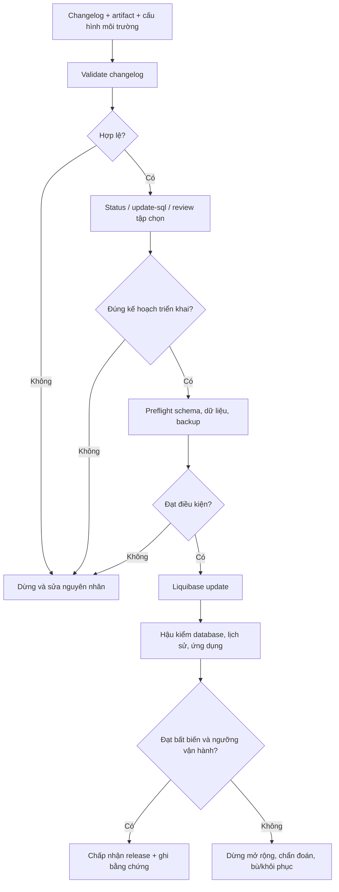
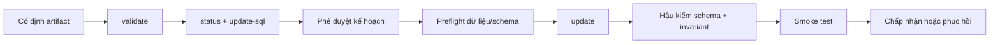

# Phân biệt kiểm tra changelog với xác minh kết quả trên cơ sở dữ liệu

## 1. Mục tiêu và bối cảnh

Trong module **DATABASE_SCHEMA_MIGRATION_LIQUIBASE**, người học nắm cách quản lý thay đổi schema và dữ liệu bằng Liquibase thông qua changelog, changeset, precondition, checksum và lịch sử triển khai; thực hành migration có kiểm chứng, rollback, phối hợp nhiều môi trường và tích hợp Spring Boot hoặc CI/CD. Ở chương **Kiểm tra và cập nhật**, một ranh giới quan trọng là: **changelog hợp lệ không đồng nghĩa cơ sở dữ liệu đã đạt trạng thái mong muốn**.

Một lần triển khai có thể đi qua các bước sau:

1. Liquibase đọc được changelog, phân tích được thay đổi và không phát hiện lỗi kiểm tra mà nó hỗ trợ.
2. Liquibase xác định những changeset cần xử lý theo lịch sử và bộ lọc.
3. SQL được gửi đến database; DBMS thực thi, có thể thành công hoặc thất bại.
4. Dữ liệu, cấu trúc và ứng dụng có thể đạt hoặc **không đạt** những bất biến nghiệp vụ mà hệ thống kỳ vọng.

Chẳng hạn, một changeset `UPDATE` có cú pháp hợp lệ nhưng tác động **0 hàng** vì điều kiện `WHERE` không phù hợp. Một changeset tạo cột thành công nhưng dữ liệu cần backfill chưa được điền đủ. Một deployment hoàn tất nhưng ứng dụng dùng nhầm schema, hoặc có bảng đã bị DBA chỉnh thủ công sau migration. Không trường hợp nào có thể được kết luận an toàn chỉ dựa trên việc `validate` trả về thành công.

Bài học giúp bạn:

- Phân biệt kiểm tra định nghĩa migration, xem trước kế hoạch thực thi và xác minh trạng thái DBMS sau thực thi.
- Hiểu giới hạn của `validate`, `status`, `update-sql`, checksum và `DATABASECHANGELOG`.
- Viết phép kiểm tra sau migration cho schema, constraint, dữ liệu và bất biến nghiệp vụ.
- Kết hợp precondition trước changeset với hậu kiểm độc lập sau `update`.
- Thiết kế bằng chứng triển khai và quality gate trong Spring Boot hoặc CI/CD.
- Phát hiện và xử lý schema drift, lỗi áp dụng một phần hoặc khác biệt giữa các môi trường.

**Thông điệp cốt lõi:** `validate` giúp trả lời “mô tả thay đổi có hợp lệ theo các quy tắc Liquibase kiểm tra không?”, còn truy vấn/hậu kiểm trên DBMS giúp trả lời “đối tượng và dữ liệu thực tế có đúng không?”. Cả hai đều cần thiết, nhưng không thể thay thế nhau.

## 2. Ba lớp kiểm tra cần tách biệt

| Lớp | Câu hỏi chính | Công cụ / bằng chứng | Điều **không** chứng minh |
|---|---|---|---|
| **A. Kiểm tra changelog** | Định nghĩa và lịch sử changeset có hợp lệ theo phạm vi Liquibase kiểm tra? | `liquibase validate`, review YAML/XML/JSON/SQL, checksum | SQL chắc chắn thực thi được và dữ liệu đúng |
| **B. Kiểm tra kế hoạch cập nhật** | Chạy trên database này, với filter này, Liquibase dự định xử lý gì? | `status --verbose`, `update-sql`, so khớp `DATABASECHANGELOG` | Câu SQL đã chạy hoặc precondition chắc chắn còn đúng khi chạy |
| **C. Xác minh kết quả** | Sau cập nhật, schema và dữ liệu có đạt điều kiện kỹ thuật/nghiệp vụ? | Truy vấn metadata, dữ liệu, constraint, integration test, log và đối chiếu | Mọi downstream đều đúng nếu chỉ kiểm tra một vài bảng |

Ba lớp tương ứng ba mốc thời gian khác nhau: **trước khi chạy**, **ngay trước khi thực thi** và **sau khi DBMS xử lý thay đổi**. Với migration phức tạp, một bước xem xét kết quả ở staging không đủ cho production, bởi hai môi trường có thể khác dữ liệu, lịch sử, quyền hoặc cấu hình.

### 2.1. Sơ đồ quy trình có điều kiện dừng



Không nên viết pipeline theo giả định “`update` exit code bằng 0 → deployment chắc chắn đạt mọi điều kiện”. Exit code thể hiện kết quả của công cụ trong phạm vi được xử lý, không thay cho các phép đo trạng thái nghiệp vụ.

## 3. `liquibase validate` thực sự kiểm tra gì?

Lệnh `validate` yêu cầu Liquibase kiểm tra changelog theo các quy tắc mà phiên bản và loại changelog hỗ trợ. Ví dụ thao tác CLI sau khi đã cấu hình connection an toàn:

```bash
liquibase --changelog-file=db/changelog.yaml validate
```

Tùy cấu hình, phiên bản và cơ chế tích hợp, Liquibase có thể cần kết nối database để kiểm tra một số thông tin. Nội dung kiểm tra có thể gồm định dạng changelog, tính hợp lệ của một số change, vấn đề danh tính changeset và checksum so với lịch sử đã lưu. Phạm vi cụ thể không giống một lần thực thi SQL thật.

### 3.1. Những vấn đề `validate` có thể giúp phát hiện

- Cấu trúc changelog sai hoặc thuộc tính Liquibase không hợp lệ theo phiên bản đang dùng.
- Định nghĩa changeset không đáp ứng một số quy tắc bắt buộc.
- Trùng danh tính changeset trong một số trường hợp.
- Các vấn đề về tính toàn vẹn changeset, checksum, resource và cấu hình mà Liquibase thực sự kiểm tra được ở ngữ cảnh hiện tại.
- Sự khác biệt giữa nội dung đang triển khai và lịch sử được ghi nhận nếu việc xác thực có đối chiếu database.

**Không nên biến danh sách này thành cam kết tuyệt đối.** Có lỗi chỉ xuất hiện khi đọc một resource cụ thể, phân giải parameter, chạy precondition hoặc DBMS xử lý câu lệnh. Những điều kiện đầu vào và phiên bản phải được cố định khi đánh giá kết quả.

### 3.2. Những vấn đề `validate` không thể tự xác minh

`validate` không mặc nhiên chứng minh:

1. Schema `app` hay bảng `orders` thực sự ở trạng thái mà nghiệp vụ mong muốn.
2. Một câu `UPDATE` sẽ tác động đúng số hàng hay đúng dữ liệu.
3. Tài khoản migration đủ quyền cho mọi thao tác SQL tại thời điểm chạy.
4. Một precondition phụ thuộc dữ liệu sẽ tiếp tục đúng đến lúc thực thi.
5. DDL không gây lock dài, deadlock hoặc downtime.
6. View, stored procedure, trigger hoặc SQL đặc thù DBMS có hành vi đúng.
7. Ứng dụng Java/Spring Boot và các worker cũ tương thích với schema mới.
8. Có thể rollback và phục hồi chính xác dữ liệu sau lỗi.
9. Mọi thay đổi thủ công ngoài Liquibase đều được phát hiện.
10. Backup/PITR và downstream có thể khôi phục khi sự cố xảy ra.

Ví dụ một changeset với `sql` chứa `UPDATE app.orders SET status = 'OPEN' WHERE legacy_status = 'WAITING'` có thể hợp lệ về định nghĩa, nhưng nếu giá trị cũ thực tế là `PENDING` thì không bản ghi nào được thay đổi. Changelog hợp lệ, nhưng mục tiêu dữ liệu thất bại.

## 4. `status`, `update-sql` và lịch sử: kiểm tra kế hoạch chứ chưa phải kết quả

Sau khi định nghĩa được kiểm tra, cần biết **Liquibase sắp xử lý changeset nào trên database đích**.

### 4.1. `status --verbose`

```bash
liquibase --changelog-file=db/changelog.yaml status --verbose
```

`status` hỗ trợ nhận diện các changeset cần xử lý trong ngữ cảnh hiện tại, dựa trên changelog, kết nối, lịch sử và bộ lọc. Đầu ra chi tiết tùy phiên bản Liquibase, và có thể chịu ảnh hưởng của `runAlways`, `runOnChange` hoặc các quy tắc chọn changeset.

Khi đọc `status`, cần xác minh:

- Đúng changelog root và đúng commit/artifact phát hành.
- Đúng database, catalog, schema và user kết nối.
- Context/label/dbms filter phù hợp môi trường.
- ID, author và filename của changeset nằm trong kế hoạch.
- Không có changeset lạ, bị bỏ sót hoặc thay đổi ngoài dự kiến.
- Những changeset chạy lại có chủ đích đã được review về idempotency.

Nếu `status` không cho thấy pending changeset, điều đó có thể chỉ có nghĩa **không có thay đổi được chọn để chạy tại thời điểm kiểm tra**. Nó không chứng minh schema của database phù hợp với bản phát hành: có thể đã kết nối nhầm database, filter loại hết changeset, hoặc DBA đã chỉnh schema ngoài Liquibase.

### 4.2. `update-sql`: nhìn trước các câu SQL

```bash
liquibase --changelog-file=db/changelog.yaml update-sql
```

`update-sql` tạo đầu ra SQL dự kiến trong ngữ cảnh được cấu hình. Cần xem xét:

- Câu `CREATE`, `ALTER`, `DROP`, `INSERT`, `UPDATE`, `DELETE` và schema bị tác động.
- Tên đối tượng sau property substitution.
- SQL do các change type của Liquibase sinh ra cho DBMS đích.
- Thứ tự các câu lệnh và số thay đổi có nguy cơ phá hủy.
- Các thao tác metadata liên quan `DATABASECHANGELOG` nếu xuất hiện trong output.

**Preview không phải thực thi.** Không thể suy ra số hàng sẽ đổi từ bản SQL nếu chưa kiểm tra dữ liệu thật. DBMS có thể từ chối câu SQL vì constraint, quyền, lock hoặc cú pháp cụ thể. Precondition và dữ liệu có thể thay đổi giữa lúc preview và `update`; bởi vậy SQL cuối cùng và trạng thái lúc chạy vẫn phải được quan sát.

Các tên lệnh và option ở ví dụ dùng phong cách Liquibase CLI phổ biến; cần xác nhận với phiên bản Liquibase đang dùng và đặt cấu hình kết nối/secret ở nguồn được bảo vệ.

### 4.3. `DATABASECHANGELOG` và checksum

Bảng `DATABASECHANGELOG` lưu lịch sử changeset, thường gồm các cột như `ID`, `AUTHOR`, `FILENAME`, `DATEEXECUTED`, `EXECTYPE` và `MD5SUM`.

Ví dụ xem lịch sử:

```sql
SELECT ID, AUTHOR, FILENAME, DATEEXECUTED, EXECTYPE, MD5SUM
FROM DATABASECHANGELOG
ORDER BY DATEEXECUTED, ORDEREXECUTED;
```

Danh tính changeset dựa chủ yếu trên `id`, `author` và định danh đường dẫn changelog (có thể chịu ảnh hưởng của `logicalFilePath`). Checksum giúp kiểm tra nội dung changeset đã ghi nhận có nhất quán với định nghĩa hiện tại theo cơ chế Liquibase.

Nhưng hãy phân biệt:

| Bằng chứng | Có thể kết luận | Không thể kết luận |
|---|---|---|
| Có hàng trong `DATABASECHANGELOG` | Liquibase đã ghi nhận changeset tương ứng theo `EXECTYPE` | Toàn bộ dữ liệu nghiệp vụ đã đúng |
| `MD5SUM` được chấp nhận | Định nghĩa changeset đáp ứng cơ chế kiểm tra checksum | Schema thật không hề bị chỉnh tay |
| `EXECTYPE = EXECUTED` | Changeset được ghi nhận là đã thực thi | Mọi hàng dữ liệu đều thỏa invariant cần kiểm tra |
| `EXECTYPE = MARK_RAN` | Changeset được đánh dấu xử lý theo chính sách | SQL trong changeset đã thực thi |
| Không còn pending changeset | Liquibase không dự định chạy thêm changeset tương ứng | Database không có schema drift hoặc thiếu dữ liệu |

**Một hàng lịch sử không phải snapshot.** `DATABASECHANGELOG` không lưu giá trị cũ của mọi dòng bị `UPDATE` hoặc `DELETE`. Tương tự, `clearCheckSums` không phải công cụ sửa dữ liệu đã sai.

## 5. Tiêu chí xác minh kết quả trên database

Hậu kiểm cần đo **trạng thái thực tế**, theo tiêu chí độc lập với mã thay đổi. Một changeset hoàn tất chỉ là đầu vào để biết lúc nào nên đo, không phải kết quả đo.

### 5.1. Xác minh đối tượng và cấu trúc

Những câu hỏi điển hình:

- Bảng/cột/index/constraint/view đúng tên và đúng schema chưa?
- Kiểu dữ liệu, độ dài, nullability, default và khóa ngoại có đúng không?
- Các đối tượng cũ cần xóa đã được xử lý đúng thời điểm chưa?
- Có object ngoài dự kiến bị thay đổi hoặc bị drop không?
- Schema thực tế có lệch giữa dev, staging và production không?

Đối với PostgreSQL, có thể kiểm tra cột qua `information_schema.columns`; index hoặc constraint phức tạp có thể cần catalog `pg_catalog`. Các DBMS khác có view metadata riêng. Không dùng một câu SQL PostgreSQL rồi cho rằng Oracle, MySQL hay SQL Server trả ra cùng cột/kiểu.

### 5.2. Xác minh dữ liệu

Cần quan sát:

- Số hàng trong phạm vi bị tác động và số hàng còn chưa chuyển.
- Mapping đầu vào → đầu ra theo **từng khóa**, không chỉ tổng số hàng.
- Giá trị NULL bất thường, bản ghi trùng, bản ghi mồ côi.
- Tính toàn vẹn tham chiếu, uniqueness và constraint đang có hiệu lực.
- Các invariant nghiệp vụ như tổng số dư, số đơn theo trạng thái, số giao dịch và điều kiện thời gian.
- Dữ liệu mới tiếp tục được ghi đúng sau khi ứng dụng chuyển sang schema mới.

Một kiểm tra `COUNT(*)` trả bằng nhau có thể che lỗi: hai tập dữ liệu khác nhau vẫn có cùng số hàng. Nếu cần độ tin cậy cao, đối chiếu theo ID, giá trị, phiên bản và kiểm tra các ràng buộc liên bảng.

### 5.3. Xác minh khả năng sử dụng

Một schema trông đúng nhưng ứng dụng vẫn có thể lỗi nếu:

- ORM mapping không khớp kiểu dữ liệu hoặc tên cột.
- Query ở worker, batch job, BI hoặc service khác còn dùng tên cũ.
- View/function/trigger tạo thành công nhưng hành vi không đúng.
- DBMS quyền truy cập chưa được cấp cho tài khoản runtime.
- Lock hoặc transaction kéo dài khiến ứng dụng timeout.
- Replication/CDC/cache và báo cáo chưa phản ánh dữ liệu mới.

Vì vậy, hậu kiểm thường cần **truy vấn DBMS + integration/smoke test + giám sát runtime**. Không nên chỉ dựa vào một tín hiệu.

## 6. Ví dụ xuyên suốt: thêm cột và chuẩn hóa trạng thái đơn hàng

Giả sử hệ thống PostgreSQL có bảng `app.orders`:

| order_id | legacy_status |
|---:|---|
| 101 | NEW |
| 102 | PENDING |
| 103 | PAID |
| 104 | NEW |

Yêu cầu: thêm cột `status_normalized varchar(24)` và đưa `NEW`, `PENDING` thành `OPEN`; các trạng thái khác giữ nguyên. Ứng dụng vẫn giữ `legacy_status` trong giai đoạn chuyển đổi để có nguồn đối chiếu.

**Giả định trước khi thực hành:**

- PostgreSQL là DBMS đích và schema `app`, bảng `orders` đã tồn tại.
- `order_id` là khóa chính duy nhất; `legacy_status` thuộc kiểu chuỗi phù hợp.
- Cột `status_normalized` chưa tồn tại.
- Mapping `NEW/PENDING → OPEN` đã được nghiệp vụ duyệt.
- Trong khoảng backfill và đối chiếu, dữ liệu không bị thay đổi đồng thời hoặc đã có cơ chế đồng bộ đáng tin cậy.
- Ví dụ minh họa một vòng phát hành; phải kiểm thử trong môi trường không sản xuất trước.

### 6.1. Changelog YAML có hai changeset

```yaml
databaseChangeLog:
  - changeSet:
      id: 001-add-status-normalized
      author: migration-team
      dbms: postgresql
      preConditions:
        - onFail: HALT
        - tableExists:
            schemaName: app
            tableName: orders
        - columnExists:
            schemaName: app
            tableName: orders
            columnName: legacy_status
        - not:
            - columnExists:
                schemaName: app
                tableName: orders
                columnName: status_normalized
      changes:
        - addColumn:
            schemaName: app
            tableName: orders
            columns:
              - column:
                  name: status_normalized
                  type: varchar(24)

  - changeSet:
      id: 002-backfill-status-normalized
      author: migration-team
      dbms: postgresql
      preConditions:
        - onFail: HALT
        - columnExists:
            schemaName: app
            tableName: orders
            columnName: status_normalized
        - columnExists:
            schemaName: app
            tableName: orders
            columnName: legacy_status
      changes:
        - sql:
            sql: >
              UPDATE app.orders
              SET status_normalized =
                CASE
                  WHEN legacy_status IN ('NEW', 'PENDING') THEN 'OPEN'
                  ELSE legacy_status
                END
              WHERE status_normalized IS NULL
```

**Điều gì có thể được kiểm tra bằng `validate`?** Cấu trúc changelog và các trường changeset theo khả năng của phiên bản Liquibase.

**Điều gì có thể được quan sát bằng `status`?** Nếu database chưa triển khai hai changeset, có thể thấy cả hai trong tập cần xử lý, với điều kiện filter phù hợp.

**Điều gì có thể kiểm tra bằng `update-sql`?** SQL `ALTER TABLE ... ADD COLUMN` và `UPDATE` mà Liquibase dự kiến gửi, cùng phần quản lý lịch sử tùy bối cảnh.

**Điều gì phải hậu kiểm?** Cột có đúng kiểu hay không, mọi hàng đã mang `status_normalized` đúng mapping hay chưa, có dữ liệu NULL không mong muốn hoặc thay đổi ngoài kế hoạch hay không, và ứng dụng có đọc được cột mới không.

> Ví dụ không tự đặt `NOT NULL` trên cột mới, vì một số hàng `legacy_status` có thể là NULL. Nếu nghiệp vụ đòi `NOT NULL`, phải xác minh dữ liệu và thêm constraint trong một changeset khác sau backfill, không áp đặt ràng buộc quá sớm.

### 6.2. Cẩn trọng với điều kiện `WHERE status_normalized IS NULL`

Điều kiện này làm cho các hàng đã điền giá trị không bị ghi đè. Nó giúp giảm một số tác động khi chạy lại, nhưng không tự động sửa những giá trị **đã điền sai**. Một cột `status_normalized = 'INVALID'` sẽ bị bỏ qua bởi câu `UPDATE`, khiến changeset có thể hoàn thành nhưng dữ liệu sai. Hậu kiểm phải bắt được sai lệch đó.

Nếu lần triển khai đầu đã hoàn tất và nhóm sửa logic mapping, **không được sửa changeset cũ tùy tiện để ép nó chạy lại**. Hãy tạo changeset mới với ID khác và có điều kiện sửa dữ liệu chính xác, kèm kiểm tra trước/sau.

## 7. Hậu kiểm cấu trúc bằng truy vấn database

### 7.1. Kiểm tra cột tồn tại và có kiểu mong đợi

Ví dụ PostgreSQL dùng `information_schema`:

```sql
SELECT
    table_schema,
    table_name,
    column_name,
    data_type,
    character_maximum_length,
    is_nullable
FROM information_schema.columns
WHERE table_schema = 'app'
  AND table_name = 'orders'
  AND column_name = 'status_normalized';
```

Giá trị kỳ vọng theo ví dụ:

- Có **đúng một** hàng mô tả cột.
- `data_type = 'character varying'`.
- `character_maximum_length = 24`.
- `is_nullable = 'YES'` ở giai đoạn hiện tại.

Để dùng làm gate tự động, có thể kiểm tra đếm **đúng định nghĩa**:

```sql
SELECT COUNT(*) AS matching_columns
FROM information_schema.columns
WHERE table_schema = 'app'
  AND table_name = 'orders'
  AND column_name = 'status_normalized'
  AND data_type = 'character varying'
  AND character_maximum_length = 24
  AND is_nullable = 'YES';
```

Kết quả kỳ vọng là `1`. Một kết quả `0` có thể nghĩa là cột không tồn tại, kiểu sai, độ dài sai hoặc nullability khác. Cần dùng thêm truy vấn chi tiết để xác định nguyên nhân.

**Giới hạn:** `information_schema` chỉ hiển thị các đối tượng phù hợp với quyền của user truy vấn; nếu tài khoản hậu kiểm không có quyền hoặc chạy nhầm database/schema, kết quả có thể gây hiểu nhầm. Vì vậy phải xác minh kết nối và quyền, không suy ra “không tồn tại” từ một truy vấn metadata không đáng tin cậy.

### 7.2. Đối tượng phức tạp hơn

Với index, foreign key, check constraint hoặc view, một phép kiểm tra “object tồn tại” có thể chưa đủ. Ví dụ index đúng tên nhưng thiếu cột, constraint có trạng thái chưa validate, view trỏ sai nguồn hoặc quyền SELECT bị thiếu. Tùy DBMS có thể cần:

- Metadata chi tiết từ catalog và định nghĩa DDL.
- Thử một truy vấn đơn giản trên view/function.
- Kiểm tra các constraint thực sự được DBMS áp dụng.
- Xác minh account runtime truy cập được object.
- Đo tác động lock và execution plan nếu có migration hiệu năng cao.

Hậu kiểm nên kiểm tra **thuộc tính mong muốn** của object, không chỉ tên của nó.

## 8. Hậu kiểm dữ liệu và invariant nghiệp vụ

### 8.1. Kiểm tra mapping theo từng hàng

PostgreSQL hỗ trợ toán tử `IS DISTINCT FROM` để so sánh có xét NULL:

```sql
SELECT COUNT(*) AS mismatched_rows
FROM app.orders
WHERE status_normalized IS DISTINCT FROM
      CASE
        WHEN legacy_status IN ('NEW', 'PENDING') THEN 'OPEN'
        ELSE legacy_status
      END;
```

Kỳ vọng `mismatched_rows = 0`. Truy vấn này phát hiện cả:

- Hàng `NEW` nhưng `status_normalized` không phải `OPEN`.
- Hàng `PENDING` nhưng cột mới chưa được backfill.
- Hàng `PAID` nhưng cột mới mang giá trị khác `PAID`.
- Trường hợp NULL ở cột cũ/mới không đồng nhất theo mapping.

Trên DBMS khác, cú pháp so sánh NULL-safe có thể khác. Đừng sao chép nguyên truy vấn này sang Oracle/MySQL/SQL Server mà không kiểm tra.

### 8.2. Kiểm tra phân bố đầu vào và đầu ra

```sql
SELECT legacy_status, status_normalized, COUNT(*) AS row_count
FROM app.orders
GROUP BY legacy_status, status_normalized
ORDER BY legacy_status, status_normalized;
```

Bảng phân bố giúp người vận hành nhận diện các giá trị mới bất ngờ, trạng thái ít gặp hoặc nhóm bản ghi có mapping không đúng. Nó bổ sung cho kết quả `mismatched_rows`, nhưng không thay cho việc kiểm tra từng hàng.

### 8.3. Kiểm tra riêng những giá trị NULL

```sql
SELECT
    COUNT(*) AS total_orders,
    COUNT(*) FILTER (WHERE legacy_status IS NULL) AS legacy_null_rows,
    COUNT(*) FILTER (WHERE status_normalized IS NULL) AS normalized_null_rows
FROM app.orders;
```

Trong ví dụ, nếu `legacy_status` là NULL thì phép mapping cũng để NULL; vì vậy `normalized_null_rows` **không nhất thiết bằng 0**. Kỳ vọng phải xuất phát từ đặc tả nghiệp vụ. Nếu yêu cầu mới cấm NULL, cần quyết định quy tắc xử lý hàng thiếu trạng thái trước khi thêm constraint.

### 8.4. Kiểm tra số hàng chưa đủ

Giả sử trước update có 1.000 hàng và sau update vẫn có 1.000 hàng. Điều đó không chứng minh dữ liệu đúng: trạng thái có thể được gán sai cho 200 hàng mà tổng số vẫn không đổi. Tương tự, một checksum tính trên toàn bảng chưa chắc phát hiện lỗi nếu cách chuẩn hóa, thứ tự hoặc phạm vi lấy dữ liệu không được định nghĩa chặt.

Khi rủi ro cao, hãy kết hợp:

- Đối chiếu theo khóa chính và giá trị.
- Đếm sai lệch bằng biểu thức invariant.
- Phân bố nhóm, tổng tiền hoặc tính chất nghiệp vụ phù hợp.
- Kiểm thử trường hợp biên, giá trị hiếm, NULL, dữ liệu lịch sử.
- Kiểm tra cùng nguồn dữ liệu và trạng thái nhất quán, tránh đọc hai thời điểm có ghi đồng thời mà không kiểm soát.

### 8.5. Khi nào phép hậu kiểm này hết hiệu lực?

Truy vấn `mismatched_rows` ở phần trên giả định `legacy_status` vẫn là nguồn chân lý và chưa có nghiệp vụ mới khiến `status_normalized` thay đổi độc lập. Sau khi ứng dụng chuyển hẳn sang cột mới, cột cũ có thể không còn được đồng bộ. Khi đó biểu thức “hai cột luôn tương ứng” **không còn là invariant phù hợp**.

Hậu kiểm phải gắn với **giai đoạn migration**. Chỉ chạy phép đối chiếu nguồn-đích khi nguồn còn phản ánh dữ liệu cần so sánh. Về sau, cần dùng những invariant mới độc lập với cột cũ và có phương án archive/rollback phù hợp.

## 9. Precondition trước migration khác hậu kiểm sau migration

**Precondition** là điều kiện Liquibase kiểm tra khi xử lý changeset. Nó thích hợp để ngăn một thay đổi nếu database không ở trạng thái được giả định.

Ví dụ:

```yaml
preConditions:
  - onFail: HALT
  - tableExists:
      schemaName: app
      tableName: orders
  - columnExists:
      schemaName: app
      tableName: orders
      columnName: legacy_status
```

Precondition giúp trả lời: “trước khi thực thi, đối tượng nguồn có tồn tại không?”. Nó **không** tự xác minh kết quả SQL sau changeset. Việc một `preCondition` đạt rồi update xong không có nghĩa mọi hàng đã đúng.

### 9.1. Có nên đặt hậu kiểm trong changeset kế tiếp?

Có thể tổ chức thêm một changeset sử dụng `sqlCheck` như một checkpoint tại thời điểm xử lý. Nhưng cách này có những giới hạn:

- Nếu chỉ dùng precondition, các phép đo xảy ra trước phần `changes` của changeset kiểm tra đó, **không phải một cơ chế `postConditions` chung tự động của Liquibase**.
- Checkpoint bị phụ thuộc vào thứ tự và điều kiện chạy; một số giá trị xử lý precondition có thể ghi nhận changeset mà không chạy phần change.
- Một changeset ghi nhận đã chạy một lần thường không tự chạy lại trong các lần deploy sau.
- Nếu business invariant thay đổi theo thời gian, một kiểm tra được lưu trong changelog có thể không còn phù hợp.
- Không nên tạo changeset chỉ để `SELECT` mà không rõ mục đích, lịch sử và cách xử lý lỗi.

Thực tế thường đáng tin cậy hơn khi dùng **hậu kiểm độc lập trong CI/CD hoặc hệ thống test** cho những invariant quan trọng, đồng thời giữ precondition chặn trạng thái đầu vào sai.

### 9.2. Tính tức thời và race condition

Ngay cả khi precondition `sqlCheck` trả về giá trị đúng lúc 10:00, một transaction khác có thể thay đổi bảng trước câu SQL lúc 10:01. Tương tự, kiểm tra hậu triển khai lúc 10:05 có thể bị thay đổi lúc 10:06 nếu ứng dụng tiếp tục ghi. Với thay đổi cần một chứng cứ nhất quán, phải thiết kế transaction boundary, snapshot isolation, tạm dừng ghi hoặc cơ chế versioning/CDC phù hợp; không mặc định hai câu `SELECT` liên tiếp thấy cùng trạng thái dữ liệu.

## 10. Schema drift: lịch sử Liquibase khớp vẫn chưa đủ

**Schema drift** là tình huống định nghĩa database thực tế khác trạng thái kỳ vọng, ví dụ:

- DBA tạo/xóa index hoặc đổi kiểu cột thủ công.
- Một bảng bị chỉnh bằng công cụ khác nhưng không có changeset tương ứng.
- Database được restore từ snapshot không đồng nhất với lịch sử migration.
- Một script thực thi một phần ngoài transaction rồi thất bại.
- Hai environment có những thay đổi ngoài quy trình khác nhau.

`DATABASECHANGELOG` mô tả những changeset Liquibase đã ghi nhận. Nó không liên tục giám sát hoặc khóa mọi thay đổi DDL do công cụ ngoài Liquibase thực hiện.

### 10.1. Cách tiếp cận kiểm tra drift

Một quy trình có thể bao gồm:

1. Xác định **mô hình kỳ vọng**: changelog từ đầu trên database chuẩn hoặc một reference database được kiểm soát.
2. Chụp/đọc metadata của database đích.
3. So sánh những đối tượng liên quan: bảng, cột, constraint, index, view, sequence...
4. Điều tra khác biệt: thay đổi chủ đích, lỗi triển khai hay thay đổi ngoài Liquibase.
5. Không tự động tạo rồi chạy script đồng bộ schema trước khi xác nhận nguồn sự thật.

Liquibase cung cấp những cơ chế như `snapshot`, `diff` hoặc `diffChangelog` trong các phiên bản/tính năng phù hợp để hỗ trợ so sánh database. Tuy nhiên, kết quả diff tùy khả năng hỗ trợ object/DBMS, quyền và cấu hình; **diff schema không chứng minh dữ liệu nghiệp vụ đúng**, và script được tạo tự động cần review kỹ trước khi chạy.

### 10.2. Cấu trúc đúng nhưng dữ liệu sai

Hai database có bảng và cột hoàn toàn giống nhau nhưng dữ liệu khác nhau. Công cụ so sánh schema có thể không phát hiện một thay đổi sai ở `orders.status_normalized`. Vì vậy:

- Dùng schema metadata để xác minh **cấu trúc**.
- Dùng truy vấn invariant và đối chiếu theo khóa để xác minh **dữ liệu**.
- Dùng integration test để xác minh **hành vi hệ thống**.

Ba lớp này bổ sung cho nhau; không dùng công cụ của lớp này để đưa ra kết luận của lớp khác.

## 11. Các tình huống lỗi thực thi và trạng thái trung gian

### 11.1. Lệnh SQL chạy thành công nhưng không đúng nghiệp vụ

Ví dụ câu `UPDATE` sai điều kiện `WHERE`, hoặc lấy nhầm schema. Liquibase có thể ghi thành công. Hậu kiểm phải so kết quả với một invariant được xác định **trước khi triển khai** chứ không sao chép y nguyên giả định của SQL nếu giả định ấy có thể sai.

### 11.2. SQL bị từ chối bởi DBMS

Câu lệnh có thể thất bại vì kiểu dữ liệu, khóa ngoại, quyền, lock, SQL dialect hoặc constraint. `validate` không bảo đảm phát hiện các lỗi runtime này. Cần đọc log DBMS/Liquibase, xác định changeset và đối tượng trước khi retry.

### 11.3. Thay đổi áp dụng một phần

Một DBMS có thể hỗ trợ transactional DDL cho nhiều thao tác, nhưng không phải tất cả DBMS và change type có cùng đặc điểm. Nếu changeset gồm nhiều câu lệnh, transaction không nguyên tử hoặc `runInTransaction: false`, một số SQL có thể đã commit trước khi lỗi xảy ra.

Khi đó có thể xảy ra tình huống:

- Dữ liệu đã đổi nhưng history chưa ghi nhận hoàn tất.
- Bảng đã được tạo nhưng index chưa tạo.
- Precondition ở lần chạy lại thất bại vì object đã tồn tại.
- Một phần batch DML đã commit, phần còn lại chưa thực hiện.

Hãy kiểm tra trạng thái DBMS thật, các transaction, log và lịch sử trước khi đưa ra phương án chạy lại/khôi phục. **Không xóa hàng trong `DATABASECHANGELOG`, không đổi ID changeset hay dùng `clearCheckSums` để bỏ qua lỗi dữ liệu**.

### 11.4. Bước hậu kiểm thất bại

Nếu `update` thành công nhưng hậu kiểm sai, quy trình release phải có nhánh **không chấp nhận phát hành**: dừng rollout, giữ bằng chứng, xác định phạm vi và lựa chọn sửa tiến, rollback có kiểm chứng hoặc restore phù hợp.

Không tự động gọi `liquibase rollback` cho mọi lỗi hậu kiểm. Một thay đổi dữ liệu mất thông tin hoặc đã nhận ghi mới có thể không khôi phục được bằng rollback SQL. Cần kế hoạch backup/PITR, lưu giá trị cũ và xử lý hệ thống ngoài nếu cần.

## 12. Spring Boot: ứng dụng chạy được chưa đủ chứng minh migration đúng

Khi Spring Boot tích hợp Liquibase, migration thường được kích hoạt trong quá trình khởi động theo cấu hình dự án. Ví dụ:

```yaml
spring:
  liquibase:
    enabled: true
    change-log: classpath:db/changelog/db.changelog-master.yaml
```

Cấu hình này chỉ minh họa việc chọn changelog. Nguồn connection thực tế có thể từ datasource ứng dụng hoặc cấu hình Liquibase riêng. Không suy ra database nào được cập nhật chỉ từ path changelog.

### 12.1. Các lớp cần kiểm tra khi khởi động

1. **Liquibase:** có lỗi nạp changelog, checksum hoặc changeset nào không?
2. **DBMS:** schema và dữ liệu sau migration có đúng với bản ứng dụng không?
3. **Ứng dụng:** ORM mapping, repository và endpoint có hoạt động với schema mới không?
4. **Nhiều replica:** có ứng dụng cũ còn kết nối với schema mới trong rolling deployment không?
5. **Vận hành:** DBMS lock, connection pool và thời gian khởi động có nằm trong giới hạn không?

Ứng dụng khởi động thành công chỉ cho biết những điều kiện kiểm tra tại thời điểm đó không ngăn được startup. Một job chạy theo tháng hoặc một query hiếm dùng vẫn có thể lỗi khi cột cũ đã bị xóa.

### 12.2. Tách migration khỏi startup khi cần

Với production cần approval và hậu kiểm rõ ràng, có thể chạy Liquibase trong job CI/CD trước khi triển khai ứng dụng:

- Job migration có quyền DDL/DML được kiểm soát.
- Job hậu kiểm dùng quyền đọc metadata/dữ liệu cần thiết.
- Ứng dụng sử dụng user runtime hạn chế hơn nếu kiến trúc cho phép.
- Chỉ khi hậu kiểm đạt mới tiếp tục rollout các phiên bản ứng dụng phụ thuộc schema mới.

Tùy thiết kế, vẫn có thể cho Spring Boot chạy Liquibase khi khởi động. Điều cốt lõi là **không nhầm một lifecycle event với phép kiểm chứng đầy đủ trạng thái database**.

## 13. Thiết kế quality gate trong CI/CD

Một pipeline tốt phải có điều kiện dừng và bằng chứng cho từng bước.

| Cổng | Bằng chứng tối thiểu | Hành động nếu sai |
|---|---|---|
| **Artifact** | Changelog, file SQL, version Liquibase, driver và commit khớp | Dừng, không dùng resource không nhất quán |
| **Validate** | Changelog vượt qua kiểm tra có hỗ trợ | Dừng, sửa định nghĩa/checksum theo quy trình |
| **Plan review** | Tập changeset và SQL dự kiến đúng môi trường, đúng filter | Dừng nếu có thay đổi lạ/phá hủy ngoài kế hoạch |
| **Preflight DB** | Đủ object nguồn, dữ liệu và quyền; backup phù hợp | Dừng nếu trạng thái đầu vào không phù hợp |
| **Update** | Liquibase thực thi thành công theo log và lịch sử | Dừng, phân tích commit/lock và thay đổi một phần |
| **Schema verification** | Metadata và constraint khớp yêu cầu | Không mở rộng rollout; điều tra drift |
| **Data verification** | Invariant/mismatch count và kiểm tra phân bố đạt | Tạm dừng hoặc kích hoạt kế hoạch sửa/khôi phục |
| **Application verification** | Smoke/integration test và metric đạt | Dừng rollout, bảo đảm tương thích |
| **Evidence** | Bản ghi kiểm tra có thời điểm, commit, DB đích, reviewer | Không coi phát hành đạt nếu thiếu bằng chứng bắt buộc |

### 13.1. Một luồng CI/CD khái niệm



Cần dùng cùng một bộ cấu hình cho các bước: database URL, changelog, context/label filter, property substitution, schema và phiên bản Liquibase/driver. Một bản SQL xem trước tạo ở staging không chứng minh production sẽ chạy giống hệt, vì `DATABASECHANGELOG` và dữ liệu đích có thể khác.

### 13.2. Giới hạn quyền và thông tin nhạy cảm

Tài khoản hậu kiểm nên có quyền đủ để đọc metadata và dữ liệu liên quan nhưng không tự động có quyền sửa production. Log không được làm lộ mật khẩu, token hoặc dữ liệu cá nhân. Nếu cần ghi bằng chứng kiểm tra theo từng hàng, lưu tối thiểu và theo chính sách retention, thay vì copy toàn bộ dữ liệu nhạy cảm vào artifact của pipeline.

### 13.3. Thiết kế kiểm tra idempotent, có thể chạy lại

Script hậu kiểm nên ưu tiên **truy vấn chỉ đọc** và trả về kết quả ổn định theo phạm vi thời gian và data version được kiểm soát. Nếu một truy vấn kiểm tra có side effect, retry pipeline có thể tạo dữ liệu mới hoặc làm trạng thái khó diễn giải.

Trong ví dụ `mismatched_rows`, một phép hậu kiểm tốt trả về số sai lệch; cổng CI/CD phải có logic phân biệt `0` là đạt và `> 0` là lỗi. Chỉ in ra bảng kết quả mà không kiểm tra giá trị **chưa phải quality gate tự động**.

## 14. Đối chiếu lịch sử, schema và dữ liệu sau triển khai

Có thể tổ chức một **bộ ba bằng chứng** cho mỗi migration:

1. **Bản ghi Liquibase:** changeset nào được ghi nhận, vào thời điểm nào, checksum và loại thực thi nào.
2. **Schema thực tế:** các object và thuộc tính đã đúng với hợp đồng ứng dụng.
3. **Dữ liệu thực tế:** tập hàng và invariant khớp đặc tả nghiệp vụ.

Ví dụ báo cáo nội bộ về một lần migration (đây là định dạng tài liệu minh họa, không phải output mặc định của Liquibase):

```yaml
release: orders-normalization
environment: staging
changelog_revision: reviewed-commit
dbms: postgresql
changesets_reviewed:
  - 001-add-status-normalized
  - 002-backfill-status-normalized
validation:
  changelog: pass
  selected_changesets: pass
  schema_column_matching_count: 1
  mapping_mismatched_rows: 0
  smoke_tests: pass
```

Những kết quả này phải đến từ quy trình đo thật. Không tự ghi `pass` khi chưa chạy công cụ hoặc chưa đánh giá kết quả. Với production, bản ghi có thể bổ sung thời gian, môi trường, người phê duyệt, báo cáo backup/restore và điều kiện dừng.

## 15. Lỗi thường gặp và phương pháp chẩn đoán

| Dấu hiệu | Kết luận sai cần tránh | Cách điều tra đúng |
|---|---|---|
| `validate` pass nhưng `update` lỗi SQL | “Validate bị hỏng” | Tách kiểm tra định nghĩa với lỗi DBMS, quyền, dữ liệu, lock |
| `update` pass nhưng số hàng sai | “Liquibase đã bảo đảm dữ liệu” | Xem `WHERE`, phạm vi, mapping, truy vấn invariant |
| `status` không còn pending | “Schema hoàn toàn đúng” | Kiểm tra database đích, filter, metadata và drift |
| Có `DATABASECHANGELOG` row | “SQL chắc chắn đã chạy” | Xem `EXECTYPE`, precondition, log và object |
| Checksum hợp lệ | “Không ai chỉnh database” | Đối chiếu schema thực tế và các thay đổi ngoài Liquibase |
| Cột đúng tên nhưng ứng dụng lỗi | “Migration schema đầy đủ rồi” | Kiểm tra kiểu, nullability, ORM mapping, quyền và query |
| Count trước/sau bằng nhau | “Dữ liệu không bị sai” | So ID, giá trị, invariant và trường hợp biên |
| Truy vấn hậu kiểm bất thường | “Chạy lại migration là được” | Xác định commit, trạng thái DBMS, khả năng retry và dữ liệu mới |
| SQL preview khác kết quả update | “Công cụ tự sửa câu SQL” | Kiểm tra thay đổi dữ liệu/history/config giữa hai thời điểm |
| Staging đạt, production sai | “Hai nơi phải giống nhau” | Đối chiếu DBMS/version, data, quyền, filter và lịch sử |
| Kết quả metadata trống | “Đối tượng chắc chắn không tồn tại” | Xác minh quyền đọc metadata, database/schema và kiểu query |
| Hậu kiểm pass nhưng downstream lỗi | “Chỉ cần kiểm tra DB” | Kiểm tra CDC, cache, ETL, API và phiên bản ứng dụng |

### 15.1. Quy trình điều tra ngắn

1. Xác minh database/schema thực sự đang kết nối.
2. Xác định changelog root, commit, filter và parameter.
3. Đối chiếu `status`/log/`DATABASECHANGELOG` để hiểu changeset nào đã được xử lý.
4. Chạy lại các **truy vấn hậu kiểm chỉ đọc** trên một trạng thái dữ liệu phù hợp.
5. Xem SQL và phạm vi thay đổi thực tế, kể cả trigger/constraint.
6. Kiểm tra phụ thuộc ứng dụng và hệ thống ngoài.
7. Lựa chọn sửa bằng changeset mới, rollback có kiểm chứng hoặc restore tùy trạng thái; không chỉnh lịch sử mù quáng.

## 16. Bài thực hành tự kiểm tra

**Bối cảnh:** Một dịch vụ dùng PostgreSQL có `app.orders` với 100.000 hàng. Nhóm triển khai hai changeset ở phần 6. `validate` và `update` đều trả thành công, nhưng sau migration một nhóm đơn có `status_normalized` khác giá trị theo mapping.

### Câu hỏi 1: `validate` pass chứng minh điều gì?

Nó chứng minh định nghĩa changelog vượt qua những quy tắc mà bản Liquibase thực hiện ở ngữ cảnh đó. Nó **không chứng minh** mapping SQL phù hợp nghiệp vụ hoặc mọi hàng đã được cập nhật đúng.

### Câu hỏi 2: Truy vấn đầu tiên cần chạy là gì?

Có thể dùng:

```sql
SELECT COUNT(*) AS mismatched_rows
FROM app.orders
WHERE status_normalized IS DISTINCT FROM
      CASE
        WHEN legacy_status IN ('NEW', 'PENDING') THEN 'OPEN'
        ELSE legacy_status
      END;
```

Sau đó dùng truy vấn chi tiết có giới hạn, phân nhóm theo trạng thái và kiểm tra một tập khóa đại diện để xác định lý do sai. Cần tránh xuất dữ liệu nhạy cảm vào log.

### Câu hỏi 3: Vì sao cột có thể đã tồn tại nhưng dữ liệu sai?

Các khả năng gồm: dữ liệu cũ chứa giá trị ngoài mapping, `WHERE status_normalized IS NULL` bỏ qua hàng đã có giá trị sai, một ứng dụng thay đổi dữ liệu đồng thời, hoặc deployment chạy đúng SQL trên database nhưng đặc tả nghiệp vụ không chính xác.

### Câu hỏi 4: Có nên đổi nội dung changeset 002 rồi chạy lại?

Không nên sửa trực tiếp changeset đã triển khai nếu chưa có quy trình đặc biệt được phê duyệt. Cần điều tra checksum, lịch sử và dữ liệu thật; thông thường dùng **changeset bù mới** có điều kiện và invariant rõ ràng, hoặc phục hồi từ nguồn đáng tin cậy nếu thông tin gốc đã mất.

### Câu hỏi 5: Những kiểm tra nào nên bổ sung?

- Sự tồn tại và định nghĩa của cột `status_normalized`.
- Số hàng sai theo khóa và phân bố trạng thái.
- Tình trạng NULL và các giá trị ngoài miền cho phép.
- Bằng chứng không có thao tác ghi đồng thời làm sai đối chiếu.
- Smoke test của ứng dụng và các worker dùng cột mới.
- Xác minh lịch sử Liquibase và khả năng khôi phục trước khi mở rộng rollout.

### Câu hỏi 6: `status` trở về 0 pending có đủ đóng sự cố không?

Không. `status` giúp biết Liquibase còn dự kiến xử lý những changeset nào theo changelog và history; nó không kiểm tra giá trị của `status_normalized`. Chỉ có thể đóng sự cố khi các phép đo dữ liệu, schema, nghiệp vụ và vận hành cần thiết đều đạt.

## 17. Checklist áp dụng trong dự án thật

Trước `update`:

- [ ] Đúng changelog root, commit/artifact và phiên bản Liquibase.
- [ ] Đúng URL, catalog/schema, user và bộ lọc context/label/dbms.
- [ ] `validate` đạt theo môi trường mục tiêu.
- [ ] `status` và `update-sql` khớp kế hoạch release.
- [ ] Trạng thái DBMS nguồn, precondition và data baseline được xác minh.
- [ ] Có kế hoạch backup/rollback/forward-fix theo mức độ rủi ro.
- [ ] Truy vấn hậu kiểm và các giá trị kỳ vọng đã được viết **trước** khi chạy migration.
- [ ] Bước approval và giới hạn quyền/secret đã được kiểm tra.

Sau `update`:

- [ ] Log, changeset identity, checksum và `EXECTYPE` được đối chiếu.
- [ ] Metadata của các bảng/cột/index/constraint được kiểm tra trực tiếp.
- [ ] Các phép kiểm tra dữ liệu, invariant và số hàng sai lệch đạt yêu cầu.
- [ ] Test tương thích ứng dụng, worker, batch/CDC/downstream đạt yêu cầu.
- [ ] Không có schema drift, lỗi transaction hoặc lock bất thường chưa giải quyết.
- [ ] Kết quả đã được ghi lại với thời điểm và môi trường; có nhánh xử lý nếu không đạt.

## 18. Tổng kết

Một quy trình Liquibase an toàn không dừng ở câu hỏi “changelog có hợp lệ không?”. Cần trả lời đủ ba câu:

1. **Định nghĩa hợp lệ?** — dùng review và `validate`.
2. **Kế hoạch thực thi đúng?** — dùng `status`, `update-sql`, filter, checksum và lịch sử changeset.
3. **Kết quả database đúng?** — dùng metadata, SQL kiểm chứng dữ liệu, invariant nghiệp vụ và kiểm thử ứng dụng.

`DATABASECHANGELOG` cho thấy Liquibase đã **ghi nhận những thay đổi nào**; nó không thể chứng minh trạng thái thực tế của mọi bảng hoặc dữ liệu. SQL preview cho thấy dự định; nó không cam kết kết quả. Precondition giúp chặn một số trạng thái đầu vào sai; nó không thay cho hậu kiểm.

**Kết luận:** Khi phân biệt kiểm tra changelog với xác minh kết quả trên cơ sở dữ liệu, nhóm có thể biến migration từ một lệnh triển khai đơn lẻ thành quy trình có bằng chứng và điều kiện dừng. Liquibase điều phối và ghi lịch sử thay đổi; DBMS, truy vấn invariant, integration test và quy trình vận hành mới xác nhận rằng schema, dữ liệu và ứng dụng thật sự đạt mục tiêu đã được phê duyệt.

