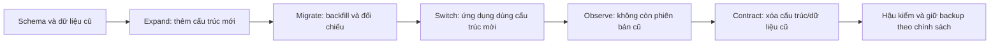
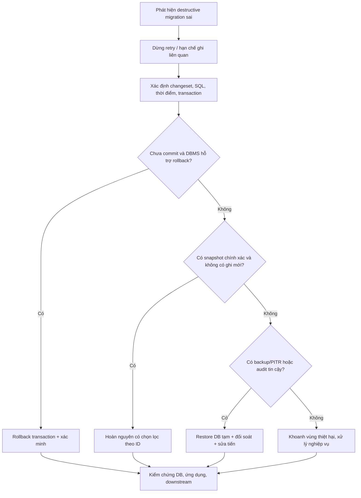

# Nhận diện thay đổi phá hủy dữ liệu hoặc không thể đảo ngược

## 1. Bài toán: hoàn tác câu lệnh khác với khôi phục thông tin

Trong module **DATABASE_SCHEMA_MIGRATION_LIQUIBASE**, chúng ta học quản lý thay đổi schema và dữ liệu bằng Liquibase qua changelog, changeset, precondition, checksum và lịch sử triển khai; thực hành migration có kiểm chứng, rollback, phối hợp nhiều môi trường và tích hợp Spring Boot hoặc CI/CD. Ở chương **Hoàn tác**, một kỹ năng quan trọng là nhận diện thay đổi **phá hủy dữ liệu (destructive)** hoặc **không thể đảo ngược đầy đủ (irreversible)** trước khi bấm chạy migration.

Có những changeset dễ nghĩ ra thao tác đảo chiều, ví dụ tạo một index mới rồi xóa chính index ấy. Nhưng việc **tạo lại cột bị xóa** không giúp lấy lại những giá trị cũ. Một câu SQL chuyển cả `NEW` lẫn `PENDING` thành `OPEN` không thể tính ngược trạng thái ban đầu của từng đơn hàng nếu không có dữ liệu bổ sung.

```sql
-- Xóa một cột có thể làm mất tất cả giá trị của nó.
ALTER TABLE app.orders DROP COLUMN legacy_note;

-- Thêm lại cột chỉ tái tạo cấu trúc; dữ liệu cũ không tự khôi phục.
ALTER TABLE app.orders ADD COLUMN legacy_note VARCHAR(200);
```

Cần phân biệt ba mục tiêu:

1. **Hoàn tác cấu trúc**: đưa định nghĩa bảng, cột, index, constraint hoặc view về dạng trước đó.
2. **Phục hồi dữ liệu**: lấy lại chính xác những giá trị, tập hàng và quan hệ đã tồn tại trước khi thay đổi.
3. **Khôi phục vận hành**: khiến ứng dụng, API, worker, báo cáo, cache và các hệ thống tích hợp hoạt động lại theo đúng hợp đồng dữ liệu.

Liquibase có thể quản lý changeset và một số thao tác rollback, nhưng **`DATABASECHANGELOG` không chứa bản sao của mọi giá trị đã xóa hoặc ghi đè**.

### Mục tiêu học tập

Sau bài học, bạn có thể:

- Nhận diện rủi ro mất dữ liệu và mất tính tương thích từ một changeset.
- Phân biệt `dropColumn`, `dropTable`, `delete`, `update`, `modifyDataType` và SQL có tác dụng phá hủy gián tiếp.
- Đánh giá khi nào dữ liệu gốc không thể suy ra từ dữ liệu sau migration.
- Hiểu khả năng và giới hạn của Liquibase rollback, transaction rollback, backup và PITR.
- Viết precondition để phát hiện các trạng thái nguy hiểm và truy vấn hậu kiểm để xác minh kết quả.
- Thiết kế lưu dữ liệu gốc theo khóa, chuyển đổi có kiểm soát, rollback giới hạn phạm vi và forward-fix khi cần.
- Xây dựng checklist review và runbook trước khi triển khai trên production.

**Thông điệp chính:** Không phải cứ có câu `rollback` trong changelog là một thay đổi đã trở nên có thể phục hồi hoàn toàn.

## 2. Định nghĩa đúng rủi ro

**Destructive change** là thay đổi có thể xóa hoặc làm mất giá trị của dữ liệu/cấu trúc, phá vỡ quan hệ hoặc hợp đồng mà ứng dụng đang sử dụng. Nó có thể tác động ngay đến database hoặc gián tiếp đến hệ thống khác.

**Irreversible change** là thay đổi mà không thể tái tạo chính xác trạng thái trước đó **từ trạng thái hiện tại và các nguồn thông tin còn lại**. Định nghĩa này mang tính ngữ cảnh: một phép biến đổi mất thông tin có thể khôi phục được nếu trước đó đã lưu một snapshot đúng và được phép sử dụng; nó có thể không thể khôi phục nếu không còn bản gốc.

```text
Dữ liệu trước:
  101 -> NEW
  102 -> PENDING

Phép biến đổi:
  NEW, PENDING -> OPEN

Dữ liệu sau:
  101 -> OPEN
  102 -> OPEN

Không có bản ghi (order_id, status_before):
  Không thể biết 101 từng là NEW và 102 từng là PENDING.
```

### 2.1. Bốn chiều của tính đảo ngược

| Chiều | Câu hỏi | Rủi ro |
|---|---|---|
| **Thông tin** | Giá trị hoặc quan hệ gốc có bị xóa/ghi đè không? | Gộp trạng thái, cắt chuỗi, làm tròn |
| **Schema** | Có đối tượng hoặc hợp đồng nào bị xóa/đổi không? | Drop bảng, xóa cột, đổi kiểu |
| **Thời gian** | Có bản ghi hợp lệ mới sau migration cần giữ không? | Restore snapshot cũ ghi đè giao dịch mới |
| **Hệ thống ngoài** | Dữ liệu đã được đồng bộ/phát sự kiện chưa? | CDC, message, cache, báo cáo, email |

Một thay đổi có thể không xóa trực tiếp dữ liệu nhưng vẫn khó hoàn tác về vận hành. Ví dụ đổi tên cột có thể giữ nguyên giá trị, nhưng làm một worker cũ không chạy được; khi hệ thống chuyển sang tên mới, đổi lại ngay có thể làm phiên bản mới hỏng. Do đó cần đánh giá cả **compatibility**.

## 3. Danh mục thay đổi cần nhận diện sớm

| Nhóm | Ví dụ Liquibase/SQL | Điều có thể bị mất hoặc hỏng |
|---|---|---|
| Xóa bảng | `dropTable` / `DROP TABLE` | Dữ liệu, đối tượng, quan hệ, ứng dụng phụ thuộc |
| Xóa cột | `dropColumn` / `DROP COLUMN` | Giá trị từng hàng, view, index, mapping |
| Xóa dữ liệu | `delete` / `DELETE` | Hàng và quan hệ nghiệp vụ |
| Làm rỗng bảng | SQL `TRUNCATE` | Tập dữ liệu lớn; transaction/identity khác tùy DBMS |
| Ghi đè giá trị | `update`, `sql`, `sqlFile` | Giá trị trước khi cập nhật |
| Thu hẹp kiểu | `modifyDataType` | Dữ liệu dài, số vượt ngưỡng, độ chính xác |
| Thay logic ràng buộc | `dropUniqueConstraint`, thay check | Ghi mới có thể vi phạm invariant cũ |
| Drop view/function/trigger | `dropView`, SQL `DROP FUNCTION` | API database, hành vi tự động, quyền |
| SQL cascade | `CASCADE` | Đối tượng phụ thuộc ngoài phạm vi dự kiến |
| Gộp/tách dữ liệu | DML tùy chỉnh | Mapping không song ánh, hàng thiếu/trùng |
| Chuyển đổi mật mã/ẩn danh | SQL hoặc script ngoài | Dữ liệu nguồn có thể không thể/không được phép lấy lại |

Không phải mọi change type trong bảng đều làm mất dữ liệu ở mọi trường hợp. `dropUniqueConstraint` chẳng hạn không tự xóa hàng, nhưng có thể mở đường cho dữ liệu trùng và làm hệ thống về sau không thể trở lại constraint cũ nếu dữ liệu mới đã vi phạm. **Phân tích hậu quả** quan trọng hơn đánh dấu theo tên change type.

### 3.1. Những dấu hiệu đặc biệt trong SQL

Khi review file `sqlFile` hoặc `update-sql`, cần tìm:

- `DROP TABLE`, `DROP COLUMN`, `DROP VIEW`, `TRUNCATE`, `DELETE`.
- `UPDATE` thiếu `WHERE` hoặc điều kiện quá rộng.
- `CAST`, `ROUND`, `SUBSTRING`, `LEFT`, `COALESCE` có thể làm mất thông tin.
- `ALTER COLUMN TYPE` hay giảm `varchar`, `decimal` precision/scale.
- `CASCADE` hoặc xóa foreign key/index/constraint quan trọng.
- Thay tên schema/bảng qua `${targetSchema}` hoặc các property khác có nguy cơ trỏ nhầm môi trường.
- DML tiền, số dư, điểm thưởng, trạng thái thanh toán hoặc hóa đơn mà không lưu giá trị cũ.

Đó là danh sách sàng lọc, không phải bộ phân tích tĩnh đầy đủ. Một `UPDATE` có `WHERE` vẫn có thể sai nghiệp vụ. Một bảng rỗng vẫn có thể là dependency quan trọng.

## 4. Liquibase có thực sự tự rollback được không?

Liquibase ghi nhận changeset theo `id`, `author` và định danh đường dẫn changelog; quá trình triển khai được theo dõi trong `DATABASECHANGELOG`. Khi được yêu cầu rollback theo cơ chế hỗ trợ, Liquibase có thể:

1. Dùng thao tác đảo chiều do change type/DBMS hỗ trợ.
2. Chạy một khối `rollback` do tác giả khai báo.
3. Không thể thực hiện rollback tự động nếu không có định nghĩa phù hợp.

**Không suy đoán khả năng rollback chỉ từ tên change type.** Tài liệu, phiên bản Liquibase và DBMS quyết định khả năng đảo chiều tự động. Với `dropColumn`/`dropTable`, không được coi việc tạo lại đối tượng là phục hồi dữ liệu đã bị xóa.

### 4.1. Ba cơ chế thường bị nhầm

| Cơ chế | Khi nào có tác dụng? | Giới hạn |
|---|---|---|
| JDBC/DBMS transaction rollback | Thao tác chưa commit, DBMS hỗ trợ transaction | Không hoàn tác commit cũ; một số DDL có implicit commit |
| Liquibase rollback | Có logic đảo chiều, changeset thuộc tập rollback | Không tự lưu bản sao giá trị cũ |
| Backup/snapshot/PITR | Có bản sao/log phù hợp và runbook restore | Có thể làm mất ghi mới, cần thời gian và đối soát |

**Transaction rollback** và **Liquibase rollback** là hai việc khác nhau. Liquibase rollback có thể là một lần migration đảo chiều được chạy sau khi database đã commit các thay đổi trước đó. Nó không phải “quay ngược đồng hồ” của mọi bảng và dịch vụ.

### 4.2. Câu rollback tạo lại cột không có dữ liệu cũ

```yaml
databaseChangeLog:
  - changeSet:
      id: 010-drop-old-note
      author: database-team
      changes:
        - dropColumn:
            schemaName: app
            tableName: orders
            columnName: old_note
      rollback:
        - addColumn:
            schemaName: app
            tableName: orders
            columns:
              - column:
                  name: old_note
                  type: varchar(200)
```

Nếu rollback chạy, nó có thể tạo lại tên cột `old_note`. Nhưng các ghi chú cũ không xuất hiện; index, default, constraint hoặc các phụ thuộc trước đó cũng không tự phục hồi. Đây là **rollback cấu trúc một phần**, không phải rollback dữ liệu.

### 4.3. Khi nào phải viết rollback bằng tay?

Nếu migration dùng `sql`/`sqlFile` với nhiều phép chuyển đổi nghiệp vụ, Liquibase không thể tự suy luận chính xác SQL ngược. Một khối rollback thủ công cần:

- Chỉ rõ tập bản ghi/đối tượng phải hoàn nguyên.
- Có dữ liệu trước thay đổi hoặc một phép biến đổi thật sự đảo được.
- Không ghi đè các thay đổi hợp lệ xảy ra sau migration.
- Có preflight, điều kiện dừng và kiểm thử trên DBMS đích.
- Có hậu kiểm về cấu trúc, dữ liệu và ứng dụng.

Để review, có thể dùng tính năng xem trước rollback SQL của bản Liquibase đang sử dụng. **Xem trước SQL không chứng minh rằng dữ liệu gốc vẫn còn** hay rollback sẽ thành công trong trạng thái production tương lai.

## 5. Xác định sự mất thông tin bằng ví dụ

| Phép biến đổi | Khôi phục giá trị ban đầu chỉ từ kết quả? | Lý do |
|---|---|---|
| `NEW`/`PENDING` → `OPEN` | Không | Hai giá trị nguồn có một kết quả |
| `UPPER(customer_name)` | Không chắc | Mất cách viết hoa/thường ban đầu |
| `ROUND(amount, 0)` | Không | Mất phần thập phân |
| `LEFT(description, 80)` | Không | Mất phần chuỗi phía sau |
| Chuyển thời gian thành ngày | Không | Mất giờ/phút/giây và có thể cả timezone |
| Xóa `old_code` sau khi tạo `new_code` | Chỉ khi mapping đầy đủ, còn nguồn | Mã mới có thể gộp nhiều mã cũ |
| Đổi tên cột | Thường giữ dữ liệu | Nhưng làm hỏng hợp đồng với ứng dụng |
| Thêm một index | Thường có hướng ngược rõ | Vẫn phải kiểm tra lock, quyền và dependency |

Một phép biến đổi không song ánh có thể phục hồi được khi **giữ chính xác giá trị nguồn theo ID**. Ngược lại, một phép đổi tên tưởng dễ đảo chiều có thể khó rollback nếu nhiều service mới và cũ cùng chạy.

Khi thay đổi nhằm xóa dữ liệu theo quy định bảo mật hoặc retention, **không tự lưu một bản sao bị cấm** để tạo khả năng phục hồi giả. Sự không thể đảo ngược có thể là yêu cầu của nghiệp vụ/tuân thủ; khi đó biện pháp an toàn chuyển sang kiểm chứng phạm vi xóa trước khi thực hiện.

## 6. Quy trình phân loại trước khi viết changeset

### Bước 1: Xác định phạm vi và invariant

Ghi rõ:

- Đối tượng schema nào đang bị thay đổi.
- Tập bản ghi, tenant, partition hoặc thời gian dữ liệu bị ảnh hưởng.
- Miền giá trị cũ và quy tắc chuyển đổi mới.
- Những invariant không được phá vỡ: tổng số dư, số đơn, uniqueness, foreign key, quan hệ nghiệp vụ.
- Những ứng dụng/worker/job/report còn phụ thuộc dữ liệu hoặc tên cũ.

### Bước 2: Kiểm kê dữ liệu trước khi xóa/ghi đè

Không chỉ đếm tổng số dòng. Kiểm tra phân bố giá trị, NULL, duplicate, outlier, độ dài tối đa, miền kiểu dữ liệu, tập khóa và quan hệ với bảng khác. Với dữ liệu quan trọng, cần xem cả log truy vấn, CDC và lịch chạy batch ít thường xuyên.

### Bước 3: Tự đặt câu hỏi “có phép đảo chính xác không?”

Nếu chỉ giữ kết quả sau thay đổi, có thể suy ra giá trị trước đó **cho từng ID** không? Nếu không, phải thiết kế snapshot/audit/backup hoặc chấp nhận giới hạn phục hồi trước khi phát hành.

### Bước 4: Xác định mức độ ảnh hưởng

Xem xét mất dữ liệu, sai số tài chính, lỗi schema compatibility, downtime, quyền truy cập, hệ thống downstream và nghĩa vụ lưu trữ. Thay đổi có thể đảo ngược về mặt dữ liệu nhưng vẫn phải dừng khi một phiên bản ứng dụng cũ còn chạy.

### Bước 5: Chọn cách triển khai ít rủi ro hơn

Ưu tiên:

- Thêm cấu trúc mới nhưng giữ nguồn cũ trong giai đoạn chuyển tiếp.
- Chụp dữ liệu gốc theo khóa và kiểm chứng snapshot.
- Chạy backfill theo batch có checkpoint và khả năng retry rõ ràng.
- Tách bước xóa cuối cùng sang một đợt phát hành sau.
- Diễn tập backup/PITR và runbook.
- Hoãn thay đổi nếu chưa có bằng chứng đáp ứng điều kiện an toàn.

### Bước 6: Định nghĩa tiêu chí dừng

Không chạy `update` khi có dữ liệu ngoài quy tắc, thiếu backup, không xác định được phạm vi, ứng dụng cũ vẫn phụ thuộc schema, checksum/history bất thường hoặc RPO/RTO không được đáp ứng. Một kết quả “không chạy migration” có thể là kết quả review **đúng**.

## 7. Ví dụ xuyên suốt: gộp trạng thái đơn hàng

Giả sử PostgreSQL có bảng `app.orders`:

| order_id | status ban đầu |
|---:|---|
| 101 | NEW |
| 102 | PENDING |
| 103 | PAID |
| 104 | NEW |

Nghiệp vụ muốn gộp `NEW` và `PENDING` thành `OPEN`:

```sql
UPDATE app.orders
SET status = 'OPEN'
WHERE status IN ('NEW', 'PENDING');
```

Sau khi chạy, các đơn 101, 102 và 104 cùng có trạng thái `OPEN`. Không thể biết chúng thuộc trạng thái nguồn nào nếu không lưu dữ liệu trước cập nhật. Đây là **ví dụ điển hình của migration không đảo ngược từ dữ liệu cuối cùng**.

### 7.1. Lưu giá trị nguồn theo khóa chính trước migration

Changelog YAML minh họa:

```yaml
databaseChangeLog:
  - changeSet:
      id: 001-capture-order-status
      author: data-team
      dbms: postgresql
      preConditions:
        - onFail: HALT
        - tableExists:
            schemaName: app
            tableName: orders
        - not:
            - tableExists:
                schemaName: app
                tableName: order_status_before_merge
      changes:
        - createTable:
            schemaName: app
            tableName: order_status_before_merge
            columns:
              - column:
                  name: order_id
                  type: bigint
                  constraints:
                    primaryKey: true
                    nullable: false
              - column:
                  name: status_before
                  type: varchar(24)
                  constraints:
                    nullable: false
        - sql:
            sql: >
              INSERT INTO app.order_status_before_merge
                (order_id, status_before)
              SELECT order_id, status
              FROM app.orders
              WHERE status IN ('NEW', 'PENDING')
```

**Ý nghĩa:** mỗi bản ghi cần chuyển đổi được lưu theo khóa `order_id` và giá trị `status_before`. Bảng archive nên có tên gắn với release/batch cụ thể trong dự án thực, có quyền truy cập hạn chế và thời hạn lưu giữ rõ ràng.

**Giới hạn quan trọng:** snapshot trong cùng database **không phải backup độc lập**. Nếu ứng dụng tiếp tục cập nhật `orders.status` sau khi snapshot, dữ liệu archive có thể không phản ánh đúng trạng thái nguồn tại thời điểm migration. Cần tạm dừng ghi liên quan, bảo vệ bằng transaction/lock phù hợp hoặc thiết kế audit/version/CDC để đồng bộ.

### 7.2. Kiểm tra snapshot trước khi chuyển đổi

Các truy vấn sau dành cho PostgreSQL:

```sql
SELECT status, COUNT(*) AS rows_to_change
FROM app.orders
WHERE status IN ('NEW', 'PENDING')
GROUP BY status;

SELECT status_before, COUNT(*) AS archived_rows
FROM app.order_status_before_merge
GROUP BY status_before;

SELECT COUNT(*) AS missing_or_changed
FROM app.order_status_before_merge AS b
LEFT JOIN app.orders AS o ON o.order_id = b.order_id
WHERE o.order_id IS NULL
   OR o.status IS DISTINCT FROM b.status_before;
```

Trong cửa sổ **không có ghi đồng thời**, số bản ghi cần chuyển và số bản archive phải khớp, còn `missing_or_changed = 0`. Cũng cần kiểm tra chiều ngược: mọi ID thuộc tập nguồn được chụp, không chỉ các ID đã có trong archive. Hai tập khác nhau vẫn có thể cùng số hàng.

### 7.3. Changeset cập nhật và một rollback có giới hạn

Phần sau được đặt tiếp trong cùng danh sách `databaseChangeLog`:

```yaml
  - changeSet:
      id: 002-merge-order-status
      author: data-team
      dbms: postgresql
      preConditions:
        - onFail: HALT
        - tableExists:
            schemaName: app
            tableName: order_status_before_merge
        - sqlCheck:
            expectedResult: "0"
            sql: >
              SELECT COUNT(*)
              FROM app.orders AS o
              WHERE o.status IN ('NEW', 'PENDING')
                AND NOT EXISTS (
                  SELECT 1
                  FROM app.order_status_before_merge AS b
                  WHERE b.order_id = o.order_id
                )
      changes:
        - sql:
            sql: >
              UPDATE app.orders
              SET status = 'OPEN'
              WHERE status IN ('NEW', 'PENDING')
      rollback:
        - sql:
            sql: >
              UPDATE app.orders AS o
              SET status = b.status_before
              FROM app.order_status_before_merge AS b
              WHERE o.order_id = b.order_id
                AND o.status = 'OPEN'
```

Rollback này **chỉ có thể dùng sau khi kiểm chứng không có cập nhật nghiệp vụ hợp lệ nào đối với những hàng liên quan kể từ lúc chuyển đổi**, hoặc đã bổ sung cơ chế bảo vệ mạnh hơn. Điều kiện `o.status='OPEN'` không cho biết ai đã đưa hàng về `OPEN` sau migration; nếu ứng dụng đã tiếp tục ghi, phép rollback có thể ghi đè dữ liệu mới.

Precondition chỉ giảm một số rủi ro; nó không bảo vệ khỏi race condition giữa lúc kiểm tra và lúc thực thi. Đối với các hệ thống yêu cầu độ chính xác cao, cần audit/row version và một chiến lược nhất quán được kiểm thử.

### 7.4. Hậu kiểm kết quả

```sql
SELECT COUNT(*) AS source_status_remaining
FROM app.orders
WHERE status IN ('NEW', 'PENDING');

SELECT COUNT(*) AS snapshot_ids_not_open
FROM app.order_status_before_merge AS b
LEFT JOIN app.orders AS o ON o.order_id = b.order_id
WHERE o.order_id IS NULL
   OR o.status IS DISTINCT FROM 'OPEN';
```

Trong giả định không có ghi đồng thời, hai kết quả kỳ vọng bằng 0. Phải kiểm tra thêm các hàng không thuộc tập archive **không bị thay đổi ngoài kế hoạch**, các hệ thống khác hiểu `OPEN` đúng nghĩa và ứng dụng không còn phụ thuộc trạng thái cũ.

### 7.5. Vì sao không tự xóa bảng archive ngay?

Nguồn `status_before` là tài sản phục hồi. Nếu xóa ngay khi update vừa thành công, nhóm mất khả năng khôi phục chính xác khi lỗi được phát hiện muộn. Một changeset dọn dẹp chỉ nên chạy **sau thời gian quan sát và phê duyệt retention**; không khai báo xóa archive tự động trong rollback của changeset chụp dữ liệu khi chưa có kế hoạch bảo toàn nguồn.

Mặt khác, không giữ dữ liệu gốc vô thời hạn trái quy định bảo mật. Cửa sổ phục hồi phải được xác định trước.

## 8. Nhận diện destructive DDL và phụ thuộc schema

### 8.1. Xóa cột

```yaml
databaseChangeLog:
  - changeSet:
      id: 010-drop-legacy-customer-code
      author: database-team
      changes:
        - dropColumn:
            schemaName: app
            tableName: customers
            columnName: legacy_code
```

Trước khi chạy, cần kiểm tra:

- Cột còn dữ liệu không NULL hoặc dữ liệu có giá trị nghiệp vụ không?
- Đã di chuyển/đối chiếu dữ liệu đến đối tượng mới chưa?
- Có application, worker, báo cáo, ETL, view, index, constraint hoặc SQL thủ công còn dùng cột không?
- DBMS có lock hoặc khả năng DDL không nguyên tử nào cần xem xét?
- Bản backup có thể phục hồi giá trị cột và các phụ thuộc nếu lỗi không?
- Có phiên bản ứng dụng cũ còn cần cột để rollback ứng dụng không?

Đừng bật `runAlways` cho changeset xóa cột chỉ để “chắc chắn chạy”: lần thứ hai có thể lỗi vì cột đã không còn.

### 8.2. Xóa bảng

```yaml
databaseChangeLog:
  - changeSet:
      id: 011-drop-empty-import-table
      author: database-team
      preConditions:
        - onFail: HALT
        - tableExists:
            schemaName: app
            tableName: legacy_import
        - sqlCheck:
            expectedResult: "0"
            sql: >
              SELECT COUNT(*)
              FROM app.legacy_import
      changes:
        - dropTable:
            schemaName: app
            tableName: legacy_import
```

`sqlCheck` chặn xóa nếu bảng không rỗng tại thời điểm kiểm tra. **Bảng rỗng không đồng nghĩa bảng không còn được sử dụng**: có thể còn job theo tháng hoặc foreign key/view phụ thuộc. Phải kiểm kê cả thành phần sử dụng đối tượng và rủi ro ghi đồng thời.

### 8.3. Thận trọng với CASCADE

Một số DBMS cho phép `DROP ... CASCADE` để xóa thêm các đối tượng liên quan. Không coi cascade là giải pháp tổng quát khi gặp lỗi dependency; nó có thể làm biến mất những object không có trong kế hoạch review. Cần liệt kê chính xác foreign key, view, trigger và phụ thuộc, rồi thay đổi chúng có chủ đích.

## 9. Nguyên tắc expand → migrate → contract

Với thay đổi không tương thích hoặc khó đảo ngược, nên chia thành nhiều pha:



Ví dụ chuyển `orders.legacy_status` sang `orders.status`:

1. Thêm cột `status` mà chưa xóa `legacy_status`.
2. Backfill dữ liệu, kiểm tra mapping theo `order_id`, xử lý các bản ghi NULL/bất thường.
3. Sửa ứng dụng đọc/ghi `status`, đồng bộ với nguồn cũ trong khoảng chuyển tiếp nếu còn bản app cũ.
4. Xác nhận mọi worker, báo cáo và bản ứng dụng cũ không còn phụ thuộc `legacy_status`.
5. Giữ backup/nguồn dữ liệu gốc qua cửa sổ quan sát.
6. Chỉ khi đủ bằng chứng mới phát hành `dropColumn` trong một changeset riêng.

Expand-contract không tự bảo đảm không downtime; DDL vẫn có thể lấy lock, ảnh hưởng replication hoặc làm chậm ứng dụng tùy DBMS.

## 10. Chọn nguồn phục hồi phù hợp

### 10.1. Archive theo khóa chính

Dùng khi cần phục hồi có chọn lọc giá trị gốc cho một tập bản ghi. Phải có ID ổn định, thời điểm chụp nhất quán, dữ liệu nguồn, cơ chế kiểm tra và quyền truy cập phù hợp. Archive cùng database không bảo vệ khỏi sự cố làm mất cả database.

### 10.2. Backup/snapshot độc lập

Dùng khi có khả năng mất bảng, mất cột, sai DML diện rộng hoặc database cần phục hồi. **Backup tồn tại không đồng nghĩa restore được**: phải kiểm tra tính nhất quán, tính toàn vẹn, quyền truy cập và thời gian khôi phục.

### 10.3. Point-in-time recovery (PITR)

Nếu DBMS và log giao dịch hỗ trợ, PITR giúp đưa một bản database về mốc thời gian trước migration. Khi ứng dụng đã tạo thêm giao dịch mới, không nên tự động restore toàn bộ production về mốc cũ vì sẽ làm mất dữ liệu hợp lệ. Có thể:

1. Restore vào database tạm được cô lập.
2. Trích xuất tập bản ghi hoặc giá trị gốc cần phục hồi.
3. Đối chiếu với trạng thái production hiện tại.
4. Dùng changeset bù hoặc thao tác merge được kiểm soát.
5. Kiểm tra invariant và side effect tại các hệ thống tích hợp.

### 10.4. RPO và RTO

- **RPO:** mức mất dữ liệu tối đa chấp nhận, thường diễn đạt bằng khoảng thời gian.
- **RTO:** thời gian tối đa chấp nhận để khôi phục chức năng quan trọng.

Nếu RPO chỉ vài phút mà backup chạy mỗi ngày, kế hoạch có thể không đáp ứng. Nếu restore mất ba giờ nhưng RTO là một giờ, backup có sẵn vẫn không giải quyết được yêu cầu. Cần diễn tập thật trên dữ liệu và hạ tầng gần production.

### 10.5. Tuân thủ bảo mật và retention

Nếu thay đổi được thiết kế để xóa vĩnh viễn thông tin cá nhân, không tạo bản sao trái chính sách chỉ nhằm dễ rollback. Phải cân nhắc quyền được lưu, thời hạn retention, mã hóa, quyền truy cập và việc dọn dẹp dữ liệu tạm sau sự cố.

## 11. Precondition: chặn trạng thái đầu vào sai

Precondition kiểm tra trạng thái **trước khi Liquibase thực thi changeset**. Nó không có chức năng sao lưu dữ liệu, không thể tự chứng minh SQL sau thay đổi đúng và có thể gặp race condition.

Ví dụ PostgreSQL: giảm độ dài `customer_code` từ kiểu đủ dài xuống `varchar(40)` chỉ khi không có giá trị vượt ngưỡng:

```yaml
databaseChangeLog:
  - changeSet:
      id: 020-shorten-customer-code
      author: database-team
      dbms: postgresql
      preConditions:
        - onFail: HALT
        - tableExists:
            schemaName: app
            tableName: customers
        - sqlCheck:
            expectedResult: "0"
            sql: >
              SELECT COUNT(*)
              FROM app.customers
              WHERE customer_code IS NOT NULL
                AND char_length(customer_code) > 40
      changes:
        - modifyDataType:
            schemaName: app
            tableName: customers
            columnName: customer_code
            newDataType: varchar(40)
```

Nếu có giá trị dài hơn 40 ký tự, precondition thất bại và với `onFail: HALT` Liquibase sẽ dừng thay vì cố chuyển kiểu. Điều kiện vẫn chưa kiểm tra mọi dependency, concurrent writes, index, constraint và hành vi cast trên DBMS khác.

### 11.1. Chính sách thất bại cần hiểu đúng

| Xử lý | Ý nghĩa tổng quát | Cần nhớ |
|---|---|---|
| `HALT` | Dừng khi điều kiện không đạt | Thích hợp với điều kiện an toàn bắt buộc |
| `WARN` | Cảnh báo, xử lý theo chính sách | Có thể tiếp tục trong bối cảnh không mong muốn |
| `CONTINUE` | Bỏ qua changeset ở lần xử lý liên quan | Không chứng minh thay đổi đã được thực thi |
| `MARK_RAN` | Đánh dấu đã xử lý dù change không chạy | Dễ che giấu thiếu migration nếu không hậu kiểm |

Các giá trị được hỗ trợ phụ thuộc phạm vi precondition và phiên bản Liquibase. Đặc biệt không dùng `MARK_RAN` như cách “bỏ qua lỗi” của destructive change trước khi kiểm tra trạng thái DBMS.

### 11.2. Hậu kiểm độc lập sau migration

Ví dụ sau khi `modifyDataType` chạy, cần kiểm tra schema cột đã thực sự là `varchar(40)`, dữ liệu đáp ứng miền giá trị và app vẫn hoạt động. `validate`/`update-sql` hoặc precondition pass **không thay thế** truy vấn metadata và invariant trên database thật.

## 12. Kiểm tra trước khi `update`

Trước khi chạy destructive migration, cố định:

- Database URL, DBMS/phiên bản, schema, user và quyền.
- Changelog root, các `include`/`includeAll`, revision và file `sqlFile`.
- Context/label filter, property substitution và các thay đổi SQL đặc thù DBMS.
- Tình trạng `DATABASECHANGELOG`, checksum và khóa triển khai.
- Tập thay đổi dự kiến, số hàng/đối tượng bị ảnh hưởng.
- Chính sách backup, phương án rollback và người phê duyệt.

Các lệnh CLI minh họa (kết nối đã được cấu hình bảo mật):

```bash
liquibase --changelog-file=db/changelog.yaml validate
liquibase --changelog-file=db/changelog.yaml status --verbose
liquibase --changelog-file=db/changelog.yaml update-sql
```

`validate` kiểm tra changelog trong khả năng của Liquibase; `status` hỗ trợ xem changeset cần xử lý; `update-sql` giúp review SQL dự kiến. **Không lệnh nào chứng minh một câu `DROP` là an toàn hay backup có thể phục hồi dữ liệu**. Cần kiểm thử trên môi trường gần production và xem SQL đúng DBMS/phiên bản.

### 12.1. Nhận diện lịch sử changeset

```sql
SELECT ID, AUTHOR, FILENAME, DATEEXECUTED, EXECTYPE, MD5SUM
FROM DATABASECHANGELOG
ORDER BY DATEEXECUTED, ORDEREXECUTED;
```

Lịch sử cho biết Liquibase đã ghi nhận changeset nào; nó không chứa tập dữ liệu trước khi bị `UPDATE` hoặc `DELETE`. Checksum là cơ chế kiểm tra tính toàn vẹn định nghĩa changeset, không phải bản sao schema hoặc dữ liệu.

Không xóa dòng `DATABASECHANGELOG`, đổi ID/author/đường dẫn hoặc dùng `clearCheckSums` chỉ để ép chạy lại destructive change.

### 12.2. Những bộ lọc có thể thay đổi phạm vi

Một changeset có `contextFilter`, `labels` hoặc `dbms` có thể được chọn khác nhau giữa dev/staging/production. `runAlways` và `runOnChange` cũng ảnh hưởng khả năng chạy lại. Không coi filter là cơ chế bảo mật duy nhất: còn cần quyền DBMS, approval và quy trình triển khai.

Nếu tham số `${targetSchema}` trỏ tới schema khác, cùng câu SQL có thể phá hủy bảng khác. Phải xem SQL sau khi thay property trong đúng môi trường.

## 13. Transaction và lỗi áp dụng một phần

Liquibase thường chạy changeset trong transaction khi DBMS và loại thao tác hỗ trợ. Nhưng không phải mọi DDL đều có cùng hành vi transaction; một số DBMS có implicit commit hoặc hạn chế rollback DDL. Với `runInTransaction: false`, nếu một changeset có nhiều câu lệnh, lỗi giữa chừng có thể để lại dữ liệu/schema đã bị thay đổi một phần.

| Trạng thái khi lỗi | Điều cần kiểm tra | Cách tiếp cận |
|---|---|---|
| Chưa commit, transaction còn hợp lệ | DBMS hỗ trợ rollback, lock và transaction | Hoàn tác transaction, đối chiếu dữ liệu thật |
| Đã commit nhưng history chưa cập nhật | Những SQL nào đã có tác dụng | Không retry mù quáng; đối chiếu lịch sử và DBMS |
| Một phần câu lệnh đã commit | Tập dữ liệu/đối tượng nào đã thay đổi | Khoanh vùng và sửa có chọn lọc |
| App tiếp tục ghi sau migration | Những giao dịch hợp lệ mới có thể bị rollback ghi đè | Audit/version, restore DB tạm hoặc forward-fix |
| CDC/event đã phát ra ngoài | Cần bù side effect | Đối soát downstream, event bù có kiểm soát |

**Idempotency không đồng nghĩa reversibility.** Một câu `UPDATE status='OPEN' WHERE status IN (...)` có thể ít tác dụng khi chạy lần hai nhưng vẫn làm mất giá trị nguồn từ lần đầu. Không bật `runAlways` để giải quyết retry khi thao tác chưa được chứng minh an toàn.

## 14. Tổ chức triển khai với Spring Boot và CI/CD

Khi Spring Boot tích hợp Liquibase và tự kích hoạt migration lúc khởi động, nhiều replica có thể bắt đầu các lần kiểm tra/cập nhật gần nhau. `DATABASECHANGELOGLOCK` hỗ trợ điều phối các tiến trình Liquibase trong cùng phạm vi lịch sử, nhưng không thay thế lock của DBMS hoặc ngăn thay đổi từ ứng dụng bên ngoài Liquibase.

Ví dụ cấu hình khởi chạy changelog:

```yaml
spring:
  liquibase:
    change-log: classpath:db/changelog/db.changelog-master.yaml
```

Một thay đổi phá hủy có thể ảnh hưởng ứng dụng cũ còn chạy trong rolling deployment. Vì vậy, khi rủi ro lớn, cân nhắc **job migration độc lập trong CI/CD**, sau khi đã phê duyệt schema/dữ liệu và trước rollout phiên bản ứng dụng phụ thuộc cấu trúc mới.

### 14.1. Cổng kiểm soát gợi ý

| Cổng | Bằng chứng yêu cầu | Nếu không đạt |
|---|---|---|
| Review SQL | Tập ID, dữ liệu, bảng/cột và dependency | Chặn merge |
| Rủi ro | Có phân loại mất thông tin và tác dụng ngoài DBMS | Hoãn phát hành |
| Preflight | `validate`, `status`, `update-sql`, invariant | Dừng |
| Backup/restore | Bản sao hợp lệ, thử restore, RPO/RTO | Dừng |
| Compatibility | Không còn app/worker cần schema cũ | Dời bước contract |
| Approval | Người phụ trách database và nghiệp vụ phê duyệt | Không chạy production |
| Update | Theo dõi kết quả Liquibase và DBMS | Khoanh vùng khi lỗi |
| Post-verification | Schema, dữ liệu, app và downstream đạt | Khởi động runbook |
| Cleanup | Archive được giữ/xóa theo retention | Không xóa sớm nguồn phục hồi |

Phải dùng cùng artifact, Liquibase/JDBC version, changelog, filter và nguồn tham số giữa bước preview và update; nếu một trong các đầu vào đổi, cần xem lại.

## 15. Runbook khi phát hiện mất dữ liệu

Một runbook cần có người phụ trách và điều kiện kích hoạt cụ thể trước lúc deploy. Các bước chung:



### 15.1. Trước khi chọn cách phục hồi

Xác định:

- Changeset ID/author/file và `EXECTYPE`.
- DBMS, schema, account, thời gian, các lệnh đã commit.
- Bảng/cột/hàng và hệ thống ngoài bị ảnh hưởng.
- Có ghi nghiệp vụ mới sau thời điểm snapshot không.
- Nguồn dữ liệu gốc và độ tin cậy của backup/audit.
- Thời gian còn lại theo RTO, dữ liệu có thể mất theo RPO.
- Ai quyết định dừng/mở ghi và phương án phục hồi được phê duyệt.

### 15.2. Không tự rollback toàn bộ khi đã có ghi mới

Restore production về snapshot cũ có thể làm mất đơn hàng/giao dịch hợp lệ phát sinh sau đó. Một giải pháp khác có thể là restore vào **database tạm cô lập**, trích xuất dữ liệu gốc, đối chiếu theo ID và phát hành changeset bù. Nếu không thể phục hồi chính xác, phải công bố giới hạn và xử lý nghiệp vụ theo quy trình; không tự bịa giá trị ban đầu.

### 15.3. Điều kiện đóng sự cố

Chỉ xem sự cố đã được xử lý khi các bất biến dữ liệu đúng, schema và quyền phù hợp, ứng dụng/worker hoạt động, cache/CDC/report được đối soát, metric vận hành ổn định và kế hoạch giữ/xóa archive tuân thủ chính sách.

## 16. Bài thực hành: đánh giá ba thay đổi

### Tình huống A: xóa `customers.old_phone`

Ứng dụng đã có `phone` mới, số hàng có `phone` không NULL bằng tổng số hàng.

**Có xóa ngay được không?** Chưa đủ. Cần kiểm tra **giá trị theo ID** đã được chuyển đúng, không còn app/worker/report sử dụng `old_phone`, backup có thể restore và cửa sổ tương thích đã kết thúc. Tổng số hàng không NULL không chứng minh số điện thoại đúng.

### Tình huống B: thu hẹp `customer_code`

Bảng có mã dài tối đa 70 ký tự; nhóm muốn giảm cột từ `varchar(100)` xuống `varchar(40)`.

**Đánh giá:** Có nguy cơ mất dữ liệu hoặc lỗi chuyển kiểu. Trước tiên kiểm tra:

```sql
SELECT COUNT(*) AS over_limit
FROM app.customers
WHERE customer_code IS NOT NULL
  AND char_length(customer_code) > 40;
```

Nếu kết quả khác 0, dừng để quyết định mapping hợp lệ; **không tự cắt dữ liệu**. Kể cả khi bằng 0, cần kiểm tra ứng dụng có tiếp tục tạo mã dài, các index/constraint và độ tương thích DBMS.

### Tình huống C: xóa `transaction_log` quá 90 ngày

Một `DELETE WHERE created_at < ...` tưởng như có điều kiện rõ ràng, nhưng có thể sai vì:

- Dùng timezone/mốc thời gian không nhất quán.
- Dữ liệu quá 90 ngày vẫn cần đối soát, pháp lý hoặc khiếu nại.
- Timestamp sai hoặc dữ liệu NULL.
- Có FK hoặc hệ thống ngoài tham chiếu.
- Không ước lượng số hàng hoặc backup chưa được diễn tập.

**Biện pháp:** xác nhận retention, xem trước tập ID và số hàng, kiểm tra dependency, phê duyệt mốc thời gian, có nguồn phục hồi hợp lệ và hậu kiểm.

### Tình huống D: rollback trạng thái sau hai giờ

`QUEUED` và `PENDING` đã gộp thành `READY`. Ứng dụng tiếp tục chuyển một số đơn `READY` sang `PROCESSING`.

**Có dùng `UPDATE ... SET status='QUEUED' WHERE status='READY'` không?** Không. Nó không biết trạng thái gốc của từng ID và có thể ghi đè tiến trình hợp lệ. Cần snapshot/audit/CDC, xử lý theo trạng thái hiện tại và thiết kế changeset bù.

## 17. Bảng quyết định trước khi phê duyệt

| Câu hỏi | Bằng chứng cần có |
|---|---|
| Đối tượng nào bị phá hủy hoặc đổi ngữ nghĩa? | SQL/changelog chính xác, schema và danh sách dependency |
| Tập dữ liệu nào chịu tác động? | Danh sách ID, COUNT, phân bố, điều kiện lọc |
| Giá trị trước biến đổi có suy ra từ kết quả không? | Ví dụ mapping trước/sau |
| Có nguồn khôi phục hợp lệ không? | Snapshot/audit/backup/PITR với thời điểm |
| App/worker cũ còn dùng schema không? | Kế hoạch rollout và kiểm tra tương thích |
| Có thể phục hồi trong RTO/RPO không? | Kết quả diễn tập restore |
| Có ghi đồng thời không? | Kế hoạch transaction/lock/dual-write/version |
| Precondition và hậu kiểm là gì? | Truy vấn, giá trị kỳ vọng, điều kiện HALT |
| Nếu SQL đã commit một phần thì xử lý thế nào? | Runbook, owner, phục hồi có chọn lọc |
| Dữ liệu gốc có được phép giữ không? | Retention, bảo mật, quyền và dọn dẹp |

Nếu một điều kiện bắt buộc không đạt, **hoãn destructive migration** là lựa chọn phù hợp hơn việc triển khai rồi tìm cách khôi phục.

## 18. Checklist triển khai an toàn

### Trước `update`

- [ ] Xác nhận đúng database, schema, user, changelog, commit và Liquibase version.
- [ ] Nhận diện thao tác xóa/ghi đè/thu hẹp làm mất thông tin.
- [ ] Review `dropColumn`, `dropTable`, `delete`, `update`, `sqlFile` và SQL liên quan.
- [ ] Có baseline theo ID, dữ liệu nguồn, giá trị bất thường và invariant.
- [ ] Kiểm tra FK, view, index, function, trigger, app, worker, report và CDC.
- [ ] Có phương án lưu dữ liệu gốc hợp pháp hoặc lý do được phê duyệt khi không thể lưu.
- [ ] Backup/PITR đã được thử phục hồi theo RTO/RPO.
- [ ] Precondition, `validate`, `status` và `update-sql` đã được kiểm tra.
- [ ] Đã xem khả năng rollback thật, kể cả dữ liệu mới sau deploy.
- [ ] Có approval, monitoring, điều kiện dừng và người chịu trách nhiệm.

### Sau `update`

- [ ] Đối chiếu `DATABASECHANGELOG`, checksum và log.
- [ ] Kiểm tra schema/constraint, dữ liệu theo ID và invariant nghiệp vụ.
- [ ] Đảm bảo không có đối tượng hoặc hàng ngoài phạm vi bị phá hủy.
- [ ] Kiểm thử ứng dụng, worker, API, báo cáo và downstream.
- [ ] Kiểm tra lock, transaction, replication, error rate và hiệu năng.
- [ ] Nếu có sự cố, không retry mù quáng hoặc xóa lịch sử.
- [ ] Giữ nguồn phục hồi trong cửa sổ hợp lệ, rồi dọn dẹp đúng retention.

## 19. Kết luận

Nhận diện thay đổi phá hủy dữ liệu hoặc không thể đảo ngược là bước **phân tích tác động và chứng minh khả năng khôi phục**, không chỉ kiểm tra xem Liquibase có hỗ trợ một câu lệnh rollback. Những thứ cần bảo vệ không chỉ là tên bảng/cột, mà còn là **giá trị gốc, quan hệ dữ liệu, giao dịch mới, hợp đồng ứng dụng và side effect của các hệ thống ngoài**.

Liquibase giúp chuẩn hóa changelog, changeset, precondition, checksum và lịch sử cập nhật. Nhưng **khả năng phục hồi chính xác** chỉ tồn tại khi có dữ liệu nguồn đáng tin, cách xử lý transaction, snapshot/backup/PITR và runbook đã kiểm thử. Khi chưa xác định được những điều kiện đó, hướng phù hợp thường là **expand–migrate–contract**, giữ đối tượng cũ qua một giai đoạn quan sát hoặc hoãn thao tác phá hủy thay vì mặc định rằng rollback sẽ giải quyết mọi hậu quả.

