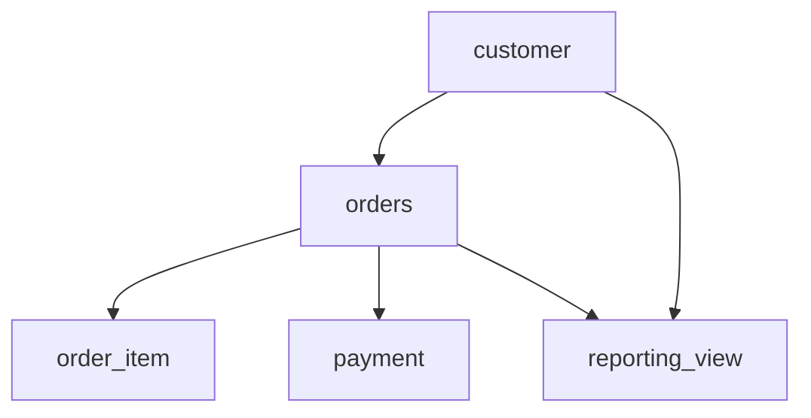

# Khảo sát cơ sở dữ liệu hiện hữu trước khi đưa vào Liquibase

Trong module `DATABASE_SCHEMA_MIGRATION_LIQUIBASE`, chúng ta học cách quản lý thay đổi schema và dữ liệu bằng **changelog, changeset, precondition, checksum và lịch sử triển khai**; thực hành migration có kiểm chứng, rollback, phối hợp nhiều môi trường và tích hợp Spring Boot hoặc CI/CD. Khi một hệ thống đã chạy nhiều năm, database thường chứa hàng trăm bảng, view, index, trigger, stored procedure, dữ liệu lịch sử và những thay đổi được thực hiện ngoài quy trình phát hành. Đưa Liquibase vào quản lý một database như vậy đòi hỏi phải hiểu trạng thái hiện hữu trước khi tạo baseline.

Bài học thuộc phần **Tiếp nhận CSDL**, tập trung vào việc khảo sát schema, đối tượng, dữ liệu, phụ thuộc ứng dụng, quyền, phiên bản DBMS và lịch sử thay đổi; đánh giá chênh lệch giữa các môi trường; sau đó lựa chọn cách tạo baseline và đồng bộ lịch sử Liquibase mà không chạy lại các DDL đã tồn tại. Mục tiêu là có một bức tranh đủ tin cậy để quyết định **những gì cần được Liquibase quản lý từ thời điểm tiếp nhận và cách bảo toàn database đang hoạt động**.

## 1. Vì sao cần khảo sát trước khi áp dụng Liquibase?

Một database hiện hữu không nhất thiết phản ánh chính xác schema trong source code hoặc tài liệu thiết kế. Trong quá trình vận hành, có thể đã xảy ra:

- DBA thêm cột hoặc index trực tiếp để xử lý sự cố.
- Một release ứng dụng chạy DDL qua script thủ công, nhưng script không được lưu vào Git.
- Môi trường staging có bảng/constraint khác production vì một lần hotfix chỉ chạy ở một nơi.
- Stored procedure, trigger, view hoặc quyền truy cập được tạo ngoài quy trình migration của ứng dụng.
- Dữ liệu thực tế chứa giá trị trùng, NULL hoặc bản ghi mồ côi mà mô hình dữ liệu ban đầu không dự đoán.
- Tên schema, collation, extension hoặc phiên bản DBMS khác nhau giữa các môi trường.

Nếu bắt đầu viết changelog ngay từ một sơ đồ ERD cũ, đội ngũ có thể bỏ sót những đối tượng đang được ứng dụng sử dụng. Nếu chạy update với changelog mô tả toàn bộ schema đã tồn tại nhưng chưa có lịch sử, Liquibase có thể cố tạo lại bảng hoặc index và thất bại. Nguy hiểm hơn, một thao tác “sửa nhanh” bằng changelog-sync có thể đánh dấu changeset đã chạy dù schema thực tế không khớp.

Khảo sát trước giúp trả lời năm câu hỏi:

1. **Database hiện có gì?** Bảng, cột, khóa, index, view, trigger, routine, sequence, partition, quyền và extension.
2. **Database đang ở trạng thái nào?** Dữ liệu, chất lượng dữ liệu, kích thước, tải ghi và trạng thái vận hành.
3. **Ứng dụng phụ thuộc vào đâu?** SQL, ORM, batch, ETL, báo cáo, tích hợp và các consumer khác.
4. **Các môi trường có giống nhau không?** Schema drift, version DBMS, collation, cấu hình và dữ liệu nền.
5. **Có thể đưa vào quản lý bằng cách nào?** Baseline, lịch sử thay đổi, thay đổi tiếp theo, kiểm thử và kế hoạch khôi phục.

Khảo sát là một hoạt động có kiểm soát. Trước khi có baseline được phê duyệt, ưu tiên đọc metadata, truy vấn thống kê và làm việc trên bản sao database; không thử DDL hoặc thay đổi dữ liệu trực tiếp trên production chỉ để tìm hiểu cấu trúc.

## 2. Xác định đúng database và môi trường trước khi đọc metadata

Trước hết, ghi nhận danh tính của database đang khảo sát:

| Thông tin | Cần ghi nhận | Tại sao quan trọng? |
|---|---|---|
| DBMS và phiên bản | PostgreSQL/MySQL/SQL Server/Oracle..., bản phát hành và patch | Quyết định cú pháp DDL, kiểu dữ liệu, transaction và khả năng Liquibase |
| Database/service | Tên database, cluster/service, endpoint đã được phân loại môi trường | Tránh khảo sát nhầm staging thành production hoặc ngược lại |
| Schema mặc định | Owner, default schema, search path/catalog | Đối tượng cùng tên có thể nằm ở schema khác |
| Encoding/charset | UTF-8, character set và collation | Ảnh hưởng dữ liệu Unicode, so sánh và uniqueness |
| Timezone | Timezone server/session và quy ước ứng dụng | Giúp diễn giải timestamp và dữ liệu thời gian |
| Cấu hình quan trọng | Extension, compatibility mode, isolation, partitioning | Ảnh hưởng khả năng tương thích của changelog |
| Kết nối | JDBC URL, TLS, DNS, port, network route | Xác nhận công cụ khảo sát và Liquibase sẽ truy cập cùng đích |
| Vai trò tài khoản | Owner, DBA, runtime, migration, read-only | Phân biệt quyền đọc metadata với quyền thay đổi schema |

Không lưu mật khẩu hoặc token vào tài liệu khảo sát, changelog hay Git. Chỉ ghi tên secret reference, vai trò và quy trình cấp quyền. Nếu cần thông tin kết nối, dùng secret manager hoặc cấu hình được bảo vệ.

Ví dụ truy vấn nhận diện PostgreSQL:

```sql
SELECT
    current_database() AS database_name,
    current_user AS current_user,
    current_schema() AS current_schema,
    version() AS server_version;
```

Ví dụ xem schema trong search path:

```sql
SHOW search_path;
SHOW server_encoding;
SHOW TimeZone;
```

Đây là truy vấn dành riêng PostgreSQL. Với DBMS khác, dùng metadata view và lệnh hệ thống tương ứng. Không suy ra database đích chỉ từ tên connection trong IDE; hãy xác nhận bằng chính kết nối và môi trường đã được cấp phép.

### 2.1. Phân biệt tài khoản khảo sát, tài khoản ứng dụng và tài khoản migration

Ba vai trò thường có quyền khác nhau:

- **Tài khoản khảo sát**: đọc catalog/metadata, xem cấu trúc và thống kê cần thiết; ưu tiên read-only.
- **Tài khoản runtime**: đọc/ghi dữ liệu nghiệp vụ theo quyền ứng dụng; thông thường không cần quyền tạo bảng hoặc thay đổi schema.
- **Tài khoản migration**: được cấp quyền DDL và quyền metadata cần thiết để Liquibase tạo, cập nhật và khóa các bảng lịch sử.

Không nên sử dụng tài khoản superuser cho tiến trình ứng dụng chỉ vì nó giúp migration chạy dễ dàng. Khi đánh giá quyền, cần biết cả quyền trực tiếp lẫn quyền qua role/schema ownership, default privileges và cơ chế xác thực của DBMS.

## 3. Lập danh mục toàn bộ đối tượng schema

ERD thường chỉ mô tả bảng và quan hệ. Một database vận hành còn có nhiều đối tượng khác mà ứng dụng hoặc tác vụ nền phụ thuộc vào.

| Nhóm đối tượng | Nội dung cần kiểm kê | Câu hỏi cần trả lời |
|---|---|---|
| Schema/database | Tên, owner, quyền, default schema | Có nhiều schema theo dịch vụ/tenant không? |
| Table | Bảng, partition, bảng tạm, bảng hệ thống | Bảng nào do ứng dụng sở hữu? Bảng nào do bên thứ ba tạo? |
| Column | Tên, kiểu, độ dài, precision/scale, nullability, default | Kiểu dữ liệu có giống giữa môi trường không? |
| Constraint | Primary key, unique, foreign key, check, not null | Có ràng buộc thiếu hoặc được vô hiệu hóa không? |
| Index | Unique, composite, partial, expression, clustered hoặc đặc thù DBMS | Index nào hỗ trợ truy vấn quan trọng? |
| Sequence/identity | Sequence độc lập, identity, giá trị hiện tại | Có nguy cơ cấp trùng khóa sau import/restore không? |
| View/materialized view | Định nghĩa, phụ thuộc, refresh strategy | View có được ứng dụng hoặc báo cáo sử dụng không? |
| Trigger/routine | Trigger, function, procedure, package | Có logic nghiệp vụ chạy ngoài ứng dụng không? |
| Partition | Key, range/list/hash, partition hiện có | DDL có tác động tới toàn bộ partition không? |
| Type/extension | Enum, domain, composite type, extension | Changelog có phụ thuộc tính năng DBMS-specific không? |
| Security | Role, grant, owner, policy, row-level security | Ai đọc/ghi được dữ liệu và schema? |
| Synonym/database link | Đối tượng trỏ sang schema/database khác | Có phụ thuộc ngoài phạm vi module không? |

Không phải mọi loại đối tượng đều được reverse-engineer hoặc quản lý giống nhau ở mọi DBMS và phiên bản Liquibase. Hãy ghi rõ đối tượng nào Liquibase có thể tạo/so sánh, đối tượng nào cần SQL hoặc extension riêng và đối tượng nào tiếp tục được quản lý bởi DBA/nhóm nền tảng.

### 3.1. Kiểm kê bảng và cột trên PostgreSQL

Ví dụ liệt kê bảng người dùng trong schema public:

```sql
SELECT table_schema, table_name
FROM information_schema.tables
WHERE table_type = 'BASE TABLE'
  AND table_schema NOT IN ('pg_catalog', 'information_schema')
ORDER BY table_schema, table_name;
```

Liệt kê cột:

```sql
SELECT
    table_schema,
    table_name,
    ordinal_position,
    column_name,
    data_type,
    udt_name,
    character_maximum_length,
    numeric_precision,
    numeric_scale,
    is_nullable,
    column_default
FROM information_schema.columns
WHERE table_schema = 'public'
ORDER BY table_name, ordinal_position;
```

Các truy vấn chỉ là ví dụ khảo sát. information_schema có thể không hiển thị mọi thuộc tính đặc thù DBMS hoặc mọi đối tượng mà tài khoản hiện tại không có quyền xem. Với PostgreSQL, cần xem thêm catalog như pg_constraint, pg_indexes, pg_trigger, pg_proc và metadata partition khi cần. Trên Oracle, SQL Server, MySQL, metadata catalog có tên và quy tắc quyền khác.

### 3.2. Kiểm kê constraint và index

Ví dụ constraint:

```sql
SELECT
    tc.table_schema,
    tc.table_name,
    tc.constraint_name,
    tc.constraint_type
FROM information_schema.table_constraints tc
WHERE tc.table_schema = 'public'
ORDER BY tc.table_name, tc.constraint_type, tc.constraint_name;
```

Ví dụ index trên PostgreSQL:

```sql
SELECT schemaname, tablename, indexname, indexdef
FROM pg_indexes
WHERE schemaname = 'public'
ORDER BY tablename, indexname;
```

Không suy rằng mỗi unique index đều xuất hiện như một unique constraint trong information_schema.table_constraints. Partial index và expression index cũng cần được ghi nhận riêng. Khi lập baseline, giữ lại tên, cột, thứ tự cột, điều kiện, biểu thức, phương thức index và tùy chọn DBMS nếu chúng ảnh hưởng hành vi.

## 4. Khảo sát quan hệ và phụ thuộc giữa các đối tượng

Một danh sách bảng không đủ để xác định thứ tự migration. Cần dựng được các phụ thuộc:

- Foreign key từ bảng con sang bảng cha.
- View/materialized view tham chiếu bảng hoặc view khác.
- Trigger gọi function/procedure.
- Function dùng type, sequence hoặc extension.
- Index phụ thuộc biểu thức, collation hoặc operator class.
- Job, ETL, báo cáo và ứng dụng ngoài truy vấn các bảng trực tiếp.
- Quyền truy cập được kế thừa qua role hoặc được cấp ở cấp schema/table/sequence.

Ví dụ: nếu order_item tham chiếu orders, khi tạo mới trên database trống thường phải tạo bảng orders trước rồi mới tạo foreign key cho order_item. Khi rollback, cần xử lý phụ thuộc theo thứ tự ngược. Tuy nhiên, không phải mọi phụ thuộc đều thể hiện bằng foreign key: SQL trong ứng dụng, view, trigger và job có thể không được DBMS biểu diễn thành ràng buộc.

### 4.1. Tìm foreign key trên PostgreSQL

```sql
SELECT
    tc.table_name AS child_table,
    kcu.column_name AS child_column,
    ccu.table_name AS parent_table,
    ccu.column_name AS parent_column,
    tc.constraint_name
FROM information_schema.table_constraints tc
JOIN information_schema.key_column_usage kcu
  ON tc.constraint_name = kcu.constraint_name
 AND tc.constraint_schema = kcu.constraint_schema
JOIN information_schema.constraint_column_usage ccu
  ON ccu.constraint_name = tc.constraint_name
 AND ccu.constraint_schema = tc.constraint_schema
WHERE tc.constraint_type = 'FOREIGN KEY'
  AND tc.constraint_schema = 'public'
ORDER BY child_table, tc.constraint_name, kcu.ordinal_position;
```

Với khóa ghép, cần xem toàn bộ các cột và thứ tự cột của constraint. Không chỉ lưu một cặp tên bảng; thiếu một cột trong composite foreign key có thể làm thay đổi hoàn toàn ngữ nghĩa.

### 4.2. Lập sơ đồ phụ thuộc

Một biểu diễn đơn giản:



Sơ đồ minh họa chiều phụ thuộc nghiệp vụ; chiều mũi tên ở đây đọc là “đối tượng phía sau phụ thuộc vào đối tượng phía trước”. Sơ đồ thật phải được xác nhận bằng metadata và kiểm tra các phụ thuộc không khai báo trong database. Khi có cycle giữa foreign key, view hoặc routine, cần thiết kế thứ tự tạo/xóa riêng và thử trên DBMS tương ứng.

## 5. Khảo sát chất lượng và hình dạng dữ liệu

Schema đúng chưa đủ: dữ liệu cũ có thể không thỏa các ràng buộc mà đội ngũ muốn đưa vào Liquibase. Trước khi thêm NOT NULL, UNIQUE, foreign key hoặc check constraint, hãy đo dữ liệu hiện có.

### 5.1. Tỷ lệ NULL và số lượng hàng

Ví dụ:

```sql
SELECT
    COUNT(*) AS total_rows,
    COUNT(email) AS non_null_email,
    COUNT(*) - COUNT(email) AS null_email
FROM customer;
```

Đối với bảng lớn, truy vấn full scan có thể tốn tài nguyên. Thống nhất với DBA về thời điểm, replica read-only hoặc phương pháp thống kê phù hợp. Không chạy nhiều truy vấn quét toàn bảng trên production giờ cao điểm mà không đánh giá tải.

### 5.2. Tìm dữ liệu trùng trước khi thêm UNIQUE

```sql
SELECT email, COUNT(*) AS duplicate_count
FROM customer
WHERE email IS NOT NULL
GROUP BY email
HAVING COUNT(*) > 1
ORDER BY duplicate_count DESC;
```

Nếu uniqueness theo tenant:

```sql
SELECT tenant_id, email, COUNT(*) AS duplicate_count
FROM customer
WHERE email IS NOT NULL
GROUP BY tenant_id, email
HAVING COUNT(*) > 1;
```

Nếu nghiệp vụ không phân biệt hoa thường hoặc bỏ khoảng trắng, truy vấn cần dùng cùng biểu thức chuẩn hóa với ràng buộc/index dự định tạo. Đừng chỉ kiểm tra GROUP BY email rồi kết luận dữ liệu sạch cho một unique index trên lower(trim(email)).

### 5.3. Tìm bản ghi mồ côi

Ví dụ tìm order item không có order tương ứng:

```sql
SELECT oi.order_id, COUNT(*) AS orphan_rows
FROM order_item oi
LEFT JOIN orders o ON o.id = oi.order_id
WHERE o.id IS NULL
GROUP BY oi.order_id;
```

Kết quả cần được phân loại: dữ liệu lỗi, dữ liệu lịch sử có chủ đích, hay quan hệ chưa được khai báo. Nếu muốn thêm foreign key, phải xử lý bản ghi mồ côi theo chính sách nghiệp vụ và xác nhận không có tiến trình ghi tạo thêm vi phạm trong lúc migration.

### 5.4. Kiểm tra miền giá trị và format

Ví dụ:

```sql
SELECT COUNT(*) AS invalid_amounts
FROM invoice
WHERE total_amount < 0;

SELECT COUNT(*) AS invalid_status
FROM customer
WHERE status NOT IN ('ACTIVE', 'SUSPENDED', 'CLOSED');
```

Đây là ví dụ theo mô hình nghiệp vụ giả định. Trước khi chuyển thành CHECK constraint hoặc enum, cần xác minh danh sách giá trị hợp lệ với chủ sở hữu nghiệp vụ, bao gồm mã cũ, trạng thái deprecated và các ngoại lệ đã tồn tại.

### 5.5. Kiểm tra độ dài, precision và dữ liệu thời gian

Tìm chuỗi vượt độ dài dự định:

```sql
SELECT COUNT(*) AS too_long
FROM customer
WHERE length(display_name) > 150;
```

Kiểm tra dữ liệu số có thể vượt precision/scale:

```sql
SELECT id, amount
FROM payment
WHERE amount <> round(amount, 2);
```

Các hàm và kiểu trả về khác nhau giữa DBMS. Không chạy lệnh ALTER COLUMN thu hẹp kiểu chỉ vì mô hình mới quy định độ dài nhỏ hơn; trước tiên phải đo dữ liệu và xác định cách xử lý giá trị vượt giới hạn.

## 6. Đánh giá kích thước và đặc tính vận hành

Để lập kế hoạch baseline và migration, cần biết quy mô:

- Số lượng bảng, số hàng, dung lượng từng bảng/index.
- Tốc độ ghi, thời điểm cao tải, batch window và thời gian bảo trì.
- Bảng partition, lịch sử lưu trữ và chính sách archive.
- Replication, logical decoding/CDC, read replica và độ trễ.
- Backup, retention, restore point và thời gian phục hồi đã thử.
- Các DDL có thể yêu cầu scan/rewrite bảng, build index hoặc khóa mạnh.
- Transaction và hành vi implicit commit của DBMS.
- Giới hạn dung lượng log/WAL/redo, disk tạm và connection.

Không có một con số “thời gian tạo index” áp dụng cho mọi bảng. Cùng một changeset có thể chạy nhanh trên staging nhỏ nhưng gây khóa hoặc replication lag trên production. Khi đánh giá thay đổi tương lai, thử trên bản sao có kích thước, phân bố dữ liệu và cấu hình gần production.

### 6.1. Ghi nhận khả năng DDL transactional

Liquibase quản lý changeset và transaction theo khả năng DBMS/driver/change type. Một số DDL có thể chạy trong transaction ở một DBMS nhưng tự commit hoặc có giới hạn ở DBMS khác. Cần biết:

- Những lệnh nào có thể rollback nguyên tử.
- Những lệnh nào commit ngầm hoặc không thể chạy trong transaction.
- Có hỗ trợ tạo index trực tuyến/ít khóa hay không.
- Cách xử lý khi job dừng giữa một changeset gồm nhiều câu SQL.
- Cơ chế Liquibase lock và quy trình xử lý lock còn sót sau sự cố.

Đừng đặt runInTransaction: false hoặc chia changeset chỉ vì muốn né một lỗi chưa hiểu. Đây là quyết định ảnh hưởng tính nguyên tử và trạng thái lịch sử; phải thử kịch bản thất bại giữa chừng.

## 7. Tìm hiểu ứng dụng và các tác nhân sử dụng database

Database hiện hữu thường được nhiều thành phần sử dụng ngoài service chính:

| Consumer | Điều cần khảo sát |
|---|---|
| Ứng dụng Spring Boot/ORM | Entity mapping, schema validation, native SQL, migration lúc startup |
| Service khác | Bảng dùng chung, view, stored procedure, contract dữ liệu |
| Batch/scheduler | Job chạy theo giờ, import/export, cleanup và archive |
| ETL/BI/reporting | Query dài, view, materialized view, replica và quyền đọc |
| CDC/event pipeline | Logical replication, trigger audit, outbox và schema evolution |
| Công cụ quản trị | Script thủ công, dashboard, báo cáo, stored procedure gọi trực tiếp |
| Đối tác ngoài | File exchange, database link, integration query hoặc quyền truy cập trực tiếp |

Hãy tìm các giả định khó thấy:

- Ứng dụng có dùng SELECT * hoặc phụ thuộc thứ tự cột không?
- Một cột có đang được parse như chuỗi dù DB khai báo kiểu số/ngày không?
- ORM tự tạo schema (ddl-auto) hay validate schema khi startup không?
- Có trigger tự cập nhật updated_at, audit hoặc sequence không?
- Job cũ có dựa vào tên index, tên constraint hoặc view cụ thể không?
- Có phiên bản ứng dụng cũ vẫn chạy song song trong thời gian rolling deployment không?

Đưa Liquibase vào quản lý schema không tự động đồng bộ những consumer này. Một migration có thể hợp lệ ở DB nhưng làm hỏng ứng dụng cũ đang đọc cột bị rename/drop. Cần có ma trận tương thích ứng dụng–schema và kế hoạch expand–migrate–contract khi thay đổi không tương thích.

## 8. So sánh các môi trường và phát hiện schema drift

Không giả định local, dev, test, staging và production giống nhau. Lập bảng đối chiếu:

| Thuộc tính | Dev | Test | Staging | Production |
|---|---|---|---|---|
| DBMS/version | Ghi nhận | Ghi nhận | Ghi nhận | Ghi nhận |
| Schema/object count | So sánh | So sánh | So sánh | So sánh |
| Constraint/index | So sánh | So sánh | So sánh | So sánh |
| View/routine/trigger | So sánh | So sánh | So sánh | So sánh |
| Extension/collation | Ghi nhận | Ghi nhận | Ghi nhận | Ghi nhận |
| Dữ liệu nền | Loại dữ liệu | Bộ seed | Dữ liệu ẩn danh gần thật | Dữ liệu thật theo chính sách |
| Quyền/owner | Role tương ứng | Role tương ứng | Role tương ứng | Role vận hành |
| Lịch sử thay đổi | Script/commit | Release | Release | Hotfix/approval |

### 8.1. Phân loại drift

1. **Drift có chủ đích**: ví dụ extension chỉ được bật trên một môi trường do hạ tầng khác nhau; phải ghi lại lý do và cách xử lý.
2. **Drift do triển khai thiếu**: một migration không được chạy ở một môi trường; cần xác định changeset và dữ liệu liên quan.
3. **Drift thủ công**: DBA thêm index hoặc cột ngoài changelog; cần xác định ai tạo, vì sao và có cần đưa vào quản lý không.
4. **Drift do phiên bản DBMS**: cùng changelog nhưng SQL được ánh xạ khác nhau hoặc một tính năng không được hỗ trợ.
5. **Drift dữ liệu**: schema giống nhau nhưng seed/reference data hoặc trạng thái dữ liệu khác.

Không giải quyết drift bằng cách tự động chạy update hoặc đồng bộ schema một chiều trước khi hiểu nguồn gốc. Có trường hợp cần bổ sung changeset; có trường hợp cần khôi phục đối tượng; cũng có trường hợp giữ khác biệt theo môi trường với cấu hình có chủ đích.

### 8.2. Dùng Liquibase diff như công cụ khảo sát

Liquibase có thể so sánh một database tham chiếu với database mục tiêu để chỉ ra khác biệt. diff phục vụ báo cáo chênh lệch; diff-changelog có thể tạo changelog mô tả thay đổi để đưa target về gần reference. Cần xác định đúng chiều:

- **Reference**: trạng thái được chọn làm chuẩn so sánh.
- **Target**: trạng thái được đối chiếu với reference.

Ví dụ minh họa dạng CLI (tham số kết nối được cấp từ defaults file hoặc cấu hình an toàn):

```bash
liquibase --reference-url="jdbc:postgresql://reference-host:5432/appdb" \
  --url="jdbc:postgresql://target-host:5432/appdb" \
  diff
```

Trong ví dụ, reference là nguồn chuẩn và target là database được so sánh. diff không tự sửa database. Nếu dùng diff-changelog, hãy review kỹ changelog sinh ra: công cụ có thể tạo thay đổi không phù hợp nghiệp vụ, không biết mục tiêu của từng đối tượng và không tự thiết kế chiến lược chuyển đổi dữ liệu an toàn.

Không đưa credential vào command line nếu shell history, process list hoặc log pipeline có thể làm lộ bí mật. Dùng cơ chế cấu hình bảo mật được Liquibase/runner hỗ trợ.

## 9. Xác định nguồn chuẩn và phạm vi tiếp nhận

Trước khi tạo baseline, cần thống nhất database nào đại diện cho schema chuẩn. Một số tiêu chí:

- Môi trường có lịch sử release và phê duyệt đầy đủ nhất.
- Không có thay đổi thủ công chưa giải thích.
- Đối tượng và dữ liệu nền phù hợp với yêu cầu ứng dụng hiện tại.
- Có thể tạo snapshot và tái tạo môi trường từ backup.
- Các khác biệt với môi trường còn lại đã được phân loại.

Không nhất thiết production luôn là nguồn chuẩn. Production có thể chứa hotfix chưa được review hoặc khác biệt do vận hành; staging có thể là nơi có schema gần release hơn nhưng thiếu dữ liệu thật. Quyết định phải dựa vào bằng chứng và người sở hữu database.

### 9.1. Chia phạm vi quản lý

Phân loại đối tượng:

| Nhóm | Ví dụ | Cách quyết định |
|---|---|---|
| Thuộc ứng dụng | Bảng nghiệp vụ, index, view do service sở hữu | Đưa vào changelog |
| Thuộc nền tảng | Extension, user, role, schema nền | Thống nhất quản lý qua Liquibase hay IaC/DBA |
| Thuộc bên thứ ba | Bảng do vendor tạo, schema package | Không tự quản lý nếu không có quyền/contract |
| Dữ liệu tham chiếu | Danh mục, mã trạng thái, cấu hình cố định | Quyết định changelog seed hoặc cơ chế dữ liệu riêng |
| Dữ liệu giao dịch | Đơn hàng, thanh toán, lịch sử | Không đưa snapshot hàng loạt vào baseline schema |
| Đối tượng tạm/derived | Staging table, cache, materialized data | Xác định có cần tái tạo từ pipeline khác không |

Liquibase nên quản lý những thay đổi mà nhóm chịu trách nhiệm và có thể kiểm soát. Không cố đưa toàn bộ database của tổ chức vào một changelog nếu database chứa nhiều hệ thống, vendor và nhóm sở hữu độc lập.

## 10. Tạo baseline từ schema hiện hữu

**Baseline** là điểm xuất phát được thống nhất, mô tả trạng thái schema mà Liquibase sẽ xem là nền tảng cho các thay đổi tiếp theo. Baseline không phải là một bản backup và không nhất thiết chứa toàn bộ dữ liệu giao dịch.

Có thể tạo baseline bằng:

1. Reverse-engineer schema bằng Liquibase.
2. So sánh với một database tham chiếu và review các khác biệt.
3. Viết hoặc điều chỉnh changelog bằng tay cho những đối tượng cần quản lý.
4. Bổ sung SQL/extension cho các đối tượng đặc thù chưa được sinh đúng.

### 10.1. Reverse-engineer bằng generate-changelog

Ví dụ trên database khảo sát PostgreSQL:

```bash
liquibase --defaults-file=legacy-db.properties \
  --changelog-file=db/changelog/000-baseline.yaml \
  generate-changelog
```

Lệnh này minh họa việc tạo changelog từ schema hiện tại của database được cấu hình. Cú pháp và mức hỗ trợ phụ thuộc phiên bản/extension. Chạy trong workspace có thể lưu artifact baseline, nhưng không chạy DDL thay đổi schema lên database hiện hữu.

Changelog sinh tự động chỉ là **bản nháp để review**:

- Kiểm tra đủ bảng, cột, kiểu, default và nullability.
- Kiểm tra primary key, unique, foreign key, check và index.
- Kiểm tra sequence/identity, view, trigger, routine, partition và extension.
- Xác định những đối tượng không được reverse-engineer hoặc được biểu diễn bằng SQL đặc thù.
- Kiểm tra tên schema, owner, quyền và các đối tượng ngoài phạm vi.
- Kiểm tra thứ tự tạo đối tượng và phụ thuộc.

Đừng coi file generate ra là baseline hoàn chỉnh chỉ vì lệnh kết thúc thành công. Đối chiếu với metadata DBMS và các ứng dụng sử dụng database.

### 10.2. Dùng diff và diff-changelog đúng chiều

Nếu có một database chuẩn hoặc một bản sao đã được kiểm duyệt, diff giúp phát hiện đối tượng thiếu/thừa/khác biệt giữa reference và target. diff-changelog có thể tạo các changeset để làm target giống reference. Đây là công cụ hỗ trợ khảo sát và xây dựng migration, không phải quyết định nghiệp vụ.

Ví dụ changelog sinh từ diff cần được xem xét:

- Có thể bao gồm một index tạm hoặc đối tượng chỉ tồn tại ở reference nhưng không nên đưa vào release.
- Có thể không mô tả đầy đủ cách backfill dữ liệu hoặc cách chuyển đổi kiểu.
- Có thể dùng tên/kiểu DBMS-specific.
- Có thể tạo DDL không phù hợp khi target chứa dữ liệu thật.
- Có thể bỏ qua đối tượng ngoài phạm vi mà tài khoản kết nối không nhìn thấy.

### 10.3. Tách baseline schema và dữ liệu

Schema baseline mô tả cấu trúc đối tượng. Dữ liệu tham chiếu (ví dụ danh mục quốc gia, mã trạng thái, bảng cấu hình cố định) có thể được quản lý riêng bằng changeset insert, loadData, loadUpdateData hoặc quy trình dữ liệu khác.

Không xuất toàn bộ dữ liệu giao dịch hiện hữu thành CSV rồi đưa vào changelog. Dữ liệu lớn, nhạy cảm hoặc thay đổi liên tục cần chiến lược riêng về backup, ETL, staging, masking và quyền truy cập.

## 11. Đưa database hiện hữu vào lịch sử Liquibase mà không chạy lại DDL

Đây là bước quan trọng nhất khi tiếp nhận: database đã có schema, nhưng Liquibase chưa có lịch sử changeset. Nếu dùng update ngay với changelog baseline, Liquibase có thể cố tạo lại các bảng đang tồn tại.

### 11.1. Hiểu changelog-sync

Lệnh **changelog-sync** (một số tài liệu/phiên bản cũ dùng cách viết changelogSync) ghi nhận những changeset đủ điều kiện trong changelog là đã được thực thi trong bảng lịch sử Liquibase, **mà không thực thi các thay đổi schema/data của các changeset đó**.

Đây là cơ chế phù hợp để đánh dấu baseline trên database hiện hữu **sau khi đã chứng minh schema thực tế khớp với baseline**. Nó không tạo bảng, không sửa cột và không tự xác minh rằng mỗi đối tượng thật sự giống changelog.

Ví dụ lệnh minh họa:

```bash
liquibase --defaults-file=legacy-db.properties \
  --changelog-file=db/changelog/000-baseline.yaml \
  changelog-sync
```

Trong giai đoạn baseline, file 000-baseline.yaml cần chứa **chỉ những changeset mô tả trạng thái schema đã có**. Không chạy lệnh này trên một master đã chứa cả changeset nâng cấp tương lai, vì Liquibase có thể đánh dấu cả những thay đổi chưa từng được áp dụng là đã chạy.

Trước khi chạy, cần:

1. Xác nhận URL/schema/database đúng môi trường.
2. So sánh baseline với schema hiện hữu, xử lý hết drift đã biết.
3. Xem nội dung changelog và phạm vi changeset mà lệnh sẽ đồng bộ.
4. Chụp backup/snapshot và có bản sao để diễn tập.
5. Kiểm tra quyền tạo/cập nhật các bảng metadata Liquibase.
6. Ghi nhận người phê duyệt và release baseline.

### 11.2. Quy trình hai trạng thái: database hiện hữu và database mới

Sau khi baseline được kiểm duyệt, có hai tình huống khác nhau:

| Loại database | Hành động với baseline | Kết quả |
|---|---|---|
| Database hiện hữu đã có đúng schema baseline | Chạy changelog-sync trên changelog baseline-only | Ghi nhận changeset đã đồng bộ, không chạy lại DDL baseline |
| Database mới, chưa có schema | Chạy update với changelog baseline | Thực thi DDL để tạo schema từ đầu |

Hai đường chạy phải dẫn tới **cùng một định danh changeset và cùng trạng thái schema**. Sau đó, các changeset mới được thêm vào changelog và chạy bằng update trên cả hai loại database.

Một quy trình adoption thực tế:

1. Tạo baseline changelog từ database chuẩn, review và cố định nội dung/định danh.
2. Triển khai baseline-only lên bản sao của database hiện hữu bằng changelog-sync; xác minh chỉ có metadata được ghi.
3. Áp dụng baseline bằng update trên một database mới; so sánh schema kết quả với database hiện hữu.
4. Khi các môi trường hiện hữu đã được đồng bộ và quy trình đã được phê duyệt, thêm changeset nâng cấp mới sau baseline.
5. Từ đó, mọi môi trường dùng cùng master/changelog để chạy update.

Khi chuyển từ giai đoạn baseline-only sang master có thêm file include, phải giữ nguyên định danh mà Liquibase đã ghi. Cách đơn giản là tiếp tục dùng cùng file changelog gốc và bổ sung changeset mới vào đó. Nếu chuyển sang một master khác hoặc di chuyển file baseline, hãy kiểm tra giá trị FILENAME thực tế trong DATABASECHANGELOG và cố định logicalFilePath theo khả năng của phiên bản đang dùng; thử cả luồng changelog-sync trên database hiện hữu lẫn update trên database mới trước khi phát hành. Chỉ giữ nguyên nội dung YAML mà thay đường dẫn nhận diện vẫn có thể khiến Liquibase coi changeset cũ là một changeset khác.

Không được chạy changelog-sync trên master đã có các thay đổi tương lai chưa áp dụng. Nếu cần tiếp nhận nhiều database ở thời điểm khác nhau, lập kế hoạch rõ phạm vi baseline-only và kiểm tra từng database; không dùng một lệnh sync không giới hạn để “làm cho lịch sử xanh”.

### 11.3. Giữ định danh changeset ổn định

Liquibase nhận diện changeset thông thường theo bộ **id + author + đường dẫn file changelog**; logicalFilePath có thể được dùng để cố định tên logic khi cần. Vì vậy, khi baseline đã được ghi trong DATABASECHANGELOG, không tùy tiện:

- Đổi id hoặc author.
- Chuyển file sang thư mục khác mà không kiểm tra FILENAME.
- Đổi root/search path giữa CLI và Spring Boot khiến tên resource khác nhau.
- Tạo bản baseline mới với bộ định danh khác nhưng mô tả cùng một schema.

Đối chiếu ID, AUTHOR, FILENAME, MD5SUM trong DATABASECHANGELOG của từng môi trường. Nếu cần đổi layout, thử logicalFilePath và đường dẫn thực tế trên bản sao database trước khi triển khai.

## 12. Những điều changelog-sync không làm

Rất dễ hiểu nhầm changelog-sync là một công cụ “đưa database về đúng changelog”. Thực tế:

- Nó **không** tạo bảng, cột, index, constraint hoặc view.
- Nó **không** chuyển đổi kiểu dữ liệu hay backfill dữ liệu.
- Nó **không** tự so sánh từng đối tượng để chứng minh schema khớp.
- Nó **không** dọn dữ liệu trùng, orphan hoặc giá trị sai nghiệp vụ.
- Nó **không** tạo backup và không bảo đảm rollback.
- Nó **không** tự phát hiện mọi drift do thay đổi thủ công.

Nếu baseline chứa một createTable nhưng database không có bảng tương ứng, changelog-sync vẫn có thể ghi nhận changeset là đã chạy. Sau đó update sẽ bỏ qua changeset đó, để lại database thiếu bảng. Đây là lý do phải kiểm tra schema trước khi sync.

Ngược lại, nếu database có bảng nhưng kiểu cột, constraint hoặc index khác baseline, việc sync có thể che giấu drift. Hãy dùng metadata, diff, truy vấn và review để xác nhận trước; khi không khớp, sửa trạng thái database hoặc thiết kế baseline đúng với thực tế đã được phê duyệt.

## 13. Kiểm tra Liquibase metadata sau khi tiếp nhận

Liquibase thường tạo hai bảng metadata:

- **DATABASECHANGELOG**: lưu changeset đã thực thi/được đồng bộ, định danh, checksum, thời gian, thứ tự và metadata liên quan.
- **DATABASECHANGELOGLOCK**: quản lý lock để ngăn nhiều tiến trình Liquibase đồng thời cập nhật cùng lịch sử.

Sau khi changelog-sync, truy vấn:

```sql
SELECT
    id,
    author,
    filename,
    dateexecuted,
    orderexecuted,
    exectype,
    md5sum
FROM databasechangelog
ORDER BY orderexecuted;
```

Kết quả cần khớp danh sách baseline changeset được phê duyệt. Với DBMS dùng quy tắc identifier khác, chỉnh tên bảng/cột/schema tương ứng.

Kiểm tra lock:

```sql
SELECT id, locked, lockgranted, lockedby
FROM databasechangeloglock;
```

Nếu lock đang được giữ, không tự động cập nhật LOCKED = FALSE chỉ để chạy tiếp. Xác minh có tiến trình Liquibase nào còn hoạt động, job có bị treo hoặc bị kill giữa chừng không, và trạng thái transaction/database ra sao. Chỉ dùng lệnh giải phóng lock được Liquibase hỗ trợ khi đã chắc chắn không có migration đang chạy và đã hiểu nguyên nhân.

Sau đó:

1. Chạy status để xác định changeset còn pending.
2. Chạy validate để kiểm tra changelog và checksum theo cấu hình hiện tại.
3. Chạy diff/công cụ metadata phù hợp để đối chiếu schema thực tế với baseline.
4. Trên database hiện hữu đã sync, xác nhận update không sinh lại DDL baseline.
5. Trên database mới, xác nhận update có thể tạo schema từ baseline.

## 14. Xử lý schema drift trước khi chấp nhận baseline

Nếu baseline và database thực tế khác nhau, phân loại từng sai khác:

| Sai khác | Ví dụ | Quyết định có thể cần |
|---|---|---|
| Thiếu đối tượng | Thiếu index hoặc view | Tạo đối tượng nếu được phê duyệt; hoặc xác nhận không còn sử dụng |
| Thừa đối tượng | Bảng cũ không còn trong thiết kế | Xác định owner/consumer trước khi bỏ khỏi phạm vi |
| Khác kiểu cột | VARCHAR(100) ở một nơi, VARCHAR(150) ở nơi khác | Chọn chuẩn và đánh giá dữ liệu có bị cắt/chuyển đổi không |
| Khác constraint | Một môi trường thiếu foreign key | Kiểm tra dữ liệu orphan trước khi thêm |
| Khác index | Khác thứ tự cột hoặc filter | Đánh giá query plan và workload |
| Khác default/nullability | Một môi trường cho phép null, nơi khác không | Xác minh ứng dụng và dữ liệu cũ |
| Khác routine/view | Định nghĩa function khác nhau | So sánh mã SQL, dependency và quyền |
| Khác quyền | Owner/grant khác | Phân biệt schema migration với quản lý security/role |

Không dùng một changeset baseline chung để che giấu những khác biệt có chủ đích mà không tài liệu hóa. Nếu các môi trường phải có cấu trúc giống nhau, chuẩn hóa trước rồi mới sync. Nếu có khác biệt theo môi trường, thể hiện nó bằng chiến lược được review (ví dụ changeset dbms, context/label hoặc công cụ hạ tầng riêng) và kiểm thử từng đường chạy.

## 15. Chuẩn bị kế hoạch adoption theo giai đoạn

Một lộ trình thường ít rủi ro hơn là:

### Giai đoạn A — Khảo sát chỉ đọc

- Xác nhận database, DBMS, phiên bản, schema và tài khoản.
- Lập danh mục đối tượng, phụ thuộc và dữ liệu.
- Đối chiếu môi trường, lịch sử release và script thủ công.
- Xác định owner nghiệp vụ, DBA, nhóm ứng dụng và nhóm vận hành.

### Giai đoạn B — Đóng băng và xác nhận baseline

- Chọn môi trường chuẩn có bằng chứng.
- Chụp backup/snapshot và thử restore.
- Reverse-engineer hoặc viết changelog baseline.
- Review mọi đối tượng và loại bỏ phần không thuộc phạm vi.
- Cố định id, author, path/logicalFilePath và nội dung baseline.

### Giai đoạn C — Diễn tập tiếp nhận

- Khôi phục snapshot vào database thử nghiệm.
- So sánh baseline với schema được khôi phục.
- Chạy changelog-sync trên bản sao hiện hữu.
- Xác minh Liquibase chỉ ghi lịch sử, không thực thi DDL baseline.
- Dựng một database trống và chạy update để tạo schema từ baseline.
- So sánh kết quả hai database.

### Giai đoạn D — Tiếp nhận các môi trường thật

- Lập lịch và xác nhận đúng từng database.
- Chạy sync baseline-only sau approval.
- Kiểm tra DATABASECHANGELOG, lock, schema và status.
- Không thêm changeset nâng cấp tương lai vào lần sync baseline chưa hoàn tất.
- Lưu bằng chứng, log và phiên bản artifact.

### Giai đoạn E — Quản lý thay đổi tiếp theo

- Thêm changeset mới cho mọi thay đổi kể từ baseline.
- Chạy validate, status, update-sql và thử trên database tương đương.
- Đưa CLI hoặc Spring Boot vào một luồng triển khai có owner rõ ràng.
- Ngăn sửa thủ công schema ngoài quy trình; mọi ngoại lệ phải được ghi nhận và đưa về changelog.

## 16. Thiết kế thay đổi đầu tiên sau baseline

Sau khi baseline đã được ghi nhận, changeset đầu tiên phải là **một thay đổi mới**, không phải bản mô tả lại schema cũ. Ví dụ thêm cột support_phone vào bảng customer:

```yaml
databaseChangeLog:
  - changeSet:
      id: "001-add-customer-support-phone"
      author: "db-team"
      changes:
        - addColumn:
            tableName: customer
            columns:
              - column:
                  name: support_phone
                  type: VARCHAR(32)
      rollback:
        - dropColumn:
            tableName: customer
            columnName: support_phone
```

Đây chỉ là ví dụ thay đổi schema đơn giản. Nếu cột mới phải NOT NULL trên bảng đã có dữ liệu, không thêm constraint ngay mà chưa xác định giá trị cho hàng cũ. Cân nhắc quy trình expand–migrate–contract:

1. Thêm cột nullable hoặc default phù hợp.
2. Triển khai ứng dụng tương thích cả schema cũ và mới.
3. Backfill dữ liệu theo lô, kiểm tra kết quả.
4. Bảo đảm mọi writer mới cung cấp giá trị.
5. Thêm NOT NULL/constraint trong changeset sau khi dữ liệu sạch.
6. Gỡ code cũ hoặc cột cũ ở một release riêng khi không còn consumer.

Không chỉnh nội dung baseline hoặc changeset đã sync để đưa thay đổi mới vào. Điều đó làm mất tính bất biến và khả năng kiểm toán của lịch sử.

## 17. Những lỗi thường gặp khi tiếp nhận database

| Triệu chứng | Nguyên nhân có thể | Cách xử lý |
|---|---|---|
| update báo bảng đã tồn tại | Changelog baseline chưa được sync hoặc định danh khác | Dừng; xác minh schema và lịch sử, không xóa bảng để chạy lại |
| changelog-sync thành công nhưng database thiếu bảng | Baseline không khớp schema thực tế | Đối chiếu diff; bổ sung thay đổi đúng bằng changeset mới hoặc điều chỉnh kế hoạch baseline trước khi chấp nhận |
| Changeset cũ bị xem là pending | FILENAME/logicalFilePath thay đổi | So sánh DATABASECHANGELOG, thống nhất định danh |
| Sync đánh dấu nhầm thay đổi tương lai | Chạy trên master chứa cả changeset chưa áp dụng | Dừng rollout; đánh giá lịch sử và phục hồi trạng thái theo quy trình được review |
| diff không thấy đối tượng | Tài khoản thiếu quyền xem metadata hoặc đối tượng ngoài scope | Xác minh quyền và schema filter |
| Baseline thiếu trigger/function/view | Reverse-engineering không bao quát hoặc DBMS-specific | Bổ sung thủ công/SQL có kiểm soát, kiểm tra artifact |
| Thêm FK thất bại | Dữ liệu orphan hoặc kiểu cột không tương thích | Thống kê, làm sạch và kiểm tra kiểu trước |
| Thêm unique thất bại | Dữ liệu trùng theo collation/NULL semantics | Xác định quy tắc unique và xử lý duplicate |
| Migration khóa bảng lâu | Bảng lớn, DDL rewrite hoặc index build | Diễn tập trên bản sao có kích thước gần thật, lên lịch và chọn kỹ thuật DBMS |
| Lock Liquibase còn tồn tại | Job dừng bất thường hoặc migration khác đang chạy | Xác minh process/transaction trước khi release lock |
| Local thành công, production drift | Khác DBMS/version/extension/schema | Đối chiếu môi trường, không giả định một bản diff đại diện cho tất cả |
| Ứng dụng lỗi sau adoption | ORM auto-DDL, startup migration hoặc schema contract không thống nhất | Chọn một owner migration, kiểm tra app/schema compatibility |

## 18. Bài thực hành: tiếp nhận một database cũ

Tạo hai database thử nghiệm cùng DBMS/version:

- legacy_existing: đã có bảng và dữ liệu được tạo thủ công.
- legacy_empty: database mới, chưa có schema nghiệp vụ.

Thực hành theo trình tự:

1. Ghi nhận phiên bản DBMS, schema, owner, encoding, timezone và quyền.
2. Tạo các bảng giả customer, orders, order_item, có primary key, foreign key và index.
3. Nạp một ít dữ liệu giả, gồm cả một trường hợp duplicate/orphan trong một bản thử riêng để quan sát kiểm tra chất lượng.
4. Dùng metadata catalog và SQL để lập inventory bảng, cột, constraint, index, view và phụ thuộc.
5. Dùng generate-changelog tạo baseline nháp; review và điều chỉnh thành baseline đã phê duyệt.
6. Trên bản sao legacy_existing, chạy validate, đối chiếu schema rồi dùng changelog-sync chỉ cho baseline-only.
7. Xác minh DDL không chạy lại, DATABASECHANGELOG có đúng các baseline changeset và schema không đổi ngoài metadata.
8. Trên legacy_empty, chạy update với baseline để tạo schema từ đầu.
9. So sánh hai database bằng diff/metadata và truy vấn; giải thích mọi sai khác.
10. Thêm changeset mới addColumn và triển khai trên cả hai; xác nhận baseline không bị thực thi lại.
11. Thử một trường hợp drift (thiếu index hoặc khác nullability) trên bản sao; xác định quy trình xử lý trước khi sync.
12. Tạo snapshot/restore thử và ghi lại thời gian, bước phục hồi, giới hạn cùng người chịu trách nhiệm.

### Checklist nghiệm thu trước khi đưa production vào Liquibase

- [ ] Database, DBMS, phiên bản, schema, owner và môi trường được xác nhận.
- [ ] Tài khoản khảo sát, runtime và migration được phân biệt; quyền tối thiểu được ghi nhận.
- [ ] Đã kiểm kê bảng, cột, constraint, index, sequence, view, trigger, routine, partition, extension và quyền trong phạm vi.
- [ ] Đã xác định phụ thuộc database và consumer ở ứng dụng, batch, ETL, báo cáo, service khác.
- [ ] Đã kiểm tra duplicate, NULL, orphan, miền giá trị, độ dài, precision và dữ liệu thời gian trước khi thêm constraint.
- [ ] Đã đo kích thước, tải ghi, replication, backup, restore và rủi ro lock/DDL.
- [ ] Đã đối chiếu schema drift giữa dev/test/staging/production và giải thích mọi khác biệt.
- [ ] Baseline được tạo/review từ nguồn chuẩn; các đối tượng DBMS-specific được xử lý.
- [ ] changelog-sync chỉ nhắm tới baseline đã tồn tại, không đánh dấu changeset tương lai.
- [ ] Đã thử trên snapshot: database hiện hữu dùng sync, database trống dùng update.
- [ ] DATABASECHANGELOG có định danh/checksum/filename ổn định; DATABASECHANGELOGLOCK được kiểm tra đúng cách.
- [ ] validate, status, diff và SQL preview đã được dùng đúng mục đích.
- [ ] Changelog được đóng gói và chạy bằng một cơ chế có owner rõ ràng giữa CLI/Spring Boot/CI/CD.
- [ ] Có backup/restore hoặc phương án forward-fix được diễn tập và có approval.
- [ ] Từ sau baseline, mọi thay đổi schema/data đều đi qua changeset mới, có review và lịch sử.

**Kết luận:** đưa một database hiện hữu vào Liquibase bắt đầu bằng **khảo sát có bằng chứng**, không phải bằng việc chạy update. Cần hiểu đầy đủ schema, dữ liệu, phụ thuộc, quyền, khác biệt môi trường và đặc tính vận hành; sau đó tạo baseline được review, xác minh nó khớp database thật và dùng changelog-sync có giới hạn để ghi nhận lịch sử mà không chạy lại DDL. Khi database mới có thể update từ cùng baseline và các database cũ đã được đồng bộ, nhóm mới có nền tảng an toàn để quản lý thay đổi tiếp theo bằng changeset, checksum, precondition và quy trình Spring Boot/CI/CD trong DATABASE_SCHEMA_MIGRATION_LIQUIBASE.
