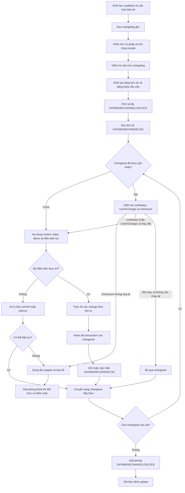

# Luồng xử lý từ đọc changelog đến ghi nhận thay đổi

Liquibase biến một tập changelog có thứ tự thành các thay đổi cơ sở dữ liệu có thể triển khai lặp lại và kiểm chứng. Khi chạy lệnh `update`, Liquibase đọc cấu hình kết nối, phân tích changelog, đối chiếu từng changeset với lịch sử trong cơ sở dữ liệu, áp dụng những thay đổi đủ điều kiện rồi ghi nhận kết quả vào `DATABASECHANGELOG`. `DATABASECHANGELOGLOCK` điều phối quyền triển khai để hai tiến trình Liquibase không cùng thực thi migration trên một cơ sở dữ liệu tại một thời điểm.

Bài này trình bày mô hình thực thi của `DATABASE_SCHEMA_MIGRATION_LIQUIBASE`: từ lúc Liquibase nạp changelog đến khi một changeset được đánh dấu đã chạy. Nội dung tập trung vào luồng thực tế, vai trò của precondition và checksum, ranh giới transaction, cách đọc lịch sử triển khai và những điểm cần kiểm soát khi tích hợp Spring Boot hoặc CI/CD.

## 1. Các thành phần tham gia vào một lần triển khai

| Thành phần | Vai trò trong luồng thực thi |
|---|---|
| Changelog | Tập tin khai báo thứ tự và nội dung thay đổi. Có thể viết bằng XML, YAML, JSON hoặc formatted SQL. |
| Changeset | Đơn vị thay đổi nhỏ nhất mà Liquibase nhận diện và ghi lịch sử. Mỗi changeset có `id`, `author` và định danh file changelog. |
| Change | Một thao tác cụ thể bên trong changeset, ví dụ tạo bảng, thêm cột, tạo index hoặc chạy SQL. |
| Preconditions | Điều kiện phải thỏa mãn trước khi Liquibase thực thi changeset hoặc changelog. |
| Checksum | Dấu kiểm tra nội dung changeset đã được Liquibase ghi nhận, dùng để phát hiện thay đổi định nghĩa sau triển khai. |
| `DATABASECHANGELOG` | Bảng lịch sử cho biết changeset nào đã được ghi nhận, thời điểm, thứ tự, checksum và kiểu thực thi. |
| `DATABASECHANGELOGLOCK` | Bảng khóa triển khai, ngăn nhiều tiến trình Liquibase đồng thời cập nhật cùng một cơ sở dữ liệu. |
| Database connection | Kết nối mà Liquibase dùng để đọc metadata, kiểm tra lịch sử, thực thi câu lệnh và ghi kết quả. |

Changelog mô tả trạng thái mong muốn thông qua các thay đổi có thứ tự. `DATABASECHANGELOG` lưu trạng thái thực thi mà Liquibase đã ghi nhận. Hai phần này bổ sung cho nhau: changelog là đầu vào khai báo, còn bảng lịch sử là căn cứ để quyết định changeset nào cần chạy trong lần triển khai hiện tại.

## 2. Toàn cảnh vòng đời của lệnh update

Luồng khái quát của một lần `update` như sau:



Sơ đồ mô tả logic nghiệp vụ. Một số thao tác khởi tạo metadata hoặc xác thực có thể được thư viện sắp xếp khác nhau tùy phiên bản, loại cơ sở dữ liệu và cách tích hợp. Điểm cốt lõi vẫn là Liquibase phải phối hợp changelog với lịch sử của chính database đích trước khi quyết định thực thi changeset.

## 3. Khởi tạo cấu hình và xác định changelog đầu vào

Trước khi đọc nội dung migration, Liquibase cần biết database đích, thông tin xác thực, schema mặc định và changelog gốc. Các thông tin này có thể đến từ tham số dòng lệnh, file cấu hình, biến môi trường hoặc cấu hình ứng dụng.

Ví dụ chạy từ CLI:

```bash
liquibase --url="jdbc:postgresql://localhost:5432/shop" --username="migration_user" --password="${DB_PASSWORD}" --changelog-file="db/changelog/db.changelog-master.yaml" update
```

Ví dụ cấu hình trong Spring Boot:

```yaml
spring:
  liquibase:
    change-log: classpath:/db/changelog/db.changelog-master.yaml
    enabled: true
    default-schema: public
    contexts: production
```

Ứng dụng thực tế nên lấy mật khẩu từ secret hoặc biến môi trường, không ghi mật khẩu thật vào file cấu hình được commit. `change-log` chỉ ra điểm bắt đầu của cây changelog. Từ file gốc, Liquibase có thể nạp thêm file bằng `include` hoặc `includeAll`; các file được mở rộng thành một luồng changeset theo thứ tự khai báo và quy tắc nạp.

Các định dạng XML, YAML, JSON và formatted SQL có cú pháp khác nhau nhưng cùng biểu diễn changelog, changeset, điều kiện và change. Parser chuyển nội dung thành mô hình nội bộ để Liquibase kiểm tra và thực thi. Nếu cú pháp sai, tham chiếu file không tồn tại hoặc khai báo không hợp lệ, quá trình có thể dừng trước khi bất kỳ changeset nào được áp dụng.

Thứ tự nạp có ý nghĩa. Ví dụ, tạo bảng phải đứng trước changeset tạo khóa ngoại tham chiếu đến bảng đó. Khi dùng `includeAll`, cần quy ước cách đặt tên file ổn định và không phụ thuộc vào thứ tự không được kiểm soát. Không nên đổi vị trí hoặc đổi tên changelog đã triển khai mà không hiểu ảnh hưởng đến định danh lịch sử.

## 4. Phân tích changelog và tạo danh sách changeset

Liquibase đọc changelog gốc, phân tích cú pháp, thay thế các tham số changelog và mở rộng các file được include. Kết quả là một tập changeset có thứ tự để xử lý. Mỗi changeset chứa metadata và một hoặc nhiều change.

Một changeset thường có các thuộc tính sau:

- `id`: mã định danh do nhóm phát triển đặt.
- `author`: tác giả hoặc nhóm sở hữu changeset.
- Đường dẫn changelog: thành phần thứ ba dùng để phân biệt changeset trong lịch sử.
- `changes`: danh sách thao tác cần thực hiện theo thứ tự.
- `preConditions`: điều kiện cần đánh giá trước khi chạy.
- `context`, `labels`, `dbms`: phạm vi hoặc bộ lọc áp dụng.
- `runInTransaction`, `runOnChange`, `runAlways`: điều khiển cách thực thi và nhận diện thay đổi.
- `rollback`: thao tác hoàn tác được khai báo tường minh nếu loại change không có rollback tự sinh phù hợp.

Ví dụ một changelog YAML:

```yaml
databaseChangeLog:
  - changeSet:
      id: 2026-11-19-001
      author: platform-team
      context: production
      preConditions:
        onFail: HALT
        not:
          tableExists:
            tableName: customer_profile
      changes:
        - createTable:
            tableName: customer_profile
            columns:
              - column:
                  name: id
                  type: BIGINT
                  autoIncrement: true
                  constraints:
                    primaryKey: true
                    nullable: false
              - column:
                  name: display_name
                  type: VARCHAR(160)
                  constraints:
                    nullable: false
      rollback:
        - dropTable:
            tableName: customer_profile
```

Trong ví dụ, Liquibase chỉ xét changeset khi context `production` được chọn. Precondition yêu cầu bảng `customer_profile` chưa tồn tại; nếu điều kiện thất bại, `onFail: HALT` làm lần cập nhật dừng lại. Nếu điều kiện đạt, Liquibase tạo bảng và ghi lịch sử sau khi changeset hoàn tất. Phần `rollback` mô tả cách xóa bảng khi thực hiện rollback tương ứng.

Việc phân tích changelog không có nghĩa là mọi changeset đều sẽ chạy. Liquibase còn phải đối chiếu lịch sử, bộ lọc, checksum và precondition với database đích.

## 5. Khởi tạo và sử dụng bảng lịch sử, bảng khóa

### 5.1. DATABASECHANGELOG

`DATABASECHANGELOG` là sổ ghi nhận changeset mà Liquibase đã xử lý trên database hiện tại. Nếu chưa tồn tại, Liquibase có thể tạo bảng này trong quá trình khởi tạo. Một bản ghi thường chứa các thông tin như:

| Cột | Ý nghĩa |
|---|---|
| `ID` | Giá trị `id` của changeset. |
| `AUTHOR` | Giá trị `author` của changeset. |
| `FILENAME` | Đường dẫn định danh changelog mà Liquibase sử dụng. |
| `DATEEXECUTED` | Thời điểm ghi nhận lần thực thi. |
| `ORDEREXECUTED` | Thứ tự thực thi được ghi nhận. |
| `EXECTYPE` | Kiểu kết quả, ví dụ `EXECUTED`, `RERAN` hoặc `MARK_RAN`. |
| `MD5SUM` | Checksum mà Liquibase lưu cho changeset. |
| `DESCRIPTION` | Mô tả ngắn về các change. |
| `COMMENTS` | Ghi chú của changeset nếu có. |
| `CONTEXTS`, `LABELS` | Context và label liên quan đến lần chạy. |
| `LIQUIBASE` | Phiên bản Liquibase đã ghi nhận lần chạy. |
| `DEPLOYMENT_ID` | Mã nhóm triển khai liên quan đến lần chạy. |

Định danh changeset được hình thành từ `id`, `author` và `filename`. Vì vậy, hai changeset có cùng `id` và `author` nhưng ở hai file được xem là hai định danh khác nhau. Nếu di chuyển file changelog sau khi đã triển khai, hãy giữ định danh đường dẫn ổn định bằng `logicalFilePath` khi phù hợp; nếu không, Liquibase có thể xem changeset đã di chuyển là một changeset mới.

`DATABASECHANGELOG` là lịch sử theo cách Liquibase nhận diện changeset, không phải bản sao đầy đủ của schema hiện tại và cũng không tự phát hiện mọi thay đổi được thực hiện thủ công ngoài Liquibase. Nếu một DBA tự thêm cột, lịch sử changeset không tự động phản ánh hành động đó. Cần kiểm tra trạng thái thực tế và đồng bộ baseline có chủ đích khi đưa một database đã tồn tại vào quản lý.

### 5.2. DATABASECHANGELOGLOCK

`DATABASECHANGELOGLOCK` thường có một dòng khóa dùng để phối hợp các lần triển khai. Liquibase kiểm tra và lấy khóa trước khi chạy phần cập nhật changelog. Nếu một tiến trình khác đang giữ khóa, tiến trình hiện tại chờ theo cấu hình hoặc kết thúc với thông báo không lấy được khóa.

Khóa giúp tránh hai pipeline hoặc hai instance ứng dụng đồng thời chạy cùng một bộ migration trên một database. Nó không thay thế khóa nghiệp vụ trong ứng dụng và không ngăn một công cụ SQL khác sửa schema trực tiếp.

Khi lệnh kết thúc, Liquibase giải phóng khóa. Nếu tiến trình bị dừng đột ngột và khóa còn tồn tại, cần xác minh không còn migration đang chạy trước khi dùng lệnh `releaseLocks` để giải phóng khóa. Không xóa hoặc sửa dòng khóa một cách tùy tiện trong lúc có triển khai hoạt động, vì điều đó có thể cho phép hai tiến trình cùng thay đổi schema.

## 6. Lấy khóa và đối chiếu từng changeset với lịch sử

Sau bước chuẩn bị, Liquibase lấy `DATABASECHANGELOGLOCK`, đọc các bản ghi trong `DATABASECHANGELOG` và duyệt danh sách changeset theo thứ tự. Với từng changeset, Liquibase xác định changeset đó đã được ghi nhận hay chưa bằng bộ ba `id`, `author`, `filename`.

| Trạng thái trong lịch sử | Cách Liquibase xử lý |
|---|---|
| Chưa có bản ghi | Changeset có thể được đưa vào danh sách thực thi nếu vượt qua các bộ lọc và precondition. |
| Đã có bản ghi, nội dung không đổi | Thông thường bỏ qua changeset đã chạy. |
| Đã có bản ghi, checksum thay đổi | Liquibase kiểm tra tính hợp lệ; thường báo lỗi validation nếu changeset đã triển khai bị sửa ngoài cơ chế cho phép. |
| Có `runOnChange: true` và checksum thay đổi | Liquibase chạy lại changeset theo chính sách `runOnChange`. |
| Có `runAlways: true` | Liquibase chạy changeset ở mỗi lần update đủ điều kiện, kể cả khi checksum không đổi. |

Changeset đã triển khai nên được xem là bất biến. Khi cần thay đổi schema, cách an toàn thông thường là thêm changeset mới. Sửa changeset cũ có thể làm checksum khác với giá trị trong `DATABASECHANGELOG`, khiến validation thất bại hoặc làm lịch sử khó kiểm toán. `runOnChange` phù hợp với một số đối tượng có thể tạo lại như view hoặc procedure, nhưng cần hiểu rõ tác động khi chạy lại. `runAlways` phù hợp với thao tác cần lặp có chủ đích; không nên dùng để che giấu một migration chỉ nên chạy một lần.

Checksum là dấu kiểm tra nội dung changeset mà Liquibase tính và lưu. Nó giúp nhận ra định nghĩa đã thay đổi sau khi được triển khai. Checksum không phải chữ ký bảo mật và không chứng minh schema thực tế vẫn đúng với changelog. `validCheckSum` có thể chấp nhận một checksum cụ thể trong tình huống được kiểm soát; `clearCheckSums` xóa checksum đã lưu để Liquibase tính lại ở lần chạy tiếp theo. Hai cơ chế này cần được dùng theo quyết định có ghi nhận, không phải như cách bỏ qua một lỗi validation chưa được điều tra.

## 7. Lọc changeset trước khi thực thi

Không phải mọi changeset trong cây changelog đều phù hợp với mọi lần triển khai. Liquibase có các bộ lọc để xác định phạm vi:

- **Context** phân loại changeset theo mục đích hoặc môi trường, ví dụ `development`, `test`, `production`.
- **Label** gắn nhãn để chọn một nhóm changeset theo chính sách phát hành.
- **DBMS** giới hạn changeset cho loại database cụ thể, ví dụ PostgreSQL hoặc Oracle.
- **Ignore hoặc các cơ chế lọc khác** có thể loại một changeset khỏi lần xử lý tùy cấu hình và phiên bản.

Ví dụ, changeset chỉ dành cho PostgreSQL không nên chạy trên MySQL. Changeset tạo dữ liệu mẫu có thể chỉ được bật ở môi trường kiểm thử. Context và label phải được truyền nhất quán từ CLI, file cấu hình hoặc Spring Boot; nếu cấu hình thiếu hoặc sai, một changeset cần thiết có thể bị bỏ qua hoặc một changeset chỉ dành cho môi trường thử nghiệm có thể được chọn nhầm.

Không nên dùng context để quản lý các nhánh schema khác nhau tùy tiện giữa môi trường. Trong quy trình thông thường, cùng một chuỗi migration được triển khai lần lượt lên các môi trường; context chỉ chọn những thay đổi có phạm vi đặc biệt đã được thiết kế rõ ràng.

## 8. Đánh giá precondition và quyết định chạy

Precondition là điều kiện kiểm tra database hoặc trạng thái triển khai trước khi chạy changeset. Các kiểm tra thường gặp gồm:

- Bảng hoặc cột đã tồn tại hay chưa.
- Một index, constraint hoặc view có tồn tại hay không.
- Database đang dùng có đúng loại hay không.
- Một truy vấn SQL có trả về kết quả mong đợi hay không.
- Một điều kiện tổng hợp có thỏa mãn hay không.

Precondition có thể đặt ở cấp changelog để bảo vệ cả luồng hoặc ở cấp changeset để bảo vệ một thay đổi cụ thể. Các thuộc tính `onFail` và `onError` quyết định cách xử lý khi điều kiện không đạt hoặc khi quá trình đánh giá điều kiện phát sinh lỗi. Những lựa chọn thường gặp là:

| Giá trị | Hành vi khái quát |
|---|---|
| `HALT` | Dừng lần triển khai và báo lỗi. |
| `WARN` | Ghi cảnh báo; tiếp tục theo ngữ nghĩa của precondition và cấp khai báo. |
| `CONTINUE` | Bỏ qua changeset hiện tại và có thể đánh giá lại ở lần update sau; thường dùng ở cấp changeset. |
| `MARK_RAN` | Không chạy các change nhưng ghi nhận changeset như đã chạy; thường dùng ở cấp changeset. |

Phạm vi giá trị được hỗ trợ có thể khác nhau giữa precondition cấp changelog và cấp changeset; hãy kiểm tra tài liệu của phiên bản Liquibase đang dùng trước khi chọn chính sách. Với thay đổi schema quan trọng, `HALT` thường dễ dự đoán hơn vì database không đạt điều kiện thì pipeline dừng để người vận hành điều tra.

`MARK_RAN` cần đặc biệt thận trọng. Nó chỉ phù hợp khi đã xác minh trạng thái database tương đương với kết quả mà changeset dự kiến tạo ra. Nếu đánh dấu một changeset đã chạy trong khi bảng hoặc constraint thực tế chưa tồn tại, những migration phía sau có thể thất bại hoặc ứng dụng có thể chạy trên schema không đúng.

Precondition cũng không thay thế kiểm tra dữ liệu toàn diện. Ví dụ, kiểm tra bảng tồn tại không chứng minh bảng có đủ cột, kiểu dữ liệu, index hay constraint cần thiết. Hãy chọn điều kiện phù hợp với bất biến mà migration cần bảo vệ.

## 9. Thực thi change và ranh giới transaction

Khi changeset đã vượt qua các bộ lọc và precondition, Liquibase chuyển từng change thành câu lệnh phù hợp với database đích rồi thực thi theo thứ tự khai báo. Một changeset có thể gồm nhiều change; các change trong cùng changeset tạo thành một đơn vị triển khai về mặt lịch sử.

Mặc định, `runInTransaction` là `true`. Liquibase cố gắng thực thi một changeset trong một transaction nếu database và loại câu lệnh hỗ trợ transaction. Khi toàn bộ change thành công, transaction được hoàn tất và Liquibase ghi nhận changeset. Nếu một change thất bại trong transaction được hỗ trợ, Liquibase có thể rollback phần thay đổi của changeset hiện tại. Các changeset đã hoàn tất trước đó thường đã được commit riêng và vẫn còn hiệu lực.

Không phải mọi database hay mọi lệnh DDL đều có cùng hành vi transaction. Một số thao tác DDL tự commit hoặc không thể rollback theo cách thông thường. Vì vậy, không nên giả định toàn bộ lệnh `update` là một transaction duy nhất có thể hoàn tác toàn bộ. Cần hiểu hành vi của database và câu lệnh cụ thể.

Đặt `runInTransaction: false` làm thay đổi ranh giới an toàn: nếu một câu lệnh giữa changeset thất bại, những câu lệnh trước đó có thể đã được commit trong khi changeset chưa được ghi nhận hoàn tất. Khi đó, lần chạy sau có thể gặp trạng thái dở dang. Chỉ tắt transaction khi có lý do kỹ thuật rõ ràng và đã thiết kế cách phục hồi.

Một lần update có thể áp dụng nhiều changeset theo thứ tự. Nếu changeset thứ ba thất bại, hai changeset đầu đã commit vẫn được ghi trong lịch sử; Liquibase thường dừng và báo lỗi tại changeset thứ ba. Người vận hành cần sửa nguyên nhân và xác định trạng thái database trước khi chạy lại, đặc biệt nếu changeset thất bại có DDL không transactional.

## 10. Ghi nhận kết quả vào DATABASECHANGELOG

Khi changeset thực thi thành công, Liquibase ghi nhận định danh và kết quả vào `DATABASECHANGELOG`. Với changeset được đánh dấu đã chạy mà không thực thi change, ví dụ qua `MARK_RAN`, lịch sử phản ánh kiểu thực thi tương ứng. Với changeset chạy lại do `runOnChange` hoặc `runAlways`, thông tin lịch sử được cập nhật theo kết quả của lần chạy.

Việc ghi lịch sử gắn chặt với trạng thái thực thi để Liquibase có thể quyết định ở lần sau. Trong trường hợp database hỗ trợ transaction phù hợp, thao tác migration và ghi lịch sử được phối hợp trong ranh giới transaction của changeset. Tuy nhiên, không nên suy rộng điều này thành cam kết nguyên tử cho mọi loại database và mọi lệnh DDL.

Các giá trị `EXECTYPE` thường gặp gồm:

- `EXECUTED`: changeset được thực thi thành công.
- `RERAN`: changeset được chạy lại, thường do `runOnChange` hoặc `runAlways`.
- `MARK_RAN`: changeset được ghi nhận là đã chạy dù các change không được thực thi.
- `SKIPPED`: changeset bị bỏ qua trong một số luồng xử lý.

Giá trị thực tế phụ thuộc vào đường đi thực thi và phiên bản. Khi điều tra, hãy kết hợp `EXECTYPE`, `MD5SUM`, `DATEEXECUTED`, `ORDEREXECUTED` với log triển khai và trạng thái schema, thay vì chỉ nhìn một cột đơn lẻ.

Sau khi xử lý hết danh sách changeset, Liquibase giải phóng `DATABASECHANGELOGLOCK` và kết thúc lệnh. Nếu có lỗi, lệnh trả trạng thái thất bại; cần đọc changeset gây lỗi và kiểm tra những changeset nào đã được ghi nhận trước đó.

## 11. Những lệnh hỗ trợ quan sát và điều khiển vòng đời

| Lệnh | Mục đích | Ảnh hưởng chính |
|---|---|---|
| `update` | Áp dụng changeset chưa chạy hoặc cần chạy lại. | Thay đổi database và cập nhật lịch sử. |
| `updateSQL` | Sinh SQL dự kiến cho lần update. | Dùng để review; không thực thi migration và không ghi nhận changeset như một lần update thực tế. |
| `status` | Liệt kê changeset chưa được triển khai. | Quan sát trạng thái, không áp dụng thay đổi. |
| `validate` | Kiểm tra changelog và các vấn đề validation như checksum. | Phát hiện lỗi trước khi triển khai; không áp dụng changeset. |
| `history` | Xem lịch sử triển khai. | Hỗ trợ kiểm toán và điều tra. |
| `changelogSync` | Đánh dấu các changeset được chọn là đã chạy mà không thực thi change. | Cập nhật lịch sử; dùng cho baseline đã được xác minh. |
| `clearCheckSums` | Xóa checksum đã lưu để tính lại ở lần chạy tiếp theo. | Thay đổi metadata checksum; không sửa schema. |
| `releaseLocks` | Giải phóng khóa Liquibase còn tồn tại. | Thay đổi trạng thái khóa; chỉ dùng sau khi xác minh không còn migration hoạt động. |
| `rollback` | Hoàn tác các changeset theo tag, số lượng hoặc mốc được hỗ trợ. | Thực thi rollback và cập nhật lịch sử. |

`updateSQL` là bước hữu ích trong CI/CD: nhóm có thể xem SQL mà Liquibase dự định chạy, đánh giá lock, thời gian chạy và tác động lên dữ liệu trước khi cấp quyền triển khai. Tuy vậy, SQL được sinh ra không đảm bảo database thực tế không đổi từ thời điểm review đến lúc chạy; pipeline vẫn cần chạy trên đúng phiên bản changelog và đúng database đích.

`changelogSync` thường được dùng khi đưa một database đã có schema vào quản lý bằng Liquibase. Chỉ dùng sau khi đã so sánh schema hiện tại với kết quả mà các changeset được chọn mô tả. Nếu đồng bộ lịch sử mà không xác minh, Liquibase có thể bỏ qua migration cần thiết trong các lần update sau.

## 12. Rollback trong mô hình thực thi

Rollback là một luồng thực thi riêng dựa trên thông tin changeset và khả năng hoàn tác. Một số change có rollback tự sinh; các thao tác khác cần khai báo phần `rollback` tường minh. Với SQL tùy chỉnh hoặc thao tác biến đổi dữ liệu phức tạp, hãy định nghĩa rollback có chủ đích hoặc ghi rõ vì sao không thể hoàn tác tự động.

Ví dụ khai báo rollback:

```yaml
- changeSet:
    id: 2026-11-19-002
    author: platform-team
    changes:
      - addColumn:
          tableName: customer_profile
          columns:
            - column:
                name: preferred_language
                type: VARCHAR(12)
    rollback:
      - dropColumn:
          tableName: customer_profile
          columnName: preferred_language
```

Rollback xóa hoặc cập nhật các bản ghi lịch sử tương ứng với những changeset được hoàn tác. Nó không phải nút khôi phục dữ liệu thần kỳ: nếu migration đã xóa dữ liệu, rollback chỉ khôi phục được dữ liệu nếu phần rollback hoặc chiến lược backup đã giữ được thông tin cần thiết. Với thay đổi phá hủy dữ liệu, cần backup, kiểm tra phục hồi và kế hoạch tương thích ứng dụng trước khi triển khai.

Trong triển khai liên tục, chiến lược expand-and-contract thường giảm rủi ro hơn rollback tức thì: trước tiên thêm cấu trúc tương thích ngược, triển khai ứng dụng có thể dùng cấu trúc mới, chuyển đổi dữ liệu, rồi mới xóa cấu trúc cũ ở một đợt phát hành sau. Liquibase thực thi từng bước migration; việc phối hợp phiên bản ứng dụng vẫn là trách nhiệm của quy trình phát hành.

## 13. Tích hợp với Spring Boot và CI/CD

### 13.1. Spring Boot

Khi bật Liquibase trong Spring Boot, auto-configuration tạo thành phần chạy migration dựa trên `DataSource` và cấu hình `spring.liquibase`. Liquibase thường chạy trong quá trình khởi tạo ứng dụng, trước khi ứng dụng hoàn tất việc sẵn sàng phục vụ. Điều này giúp môi trường đơn giản tự áp dụng migration khi khởi động.

Với hệ thống nhiều instance, cần chú ý mọi instance có thể cùng khởi động. `DATABASECHANGELOGLOCK` giúp điều phối các lần chạy trên cùng database, nhưng migration dài vẫn có thể làm chậm thời gian khởi động hoặc khiến instance chờ khóa. Ở hệ thống có quy trình phát hành riêng, thường nên chạy migration bằng một bước triển khai có kiểm soát và cấu hình ứng dụng để không tự chạy migration ngoài ý muốn.

### 13.2. CI/CD

Một pipeline migration có thể gồm các bước:

1. Lấy changelog từ đúng commit hoặc artifact sẽ phát hành.
2. Kiểm tra cấu hình kết nối và quyền của tài khoản migration.
3. Chạy `validate` và các kiểm tra chất lượng changelog.
4. Sinh `updateSQL` để review các thay đổi quan trọng.
5. Sao lưu hoặc xác nhận phương án phục hồi theo chính sách của hệ thống.
6. Chạy `update` một lần trên database đích.
7. Kiểm tra kết quả, lịch sử trong `DATABASECHANGELOG` và trạng thái ứng dụng.

Tài khoản Liquibase chỉ nên có quyền cần thiết để thực hiện migration. Tài khoản ứng dụng runtime có thể dùng quyền hẹp hơn. Không để nhiều pipeline không phối hợp cùng chạy migration trên một database; lock bảo vệ tính tuần tự, còn pipeline nên có cơ chế kiểm soát phát hành để tránh chờ khóa kéo dài và triển khai sai phiên bản.

Mỗi môi trường nên có lịch sử Liquibase riêng trong database của môi trường đó. Cùng một changelog đã kiểm soát phiên bản được triển khai lần lượt lên development, staging và production; khác biệt cấu hình kết nối hoặc tham số môi trường không nên làm thay đổi định nghĩa của changeset đã triển khai.

## 14. Ví dụ điều tra một lần update thất bại

Giả sử pipeline báo lỗi khi chạy changeset `add-customer-index`. Có thể điều tra theo trình tự sau:

1. Đọc log để xác định database, changelog, changeset và câu lệnh gây lỗi.
2. Kiểm tra `DATABASECHANGELOG` để biết các changeset trước đó đã được ghi nhận chưa.
3. Kiểm tra `DATABASECHANGELOGLOCK` để xác định còn tiến trình giữ khóa hay không.
4. Kiểm tra schema thực tế: index đã tồn tại một phần chưa, bảng có đúng cấu trúc không, transaction có rollback được không.
5. Xác định lỗi thuộc cấu hình kết nối, precondition, checksum, quyền database, xung đột dữ liệu hay câu lệnh SQL.
6. Sửa nguyên nhân bằng changeset mới hoặc một kế hoạch phục hồi có kiểm soát; không sửa changeset cũ đã triển khai chỉ để làm biến mất lỗi checksum.
7. Chạy lại validation và review SQL, sau đó triển khai lại theo quy trình.

Nếu tiến trình bị dừng giữa lúc chạy changeset không transactional, có thể database đã thay đổi một phần nhưng chưa có bản ghi hoàn tất tương ứng trong `DATABASECHANGELOG`. Không nên chạy lại ngay hoặc tự chèn dòng lịch sử. Trước tiên phải đối chiếu từng thao tác đã thành công, đưa schema về trạng thái xác định, rồi mới quyết định tiếp tục, sửa chữa hay đồng bộ lịch sử.

## 15. Các nguyên tắc vận hành cần giữ

- Xem changeset đã triển khai là bất biến; thêm changeset mới cho thay đổi tiếp theo.
- Giữ ổn định `id`, `author` và đường dẫn định danh changelog; cân nhắc `logicalFilePath` khi tổ chức lại file.
- Dùng precondition để bảo vệ giả định quan trọng và chọn `onFail`/`onError` theo mức độ an toàn mong muốn.
- Dùng context, label và dbms có chủ đích; xác minh cấu hình bộ lọc của từng môi trường.
- Hiểu ranh giới transaction của database trước khi đặt `runInTransaction: false` hoặc thực hiện DDL đặc biệt.
- Review SQL được sinh ra và có kế hoạch backup/rollback cho migration có tác động lớn.
- Không dùng `MARK_RAN`, `changelogSync` hoặc `clearCheckSums` để che giấu trạng thái database chưa được xác minh.
- Chỉ giải phóng lock còn sót sau khi chắc chắn không có tiến trình Liquibase đang hoạt động.
- Đối chiếu log, `DATABASECHANGELOG` và schema thực tế khi điều tra sự cố.

## 16. Tự kiểm tra mức độ hiểu

1. Vì sao Liquibase cần cả changelog và `DATABASECHANGELOG` để quyết định changeset nào cần chạy?
2. Bộ ba nào xác định một changeset trong lịch sử, và điều gì có thể xảy ra khi đổi đường dẫn file changelog?
3. Checksum giúp phát hiện điều gì? Vì sao checksum không chứng minh schema thực tế không bị sửa thủ công?
4. `runOnChange` khác `runAlways` ở điều kiện chạy lại như thế nào?
5. Khi precondition thất bại, `HALT`, `CONTINUE` và `MARK_RAN` dẫn đến các kết quả vận hành khác nhau ra sao?
6. Vì sao một changeset thất bại với `runInTransaction: false` có thể để lại trạng thái dở dang?
7. `DATABASECHANGELOGLOCK` bảo vệ điều gì, và tại sao không nên giải phóng lock khi chưa kiểm tra tiến trình đang chạy?
8. Vì sao `updateSQL` hữu ích trong CI/CD nhưng không thay thế việc kiểm tra database tại thời điểm triển khai?
9. Khi rollback một changeset đã xóa dữ liệu, cần chuẩn bị gì ngoài khai báo rollback?
10. Trong ứng dụng Spring Boot có nhiều instance, nên tổ chức migration thế nào để tránh khởi động đồng thời gây chờ đợi hoặc triển khai ngoài kế hoạch?

Khi nắm được luồng này, người vận hành có thể giải thích một changeset được chọn chạy vì lý do gì, Liquibase đã kiểm tra những gì, thay đổi được thực thi trong ranh giới nào và bằng chứng nào được ghi lại sau triển khai. Đó là nền tảng để quản lý migration có thể lặp lại, kiểm toán và phối hợp an toàn giữa các môi trường.
