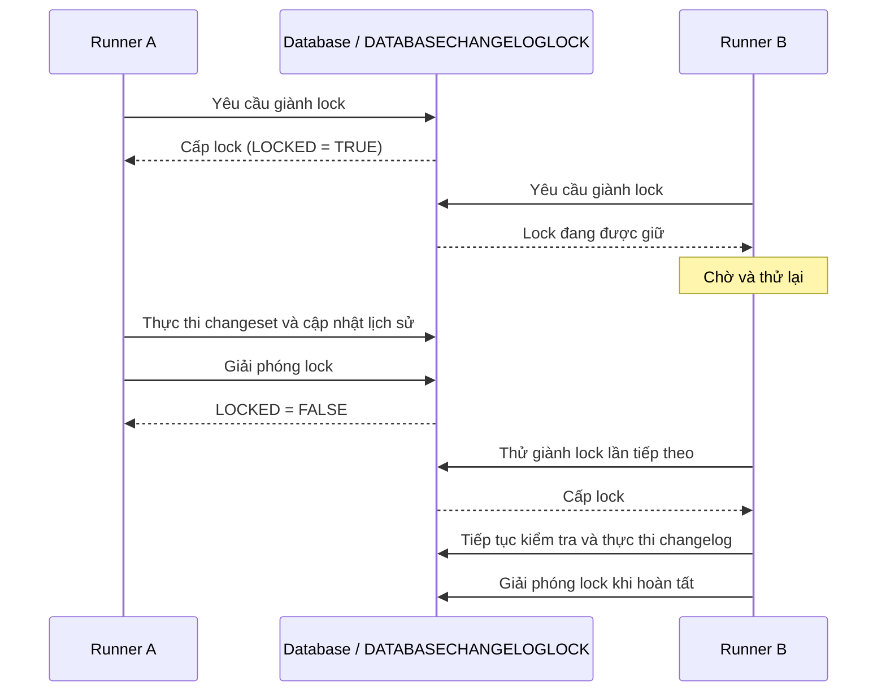

# Vai trò và cơ chế phối hợp của `DATABASECHANGELOGLOCK`

## 1. Vị trí của khóa trong mô hình thực thi Liquibase

Module `DATABASE_SCHEMA_MIGRATION_LIQUIBASE` hướng dẫn quản lý thay đổi schema và dữ liệu bằng Liquibase: tổ chức changelog và changeset, kiểm soát điều kiện chạy bằng precondition, theo dõi checksum và lịch sử triển khai, rollback thay đổi, phối hợp nhiều môi trường, đồng thời tích hợp migration vào Spring Boot hoặc CI/CD. Trong mô hình đó, `DATABASECHANGELOGLOCK` giải quyết một vấn đề vận hành cụ thể: **điều phối các tiến trình Liquibase cùng thao tác trên một bộ bảng theo dõi migration để chúng không thực thi migration đồng thời**.

Một hệ thống có thể khởi chạy Liquibase từ nhiều nơi: pipeline triển khai, lệnh CLI của quản trị viên, một ứng dụng Spring Boot, hoặc nhiều replica ứng dụng cùng khởi động. Nếu hai tiến trình cùng đọc trạng thái migration rồi đồng thời chạy changeset, chúng có thể tranh chấp DDL, ghi đè trạng thái hoặc khiến tiến trình còn lại gặp lỗi do cấu trúc cơ sở dữ liệu đang thay đổi. Liquibase dùng bảng `DATABASECHANGELOGLOCK` làm điểm đồng bộ chung trong cơ sở dữ liệu đích.

Tên bảng mặc định thường là `DATABASECHANGELOGLOCK`. Liquibase cho phép cấu hình tên bảng và schema chứa các bảng metadata; vì vậy cần xác định đúng vị trí thực tế của bảng trong từng hệ thống. Khóa chỉ phối hợp các tiến trình cùng sử dụng một bảng lock đó.

## 2. Phân biệt `DATABASECHANGELOG` và `DATABASECHANGELOGLOCK`

Hai bảng thường xuất hiện cùng nhau nhưng có trách nhiệm khác nhau:

| Thành phần | Trách nhiệm | Câu hỏi được trả lời |
|---|---|---|
| `DATABASECHANGELOG` | Lưu lịch sử các changeset Liquibase đã ghi nhận là được triển khai, cùng thông tin nhận diện và checksum của chúng | Changeset nào đã chạy trên cơ sở dữ liệu này? |
| `DATABASECHANGELOGLOCK` | Lưu trạng thái khóa dùng để điều phối tiến trình Liquibase | Hiện có tiến trình Liquibase nào đang giữ quyền chạy thao tác cần khóa không? |

`DATABASECHANGELOG` không phải cơ chế khóa. Nó giúp Liquibase xác định changeset nào đã được áp dụng và đối chiếu checksum để phát hiện thay đổi ngoài dự kiến. `DATABASECHANGELOGLOCK` cũng không thay thế lịch sử triển khai: bảng này không lưu danh sách changeset đã chạy và không chứng minh schema đang ở phiên bản nào.

Có thể hình dung hai bảng như hai phần bổ sung cho nhau: một bảng ghi nhận kết quả migration, bảng còn lại điều phối quyền thực thi migration. Khi một tiến trình có được lock, nó mới tiếp tục thao tác theo changelog; sau khi hoàn tất, lịch sử changeset được cập nhật theo quy tắc của Liquibase và lock được giải phóng.

## 3. Cấu trúc và ý nghĩa các cột

Một bảng `DATABASECHANGELOGLOCK` mặc định thường có một bản ghi điều khiển, với `ID = 1`:

| Cột | Ý nghĩa |
|---|---|
| `ID` | Khóa chính của bản ghi lock. Bản ghi điều khiển mặc định có giá trị `1`. |
| `LOCKED` | Trạng thái khóa. `TRUE` nghĩa là một tiến trình đã giữ lock; `FALSE` nghĩa là lock đang rảnh. |
| `LOCKGRANTED` | Thời điểm lock được cấp gần nhất. Giá trị này hỗ trợ điều tra lock tồn tại lâu bất thường. |
| `LOCKEDBY` | Thông tin nhận diện tiến trình hoặc máy đang giữ lock, thường giúp tìm runner, host hay pod liên quan. |

Kiểu dữ liệu và cách viết tên cột có thể khác theo hệ quản trị cơ sở dữ liệu hoặc phiên bản Liquibase. Không nên dựa vào một câu lệnh tạo bảng cố định cho mọi DBMS. Liquibase chịu trách nhiệm tạo và khởi tạo bảng khi cần, theo dialect của cơ sở dữ liệu.

Trong trạng thái bình thường, bản ghi `ID = 1` có `LOCKED = FALSE`; thông tin thời điểm và chủ sở hữu lock được xóa hoặc đặt về giá trị rỗng theo cách triển khai của Liquibase. Khi một tiến trình giữ lock, `LOCKED` chuyển thành `TRUE`, còn `LOCKGRANTED` và `LOCKEDBY` giúp nhận biết lần cấp lock và chủ sở hữu hiện tại.

Không xóa bản ghi điều khiển hoặc tự ý thêm nhiều bản ghi vào bảng này. Bản ghi đơn là điểm đồng bộ mà các tiến trình Liquibase cùng kỳ vọng sử dụng. Sửa cấu trúc hoặc dữ liệu của bảng bằng tay có thể làm hỏng cơ chế phối hợp.

## 4. Cách Liquibase giành, giữ và nhả lock

### 4.1. Chuẩn bị bảng lock

Khi cần thực thi thao tác được bảo vệ, Liquibase kiểm tra bảng lock và bản ghi điều khiển. Nếu đây là lần chạy đầu tiên và bảng chưa tồn tại, Liquibase có thể tạo bảng cùng bản ghi ban đầu theo cấu hình schema và tên bảng metadata.

Vị trí bảng rất quan trọng. Nếu một nhóm tiến trình dùng `DATABASECHANGELOGLOCK` trong schema `migration_meta`, nhưng một tiến trình khác trỏ đến bảng cùng tên trong schema khác, hai nhóm đó thực tế đang dùng hai khóa độc lập. Tên bảng giống nhau không đủ để tạo ra phối hợp; chúng phải cùng trỏ đến một đối tượng bảng trong cơ sở dữ liệu đích.

### 4.2. Giành quyền giữ lock

Về mặt logic, tiến trình yêu cầu lock chỉ có thể chuyển bản ghi từ trạng thái chưa khóa sang đã khóa khi bản ghi vẫn đang rảnh. Thao tác nhận lock phải được cơ sở dữ liệu thực hiện theo cách bảo đảm tính nguyên tử, để hai tiến trình tranh chấp không cùng nhận mình là chủ sở hữu.

Pseudocode dưới đây minh họa điều kiện giành lock; đây là mô hình khái niệm, không phải câu SQL dùng nguyên xi cho mọi DBMS hoặc mọi phiên bản Liquibase:

```sql
UPDATE DATABASECHANGELOGLOCK
SET LOCKED = TRUE,
    LOCKGRANTED = CURRENT_TIMESTAMP,
    LOCKEDBY = :current_runner
WHERE ID = 1
  AND LOCKED = FALSE;
```

Nếu thao tác cập nhật giành được bản ghi, tiến trình trở thành chủ sở hữu lock. Nếu không có bản ghi nào được cập nhật vì lock đang được giữ, tiến trình phải chờ và thử lại theo cơ chế polling của Liquibase. Cơ sở dữ liệu là nơi phân xử quyền sở hữu; một biến khóa trong bộ nhớ của JVM không thể điều phối các runner nằm ở máy khác nhau.

### 4.3. Giữ lock trong lúc thực thi

Sau khi giành được lock, tiến trình tiếp tục xử lý changelog và các changeset thuộc command cần khóa, chẳng hạn một lượt `update` hoặc `rollback`. Lock được giữ trong phạm vi thực thi của command đó và được giải phóng khi command kết thúc theo luồng xử lý bình thường. Nó không phải khóa chỉ tồn tại trong một JVM và cũng không phải khóa ứng dụng được giữ suốt thời gian ứng dụng chạy.

Việc giữ lock ở cấp bảng metadata giúp các tiến trình Liquibase cùng sử dụng bảng đó được tuần tự hóa. Một tiến trình phải chờ tiến trình đang giữ lock kết thúc trước khi bắt đầu phần thực thi được bảo vệ. Điều này giảm nguy cơ hai lượt migration đồng thời sửa cùng schema hoặc cùng lịch sử changeset.

Không phải mọi command Liquibase đều nhất thiết cần lấy lock; cơ chế được dùng bởi những thao tác cần bảo vệ trạng thái hoặc thực thi migration. Khi thiết kế quy trình, hãy dựa trên hành vi của command và phiên bản Liquibase thực tế thay vì giả định mọi lệnh đọc thông tin đều khóa cơ sở dữ liệu.

### 4.4. Giải phóng lock

Khi command hoàn tất hoặc xử lý lỗi theo luồng bình thường, Liquibase thực hiện giải phóng lock. Bản ghi điều khiển được đưa về trạng thái chưa khóa để tiến trình tiếp theo có thể tiếp tục.

Nếu tiến trình bị kết thúc đột ngột, máy bị mất kết nối hoặc container bị dừng trước khi đoạn giải phóng được chạy, bản ghi có thể vẫn giữ `LOCKED = TRUE`. Khi đó lock trở thành lock tồn đọng (stale lock). Đây là trạng thái cần điều tra; không thể kết luận chỉ từ việc lock tồn tại lâu rằng tiến trình chắc chắn đã chết.

`LOCKGRANTED` là thông tin chẩn đoán, không nên xem nó như thời hạn thuê tự hết hạn. Không nên tự động mở khóa chỉ vì timestamp cũ: migration có thể vẫn đang chạy lâu do DDL, dữ liệu lớn hoặc hệ thống chậm.

## 5. Cách nhiều tiến trình phối hợp

Giả sử hai runner A và B cùng chạy `liquibase update` trên một cơ sở dữ liệu và cùng dùng một bảng `DATABASECHANGELOGLOCK`:



Khi B lấy được lock, Liquibase vẫn kiểm tra `DATABASECHANGELOG` để xác định changeset nào đã được áp dụng. Vì vậy, việc B chạy sau A không đồng nghĩa B sẽ chạy lại toàn bộ changeset mà A vừa hoàn thành. Lock tuần tự hóa quyền thực thi; lịch sử trong `DATABASECHANGELOG` quyết định changeset nào còn cần chạy.

Nếu A kết thúc thành công, B thường tiếp tục với trạng thái mới nhất. Nếu A thất bại giữa chừng, B có thể nhận lock sau khi A giải phóng hoặc sau khi người vận hành xử lý lock tồn đọng. Trước khi cho B chạy tiếp, cần xác minh trạng thái thực tế của schema và lịch sử migration, đặc biệt với changeset có thao tác không thể rollback tự động.

### Phạm vi hiệu lực của lock

`DATABASECHANGELOGLOCK` chỉ phối hợp các tiến trình dùng chung đúng bảng lock. Cần phân biệt các trường hợp:

- **Cùng database, cùng schema metadata và cùng bảng lock:** các tiến trình Liquibase phối hợp qua cùng một bản ghi.
- **Cùng database nhưng khác schema hoặc khác tên bảng lock:** có thể hình thành các nhóm lock độc lập và không ngăn nhau chạy đồng thời.
- **Các môi trường dùng database riêng:** mỗi database có bảng lock riêng; migration ở development không giữ lock của staging hoặc production.
- **Một công cụ khác hoặc người dùng chạy SQL trực tiếp:** không tự động tham gia cơ chế lock của Liquibase. Bảng này không khóa mọi DDL/DML của database.

Do đó, lock không thay thế quy trình kiểm soát thay đổi schema. Những công cụ migration khác, thao tác DBA và thay đổi thủ công vẫn cần được điều phối trong quy trình triển khai.

## 6. Phối hợp giữa môi trường, Spring Boot và CI/CD

### 6.1. Nhiều môi trường

Mỗi môi trường thường có database đích riêng và do đó có trạng thái `DATABASECHANGELOG` cùng `DATABASECHANGELOGLOCK` riêng. Một lượt migration trên staging không cần chờ lock của production nếu hai môi trường thực sự dùng hai database độc lập.

Trong cùng một môi trường, mọi runner có thể cùng triển khai vào database đó phải thống nhất cấu hình kết nối, catalog/schema chứa metadata, tên bảng lịch sử và tên bảng lock. Đặc biệt, hãy kiểm tra cấu hình `liquibaseSchemaName` hoặc cấu hình tương đương khi bảng metadata được đặt ở schema riêng. Nếu mỗi pipeline vô tình tạo một bảng lock ở vị trí khác nhau, cơ chế đồng bộ sẽ mất tác dụng giữa các pipeline đó.

### 6.2. Spring Boot với nhiều replica

Spring Boot có thể tự chạy Liquibase khi ứng dụng khởi động. Trong một triển khai có nhiều replica, nhiều instance có thể cùng khởi động và cùng yêu cầu migration. Nếu tất cả dùng chung database và bảng lock, Liquibase sẽ tuần tự hóa các lượt thực thi cần khóa; các instance còn lại có thể phải chờ.

Ví dụ cấu hình khởi chạy migration từ Spring Boot:

```yaml
spring:
  liquibase:
    enabled: true
    change-log: classpath:/db/changelog/db.changelog-master.yaml
    liquibase-schema: migration_meta
```

`liquibase-schema` ở ví dụ trên biểu thị schema chứa metadata Liquibase; tên schema phải tồn tại hoặc được cấp quyền tạo theo thiết kế của hệ thống. Cần bảo đảm mọi instance sử dụng cùng cấu hình metadata. Nếu metadata được đặt ở schema mặc định, hãy thống nhất schema mặc định giữa các instance.

Với hệ thống có nhiều replica, một lựa chọn vận hành thường dễ kiểm soát hơn là chạy migration trong một bước triển khai riêng trước khi rollout ứng dụng. Nếu vẫn bật migration khi startup, cần tính đến thời gian chờ lock, timeout khởi động, readiness probe và khả năng nhiều instance cùng khởi động lại sau một sự cố.

### 6.3. CI/CD và các runner song song

Pipeline có thể khởi chạy migration từ nhiều job hoặc nhiều lần triển khai gần nhau. Để lock thực sự điều phối được, các job cùng target một database phải dùng chung bảng lock. Có thể cho phép các job chờ nhau, hoặc thiết kế pipeline chỉ có một bước migration chạy trước khi triển khai các phiên bản ứng dụng.

Một quy trình CI/CD nên xác định rõ:

1. Database đích và thông tin xác thực của từng môi trường.
2. Schema chứa `DATABASECHANGELOG` và `DATABASECHANGELOGLOCK`.
3. Changelog gốc, contexts/labels và các tham số cần thiết để chọn changeset.
4. Thời gian chờ lock phù hợp với thời lượng migration dự kiến.
5. Cách ghi log runner, pipeline/job và môi trường để tra cứu giá trị `LOCKEDBY`.
6. Người hoặc quy trình chịu trách nhiệm xử lý lock tồn đọng và xác minh schema sau sự cố.

Liquibase có tùy chọn cấu hình thời gian chờ lock, thường được biểu diễn bằng `changelogLockWaitTimeInMinutes` hoặc tham số CLI tương ứng `--changelog-lock-wait-time-in-minutes` tùy cách cấu hình. Tăng thời gian chờ chỉ giúp runner chờ lâu hơn; nó không sửa được tiến trình đang giữ lock bị treo và không tự giải phóng lock.

## 7. Kiểm tra và xử lý lock đang bị giữ

Khi một lệnh Liquibase báo đang chờ lock, trước tiên cần xác định lock có thuộc về một migration đang chạy hợp lệ hay không.

### 7.1. Đọc trạng thái lock

Có thể truy vấn bảng metadata bằng câu SQL đọc sau, thay tên schema nếu hệ thống đặt bảng ở schema riêng:

```sql
SELECT ID, LOCKED, LOCKGRANTED, LOCKEDBY
FROM migration_meta.DATABASECHANGELOGLOCK;
```

Tên schema và cách định danh bảng phải điều chỉnh theo DBMS. Trên một số hệ thống, cần dùng dấu nháy hoặc quy tắc viết hoa/viết thường phù hợp với cách bảng được tạo.

Diễn giải kết quả:

- `LOCKED = FALSE`: bản ghi không cho thấy một tiến trình đang giữ lock; nếu runner vẫn báo chờ, hãy kiểm tra đúng database, schema và tên bảng mà runner đang sử dụng.
- `LOCKED = TRUE`: đọc `LOCKGRANTED` để biết thời điểm cấp lock và `LOCKEDBY` để tìm tiến trình liên quan.
- Không có bảng hoặc không có bản ghi điều khiển: kiểm tra quyền truy cập, cấu hình schema metadata và trạng thái khởi tạo Liquibase; không tự suy luận rằng database chưa từng chạy migration.

### 7.2. Xác minh chủ sở hữu trước khi mở khóa

Đối chiếu `LOCKEDBY` và `LOCKGRANTED` với log của Liquibase, log ứng dụng, lịch sử pipeline, pod/container và phiên kết nối đang hoạt động trong database. Cần trả lời được các câu hỏi:

- Pipeline hoặc instance nào đã khởi chạy migration?
- Tiến trình đó còn sống và còn thực thi SQL không?
- Migration đang chạy lâu vì dữ liệu lớn, DDL chậm hay đang bị kẹt?
- Có thay đổi nào đã được ghi vào `DATABASECHANGELOG` hoặc schema trước khi tiến trình dừng không?

Nếu tiến trình vẫn hoạt động, hãy để nó hoàn tất hoặc xử lý nguyên nhân gây chậm theo quy trình vận hành. Không chạy lệnh giải phóng lock khi chủ sở hữu vẫn đang thực thi migration: tiến trình khác có thể giành lock và chạy đồng thời, phá vỡ mục đích đồng bộ.

### 7.3. Giải phóng lock tồn đọng

Chỉ khi đã xác minh tiến trình giữ lock không còn chạy và không còn thao tác migration đang diễn ra, người vận hành mới nên giải phóng lock. Liquibase cung cấp command `release-locks` để thực hiện việc này bằng chính cấu hình kết nối và metadata của môi trường:

```bash
liquibase \
  --url="jdbc:..." \
  --username="..." \
  --password="..." \
  --liquibase-schema-name=migration_meta \
  release-locks
```

Đây là khung lệnh minh họa; thay URL, thông tin xác thực và schema bằng cấu hình thực tế, đồng thời dùng đúng cách truyền secrets của hệ thống. Có thể dùng cùng file cấu hình hoặc cơ chế cấp tham số mà pipeline đang sử dụng để tránh giải phóng nhầm bảng lock ở database khác.

Sau khi chạy, đọc lại `DATABASECHANGELOGLOCK` để xác nhận lock đã được giải phóng. Nếu lock vẫn còn, kiểm tra lại database/schema đích, quyền cập nhật metadata và log của command. Không lặp lệnh một cách mù quáng khi chưa hiểu nguyên nhân.

### 7.4. Kiểm tra trạng thái migration trước khi chạy lại

Giải phóng lock chỉ khôi phục khả năng giành quyền thực thi; nó không sửa trạng thái schema hoặc hoàn tác changeset bị gián đoạn. Trước khi chạy lại `update`, hãy:

1. Kiểm tra các bản ghi mới nhất trong `DATABASECHANGELOG` và đối chiếu với changeset dự kiến.
2. Kiểm tra các đối tượng schema và dữ liệu mà changeset cuối cùng đã tác động.
3. Xác định DBMS có rollback được transaction DDL đó hay không và changeset có dùng `runInTransaction: false` hay không.
4. Nếu thao tác bị thực hiện một phần nhưng chưa được ghi nhận hoàn tất, lập phương án khôi phục hoặc sửa trạng thái có kiểm soát trước khi chạy lại.
5. Sau khi xác minh, chạy lại command trong đúng môi trường và theo dõi log cho đến khi hoàn tất.

Đặc biệt với changeset chứa nhiều thao tác không thể rollback nguyên tử, việc mở khóa rồi chạy lại ngay có thể khiến câu lệnh gặp đối tượng đã tồn tại, dữ liệu đã được biến đổi một phần hoặc điều kiện precondition không còn đúng. Cần xử lý trạng thái thực tế trước.

Không nên cập nhật thủ công `LOCKED = FALSE`, xóa hàng hoặc xóa cả bảng để xử lý thông thường. Những thao tác đó bỏ qua cơ chế của Liquibase, dễ làm sai metadata và có thể khiến các runner không còn phối hợp nhất quán. Chỉ cân nhắc can thiệp SQL trực tiếp trong quy trình khắc phục sự cố có kiểm soát, sau khi đã hiểu rõ phiên bản, cấu trúc bảng và trạng thái tiến trình.

## 8. Những hiểu nhầm thường gặp

| Hiểu nhầm | Cách hiểu chính xác |
|---|---|
| Có `DATABASECHANGELOGLOCK` nghĩa là mọi truy vấn vào database đều bị khóa | Lock điều phối các tiến trình Liquibase dùng chung bảng lock; nó không chặn toàn bộ truy vấn ứng dụng hoặc SQL chạy trực tiếp. |
| Lock cũ tự hết hạn theo `LOCKGRANTED` | Timestamp phục vụ điều tra. Không được coi nó là TTL để tự động mở khóa một migration có thể vẫn đang chạy. |
| Hai tiến trình cùng database luôn được đồng bộ | Chúng chỉ được đồng bộ nếu cùng sử dụng đúng một bảng lock. Khác schema hoặc tên bảng có thể tạo hai miền khóa riêng. |
| Xóa lock là đủ để migration tiếp tục an toàn | Còn phải kiểm tra `DATABASECHANGELOG` và schema vì command trước có thể đã dừng giữa chừng. |
| Lock thay thế `DATABASECHANGELOG` | Lock chỉ điều phối thực thi; lịch sử changeset vẫn do `DATABASECHANGELOG` quản lý. |
| Tăng thời gian chờ sẽ xử lý được lock bị treo | Tăng thời gian chờ chỉ kéo dài thời gian polling của runner đang đợi. Cần điều tra và xử lý chủ sở hữu lock. |

## 9. Tình huống vận hành mẫu

**Tình huống:** Hai pod Spring Boot khởi động gần như cùng lúc. Cả hai đều bật Liquibase và dùng chung database `orders`, schema metadata `migration_meta`.

1. Pod A giành được bản ghi `ID = 1`, đặt `LOCKED = TRUE` và bắt đầu thực thi changelog.
2. Pod B kiểm tra cùng bảng, thấy lock đang được giữ nên chờ theo cấu hình polling.
3. Pod A hoàn tất changeset và giải phóng lock.
4. Pod B giành lock sau đó, đọc `DATABASECHANGELOG`, nhận ra changeset của A đã được ghi nhận và không chạy lại chúng.
5. Pod B giải phóng lock rồi tiếp tục khởi động.

Trong tình huống này, lock giúp hai pod không chạy migration đồng thời. Tuy vậy, cả hai pod vẫn có thể chịu ảnh hưởng bởi thời gian chờ migration; vì vậy nhóm vận hành cần cấu hình timeout và readiness phù hợp. Với hệ thống có nhiều replica, chạy migration trong một bước triển khai riêng có thể làm quá trình rollout dễ dự đoán hơn.

**Biến thể có sự cố:** Pod A bị kill cưỡng bức sau khi đã giành lock. Pod B tiếp tục chờ và hết thời gian chờ. Người vận hành tra `LOCKEDBY`, tìm pod A và xác minh pod đã dừng, kiểm tra phiên DB cùng trạng thái changeset, sau đó chạy `release-locks`. Tiếp theo, họ kiểm tra lại schema và `DATABASECHANGELOG` trước khi cho pipeline chạy `update`. Như vậy, việc giải phóng lock và việc khôi phục trạng thái migration là hai bước riêng biệt.

## 10. Checklist thiết kế và vận hành

- [ ] Các runner cùng target một database sử dụng chung schema metadata và cùng bảng `DATABASECHANGELOGLOCK`.
- [ ] Tài khoản Liquibase có quyền cần thiết để đọc, tạo và cập nhật các bảng metadata.
- [ ] Pipeline ghi nhận thông tin job/runner đủ để đối chiếu với `LOCKEDBY`.
- [ ] Thời gian chờ lock phù hợp với thời lượng migration dự kiến và timeout của ứng dụng/pipeline.
- [ ] Với Spring Boot nhiều replica, nhóm đã quyết định rõ chạy migration lúc startup hay trong một bước triển khai riêng.
- [ ] Runbook xử lý lock tồn đọng yêu cầu xác minh tiến trình đang giữ lock trước khi chạy `release-locks`.
- [ ] Sau khi giải phóng lock do sự cố, nhóm kiểm tra cả `DATABASECHANGELOG` lẫn trạng thái schema trước khi chạy lại.
- [ ] Các thao tác migration thủ công và công cụ khác cũng được điều phối để tránh thay đổi schema ngoài cơ chế Liquibase.

`DATABASECHANGELOGLOCK` là cơ chế khóa điều phối ở tầng metadata, dựa trên trạng thái được lưu trong database nên có thể phối hợp nhiều tiến trình trên nhiều máy. Hiệu quả của nó phụ thuộc vào việc các runner cùng dùng một bảng lock và người vận hành xử lý đúng lock tồn đọng. Khi kết hợp đúng với `DATABASECHANGELOG`, quy trình changelog/changeset và pipeline triển khai, Liquibase có thể tuần tự hóa các lượt migration để giảm tranh chấp và giữ lịch sử thay đổi nhất quán.
