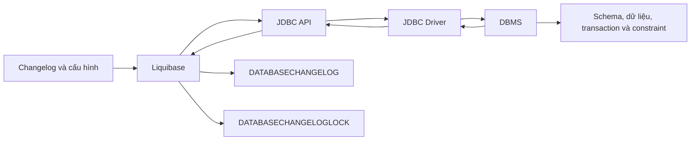

# Ranh giới trách nhiệm giữa Liquibase, JDBC và hệ quản trị

Trong module `DATABASE_SCHEMA_MIGRATION_LIQUIBASE`, mục tiêu là quản lý thay đổi schema và dữ liệu có kiểm soát: mô tả thay đổi bằng changelog, theo dõi changeset đã triển khai, kiểm tra điều kiện trước khi chạy, xử lý checksum và phối hợp triển khai qua nhiều môi trường. Để thiết kế migration an toàn, cần hiểu rõ ba thành phần tham gia vào một lần cập nhật: **Liquibase điều phối migration**, **JDBC cung cấp đường giao tiếp từ Java**, còn **hệ quản trị cơ sở dữ liệu (DBMS) thực sự thực thi SQL và quản lý dữ liệu**.

Ba thành phần phối hợp chặt chẽ nhưng không thay thế trách nhiệm của nhau. Liquibase không phải là database engine; JDBC không phải là bộ chuyển đổi SQL giữa mọi hệ quản trị; và DBMS không tự hiểu ý nghĩa nghiệp vụ của một changeset trong changelog.

## 1. Bức tranh tổng thể

Có thể hình dung luồng thông thường như sau:

- Liquibase đọc changelog, xác định changeset nào cần chạy và chọn cách biểu diễn thay đổi phù hợp với DBMS đích.
- Liquibase dùng JDBC để lấy kết nối, đọc metadata, gửi câu lệnh và nhận kết quả.
- JDBC driver chuyển các lời gọi JDBC thành giao tiếp mà DBMS hiểu, đồng thời chuyển kết quả và lỗi về cho ứng dụng.
- DBMS phân tích, kiểm tra quyền, lập kế hoạch và thực thi câu lệnh; nó quản lý transaction, khóa, constraint, index, dữ liệu và lưu trữ.
- Liquibase ghi nhận trạng thái triển khai trong các bảng lịch sử của chính database sau khi changeset được xử lý thành công theo cơ chế của lần chạy.



Trong cấu hình JDBC thông thường, Liquibase là bên điều phối và tạo yêu cầu; JDBC là kênh kết nối; DBMS là nơi quyết định câu lệnh có hợp lệ và có thể thực thi hay không. Một lỗi ở bước nào cũng có thể làm lần migration thất bại, nhưng cách chẩn đoán và khắc phục phụ thuộc vào lớp phát sinh lỗi.

## 2. Liquibase chịu trách nhiệm về vòng đời migration

Liquibase quản lý **ý định thay đổi và lịch sử triển khai**. Đầu vào của nó là changelog cùng cấu hình chạy; đầu ra là những câu lệnh hoặc thao tác cần gửi tới database và bản ghi thể hiện changeset đã được xử lý.

### 2.1. Đọc và lập kế hoạch từ changelog

Changelog mô tả thay đổi bằng các changeset. Mỗi changeset thường được nhận diện bằng tổ hợp `id`, `author` và định danh file changelog. Liquibase đọc các cấu trúc như `include`, `includeAll`, `context`, `label`, `dbms`, `preConditions` và `runInTransaction` để xác định nội dung áp dụng cho lần chạy hiện tại.

Liquibase so sánh changeset trong changelog với lịch sử trong bảng `DATABASECHANGELOG`. Từ đó, nó quyết định changeset nào chưa chạy, changeset nào cần chạy lại theo cấu hình như `runOnChange` hoặc `runAlways`, và changeset nào có vấn đề về checksum. Việc chọn changeset là quyết định ở lớp Liquibase; DBMS không tự đọc changelog để đưa ra quyết định này.

### 2.2. Chuyển mô tả thay đổi thành câu lệnh phù hợp

Với các change type có cấu trúc như `createTable`, `addColumn`, `createIndex` hoặc `addForeignKeyConstraint`, Liquibase dùng thông tin về DBMS và khả năng của nó để tạo SQL tương ứng. Ví dụ, cùng một ý định thêm cột có thể cần cách viết SQL khác nhau tùy hệ quản trị và phiên bản.

Liquibase có lớp trừu tượng cho từng hệ quản trị và các bộ sinh SQL tương ứng. **Việc chọn cú pháp theo DBMS chủ yếu thuộc Liquibase**, không phải JDBC driver tự biến câu lệnh Oracle thành cú pháp PostgreSQL. Nếu changeset chứa SQL viết tay, người viết phải chịu trách nhiệm về tính tương thích của SQL đó. Có thể giới hạn changeset bằng thuộc tính `dbms`, hoặc tổ chức changelog riêng khi các hệ quản trị cần cách triển khai khác nhau.

### 2.3. Kiểm tra điều kiện và tính toàn vẹn của changelog

Liquibase có thể đánh giá precondition trước khi chạy changeset, chẳng hạn kiểm tra bảng, cột, schema, DBMS hoặc một truy vấn điều kiện. Kết quả được xử lý theo chính sách như `HALT`, `WARN`, `CONTINUE` hoặc `MARK_RAN`. Đây là quy tắc điều phối migration; precondition không thay thế constraint và kiểm tra toàn vẹn do DBMS thực thi.

Checksum giúp Liquibase phát hiện định nghĩa changeset đã thay đổi so với nội dung được ghi nhận trong lịch sử triển khai. Checksum phản ánh định nghĩa migration theo cơ chế của Liquibase; nó **không phải** bản checksum của toàn bộ schema hoặc dữ liệu hiện tại. Vì vậy, checksum hợp lệ không chứng minh database không bị chỉnh sửa thủ công hay không bị schema drift.

### 2.4. Theo dõi lịch sử và khóa triển khai

Liquibase sử dụng hai bảng quản lý thường gặp:

- `DATABASECHANGELOG` lưu thông tin các changeset đã được xử lý, gồm định danh changeset, file nguồn, checksum, thời điểm và kiểu thực thi.
- `DATABASECHANGELOGLOCK` điều phối quyền chạy cập nhật changelog, tránh hai tiến trình Liquibase cùng áp dụng migration đồng thời trên cùng phạm vi lịch sử.

Các bảng này nằm trong database đích và được Liquibase truy cập qua kết nối. Khóa Liquibase bảo vệ quy trình cập nhật changelog; nó không khóa mọi truy vấn của ứng dụng, không ngăn DBA chạy DDL thủ công và không thay thế cơ chế khóa giao dịch của DBMS.

Liquibase cũng cung cấp các thao tác như `update`, `rollback`, `updateSQL` và `status`. `updateSQL` tạo bản xem trước SQL để kiểm tra hoặc đưa vào quy trình triển khai; bản thân việc tạo bản xem trước không đồng nghĩa database đã được cập nhật. Còn rollback của Liquibase là việc thực thi các thao tác hoàn nguyên được định nghĩa hoặc được hỗ trợ sinh ra, không đơn giản là gọi JDBC `rollback()` cho mọi thay đổi đã triển khai.

## 3. JDBC chịu trách nhiệm về giao tiếp từ Java

JDBC (Java Database Connectivity) là API Java chuẩn để chương trình làm việc với database. Liquibase thường dùng JDBC để lấy kết nối, gửi SQL, đọc kết quả và truy vấn metadata. JDBC không quản lý ý nghĩa của changelog và cũng không quyết định thứ tự nghiệp vụ của migration.

### 3.1. JDBC API và JDBC driver

Cần phân biệt hai phần:

- **JDBC API** định nghĩa các giao diện và cách gọi như `Connection`, `Statement`, `PreparedStatement`, `ResultSet` và `DatabaseMetaData`.
- **JDBC driver** là phần triển khai dành cho một DBMS hoặc họ DBMS cụ thể. Driver thực hiện giao tiếp mạng hoặc giao thức tương ứng, chuyển kiểu dữ liệu và kết quả, đồng thời ánh xạ lỗi của hệ quản trị thành các ngoại lệ JDBC như `SQLException`.

Liquibase gọi JDBC API. Driver được nạp và sử dụng để kết nối đến database đích. Nếu URL, driver class, thông tin xác thực, TLS, DNS hoặc mạng có vấn đề, Liquibase có thể không thiết lập được kết nối dù changelog hoàn toàn hợp lệ.

### 3.2. Những gì JDBC cung cấp cho Liquibase

Thông qua JDBC, Liquibase có thể:

- Mở và đóng kết nối đến database.
- Gửi câu lệnh SQL và nhận số dòng bị tác động hoặc tập kết quả.
- Truy vấn metadata về catalog, schema, bảng, cột, khóa và kiểu dữ liệu.
- Điều khiển một số thuộc tính của kết nối và transaction, ví dụ chế độ auto-commit, commit và rollback khi phù hợp.
- Nhận thông tin lỗi qua `SQLException`, SQLState và mã lỗi riêng của nhà cung cấp.

JDBC không biết `changeSet` nào đã chạy, không tính checksum changeset, không đánh giá context/label, không quyết định precondition và không ghi nhận lịch sử migration thay cho Liquibase. Một ứng dụng Java dùng JDBC trực tiếp có thể chạy DDL, nhưng nếu không có lớp quản lý riêng thì bản thân JDBC không cung cấp vòng đời migration như Liquibase.

### 3.3. JDBC driver không phải bộ dịch SQL đa hệ quản trị

Driver chuyển lời gọi JDBC thành giao tiếp phù hợp với database mà driver hỗ trợ. Nó không bảo đảm rằng một câu SQL cụ thể sẽ chạy được trên mọi DBMS. Ví dụ, câu lệnh chứa cú pháp đặc thù PostgreSQL vẫn có thể bị Oracle từ chối khi gửi qua Oracle JDBC driver. Driver không có trách nhiệm suy luận ý định `addColumn` trong changelog để viết lại câu lệnh theo một hệ quản trị khác.

Do đó, tính di động của migration đến từ việc dùng change type phù hợp và khả năng sinh SQL của Liquibase, hoặc từ việc tác giả chủ động cung cấp SQL riêng cho từng DBMS. JDBC cung cấp phương tiện gửi câu lệnh đã được lựa chọn.

## 4. DBMS chịu trách nhiệm thực thi và bảo vệ dữ liệu

DBMS là hệ thống thực sự quản lý database. Sau khi nhận câu lệnh, DBMS phân tích cú pháp, kiểm tra quyền, xác định đối tượng, tối ưu hoặc lập kế hoạch thực thi, rồi áp dụng thay đổi lên schema hay dữ liệu.

Các trách nhiệm thuộc DBMS gồm:

- Kiểm tra cú pháp SQL và khả năng hỗ trợ tính năng theo phiên bản.
- Kiểm tra quyền của tài khoản kết nối đối với database, schema, bảng và các đối tượng liên quan.
- Thực thi DDL và DML, cập nhật catalog, dữ liệu, index và các đối tượng phụ thuộc.
- Áp dụng constraint, trigger, rule, kiểu dữ liệu và các quy tắc toàn vẹn.
- Quản lý transaction, isolation, lock, deadlock, concurrency và phục hồi.
- Quyết định hành vi cụ thể của DDL, bao gồm việc DDL có tham gia transaction hay có gây implicit commit hay không.
- Lưu trữ dữ liệu và cung cấp kết quả hoặc lỗi cho client.

Liquibase có thể yêu cầu tạo foreign key, nhưng DBMS mới kiểm tra các hàng hiện tại có vi phạm foreign key hay không và thực thi constraint về sau. Liquibase có thể yêu cầu thêm cột, nhưng DBMS quyết định câu lệnh có hợp lệ, có đủ quyền, có bị chặn bởi lock và có thể hoàn tất trong điều kiện tài nguyên hiện tại hay không.

Một migration được viết đúng theo cú pháp Liquibase vẫn có thể thất bại vì database không đủ quyền, schema đích không tồn tại, dữ liệu hiện có vi phạm constraint, phiên bản DBMS không hỗ trợ tính năng hoặc một giao dịch khác đang giữ lock.

## 5. Một changeset đi qua ba lớp như thế nào?

Giả sử cần thêm cột `status` vào bảng `orders`. Changelog có thể mô tả ý định bằng change type thay vì viết SQL riêng cho một hệ quản trị:

```yaml
databaseChangeLog:
  - changeSet:
      id: 2026-11-19-add-order-status
      author: platform-team
      preConditions:
        - onFail: HALT
        - not:
            - columnExists:
                tableName: orders
                columnName: status
      changes:
        - addColumn:
            tableName: orders
            columns:
              - column:
                  name: status
                  type: varchar(20)
      rollback:
        - dropColumn:
            tableName: orders
            columnName: status
```

Khi chạy `liquibase update`, luồng trách nhiệm diễn ra như sau:

1. **Liquibase đọc changelog.** Nó nhận diện changeset bằng `id`, `author` và file, áp dụng các bộ lọc cấu hình, rồi đối chiếu lịch sử trong `DATABASECHANGELOG`.
2. **Liquibase kiểm tra precondition.** Nó cần biết cột `status` đã tồn tại hay chưa. Để lấy trạng thái database, Liquibase gửi truy vấn metadata hoặc truy vấn cần thiết qua kết nối JDBC.
3. **JDBC chuyển yêu cầu.** Liquibase gọi JDBC API; driver cụ thể chuyển yêu cầu đến DBMS và đưa kết quả trở lại.
4. **DBMS trả metadata.** DBMS cung cấp thông tin về bảng/cột theo catalog và schema mà kết nối đang nhìn thấy. Liquibase diễn giải kết quả để quyết định có tiếp tục hay dừng theo `onFail`.
5. **Liquibase tạo câu lệnh phù hợp.** Với change type `addColumn`, Liquibase chọn cách sinh SQL dựa trên DBMS đã nhận diện.
6. **JDBC gửi SQL.** Driver chuyển câu lệnh tới DBMS. JDBC không tự quyết định thêm cột và cũng không đảm bảo câu lệnh thành công.
7. **DBMS thực thi.** DBMS kiểm tra quyền, khóa, tính hợp lệ và các ràng buộc liên quan; sau đó cập nhật schema hoặc trả lỗi.
8. **Liquibase cập nhật lịch sử.** Khi changeset được xử lý thành công theo luồng thực thi, Liquibase ghi nhận changeset trong `DATABASECHANGELOG`. Nếu có lỗi, Liquibase báo lỗi và việc còn lại trong database phụ thuộc vào transaction, hành vi DDL và trạng thái thực tế của DBMS.

Ví dụ này cho thấy một thao tác nhỏ cũng đi qua cả ba lớp: Liquibase quyết định *cần làm gì và có được chạy không*; JDBC cung cấp *cách gửi và nhận yêu cầu*; DBMS quyết định *có thể thực thi thế nào và kết quả thực tế là gì*.

## 6. Transaction và rollback: không được đánh đồng hai khái niệm

Có hai cơ chế hoàn nguyên khác nhau thường bị nhầm lẫn.

### 6.1. JDBC rollback là hoàn tác transaction hiện tại

JDBC cung cấp các thao tác transaction trên `Connection`, chẳng hạn `commit()` và `rollback()`. Khi một transaction còn mở và DBMS hỗ trợ hoàn tác các thao tác đã thực hiện trong transaction đó, lời gọi rollback yêu cầu DBMS hủy các thay đổi chưa commit.

Tuy nhiên, khả năng này phụ thuộc vào DBMS và loại câu lệnh. Một số hệ quản trị có DDL transactional; một số hệ quản trị hoặc một số lệnh DDL có implicit commit hay không thể chạy trong transaction. Driver chuyển lời gọi JDBC, còn DBMS quyết định ngữ nghĩa thực tế của transaction.

### 6.2. Liquibase rollback là migration bù

Liquibase rollback chạy những thay đổi được định nghĩa trong khối `rollback` hoặc những thao tác hoàn nguyên mà Liquibase hỗ trợ sinh ra. Đây là một migration theo chiều ngược, thường được thực thi trong một lần chạy mới. Nó không thể khôi phục dữ liệu đã mất nếu định nghĩa rollback không có cách tái tạo dữ liệu đó.

Ví dụ, rollback của việc thêm cột có thể xóa cột. Nếu cột đã được ứng dụng ghi dữ liệu sau khi triển khai, thao tác xóa cột sẽ làm mất dữ liệu đó. Với thao tác xóa bảng, xóa cột hoặc biến đổi dữ liệu, cần thiết kế rollback có chủ đích và hiểu rõ tổn thất dữ liệu có thể xảy ra.

### 6.3. Vai trò của `runInTransaction`

Liquibase mặc định cố gắng thực thi changeset trong transaction khi cấu hình và DBMS cho phép. Thuộc tính `runInTransaction` điều khiển cách Liquibase xử lý transaction ở cấp changeset. Đặt `runInTransaction: false` chỉ nên dùng khi câu lệnh yêu cầu chạy ngoài transaction hoặc DBMS có giới hạn tương ứng.

Khi một changeset gồm nhiều câu lệnh nhưng không thể chạy nguyên tử, lỗi giữa chừng có thể để lại một phần thay đổi trong database. Trong tình huống đó, lịch sử changeset có thể chưa được ghi nhận như một lần hoàn tất, trong khi một số đối tượng đã thay đổi. Chạy lại một cách máy móc có thể gặp lỗi kiểu “đối tượng đã tồn tại”. Cần kiểm tra trạng thái thực tế, xác định phần nào đã được áp dụng và chuẩn bị cách phục hồi rõ ràng.

Vì vậy, hãy chia migration thành các changeset nhỏ có mục đích rõ ràng; tránh gom nhiều thay đổi khó hoàn nguyên vào một changeset; và kiểm thử trên đúng loại DBMS, phiên bản cùng cấu hình transaction dự kiến triển khai.

## 7. Giới hạn và cách phối hợp giữa ba lớp

| Công việc | Lớp chịu trách nhiệm chính | Giới hạn cần nhớ |
|---|---|---|
| Đọc changelog, chọn changeset theo context/label/dbms | Liquibase | DBMS không tự diễn giải các bộ lọc này |
| Tính và đối chiếu checksum changeset | Liquibase | Không chứng minh schema hiện tại không bị drift |
| Sinh SQL từ change type | Liquibase | SQL viết tay vẫn do tác giả bảo đảm tương thích |
| Mở kết nối, gửi câu lệnh, đọc kết quả | JDBC API và driver | Không quản lý lịch sử changeset |
| Chuyển giao thức và kiểu dữ liệu | JDBC driver | Không phải bộ dịch SQL phổ quát |
| Kiểm tra quyền, cú pháp, constraint và thực thi DDL/DML | DBMS | Không tự biết thứ tự migration mong muốn |
| Quản lý lock và transaction ở database | DBMS, được Liquibase/JDBC điều khiển | Lock Liquibase khác lock của transaction |
| Ghi nhận changeset đã triển khai | Liquibase qua JDBC trong DBMS | Bản ghi lịch sử không thay thế kiểm tra schema thực tế |
| Hoàn nguyên thay đổi đã triển khai | Liquibase rollback và/hoặc thao tác phục hồi DBMS | JDBC rollback không thay thế rollback migration |

Ba lớp cần được cấu hình đồng bộ. Liquibase phải kết nối đúng database và schema; driver phải tương thích với DBMS; tài khoản kết nối phải có quyền đọc metadata, tạo hoặc sửa đối tượng và cập nhật các bảng lịch sử Liquibase. Khi triển khai nhiều môi trường, cùng changelog có thể sinh SQL hoặc hành vi khác nhau tùy DBMS và phiên bản. Không nên suy luận rằng một lần chạy thành công trên môi trường phát triển bảo đảm lần chạy trên môi trường khác cũng thành công.

Precondition cũng không phải cơ chế khóa trạng thái. Ví dụ, Liquibase kiểm tra cột chưa tồn tại rồi chuẩn bị thêm cột; một tiến trình bên ngoài có thể thay đổi schema giữa thời điểm kiểm tra và thời điểm thực thi. DBMS vẫn là lớp quyết định kết quả cuối cùng. Cần hạn chế thay đổi schema ngoài quy trình migration và phối hợp lịch triển khai để giảm race condition.

## 8. Chẩn đoán lỗi theo lớp phát sinh

Khi migration thất bại, hãy xác định lớp nào phát sinh lỗi trước khi sửa changelog:

| Dấu hiệu | Lớp cần kiểm tra | Hướng xử lý |
|---|---|---|
| Không kết nối được, timeout, lỗi xác thực hoặc TLS | JDBC driver và cấu hình kết nối | Kiểm tra JDBC URL, driver/version, hostname, cổng, chứng thư, tài khoản và quyền kết nối |
| Không tìm thấy bảng/cột khi đánh giá precondition | Liquibase, cấu hình schema/catalog và metadata DBMS | Kiểm tra schema mặc định, tên đối tượng, quyền đọc metadata và kết quả truy vấn |
| SQL syntax error hoặc tính năng không hỗ trợ | SQL do Liquibase sinh ra hoặc SQL viết tay; khả năng của DBMS | Xem SQL thực tế, DBMS/version đích, change type và nhánh SQL theo DBMS |
| Permission denied, constraint violation, deadlock hoặc lock timeout | DBMS | Kiểm tra quyền, dữ liệu hiện có, constraint, transaction đang chạy và lock |
| Checksum mismatch | Lịch sử Liquibase và changelog | Đối chiếu changeset đã triển khai với lịch sử; nếu thay đổi là có chủ đích, tạo changeset mới hoặc xử lý theo quy trình checksum của nhóm |
| Liquibase báo đang có lock | `DATABASECHANGELOGLOCK` và tiến trình triển khai | Xác minh còn tiến trình Liquibase đang chạy hay không trước khi xử lý lock bị kẹt |

Một quy trình chẩn đoán hữu ích là xem log Liquibase để biết changeset và bước bị lỗi; xem SQL mà Liquibase chuẩn bị gửi; xem ngoại lệ JDBC cùng SQLState/mã lỗi nhà cung cấp; rồi kiểm tra trạng thái schema, transaction và lock trực tiếp trên DBMS. Không nên xóa dòng trong `DATABASECHANGELOG`, sửa checksum hoặc giải phóng lock một cách tùy tiện chỉ để lần chạy tiếp theo đi qua. Những thao tác đó có thể làm mất dấu lịch sử và khiến Liquibase đưa ra quyết định sai ở lần triển khai sau.

## 9. Nguyên tắc thiết kế migration dựa trên ranh giới trách nhiệm

1. **Mô tả ý định bằng change type khi phù hợp.** Các change type giúp Liquibase sinh SQL theo DBMS. Dùng SQL viết tay khi cần thiết, nhưng xác định rõ DBMS hỗ trợ và kiểm thử trên đúng phiên bản.
2. **Để DBMS bảo vệ tính toàn vẹn.** Dùng primary key, foreign key, unique, not-null và các constraint phù hợp. Precondition hỗ trợ điều phối nhưng không thay thế constraint.
3. **Giữ changeset nhỏ và có thể xem xét.** Mỗi changeset nên có mục tiêu cụ thể, thứ tự rõ ràng và rollback phù hợp với khả năng khôi phục dữ liệu.
4. **Không sửa tùy tiện changeset đã triển khai.** Khi cần thay đổi schema, ưu tiên thêm changeset mới. Chỉ dùng `runOnChange` cho trường hợp có chủ đích và hiểu rõ tác động checksum.
5. **Kiểm tra SQL và quyền trên môi trường tương đương.** Dùng bản xem trước SQL, log, driver tương thích và tài khoản có quyền đúng mức; thử nghiệm trên phiên bản DBMS gần với môi trường đích.
6. **Phối hợp một đầu mối triển khai.** Dùng lock của Liquibase để điều phối các tiến trình cập nhật changelog; tránh để nhiều pipeline hoặc thao tác thủ công cùng thay đổi schema.
7. **Lập kế hoạch cho dữ liệu và ứng dụng.** Một migration có thể làm thay đổi hợp đồng schema mà ứng dụng đang sử dụng. Với thay đổi lớn, triển khai theo các bước tương thích ngược: mở rộng schema, cập nhật ứng dụng và dữ liệu, sau đó mới loại bỏ cấu trúc cũ.
8. **Xác minh trạng thái sau triển khai.** Đối chiếu lịch sử Liquibase với schema thực tế, kiểm tra constraint/index và thực hiện kiểm thử ứng dụng. Một dòng trong `DATABASECHANGELOG` cho biết Liquibase đã ghi nhận changeset; nó không tự chứng minh mọi yêu cầu vận hành và nghiệp vụ đều đạt.

Hiểu đúng ranh giới giữa Liquibase, JDBC và DBMS giúp xác định nơi cần sửa khi migration thất bại, thiết kế rollback phù hợp và tránh kỳ vọng sai về tính di động hay tính nguyên tử của DDL. Liquibase quản lý vòng đời thay đổi; JDBC vận chuyển lời gọi và kết quả; DBMS thực thi và bảo vệ trạng thái dữ liệu thực tế.

